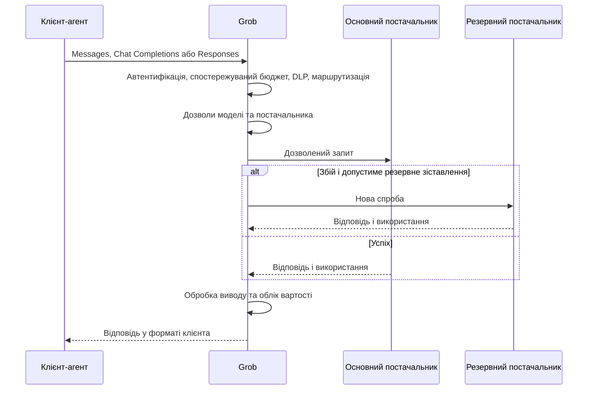

# Grob: LLM-проксі на Rust, фільтрування даних і бюджети

Оцінка від 9 жовтня 2026 року. **Оцінка доречності для посібника: 3/5**, збережена після перевірки агентом technical-writer. Рішення: зберегти технічне посилання і протокол пілотного запуску. Виявлені прогалини не дають змоги рекомендувати цю версію як захист у продакшені для чутливих даних.

## Що дає Grob

[Grob](https://github.com/azerozero/grob) перехоплює виклики між клієнтом і його постачальниками моделей. Він надає Messages, Chat Completions і Responses із внутрішнім форматом, близьким до Messages. Він поєднує правила маршрутизації, резервне перемикання між постачальниками, DLP-фільтрування, віртуальні ключі, облік витрат, політики схвалення та журнали аудиту. Бінарний файл на Rust і зберігання у файлах дають змогу обійтися без окремого сервера бази даних.

Огляд стосується [дерева вихідного коду від 5 жовтня](https://github.com/azerozero/grob/tree/1b9e00c36cc31ff627a07beec5b67545a81b4758), у якому `Cargo.toml` вказує 0.36.120. [Останній опублікований дистрибутив](https://github.com/azerozero/grob/releases/tag/v0.36.120) має той самий номер, з публікацією 27 вересня. Тести стосуються клонованого коду, а не бінарного файлу цього дистрибутива. GitHub API, переглянутий 9 жовтня, показує 21 зірку, жодного форку і три відкриті issues. Ці лічильники описують публічне поширення, а не надійність.

Grob збирає ці засоби контролю в локальному демоні, який можна дослідити. Його семантичні тести, задокументовані обмеження та захист облікових даних виправдовують його вивчення. Утім, його поверхня лишається великою порівняно з доказами, зібраними тут.

## Як це працює, за кодом

[Dispatch](https://github.com/azerozero/grob/blob/1b9e00c36cc31ff627a07beec5b67545a81b4758/src/server/dispatch/mod.rs) виконує попередню DLP-перевірку, обчислює ключ кешу, класифікує запит, визначає дозволені зіставлення, а потім використовує кеш, послідовне резервне перемикання або fan-out. [Попередня перевірка](https://github.com/azerozero/grob/blob/1b9e00c36cc31ff627a07beec5b67545a81b4758/src/server/dispatch/preflight.rs#L16-L22) вимикає сире копіювання Responses, коли DLP-дія змінює запит, щоб не передавати оригінальні байти після фільтрування.



Ця схема описує послідовний шлях. Винятки fan-out наведено в F3.

[Маршрутизатор](https://github.com/azerozero/grob/blob/1b9e00c36cc31ff627a07beec5b67545a81b4758/src/routing/classify/mod.rs#L298-L452) застосовує явний порядок: вебінструмент, назва фонової моделі, автоматичне зіставлення, тег субагента, regex промпту, `thinking.type == "enabled"`, декларативні рівні, евристична оцінка. [Оцінка](https://github.com/azerozero/grob/blob/1b9e00c36cc31ff627a07beec5b67545a81b4758/src/routing/classify/classify.rs#L458-L480) підсумовує розмір контексту, наявність інструментів, ліміт виводу, ключові слова та системний промпт. Вона не встановлює, яка модель найкраще впорається із завданням.

Для Claude Code `ANTHROPIC_BASE_URL` є інтерфейсом, задокументованим [Anthropic](https://code.claude.com/docs/en/model-config). [Запускач Grob](https://github.com/azerozero/grob/blob/1b9e00c36cc31ff627a07beec5b67545a81b4758/src/commands/exec.rs#L73-L85) задає URL клієнтів, не налаштовуючи їхні заголовки автентифікації. Гілка міркування розпізнає лише `enabled`, тоді як новіші моделі Claude використовують адаптивне міркування: не ототожнюйте цю гілку з будь-яким використанням Plan Mode.

## Висновки, що змінюють рішення

### F1. Секрет у результаті інструмента уникає маскування

**Підтверджено цільовим запуском.** [Санітайзер запитів](https://github.com/azerozero/grob/blob/1b9e00c36cc31ff627a07beec5b67545a81b4758/src/features/dlp/mod.rs#L329-L387) обходить системний промпт, текстові повідомлення та блоки `Text`. Він не маскує текст у `ToolResult` і JSON-аргументи `ToolUse`. Окреме виявлення ін'єкцій перевіряє результати інструментів, але не застосовує до них маскування секретів.

Probe відтворює випадок із фіктивним токеном і власним правилом: токен зникає з контрольного текстового повідомлення, але лишається недоторканим у `tool_result`, без DLP-звіту. В агенті для розробки прочитаний файл чи вивід команди часто надходить саме в цьому форматі. Цей тест стосується санітайзера, якого викликає попередня перевірка, а не витоку до справжнього постачальника.

### F2. Блокування ін'єкцій у виводі залежить від режиму відповіді

**Підтверджено цільовим запуском.** З `response_action = "block"` явна перевірка ін'єкцій відхиляє фіктивний текст. Проте [санітайзер виводу](https://github.com/azerozero/grob/blob/1b9e00c36cc31ff627a07beec5b67545a81b4758/src/features/dlp/mod.rs#L714-L733) трактує `IndirectInjectionResult::Blocked` як відсутність дії і повертає цей текст недоторканим, без звіту. [Обробка без стримінгу](https://github.com/azerozero/grob/blob/1b9e00c36cc31ff627a07beec5b67545a81b4758/src/server/helpers.rs#L341-L357) використовує цей санітайзер. Стримінг використовує окрему блокувальну перевірку.

Probe встановлює поведінку відповідних функцій. Доставку заблокованого тексту через HTTP в цій сесії не відтворено.

### F3. Fan-out відкриває шляхи без усіх звичайних перевірок

**Підтверджено читанням коду, через HTTP не відтворено.** Послідовний шлях без стримінгу викликає [авторизацію повернутих інструментів](https://github.com/azerozero/grob/blob/1b9e00c36cc31ff627a07beec5b67545a81b4758/src/server/dispatch/retry.rs#L491-L505). [Успішний fan-out](https://github.com/azerozero/grob/blob/1b9e00c36cc31ff627a07beec5b67545a81b4758/src/server/dispatch/mod.rs#L834-L883) фільтрує і реєструє відповідь, а потім повертає її без цього виклику HIT. Не слід вважати, що політика схвалення людиною діє на цьому шляху.

[Суддя якості](https://github.com/azerozero/grob/blob/1b9e00c36cc31ff627a07beec5b67545a81b4758/src/server/fan_out.rs#L159-L176) напряму обирає постачальника і викликає `send_message` поза звичайним dispatch. Відповіді-кандидати потрапляють у його промпт до фінального фільтрування. Обмеження постачальників, бюджети й політики основного запиту не поширюються на цей виклик автоматично. [Документація fan-out](https://github.com/azerozero/grob/blob/1b9e00c36cc31ff627a07beec5b67545a81b4758/docs/reference/fan-out.md#L124-L136) визнає цю останню розбіжність.

### F4. Бюджети й витрати не є точною фінансовою стелею

**Підтверджено читанням коду та задокументовано.** [Перевірка бюджету](https://github.com/azerozero/grob/blob/1b9e00c36cc31ff627a07beec5b67545a81b4758/src/server/budget.rs#L149-L201) порівнює вже зафіксовані витрати без резервування майбутньої вартості. Одночасно прийняті запити чи відповідь, що ще триває, можуть перевищити поріг. Ідентифіковані запити використовують лічильники tenant, а не сукупну грошову стелю для всіх tenant.

Fan-out застосовує використання переможця до повернутих учасників і пропускає виклик судді. Локальне скасування не доводить припинення тарифікації на боці постачальника. З'єднання OAuth в обліку оцінюються в нуль: ця цифра не вимірює ні ціну підписки, ні залишок її квоти. Економія та звірка з рахунком лишаються **неперевіреними**.

### F5. Назва пресету не доводить ні активного фільтрування, ні резидентності

**Підтверджено конфігурацією та кодом.** [Пресет `gdpr`](https://github.com/azerozero/grob/blob/1b9e00c36cc31ff627a07beec5b67545a81b4758/presets/gdpr.toml) налаштовує регіональну маршрутизацію без розділу, що вмикає DLP. [Типове значення DLP](https://github.com/azerozero/grob/blob/1b9e00c36cc31ff627a07beec5b67545a81b4758/src/features/dlp/config.rs#L5-L12) вимкнене. Регіональний фільтр також приймає `global`, зокрема коли регіон не вказано, як показує [resolver](https://github.com/azerozero/grob/blob/1b9e00c36cc31ff627a07beec5b67545a81b4758/src/server/helpers.rs#L218-L231).

Регіони — це мітки конфігурації. Вони не перевіряють місце обробки в постачальника. [Матриця функцій](https://github.com/azerozero/grob/blob/1b9e00c36cc31ff627a07beec5b67545a81b4758/docs/reference/features.md) відрізняє ці засоби контролю від сертифікації чи організаційної відповідності. Тлумачення «застосування пресету робить систему відповідною вимогам» **спростовано**.

## Сильні сторони та обмеження сумісності

Кеш, що виконується в dispatch, точний. Його ключ містить tenant, дозволи, епоху конфігурації, запит і його розширення. Допоміжні функції SimHash цим шляхом не використовуються: самої їх наявності недостатньо, щоб робити висновок про витік кешу між tenant. Кеш відповідей обходить стримінг; економію на стримінговій сесії Claude Code тут не вимірювали.

Захист облікових даних конкретний: зашифроване зберігання, область tenant/сервіс, контроль генерації, дозволені адресати й обмеження транспорту. Його наявність не захищає всі сліди. [Обробник Responses](https://github.com/azerozero/grob/blob/1b9e00c36cc31ff627a07beec5b67545a81b4758/src/server/handlers.rs#L756-L764) може в режимі debug журналювати сире вхідне тіло до фільтрування. Охорона ключів шифрування та строк зберігання слідів лишаються відповідальністю розгортання.

[Тест відповідності](https://github.com/azerozero/grob/blob/1b9e00c36cc31ff627a07beec5b67545a81b4758/tests/integration/conformance_test.rs) перевіряє байти, отримані імітованими постачальниками: аргументи інструментів, порядок повідомлень, зображення, системний промпт, кеш Anthropic і структуровані помилки. [Опублікована матриця](https://github.com/azerozero/grob/blob/1b9e00c36cc31ff627a07beec5b67545a81b4758/docs/reference/conformance.md) лишає непротестовані клітинки й виключає Gemini з цієї перевірки. Слово «certified» там позначає твердження проєкту, а не зовнішню кваліфікацію. Його заяву про перевірку кожного твердження мутаційним тестуванням незалежно не перевірено.

Адаптер Responses [відхиляє `previous_response_id`](https://github.com/azerozero/grob/blob/1b9e00c36cc31ff627a07beec5b67545a81b4758/src/server/responses_compat/transform.rs#L174-L179) і вимагає повну історію. Його перетворення пропускає немодельовані елементи та вхідне міркування. Збережена сира копія може зберегти ці дані для стримінгового бекенда OpenAI; DLP-перетворення вимикає цю копію. Сумісність з Codex треба уточнювати за маршрутом, режимом і ввімкненими функціями.

[Бенчмарки проєкту](https://github.com/azerozero/grob/blob/1b9e00c36cc31ff627a07beec5b67545a81b4758/docs/reference/benchmarks.md) повідомляють про медіанні накладні витрати 90 мкс зі стеком перевірок на ARM-інстансі з чотирма vCPU та локальним імітованим бекендом. Цей вимір не відтворено. Порівняння з іншими шлюзами змішують умови й увімкнені функції; вони не доводять наскрізної переваги.

Опис на GitHub «zero deps» не означає відсутності залежностей Rust: `Cargo.toml` їх містить. Архіви опублікованого дистрибутива мають від 8,25 до 9,45 MB у стиснутому вигляді залежно від цілі. Опис «6 MB» не відповідає цим архівам, а розмір встановленого бінарного файлу тут не вимірювали.

## Виконана перевірка та віддалений стан

| Перевірка | Результат | Обсяг |
|---|---|---|
| `cargo test --locked --test lib conformance -- --nocapture` | 1 тест пройдено | Семантична перевірка репозиторію, імітовані постачальники |
| `cargo test --locked --offline --test lib responses_e2e -- --nocapture` | 1 тест пройдено | Обміни Responses, текст і аргументи інструментів; імітований постачальник |
| Доданий probe | 2 тести пройдено | Відтворення прогалин F1 і F2 з позитивними контрольними перевірками |
| Справжній клієнт Claude Code/Codex, OAuth постачальника, навантаження і рахунок | Не перевірено | Жодного реального виклику моделі не здійснено |

Перший запуск Responses в обмеженому середовищі завершився збоєм до тверджень, бо імітований сервер не міг відкрити локальний порт. Той самий тест проходить, коли це дозволено. Цей початковий збій не є регресією Grob.

На проаналізованому коміті [обов'язкова перевірка CI](https://github.com/azerozero/grob/actions/runs/37255214371/job/111594439797) не проходить. [Журнал quality gate](https://github.com/azerozero/grob/actions/runs/37255214371/job/111590753649) називає причиною збою `no-commit-to-branch`, застосований до `main`. Тест на Ubuntu, покриття, приклади документації та CodeQL проходять; завдання публікації та E2E цього запуску пропущено. [Планований аудит від 9 жовтня](https://github.com/azerozero/grob/actions/runs/37922890042/job/113794822012) не проходить через відхилене попередження: `yoke-derive` 0.8.3 вилучено зі звичайного вибору реєстру («yanked»). Це завдання не виявляє жодної відомої вразливості у своїй базі. Нічні перевірки також не проходять, причину тут не встановлено. Отже, CI коміту не повністю зелена.

## Як відтворити дві прогалини без справжнього постачальника

[Probe на Rust](https://github.com/FlorianBruniaux/claude-code-ultimate-guide/blob/main/docs/resource-evaluations/fixtures/grob-boundary-probe.rs) використовує лише фіктивні значення та публічні функції Grob. Він стверджує спостережувану поведінку, зокрема дефекти: два зелені тести означають, що дефекти відтворено, а не виправлено.

З кореня клону Claude Code Ultimate Guide, зі встановленими Git і Rust:

```bash
git clone https://github.com/azerozero/grob.git /path/to/grob
git -C /path/to/grob checkout 1b9e00c36cc31ff627a07beec5b67545a81b4758
cp docs/resource-evaluations/fixtures/grob-boundary-probe.rs /path/to/grob/tests/grob_boundary_probe.rs
cd /path/to/grob
cargo test --locked --test grob_boundary_probe -- --nocapture
```

Доступ до мережі потрібен для клонування і, за потреби, завантаження залежностей. Probe не звертається до жодного постачальника моделей. Він не відтворює обхід HIT у fan-out, виклик судді чи одночасне перевищення бюджету.

## Рішення для посібника та допустимий пілот

Посібник уже охоплює шлюзи, бюджети й спостережуваність у [API Gateway](../../guide/ops/api-gateway.uk.md) і [AI Unit Economics](../../guide/ops/ai-unit-economics.uk.md). Grob дає локальний приклад на Rust, що поєднує ці функції з DLP, яку можна дослідити. Оцінка 3/5 стосується цієї документальної цінності; вона не оцінює його безпеку в продакшені.

Пілот маршрутизації на нечутливих даних є розумним, з ключем API, явним зіставленням і послідовним шляхом. Перш ніж використовувати його як засіб контролю безпеки, вимагайте маскування секретів у всіх блоках, корисних для агента, однакових відмов у режимі стримінгу й без нього та перевірки HIT кожної відповіді, що містить інструменти. Окремо перевірте виклики судді, обмеження постачальників і реальний облік, якщо розглядаєте fan-out.

Редакційне рішення лишається посиланням із цими обмеженнями. Аналіз не встановлює ні реальної інтеграції з Claude Code/Codex, ні кваліфікації для продакшену.
