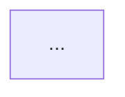
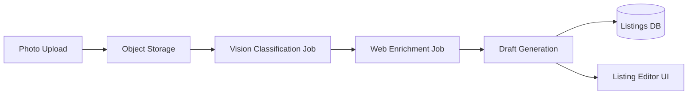
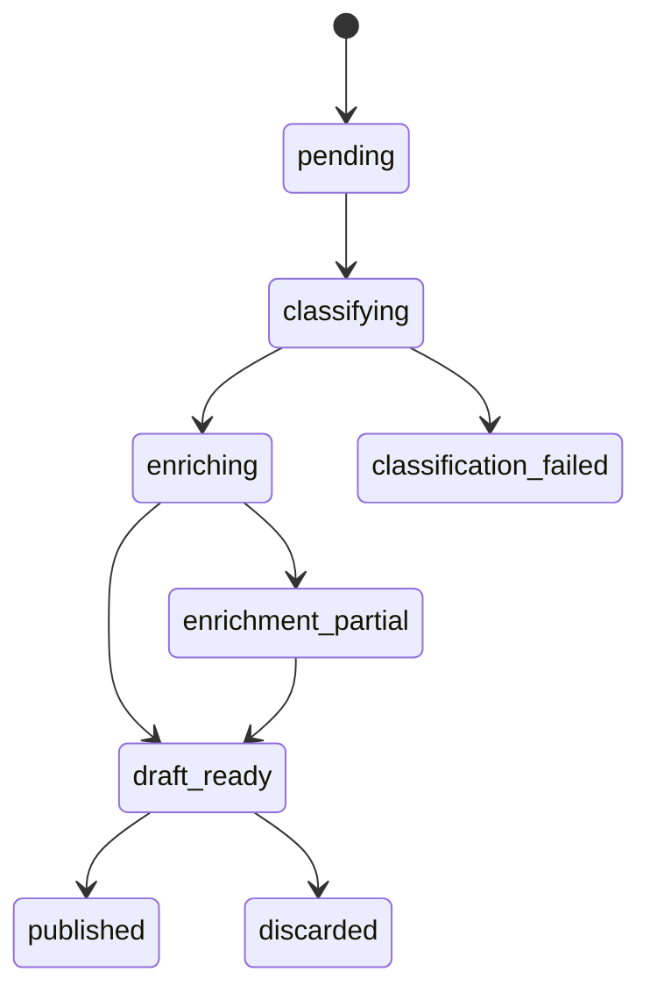

# /plan-pipeline:eng-review: Інженерний архітектурний гейт

Команда після визначення напряму й перед реалізацією. Бере перевірений продуктовий напрям і повертає придатну до реалізації технічну специфікацію з діаграмами. Змушує систему продумати архітектуру ще до того, як буде написано хоч один рядок коду реалізації.

**Використовуйте після того, як `/plan-pipeline:ceo-review` зафіксував напрям. Ви все ще в plan mode.**

---

## Яку проблему це розв'язує

Коли продуктовий напрям зафіксовано, наступний ризик — розмита архітектура. «Система це обробить» — не план. Ця команда вимагає явних відповідей на складні технічні запитання, доки вони не стали інцидентами в продакшені.

Головний ключ: **примусове створення діаграм**. Діаграми виявляють приховані припущення, які проза залишає невизначеними. Діаграма послідовності змушує вказати, хто кого викликає. Скінченний автомат змушує явно перелічити всі режими збою.

---

## Коли використовувати

- Після валідації продуктового напряму (після `/plan-pipeline:ceo-review` або еквівалента)
- Перед початком будь-якої реалізації нетривіальної функції
- Коли функція має асинхронні компоненти, зовнішні залежності або багатокрокові потоки
- Щоразу, коли «архітектура зрозуміла» потрібно довести, а не припускати

---

## Що вона має видати

| Результат | Чому це важливо |
|-----------|-----------------|
| Архітектурна діаграма (Mermaid) | Робить межі компонентів явними |
| Діаграма потоку даних | Показує, де дані трансформуються і хто чим володіє |
| Скінченний автомат для основного потоку | Змушує перелічити всі стани, включно зі збоями |
| Рішення щодо меж sync/async | Запобігає «просто зробімо це асинхронним» без обґрунтування |
| Інвентар режимів збою | Кожен шлях збою, а не лише щасливий шлях |
| Карта меж довіри | Де ви приймаєте зовнішні дані? Що валідуєте? |
| Матриця тестів | Що потрібно тестувати і на якому рівні |

---

## Шаблон prompt

```markdown
# /plan-pipeline:eng-review

Ви в режимі інженерного менеджера / тех-ліда. Напрям зафіксовано.
Ваше завдання — зробити його придатним до реалізації: перетворити
продуктовий напрям на технічну специфікацію, яку інженер зможе реалізувати,
не ухвалюючи архітектурних рішень на льоту.

НЕ ставте під сумнів продуктовий напрям. НЕ пропонуйте змін обсягу.
НЕ реалізуйте нічого. Поверніть технічну специфікацію.

## Крок 1: Переформулюйте функцію

1-2 речення: що саме будується. Підтвердіть, що ви працюєте з правильним
брифом.

## Крок 2: Архітектурна діаграма

Намалюйте архітектуру компонентів у Mermaid:
- Усі залучені компоненти (frontend, backend, jobs, сховище, зовнішні API)
- Межі між компонентами
- Напрями потоків даних



## Крок 3: Основний потік (діаграма послідовності)

Намалюйте щасливий шлях як діаграму послідовності:
- Які компоненти кого викликають і в якому порядку
- Які дані передаються на кожному кроці
- Де відбуваються асинхронні передачі

```mermaid
sequenceDiagram
    ...
```

## Крок 4: Скінченний автомат

Намалюйте скінченний автомат для основного доменного об'єкта:
- Усі допустимі стани
- Усі переходи та їхні тригери
- Термінальні стани (і успіх, і збій)


## Крок 5: Рішення sync чи async

Для кожної операції в потоці вирішіть:
- **Синхронна** (блокує запит): чому, і який бюджет затримки
- **Асинхронна** (фонове завдання): чому, що запускає повторну спробу, як
  викликач дізнається про успіх

## Крок 6: Інвентар режимів збою

Для кожного кроку потоку перелічіть:
- Що може вийти з ладу
- Як саме це ламається (тихо? гучно? часткове виконання?)
- Який шлях відновлення
- Що бачить користувач

Позначте кожен збій, який наразі відбувається непомітно.

## Крок 7: Межі довіри

Для кожного зовнішнього входу (завантаження користувача, відповіді API, payload вебхуків):
- Чому ви довіряєте? Що валідуєте?
- Де зловмисні дані можуть завдати шкоди?
- Чи потрапляють зовнішні дані в подальшу обробку (ризик prompt injection)?

## Крок 8: Матриця тестів

| Рівень | Що тестувати | Чому |
|--------|--------------|------|
| Unit | ... | ... |
| Integration | ... | ... |
| E2E | ... | ... |

Визначте будь-який режим збою з Кроку 6, для якого немає відповідного тесту.

## Крок 9: Відкриті питання

Перелічіть кожне архітектурне рішення, яке справді неясне й потребує
рішення людини до початку реалізації. Не вичерпний список, лише
блокери.
```

---

## Приклад

**Функція**: Розумне створення оголошення за фотографією (після `/plan-pipeline:ceo-review`)

**Фрагмент результату**:


Скінченний автомат:


Режими збою:
- Класифікація не вдалася -> деградація до ручного створення оголошення (не тихий збій)
- Збагачення частково не вдалося -> використати те, що вдалося, позначити відсутні поля
- Завантаження вдалося, але job класифікації так і не стартував -> осиротілий файл, потрібен job очищення
- Вебдані в генерації чернетки -> вектор prompt injection, санітизувати перед передачею в LLM

---

## Позиція в конвеєрі

```
/plan-pipeline:ceo-review    -> продуктовий напрям зафіксовано
/plan-pipeline:eng-review    -> архітектуру зафіксовано        <- ви тут
/plan-pipeline:start         -> створити план реалізації
/plan-pipeline:validate      -> перевірити перед виконанням
/plan-pipeline:execute       -> виконати до змердженого PR
```
