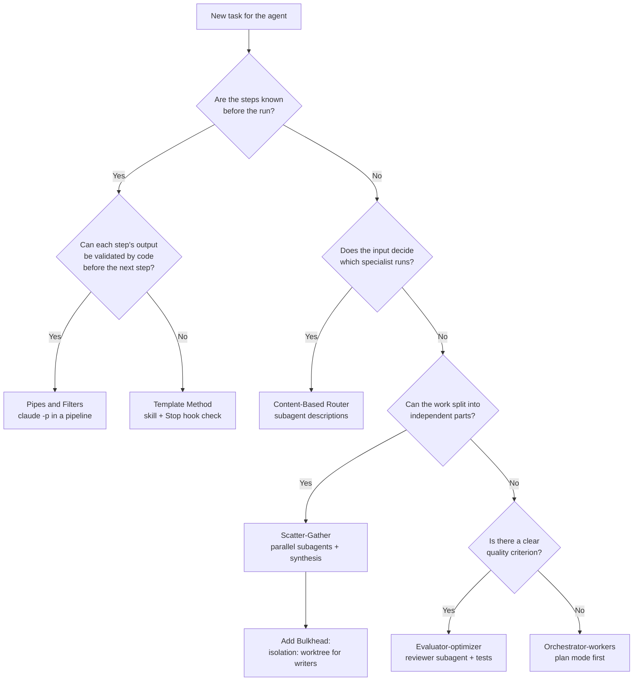

# AI design patterns для Claude Code: довідник із реалізації

Користуйтеся картками, коли реалізуєте або рев'юєте патерн в agent harness. Кожна картка називає механізм Claude Code, місце, де аналогія ламається, і перевірку, яку можна виконати. Щоб порівняти кандидатів перед вибором, почніть із [візуального підбирача патернів](https://cc.bruniaux.com/ai-design-patterns/#choose).

> **Робота в процесі:** зіставлення двох словників попереднє. Ці зіставлення — це трактування для обговорення й виправлення, і вони змінюватимуться разом із Claude Code та джерелами. Якщо якесь зіставлення у вашому випадку не працює, [відкрийте issue](https://github.com/FlorianBruniaux/claude-code-ultimate-guide/issues) із випадком, де воно ламається. Дослідження за ним також спирається на два локальні дослідницькі інструменти автора, які допомагають знаходити й цитувати джерела: [youtube-video-insights](https://github.com/FlorianBruniaux/youtube-video-insights) для транскриптів конференційних доповідей із можливістю пошуку й часовими мітками та [paper-insights](https://github.com/FlorianBruniaux/paper-insights) для локального корпусу статей із перевіреними цитатами.
>
> **Статус:** Стандартного crosswalk не існує. Опубліковані зіставлення збігаються в одних парах і розходяться в інших, а жодне з джерел, прочитаних для цієї сторінки, не зіставляє класичні патерни з механізмами Claude Code, за винятком hooks і CLAUDE.md. Кожен інший запис у колонці Claude Code — це зіставлення цього посібника, позначене `Our mapping`. Механізми перевірено за [офіційною документацією](https://code.claude.com/docs/llms-full.txt) (востаннє перевірено 2026-10-27). Сторінку востаннє оновлено 2026-10-28.
>
> **Використовуйте цю сторінку для:** пояснення дизайну агентів розробникам знайомими їм термінами та перевірки дизайну за режимами відмови, які несе кожен патерн. Про компоненти harness див. [Agent Harness Engineering](./agent-harness.uk.md). Про контракти циклів і графів див. [Loop & Graph Engineering](./loop-graph-engineering.uk.md). Про патерни всередині одного skill див. [Skill Design Patterns](./skill-design-patterns.uk.md).

Таблиці на цій сторінці генеруються з [`machine-readable/ai-design-patterns.json`](https://github.com/FlorianBruniaux/claude-code-ultimate-guide/blob/main/machine-readable/ai-design-patterns.json) скриптом `scripts/build-ai-design-patterns.py`. Редагуйте набір даних, а не таблиці.

## Зміст

1. [TL;DR](#tldr)
2. [Походження](#походження)
3. [Як читати](#як-читати)
4. [Crosswalk](#crosswalk)
5. [Картки патернів](#картки-патернів)
6. [Де аналогія ламається](#де-аналогія-ламається)
7. [Нативні агентні патерни](#нативні-агентні-патерни)
8. [Вибір патерну](#вибір-патерну)
9. [Антипатерни](#антипатерни)
10. [Класична сторона](#класична-сторона)
11. [Подальше читання](#подальше-читання)
12. [Джерела](#джерела)

---

## TL;DR

- Класичні патерни в цій таблиці досі описують агентні системи, але компонент посередині тепер є моделлю, що ухвалює рішення під час виконання. Патерну, який спирався на фіксований порядок або гарантований виклик, потрібна поруч детермінована перевірка.
- У Claude Code зіставлення з найчіткішим задокументованим механізмом такі: Observer — hooks, Memento — checkpoints, Mediator — головна розмова, що координує subagent, Bulkhead — ізоляція контексту subagent і worktree. Ліміти ходів і бюджету дають обмежене виконання, статичну половину Circuit Breaker: вони зупиняють запуск, але не виявляють збоїв. Лише Observer і Facade названо в джерелі; решта — зіставлення цього посібника.
- Два поширені припущення хибні в деталях. Hooks для однієї події виконуються паралельно, тож не утворюють ланцюжка. Checkpoints відстежують лише редагування файлів, зроблені Claude, тому rewind не скасовує shell-команд чи віддалених ефектів.
- Кожна картка класичного патерну завершується перевіркою, яку можна виконати.

## Походження

Три покоління патернів розв'язують однакову проблему в різних масштабах:

- **Об'єктні патерни** (Gamma, Helm, Johnson, Vlissides, 1994) описують, як об'єкти співпрацюють усередині однієї програми. Структуру пише розробник, навіть коли вона міняє поведінку під час виконання, як робить Strategy.
- **Інтеграційні та розподілені патерни** ([Enterprise Integration Patterns](https://www.enterpriseintegrationpatterns.com/) Hohpe і Woolf, 2003, та патерни стійкості, що з'явилися пізніше) описують, як сервіси обмінюються повідомленнями й переживають часткову відмову.
- **Агентні патерни** ([Building effective agents](https://www.anthropic.com/engineering/building-effective-agents) від Anthropic, 2024, та каталоги, що з'явилися пізніше) описують, як harness керує моделлю, що сама обирає свою наступну дію.

[Pattern Evolution](https://kage-ai.com/research/pattern-evolution/) Jia Huang подає третій крок як зсув у тому, хто обирає структуру: розробник, який її пише, чи модель, що під час роботи обирає наступний крок за неповної інформації. Саме через цей зсув кожна картка нижче має режим відмови: класична назва описує структуру, а картка вказує, яку поведінку harness більше не гарантує.

Практики роблять той самий зв'язок на сцені. Frank Coyle (UC Berkeley) згадує рух 1990-х: «Тепер у нас є патерни для агентів, але є й антипатерни» ([доповідь, 2:13](https://www.youtube.com/watch?v=Z-c11pV_uvU&t=133s)). Nishant Gupta (Meta Superintelligence Labs) прямо зіставляє з давнішим шаром: «Розподілені системи розв'язували схожу задачу десятиліттями» ([доповідь, 6:03](https://www.youtube.com/watch?v=APh1Vx0oLmQ&t=363s)). У The Pragmatic Engineer аргумент такий: агентам потрібні гардрейли корпоративних патернів: «старі патерни, схоже, повертаються» ([випуск, 44:04](https://www.youtube.com/watch?v=5wks1W-auKY&t=2644s)). Доповіді про окремі патерни наведено на кожній картці в пункті **Дивитися**.

![Огляд 29 патернів на цій сторінці у шести колонках: GoF creational (Factory Method, Singleton), GoF structural (Adapter, Composite, Decorator, Facade), GoF behavioral (Chain of Responsibility, Command, Mediator, Memento, Observer, Strategy, Template Method), Enterprise integration (Pipes and Filters, Content-Based Router, Scatter-Gather), Distributed and resilience (Bulkhead, Circuit Breaker, Saga, Sidecar, Event Sourcing) та Agent-native (Orchestrator-workers, Evaluator-optimizer, Plan-then-execute, Context isolation, Context compaction, Progressive disclosure, Deterministic gate, Goal loop).](../images/ai-design-patterns/overview-en.webp)

## Як читати

Кожен рядок crosswalk має дві мітки.

| Мітка | Значення |
|---|---|
| `Consensus` | Два чи більше різних джерел зіставляють класичний патерн з тим самим основним агентним аналогом. Картка може додати друге прочитання, що його уточнює. |
| `Single source` | Зіставлення пропонує одне джерело. Сприймайте його як пропозицію. |
| `Divergent` | Джерела зіставляють той самий класичний патерн із різними агентними аналогами. Картка перелічує кожне прочитання з його джерелом. |
| `Named by a source` | Джерело саме називає механізм Claude Code. |
| `Our mapping` | Джерела дають загальний агентний аналог; цей посібник зіставляє його з Claude Code. |

Рядок потрапляє в таблицю лише тоді, коли виконуються три умови: публічне джерело зіставляє класичний патерн з агентним аналогом, існує задокументований механізм Claude Code і можна сформулювати режим відмови. Saga — єдиний свідомий виняток: у Claude Code немає нативного механізму компенсації, і рядок документує цю прогалину.

## Crosswalk

<!-- BEGIN GENERATED: crosswalk-table -->

| Класичний патерн | Родина | Агентний аналог | У Claude Code | Докази | Зіставлення |
|---|---|---|---|---|---|
| [Factory Method](#factory-method) | GoF creational | Породження subagent за іменованим визначенням | Визначення subagent та інструмент Agent | Consensus | Our mapping |
| [Singleton](#singleton) | GoF creational | Спільний реєстр інструментів / Шарове керування пам'яттю: вирішити, який стан спільний, ізольований, збережений чи ефемерний | Ієрархія CLAUDE.md та auto memory (спільний стан, а не Singleton) | Divergent | Our mapping |
| [Adapter](#adapter) | GoF structural | Адаптер інструмента, що відкриває моделі зовнішню систему | MCP-сервери | Consensus | Our mapping |
| [Composite](#composite) | GoF structural | Агент, що делегує агентам, які можуть делегувати далі | Вкладені subagent (глибина породження) | Consensus | Our mapping |
| [Decorator](#decorator) | GoF structural | Guardrail, обгорнутий навколо виклику моделі / Middleware впровадження контексту, що збагачує кожен запит | Hooks UserPromptSubmit і PostToolUse | Divergent | Our mapping |
| [Facade](#facade) | GoF structural | Файл інструкцій проєкту як єдина точка входу для конвенцій | CLAUDE.md | Single source | Named by a source |
| [Chain of Responsibility](#chain-of-responsibility) | GoF behavioral | Конвеєр hooks чи дозволів перед викликами інструментів / Агенти, зв'язані так, що кожен обробляє те, що може, й передає решту | Правила дозволів: deny, потім ask, потім allow | Divergent | Our mapping |
| [Command](#command) | GoF behavioral | Виклик інструмента: іменована дія зі структурованими аргументами | Виклики інструментів та hooks PreToolUse | Consensus | Our mapping |
| [Mediator](#mediator) | GoF behavioral | Оркестратор, що координує виконавців, які ніколи не розмовляють між собою | Головна розмова, що координує subagent; Agent teams (експериментально, вимкнено за замовчуванням; обмін повідомленнями між рівноправними, немедіаційна альтернатива) | Consensus | Our mapping |
| [Memento](#memento) | GoF behavioral | Checkpoint і rewind стану агента | Checkpointing і /rewind | Consensus | Our mapping |
| [Observer](#observer) | GoF behavioral | Hooks життєвого циклу, що реагують на події агента | Hooks (PreToolUse, PostToolUse, Stop, SubagentStop) | Consensus | Named by a source |
| [Strategy](#strategy) | GoF behavioral | Модель чи підхід, обрані для кожного завдання / Перемикання стратегії під час виконання, де harness фіксує, чому, якою ціною і як відкотити | Поле model для кожного subagent і /model | Consensus | Our mapping |
| [Template Method](#template-method) | GoF behavioral | Системний промпт, що визначає кроки / Фіксований скелет циклу агента зі змінними кроками | Skills, що визначають процедуру; hook Stop як перевірка завершального кроку | Divergent | Our mapping |
| [Pipes and Filters](#pipes-and-filters) | Enterprise integration | Конвеєр, у якому кожен агент чи виклик моделі є фільтром | Print mode у shell-конвеєрі (claude -p) | Consensus | Our mapping |
| [Content-Based Router](#content-based-router) | Enterprise integration | Класифікатор, що надсилає запит спеціалізованому обробнику | Автоматичне делегування за описом subagent; вибір skill за описом | Consensus | Our mapping |
| [Scatter-Gather](#scatter-gather) | Enterprise integration | Паралельні агенти з подальшим кроком синтезу | Паралельні subagent; Dynamic workflows | Consensus | Our mapping |
| [Bulkhead](#bulkhead) | Distributed and resilience | Ізоляція контексту, інструментів і бюджету для кожного агента | Ізоляція контексту subagent; isolation: worktree | Consensus | Our mapping |
| [Circuit Breaker](#circuit-breaker) | Distributed and resilience | Ліміти зупинки за ходами, оціненою вартістю та глибиною циклу / Breaker на інструментах, моделях і власному циклі агента | Обмежене виконання: --max-turns і --max-budget-usd (print mode); maxTurns у frontmatter subagent | Consensus | Our mapping |
| [Saga](#saga) | Distributed and resilience | Компенсувальні дії для плану агента | Немає нативної saga: checkpoints плюс скриптова компенсація | Consensus | Our mapping |
| [Sidecar](#sidecar) | Distributed and resilience | Agent harness навколо циклу моделі | Hooks, дозволи й пісочниця навколо циклу | Single source | Our mapping |
| [Event Sourcing](#event-sourcing) | Distributed and resilience | Журнал трасування як потік подій запуску агента | Транскрипти сесій і resume (збереження розмови) | Single source | Our mapping |

<!-- END GENERATED: crosswalk-table -->

## Картки патернів

<!-- BEGIN GENERATED: pattern-cards -->

### Factory Method

`GoF creational` `Consensus` `Our mapping`

- **Класичний намір:** дозволити творцеві вирішувати, який конкретний продукт створити, за спільним інтерфейсом.
- **Агентна сторона:** породження subagent за іменованим визначенням ([AgentPatterns.ai](https://agentpatterns.ai/patterns/agent-design/classical-se-patterns-agent-analogues/), [Esther Aznar, Ivan Garcia Villar](https://aicodingpatterns.com/patterns/patrones-gof-patrones-agenticos-mapeo-completo/))
- **У Claude Code:** [Визначення subagent та інструмент Agent](https://code.claude.com/docs/en/sub-agents)
- **Режим відмови:** фабрика передає кожному продукту повний набір інструментів: визначення subagent без поля tools успадковує всі інструменти, доступні subagent.
- **Як перевірити:** перелічіть поле tools кожного визначення в .claude/agents/ і відхиляйте рев'ю, коли агент, здатний писати, не має явного allowlist.

### Singleton

`GoF creational` `Divergent` `Our mapping`

- **Класичний намір:** гарантувати один спільний екземпляр компонента з глобальною точкою доступу.
- **Агентна сторона, джерела розходяться:**
  - Спільний реєстр інструментів ([Esther Aznar, Ivan Garcia Villar](https://aicodingpatterns.com/patterns/patrones-gof-patrones-agenticos-mapeo-completo/))
  - Шарове керування пам'яттю: вирішити, який стан спільний, ізольований, збережений чи ефемерний ([Jia Huang](https://kage-ai.com/research/pattern-evolution/))
- **У Claude Code:** [Ієрархія CLAUDE.md та auto memory (спільний стан, а не Singleton)](https://code.claude.com/docs/en/memory)
- **Режим відмови:** Claude Code тут не надає Singleton: кілька файлів CLAUDE.md і пам'яті завантажуються й поєднуються, і ніщо не примушує до одного екземпляра чи однієї точки доступу. Переноситься ризик некерованого спільного стану: паралельні сесії чи агенти, що одночасно пишуть той самий файл пам'яті, можуть перезаписати записи одне одного.
- **Як перевірити:** запустіть дві сесії, що обидві додають у той самий файл пам'яті, і перевірте, чи не втрачено котрийсь запис.
- **Докладніше:** [Memory systems: нативний стек пам'яті Claude Code](memory-systems.uk.md#2-нативний-стек-памяті-claude-code) (посібник); [Persistent memory: шість збоїв, що ніколи не викликають помилки](https://www.florian.bruniaux.com/guides/persistent-memory-silent-failures/) (стаття автора)

### Adapter

`GoF structural` `Consensus` `Our mapping`

- **Класичний намір:** перетворити інтерфейс наявного компонента на інтерфейс, якого очікує клієнт.
- **Агентна сторона:** адаптер інструмента, що відкриває моделі зовнішню систему ([Esther Aznar, Ivan Garcia Villar](https://aicodingpatterns.com/patterns/patrones-gof-patrones-agenticos-mapeo-completo/), [Marco Nissen](https://github.com/agentpatternscatalog/patterns))
- **У Claude Code:** [MCP-сервери](https://code.claude.com/docs/en/mcp)
- **Режим відмови:** адаптер дзеркалить кожен upstream endpoint, тож визначення інструментів засмічують контекст, а модель обирає серед майже однакових інструментів.
- **Як перевірити:** виконайте /mcp і /context, потім приберіть або відкладіть інструменти, які не знадобилися жодному завданню в останньому спринті.
- **Докладніше:** [Екосистема MCP-серверів](../ecosystem/mcp-servers-ecosystem.uk.md) (посібник); [MCP-сервери: скільки вони насправді коштують і коли їх використовувати](https://www.florian.bruniaux.com/guides/mcp-servers-token-cost/) (стаття автора)
- **Дивитися:** Christian Tzolov і Dariusz Jędrzejczyk (Devoxx), [Unifying AI integration with Model Context Protocol](https://www.youtube.com/watch?v=PJOthBhLbao&t=1262s) на 21:02: доповідачі пояснюють, що кожен вендор відкриває власні API через шар MCP-сервера, уніфіковану обгортку, яку може використовувати LLM.

### Composite

`GoF structural` `Consensus` `Our mapping`

- **Класичний намір:** ставитися до одного об'єкта й дерева об'єктів через той самий інтерфейс.
- **Агентна сторона:** агент, що делегує агентам, які можуть делегувати далі ([AgentPatterns.ai](https://agentpatterns.ai/patterns/agent-design/classical-se-patterns-agent-analogues/), [Esther Aznar, Ivan Garcia Villar](https://aicodingpatterns.com/patterns/patrones-gof-patrones-agenticos-mapeo-completo/))
- **У Claude Code:** [Вкладені subagent (глибина породження)](https://code.claude.com/docs/en/sub-agents)
- **Режим відмови:** рекурсія без бюджету: кожен шар множить використання токенів. Claude Code обмежує вкладеність через CLAUDE_CODE_MAX_SUBAGENT_SPAWN_DEPTH, який можна змінити, але не прибрати.
- **Як перевірити:** задайте CLAUDE_CODE_MAX_SUBAGENT_SPAWN_DEPTH явно для автоматизованих запусків і логуйте породжені subagent через hook SubagentStop.
- **Дивитися:** Clément Escoffier і Mario Fusco (Devoxx), [From LLM orchestration to autonomous agents: Agentic AI patterns with LangChain4j](https://www.youtube.com/watch?v=SrFXsjeGc6Q&t=6741s) на 112:21: доповідачі показують агента в послідовності, який сам є циклом із двох агентів, тож воркфлоу використовується як один sub agent.

### Decorator

`GoF structural` `Divergent` `Our mapping`

- **Класичний намір:** додати поведінку об'єкту обгорткою, не змінюючи його клас.
- **Агентна сторона, джерела розходяться:**
  - Guardrail, обгорнутий навколо виклику моделі ([Esther Aznar, Ivan Garcia Villar](https://aicodingpatterns.com/patterns/patrones-gof-patrones-agenticos-mapeo-completo/))
  - Middleware впровадження контексту, що збагачує кожен запит ([AgentPatterns.ai](https://agentpatterns.ai/patterns/agent-design/classical-se-patterns-agent-analogues/))
- **У Claude Code:** [Hooks UserPromptSubmit і PostToolUse](https://code.claude.com/docs/en/hooks)
- **Режим відмови:** класичний стек декораторів має фіксований порядок. Відповідні hooks виконуються паралельно, тож обгортка, що припускає, що інша обгортка вже відпрацювала, — це гонка.
- **Як перевірити:** пишіть кожен hook так, щоб він проходив, коли виконується сам, і тестуйте його з вимкненими іншими hooks.
- **Докладніше:** [Довідник подій hooks](hooks-events-reference.uk.md) (посібник); [Smart-Suggest routing: hook UserPromptSubmit, що додає кандидатів-skills до промпту](../workflows/smart-suggest-routing.uk.md#архітектура-claude-code) (посібник)
- **Дивитися:** Mark Pollack, Christian Tzolov, Josh Long, James Ward (Devoxx), [Bootiful Spring AI](https://www.youtube.com/watch?v=Sw3PlFXfWj4&t=703s) на 11:43: доповідач пояснює advisors у Spring AI як фільтр чи препроцесор, що обгортає виклики до моделі й від неї та може змінювати або логувати кожен запит.
- **Дивитися:** Thariq Shihipar, [Claude Agent SDK [Full Workshop]](https://www.youtube.com/watch?v=TqC1qOfiVcQ&t=6430s) на 107:10: доповідач Anthropic каже, що hooks спрацьовують як події в Agent SDK і використовуються для детермінованої перевірки або для вставлення контексту.

### Facade

`GoF structural` `Single source` `Named by a source`

- **Класичний намір:** запропонувати одну просту точку входу перед складною підсистемою.
- **Агентна сторона:** файл інструкцій проєкту як єдина точка входу для конвенцій ([AgentPatterns.ai](https://agentpatterns.ai/patterns/agent-design/classical-se-patterns-agent-analogues/))
- **У Claude Code:** [CLAUDE.md](https://code.claude.com/docs/en/memory)
- **Режим відмови:** фасад читають як контракт. Документація стверджує, що Claude сприймає CLAUDE.md як контекст, а не примусову конфігурацію: правило, записане там, — це прохання, а не гарантія.
- **Як перевірити:** для кожного правила «ніколи» в CLAUDE.md додайте hook PreToolUse або правило deny і тест, що його викликає.
- **Докладніше:** [Your CLAUDE.md is too long](https://www.florian.bruniaux.com/blog/articles/your-claudemd-is-too-long/) (стаття автора); [ctxharness: перевірки того, що твердження в CLAUDE.md і правилах досі відповідають проєкту](https://github.com/FlorianBruniaux/ctxharness) (проєкт автора); [Team AI instructions](../workflows/team-ai-instructions.uk.md) (посібник)

### Chain of Responsibility

`GoF behavioral` `Divergent` `Our mapping`

- **Класичний намір:** передавати запит уздовж ланцюжка обробників, доки один з них його не обробить.
- **Агентна сторона, джерела розходяться:**
  - Конвеєр hooks чи дозволів перед викликами інструментів ([AgentPatterns.ai](https://agentpatterns.ai/patterns/agent-design/classical-se-patterns-agent-analogues/), [Ashish Patel](https://github.com/ashishpatel26/agent-harness-engineering-pattern))
  - Агенти, зв'язані так, що кожен обробляє те, що може, й передає решту ([Esther Aznar, Ivan Garcia Villar](https://aicodingpatterns.com/patterns/patrones-gof-patrones-agenticos-mapeo-completo/))
- **У Claude Code:** [Правила дозволів: deny, потім ask, потім allow](https://code.claude.com/docs/en/permissions)
- **Режим відмови:** команди очікують, що вирішуватиме порядок оголошення чи специфічність правила. Документація стверджує, що правила оцінюються як deny, потім ask, потім allow, і специфічність цей порядок не змінює: широкий deny бере гору над вузьким allow.
- **Як перевірити:** додайте deny і специфічніший allow для тієї самої команди в тестовому проєкті й перевірте, що команда лишається заблокованою.

### Command

`GoF behavioral` `Consensus` `Our mapping`

- **Класичний намір:** перетворити запит на об'єкт, який можна поставити в чергу, залогувати, перевірити чи скасувати.
- **Агентна сторона:** виклик інструмента: іменована дія зі структурованими аргументами ([Esther Aznar, Ivan Garcia Villar](https://aicodingpatterns.com/patterns/patrones-gof-patrones-agenticos-mapeo-completo/), [Ashish Patel](https://github.com/ashishpatel26/agent-harness-engineering-pattern))
- **У Claude Code:** [Виклики інструментів та hooks PreToolUse](https://code.claude.com/docs/en/tools-reference)
- **Режим відмови:** об'єкт команди пише модель. Без валідації перед диспетчеризацією неправильно сформований або позаобласний аргумент виконується як написаний.
- **Як перевірити:** подайте hook'у PreToolUse записаний вхід інструмента зі шляхом поза областю й переконайтеся, що він блокує.
- **Докладніше:** [Довідник подій hooks](hooks-events-reference.uk.md) (посібник)

### Mediator

`GoF behavioral` `Consensus` `Our mapping`

- **Класичний намір:** централізувати, як спілкується набір компонентів, щоб вони не посилалися один на одного напряму.
- **Агентна сторона:** оркестратор, що координує виконавців, які ніколи не розмовляють між собою ([Esther Aznar, Ivan Garcia Villar](https://aicodingpatterns.com/patterns/patrones-gof-patrones-agenticos-mapeo-completo/), [Sarkar and Sarkar](https://arxiv.org/abs/2506.05364))
- **У Claude Code:** [Головна розмова, що координує subagent](https://code.claude.com/docs/en/sub-agents); [Agent teams (експериментально, вимкнено за замовчуванням; обмін повідомленнями між рівноправними, немедіаційна альтернатива)](https://code.claude.com/docs/en/agent-teams)
- **Режим відмови:** топологія не примусова, і медіатор може стати вузьким місцем. Subagent, чиї інструменти містять SendMessage, може напряму писати іншим іменованим агентам без agent teams. А якщо виконавці повертають транскрипти замість підсумків, контекст координатора заповнюється матеріалом, який він більше ніколи не читає.
- **Як перевірити:** не додавайте SendMessage до інструментів виконавця, коли весь трафік має йти через координатора, просіть кожен subagent про обмежений фінальний звіт і порівняйте /context до й після делегування.
- **Докладніше:** [Agent teams](../workflows/agent-teams.uk.md) (посібник); [Cross-session messaging: повідомлення між рівноправними без медіатора](../workflows/cross-session-messaging.uk.md) (посібник)
- **Дивитися:** Sandipan Bhaumik, [From Chaos to Choreography: Multi-Agent Orchestration Patterns That Actually Work](https://www.youtube.com/watch?v=2czYyrTzILg&t=529s) на 8:49: в оркестрації кожен виклик іде через оркестратор, а агенти ніколи не викликають одне одного.

### Memento

`GoF behavioral` `Consensus` `Our mapping`

- **Класичний намір:** зафіксувати стан об'єкта, щоб його можна було відновити пізніше, не розкриваючи внутрішнього устрою.
- **Агентна сторона:** checkpoint і rewind стану агента ([AgentPatterns.ai](https://agentpatterns.ai/patterns/agent-design/classical-se-patterns-agent-analogues/), [Ashish Patel](https://github.com/ashishpatel26/agent-harness-engineering-pattern))
- **У Claude Code:** [Checkpointing і /rewind](https://code.claude.com/docs/en/checkpointing)
- **Режим відмови:** знімок частковий. Документація стверджує, що checkpoints відстежують лише зміни, зроблені через інструменти редагування файлів Claude; команди Bash і зовнішні процеси не фіксуються, а редагування, зроблені фоновим subagent, зазвичай теж.
- **Як перевірити:** змініть командою Bash файл, який Claude не редагував у цій сесії, виконайте rewind і переконайтеся, що зміна збереглася. Комітьте через git перед ризикованою роботою в shell чи делегованими редагуваннями.
- **Дивитися:** Hamza Tahir, [Your Agents Need a Save Button](https://www.youtube.com/watch?v=bZISsg7H7DA&t=14s) на 0:14: доповідач стверджує, що агентам потрібна кнопка збереження: runtime checkpoints, що дають змогу відтворювати, порівнювати й вирішувати, замість трасувань лише для читання.

### Observer

`GoF behavioral` `Consensus` `Named by a source`

- **Класичний намір:** автоматично сповіщати підписників, коли суб'єкт змінює стан.
- **Агентна сторона:** hooks життєвого циклу, що реагують на події агента ([AgentPatterns.ai](https://agentpatterns.ai/patterns/agent-design/classical-se-patterns-agent-analogues/), [Esther Aznar, Ivan Garcia Villar](https://aicodingpatterns.com/patterns/patrones-gof-patrones-agenticos-mapeo-completo/))
- **У Claude Code:** [Hooks (PreToolUse, PostToolUse, Stop, SubagentStop)](https://code.claude.com/docs/en/hooks)
- **Режим відмови:** підписники припускають порядок. Документація стверджує, що відповідні hooks виконуються паралельно, що Claude Code поєднує їхні виводи після завершення всіх і що для рішень про дозволи застосовується найсуворіший результат: deny одного hook не зупиняє побічних ефектів сусіднього hook.
- **Як перевірити:** запустіть кожен hook окремо на записаному корисному навантаженні події; hook, що проходить лише після іншого, не є observer.
- **Докладніше:** [Довідник подій hooks](hooks-events-reference.uk.md) (посібник); [Claude Code under the hood](https://www.florian.bruniaux.com/blog/articles/claude-code-under-the-hood/) (стаття автора)
- **Дивитися:** Cole Medin, [Watch This If Your Coding Agent is Ignoring Your Rules (You Need Hooks)](https://www.youtube.com/watch?v=msfMqW92Y8Q&t=44s) на 0:44: доповідач визначає hooks як дії, що гарантовано спрацьовують на події агента, як-от безпосередньо перед читанням файлу або коли розмова зупиняється.

### Strategy

`GoF behavioral` `Consensus` `Our mapping`

- **Класичний намір:** підмінити один алгоритм іншим за тим самим інтерфейсом під час виконання.
- **Агентна сторона, основне прочитання першим:**
  - Модель чи підхід, обрані для кожного завдання ([AgentPatterns.ai](https://agentpatterns.ai/patterns/agent-design/classical-se-patterns-agent-analogues/), [Esther Aznar, Ivan Garcia Villar](https://aicodingpatterns.com/patterns/patrones-gof-patrones-agenticos-mapeo-completo/))
  - Перемикання стратегії під час виконання, де harness фіксує, чому, якою ціною і як відкотити ([Jia Huang](https://kage-ai.com/research/pattern-evolution/))
- **У Claude Code:** [поле model для кожного subagent і /model](https://code.claude.com/docs/en/model-config)
- **Режим відмови:** стратегія змінюється мовчки. Згодом ніхто не може сказати, яка модель дала який результат і чого коштувало перемикання.
- **Як перевірити:** зафіксуйте model у кожному визначенні subagent і перевірте /usage чи транскрипт сесії після запуску.
- **Докладніше:** [agent-router-core: експериментальний CLI детермінованої маршрутизації для агентних воркфлоу](https://github.com/FlorianBruniaux/agent-router-core) (проєкт автора); [cc-copilot-bridge: маршрутизація між кількома провайдерами для Claude Code](https://ccbridge.bruniaux.com/) (проєкт автора); [Measuring your own AI usage: three meters, three different answers](https://www.florian.bruniaux.com/blog/articles/real-cost-of-ai-measuring-your-own-usage/) (стаття автора)
- **Дивитися:** Archana Kamath і Tyler Gillam, [Preferences Over Benchmarks: Model Routing](https://www.youtube.com/watch?v=FvxY8oPoI8o&t=106s) на 1:46: доповідач стверджує, що одна модель для кожного завдання — це надлишок, а маршрутизація кожного завдання до відповідної моделі знижує вартість і ризик.

### Template Method

`GoF behavioral` `Divergent` `Our mapping`

- **Класичний намір:** зафіксувати скелет алгоритму й дозволити підкласам заповнювати деякі кроки.
- **Агентна сторона, джерела розходяться:**
  - Системний промпт, що визначає кроки ([Esther Aznar, Ivan Garcia Villar](https://aicodingpatterns.com/patterns/patrones-gof-patrones-agenticos-mapeo-completo/))
  - Фіксований скелет циклу агента зі змінними кроками ([Ashish Patel](https://github.com/ashishpatel26/agent-harness-engineering-pattern))
- **У Claude Code:** [Skills, що визначають процедуру](https://code.claude.com/docs/en/skills); [hook Stop як перевірка завершального кроку](https://code.claude.com/docs/en/hooks)
- **Режим відмови:** скелет у прозі не примусовий: модель може пропустити чи переставити крок, на відміну від базового класу, що сам викликає кроки.
- **Як перевірити:** дайте останньому кроку артефакт (файл, запуск тестів) і блокуйте завершення hook'ом Stop, коли артефакт відсутній.
- **Докладніше:** [Skill design patterns](skill-design-patterns.uk.md) (посібник); [TDD with Claude](../workflows/tdd-with-claude.uk.md) (посібник); [TDD with Claude Code](https://www.florian.bruniaux.com/guides/tdd-with-claude-code/) (стаття автора)
- **Дивитися:** Cole Medin, [Stripe's Coding Agents Ship 1,300 PRs EVERY Week - Here's How They Do It](https://www.youtube.com/watch?v=NMWgXvm--to&t=421s) на 7:01: доповідач описує blueprints у Stripe: agent skills, переплетені з детермінованим кодом у фіксованому воркфлоу.

### Pipes and Filters

`Enterprise integration` `Consensus` `Our mapping`

- **Класичний намір:** обробити повідомлення послідовністю незалежних кроків, з'єднаних каналами.
- **Агентна сторона:** конвеєр, у якому кожен агент чи виклик моделі є фільтром ([Roan Brasil](https://github.com/roanbrasil/agents-integration-patterns), [Marco Nissen](https://github.com/agentpatternscatalog/patterns))
- **У Claude Code:** [Print mode у shell-конвеєрі (claude -p)](https://code.claude.com/docs/en/headless)
- **Режим відмови:** фільтр видає вільний текст, який наступний фільтр прочитує хибно, і помилка йде далі по конвеєру.
- **Як перевірити:** використовуйте --output-format json між кроками й валідуйте форму, перш ніж запуститься наступний фільтр.
- **Докладніше:** [Воркфлоу GitHub Actions](../workflows/github-actions.uk.md) (посібник)
- **Дивитися:** Mark Pollack, Christian Tzolov, Josh Long, James Ward (Devoxx), [Bootiful Spring AI](https://www.youtube.com/watch?v=Sw3PlFXfWj4&t=2291s) на 38:11: доповідач передає git log у claude -p, щоб згенерувати нотатки до релізу, і називає це pipes and filters знову.
- **Дивитися:** Kevin Dubois і Mario Fusco (Devoxx), [Agentic AI Patterns](https://www.youtube.com/watch?v=X9baI7RBhqk&t=491s) на 8:11: доповідачі представляють патерн послідовності, коли один агент викликається за іншим, також відомий як prompt chaining.

### Content-Based Router

`Enterprise integration` `Consensus` `Our mapping`

- **Класичний намір:** маршрутизувати кожне повідомлення до місця призначення за його вмістом.
- **Агентна сторона:** класифікатор, що надсилає запит спеціалізованому обробнику ([Roan Brasil](https://github.com/roanbrasil/agents-integration-patterns), [Anthropic](https://www.anthropic.com/engineering/building-effective-agents))
- **У Claude Code:** [Автоматичне делегування за описом subagent](https://code.claude.com/docs/en/sub-agents); [Вибір skill за описом](https://code.claude.com/docs/en/skills)
- **Режим відмови:** описи, що перекриваються, спрямовують той самий запит до різних обробників від запуску до запуску.
- **Як перевірити:** тримайте набір промптів маршрутизації з очікуваним subagent чи skill і повторно запускайте його після кожної зміни опису.
- **Докладніше:** [BM25 router, крок за кроком](../workflows/smart-suggest-routing.uk.md#маршрутизатор-bm25-крок-за-кроком) (посібник); [Робочий hook маршрутизації BM25](https://github.com/FlorianBruniaux/claude-code-ultimate-guide/blob/main/examples/hooks/bm25-routing/README.md) (шаблон); [cc-skill-usage: рахує реальні виклики Skill у транскриптах](https://github.com/FlorianBruniaux/cc-skill-usage) (проєкт автора)
- **Дивитися:** Goulven Le Dû (Doctolib), [Alfred le système Agentic AI de Doctolib au service des professionnels de santé](https://www.youtube.com/watch?v=uTM3fRgbUN0&t=252s) на 4:12: Alfred у Doctolib має агента маршрутизації, що використовує модель класифікації намірів, щоб надіслати кожен запит спеціалізованому агентові.
- **Дивитися:** Renato Guerra Cavalcanti (Devoxx), [Akka: an enterprise runtime for resilient agentic AI](https://www.youtube.com/watch?v=PrIh_9HomfI&t=821s) на 13:41: доповідач описує маршрутизатор, що отримує повідомлення й вирішує, який агент його отримає, за допомогою LLM або простих if та else.

### Scatter-Gather

`Enterprise integration` `Consensus` `Our mapping`

- **Класичний намір:** надіслати запит кільком одержувачам і агрегувати їхні відповіді.
- **Агентна сторона:** паралельні агенти з подальшим кроком синтезу ([Esther Aznar, Ivan Garcia Villar](https://aicodingpatterns.com/patterns/patrones-gof-patrones-agenticos-mapeo-completo/), [Roan Brasil](https://github.com/roanbrasil/agents-integration-patterns))
- **У Claude Code:** [Паралельні subagent](https://code.claude.com/docs/en/sub-agents); [Dynamic workflows](https://code.claude.com/docs/en/workflows)
- **Режим відмови:** крок збирання усереднює суперечливі відповіді замість того, щоб їх узгодити, а вартість токенів зростає з кожною гілкою.
- **Як перевірити:** змусьте крок синтезу явно перелічувати розбіжності й порівняйте вартість запуску з базовим варіантом з одним агентом.
- **Докладніше:** [Dynamic workflows](../workflows/dynamic-workflows.uk.md) (посібник); [Best-of-N](../workflows/best-of-n.uk.md) (посібник); [Multi-provider code review](../workflows/multi-provider-code-review.uk.md) (посібник)
- **Дивитися:** Renato Guerra Cavalcanti (Devoxx), [Akka: an enterprise runtime for resilient agentic AI](https://www.youtube.com/watch?v=PrIh_9HomfI&t=786s) на 13:06: доповідач описує виклик кількох агентів паралельно, очікування всіх результатів і передачу їх підсумовувачу.
- **Дивитися:** Colin (LangChain), [Dynamic Subagents: How to Run Parallel Agents Reliably in Deep Agents](https://www.youtube.com/watch?v=5AkdMangfNk&t=46s) на 0:46: у демонстрації агент розгалужується на 15 subagent паралельно, а потім обирає найкращий результат.

### Bulkhead

`Distributed and resilience` `Consensus` `Our mapping`

- **Класичний намір:** ізолювати ресурси для кожного споживача, щоб одна відмова не потопила всю систему.
- **Агентна сторона:** ізоляція контексту, інструментів і бюджету для кожного агента ([Esther Aznar, Ivan Garcia Villar](https://aicodingpatterns.com/patterns/patrones-gof-patrones-agenticos-mapeo-completo/), [Jia Huang](https://kage-ai.com/research/pattern-evolution/))
- **У Claude Code:** [Ізоляція контексту subagent](https://code.claude.com/docs/en/sub-agents); [isolation: worktree](https://code.claude.com/docs/en/worktrees)
- **Режим відмови:** ізольовано лише контекст. Паралельні агенти все одно ділять один checkout і перезаписують файли одне одного.
- **Як перевірити:** дайте паралельним subagent, здатним писати, isolation: worktree і перевірте, що git status у головному checkout лишається чистим протягом запуску.
- **Докладніше:** [Sandbox isolation](../security/sandbox-isolation.uk.md) (посібник); [Plan-execute: running 20+ agents on a migration (worktree isolation)](https://www.florian.bruniaux.com/guides/plan-execute-migrations/) (стаття автора); [wt-sweep: знаходить Git worktree і переглядає докази інтеграції](https://wt-sweep.bruniaux.com/) (проєкт автора)

### Circuit Breaker

`Distributed and resilience` `Consensus` `Our mapping`

- **Класичний намір:** перестати викликати залежність, що відмовляє, після повторних збоїв і швидко завершуватися помилкою.
- **Агентна сторона, основне прочитання першим:**
  - Ліміти зупинки за ходами, оціненою вартістю та глибиною циклу ([AgentPatterns.ai](https://agentpatterns.ai/patterns/agent-design/classical-se-patterns-agent-analogues/), [Esther Aznar, Ivan Garcia Villar](https://aicodingpatterns.com/patterns/patrones-gof-patrones-agenticos-mapeo-completo/), [James Davies](https://github.com/jlldavies/go4-llm-design-patterns))
  - Breaker на інструментах, моделях і власному циклі агента ([Jia Huang](https://kage-ai.com/research/pattern-evolution/))
- **У Claude Code:** [Обмежене виконання: --max-turns і --max-budget-usd (print mode)](https://code.claude.com/docs/en/cli-reference); [maxTurns у frontmatter subagent](https://code.claude.com/docs/en/sub-agents)
- **Режим відмови:** ці ліміти — обмежене виконання, а не breaker. Circuit breaker стежить за збоями й розмикається; ці ліміти фіксуються до запуску й збоїв не відстежують. --max-turns за замовчуванням не має межі й рахує ходи, а не вартість. --max-budget-usd зупиняє за оцінкою вартості на боці клієнта, і документація попереджає, що витрати можуть перевищити ліміт, тож залишайте запас.
- **Як перевірити:** запустіть автоматизоване завдання із заданими --max-turns і --max-budget-usd на завданні, розрахованому на зациклення, і перевірте, що воно завершується з помилкою та наскільки звітні витрати перевищили ліміт.
- **Докладніше:** [Loop & Graph Engineering: напишіть контракт циклу](loop-graph-engineering.uk.md#2-напишіть-контракт-циклу) (посібник); [Designing a bounded review loop](https://www.florian.bruniaux.com/guides/bounded-code-review-loop/) (стаття автора)
- **Дивитися:** Sandipan Bhaumik, [From Chaos to Choreography: Multi-Agent Orchestration Patterns That Actually Work](https://www.youtube.com/watch?v=2czYyrTzILg&t=1011s) на 16:51: доповідач застосовує circuit breaker до викликів між агентами: після повторних збоїв ланцюг розмикається, швидко завершується помилкою, потім напіврозмикається, щоб перевірити відновлення.
- **Дивитися:** Tisha Chawla і Susheem Koul, [FinOps for AI Agents: Who Spent All the Tokens?](https://www.youtube.com/watch?v=GJX19pNhmSw&t=1056s) на 17:36: у демонстрації агент, що перевищує свій бюджет на запуск, негайно зупиняється, що доповідач називає простим circuit breaker.

### Saga

`Distributed and resilience` `Consensus` `Our mapping`

- **Класичний намір:** виконати довгу транзакцію як локальні кроки, кожен із компенсувальною дією на випадок збою наступного кроку.
- **Агентна сторона:** компенсувальні дії для плану агента ([AgentPatterns.ai](https://agentpatterns.ai/patterns/agent-design/classical-se-patterns-agent-analogues/), [Esther Aznar, Ivan Garcia Villar](https://aicodingpatterns.com/patterns/patrones-gof-patrones-agenticos-mapeo-completo/), [Jia Huang](https://kage-ai.com/research/pattern-evolution/), [Vasundra Srinivasan](https://arxiv.org/abs/2605.20173))
- **У Claude Code:** [Немає нативної saga: checkpoints плюс скриптова компенсація](https://code.claude.com/docs/en/checkpointing)
- **Режим відмови:** rewind помилково приймають за компенсацію. Він відновлює лише локальні редагування файлів; push, виклик API чи запис у базу даних лишаються виконаними.
- **Як перевірити:** для кожного кроку плану агента з побічним ефектом запишіть його компенсувальну дію до запуску й протестуйте цю дію один раз.
- **Докладніше:** [Loop & Graph Engineering: узгоджуйте перервані ефекти перед повторною спробою](loop-graph-engineering.uk.md#звіряйте-перервані-ефекти-перед-повторною-спробою) (посібник); [Production safety](../security/production-safety.uk.md) (посібник)
- **Дивитися:** Sandipan Bhaumik, [From Chaos to Choreography: Multi-Agent Orchestration Patterns That Actually Work](https://www.youtube.com/watch?v=2czYyrTzILg&t=1142s) на 19:02: доповідач представляє патерн компенсації, або saga: кожен агент має execute і compensate, а при збої оркестратор іде назад і викликає compensate.
- **Дивитися:** Salman Munaf, [AI Agents Are Just Distributed Systems Now](https://www.youtube.com/watch?v=hD9-V56FNRI&t=730s) на 12:10: доповідач каже, що багатокроковий агент, який збоїть посередині, має скасувати всю транзакцію в усіх системах і потребує визначеної операції компенсації.

### Sidecar

`Distributed and resilience` `Single source` `Our mapping`

- **Класичний намір:** прикріпити наскрізні можливості (логування, політику, мережу) поруч із сервісом, а не всередині нього.
- **Агентна сторона:** agent harness навколо циклу моделі ([Jia Huang](https://kage-ai.com/research/pattern-evolution/))
- **У Claude Code:** [Hooks, дозволи й пісочниця навколо циклу](https://code.claude.com/docs/en/sandboxing)
- **Режим відмови:** політика живе в промпті замість sidecar, тож модель може переконати себе її обійти. Policy hook також може відмовляти відкрито (fail open): на більшості подій hook, що аварійно завершується чи перевищує тайм-аут, пропускає дію, якщо не задано onFailure: "block".
- **Як перевірити:** перелічіть кожне правило безпеки й назвіть шар, що його примушує: hook, правило дозволів, пісочниця чи лише промпт. Для кожного policy hook вкажіть відсутній скрипт і перевірте, що дію заблоковано.
- **Докладніше:** [Нативна пісочниця](../security/sandbox-native.uk.md) (посібник); [Claude Code security: the attack surface few teams audit](https://www.florian.bruniaux.com/guides/claude-code-attack-surface/) (стаття автора)

### Event Sourcing

`Distributed and resilience` `Single source` `Our mapping`

- **Класичний намір:** зберігати кожну зміну стану як подію й відновлювати стан відтворенням журналу.
- **Агентна сторона:** журнал трасування як потік подій запуску агента ([Jia Huang](https://kage-ai.com/research/pattern-evolution/))
- **У Claude Code:** [Транскрипти сесій і resume (збереження розмови)](https://code.claude.com/docs/en/sessions)
- **Режим відмови:** транскрипт приймають за весь журнал подій. Він фіксує розмову, зокрема виводи моделі та результати інструментів, тож --resume відновлює розмову без повторного виклику моделі. Він не фіксує стан файлів, гілок чи сервісів, які змінила сесія, тому не може відновити цей стан, а ходи після resume — це нові виклики моделі.
- **Як перевірити:** перш ніж покладатися на відновлену сесію, перевірте, що файли, гілка й сервіси, які вона припускає, досі збігаються, і зберігайте стан, який потрібно відновлювати, у git або явному журналі.
- **Докладніше:** [Observability: пошук сесій і resume](../ops/observability.uk.md) (посібник); [AI traceability](../ops/ai-traceability.uk.md) (посібник); [cc-sessions: пошук і аналіз історії сесій Claude Code](https://github.com/FlorianBruniaux/cc-sessions) (проєкт автора)
- **Дивитися:** Jonas Templestein, [Make your own event-sourced agent harness using stream processors](https://www.youtube.com/watch?v=vi-2nasppAg&t=105s) на 1:45: доповідач хоче побудувати harness для агента-програміста, що повністю базується на event sourcing, бо агент уже веде журнал подій.
- **Дивитися:** Ishaan Sehgal, [The Log Is The Agent](https://www.youtube.com/watch?v=UPwGaM2MKHY&t=259s) на 4:19: доповідач стверджує, що журнал — це довговічна історія, проєкцією якої є кожен погляд на агента (налагодження, аудит, compaction).

<!-- END GENERATED: pattern-cards -->

## Де аналогія ламається

Кожен розрив нижче має спільний корінь: класичний патерн припускає, що компонент посередині виконує те, що йому дали, а модель — ні.

**Порядок не гарантований.** Стек decorator і ланцюжок обробників виконуються в відомому порядку. Claude Code виконує відповідні hooks для однієї події паралельно, а для рішень про дозволи застосовується найсуворіший результат ([довідник hooks](https://code.claude.com/docs/en/hooks)). Claude Code поєднує виводи після завершення всіх відповідних hooks, тож deny одного hook не зупиняє побічних ефектів іншого; скасовується лише hook, що досяг тайм-ауту ([посібник із hooks](https://code.claude.com/docs/en/hooks-guide)). Пишіть кожен hook так, щоб він був правильним сам по собі. Правила дозволів, навпаки, оцінюються в задокументованому порядку: deny, потім ask, потім allow, і специфічність цей порядок не змінює ([дозволи](https://code.claude.com/docs/en/permissions)).

**Відновлення часткове.** Memento фіксує весь стан, який йому потрібен. Checkpoints відстежують лише зміни, зроблені через інструменти редагування файлів Claude; зміни, зроблені командами Bash чи зовнішніми процесами, не фіксуються ([checkpointing](https://code.claude.com/docs/en/checkpointing)). Редагування, зроблені фоновим subagent, зазвичай теж виходять за межі checkpoints: rewind відновлює лише файли, які Claude вже редагував у розмові. Для всього поза цією областю застосовується питання Saga: яка компенсувальна дія і хто її виконує?

**Журнал — це не весь стан.** Система з event sourcing відновлює свій стан із журналу, бо кожна зміна стану є в ньому подією. Транскрипт Claude Code фіксує розмову, зокрема результати інструментів, тож відновлена сесія повертає розмову без нових викликів моделі. Він не фіксує файли, гілки чи сервіси, які змінила сесія, тому не може їх відновити, а те, що модель робить після resume, — це новий запуск. Тримайте транскрипт як слід аудиту, а стан, який потрібно відновлювати, зберігайте в git або явному журналі.

**Проза не примушує.** Template method викликає свої кроки; facade — це код, тож кожен виклик іде через нього. Skill, що перелічує кроки, або файл CLAUDE.md, що викладає правила, — це контекст, який читає модель. Документація каже про це прямо: Claude сприймає CLAUDE.md як контекст, а не примусову конфігурацію, і вказує на hook PreToolUse, щоб заблокувати дію незалежно від рішення Claude ([memory](https://code.claude.com/docs/en/memory)).

**Observer може накладати вето.** Класичний observer отримує сповіщення й не може змінити те, що робить його суб'єкт. Hook PreToolUse може заблокувати виклик інструмента, який спостерігає, тож hook ближчий до сторожа, ніж до слухача. Вето працює лише в один бік: hook, що повертає allow, не оминає правил дозволів, і відповідне правило deny або ask усе одно застосовується ([дозволи](https://code.claude.com/docs/en/permissions)).

**Сторожі відмовляють відкрито.** Класичний сторож, що кидає виняток, зупиняє запит. На більшості подій hook Claude Code, що аварійно завершується, не може запуститися чи перевищує тайм-аут, пропускає дію, тож policy hook із неправильним шляхом нічого не примушує. Задайте `"onFailure": "block"` для hook типу command чи HTTP, щоб це змінити; доступно з Claude Code v2.1.295 ([довідник hooks](https://code.claude.com/docs/en/hooks)).

**Ліміти статичні.** Класичний circuit breaker розмикається після повторних збоїв і замикається знову після охолодження. `--max-turns`, `--max-budget-usd` і `maxTurns` — це фіксовані ліміти, задані до запуску ([довідник CLI](https://code.claude.com/docs/en/cli-reference)): вони обмежують цикл, але не виявляють залежність, що відмовляє. Ліміт бюджету перевіряється за оцінкою вартості на боці клієнта, і документація попереджає, що витрати можуть його перевищити.

**Обгортка теж імовірнісна.** Кілька джерел зіставляють Decorator з guardrails чи впровадженням контексту. Guardrail, що сам є викликом моделі, успадковує невизначеність, яку мав стримувати. Зберігайте принаймні одну детерміновану перевірку на кожному шляху, що не має права збоїти.

## Нативні агентні патерни

Ці патерни близькі до класичних, але залежать від двох речей, якими класичним патернам ніколи не доводилося керувати: вікно контексту як дефіцитний ресурс і модель як той, хто ухвалює рішення. Коли рядок crosswalk охоплює схожий механізм, картка називає найближчий класичний патерн і те, що змінюється.

<!-- BEGIN GENERATED: native-cards -->

### Orchestrator-workers

Центральна модель розбиває завдання під час виконання, делегує частини й синтезує результати.

- **Що нового:** найближчий класичний патерн — Mediator. Різниця в тому, що модель вирішує декомпозицію під час запуску, а не дизайнер її малює. Делегування окупається на паралельній роботі: у контрольованому дослідженні Google Research кожен багатоагентний варіант погіршив послідовне завдання планування на 39–70%.
- **У Claude Code:** [Subagents](https://code.claude.com/docs/en/sub-agents); [Dynamic workflows](https://code.claude.com/docs/en/workflows)
- **Джерела:** [Anthropic](https://www.anthropic.com/engineering/building-effective-agents), [Claude Code docs: Subagents](https://code.claude.com/docs/en/sub-agents), [Claude Code docs: Dynamic workflows](https://code.claude.com/docs/en/workflows), [Yubin Kim, Xin Liu (Google Research)](https://research.google/blog/towards-a-science-of-scaling-agent-systems-when-and-why-agent-systems-work/)
- **Докладніше:** [Dynamic workflows](../workflows/dynamic-workflows.uk.md) (посібник); [Agent teams](../workflows/agent-teams.uk.md) (посібник); [Plan-execute: running 20+ agents on a migration](https://www.florian.bruniaux.com/guides/plan-execute-migrations/) (стаття автора)
- **Дивитися:** Luke Alvoeiro, [The Multi-Agent Architecture That Actually Ships](https://www.youtube.com/watch?v=ow1we5PzK-o&t=276s) на 4:36: доповідач описує систему Missions у Factory як оркестратор, що планує, виконавців, що виконують, і валідаторів, що перевіряють.

### Evaluator-optimizer

Один виклик дає відповідь, інший оцінює її й надсилає відгук, у циклі.

- **Що нового:** тестовий оракул сам є моделлю, тож цикл може збігтися до хибної відповіді, яку приймають обидві сторони.
- **У Claude Code:** [Subagent-рецензент зі власним контекстом](https://code.claude.com/docs/en/sub-agents); [hook Stop, що запускає реальні тести](https://code.claude.com/docs/en/hooks)
- **Джерела:** [Anthropic](https://www.anthropic.com/engineering/building-effective-agents), [Claude Code docs: Subagents](https://code.claude.com/docs/en/sub-agents), [Claude Code docs: Hooks reference](https://code.claude.com/docs/en/hooks)
- **Докладніше:** [Best-of-N](../workflows/best-of-n.uk.md) (посібник); [When an independent reviewer earns its place](https://www.florian.bruniaux.com/blog/articles/reviewer-you-ignore/) (стаття автора); [Designing a bounded review loop](https://www.florian.bruniaux.com/guides/bounded-code-review-loop/) (стаття автора)
- **Дивитися:** Ash Prabaker і Andrew Wilson, [Anthropic Workshop: Build Agents That Run for Hours](https://www.youtube.com/watch?v=mR-WAvEPRwE&t=1141s) на 19:01: доповідачі описують генератор і оцінювач, розділені на окремі контексти, де оцінювач тестує результат через Playwright і повертає критику.
- **Дивитися:** Luke Alvoeiro, [The Multi-Agent Architecture That Actually Ships](https://www.youtube.com/watch?v=ow1we5PzK-o&t=334s) на 5:34: окрема роль валідатора перевіряє роботу, зокрема наскрізну поведінку, замість того щоб лише читати код.

### Plan-then-execute

Відокремити фазу планування лише для читання від фази, що змінює файли.

- **Що нового:** план — це артефакт для рев'ю, написаний до будь-яких змін файлів, тож хибний підхід можна виявити, перш ніж він коштуватиме редагувань. Його рев'ю додає контрольну точку; воно не замінює рев'ю коду, що йде далі, а модель-виконавець може відрізнятися від моделі-планувальника (opusplan планує з Opus і виконує із Sonnet).
- **Джерела:** [Nikola Balic and contributors](https://github.com/nibzard/awesome-agentic-patterns), [Claude Code docs: Permission modes](https://code.claude.com/docs/en/permission-modes), [Claude Code docs: Model configuration](https://code.claude.com/docs/en/model-config)
- **Докладніше:** [Plan-driven workflow](../workflows/plan-driven.uk.md) (посібник); [Dual-instance planning](../workflows/dual-instance-planning.uk.md) (посібник); [Plan-execute: running 20+ agents on a migration](https://www.florian.bruniaux.com/guides/plan-execute-migrations/) (стаття автора)
- **Дивитися:** Matt Pocock, [I was an AI skeptic. Then I tried plan mode](https://www.youtube.com/watch?v=WNx-s-RxVxk&t=22s) на 0:22: доповідач планує кожну зміну в plan mode, доручає ШІ виконати план, потім тестує й комітить.

### Context isolation

Запустити шумне побічне завдання у власному контексті й повернути підсумок результату.

- **Що нового:** найближчий класичний патерн — Bulkhead. Тут ресурс, що захищається, — це вікно контексту, а не потоки чи з'єднання.
- **У Claude Code:** [Subagents працюють у власному контексті й звітують підсумком](https://code.claude.com/docs/en/sub-agents)
- **Джерела:** [Lance Martin](https://rlancemartin.github.io/2026/01/09/agent_design/), [Claude Code docs: Subagents](https://code.claude.com/docs/en/sub-agents)
- **Докладніше:** [Agent Harness Engineering: керування sub-agent](agent-harness.uk.md#24-керування-субагентами) (посібник)
- **Дивитися:** Colin (LangChain), [Dynamic Subagents: How to Run Parallel Agents Reliably in Deep Agents](https://www.youtube.com/watch?v=5AkdMangfNk&t=110s) на 1:50: subagent дають ізоляцію контексту: кожен працює у власному вікні контексту й повертає лише свої результати, тож контекст головного агента лишається чистим.
- **Дивитися:** Frank Coyle, [Anthropic's CCA Exam as a Field-Guide for Agentic Engineering](https://www.youtube.com/watch?v=Z-c11pV_uvU&t=917s) на 15:17: доповідач називає антипатерном дозвіл кожному підзавданню скидати весь свій вивід в основну гілку й радить натомість ізолювати вивід підзавдань.

### Context compaction

Підсумувати розмову, коли вона наближається до межі вікна, і продовжити з підсумку.

- **Що нового:** стан втрачається за задумом: те, що підсумок відкидає, залишає активний контекст, доки щось його не перезавантажить. Claude Code повторно впроваджує CLAUDE.md проєкту, auto memory, план і викликані skills (з обмеженням) і повторно читає до п'яти нещодавніх файлів; решта розмови виживає лише як підсумок.
- **У Claude Code:** [Auto compaction і /compact](https://code.claude.com/docs/en/context-window)
- **Джерела:** [Lance Martin](https://rlancemartin.github.io/2026/01/09/agent_design/), [Nikola Balic and contributors](https://github.com/nibzard/awesome-agentic-patterns), [Claude Code docs: Context window](https://code.claude.com/docs/en/context-window)
- **Докладніше:** [Architecture: auto-compaction](architecture.uk.md#автоматичне-стиснення-auto-compaction) (посібник); [Memory systems: тримайте історію окремо від compaction](memory-systems.uk.md#тримайте-історію-окремо-від-compaction) (посібник)
- **Дивитися:** Louis-François Bouchard, Omar Solano і Samridhi Vaid (Towards AI), [Context Engineering in 2026](https://www.youtube.com/watch?v=WP3hjUXd918&t=535s) на 8:55: доповідачі визначають compaction як збереження найменшого контексту, що все ще може відповісти на запитання, і відкидання чи збереження решти.
- **Дивитися:** Ishaan Sehgal, [The Log Is The Agent](https://www.youtube.com/watch?v=UPwGaM2MKHY&t=272s) на 4:32: доповідач пояснює, що журнал може рости безмежно, а погляд моделі — ні, тож журнал треба ущільнити до меншого репрезентативного подання з втратами.

### Progressive disclosure

Спершу завантажувати короткі описи, а повні інструкції лише тоді, коли вони потрібні.

- **Що нового:** вибір відбувається тим, що модель читає описи, тож нечіткий опис ховає можливість. Skills, попередньо завантажені через поле skills subagent, — виняток: їхній повний вміст завантажується під час запуску.
- **У Claude Code:** [Skills: описи на початку, повний вміст при використанні](https://code.claude.com/docs/en/skills); [Пошук інструментів MCP](https://code.claude.com/docs/en/mcp)
- **Джерела:** [Lance Martin](https://rlancemartin.github.io/2026/01/09/agent_design/), [Claude Code docs: Skills](https://code.claude.com/docs/en/skills), [Claude Code docs: MCP](https://code.claude.com/docs/en/mcp)
- **Докладніше:** [Skill design patterns](skill-design-patterns.uk.md) (посібник); [Smart-Suggest routing](../workflows/smart-suggest-routing.uk.md) (посібник); [Your CLAUDE.md is too long](https://www.florian.bruniaux.com/blog/articles/your-claudemd-is-too-long/) (стаття автора)
- **Дивитися:** Pedro Rodrigues, [Skill Issue: How We Used AI to Make Agents Actually Good at Supabase](https://www.youtube.com/watch?v=GmAQKINjv1E&t=265s) на 4:25: доповідач каже, що skills принесли progressive disclosure, якого бракувало інструментам MCP, а згодом пов'язує пошук інструментів Claude Code з тією самою ідеєю для інструментів MCP.

### Deterministic gate

Помістіть усе, що має відбуватися завжди, в код, який виконується поза судженням моделі.

- **Що нового:** найближчі класичні патерни — Sidecar і Chain of Responsibility. Різниця в тому, що решта системи імовірнісна, тож межу між пропозицією та примусом треба проводити свідомо.
- **У Claude Code:** [Hooks PreToolUse](https://code.claude.com/docs/en/hooks); [Правила deny дозволів](https://code.claude.com/docs/en/permissions)
- **Джерела:** [Anthropic](https://claude.com/resources/articles/steering-claude-code-skills-hooks-rules-subagents-and-more), [Claude Code docs: Memory (CLAUDE.md)](https://code.claude.com/docs/en/memory), [Claude Code docs: Hooks reference](https://code.claude.com/docs/en/hooks)
- **Докладніше:** [Довідник подій hooks](hooks-events-reference.uk.md) (посібник); [A green review is not a merge gate](https://www.florian.bruniaux.com/blog/articles/your-gate-is-decorative/) (стаття автора); [Turn recurring review comments into tested controls](https://www.florian.bruniaux.com/blog/articles/recurring-review-comments-controls/) (стаття автора)
- **Дивитися:** Sachin Malhotra, [Give the Agent a Budget, Not a Token](https://www.youtube.com/watch?v=rbjWzZK2LU0&t=967s) на 16:07: доповідач Anthropic описує проксі-шар, що рахує й порівнює, повертає 403, коли бюджет перевищено або зроблено спробу видалення, і якого prompt injection не може переконати відмовитися від правила.
- **Дивитися:** Matt Pocock, [How to actually force Claude Code to use the right CLI (don't use CLAUDE.md)](https://www.youtube.com/watch?v=3CSi8QAoN-s&t=146s) на 2:26: доповідач використовує hook PreToolUse, що блокує виклик інструмента до його виконання, перетворюючи інструкції CLAUDE.md на детерміновані hooks.

### Goal loop

Тримайте агента в роботі, доки не виконано заявлену умову завершення.

- **Що нового:** чи досягнуто ціль, оцінює модель, тож умова має бути перевірною.
- **У Claude Code:** [/goal](https://code.claude.com/docs/en/goal); [Продовження через hook Stop](https://code.claude.com/docs/en/hooks)
- **Джерела:** [Nikola Balic and contributors](https://github.com/nibzard/awesome-agentic-patterns), [Claude Code docs: Keep Claude working toward a goal](https://code.claude.com/docs/en/goal), [Claude Code docs: Hooks reference](https://code.claude.com/docs/en/hooks)
- **Докладніше:** [Loop & Graph Engineering](loop-graph-engineering.uk.md) (посібник); [Designing a bounded review loop](https://www.florian.bruniaux.com/guides/bounded-code-review-loop/) (стаття автора)
- **Дивитися:** Ash Prabaker і Andrew Wilson, [Anthropic Workshop: Build Agents That Run for Hours](https://www.youtube.com/watch?v=mR-WAvEPRwE&t=506s) на 8:26: доповідачі пояснюють цикл Ralph: подати один промпт у CLI й запускати його в циклі, доки не виконано всі завдання, зі stop hook і максимальною кількістю ітерацій у plugin Anthropic.

<!-- END GENERATED: native-cards -->

## Вибір патерну

Обирайте за формою проблеми, а потім використовуйте найпростішу структуру, що проходить свою перевірку, як рекомендують настанови Anthropic.

Три запитання застосовні до кожної гілки, який би патерн не був:

- **Які побічні ефекти залишають машину?** Кожен потребує записаної компенсувальної дії (Saga), бо rewind їх не скасує.
- **Які правила ніколи не можна порушувати?** Кожне потребує детермінованого gate (hook PreToolUse або правила deny), бо промпт нічого не примушує.
- **Що зупиняє запуск?** Кожна автоматизована гілка потребує обмеженого виконання, статичної половини Circuit Breaker: ліміту ходів і ліміту бюджету із запасом, заданих до запуску.

## Антипатерни

Перші три категорії походять із таксономії MAST збоїв багатоагентних систем ([Cemri et al.](https://arxiv.org/abs/2503.13657)), що групує 14 режимів відмови в три категорії: проблеми специфікації, неузгодженість між агентами та верифікація завдання (мітки скорочено в таблиці). Четверта категорія охоплює механіку Claude Code, якої MAST не розглядає. Віднесення кожного антипатерну до категорії — це трактування цього посібника.

<!-- BEGIN GENERATED: anti-patterns-table -->

| Антипатерн | Симптом | Виправлення | Категорія | Пов'язані патерни |
|---|---|---|---|---|
| **Prompt as enforcement** | Правило «ніколи» живе лише в CLAUDE.md чи системному промпті. | Deterministic gate: hook PreToolUse з onFailure: "block" або правило deny, з тестом. | Проблеми специфікації | [Deterministic gate](#deterministic-gate), [Facade](#facade) |
| **Context flooding** | Виконавці повертають у координаційну гілку повні транскрипти чи логи. | Context isolation: просіть кожного виконавця про обмежений фінальний звіт. | Неузгодженість між агентами | [Context isolation](#context-isolation), [Mediator](#mediator) |
| **Unbounded loop** | Автоматизований запуск не має ліміту ходів, вартості чи глибини. | Обмежене виконання на кожному шарі: --max-turns, --max-budget-usd із запасом, maxTurns, глибина породження. | Проблеми специфікації | [Circuit Breaker](#circuit-breaker), [Composite](#composite) |
| **Unverified done** | Агент оголошує успіх без запуску перевірки або зупиняється завчасно. | Evaluator-optimizer з реальним тестом, що примусово забезпечується hook'ом Stop. | Верифікація завдання | [Evaluator-optimizer](#evaluator-optimizer), [Template Method](#template-method) |
| **Step repetition** | Агент повторює виконані кроки після переривання чи скидання розмови. | Тривалий прогрес поза контекстом (список завдань чи файл) та ідемпотентні побічні ефекти. | Проблеми специфікації | [Event Sourcing](#event-sourcing), [Saga](#saga) |
| **Rewind as rollback** | Команда розраховує на /rewind, щоб скасувати shell-команди чи віддалені ефекти. | Мислення Saga: git-коміти перед ризикованою роботою, записана компенсація для кожного зовнішнього ефекту. | Механіка harness (поза MAST) | [Memento](#memento), [Saga](#saga) |
| **Ordered hooks assumption** | Hook покладається на те, що інший hook для тієї самої події відпрацював першим. | Незалежні observers: кожен hook проходить або блокує сам. | Механіка harness (поза MAST) | [Observer](#observer), [Decorator](#decorator) |
| **Specific allow overrides deny** | Вузьке правило allow додають, щоб пробити діру в широкому deny. | Правила дозволів оцінюються як deny, потім ask, потім allow: натомість звужуйте deny. | Механіка harness (поза MAST) | [Chain of Responsibility](#chain-of-responsibility) |
| **Unguarded shared checkout** | Паралельні агенти, здатні писати, редагують те саме робоче дерево. | Bulkhead: isolation: worktree для кожного агента, що пише. | Неузгодженість між агентами | [Bulkhead](#bulkhead), [Scatter-Gather](#scatter-gather) |
| **Untrusted content as instructions** | Отриманим сторінкам, тексту issue чи виводу інструментів дозволено керувати наступною дією агента. | Межа довіри: сприймайте зовнішній вміст як дані й тримайте інструменти запису та мережі за правилами дозволів. | Механіка harness (поза MAST) | [Sidecar](#sidecar), [Command](#command) |

<!-- END GENERATED: anti-patterns-table -->

## Класична сторона

Посібник уже постачає skill, що виявляє 23 патерни GoF у кодовій базі: [`examples/skills/design-patterns/`](../../examples/skills/design-patterns/), описаний у [Example 3: Design Patterns Analyzer Skill](../ultimate-guide.uk.md#example-3-design-patterns-analyzer-skill). Використовуйте його на коді, який створює агент; використовуйте цю сторінку для harness, що його створює.

## Подальше читання

Тексти практиків і репозиторії, що охоплюють ту саму територію з інших кутів. Жоден із них не використовує crosswalk цієї сторінки; пов'язані посилання вказують на найближчу картку тут.

<!-- BEGIN GENERATED: further-reading -->

- Addy Osmani, [Agent Harness Engineering](https://addyosmani.com/blog/agent-harness-engineering/): 19 квітня 2026. Каталог практик harness: Git як довговічний стан, compaction, skills із progressive disclosure, hooks як шар примусу, розділення на planner, generator та evaluator і перетворення кожної помилки агента на постійне правило. Пов'язане: [Context compaction](#context-compaction), [Progressive disclosure](#progressive-disclosure), [Deterministic gate](#deterministic-gate), [Evaluator-optimizer](#evaluator-optimizer), [Goal loop](#goal-loop).
- Birgitta Böckeler (martinfowler.com), [Harness engineering for coding agent users](https://martinfowler.com/articles/harness-engineering.html): 2 квітня 2026. Ментальна модель feedforward-настанов і feedback-сенсорів, кожен обчислювальний чи інференційний, з людиною, що керує циклом. Пов'язане: [Deterministic gate](#deterministic-gate), [Evaluator-optimizer](#evaluator-optimizer).
- Simon Willison, [Agentic Engineering Patterns](https://simonwillison.net/guides/agentic-engineering-patterns/): посібник із практичних патернів для агентів-програмістів: subagent, red/green TDD, запуск тестів першими, ручне тестування й антипатерни. Пов'язане: [Context isolation](#context-isolation), [Evaluator-optimizer](#evaluator-optimizer).
- Andrew Ng, [Agentic Design Patterns Part 1 (The Batch)](https://www.deeplearning.ai/the-batch/how-agents-can-improve-llm-performance/): березень 2024. Чотири агентні патерни проєктування, що популяризували цей термін: reflection, tool use, planning і multi-agent collaboration. Пов'язане: [Evaluator-optimizer](#evaluator-optimizer), [Plan-then-execute](#plan-then-execute), [Orchestrator-workers](#orchestrator-workers).
- Chip Huyen, [Agents](https://huyenchip.com/2025/01/07/agents.html): січень 2025. Tool use, планування та валідація плану, reflection, режими відмови й оцінювання агентів. Пов'язане: [Plan-then-execute](#plan-then-execute), [Evaluator-optimizer](#evaluator-optimizer).
- Lilian Weng, [LLM Powered Autonomous Agents](https://lilianweng.github.io/posts/2023-06-23-agent/): червень 2023. Декомпозиція на планування, пам'ять і використання інструментів, з якої починає більшість пізніших каталогів. Пов'язане: [Plan-then-execute](#plan-then-execute), [Context compaction](#context-compaction).
- DenisSergeevitch, [agents-best-practices](https://github.com/DenisSergeevitch/agents-best-practices): Agent Skill з ліцензією MIT для проєктування й аудиту harness, побудований на одному правилі: модель пропонує дії, harness валідує, авторизує, виконує та записує їх. Пов'язане: [Deterministic gate](#deterministic-gate), [Sidecar](#sidecar).
- gtzheng, [Awesome Agentic System Design](https://github.com/gtzheng/Awesome-Agentic-System-Design): читацький хаб із ліцензією MIT про оркестрацію, контекст і пам'ять, інструменти та протоколи, оцінювання й безпеку у production. Пов'язане: [Context isolation](#context-isolation), [Context compaction](#context-compaction).
- josephsenior, [Agentic-Design-Patterns](https://github.com/josephsenior/Agentic-Design-Patterns): невеликі робочі реалізації на Python із ліцензією MIT патернів воркфлоу, як-от chaining, routing, parallelization, reflection і planning. Пов'язане: [Pipes and Filters](#pipes-and-filters), [Content-Based Router](#content-based-router), [Scatter-Gather](#scatter-gather), [Evaluator-optimizer](#evaluator-optimizer).

<!-- END GENERATED: further-reading -->

## Джерела

Ліцензії різняться. Текст і діаграми з джерел без зазначеної ліцензії цитуються та посилаються, але ніколи не копіюються. Кілька широко поширених репозиторіїв, що описують патерни проєктування Claude Code, побудовані з витеклого вихідного коду; їх виключено, і кожен механізм Claude Code на цій сторінці походить лише з офіційної документації.

<!-- BEGIN GENERATED: sources -->

**Crosswalks і каталоги**

- AgentPatterns.ai, [Classical SE Patterns as Agent Design Analogues](https://agentpatterns.ai/patterns/agent-design/classical-se-patterns-agent-analogues/)
- Esther Aznar, Ivan Garcia Villar, [Patrones GoF en agentes IA: el mapeo completo](https://aicodingpatterns.com/patterns/patrones-gof-patrones-agenticos-mapeo-completo/)
- Jia Huang, [Pattern Evolution: GoF, distributed, agent](https://kage-ai.com/research/pattern-evolution/)
- Roan Brasil, [Agents Integration Patterns](https://github.com/roanbrasil/agents-integration-patterns)
- James Davies, [GO4: A Pattern Language for LLM Engineering](https://github.com/jlldavies/go4-llm-design-patterns)
- Ashish Patel, [Agent Harness Engineering Patterns](https://github.com/ashishpatel26/agent-harness-engineering-pattern)
- Marco Nissen, [Agent Patterns Catalog](https://github.com/agentpatternscatalog/patterns)
- Nikola Balic and contributors, [Awesome Agentic Patterns](https://github.com/nibzard/awesome-agentic-patterns)
- DenisSergeevitch, [agents-best-practices](https://github.com/DenisSergeevitch/agents-best-practices)
- gtzheng, [Awesome Agentic System Design](https://github.com/gtzheng/Awesome-Agentic-System-Design)
- josephsenior, [Agentic-Design-Patterns](https://github.com/josephsenior/Agentic-Design-Patterns)

**Статті**

- Jia Huang, Joey Tianyi Zhou, [A Two-Dimensional Framework for AI Agent Design Patterns: Cognitive Function and Execution Topology (arXiv 2605.13850)](https://arxiv.org/abs/2605.13850)
- Jia Huang, Bingsheng Ru, Bo Liang, Yuke Xiong, Haiyan Fan, Joey Tianyi Zhou, [Selecting and Composing Agent Design Patterns: Industrial Case Evidence and Controlled Reference-System Experiments (arXiv 2610.25629)](https://arxiv.org/abs/2610.25629)
- Vasundra Srinivasan, [A Methodology for Selecting and Composing Runtime Architecture Patterns for Production LLM Agents (arXiv 2605.20173)](https://arxiv.org/abs/2605.20173)
- Sarkar and Sarkar, [Survey of LLM Agent Communication with MCP: A Software Design Pattern Centric Review (arXiv 2506.05364)](https://arxiv.org/abs/2506.05364)
- Cemri et al., [Why Do Multi-Agent LLM Systems Fail? (arXiv 2503.13657)](https://arxiv.org/abs/2503.13657)
- Yubin Kim, Xin Liu (Google Research), [Towards a Science of Scaling Agent Systems (arXiv 2512.08296)](https://research.google/blog/towards-a-science-of-scaling-agent-systems-when-and-why-agent-systems-work/)

**Настанови вендорів і статті**

- Anthropic, [Building effective agents](https://www.anthropic.com/engineering/building-effective-agents)
- Anthropic, [Steering Claude Code: skills, hooks, rules, subagents and more](https://claude.com/resources/articles/steering-claude-code-skills-hooks-rules-subagents-and-more)
- Lance Martin, [Agent design patterns](https://rlancemartin.github.io/2026/01/09/agent_design/)
- Addy Osmani, [Agent Harness Engineering](https://addyosmani.com/blog/agent-harness-engineering/)
- Birgitta Böckeler (martinfowler.com), [Harness engineering for coding agent users](https://martinfowler.com/articles/harness-engineering.html)
- Simon Willison, [Agentic Engineering Patterns](https://simonwillison.net/guides/agentic-engineering-patterns/)
- Andrew Ng, [Agentic Design Patterns Part 1 (The Batch)](https://www.deeplearning.ai/the-batch/how-agents-can-improve-llm-performance/)
- Chip Huyen, [Agents](https://huyenchip.com/2025/01/07/agents.html)
- Lilian Weng, [LLM Powered Autonomous Agents](https://lilianweng.github.io/posts/2023-06-23-agent/)

**Доповіді**

- Sandipan Bhaumik, [From Chaos to Choreography: Multi-Agent Orchestration Patterns That Actually Work](https://www.youtube.com/watch?v=2czYyrTzILg)
- Matt Pocock, [How to actually force Claude Code to use the right CLI (don't use CLAUDE.md)](https://www.youtube.com/watch?v=3CSi8QAoN-s)
- Colin (LangChain), [Dynamic Subagents: How to Run Parallel Agents Reliably in Deep Agents](https://www.youtube.com/watch?v=5AkdMangfNk)
- The Pragmatic Engineer, [Slow down to speed up: AI and software engineering](https://www.youtube.com/watch?v=5wks1W-auKY)
- Nishant Gupta, [Deterministic Infra for Non-Deterministic AI Agents](https://www.youtube.com/watch?v=APh1Vx0oLmQ)
- Archana Kamath and Tyler Gillam, [Preferences Over Benchmarks: Model Routing](https://www.youtube.com/watch?v=FvxY8oPoI8o)
- Tisha Chawla and Susheem Koul, [FinOps for AI Agents: Who Spent All the Tokens?](https://www.youtube.com/watch?v=GJX19pNhmSw)
- Pedro Rodrigues, [Skill Issue: How We Used AI to Make Agents Actually Good at Supabase](https://www.youtube.com/watch?v=GmAQKINjv1E)
- Cole Medin, [Stripe's Coding Agents Ship 1,300 PRs EVERY Week - Here's How They Do It](https://www.youtube.com/watch?v=NMWgXvm--to)
- Christian Tzolov and Dariusz Jędrzejczyk (Devoxx), [Unifying AI integration with Model Context Protocol](https://www.youtube.com/watch?v=PJOthBhLbao)
- Renato Guerra Cavalcanti (Devoxx), [Akka: an enterprise runtime for resilient agentic AI](https://www.youtube.com/watch?v=PrIh_9HomfI)
- Clément Escoffier and Mario Fusco (Devoxx), [From LLM orchestration to autonomous agents: Agentic AI patterns with LangChain4j](https://www.youtube.com/watch?v=SrFXsjeGc6Q)
- Mark Pollack, Christian Tzolov, Josh Long, James Ward (Devoxx), [Bootiful Spring AI](https://www.youtube.com/watch?v=Sw3PlFXfWj4)
- Thariq Shihipar, [Claude Agent SDK [Full Workshop]](https://www.youtube.com/watch?v=TqC1qOfiVcQ)
- Ishaan Sehgal, [The Log Is The Agent](https://www.youtube.com/watch?v=UPwGaM2MKHY)
- Matt Pocock, [I was an AI skeptic. Then I tried plan mode](https://www.youtube.com/watch?v=WNx-s-RxVxk)
- Louis-François Bouchard, Omar Solano and Samridhi Vaid (Towards AI), [Context Engineering in 2026](https://www.youtube.com/watch?v=WP3hjUXd918)
- Kevin Dubois and Mario Fusco (Devoxx), [Agentic AI Patterns](https://www.youtube.com/watch?v=X9baI7RBhqk)
- Frank Coyle, [Anthropic's CCA Exam as a Field-Guide for Agentic Engineering](https://www.youtube.com/watch?v=Z-c11pV_uvU)
- Hamza Tahir, [Your Agents Need a Save Button](https://www.youtube.com/watch?v=bZISsg7H7DA)
- Salman Munaf, [AI Agents Are Just Distributed Systems Now](https://www.youtube.com/watch?v=hD9-V56FNRI)
- Ash Prabaker and Andrew Wilson, [Anthropic Workshop: Build Agents That Run for Hours](https://www.youtube.com/watch?v=mR-WAvEPRwE)
- Cole Medin, [Watch This If Your Coding Agent is Ignoring Your Rules (You Need Hooks)](https://www.youtube.com/watch?v=msfMqW92Y8Q)
- Luke Alvoeiro, [The Multi-Agent Architecture That Actually Ships](https://www.youtube.com/watch?v=ow1we5PzK-o)
- Sachin Malhotra, [Give the Agent a Budget, Not a Token](https://www.youtube.com/watch?v=rbjWzZK2LU0)
- Goulven Le Dû (Doctolib), [Alfred le système Agentic AI de Doctolib au service des professionnels de santé](https://www.youtube.com/watch?v=uTM3fRgbUN0)
- Jonas Templestein, [Make your own event-sourced agent harness using stream processors](https://www.youtube.com/watch?v=vi-2nasppAg)

**Класичні джерела**

- Gregor Hohpe, Bobby Woolf, [Enterprise Integration Patterns](https://www.enterpriseintegrationpatterns.com/)
- Martin Fowler, [CircuitBreaker](https://martinfowler.com/bliki/CircuitBreaker.html)

**Документація Claude Code**

- Claude Code docs, [Hooks reference](https://code.claude.com/docs/en/hooks)
- Claude Code docs, [Automate workflows with hooks](https://code.claude.com/docs/en/hooks-guide)
- Claude Code docs, [Permissions](https://code.claude.com/docs/en/permissions)
- Claude Code docs, [Permission modes](https://code.claude.com/docs/en/permission-modes)
- Claude Code docs, [Checkpointing](https://code.claude.com/docs/en/checkpointing)
- Claude Code docs, [Subagents](https://code.claude.com/docs/en/sub-agents)
- Claude Code docs, [Agent teams](https://code.claude.com/docs/en/agent-teams)
- Claude Code docs, [Dynamic workflows](https://code.claude.com/docs/en/workflows)
- Claude Code docs, [Memory (CLAUDE.md)](https://code.claude.com/docs/en/memory)
- Claude Code docs, [Skills](https://code.claude.com/docs/en/skills)
- Claude Code docs, [MCP](https://code.claude.com/docs/en/mcp)
- Claude Code docs, [CLI reference](https://code.claude.com/docs/en/cli-reference)
- Claude Code docs, [Run Claude Code programmatically](https://code.claude.com/docs/en/headless)
- Claude Code docs, [Environment variables](https://code.claude.com/docs/en/env-vars)
- Claude Code docs, [Model configuration](https://code.claude.com/docs/en/model-config)
- Claude Code docs, [Tools reference](https://code.claude.com/docs/en/tools-reference)
- Claude Code docs, [Worktrees](https://code.claude.com/docs/en/worktrees)
- Claude Code docs, [Sandboxing](https://code.claude.com/docs/en/sandboxing)
- Claude Code docs, [Sessions](https://code.claude.com/docs/en/sessions)
- Claude Code docs, [Context window](https://code.claude.com/docs/en/context-window)
- Claude Code docs, [Keep Claude working toward a goal](https://code.claude.com/docs/en/goal)
- Claude Code docs, [Security](https://code.claude.com/docs/en/security)

<!-- END GENERATED: sources -->
