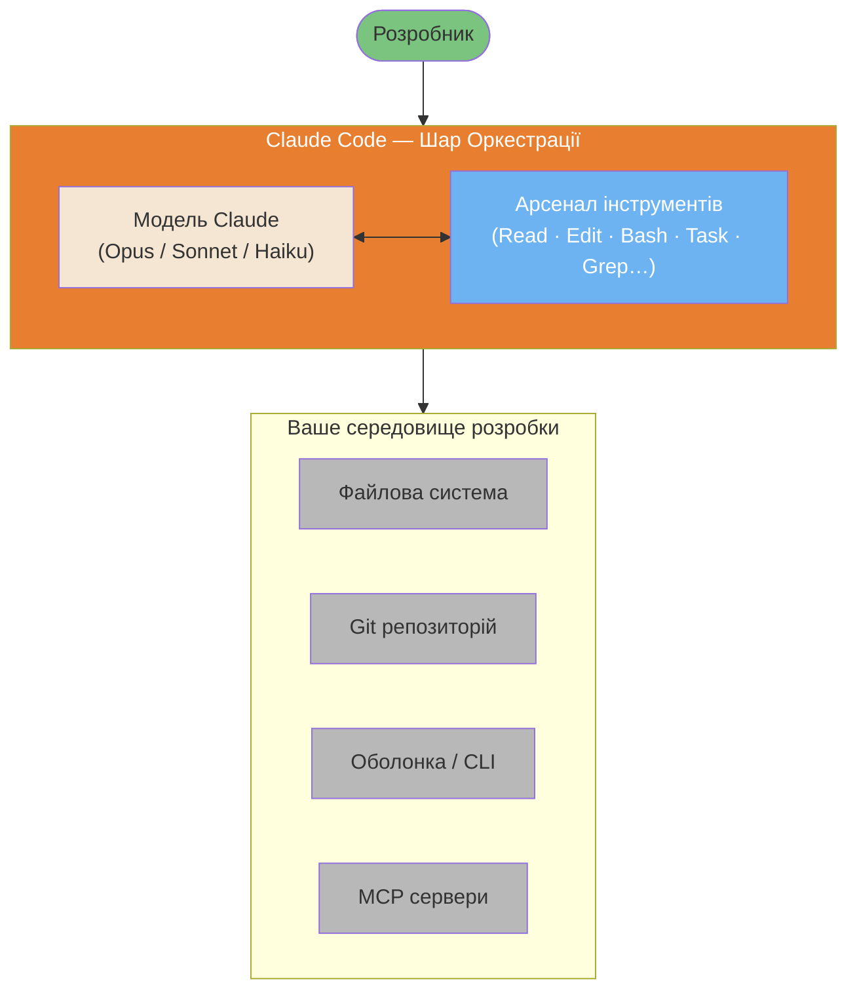

# Як працює Claude Code: Архітектура та внутрішня будова

> Технічне занурення у внутрішні механізми Claude Code, засноване на офіційній документації Anthropic та перевіреному аналізі спільноти.

**Автор**: Florian BRUNIAUX | Внесок від Claude (Anthropic)

**Час читання**: ~25 хвилин (повний) | ~5 хвилин (лише TL;DR)

**Востаннє перевірено**: Лютий 2026 (Claude Code v2.1.34)

---

## Прозорість джерел

Цей документ поєднує три рівні джерел:

| Рівень | Опис | Довіра | Приклад |
|--------|-------------|------------|---------|
| **Рівень 1** | Офіційна документація Anthropic | 100% | anthropic.com/engineering/* |
| **Рівень 2** | Перевірений реверс-інжиніринг | 70-90% | Аналіз PromptLayer, поведінка code.claude.com |
| **Рівень 3** | Висновки спільноти | 40-70% | Спостереження, не підтверджені офіційно |

Кожне твердження позначене рівнем довіри. **Завжди віддавайте перевагу офіційній документації**, якщо вона доступна.

---

## TL;DR — Стислий огляд з 5 фактів

1. **Простий цикл (Simple Loop)**: Claude Code працює в циклі `while(tool_call)` — без складних графів (DAG), класифікаторів або RAG. Модель вирішує все сама.

2. **Вісім базових інструментів**: Bash (універсальний адаптер), Read, Edit, Write, Grep, Glob, Task (під-агенти), TodoWrite. Це весь арсенал.

   **Еволюція стратегії пошуку**: Ранні версії Claude Code експериментували з RAG, використовуючи ембеддінги Voyage для семантичного пошуку коду. Anthropic перейшла на пошук на основі grep (ripgrep) після того, як внутрішні тести показали кращу продуктивність при меншій операційній складності — не потрібна синхронізація індексів та немає ризиків безпеки через зовнішніх постачальників ембеддінгів. Філософія "Шукай, а не індексуй" жертвує затримкою та токенами заради простоти та безпеки. Кастомні плагіни (ast-grep для AST-патернів) та MCP-сервери (Serena для символів, grepai для RAG) доступні для спеціалізованих потреб.

   *Джерело*: [Latent Space podcast](https://www.latent.space/p/claude-code) (Травень 2025), документація ast-grep

3. **Бюджет у 200K токенів**: Вікно контексту ділиться між системним промптом, історією розмови, результатами інструментів та буфером відповіді. Автостиснення відбувається при заповненні на ~75-92%.

4. **Під-агенти = Ізоляція**: Інструмент `Task` створює під-агентів із власним контекстом. Вони не можуть створювати інших під-агентів (глибина=1). Повертається лише їхнє коротке резюме.

5. **Філософія**: "Менше каркаса, більше моделі" — довіряйте міркуванням Claude замість того, щоб будувати складні системи оркестрації навколо нього.

---

## Візуальний огляд

Claude Code — це не нова модель ШІ. Це шар оркестрації, який надає Claude (Opus/Sonnet/Haiku) можливість читати файли, запускати команди оболонки, навігувати по репозиторіях та створювати під-агентів — у безперервному циклі до завершення завдання.



*Натхненно [архітектурною діаграмою Mohamed Ali Ben Salem](https://www.linkedin.com/posts/mohamed-ali-ben-salem-2b777b9a_en-ce-moment-je-vois-passer-des-posts-du-activity-7420592149110362112-eY5a) — Див. [діаграми внутрішньої архітектури](../diagrams/04-architecture-internals.uk.md) для більш детального аналізу.*

---

## Зміст

- [Візуальний огляд](#візуальний-огляд)

1. [Основний цикл (The Master Loop)](#1-основний-цикл-the-master-loop)
2. [Арсенал інструментів](#2-арсенал-інструментів)
3. [Внутрішнє керування контекстом](#3-внутрішнє-керування-контекстом)
4. [Архітектура під-агентів](#4-архітектура-під-агентів)
5. [Модель дозволів та безпеки](#5-модель-дозволів-та-безпеки)
6. [Інтеграція MCP](#6-інтеграція-mcp)
7. [Просунуті патерни використання інструментів (API)](#7-просунуті-патерни-використання-інструментів-api)
8. [Інструмент Edit: як він працює насправді](#8-інструмент-edit-як-він-працює-насправді)
9. [Збереження сесій](#9-збереження-сесій)
10. [Філософія: Менше каркаса, більше моделі](#10-філософія-менше-каркаса-більше-моделі)
11. [Claude Code проти альтернатив](#11-claude-code-проти-альтернатив)
12. [Джерела та посилання](#12-джерела-та-посилання)
13. [Додаток: Чого ми не знаємо](#13-додаток-чого-ми-не-знаємо)

---

## 1. Основний цикл (The Master Loop)

**Довіра**: 100% (Рівень 1 - Офіційно)
**Джерело**: [Anthropic Engineering Blog](https://www.anthropic.com/engineering/claude-code-best-practices)

В основі Claude Code лежить надзвичайна простота:

```
┌─────────────────────────────────────────────────────────────┐
│                    ОСНОВНИЙ ЦИКЛ CLAUDE CODE (MASTER LOOP)  │
├─────────────────────────────────────────────────────────────┤
│                                                             │
│   ┌──────────────┐                                          │
│   │ Ваш промпт   │                                          │
│   └──────┬───────┘                                          │
│          │                                                  │
│          ▼                                                  │
│   ┌──────────────────────────────────────────────────────┐  │
│   │                                                      │  │
│   │                  CLAUDE МІРКУЄ                       │  │
│   │        (Без класифікаторів, без шарів маршрутизації) │  │
│   │                                                      │  │
│   └────────────────────────┬─────────────────────────────┘  │
│                            │                                │
│                            ▼                                │
│                   ┌────────────────┐                        │
│                   │ Виклик інструмента?│                    │
│                   └───────┬────────┘                        │
│                           │                                 │
│              ТАК          │           НІ                    │
│         ┌─────────────────┴─────────────────┐               │
│         │                                   │               │
│         ▼                                   ▼               │
│  ┌────────────┐                      ┌────────────┐         │
│  │ Виконати   │                      │ Текстова   │         │
│  │ інструмент │                      │ відповідь  │         │
│  │            │                      │ (ЗАВЕРШЕНО)│         │
│  └─────┬──────┘                      └────────────┘         │
│        │                                                    │
│        ▼                                                    │
│  ┌─────────────┐                                            │
│  │ Передати    │                                            │
│  │ результат   │──────────────────┐                         │
│  │ до Claude   │                  │                         │
│  └─────────────┘                  │                         │
│                                   │                         │
│                                   ▼                         │
│                          ┌────────────────┐                 │
│                          │ ПЕРЕХІД НА     │                 │
│                          │ НАСТУПНИЙ КРОК │                 │
│                          └────────────────┘                 │
│                                                             │
└─────────────────────────────────────────────────────────────┘
```

### Що це означає

Вся архітектура — це простий цикл `while`:

```
while (claude_response.has_tool_call):
    result = execute_tool(tool_call)
    claude_response = send_to_claude(result)
return claude_response.text
```

**Тут немає:**
- Класифікатора намірів
- Маршрутизатора завдань
- RAG/векторного пошуку
- Розподілу на Планувальника та Виконавця

Модель сама вирішує, коли викликати інструменти, які саме та коли завдання виконано. Це і є "агентний цикл" (agentic loop), описаний в інженерному блозі Anthropic.

### Чому обрано такий дизайн?

1. **Простота**: менше компонентів = менше точок відмови
2. **Керованість моделлю**: міркування Claude кращі за написані вручну евристики
3. **Гнучкість**: жодних жорстких рамок, що обмежують дії Claude
4. **Легкість відлагодження**: легко зрозуміти, що саме сталося і чому

### Аудит нативних можливостей (Native Capabilities Audit)

Використовуйте цей чек-лист, щоб переконатися, що ви розумієте всі можливості Claude Code. Кожна можливість детально описана далі в цьому посібнику.

**11 нативних можливостей**:

- [ ] **Хуки подій (Event Hooks)** — скрипти Bash/PowerShell, що запускаються при виконанні інструментів
  - PreToolUse, PostToolUse, UserPromptSubmit, Notification
  - Див: [Розділ 5: Модель дозволів та безпеки](#5-модель-дозволів-та-безпеки)
- [ ] **Хуки з обмеженою областю дії (Skill-Scoped Hooks)** — хуки подій, специфічні для контексту виконання навичок
  - Керування життєвим циклом кожної навички
  - Див: [Розділ 5.11 Повного посібника](#51-understanding-skills)
- [ ] **Фонові агенти (Background Agents)** — асинхронне виконання завдань (тести, довгі операції)
  - Неблокуючий запуск агентів
  - Див: [Розділ 4: Архітектура під-агентів](#4-архітектура-під-агентів)
- [ ] **Дослідницький під-агент (Explore Subagent)** — `/explore` для аналізу кодобази
  - Дослідження кодобази в режимі "тільки для читання"
  - Див: [Розділ 4: Архітектура під-агентів](#4-архітектура-під-агентів)
- [ ] **Планувальний під-агент (Plan Subagent)** — `/plan` для режиму планування (тільки для читання)
  - Безпечне архітектурне дослідження
  - Див: [Розділ 2.3 Повного посібника](#23-plan-mode)
- [ ] **Інструмент Task (Task Tool)** — ієрархічне делегування завдань спеціалізованим агентам
  - Паралельне виконання завдань, під-агенти з глибиною=1
  - Див: [Розділ 4: Архітектура під-агентів](#4-архітектура-під-агентів)
- [ ] **Агентні команди (Agent Teams)** — мультиагентна паралельна координація (експериментально v2.1.32+)
  - Координація на основі Git, автономний розподіл завдань
  - Див: [Розділ 9.20 Повного посібника](#920-agent-teams-multi-agent-coordination)
- [ ] **Вибір моделі для конкретного завдання (Per-Task Model Selection)** — динамічне перемикання моделей всередині сесії
  - `/model opus|sonnet|haiku` на межах завдань
  - Див: [Розділ 10: Claude Code проти альтернатив](#10-claude-code-vs-alternatives)
- [ ] **Інтеграція протоколу MCP (MCP Protocol Integration)** — Model Context Protocol для розширення інструментів
  - Context7, Sequential, Serena, Playwright тощо.
  - Див: [Розділ 6: Інтеграція MCP](#6-інтеграція-mcp)
- [ ] **Режими дозволів (Permission Modes)** — тонке керування виконанням інструментів
  - За замовчуванням, автопідтвердження, режим планування, кастомні правила
  - Див: [Розділ 5: Модель дозволів та безпеки](#5-модель-дозволів-та-безпеки)
- [ ] **Пам'ять сесії (Session Memory)** — збереження контексту між сесіями
  - CLAUDE.md, файли пам'яті, стан проекту
  - Див: [Розділ 9: Збереження сесій](#9-збереження-сесій)

**Порада для початківців**: якщо ви ще не дослідили всі 11 можливостей, ви, ймовірно, втрачаєте можливості для підвищення продуктивності. Зосередьтеся на невиділених пунктах вище.

**Джерело**: Синтезовано на основі [аналізу Gur Sannikov](https://www.linkedin.com/posts/gursannikov_claudecode-embeddedengineering-aiagents-activity-7423851983331328001-DrFb)

---

## 2. Арсенал інструментів

**Довіра**: 100% (Рівень 1 - Офіційно)
**Джерело**: [code.claude.com/docs](https://code.claude.com/docs/en/setup)

Claude Code має рівно 8 базових інструментів:

| Інструмент | Призначення | Ключова поведінка | Вартість токенів |
|----------|------------|------------------|------------------|
| `Bash` | Запуск shell-команд | Універсальний адаптер, найпотужніший | Низька (команда) + Змінна (вивід) |
| `Read` | Читання вмісту файлів | Макс 2000 рядків, підтримує скорочення | Висока для великих файлів |
| `Edit` | Модифікація файлів | На основі diff, потребує точного збігу | Середня |
| `Write` | Створення/перезапис файлів | Потребує попереднього читання, якщо файл існує | Середня |
| `Grep` | Пошук вмісту файлів | На основі ripgrep (regex), замінив RAG/ембеддінги. Для структурного пошуку коду (на основі AST) див. плагін ast-grep. Компроміс: Grep (швидкий, простий) vs ast-grep (точний, потребує налаштування) vs Serena MCP (семантичний, з урахуванням символів) | Низька |
| `Glob` | Пошук файлів за патерном | Пошук шляхів, сортування за часом зміни (mtime) | Низька |
| `Task` | Створення під-агентів | Ізольований контекст, ліміт глибини=1 | Висока (новий контекст) |
| `TodoWrite` | Відстеження прогресу | Структуроване керування завданнями | Низька |

### Універсальний адаптер Bash

**Ключове розуміння**: Bash — це швейцарський ніж Claude. Він може:

- Запускати будь-який CLI-інструмент (git, npm, docker, curl...)
- Виконувати скрипти
- Об'єднувати команди через конвеєри (pipes)
- Отримувати доступ до стану системи

Модель була навчена на величезній кількості даних оболонки (shell data), що робить її надзвичайно ефективною у використанні Bash як універсального адаптера, коли спеціалізованих інструментів недостатньо.

### Логіка вибору інструментів

Claude вирішує, який інструмент використовувати, залежно від завдання. Тут немає жорстко закодованої маршрутизації:

```
┌─────────────────────────────────────────────────────┐
│             ВИБІР ІНСТРУМЕНТІВ (Керований моделлю)  │
├─────────────────────────────────────────────────────┤
│                                                     │
│  "Read auth.ts"           → Інструмент Read         │
│  "Find all test files"    → Інструмент Glob         │
│  "Search for TODO"        → Інструмент Grep         │
│  "Run npm test"           → Інструмент Bash         │
│  "Explore the codebase"   → Інструмент Task         │
│  "Track my progress"      → Інструмент TodoWrite    │
│                                                     │
│  Модель вивчає ці патерни під час навчання,         │
│  а не з чітко прописаних правил.                    │
│                                                     │
└─────────────────────────────────────────────────────┘
```

### Розширена екосистема інструментів

Окрім 8 базових інструментів, Claude Code може використовувати:

**MCP сервери** (Model Context Protocol):
- **Serena**: Навігація кодом з урахуванням символів + пам'ять сесій
- **grepai**: Семантичний пошук + аналіз графа викликів (на базі Ollama)
- **Context7**: Пошук в офіційній документації бібліотек
- **Sequential**: Структуровані багатокрокові міркування
- **Playwright**: Автоматизація браузера та E2E тестування
- **claude-code-ultimate-guide**: 12 інструментів — пошук посібника, відстеження релізів, `compare_versions`, пошук загроз безпеці (`get_threat`, `list_threats` з 28 CVE + 655 шкідливими навичками), пошук шаблонів (`search_examples`) — `npx -y claude-code-ultimate-guide-mcp`

**Плагіни спільноти**:
- **ast-grep**: Структурний пошук коду на основі AST (явний виклик)

### Матриця вибору інструментів пошуку

Claude Code пропонує кілька способів пошуку коду, кожен з яких має свої переваги:

| Потреба пошуку | Нативний інструмент | Альтернатива (MCP/плагін) | Коли переходити |
|----------------|---------------------|--------------------------|-----------------|
| Точний текст | `Grep` (ripgrep) | - | Ніколи (найшвидший) |
| Назва функції | `Grep` | Serena `find_symbol` | Великий рефакторинг багатьох файлів |
| За значенням | - | grepai `search` | Не знаєте точного тексту |
| Граф викликів | - | grepai `trace_callers` | Аналіз залежностей |
| Структурний патерн | - | ast-grep | Масштабні міграції (>50k рядків) |
| Структура файлу | - | Serena `get_symbols_overview` | Потрібен контекст символів |

**Порівняння продуктивності**:

| Інструмент | Швидкість | Налаштування | Кейс використання |
|------------|-----------|--------------|-------------------|
| Grep (ripgrep) | ⚡ ~20мс | ✅ Немає | 90% пошуків |
| Serena | ⚡ ~100мс | ⚠️ MCP | Рефакторинг, символи |
| grepai | 🐢 ~500мс | ⚠️ Ollama + MCP | Семантичний, граф викликів |
| ast-grep | 🕐 ~200мс | ⚠️ Плагін | Патерни AST, міграції |

**Принцип прийняття рішень**: Починайте з Grep (найшвидший), переходьте до спеціалізованих інструментів лише за потреби.

> **📖 Глибоке занурення**: Див. [Опанування інструментів пошуку](../workflows/search-tools-mastery.uk.md) для отримання детальних описів робочих процесів, які об'єднують усі інструменти пошуку.

---

## 3. Внутрішнє керування контекстом

**Довіра**: 80% (Рівень 2 - Частково офіційно)
**Джерела**:
- [platform.claude.com/docs](https://platform.claude.com/docs/en/build-with-claude/context-windows) (Рівень 1)
- Спостережувана поведінка (Рівень 2)

Claude Code працює у фіксованому вікні контексту (~200K токенів, залежно від моделі).

### Розподіл бюджету контексту

```
┌─────────────────────────────────────────────────────────────┐
│                 БЮДЖЕТ КОНТЕКСТУ (~200K токенів)            │
├─────────────────────────────────────────────────────────────┤
│                                                             │
│  ┌──────────────────────────────────────────────────────┐   │
│  │ Системний промпт                         (~5-15K)    │   │
│  │ • Визначення інструментів                            │   │
│  │ • Інструкції з безпеки                               │   │
│  │ • Поведінкові вказівки                               │   │
│  │ • Детальний розподіл див. нижче ↓                    │   │
│  ├──────────────────────────────────────────────────────┤   │
│  │ Файли CLAUDE.md                          (~1-10K)    │   │
│  │ • Глобальний ~/.claude/CLAUDE.md                     │   │
│  │ • Проектний /CLAUDE.md                               │   │
│  │ • Локальний /.claude/CLAUDE.md                       │   │
│  ├──────────────────────────────────────────────────────┤   │
│  │ Історія розмови                          (змінна)    │   │
│  │ • Ваші запити                                        │   │
│  │ • Відповіді Claude                                   │   │
│  │ • Записи викликів інструментів                       │   │
│  ├──────────────────────────────────────────────────────┤   │
│  │ Результати інструментів                  (змінна)    │   │
│  │ • Вміст файлів після Read                            │   │
│  │ • Вивід команд після Bash                            │   │
│  │ • Результати пошуку після Grep                       │   │
│  ├──────────────────────────────────────────────────────┤   │
│  │ Резерв на відповідь                      (~40-45K)   │   │
│  │ • Міркування Claude                                  │   │
│  │ • Згенерований код/текст                             │   │
│  └──────────────────────────────────────────────────────┘   │
│                                                             │
│  КОРИСНИЙ КОНТЕКСТ = Всього - Системний - Резерв ≈ 140-150K │
│                                                             │
└─────────────────────────────────────────────────────────────┘
```

### Вміст системного промпту

**Довіра**: 100% (Рівень 1 - Офіційна документація Anthropic)
**Джерела**:
- [Anthropic System Prompts Release Notes](https://platform.claude.com/docs/en/release-notes/system-prompts)
- [Anthropic Engineering: Claude Code Best Practices](https://www.anthropic.com/engineering/claude-code-best-practices)

Системні промпти Claude (~5-15K токенів) **офіційно публікуються** Anthropic у рамках їхньої прихильності до прозорості. Ці промпти визначають:

**Основні компоненти**:
- **Визначення інструментів**: Bash, Read, Edit, Write, Grep, Glob, Task, TodoWrite
- **Інструкції з безпеки**: Політики щодо контенту, шаблони відмов (див. [Посилення безпеки](../security/security-hardening.uk.md))
- **Поведінкові вказівки**: Пріоритет виконання завдання, орієнтація на MVP, відсутність надлишкового проектування
- **Інструкції щодо контексту**: Як збирати та використовувати контекст проекту

**Важливі відмінності**:
- **Claude.ai/Мобільні додатки**: Опубліковані промпти доступні публічно
- **Anthropic API**: Інші інструкції за замовчуванням, які розробники можуть конфігурувати
- **Claude Code CLI**: Агентний кодинг-асистент із функціями збору контексту

**Аналіз спільноти** (для глибшого розуміння):
- **Аналіз Claude 4 від Simon Willison** (Травень 2025): [Глибоке занурення в блоки міркувань, правила пошуку, гардрайли безпеки](https://simonwillison.net/2025/May/25/claude-4-system-prompt/)
- **Технічний розбір PromptHub** (Червень 2025): [Детальний аналіз патернів розробки промптів](https://www.prompthub.us/blog/an-analysis-of-the-claude-4-system-prompt)

→ **Перехресне посилання**: Щодо аспектів безпеки див. [Розділ 5: Модель дозволів та безпеки](#5-модель-дозволів-та-безпеки)

**Примітка**: Системні промпти Claude Code можуть відрізнятися від версій для Claude.ai/мобільних пристроїв. Зазначені вище джерела охоплюють сімейство моделей Claude; промпти для Claude Code інтегровані в поведінку самого CLI-інструменту.

---

### Автоматичне стиснення (Auto-Compaction)

**Довіра**: 75% (Рівень 2 - Перевірено спільнотою з науковим обґрунтуванням)

Коли обсяг використаного контексту перевищує певну межу, Claude Code автоматично стискає старі репліки розмови:

| Джерело | Повідомлена межа | Примітки |
|--------|------------------|----------|
| Розширення VS Code | ~75% використання (25% залишається) | [GitHub #11819](https://github.com/anthropics/claude-code/issues/11819) (Листопад 2025) |
| Версія CLI | 1-5% залишається | Більш консервативна, ніж у VS Code |
| Аналіз PromptLayer | 92% | Історичні спостереження |
| Steve Kinney | 95% | [Session Management Guide](https://stevekinney.com/courses/ai-development/claude-code-session-management) (Липень 2025) |
| Команда `/compact` користувача | У будь-який час | Ручне керування |

**Що відбувається під час стиснення:**

1. Старі кроки розмови підсумовуються
2. Результати роботи інструментів стискаються
3. Нещодавній контекст зберігається повністю
4. Модель отримує сигнал "контекст було стиснуто"

**Вплив на продуктивність** (науково обґрунтований):

Нещодавні дослідження та спостереження практиків підтверджують **зниження якості при автоматичному стисненні**:

- **Ефективність LLM падає на 50-70% на складних завданнях**, коли контекст зростає з 1K до 32K токенів ([Context Rot Research](https://research.trychroma.com/context-rot), Липень 2025)
- **11 з 12 моделей показують результати нижче 50% від їхнього базового рівня при короткому контексті**, коли обсяг досягає 32K токенів (бенчмарк NoLiMa)
- **Автоматичне стиснення втрачає нюанси та руйнує зв'язки** через повторювані цикли стиснення ([Claude Saves Tokens, Forgets Everything](https://golev.com/post/claude-saves-tokens-forgets-everything/), Січень 2026)
- **Механізм уваги (attention mechanism) перевантажується** завданням пошуку в сценаріях з великим контекстом

**Консенсус спільноти**: Ручне очищення через `/compact` на логічних етапах значно краще, ніж очікування автоматичного стиснення.

**Рекомендована стратегія** ([Lorenz, 2026](https://www.linkedin.com/posts/robin-lorenz-54055412a_claudecode-contextengineering-aiengineering-activity-7425136701515251713)):

| Обсяг контексту | Дія | Обґрунтування |
|-----------------|-----|---------------|
| **70%** | Попередження — планування очищення | Раннє усвідомлення |
| **85%** | Рекомендовано ручний handoff | Запобігання втраті якості через автостиснення |
| **95%** | Примусовий handoff | Серйозне падіння якості |

**Керування користувачем**: Використовуйте команду `/compact` вручну для запуску резюмування на логічних етапах або застосовуйте **передачу сесії (Session Handoffs)** (див. розділ нижче) для збереження намірів у стислій історії.

### Стратегії збереження контексту

| Стратегія | Коли використовувати | Як реалізувати |
|-----------|--------------------|----------------|
| Під-агенти | Дослідницькі завдання | Інструмент `Task` для ізольованого пошуку |
| Ручний compact | Проактивне очищення | Команда `/compact` |
| Очищення сесії | Потрібен свіжий старт | Команда `/clear` |
| Цільове читання | Відомо, що саме потрібно | Читання конкретних файлів, а не директорій |
| CLAUDE.md | Персистентний контекст | Зберігання правил у файлах пам'яті |

### Граничні ліміти деградації сесії

**Довіра**: 70% (Рівень 2 - Дослідження практиків, arXiv матеріали)

Ефективність Claude Code прогнозовано знижується за певних умов:

| Умова | Спостережувана межа | Симптом |
|-------|---------------------|---------|
| Кількість реплік | **15-25 реплік** | Втрачає з виду обмеження, згадані на початку |
| Накопичення токенів | **80-100K токенів** | Ігнорує вимоги, озвучені на початку сесії |
| Обсяг проблеми | **>5 файлів одночасно** | Неузгоджені зміни, пропущені файли |

**Відсоток успіху за обсягом роботи** (на основі звітів практиків):

| Обсяг | Відсоток успіху | Приклад |
|-------|-----------------|---------|
| 1-3 файли | ~85% | Виправлення багу в одному модулі |
| 4-7 файлів | ~60% | Рефакторинг фічі в різних компонентах |
| 8+ файлів | ~40% | Зміни в усій кодобазі |

**Стратегії мінімізації негативних наслідків**:

1. **Промпти-чекпоінти**: "Перш ніж продовжити, підсумуй поточні вимоги та обмеження."
2. **Скидання сесій**: Починайте заново для нових завдань (`/clear`)
3. **Чітке обмеження рамками**: Розбивайте великі завдання на менші, сфокусовані під-завдання
4. **Використання під-агентів**: Делегуйте пошук та аналіз інструменту `Task` для захисту головного контексту

### Деградація через накопичення помилок (Failure-Triggered Context Drift)

Окремий вид зниження якості, який не залежить безпосередньо від загального обсягу контексту: повторювані помилки інструментів. Коло обміну даними, в якому виникають помилки, засмічує вікно контексту трейсами та логами.

Це явище відрізняється від деградації через автостиснення. Стиснення стосується *розміру* контексту; накопичення помилок — його *якості* всередині поточного вікна.

**Патерн вирішення**: повторно надсилайте ключове завдання при кожній помилці команди, а не лише після `/compact`. Хук `PostToolUse` може в разі невдачі додавати до виводу нагадування про початковий намір:

```bash
# Хук PostToolUse: повторне введення наміру після помилок
if [[ "$CLAUDE_TOOL_EXIT_CODE" != "0" ]]; then
  echo "НАГАДУВАННЯ: Поточне завдання: $ORIGINAL_TASK_SUMMARY. Ігноруй цю помилку, якщо вона не є блокуючою, та продовжуй рухатися до мети."
fi
```

Джерело: [Nick Tune — Workflow DSL: Domain-Driven Claude Code Workflows](https://nick-tune.me/blog/2026-03-01-workflow-dsl-domain-driven-claude-code-workflows/) (2026-03-01)

---

## 4. Архітектура під-агентів

**Довіра**: 100% (Рівень 1 - Задокументована поведінка)
**Джерело**: [code.claude.com/docs](https://code.claude.com/docs/en/setup) + Системний промпт (опис у визначеннях інструментів)

Інструмент `Task` створює під-агентів для паралельної або ізольованої роботи.

### Модель ізоляції

```
┌─────────────────────────────────────────────────────────────┐
│                        ГОЛОВНИЙ АГЕНТ                       │
├─────────────────────────────────────────────────────────────┤
│                                                             │
│  Context: Повна розмова + всі прочитані файли               │
│                                                             │
│         Task("Explore authentication patterns")             │
│                        │                                    │
│                        ▼                                    │
│  ┌───────────────────────────────────────────────────────┐  │
│  │             ПІД-АГЕНТ (Створений)                     │  │
│  │                                                       │  │
│  │  • Власне свіже вікно контексту                       │  │
│  │  • Отримує: тільки опис завдання                      │  │
│  │  • Має доступ до: тих самих інструментів (крім Task)  │  │
│  │  • НЕ може створювати під-під-агентів (глибина = 1)   │  │
│  │  • Повертає: тільки текстове резюме                   │  │
│  │                                                       │  │
│  └───────────────────────────────────────────────────────┘  │
│                        │                                    │
│                        ▼                                    │
│         Результат: "Found 3 auth patterns: JWT in..."       │
│         (Лише цей текст потрапляє в головний контекст)      │
│                                                             │
└─────────────────────────────────────────────────────────────┘
```

### Чому Глибина = 1?

Обмеження під-агентів одним рівнем запобігає:

1. **Рекурсивному вибуху**: Вкладені агенти споживали б безкінечні ресурси
2. **Засміченню контексту**: Кожен рівень накопичував би свій контекст
3. **Проблемам відлагодження**: Відстежувати ланцюжки з багатьох рівнів дуже важко
4. **Непередбачуваним витратам**: Вкладені агенти генерують неконтрольоване споживання токенів

### Типи під-агентів

Claude Code пропонує спеціалізовані типи під-агентів через параметр `subagent_type`:

| Тип | Призначення | Доступні інструменти |
|-----|-------------|----------------------|
| `Explore` | Дослідження кодобази | Усі інструменти "тільки для читання" |
| `Plan` | Планування архітектури | Усі інструменти, крім Edit/Write |
| `General` | Складні багатокрокові завдання | Усі інструменти |

### Коли використовувати під-агентів

| Кейс використання | Чому під-агент допомагає |
|-------------------|--------------------------|
| Пошук у великих кодобазах | Зберігає головний контекст чистим |
| Паралельні дослідження | Кілька пошуків одночасно |
| Ризиковані дії | Помилки не засмічують головний контекст |
| Спеціалізований аналіз | Інший фокус уваги для різних завдань |

---

## 5. Модель дозволів та безпеки

**Довіра**: 100% (Рівень 1 - Офіційно)
**Джерела**:
- [code.claude.com/docs/en/hooks](https://code.claude.com/docs/en/hooks)
- [code.claude.com/docs/en/sandboxing](https://code.claude.com/docs/en/sandboxing)

Claude Code використовує багаторівневу модель безпеки:

```
┌─────────────────────────────────────────────────────────────┐
│                    РІВНІ ДОЗВОЛІВ ТА БЕЗПЕКИ                │
├─────────────────────────────────────────────────────────────┤
│                                                             │
│  Рівень 1: ІНТЕРАКТИВНІ ЗАПИТИ                              │
│  ┌────────────────────────────────────────────────────────┐ │
│  │ Claude wants to run: rm -rf node_modules               │ │
│  │ [Allow once] [Allow always] [Deny] [Edit command]      │ │
│  └────────────────────────────────────────────────────────┘ │
│                          │                                  │
│                          ▼                                  │
│  Рівень 2: ПРАВИЛА ALLOW/DENY (settings.json)               │
│  ┌────────────────────────────────────────────────────────┐ │
│  │ {                                                      │ │
│  │   "permissions": {                                     │ │
│  │     "allow": ["Bash(npm *)", "Read"],                  │ │
│  │     "deny": ["Bash(rm -rf *)"]                         │ │
│  │   }                                                    │ │
│  │ }                                                      │ │
│  └────────────────────────────────────────────────────────┘ │
│                          │                                  │
│                          ▼                                  │
│  Рівень 3: ХУКИ (Перед/Після виконання)                     │
│  ┌────────────────────────────────────────────────────────┐ │
│  │ PreToolUse: Валідація перед виконанням                 │ │
│  │ PostToolUse: Аудит після виконання                     │ │
│  │ PermissionRequest: Перевизначення запитів дозволів    │ │
│  └────────────────────────────────────────────────────────┘ │
│                          │                                  │
│                          ▼                                  │
│  Рівень 4: РЕЖИМ ПІСОЧНИЦІ (Додаткова ізоляція)             │
│  ┌────────────────────────────────────────────────────────┐ │
│  │ Ізоляція файлової системи + обмеження мережі           │ │
│  └────────────────────────────────────────────────────────┘ │
│                                                             │
└─────────────────────────────────────────────────────────────┘
```

### Виявлення небезпечних патернів

**Довіра**: 80% (Рівень 2 - Перевірено практикою, але список не є вичерпним)

Claude Code ідентифікує певні небезпечні патерни для додаткової перевірки:

| Патерн | Ризик | Поведінка |
|--------|-------|-----------|
| `rm -rf` | Деструктивне видалення | Завжди запитує підтвердження |
| `sudo` | Ескалація привілеїв | Завжди запитує підтвердження |
| `curl \| sh` | Виконання віддаленого коду | Завжди запитує підтвердження |
| `chmod 777` | Небезпечні права доступу | Завжди запитує підтвердження |
| `git push --force` | Руйнування історії Git | Завжди запитує підтвердження |
| `DROP TABLE` | Руйнування баз даних | Завжди запитує підтвердження |

Це не жорсткий блок-лист — виявлення відбувається завдяки навчанню самої моделі, а не за допомогою простих регулярних виразів.

### Нативна пісочниця (v2.1.0+)

**Довіра**: 100% (Рівень 1 - Офіційно)
**Джерело**: [code.claude.com/docs/en/sandboxing](https://code.claude.com/docs/en/sandboxing)

Claude Code має вбудовану **нативну пісочницю (native sandbox)**, яка використовує примітиви ОС для ізоляції процесів:

```
┌──────────────────────────────────────────────────────┐
│             Архітектура нативної пісочниці           │
├──────────────────────────────────────────────────────┤
│                                                      │
│  Запит команди Bash                                  │
│       │                                              │
│       ▼                                              │
│  Обгортка пісочниці (Seatbelt/bubblewrap)            │
│       │                                              │
│       ├─ Файлова система: читання скрізь, запис у CWD│
│       ├─ Мережа: SOCKS5 проксі + фільтрація доменів  │
│       ├─ Процес: ізольоване середовище               │
│       │                                              │
│       ▼                                              │
│  Енфорсмент на рівні ядра ОС                         │
│       │                                              │
│       ├─ Дозволено: operation в межах дозволеного    │
│       ├─ Блоковано: порушення системних викликів     │
│       └─ Сповіщення: користувач бачить попередження  │
│                                                      │
└──────────────────────────────────────────────────────┘
```

**Примітиви ОС**:

| Платформа | Механізм | Примітки |
|-----------|----------|-----------|
| **macOS** | Seatbelt (TrustedBSD MAC) | Вбудована, фільтрація системних викликів на рівні ядра |
| **Linux/WSL2** | bubblewrap (namespaces + seccomp) | Потребує: `sudo apt-get install bubblewrap socat` |
| **WSL1** | ❌ Не підтримується | bubblewrap потребує функцій ядра, недоступних у WSL1 |
| **Windows** | ⏳ Планується | Поки що недоступно |

**Модель ізоляції**:

1. **Файлова система**:
   - **Читання**: Уся система (крім заборонених шляхів)
   - **Запис**: Тільки поточна робоча директорія (можна конфігурувати)
   - **Заблоковано**: Зміни поза робочою директорією, директорії ключів/паролів (`~/.ssh`, `~/.aws`)

2. **Мережа**:
   - **Проксі**: Усі з'єднання проходять через SOCKS5-проксі
   - **Фільтрація доменів**: Режими allowlist/denylist
   - **Заблоковано за замовчуванням**: Приватні IP (CIDR), localhost

3. **Процес**:
   - **Спільне ядро**: Можлива вразливість до експлойтів ядра (на відміну від мікроVM Docker)
   - **Дочірні процеси**: Успадковують ті самі обмеження пісочниці
   - **Аварійний вихід**: Параметр `dangerouslyDisableSandbox` для несумісних інструментів

**Режими пісочниці**:

- **Режим автопідтвердження (Auto-allow)**: Команди Bash виконуються автоматично, якщо вони запущені в пісочниці (рекомендовано для щоденної розробки)
- **Звичайний режим**: Кожна команда потребує окремого підтвердження (максимальна безпека)

**Порівняння безпеки**:

| Аспект | Нативна пісочниця | Docker-пісочниця (microVM) |
|--------|--------------------|----------------------------|
| **Ізоляція ядра** | ❌ Спільне ядро з хостом | ✅ Окреме ядро для кожної VM |
| **Встановлення** | Без залежностей (macOS), 2 пакети (Linux) | Потребує Docker Desktop 4.58+ |
| **Накладні витрати**| Мінімальні (~1-3% CPU) | Помірні (~5-10% CPU) |
| **Кейс використання**| Щоденна розробка, довірений код | Недовірений код, макс. безпека |

**Ліміти та вразливості**:

⚠️ **Domain fronting**: Мережі CDN (Cloudflare, Akamai) можуть обходити фільтрацію доменів
⚠️ **Unix-сокети**: Неправильно налаштований `allowUnixSockets` відкриває шлях до підвищення привілеїв
⚠️ **Файлова система**: Занадто широкі права на запис дозволяють атаки на директорії з `$PATH`

**Коли що обирати**:

- ✅ **Нативна пісочниця**: Щоденна розробка, довірена команда розробників, швидкий старт без навантаження на систему
- ✅ **Docker-пісочниця**: Запуск недовіреного коду, захист ядра системи, робота в режимі Docker-in-Docker

**Глибоке занурення**: Див. [Гайд із нативної пісочниці](../security/sandbox-native.uk.md) для отримання повної технічної документації, прикладів конфігурації та вирішення поширених проблем.

### Система хуків (Hooks System)

Хуки дають змогу програмно контролювати дії Claude:

```json
{
  "hooks": {
    "PreToolUse": [
      {
        "matcher": "Bash",
        "hooks": [{
          "type": "command",
          "command": "/path/to/validate-command.sh"
        }]
      }
    ],
    "PostToolUse": [
      {
        "matcher": "*",
        "hooks": [{
          "type": "command",
          "command": "/path/to/audit-log.sh"
        }]
      }
    ]
  }
}
```

**Можливості хуків:**

| Можливість | Підтримується | Як реалізувати |
|------------|---------------|----------------|
| Блокування виконання | Так | Вихід з кодом 2 (exit code 2) |
| Зміна параметрів | Так | Повернення модифікованого JSON |
| Логування дій | Так | Запис у файл всередині хука |
| Асинхронна обробка | Так | Встановлення `async: true` у конфігу хука (v2.1.0+) |

**JSON-корисне навантаження хука** (передається через stdin):

```json
{
  "session_id": "abc123",
  "transcript_path": "/home/user/.claude/projects/.../transcript.jsonl",
  "cwd": "/path/to/project",
  "permission_mode": "default",
  "hook_event_name": "PreToolUse",
  "tool_name": "Bash",
  "tool_input": {
    "command": "npm install lodash"
  }
}
```

Спільні поля для всіх подій: `session_id`, `transcript_path`, `cwd`, `permission_mode`, `hook_event_name`. Додаткові поля, специфічні для подій (наприклад, `tool_name`/`tool_input` для PreToolUse), додаються поверх них.

→ **Перехресне посилання**: Див. [Розділ 7 — Хуки](#7-hooks) у головному посібнику для отримання детальних прикладів.

---

## 6. Інтеграція MCP

**Довіра**: 100% (Рівень 1 - Офічно)
**Джерело**: [code.claude.com/docs/en/mcp](https://code.claude.com/docs/en/mcp)

MCP (Model Context Protocol) сервери розширюють можливості Claude Code новими інструментами.

### Візуальний огляд архітектури MCP

> **💡 Візуальний гайд**: Наступна діаграма демонструє, як MCP створює безпечний рівень контролю між LLM та реальними системами. Рівень LLM **не має прямого доступу до даних** — сервер MCP перевіряє політики безпеки перед тим, як інструменти зможуть взаємодіяти з базами даних, API або файлами.


*Рисунок 1: Архітектура MCP, що демонструє розподіл між мисленням (LLM), контролем (MCP Server) та виконанням (Tools). Дизайн натхненний [візуалізацією Dinesh Kumar у LinkedIn](https://www.linkedin.com/posts/dinesh-kumar-6b0528b4_model-context-protocol-mcp-why-it-came-activity-7419969525795782656-VoFh), відтворено під ліцензією Apache-2.0.*

**Ключові межі безпеки**:
- **Жовтий рівень (LLM)**: Тільки міркування — **Немає доступу до даних**
- **Помаранчевий рівень (MCP Server)**: Точка контролю безпеки (політики, валідація, логи)
- **Сірий рівень (Real Systems)**: Захищені дані — **Приховані від ШІ**

### Як працює MCP (Технічні деталі)

```
┌─────────────────────────────────────────────────────────────┐
│                        ІНТЕГРАЦІЯ MCP                       │
├─────────────────────────────────────────────────────────────┤
│                                                             │
│  ┌─────────────────────────────────────────────────────┐    │
│  │                  CLAUDE CODE                        │    │
│  │                                                     │    │
│  │   Нативні інструменти    Інструменти MCP            │    │
│  │   ┌─────────┐        ┌─────────────────────────┐    │    │
│  │   │ Bash    │        │ mcp__serena__*          │    │    │
│  │   │ Read    │        │ mcp__context7__*        │    │    │
│  │   │ Edit    │        │ mcp__playwright__*      │    │    │
│  │   │ ...     │        │ mcp__custom__*          │    │    │
│  │   └─────────┘        └───────────┬─────────────┘    │    │
│  │                                  │                  │    │
│  └──────────────────────────────────┼──────────────────┘    │
│                                     │                       │
│                           JSON-RPC 2.0                      │
│                                     │                       │
│                                     ▼                       │
│  ┌─────────────────────────────────────────────────────┐    │
│  │                  СЕРВЕР MCP                         │    │
│  │                                                     │    │
│  │   Транспорт stdio/HTTP                              │    │
│  │   Визначення інструментів (JSON Schema)             │    │
│  │   Реалізація інструментів                           │    │
│  │                                                     │    │
│  └─────────────────────────────────────────────────────┘    │
│                                                             │
└─────────────────────────────────────────────────────────────┘
```

### Ключові факти про MCP

| Аспект | Поведінка |
|--------|-----------|
| Протокол | JSON-RPC 2.0 через stdio або HTTP |
| Найменування інструментів | Шаблон `mcp__<сервер>__<інструмент>` |
| Обмін контекстом | Тільки через параметри інструментів та значення повернення |
| Життєвий цикл | Сервер запускається при першому використанні, залишається активним під час сесії |
| Дозволи | Така ж система перевірки, як і для нативних інструментів |

### Що MCP не може робити

| Обмеження | Пояснення |
|-----------|-----------|
| Отримувати історію розмови | Бачить тільки параметри інструментів, а не весь контекст |
| Зберігати стан між викликами | Кожен виклик є незалежним (якщо сервер не реалізує кешування) |
| Змінювати системний промпт Claude | Тільки інструменти, жодних ін'єкцій у промпти |
| Обходити систему дозволів | Працює під тим самим шаром безпеки, що й нативні інструменти |

→ **Перехресне посилання**: Див. [Розділ 8.6 — Безпека MCP](#86-mcp-security) для розуміння аспектів безпеки.

### Розширення MCP: Додатки (Apps, SEP-1865)

**Статус**: Стабільний (26 січня 2026)
**Специфікація**: [SEP-1865 на GitHub](https://github.com/modelcontextprotocol/ext-apps)
**Співавтори**: OpenAI, Anthropic, розробники MCP-UI

#### Що таке додатки MCP Apps?

MCP Apps — це **перше офіційне розширення** протоколу Model Context Protocol, яке дозволяє серверам MCP надавати **інтерактивні інтерфейси користувача** разом із традиційними текстовими відповідями інструментів.

**Проблема, яку вирішено**: Традиційні текстові відповіді створюють тертя під час дослідження даних. Кожна дія користувача (сортування, фільтрація, деталізація) вимагає нового циклу промптів. MCP Apps усуває цей "розрив контексту", рендеричи інтерактивні інтерфейси безпосередньо в чаті.

#### Технічна архітектура

**Два основні примітиви**:

1. **Інструменти з метаданими UI**:
   ```json
   {
     "name": "query_database",
     "description": "Query customer database",
     "_meta": {
       "ui": {
         "resourceUri": "ui://dashboard/customers"
       }
     }
   }
   ```

2. **Ресурси інтерфейсу** (схема `ui://`):
   - Серверні збірки HTML/JavaScript
   - Рендеряться хостом в ізольованих iframe
   - Двонаправлений зв'язок JSON-RPC через `postMessage`

**Потік взаємодії**:

```
┌─────────────────────────────────────────────────────────┐
│                  АРХІТЕКТУРА MCP APPS                   │
├─────────────────────────────────────────────────────────┤
│                                                         │
│  ┌──────────────┐         ┌──────────────┐             │
│  │  MCP Client  │◄───────►│  MCP Server  │             │
│  │ (Claude/IDE) │ JSON-RPC│  (Ваш сервер)│             │
│  └──────┬───────┘         └──────────────┘             │
│         │                                               │
│         │ Запит ресурсу ui://                           │
│         ▼                                               │
│  ┌─────────────────────────────────────────┐            │
│  │     Sandboxed Iframe (Рендеринг UI)     │            │
│  │  ┌───────────────────────────────────┐  │            │
│  │  │  HTML/JS збірка від сервера       │  │            │
│  │  │  - Інтерактивна панель            │  │            │
│  │  │  - Форми з валідацією             │  │            │
│  │  │  - Візуалізація даних у реалі      │  │            │
│  │  └───────────────────────────────────┘  │            │
│  │                                          │            │
│  │  postMessage ◄─────► JSON-RPC           │            │
│  └─────────────────────────────────────────┘            │
│                                                         │
└─────────────────────────────────────────────────────────┘
```

#### Модель безпеки

**Багаторівневий захист**:

| Рівень | Захист |
|--------|--------|
| **Пісочниця iframe** | Обмежені права (немає прямого доступу до системи) |
| **Попередньо оголошені шаблони** | Хости перевіряють HTML/JS перед рендерингом |
| **Логування повідомлень** | Усі комунікації між інтерфейсом та хостом записуються в логи JSON-RPC |
| **Згода користувача** | Обов'язкове підтвердження для викликів інструментів, ініційованих з UI |
| **Блокування вмісту** | Хости можуть блокувати підозрілі ресурси перед рендерингом |

→ **Перехресне посилання**: Див. [Розділ 8.6 — Безпека MCP](#86-mcp-security) для більш детального вивчення безпеки MCP.

#### SDK: @modelcontextprotocol/ext-apps

**Встановлення**:
```bash
npm install @modelcontextprotocol/ext-apps
```

**Головний API** (не залежить від фреймворку):

```typescript
import { App } from '@modelcontextprotocol/ext-apps';

const app = new App();

// 1. Встановлення зв'язку з хостом
await app.connect();

// 2. Отримання результатів роботи інструментів від хоста
app.ontoolresult = (result) => {
  // Оновлення інтерфейсу результатами виконання
  updateDashboard(result.data);
};

// 3. Виклик інструментів сервера з інтерфейсу (UI)
await app.callServerTool('fetch_analytics', {
  timeRange: '7d',
  metrics: ['users', 'revenue']
});

// 4. Асинхронне оновлення контексту моделі
await app.updateModelContext({
  selectedFilters: ['region:EU', 'status:active']
});

// Додаткові можливості:
app.logDebug('Дія користувача', { filter: 'applied' });
app.openBrowserLink('https://docs.example.com');
app.sendFollowUpMessage('Застосовані фільтри: EU, Active');
```

**Стандарт зв'язку**: Усі функції працюють через `postMessage` (без жорсткої прив'язки до JS-фреймворків).

#### Підтримка платформами

| Платформа | Підтримка MCP Apps | Примітки |
|-----------|--------------------|----------|
| **Claude Desktop** | ✅ Доступно вже | claude.ai/directory (Pro/Max/Team/Enterprise) |
| **Claude Cowork** | 🔄 Незабаром | Планується інтеграція в агентні воркфлоу |
| **VS Code** | ✅ В Insiders збірці | [Офіційний блог](https://code.visualstudio.com/blogs/2026/01/26/mcp-apps-support) |
| **ChatGPT** | 🔄 Впроваджується | Починаючи з тижня 26 січня 2026 |
| **Goose** | ✅ Доступно вже | CLI з відкритим кодом та підтримкою UI |
| **Claude Code CLI** | ❌ Н/Д | Тільки текст у терміналі (немає можливості рендерити iframe) |

#### Важливість для користувачів Claude Code

**Пряме використання**: Відсутнє (CLI є текстовим і не підтримує рендеринг iframe).

**Непряма вигода**:

1. **Розуміння екосистеми**: MCP Apps є майбутнім агентних інтерфейсів розробки
2. **Розробка серверів MCP**: Якщо ви створюєте власні сервери MCP, додавання UI є чудовою опцією
3. **Гібридні робочі процеси**:
   - Використовуйте Claude Desktop для дослідження даних з UI (дашборди, графіки)
   - Переходьте до Claude Code CLI для безпосередньої реалізації та автоматизації коду
4. **Конфігураційні метадані**: Сервери MCP можуть рекламувати можливості UI у своїх схемах

#### Приклади реалізації

**Офіційні приклади серверів** (у репозиторії [`ext-apps` на GitHub](https://github.com/modelcontextprotocol/ext-apps)):

- **threejs-server**: 3D-візуалізація та маніпуляції
- **map-server**: Інтерактивне дослідження географічних даних
- **pdf-server**: Перегляд документів із підсвічуванням тексту
- **system-monitor-server**: Дашборди системних метрик у реальному часі
- **sheet-music-server**: Рендеринг нотної грамоти

**Застосування в індустрії** (Станом на Січень 2026):

| Інструмент | Провайдер | Можливості |
|------------|-----------|------------|
| Asana | Asana | Таймлайни проектів, дошки завдань |
| Slack | Salesforce | Створення чернеток повідомлень з попереднім переглядом форматування |
| Figma | Figma | Блок-схеми, діаграми Ганта у FigJam |
| Amplitude | Amplitude | Аналітичні графіки з інтерактивною фільтрацією |
| Box | Box | Пошук файлів, прев'ю документів |
| Canva | Canva | Дизайн презентацій з кастомізацією в реальному часі |
| Clay | Clay | Дослідження компаній, пошук контактів |
| Hex | Hex | Аналіз даних з інтерактивними запитами |
| monday.com | monday.com | Дошки управління проектами |

**Незабаром**: Salesforce (Agentforce 360)

#### Зв'язок із попередніми рішеннями

MCP Apps стандартизує підходи, започатковані в:
- **MCP-UI**: Ранній громадський проект розширення інтерфейсу для MCP
- **OpenAI Apps SDK**: Паралельний проект створення інтерактивних інструментів

Обидва стандарти продовжують підтримуватися. MCP Apps пропонує **єдину уніфіковану специфікацію** (SEP-1865), створену спільно розробниками обох екосистем разом з Anthropic та OpenAI.

**Шлях міграції**: Простий для існуючих рішень на базі MCP-UI та Apps SDK.

#### Коли використовувати MCP Apps

**Дерево рішень для розробників серверів MCP**:

```
Будуєте кастомний сервер MCP?
├─ Користувачам потрібно обирати з 50+ опцій? → MCP Apps (випадаючі списки, форми)
├─ Користувачам потрібно бачити графічні закономірності? → MCP Apps (діаграми, карти)
├─ Потрібні багатокрокові форми з умовною логікою? → MCP Apps (інтерактивні майстри)
├─ Потрібно оновлювати дані в реальному часі? → MCP Apps (живі дашборди)
└─ Просте отримання даних або прості дії? → Звичайні інструменти MCP (достатньо)
```

**Компроміс**: Складність розробки інтерфейсу проти покращення користувацького досвіду.

#### Ресурси

- **Специфікація**: [SEP-1865 на GitHub](https://github.com/modelcontextprotocol/ext-apps)
- **SDK**: [`@modelcontextprotocol/ext-apps` (npm)](https://www.npmjs.com/package/@modelcontextprotocol/ext-apps)
- **Приклади**: [репозиторій modelcontextprotocol/ext-apps](https://github.com/modelcontextprotocol/ext-apps)
- **Анонс у блозі MCP**: [MCP Apps Announcement](https://blog.modelcontextprotocol.io/posts/2026-01-26-mcp-apps/)
- **Анонс у блозі Claude**: [Interactive tools in Claude](https://claude.com/blog/interactive-tools-in-claude)
- **VS Code**: [MCP Apps support announcement](https://code.visualstudio.com/blogs/2026/01/26/mcp-apps-support)

---

### Ледаче завантаження інструментів MCP (Lazy Loading)

**Довіра**: 100% (Рівень 1 - Офіційно)
**Джерело**: [anthropic.com/engineering/advanced-tool-use](https://www.anthropic.com/engineering/advanced-tool-use)

Починаючи з версії v2.1.7 (Січень 2026), Claude Code використовує **ледаче завантаження (lazy loading / Tool Search)** для описів інструментів MCP замість завантаження всього списку в контекст. Це реалізовано на базі API-функції [Advanced Tool Use](https://www.anthropic.com/engineering/advanced-tool-use) від Anthropic.

**Проблема, яку вирішено:**
- Описи інструментів MCP споживають значну частину контексту (наприклад, GitHub MCP: ~46K токенів для 93 інструментів)
- Розробник Scott Spence задокументував понад 66,000 токенів, витрачених ще до введення першого промпту
- Це засмічення контексту стримувало широке використання MCP

**Як працює пошук інструментів (Tool Search):**

```
┌─────────────────────────────────────────────────────────────┐
│                 СХЕМА ПОШУКУ ІНСТРУМЕНТІВ MCP               │
├─────────────────────────────────────────────────────────────┤
│                                                             │
│  БЕЗ пошуку інструментів (повне завантаження):              │
│  ┌──────────────────────────────────────────────────────┐   │
│  │ Усі 100+ описів завантажуються одразу (~55K токенів) │   │
│  └──────────────────────────────────────────────────────┘   │
│                                                             │
│  З пошуком інструментів (ледаче завантаження):              │
│  ┌──────────────────────────────────────────────────────┐   │
│  │ Крок 1: Завантажено лише інструмент пошуку (~500 т.) │   │
│  │ Крок 2: Claude визначає необхідну дію                │   │
│  │ Крок 3: Tool Search знаходить потрібні інструменти   │   │
│  │ Крок 4: Завантажуються ТІЛЬКИ знайдені інструменти   │   │
│  │ Крок 5: Інструмент викликається як звичайно          │   │
│  └──────────────────────────────────────────────────────┘   │
│                                                             │
│  Результат: 55K токенів → ~8.7K токенів (зниження на 85%)   │
│                                                             │
└─────────────────────────────────────────────────────────────┘
```

**Отримані результати** (бенчмарки Anthropic):

| Метрика | До впровадження | Після впровадження | Покращення |
|---------|-----------------|--------------------|------------|
| Витрати токенів (5 MCP серверів) | ~55K | ~8.7K | **Зниження на 85%** |
| Точність вибору інструментів Opus 4 | 49% | 74% | +25 відсоткових пунктів |
| Точність вибору інструментів Opus 4.5 | 79.5% | 88.1% | +8.6 відсоткових пунктів |
| Адаптивне мислення Opus 4.6 | Н/Д | Автокалібрування | Динамічна глибина |

**Конфігурація** (v2.1.9+):

```bash
# Змінна оточення
ENABLE_TOOL_SEARCH=auto      # За замовчуванням (поріг 10% контексту)
ENABLE_TOOL_SEARCH=auto:5    # Агресивний режим (поріг 5%)
ENABLE_TOOL_SEARCH=auto:20   # Консервативний режим (поріг 20%)
ENABLE_TOOL_SEARCH=true      # Завжди ввімкнено
ENABLE_TOOL_SEARCH=false     # Вимкнено (повне завантаження всіх інструментів)
```

| Поріг | Рекомендовано для |
|-------|-------------------|
| `auto:20` | Невеликі конфігурації (5-10 інструментів) |
| `auto:10` | Збалансоване налаштування (20-50 інструментів) |
| `auto:5` | Просунуті користувачі (100+ інструментів) |

→ Як зазначив Simon Willison: "Засмічення контексту було причиною, чому я рідко користувався MCP. Тепер, коли проблему вирішено, немає причин не підключати десятки чи навіть сотні серверів MCP до Claude Code." — [X/Twitter, 14 Січня 2026](https://twitter.com/simonw)

---

## 7. Просунуті патерни використання інструментів (API)

**Довіра**: 90% (Рівень 1 - Офіційно від інженерів Anthropic)
**Джерело**: [Anthropic Engineering: Advanced Tool Use](https://www.anthropic.com/engineering/advanced-tool-use) | [Документація Programmatic Tool Calling](https://platform.claude.com/docs/en/agents-and-tools/tool-use/programmatic-tool-calling)

Чотири нові функції на рівні API стали доступними 18 лютого 2026 року (з виходом моделей Opus/Sonnet 4.6). Вони є актуальними для розробників, які створюють власних агентів за допомогою Anthropic API або Agent SDK — вони недоступні безпосередньо в CLI-версії Claude Code.

| Фіча | Проблема, яку вирішено | Доступність |
|------|------------------------|-------------|
| Програмний виклик інструментів (PTC)| Агентні цикли витрачають токени на зайві кроки | API + Foundry |
| Динамічна фільтрація | Веб-пошук забиває контекст інформаційним шумом | API + Foundry |
| Інструмент пошуку інструментів | Занадто багато описів інструментів розмивають контекст | API + Foundry |
| Приклади використання інструментів | Тільки схеми не здатні передати складні патерни | API + Foundry |

**Стратегічне планування** — вирішуйте вашу головну проблему першою:
- Контекст переповнений описами інструментів → Інструмент пошуку інструментів (Tool Search Tool)
- Величезні проміжні результати → Програмний виклик інструментів (Programmatic Tool Calling)
- Веб-дослідження повертає забагато сміття → Динамічна фільтрація
- Модель робить помилки в параметрах попри правильну схему → Приклади використання інструментів

### Програмний виклик інструментів (Programmatic Tool Calling - PTC)

**Зміна парадигми**: замість того, щоб викликати інструменти один за одним з повним колом обміну даними з моделлю на кожному кроці, Claude пише код на Python, який викликає всі необхідні інструменти локально. У контекст ШІ повертається лише фінальний результат `stdout`.

```
Традиційний шлях: промпт → Claude → інструмент 1 → результат 1 → Claude → інструмент 2 → результат 2 → Claude → фінал
                  (3 інструменти = 3 цикли міркувань, 3× проміжних результатів у контексті)

Шлях PTC:         промпт → Claude → пише Python-код → код викликає інструменти 1, 2, 3 → stdout → Claude → фінал
                  (3 інструменти = 1 цикл міркувань, тільки фінальний результат у контексті)
```

**Конфігурація** — позначте інструменти, які дозволено викликати з пісочниці виконання коду, за допомогою `allowed_callers`:

```json
{
  "tools": [
    { "type": "code_execution_20250825", "name": "code_execution" },
    {
      "name": "query_database",
      "description": "Execute SQL. Returns rows as JSON: id (str), name (str), revenue (float).",
      "input_schema": {
        "type": "object",
        "properties": { "sql": { "type": "string" } },
        "required": ["sql"]
      },
      "allowed_callers": ["code_execution_20250825"]
    }
  ]
}
```

| Значення `allowed_callers` | Поведінка |
|----------------------------|-----------|
| пропущено / `["direct"]` | Тільки традиційний виклик інструментів |
| `["code_execution_20250825"]` | Виклик тільки з Python-пісочниці |
| `["direct", "code_execution_20250825"]` | Обидва режими (не рекомендовано, заплутує модель) |

**Типові патерни** (усі виконуються за 1 прохід міркувань):
- Пакетна обробка: перебір N елементів у циклі, агрегування, вивід резюме
- Ранній вихід: завершення роботи одразу при досягненні успіху
- Динамічний вибір: запуск легкого або важкого інструмента залежно від проміжних даних
- Фільтрація даних: звуження результату перед передачею Claude (`errors = [l for l in logs if "ERROR" in l]`)

**Ефективність токенів**: проміжні результати програмних викликів ніколи не потрапляють у контекст Claude — туди надходить лише фінальний вивід `stdout`. Запуск 10 програмних інструментів споживає приблизно 1/10 частину токенів порівняно з прямим викликом. Оцінка зниження споживання токенів на ~37% є спостереженням спільноти (аналіз Shayan Tabe) і офіційно не підтверджена Anthropic.

**Обмеження**: Доступно тільки через API та Foundry (немає в Bedrock/Vertex). Не працює з інструментами MCP, веб-пошуком та інструментами з опцією `strict: true`. Час життя контейнера ~4.5 хвилини. На функцію не поширюється політика Zero Data Retention (ZDR).

### Динамічна фільтрація для Web Search/Fetch

Інструменти пошуку та завантаження веб-сторінок зазвичай закидають повний HTML-код у контекст — включаючи навігаційні панелі, рекламу та службовий код. Динамічна фільтрація дозволяє Claude написати Python-скрипт для попередньої обробки та фільтрації веб-сторінок перед тим, як вони потраплять у вікно контексту.

**Конфігурація** — використовуйте оновлені версії інструментів зі спеціальним бета-заголовком:

```json
{
  "tools": [
    { "type": "web_search_20260209", "name": "web_search" },
    { "type": "web_fetch_20260209", "name": "web_fetch" }
  ]
}
```

Необхідний заголовок: `anthropic-beta: code-execution-web-tools-2026-02-09`. Фільтрація ввімкнена за замовчуванням при використанні цих інструментів з моделями Sonnet 4.6 або Opus 4.6.

**Офіційні бенчмарки** (Anthropic, набір BrowseComp):

| Модель | Без фільтрації | З фільтрацією | Покращення |
|--------|----------------|---------------|------------|
| Sonnet 4.6 | 33.3% | 46.6% | +13.3 відсоткових пунктів |
| Opus 4.6 | 45.3% | 61.6% | +16.3 відсоткових пунктів |

Середнє зниження обсягу вхідних токенів становить ~24%. Найкраще підходить для багатоетапних досліджень, перевірки джерел та вилучення конкретних даних з великих веб-сторінок.

### Приклади використання інструментів (Tool Use Examples)

Схеми JSON визначають структуру параметрів, але не вміють пояснювати, коли слід передавати необов'язкові поля, які комбінації є логічними чи які конвенції форматування діють. Додавайте параметр `input_examples` до опису інструментів для демонстрації патернів:

```json
{
  "name": "create_ticket",
  "input_schema": { ... },
  "input_examples": [
    { "title": "Помилка 500 на сторінці логіну", "priority": "critical", "assignee": "oncall-team", "labels": ["bug", "auth"] },
    { "title": "Додати темну тему", "priority": "low", "labels": ["feature-request"] },
    { "title": "Оновити документацію API для v2" }
  ]
}
```

Точність роботи зі складними параметрами зростає з 72% до 90% за оцінками Anthropic. Використовуйте від 1 до 5 реалістичних прикладів для кожного інструмента, демонструючи мінімальний, частковий та повний набори параметрів.

### Практичне значення для користувачів Claude Code

| Фіча | Доступність у Claude Code CLI | Що робити користувачам CLI |
|------|-------------------------------|----------------------------|
| Пошук інструментів (ледаче завантаження MCP) | Вбудовано з версії v2.1.7 як авторежим | Тюнінгуйте параметр `ENABLE_TOOL_SEARCH=auto:N` (описано в Розділі 6) |
| Приклади використання інструментів | Не налаштовується з CLI | Актуально для авторів MCP-серверів — додавайте блок `input_examples` у ваші схеми інструментів |
| Програмний виклик інструментів | Недоступно в CLI | Актуально для розробників, які будують власні рішення через Agent SDK |
| Динамічна фільтрація веб-пошуку | Недоступно в CLI | Актуально для розробників на базі Agent SDK, які автоматизують веб-дослідження |

---

## 8. Інструмент Edit: як він працює насправді

**Довіра**: 90% (Рівень 2 - Перевірено поведінковим тестуванням)
**Джерела**:
- Спостережувана поведінка моделі
- [github.com/cline/cline/issues/2909](https://github.com/cline/cline/issues/2909) (аналогічна реалізація)

Інструмент `Edit` є набагато складнішим, ніж здається на перший погляд.

### Алгоритм роботи Edit

```
┌─────────────────────────────────────────────────────────────┐
│                     АЛГОРИТМ РОБОТИ EDIT                     │
├─────────────────────────────────────────────────────────────┤
│                                                             │
│  Вхідні дані: old_string, new_string, file_path             │
│                                                             │
│         ┌──────────────────────────────────────┐            │
│         │ Крок 1: ТОЧНИЙ ЗБІГ                  │            │
│         │ Пошук точного літералу old_string    │            │
│         └────────────────┬─────────────────────┘            │
│                          │                                  │
│             Знайдено? ───┴─── Не знайдено?                  │
│                │                     │                      │
│                ▼                     ▼                      │
│         ┌──────────┐         ┌──────────────────┐           │
│         │ ЗАМІНА   │         │ Крок 2: НЕКЛАСИЧ-│           │
│         │ (готово) │         │ НИЙ ПОШУК (FUZZY)│           │
│         └──────────┘         └────────┬─────────┘           │
│                                       │                     │
│                           Знайдено? ──┴── Не знайдено?      │
│                             │                     │         │
│                             ▼                     ▼         │
│                      ┌──────────┐         ┌──────────────┐  │
│                      │ ЗАМІНА + │         │  ПОМИЛКА     │  │
│                      │ ПОПЕРЕД- │         │(невідповід-  │  │
│                      │ ЖЕННЯ    │         │ ність рядка) │  │
│                      └──────────┘         └──────────────┘  │
│                                                             │
└─────────────────────────────────────────────────────────────┘
```

### Деталі неточного збігу (Fuzzy Matching)

Коли прямий пошук точного рядка не дає результатів, інструмент Edit намагається:

1. **Нормалізувати пробіли**: Ігнорувати зайві пробіли на кінцях рядків, вирівнювати відступи
2. **Нормалізувати переноси рядків**: Працювати однаково з CRLF (Windows) та LF (Unix)
3. **Розширити контекст**: Використовувати сусідні рядки коду для однозначної ідентифікації місця заміни

Якщо неточний пошук також завершується невдачею, інструмент повертає помилку, пропонуючи Claude перечитати файл та уточнити `old_string`.

### Валідація перед зміною

Перш ніж записати оновлений код, інструмент Edit перевіряє:

| Перевірка | Мета перевірки |
|-----------|----------------|
| Існування файлу | Запобігти створенню нових файлів через Edit (для цього є Write) |
| Знаходження `old_string` | Переконатися, що заміна відбудеться в правильному місці |
| Унікальність збігу | Рядок `old_string` має зустрічатися один раз (або використовується параметр `replace_all`) |
| Наявність змін | Переконатися, що новий код відрізняється від старого |

### Що відбувається при невдачі Edit

| Помилка | Причина | Реакція Claude |
|---------|---------|----------------|
| "old_string not found" | Код змінився з моменту останнього читання | Перечитує файл, пробує знову |
| "Multiple matches" | `old_string` зустрічається кілька разів | Додає більше сусідніх рядків для контексту |
| "File not found" | Вказано неправильний шлях до файлу | Шукає правильний шлях через Glob або Grep |

---

## 9. Збереження сесій

**Довіра**: 100% (Рівень 1 - Офіційно)
**Джерело**: [code.claude.com/docs](https://code.claude.com/docs/en/setup)

Сесії розробки можна зберігати та відновлювати навіть після перезапуску терміналу.

### Механізми відновлення

| Команда | Поведінка |
|---------|-----------|
| `claude --continue` / `claude -c` | Продовжити найновішу сесію |
| `claude --resume <id>` / `claude -r <id>` | Відновити конкретну сесію за її унікальним ID |

### Що зберігається, а що ні

| Зберігається в сесії | НЕ зберігається |
|----------------------|-----------------|
| Повна історія діалогу | Активний стан інструментів у пам'яті |
| Результати викликів інструментів | Очікувані фонові операції |
| Унікальний ID сесії | Тимчасові блокування файлів (file locks) |
| Контекст поточної робочої директорії | Змінні оточення терміналу (env vars) |

### Формат збереження даних

**Довіра**: 50% (Рівень 3 - Громадські висновки)

Сесії зберігаються у файлах форматів JSON/JSONL у директорії `~/.claude/`, але:

- Цей формат не є публічно задокументованим
- Він не позиціонується як стабільний API
- Може змінюватися між версіями CLI без попереджень

**Не будуйте ваші автоматизації на основі внутрішнього формату файлів сесій**, оскільки він може змінитися в будь-якому релізі.

---

## 10. Філософія: Менше каркаса, більше моделі

**Довіра**: 100% (Рівень 1 - Офіційно)
**Джерело**: Daniela Amodei (Співзасновниця та президентка Anthropic) - Публічні виступи

Головна філософія створення Claude Code полягає в наступному:

> "Робити більше меншими засобами. Розумні архітектурні рішення, вища ефективність навчання та сфокусоване вирішення проблем здатні успішно конкурувати з простим нарощуванням масштабів."

### Практичне втілення філософії

| Традиційний підхід | Підхід Claude Code |
|--------------------|--------------------|
| Класифікатор намірів → Маршрутизатор → Вузький спеціаліст | Одна потужна модель вирішує все сама |
| RAG з векторними базами даних та ембеддінгами | Звичайні Grep + Glob (пошук регулярними виразами) |
| Складні графи завдань (DAG) | Простий цикл while |
| Запрограмовані планувальники використання інструментів | Вибір інструментів, керований міркуваннями ШІ |
| Складні машини стану (State Machines) | Контекст розмови як єдиний стан системи |
| Важкі фреймворки промпт-інженерії | Довіра до базових можливостей моделі |

### Чому це працює

1. **Можливості сучасних моделей**: Claude 4+ є достатньо розумною для самостійного вибору шляхів вирішення та виклику інструментів
2. **Мінімальна затримка**: Чим менше проміжних ланок, тим швидше користувач отримує відповідь
3. **Просте відлагодження**: Якщо щось пішло не так, є лише одне місце, де шукати проблему
4. **Чудова генералізація**: Немає написаних людиною жорстких правил, які ламаються на нестандартних завданнях

### Компроміси та недоліки

| Перевага | Недолік |
|----------|---------|
| Неймовірна простота системи | Менше можливостей для тонкого контролю |
| Гнучкість на будь-ях завданнях | Важче примусити модель діяти за суворим шаблоном |
| Менше технічних багів розробки | Помилки міркувань моделі впливають на весь результат |
| Швидка ітерація розробки | Повна залежність від якості базової моделі ШІ |

### Валідація спільнотою

Підхід "нативні можливості перш за все" все більше підтверджується незалежними практиками. Команди розробників вбудованих систем (включаючи колишніх активних користувачів Cursor) переходять на використання нативних навичок (Agent Skills) замість зовнішніх фреймворків оркестрації, що підтверджує правильність філософії довіри до нативних міркувань Claude.

**Приклад**: [Gur Sannikov](https://www.linkedin.com/posts/gursannikov_claudecode-embeddedengineering-aiagents-activity-7423851983331328001-DrFb) (розробка вбудованих систем) успішно впровадив воркфлоу на основі архітектурних рішень (ADR), використовуючи виключно нативні інструменти Claude Code (хуки, навички, інструмент Task) без підключення сторонніх фреймворків — що повністю валідує філософію, задокументовану в цьому посібнику.

Це свідчить про те, що підхід "менше каркаса, більше моделі" чудово масштабується для складних інженерних областей, перевершуючи початкові очікування.

---

## 11. Claude Code проти альтернатив

**Довіра**: 80% (Рівень 2 - На основі фактів станом на Березень 2026)
**Джерела**: Офіційна документація, дослідження Perplexity за Березень 2026, чейнджлоги вендорів

| Вимір порівняння | Claude Code | GitHub Copilot | Cursor | Amazon Q Developer |
|------------------|-------------|----------------|--------|--------------------|
| **Архітектура** | цикл while(tool) | IDE-агент + хмарний агент | Події + хмарні обчислення | Агенти, інтегровані в AWS |
| **Виконання** | Локальний термінал | Локально (агентний режим) + хмари | Локально + хмарний сервер | Гібрид хмари та локалі |
| **Модель** | Claude (один провайдер) | GPT, Claude, Codex (на вибір) | Мультимодельний адаптивний | Amazon Titan + інші |
| **Обсяг контексту** | ~200K токенів | Вся кодобаза (агентний режим) | Розуміння всієї бази (Composer) | Залежить від підключення AWS |
| **Прозорість** | Висока (видиме мислення) | Середня | Середня | Низька |
| **Кастомізація** | CLAUDE.md + хуки + MCP | AGENTS.md, MCP, кастомні агенти | MCP Apps, .cursorrules | MCP, інтеграція з AWS |
| **Підтримка MCP** | Нативна | Так (автопідтвердження) | Так (MCP Apps v2.6) | Так (нативна) |
| **Ціноутворення** | Pro $20 / Max $100-200 | Безкоштовно / Pro $10 / Biz $19/seat | Безкоштовно / Pro $20 / Biz $40/seat | Безкоштовно / Pro $19/seat |

### Коли обирати Claude Code

| Сценарій | Claude Code | Альтернативи |
|----------|-------------|--------------|
| Глибоке дослідження кодобази | Чудово | Добре |
| Термінало-орієнтований процес | Чудово | Обмежено |
| Власна автоматизація (через хуки) | Чудово | Обмежено |
| Стандартизація команди | Добре (CLAUDE.md) | Різні результати |
| Інтеграція в IDE | Обмежено (плагін VS Code) | Cursor/Copilot значно кращі |
| Корпоративний комплаєнс | Через тарифи Enterprise | Різні результати |

---

## 12. Джерела та посилання

### Рівень 1 — Офіційні джерела Anthropic

| Джерело | URL | Теми |
|---------|-----|------|
| Engineering Blog | anthropic.com/engineering/claude-code-best-practices | Головний цикл, філософія |
| Setup Docs | code.claude.com/docs/en/setup | Інструменти, команди |
| Context Windows | platform.claude.com/docs/en/build-with-claude/context-windows | Ліміти токенів |
| Hooks Reference | code.claude.com/docs/en/hooks | Система хуків |
| Hooks Guide | code.claude.com/docs/en/hooks-guide | Приклади хуків |
| MCP Docs | code.claude.com/docs/en/mcp | Інтеграція MCP |
| Sandboxing | code.claude.com/docs/en/sandboxing | Модель безпеки |
| llms.txt (індекс) | code.claude.com/docs/llms.txt | Документація для ШІ, ~65 сторінок |
| llms-full.txt | code.claude.com/docs/llms-full.txt | Повна документація (~98 KB тексту) |

### Рівень 2 — Перевірені аналітичні матеріали

| Джерело | URL | Теми |
|---------|-----|------|
| Аналіз PromptLayer | blog.promptlayer.com/claude-code-behind-the-scenes-of-the-master-agent-loop/ | Внутрішня архітектура |
| Курс Steve Kinney | stevekinney.com/courses/ai-development/claude-code-* | Дозволи, збереження сесій |

### Рівень 3 — Ресурси спільноти

| Джерело | Теми |
|---------|------|
| GitHub Issues (anthropics/claude-code) | Крайові випадки, баги, обговорення функцій |
| Reddit r/ClaudeAI | Досвід користувачів, обхідні рішення |
| Відеоуроки на YouTube | Візуальні інструкції та демонстрації |

---

## 13. Додаток: Чого ми не знаємо

Чесно про прогалини в нашому розумінні внутрішніх механізмів:

### Невідоме або непідтверджене

| Тема | Чого саме ми не знаємо | Рівень довіри до поточного знання |
|------|------------------------|-----------------------------------|
| **Точний поріг стиснення** | Чи це 75%? 85%? 92%? Чи змінюється від моделі? | 40% |
| **Повний вміст системного промпту** | Повний текст не є публічним, міняється між версіями | 30% |
| **Метод підрахунку токенів** | Точний токенізатор та накладні витрати на схеми інструментів | 50% |
| **Аварійне перемикання моделей**| Чи перемикається Claude Code при збої моделі? | 20% |
| **Внутрішнє кешування результатів**| Чи діє кешування результатів між окремими сесіями? | 20% |
| **Логіка обмеження частоти (Rate Limiting)**| Як саме ліміти частоти діють на окремі інструменти | 40% |

### Те, що не документується навмисно

Ці теми Anthropic свідомо залишає без офіційної документації:

- Формат файлів збереження сесій (деталь внутрішньої реалізації)
- Варіації системного промпту між різними моделями
- Внутрішні технічні назви компонентів архітектури
- Точний розподіл витрат токенів між модулями системи
- Точний порядок оцінки прав та дозволів на виконання

### Як залишатися в курсі оновлень

1. **Офіційний журнал змін**: Стежте за anthropic.com/changelog
2. **Релізи на GitHub**: github.com/anthropics/claude-code/releases
3. **Discord-спільноти**: Сервери, орієнтовані на обговорення продуктів Claude
4. **Цей посібник**: Оновлюється періодично на основі верифікованої інформації

---

## Участь у проекті (Contributing)

Знайшли помилку? Маєте перевірену нову інформацію? Ваша участь вітається:

1. **Для офіційних фактів**: Надавайте посилання на першоджерело Anthropic
2. **Для власних спостережень**: Опишіть, як саме ви відтворили та перевірили поведінку
3. **Для виправлень**: Чітко поясніть, що саме не так і чому

---
**Локалізація**: [Serhii (MacPlus Software)](https://macplus-software.com)
*Остання синхронізація: Травень 2026*

---

*Далі: [Методології розробки](./methodologies.uk.md) | [Глосарій](./glossary.uk.md) | [Назад до покажчика](../README.uk.md)*
