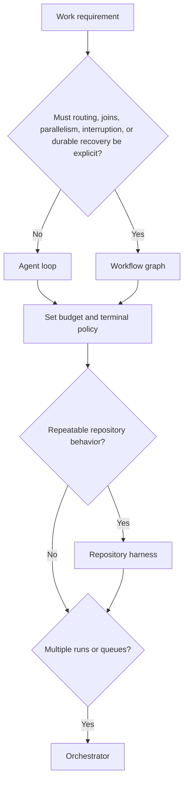

# Loop & graph engineering

**Цикл (loop)** визначає зворотний зв'язок і зупинку агента. **Граф (graph)** визначає його виконувану топологію. Граф може містити цикл, але жоден із термінів не доводить, що рішення про приймання є правильним.

> **Статус:** Loop engineering — це словник практиків, а не формальний стандарт. Graph engineering — це новий дослідницький ярлик, а не усталена дисципліна. Базові механізми, як-от скінченні автомати, графи робочих процесів, контрольні точки та шлюзи рецензування, — зрілі інженерні техніки.
>
> **Використовуйте цю сторінку для:** проєктування зворотного зв'язку й топології системи агентів. Про компоненти runtime-harness, засоби безпеки та дослідження оптимізаторів див. [Agent Harness Engineering](./agent-harness.uk.md). Про класифікацію продуктів див. [Agent Harness Landscape](../ecosystem/agent-harness-landscape.uk.md). Про класичні патерни проєктування, що лежать в основі цих структур, див. [AI Design Patterns](./ai-design-patterns.uk.md).

Явні контракти роблять зворотний зв'язок, зупинку, маршрутизацію й приймання тестовними; довший промпт сам по собі цих засобів контролю не визначає.

[Agent Harness Engineering](./agent-harness.uk.md) відповідає за розрізнення моделі, runtime harness, репозиторного harness і оркестратора. Використовуйте його, щоб визначити, який шар керує контекстом, інструментами, дозволами, верифікацією, відновленням чи координацією. Ця сторінка зосереджена на контрактах циклів і графів, що роблять зворотний зв'язок і маршрутизацію перевірюваними.

## Зміст

1. [Оберіть найменшу керувальну структуру](#1-choose-the-smallest-control-structure)
2. [Напишіть контракт циклу](#2-write-a-loop-contract)
3. [Напишіть контракт графа](#3-write-a-graph-contract)
4. [Статичні й динамічні графи](#4-static-and-dynamic-graphs)
5. [Розподіляйте судження явно](#5-allocate-judgment-explicitly)
6. [Зробіть виконання довговічним](#6-make-execution-durable)
7. [Спостерігайте й оцінюйте систему](#7-observe-and-evaluate-the-system)
8. [Три випадки реалізації](#8-three-implementation-cases)
9. [Антипатерни](#9-anti-patterns)
10. [Контрольний список вибору](#10-selection-checklist)

---

## 1. Оберіть найменшу керувальну структуру

Починайте з найпростішої структури, що здатна безпечно ухвалити потрібне рішення.

| Потреба | Найменша придатна структура циклу чи графа | Що все одно потрібно визначити |
|---|---|---|
| Одне обмежене завдання з локальним зворотним зв'язком від інструментів | Цикл агента | правило зупинки, політика інструментів, локальний верифікатор |
| Відомі гілки, повторні спроби, паралельна робота чи втручання людини | Явний граф робочого процесу | схема стану, маршрути, зʼєднання (joins), політика контрольних точок і відновлення |



Діаграма обирає керувальну структуру; [Agent Harness Engineering](./agent-harness.uk.md) визначає межу відповідальності між runtime harness, репозиторним harness і оркестратором.

Не перетворюйте одне обмежене завдання на багатоагентний граф лише тому, що фреймворк це полегшує. Кожен доданий компонент вносить стан, накладні витрати й режими збою. Кожен верифікатор, рецензент чи шлюз релізу вносить межу приймання, яку потрібно тестувати.

Ярлики навмисно вузькі. [Відгук практика Addy Osmani](https://addyosmani.com/blog/loop-engineering/) — корисне засноване на досвіді формулювання заміни повторюваного промптингу системою, що знаходить, розподіляє, перевіряє й фіксує роботу. Це не стандарт і не дослідження продуктивності. Два нещодавні препринти, [Graph Engineering in the Era of LLM Agents](https://arxiv.org/abs/2608.21156) і [What Makes Prompts a Graph](https://arxiv.org/abs/2607.27578), пропонують словники graph engineering. Сприймайте їхні визначення як дослідницькі пропозиції, а не доказ того, що графи покращують будь-яку систему агентів.

## 2. Напишіть контракт циклу

Контракт циклу робить «продовжуй, доки не запрацює» тестовним. Він називає одиницю роботи, дозволені дії, докази, що зараховуються як прогрес, і кожен допустимий вихід.

| Поле | Питання, на які має відповісти контракт |
|---|---|
| Мета й вхід | Яка вимога, ревізія репозиторію й очікуваний артефакт визначають цей запуск? |
| Стан | Які факти зберігаються поза вікном контексту? Хто може їх оновлювати? |
| Дії | Які інструменти, облікові дані, файли й зовнішні ефекти дозволені? |
| Спостереження | Які виводи інструментів, тести, трасування та відгуки людини потрапляють у наступну ітерацію? |
| Верифікація | Які детерміновані перевірки, незалежні рецензії чи рішення людини можуть прийняти роботу? |
| Зупинка й ескалація | Що завершує успіх, завершує невдачу, вичерпує бюджет, спричиняє тайм-аут або вимагає людини? |
| Докази | Які команди, виводи, ідентифікатори трасувань і версії доводять остаточне твердження? |

### Застосуйте горизонти зворотного зв'язку

[Agent Harness Engineering](./agent-harness.uk.md#21-while-loop-engine) визначає внутрішній, зовнішній і мета-горизонти та шари, що ними володіють. Застосовуйте контракт циклу на кожній межі: контракт внутрішнього циклу фіксує докази інструментів і локальну зупинку; контракт зовнішнього циклу називає верифікатор доставки й орган приймання; контракт мета-циклу версіонує зміну графа чи harness і оцінює її за відкладеними (held-out) доказами. Заява моделі, що вона закінчила, — це спостереження, а не доказ приймання.

## 3. Напишіть контракт графа

Використовуйте явний граф, коли сама маршрутизація має значення. [LangGraph Graph API](https://docs.langchain.com/oss/python/langgraph/graph-api) — конкретний приклад з первинного джерела: він представляє спільний стан, вузли, фіксовані й умовні ребра та паралельне виконання. Вузли можуть містити виклики LLM або звичайний код. Саме тому граф не є синонімом багатоагентної системи.

Контракт графа має бути придатним до рецензування без запуску графа.

| Елемент | Мінімальний контракт |
|---|---|
| Ідентичність графа | версії графа й політики, власник, сумісна схема стану |
| Стан | типізовані поля, конфіденційність, записувач, редуктор чи правило конфліктів, зберігання |
| Вузол | призначення, вхід і вихід, межа ідемпотентності, тайм-аут, побічні ефекти |
| Ребро | джерело, призначення, умова, докази маршрутизації, заборонені переходи |
| Зʼєднання (join) | очікувані входи, тайм-аут, поведінка за відсутності входу, правило злиття |
| Повторна спроба | повторювані збої, ліміт, backoff, компенсація чи ескалація |
| Контрольна точка | межа збереження, семантика відновлення, сумісність міграцій |
| Завершення | допустимі термінальні стани та орган, що може позначити кожен із них |

Контракт графа має розрізняти коректний маршрут і правильний результат. Скінченний автомат може відхилити недопустимий перехід і водночас переносити далі хибну вимогу чи хибний вердикт рецензії.

### Практичний приклад: обмежений граф рецензування зміни

Цей контракт додає стан, маршрутизацію, бюджет і політики термінальних станів, які діаграма лише топології пропускає:

```yaml
graph: change-review
version: 1
state:
  requirement: { writer: human, immutable_after: triage }
  patch_ref: { writer: implement, validator: commit_exists }
  test_evidence: { writer: verify, validator: command_and_exit_status }
  remaining_rework_budget:
    type: integer
    writer: retry_router
    initial: 2
    minimum: 0
    maximum: 2
    decrement: { when: verification_failed_and_value_gt_0, by: 1 }
nodes:
  triage: { timeout: 10m, output: approved_plan }
  implement: { side_effect: git_worktree }
  verify: { input: patch_ref, output: test_evidence }
  retry_router:
    input: [test_evidence, remaining_rework_budget]
    behavior: decrement_if_budget_remains_then_route
  review: { input: [patch_ref, test_evidence], authority: accept_or_escalate }
terminals:
  done: { condition: accepted_with_evidence }
  failed: { conditions: [rework_budget_exhausted, policy_violation] }
  escalated: { condition: human_escalation }
edges:
  - triage -> implement: approved_plan
  - triage -> failed: policy_violation
  - implement -> verify: patch_ref_exists
  - implement -> failed: policy_violation
  - verify -> retry_router: verification_failed
  - verify -> failed: policy_violation
  - retry_router -> implement: rework_budget_decremented
  - retry_router -> failed: rework_budget_exhausted
  - verify -> review: verification_passed
  - review -> done: accepted_with_evidence
  - review -> failed: policy_violation
  - review -> escalated: ambiguous_or_high_impact
```

`retry_router` — єдиний записувач, якому дозволено зменшувати лічильник. Він зменшує його лише поки бюджет лишається, а потім маршрутизує до `implement`; коли бюджет досягає нуля, наступна невдала верифікація потрапляє в термінальний стан `failed`. Приклад не дає рецензентові повноважень приймати нетестований патч. У продакшн-дизайні додайте точну команду тесту, одиницю бюджету, поля трасування та правила для побічних ефектів.

## 4. Статичні й динамічні графи

**Статичний граф** фіксує свою топологію в перевіреній конфігурації чи коді. **Динамічний граф** створює чи змінює завдання, залежності, маршрути або виконавців під час виконання.

| Аспект | Статичний граф | Динамічний граф |
|---|---|---|
| Найкраще для | стабільних ролей, затверджених переходів, шлюзів рецензування, відомого робочого процесу | виявлених завдань, черг роботи, розширення залежностей, адаптивної маршрутизації |
| Головна перевага | можна перевірити до виконання | може реагувати на нові докази |
| Головний ризик | крихкість, коли завдання не вписується | неперевірені маршрути, необмежена робота, дрейф топології |
| Потрібний контроль | рецензування версій і тести маршрутів | політика створення, бюджет, походження, валідація, журнал аудиту, відкликання |

Динамічний не означає, що LLM може писати довільний код робочого процесу й виконувати його. Тримайте площину керування статичною там, де наслідки високі: дозволені типи вузлів, дозволи, переходи, паралелізм, бюджети й повноваження на реліз. Дозволяйте динамічному виконанню створювати лише обмежені дані в межах цієї політики.

Цю відмінність видно у зафіксованих джерелах [Liza](https://github.com/liza-mas/liza/tree/a22c12381c5d884d2586a48aaaa517bca184f9cf). Його `pipeline.yaml` визначає стабільний граф організації з ролей, переходів і кворумів. Залежності завдань еволюціонують під час виконання як граф роботи. Тому Liza — це предметно-специфічний виконуваний граф і площина керування, а не доказ існування універсального графового рантайму. Точну межу див. у [записі доказів про Liza](https://github.com/FlorianBruniaux/claude-code-ultimate-guide/blob/main/docs/resource-evaluations/liza-mas-framework.md).

## 5. Розподіляйте судження явно

Автоматизація переміщує судження. Вона його не стирає. Запишіть, хто відповідає за планку якості, декомпозицію, дозвіл інструментів, виняток, вердикт приймання та рішення про реліз. Це **розподіл судження (judgment allocation)**.

### Розділяйте виконання й управління

Усунення людини з повторюваного виконання не знімає людської відповідальності. Розглядайте три цикли як окремі контракти:

| Цикл | Основна відповідальність | Роль людини |
|---|---|---|
| Цикл виконання | планувати, діяти, спостерігати, верифікувати, повторювати в межах бюджету | обробляти винятки та ескалації, що виходять за межі політики |
| Цикл управління | визначати цілі, дозволи, бюджети, політику приймання та повноваження на реліз | залишатися відповідальною за ризик і незворотні ефекти |
| Цикл покращення | вивчати трасування та збої, пропонувати змінений промпт, граф, політику чи harness | затверджувати версіоновану зміну за відкладеними доказами |

Це розв'язує неоднозначність у практичних обговореннях loop engineering. Pavan Belagatti описує усунення оператора, який раз у раз промптить агента, а потім описує процеси софтверних фабрик, що зберігають людські шлюзи для чутливих переходів. Узгоджене тлумачення таке: людина залишає повторюваний цикл виконання, лишаючись у циклі управління. Див. [Loop Engineering Explained](https://www.youtube.com/watch?v=RvG7R0Ue1k4) та [шлюз людського рецензування у Build Your Own Software Factory](https://www.youtube.com/watch?v=pE1S1egMrAI&t=908s). Ці відео — практичні й вендорські демонстрації, а не порівняльні дослідження надійності.

Опис OpenAI [Harness Engineering](https://openai.com/index/harness-engineering/) використовує споріднене формулювання «Humans steer. Agents execute.» Повідомлені там пропускна здатність і заощаджений час описують один внутрішній експеримент з нуля. Вони не встановлюють універсального рівня автономії чи базової продуктивності.

| Рішення | Віддавайте перевагу | Чому |
|---|---|---|
| схема, обов'язкова команда, заборонений перехід | детермінований валідатор або рушій політик | точно, відтворювано, піддається аудиту |
| неоднозначна вимога, компроміс ризиків, бізнес-пріоритет | відповідальна людина | потребує повноважень і контексту поза запуском |
| дослідницький аналіз чи якісне ранжування | агент або LLM-суддя з вибірковим арбітражем | корисний сигнал, але не єдиний продакшн-шлюз |
| реліз чи незворотний зовнішній ефект | іменована людина або попередньо авторизована політика | встановлює відповідальність і обробку винятків |

Розділення творця й верифікатора — це лікування, яке слід тестувати, а не доказ незалежності. Рецензент може мати свіжий контекст і все одно ділити ту саму хибну специфікацію, модель, провайдера, інструменти чи стимули. Порівнюйте самоперевірку, рецензію у свіжому контексті, рецензію іншою моделлю, детерміновані перевірки та людський арбітраж на тих самих вибраних дефектах. Записуйте хибні прийняття, хибні відхилення, порятунки, пропуски, розбіжності та докази, використані кожним вердиктом.

Щодо Liza зокрема, його детермінований супервізор може відхиляти недопустимі стани робочого процесу, застарілі оренди (leases) і невиконані кворуми. Зафіксоване джерело та його власний журнал проблем не встановлюють семантичної коректності допустимого вердикту. [Сторонній практичний REX від Ippon](https://blog.ippon.fr/2026/04/29/premier-rex-multi-agent-liza/) явно обмежений одним малим проєктом і повідомляє про збережені людські контрольні точки. Це корисний операційний звіт, а не порівняльний бенчмарк.

## 6. Зробіть виконання довговічним

### Розрізняйте відновлення процесу й відновлення продукту

Відновлення перерваного завдання встановлює безперервність виконання. Воно не показує, що доставлений результат був достатнім чи що його наслідки можна скасувати. Після хибного приймання продукту потрібні виявлення, стримування, власник і випробуваний шлях відновлення чи компенсації. Відкат застосунку може залишити мутації даних і зовнішні ефекти недоторканими.

Записуйте базу, перевірені head-ревізії та ревізію кандидата на інтеграцію для комбінованих змін. Два окремо обмежені PR можуть взаємодіяти поза межами своїх окремих тестів. Коли база чи група змінюється, інвалідуйте результат інтеграції та повторно оцініть уражені докази рецензування. Межу приймання див. у [multi-provider review](../workflows/multi-provider-code-review.uk.md#blocking-merge-the-ci-gate).

Довговічне виконання означає, що переривання не губить, не дублює й не вигадує роботу непомітно. Це не просто збереження історії чату.

| Вимога | Питання проєктування |
|---|---|
| Збережений стан | Чи може інший процес відновити запуск зі стійкого запису? |
| Ідемпотентність | Що станеться, якщо вузол чи виклик інструмента виконається знову після відновлення? |
| Контрольні точки | У яких безпечних межах система може відновитися? |
| Зовнішні ефекти | Який ключ ідемпотентності, квитанція, компенсація чи правило «прочитай перед записом» захищає кожен ефект? |
| Відновлення | Хто повторює спробу, хто розв'язує конфлікти і коли відновлення ескалюється? |
| Версіонування | Чи можна відновити старішу контрольну точку під зміненим графом чи політикою? |

[Документація LangGraph про персистентність](https://docs.langchain.com/oss/python/langgraph/persistence) класифікує `InMemorySaver` як реалізацію для експериментів і перелічує персистентні чекпойнтери для продакшну; використовуйте стійкий бекенд, коли стан має пережити перезапуск процесу. З динамічним [`interrupt()`](https://docs.langchain.com/oss/python/langgraph/interrupts#rules-of-interrupts) відновлення перезапускає вузол, що його містить, з початку, тож код перед interrupt може виконатися знову. Відтворення й незавершені спроби мають власну семантику повторного виконання. Робіть побічні ефекти ідемпотентними на кожній застосовній межі, а не припускайте, що кожен відновлений вузол поводиться однаково. [Документація Temporal про робочі процеси](https://docs.temporal.io/workflow-execution) — друге первинне джерело щодо довговічного виконання робочих процесів, відтворення та історії подій.

Не заявляйте про відновлення після збою, якщо його не випробувано. Перервіть запуск у визначеній точці, відновіть його в чистому процесі й перевірте перехід стану, зовнішній ефект, запис доказів і поведінку щодо дублювання роботи.

### Робіть збої інструментів придатними до дії

[Доповідь Michael Hablich про Chrome DevTools, 13:14](https://www.youtube.com/watch?v=_B4Pv9ttFgY&t=794s) описує покращення помилок інструментів; його [завершальні рекомендації](https://www.youtube.com/watch?v=_B4Pv9ttFgY&t=1316s) включають плейбуки відновлення та токени на успішний результат. Це практична порада, а не контрольоване порівняння витрат.

Запропонований контракт адаптера має повідомляти, що відмовило, чи міг відбутися ефект і яке обмежене відновлення дозволене. Наприклад, тайм-аут після публікації рецензії має запускати звірку квитанції до наступної спроби публікації. Протестуйте цю гілку та зараховуйте спроби відновлення до збереженого бюджету; саме повідомлення про помилку не може забезпечити жодного з цих правил.

### Звіряйте перервані ефекти перед повторною спробою

Віддалена операція може вдатися, а відповідь про це загубитися. Зберігайте стабільний ідентифікатор логічного ефекту та витрачений бюджет через перезапуск. Звіряйтеся з призначенням перед повторенням дії; без надійної квитанції лишайте результат невизначеним і спрямовуйте його на рішення. Контрольна точка чи атомарне перейменування файлу не встановлюють виконання рівно один раз у різних системах.

[Контрольна вправа](../../examples/workflows/review-control-demo.py) використовує стійкий стан SQLite і симульоване ідемпотентне призначення. Її перевірки охоплюють результати «дозволено/відмовлено/невідомо», змінену ревізію, застарілого або хибного виробника, вичерпання бюджету, паралельні спроби та втрату відповіді. Запустіть її з кореня клонованого посібника:

```bash
python3 examples/workflows/review-control-demo.py
```

Приклад задіює власний контрольний шлях. Кваліфікація реального провайдера також вимагає його фактичних дозволів, джерела квитанцій і семантики побічних ефектів. [AutoHarness](https://github.com/FlorianBruniaux/claude-code-ultimate-guide/blob/main/docs/resource-evaluations/autoharness-2026.md) наводить перевірені контрприклади щодо втрачених оновлень, повторно відтворених лічильників і часткових записів у кілька файлів, які мотивують окремі тести адаптерів.

[](../images/harness-review/review-acceptance-en-gemini.webp)

*Запропонований дизайн, а не доказ розгорнутого робочого процесу. [Французька версія та джерела](https://github.com/FlorianBruniaux/claude-code-ultimate-guide/blob/main/guide/images/harness-review/README.md).*

## 7. Спостерігайте й оцінюйте систему

Трасування агента потребує достатньо доказів, щоб відповісти на чотири питання: що виконувалося, чому відбулася така маршрутизація, який стан змінився і хто прийняв результат. Збирайте дані на тому шарі, що ухвалив рішення.

| Шар | Мінімальні докази |
|---|---|
| Runtime-цикл | версія моделі та harness, виклики інструментів, дозволи, політика контексту, повторні спроби, причина зупинки |
| Граф | версія графа й політики, вузол, ребро, причина маршруту, стан до і після, очікування join, контрольна точка, відновлення |
| Репозиторний harness | команда налаштування, змінений артефакт, команда верифікатора, вивід, статус виходу |
| Оркестратор | диспетчеризація, володіння, очікування в черзі, передача, оренда (lease), ескалація, людська контрольна точка |
| Судження | ідентичність і походження оцінювача, посилання на докази, вердикт, скасування, повноваження щодо винятків |

Використовуйте стабільні назви подій і редагуйте чутливий текст промптів, аргументи інструментів, результати інструментів, шляхи та ідентифікатори перед експортом телеметрії. [Репозиторій семантичних конвенцій OpenTelemetry GenAI](https://github.com/open-telemetry/semantic-conventions-genai/blob/main/docs/gen-ai/README.md) визначає телеметрію агента, моделі, запиту, відповіді, токенів та інструментів, але його статус — **Development**. Тримайте адаптер між цими конвенціями та вашим бекендом телеметрії й версіонуйте локальні поля графа та судження, як-от `graph.version` і `verdict.overturned`, бо словник upstream може змінитися.

Оцінюйте точну пару модель-harness, ревізію репозиторію, набір дозволів, версію графа, набір інструментів, бюджет і розподіл завдань. Зелений тест графа показує, що потік керування дотримався свого контракту. Він не доводить, що доставлений патч відповідає вимозі. Поєднуйте тести робочого процесу з верифікацією на рівні вимог, навчаннями з відновлення й повтореними репрезентативними завданнями. [Agent Evaluation](../roles/agent-evaluation.uk.md#evaluate-judgment-allocation-and-reviewer-independence) визначає корисні міри на рівні графа та незалежності рецензентів.

### Обмежуйте допуск ємністю верифікації

Обмежуйте спільну чергу так само, як і кожен запуск агента. Завдання зі скінченним бюджетом повторних спроб усе одно може додавати роботу швидше, ніж рецензенти встигають її приймати. В [епізоді IFTTD 362](https://www.ifttd.io/episodes/le-lean-a-l-ere-de-l-ia) Yacine Hmito описує це як проблему потоку: швидша реалізація переносить тиск на контроль якості, а повторювані дефекти мають змінювати процес виробництва вище за течією. [Підсумок сезону](https://bilan.ifttd.io/conclusion/) від Bruno Soulez іде далі, пропонуючи валідацію перед розширенням генерації; цей порядок — його тлумачення, а не продемонстрована універсальна послідовність.

Порівняння з [Toyota Production System](https://global.toyota/en/company/vision-and-philosophy/production-system/) — це аналогія, а не доказ того, що софтверна команда відтворила результати Toyota. Тут умова паузи, затверджена власником, зупиняє *нове авторство*, поки наявні рецензії та виправлення тривають; підтверджений повторюваний дефект стає кандидатом на протестований контроль вище за течією.

#### Точно називайте механізми Lean

У [Lean Software Development](https://res.infoq.com/articles/poppendieck-implementing-lean/en/resources/poppendieck_ch02.pdf) Mary і Tom Poppendieck перекладають ідеї виробництва на принципи програмного забезпечення, як-от вбудовування якості та оптимізація всього потоку створення цінності. Це означає перевірку роботи під час створення, а не покладання на фінальний шлюз рецензування для виявлення кожного дефекту. Вимірюйте час до доставки та подальший результат для користувача окремо.

- **Just-in-Time і kanban:** [Toyota](https://global.toyota/en/company/plant-tours/production-system/) використовує сигнал витягування (pull) від наступного етапу, щоб запитати те, що потрібно наступному процесу. [Kanban Method](https://kanban.university/kanban-guide/) робить політики обмеження незавершеної роботи (WIP) явними. Дошка з тікетами сама по собі не встановлює pull; резервування ємності верифікації перед наступним чорновиком агента — запропонована програмна адаптація.
- **Jidoka та andon:** [Toyota](https://global.toyota/en/company/vision-and-philosophy/production-system/) розрізняє зупинку при аномалії та видимий сигнал andon. У робочому процесі агента ранні тести й перевірки доказів можуть виявити несправність, а політика має фактично призупинити уражену роботу й спрямувати її на виправлення. Червоний індикатор на дашборді без зупинки — лише сповіщення.
- **Muda, mura, muri:** [Lean Enterprise Institute](https://www.lean.org/lexicon-terms/muda-mura-muri/) визначає їх як марнотратство, нерівномірність і перевантаження. Невикористані чорновики чи переробка, якої можна уникнути, можуть бути muda, сплески подань від агентів — mura, а перевантажений шлях рецензування — muri. Це гіпотези для перевірки на реальних чергах, а не діагнози, надані інфографікою.
- **Kaizen:** [Toyota](https://global.toyota/en/company/vision-and-philosophy/production-system/) описує постійне вдосконалення людьми. Коли той самий дефект повертається, змініть тест вище за течією, інструкцію агента чи правило допуску, а потім перевірте, чи частота повторів падає. Сповіщення чи повторна спроба агента самі по собі не демонструють покращення.
- **Poka-yoke:** [Toyota](https://global.toyota/en/company/plant-tours/production-system/) та [Lean Enterprise Institute](https://www.lean.org/lexicon-terms/error-proofing/) використовують цей термін для захисту від помилок у місці виконання роботи. У програмному забезпеченні відтворювана збірка, цілеспрямований тест або правило валідації можуть відхилити відому помилку до рецензування. Перевірка, що лише існує, але не ловить відповідного збою, не є доказом захисту від помилок.

Два практичні звіти показують різні частини цього механізму. У [Qonto](https://medium.com/qonto-way/ai-driven-refactoring-in-large-scale-migrations-strategies-and-techniques-fcdb9b5116c6) інженери ітерували інструмент міграції з Ember на React під час ініціативи kaizen, поєднуючи прохід ШІ, детермінований codemod, ще один прохід ШІ та людське рецензування. Один інженер, з обмеженою допомогою, мігрував 8,632 рядки за двотижневу оцінку. Ручна база близько 50 рядків на інженеро-день була оцінкою, а мігровані рядки не вимірюють вартість рецензування, дефекти, що прослизнули, чи результати для користувачів. У [звіті Theodo про роботу AP-HP](https://www.theodo.com/blog/how-i-shipped-2-months-of-features-in-3-weeks-with-llm-agents) CTO описує зупинку агента після дефекту, зміну його інструкцій чи перевірок, скидання та повторну спробу; повідомлена тритижнева доставка порівнюється з внутрішньою двомісячною оцінкою. Жоден з випадків не встановлює переносного множника швидкості чи перевіреної межі для черги верифікації.

Готовність репозиторію — це обмеження вище за течією для цього потоку. У [доповіді Marek Kalnik на FlowCon](https://www.flowcon.io/fr/archives/2026/marek-kalnik-les-standards-lean-pour-guider-les-ia/) неузгоджений файл перекладів спонукає агента відтворювати неузгоджені конвенції; він виступає за спільні стандарти та явні критерії для проєкту, готового до ШІ. [Документація Factory Agent Readiness](https://docs.factory.com/agent-readiness/overview) інвентаризує умови репозиторію, як-от відтворювані збірки, локальні тести, підтримувані інструкції, спостережуваність і безпеку. У [доповіді Eno Reyes](https://ai.engineer/talks/ShuJ_CN6zr4-making-codebases-agent-ready) операційний аргумент полягає в тому, щоб надійно верифікувати одне завдання, перш ніж примножувати паралельну роботу агентів. Це практичні фреймворки, а не контрольовані оцінки покращення доставки. Інженер, що знає репозиторій, усе одно має обрати збій, вартий запобігання, і судити, чи пропонована перевірка охоплює задуману поведінку. Factory використовує власну п'ятирівневу рубрику; оцінка з іншого радара з нею не взаємозамінна.

Починайте зі збою, спостереженого на реальному завданні: відсутньої команди збірки, нестабільної перевірки, неявної конвенції коду чи дефекту, що пережив валідацію. Змініть один контроль репозиторію, повторно запустіть порівнянне завдання з тією самою моделлю, середовищем і умовами приймання та запишіть повторні спроби, використання токенів, виправлення рецензента й витрачений час. Потім простежте прийняту зміну через реліз до результату для користувача. Вищий бал готовності корисний, лише якщо відповідний збій стає рідшим без створення пізнішої черги чи приховування дефектів.

Перевантажена черга нижче за течією — це гіпотеза для перевірки, а не типовий результат швидшої генерації. [Польове дослідження Globo](../ops/team-metrics.uk.md#measure-the-shared-verification-queue) повідомляє про коротший цикл завдань Jira в його умовах, з історичним компаратором і без міри результату для користувача. Наведений нижче контроль допуску доречний, коли цього вимагають локальні докази черги чи ризик; це не твердження, що кожна команда має обмежувати паралелізм агентів.

Перед диспетчеризацією зарезервуйте ємність для обов'язкової верифікації зміни. Призупиніть нове авторство, коли досягнуто затвердженого власником ліміту черги чи віку, обов'язковий рецензент недоступний або телеметрія черги застаріла. Дозвольте завершитися рецензіям у процесі та узгодженим виправленням. Відновлюйтеся нижче окремого порогу зі свіжою телеметрією й доступною ємністю; інакше планувальник може коливатися між паузою та відновленням.

[Робочий аркуш допуску на рецензування](https://github.com/FlorianBruniaux/claude-code-ultimate-guide/blob/main/examples/workflows/review-admission.md) визначає володіння, атомарні резервування, винятки та настільне навчання. Його ілюстративні пороги не є типовими значеннями для продакшну. Використовуйте [вимірювання черги](../ops/team-metrics.uk.md#measure-the-shared-verification-queue) для їх калібрування. Це доповнює ліміт WIP на функцію з [Spec-First Development](../workflows/spec-first.uk.md); він не надає повноважень на злиття чи розгортання.

## 8. Три випадки реалізації

### Claude Code: внутрішній цикл плюс репозиторний harness

Claude Code володіє інтерактивним циклом «модель-інструменти». Репозиторний harness надає контракт проєкту через `CLAUDE.md`, за бажанням імпортуючи чи символічно посилаючись на наявний `AGENTS.md`, а також налаштування, стан завдань, тести, hooks і шлюзи доставки. Практичний дизайн для Claude Code має робити правило зупинки явним: наприклад, цілеспрямований тест проходить, зміну перевірено на відповідність вимозі, і жоден вихід за політикою чи бюджетом не спрацював. Не виводьте загальний рантайм явного графа лише з subagents, команд чи hooks. Про межу рантайму див. [Agent Harness Engineering](./agent-harness.uk.md), про поведінку продукту — [офіційне пояснення агентного циклу Claude Code](https://code.claude.com/docs/en/how-claude-code-works), про підтримуваний патерн файлу інструкцій — [розділ про сумісність з `AGENTS.md`](https://code.claude.com/docs/en/memory#agentsmd).

#### Поєднуйте повторюваний тріаж з обмеженою роботою

Запланована перевірка виявляє роботу; допуск вирішує, чи може кандидат стартувати. Обмежене завдання потім переслідує умову завершення, а політика рецензування вирішує, чи прийнятна отримана зміна. [Practical Loop Engineering](https://addyo.substack.com/p/practical-loop-engineering) описує цю комбінацію з практики Addy Osmani. Розглядайте її як пропозицію робочого процесу, а не доказ того, що вкладена команда виконується успішно.

| Етап | Потрібні докази чи рішення |
|---|---|
| Виявити | Визначити придатну проблему та ревізію репозиторію, що розглядається |
| Допустити | Перевірити, чи те саме питання, ревізія репозиторію та версія критеріїв уже оброблені чи належать активному запуску; зарезервувати ємність верифікації |
| Працювати | Зафіксувати завдання, дозволені зміни, критерії приймання та загальний бюджет спроб |
| Верифікувати | Відтворити дефект до виправлення й зберегти відповідні перевірки на ревізії кандидата |
| Прийняти чи зупинити | Записати рішення рецензії або причину збою, вичерпаного бюджету чи ескалації |

Для ілюстративного запуску тріажу проблем допустіть один відтворюваний баг, зберігайте його ідентифікатор між запланованими перевірками та створіть патч-кандидат із доказами тестів. Пізніша перевірка не повинна створювати другого виконавця для того самого активного завдання чи скидати його витрачений бюджет. Резервуйте ємність черги перед диспетчеризацією; [контракт обмеженого циклу](https://github.com/FlorianBruniaux/claude-code-ultimate-guide/blob/main/examples/workflows/bounded-loop-contract.md) відповідає за виконання окремого завдання. Цей сценарій не виконувався як інтеграційний тест Claude Code.

Використовуйте [довідник з goal](../ultimate-guide.uk.md#goal-autonomous-completion-mode-v21139) для поведінки завершення та [довідник з планування](../ultimate-guide.uk.md#the-loop-command) для тригерів. Заплановані промпти не виконують вбудованих команд лише тому, що їхні назви зʼявляються в тексті. Тому приклад, що каже «use /goal» усередині `/loop`, усе одно потребує явної, протестованої межі виклику. Не подавайте його як готову до копіювання оркестрацію.

#### Розрізняйте запитані ліміти й примусові бюджети

Ліміт, записаний в умову `/goal`, оцінює evaluator за розмовою. Бюджет, що його примусово застосовує контролер, перевіряє лічильник перед диспетчеризацією наступної дії. [Запускний приклад обмеженого циклу](../../examples/workflows/bounded-loop-example.py) демонструє останнє із синтетичними діями та верифікатором; він не встановлює поведінки Claude Code. Для роботи, що охоплює кілька сесій, тримайте сукупне споживання поза лічильниками сесії, які скидаються, коли активна ціль відновлюється, згідно з [документацією goal](https://code.claude.com/docs/en/goal).

Оцінка завершення також має вужчу роль, ніж рецензування. Evaluator цілі в Claude Code читає докази, що вже зʼявилися в розмові; він не інспектує патч самостійно й не перезапускає команди. Окремому рецензентові все одно потрібні початкова вимога, ревізія кандидата та доступ до перевірок. Проходження цих перевірок не вирішує, чи варта зміна своєї продуктової вартості; це рішення належить названому органові приймання.

### LangGraph: явний рантайм робочого процесу

LangGraph доречний, коли стан, маршрутизація, умовні гілки, паралельна робота, interrupts чи персистентність мають бути повноцінними артефактами. Його офіційний graph API явно представляє стан, вузли й ребра, а API персистентності надає контрольні точки та сховища. Інженерна робота лишається в контрактах: редуктори стану, умови маршрутів, ідемпотентність побічних ефектів, вибір контрольних точок і спостережуваність.

### Liza: репозиторний harness плюс площина керування

Liza координує зовнішні CLI агентів програмування через персистентний стан завдань, worktree, оренди, ролі виконавця й рецензента, відновлення та шлюзи злиття. Обраний CLI зберігає свій внутрішній цикл інструментів. Його стабільна конфігурація конвеєра та мінливі залежності завдань роблять його корисним випадком для розділення графів організації та роботи. Його ізоляція worktree не замінює пісочниці файлової системи, облікових даних чи мережі. [Оцінка Liza](https://github.com/FlorianBruniaux/claude-code-ultimate-guide/blob/main/docs/resource-evaluations/liza-mas-framework.md) фіксує закріплений коміт і межу безпеки.

## 9. Антипатерни

| Антипатерн | Чому це не працює | Виправна дія |
|---|---|---|
| «Пробуй, доки не буде готово» | немає меж завершення, вартості чи ескалації | запишіть явні виходи успіху, невдачі, бюджету, тайм-ауту та людини |
| Діаграма без виконуваної семантики | рецензенти не можуть тестувати маршрутизацію, join чи відновлення | визначте стан, контракти вузлів, умови ребер і поведінку контрольних точок |
| Динамічна топологія без політики | LLM може створити приховані цикли чи неузгоджені ефекти | обмежте дозволені мутації, задайте їм бюджет, ведіть журнал походження й валідуйте кожен маршрут |
| Один агент і створює, і приймає | самоперевірка може сплутати впевненість із доказом | розділіть детерміновані перевірки та вибіркове незалежне чи людське рецензування |
| Контрольні точки без ідемпотентності | відновлення може задублювати записи чи зіпсувати стан | використовуйте квитанції ефектів, ключі ідемпотентності, upsert чи компенсацію |
| Спостережуваність лише за токенами | вартість не пояснює поганого маршруту, застарілого стану чи хибного вердикту | трасуйте топологію, переходи стану, докази та судження |
| Називати планувальник runtime harness | затемнює, хто керує політикою інструментів і відновленням | визначте власника фактичного циклу «модель-інструмент-спостереження» |
| Сприймати REX як бенчмарк | один проєкт не може встановити загальну продуктивність | позначайте обсяг REX, зберігайте артефакти й уникайте порівняльних тверджень |

## 10. Контрольний список вибору

Перш ніж додавати цикл, граф чи оркестратор, дайте «так» на кожне доречне питання.

- [ ] Обрана структура — найменша, що відповідає вимогам щодо маршрутизації, довговічності та повноважень.
- [ ] Цикл має явні виходи успіху, невдачі, тайм-ауту, бюджету та ескалації.
- [ ] Стан, побічні ефекти, докази та зберігання визначені поза контекстом моделі.
- [ ] Кожен вузол, ребро, join, повторна спроба й контрольна точка графа мають перевірений контракт.
- [ ] Статична політика обмежує динамічне створення завдань і маршрутів.
- [ ] Детерміновані перевірки володіють тим, що можуть вирішити детерміновано.
- [ ] Людські повноваження названо для неоднозначності, винятків, релізу та незворотних ефектів.
- [ ] Незалежність рецензентів вимірюється, а не припускається з назв ролей.
- [ ] Поведінку відновлення та ідемпотентність побічних ефектів протестовано за переривання.
- [ ] Трасування відновлюють маршрутизацію, зміни стану, докази та вердикти без експорту чутливих корисних навантажень.
- [ ] Оцінювання фіксує точну пару модель-harness, версію графа, бюджет, набір завдань і режими збою.

Розв'яжіть кожен застосовний невідмічений контракт, перш ніж розширювати обсяг маршрутизації, побічні ефекти чи повноваження системи на реліз.
