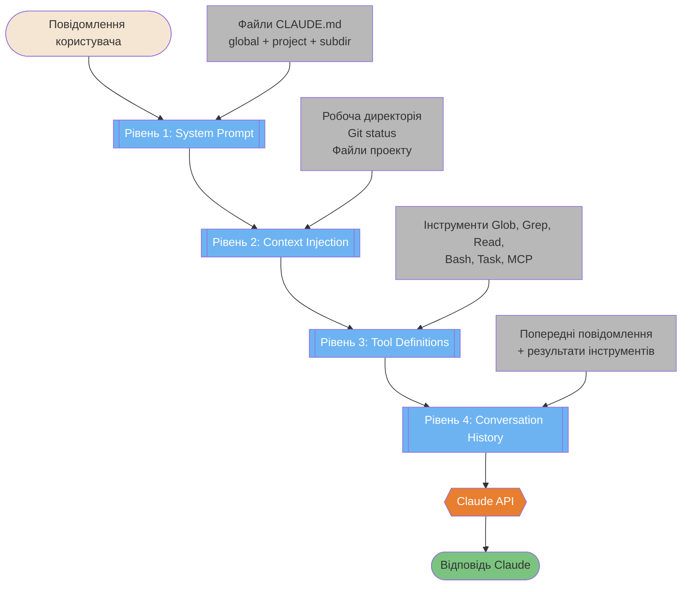
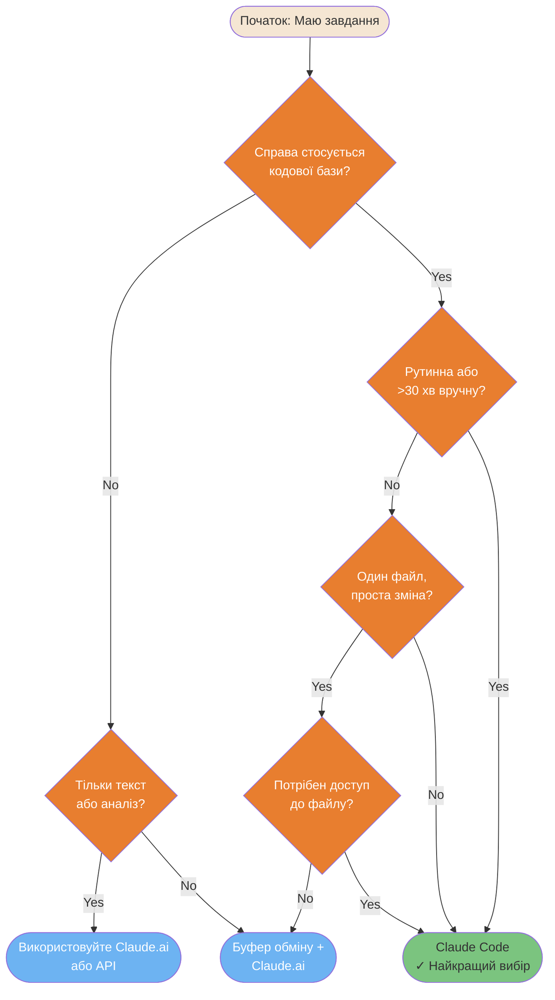

# Основи

Основні концепції, які пояснюють, що таке Claude Code та як він принципово функціонує.

---

### "Чат-бот проти системи контексту" — 4-рівнева модель

Claude Code — це не просто чат-бот, це система контексту, яка перетворює ваше повідомлення на багаторівневий промпт перед викликом API. Ця діаграма демонструє 4-рівневе доповнення, яке відбувається непомітно для кожного запиту.



<details>
<summary>ASCII версія</summary>

```
Повідомлення користувача
     │
     ▼
┌─────────────────────────────────┐
│ Рівень 1: System Prompt          │ ← Файли CLAUDE.md
│ Рівень 2: Context Injection      │ ← Робоча директорія, git status
│ Рівень 3: Tool Definitions       │ ← Усі доступні інструменти
│ Рівень 4: Conversation History   │ ← Попередні повідомлення
└─────────────────┬───────────────┘
                  │
                  ▼
           Виклик Claude API
                  │
                  ▼
           Відповідь Claude
```

</details>

> **Джерело**: [Як працює Claude Code](../ultimate-guide.uk.md#how-claude-code-works) — Рядок ~2360

---

### 9-кроковий конвеєр робочого процесу

Кожен запит до Claude Code проходить через цей конвеєр — від аналізу вашого наміру до відображення фінальної відповіді. Розуміння цього циклу допомагає створювати кращі інструкції та швидше діагностувати проблеми.

```mermaid
flowchart LR
    A([Повідомлення користувача]) --> B(Аналіз наміру)
    B --> C(Завантаження контексту)
    C --> D(Планування дій)
    D --> E(Виконання інструментів)
    E --> F{Потрібні<br/>ще інструменти?}
    F -->|Yes| G(Збір результатів)
    G --> E
    F -->|No| H(Оновлення контексту)
    H --> I(Генерація відповіді)
    I --> J([Відображення користувачу])

    style A fill:#F5E6D3,color:#333
    style B fill:#6DB3F2,color:#fff
    style C fill:#6DB3F2,color:#fff
    style D fill:#E87E2F,color:#fff
    style E fill:#E87E2F,color:#fff
    style F fill:#E87E2F,color:#fff
    style G fill:#B8B8B8,color:#333
    style H fill:#B8B8B8,color:#333
    style I fill:#6DB3F2,color:#fff
    style J fill:#7BC47F,color:#333

    click A href "https://github.com/gerasimsergey/claude-code-ultimate-guide-ua/blob/main/guide/ultimate-guide.md#12-first-workflow" "Перший робочий процес"
    click B href "https://github.com/gerasimsergey/claude-code-ultimate-guide-ua/blob/main/guide/core/architecture.md#1-the-master-loop" "Аналіз наміру — Головний цикл (Master Loop)"
    click C href "https://github.com/gerasimsergey/claude-code-ultimate-guide-ua/blob/main/guide/ultimate-guide.md#22-context-management" "Завантаження контексту"
    click D href "https://github.com/gerasimsergey/claude-code-ultimate-guide-ua/blob/main/guide/ultimate-guide.md#23-plan-mode" "Планування дій — Режим планування (Plan Mode)"
    click E href "https://github.com/gerasimsergey/claude-code-ultimate-guide-ua/blob/main/guide/core/architecture.md#2-the-tool-arsenal" "Виконання інструментів"
    click F href "https://github.com/gerasimsergey/claude-code-ultimate-guide-ua/blob/main/guide/core/architecture.md#1-the-master-loop" "Ще інструменти? — Головний цикл (Master Loop)"
    click G href "https://github.com/gerasimsergey/claude-code-ultimate-guide-ua/blob/main/guide/core/architecture.md#1-the-master-loop" "Збір результатів"
    click H href "https://github.com/gerasimsergey/claude-code-ultimate-guide-ua/blob/main/guide/ultimate-guide.md#22-context-management" "Оновлення контексту"
    click I href "https://github.com/gerasimsergey/claude-code-ultimate-guide-ua/blob/main/guide/core/architecture.md#1-the-master-loop" "Генерація відповіді"
    click J href "https://github.com/gerasimsergey/claude-code-ultimate-guide-ua/blob/main/guide/ultimate-guide.md#12-first-workflow" "Відображення користувачу"
```



<details>
<summary>ASCII версія</summary>

```
Повідомлення користувача → Аналіз наміру → Завантаження контексту → Планування дій
                                                   │
                          ┌────────────────────────┘
                          ▼
                    Виклик інструментів ◄─────────────────┐
                          │                          │
                    Ще інструменти?  ─── Yes ─── Збір результатів
                          │ No
                          ▼
               Оновлення контексту → Генерація відповіді → Відображення
```

</details>

> **Джерело**: [Початок роботи](../ultimate-guide.uk.md#getting-started) — Рядок ~277

---

### Швидке дерево рішень — "Чи варто використовувати Claude Code?"

Не для кожного завдання потрібен Claude Code. Це дерево рішень допоможе вам направити завдання до правильного інструменту — Claude Code CLI, Claude.ai чи методів на основі буфера обміну.



<details>
<summary>ASCII версія</summary>

```
Завдання стосується кодової бази?
├── No → Тільки текст/аналіз? → Yes → Claude.ai
│                           → No  → Буфер обміну + Claude.ai
└── Yes → Рутинна або >30хв?
          ├── Yes → ✓ Claude Code
          └── No  → Один файл, простий?
                    ├── Yes → Потрібен доступ до файлу? → No → Буфер обміну
                    │                                   → Yes → Claude Code
                    └── No  → ✓ Claude Code
```

</details>

> **Джерело**: [Швидке рішення про старт](../ultimate-guide.uk.md#quick-start) — Див. також `machine-readable/reference.yaml` (розділ decide)

---

### Порівняння режимів дозволів

Claude Code має 5 режимів дозволів, які контролюють, що він може робити автоматично, а що потребує вашого схвалення. Вибір неправильного режиму — помилка безпеки №1.

```mermaid
flowchart TD
    subgraph DEFAULT["🔒 Default Mode (Рекомендовано)"]
        D1(Читання файлів) --> D2([Автоматично схвалено])
        D3(Запис файлів) --> D4([Потрібен запит])
        D5(Команди оболонки) --> D6([Потрібен запит])
        D7(Ризиковані операції) --> D8([Потрібен запит])
    end

    subgraph ACCEPT["✏️ acceptEdits Mode"]
        A1(Читання файлів) --> A2([Автоматично схвалено])
        A3(Запис файлів) --> A4([Автоматично схвалено])
        A5(Команди оболонки) --> A6([Потрібен запит])
        A7(Ризиковані операції) --> A8([Потрібен запит])
    end

    subgraph BYPASS["⚠️ bypassPermissions Mode"]
        B1(УСІ операції) --> B2([Автоматично схвалено])
        B3["Використовувати тільки в:<br/>CI/CD, ізольованих (sandboxed)<br/>середовищах"] --> B2
    end

    subgraph PLAN["🔍 Plan Mode (Лише для читання)"]
        PL1(Читання файлів) --> PL2([Автоматично схвалено])
        PL3(Запис файлів) --> PL4([Заблоковано])
        PL5(Команди оболонки) --> PL6([Заблоковано])
        PL7["Вихід за допомогою /execute<br/>або Shift+Tab"] --> PL2
    end

    subgraph DONTASK["🚫 dontAsk Mode"]
        DA1(УСІ операції) --> DA2([Автоматично відхилено])
        DA3["Якщо заздалегідь не схвалено<br/>через /permissions add"] --> DA2
    end

    style D2 fill:#7BC47F,color:#333
    style D4 fill:#E87E2F,color:#fff
    style D6 fill:#E87E2F,color:#fff
    style D8 fill:#E87E2F,color:#fff
    style A2 fill:#7BC47F,color:#333
    style A4 fill:#7BC47F,color:#333
    style A6 fill:#E87E2F,color:#fff
    style A8 fill:#E87E2F,color:#fff
    style B2 fill:#E85D5D,color:#fff
    style B3 fill:#F5E6D3,color:#333
    style PL2 fill:#7BC47F,color:#333
    style PL4 fill:#E85D5D,color:#fff
    style PL6 fill:#E85D5D,color:#fff
    style DA2 fill:#E85D5D,color:#fff
    style DA3 fill:#F5E6D3,color:#333

    click D1 href "https://github.com/gerasimsergey/claude-code-ultimate-guide-ua/blob/main/guide/ultimate-guide.md#14-permission-modes" "Default Mode — Режими дозволів"
    click D2 href "https://github.com/gerasimsergey/claude-code-ultimate-guide-ua/blob/main/guide/ultimate-guide.md#14-permission-modes" "Автоматично схвалено"
    click D3 href "https://github.com/gerasimsergey/claude-code-ultimate-guide-ua/blob/main/guide/ultimate-guide.md#14-permission-modes" "Запис файлів"
    click D4 href "https://github.com/gerasimsergey/claude-code-ultimate-guide-ua/blob/main/guide/ultimate-guide.md#14-permission-modes" "Потрібен запит"
    click D5 href "https://github.com/gerasimsergey/claude-code-ultimate-guide-ua/blob/main/guide/ultimate-guide.md#14-permission-modes" "Команди оболонки"
    click D6 href "https://github.com/gerasimsergey/claude-code-ultimate-guide-ua/blob/main/guide/ultimate-guide.md#14-permission-modes" "Потрібен запит"
    click D7 href "https://github.com/gerasimsergey/claude-code-ultimate-guide-ua/blob/main/guide/ultimate-guide.md#14-permission-modes" "Ризиковані операції"
    click D8 href "https://github.com/gerasimsergey/claude-code-ultimate-guide-ua/blob/main/guide/ultimate-guide.md#14-permission-modes" "Потрібен запит"
    click A1 href "https://github.com/gerasimsergey/claude-code-ultimate-guide-ua/blob/main/guide/ultimate-guide.md#14-permission-modes" "acceptEdits Mode"
    click A2 href "https://github.com/gerasimsergey/claude-code-ultimate-guide-ua/blob/main/guide/ultimate-guide.md#14-permission-modes" "Автоматично схвалено"
    click A3 href "https://github.com/gerasimsergey/claude-code-ultimate-guide-ua/blob/main/guide/ultimate-guide.md#14-permission-modes" "Запис файлів — авто"
    click A4 href "https://github.com/gerasimsergey/claude-code-ultimate-guide-ua/blob/main/guide/ultimate-guide.md#14-permission-modes" "Автоматично схвалено"
    click A5 href "https://github.com/gerasimsergey/claude-code-ultimate-guide-ua/blob/main/guide/ultimate-guide.md#14-permission-modes" "Команди оболонки"
    click A6 href "https://github.com/gerasimsergey/claude-code-ultimate-guide-ua/blob/main/guide/ultimate-guide.md#14-permission-modes" "Потрібен запит"
    click A7 href "https://github.com/gerasimsergey/claude-code-ultimate-guide-ua/blob/main/guide/ultimate-guide.md#14-permission-modes" "Ризиковані операції"
    click A8 href "https://github.com/gerasimsergey/claude-code-ultimate-guide-ua/blob/main/guide/ultimate-guide.md#14-permission-modes" "Потрібен запит"
    click B1 href "https://github.com/gerasimsergey/claude-code-ultimate-guide-ua/blob/main/guide/ultimate-guide.md#14-permission-modes" "bypassPermissions Mode"
    click B2 href "https://github.com/gerasimsergey/claude-code-ultimate-guide-ua/blob/main/guide/ultimate-guide.md#14-permission-modes" "Автоматично схвалено (все)"
    click B3 href "https://github.com/gerasimsergey/claude-code-ultimate-guide-ua/blob/main/guide/ultimate-guide.md#14-permission-modes" "Тільки CI/CD, sandboxed"
    click PL1 href "https://github.com/gerasimsergey/claude-code-ultimate-guide-ua/blob/main/guide/ultimate-guide.md#14-permission-modes" "Plan Mode — Читання файлів"
    click PL2 href "https://github.com/gerasimsergey/claude-code-ultimate-guide-ua/blob/main/guide/ultimate-guide.md#14-permission-modes" "Автоматично схвалено"
    click PL3 href "https://github.com/gerasimsergey/claude-code-ultimate-guide-ua/blob/main/guide/ultimate-guide.md#14-permission-modes" "Plan Mode — Запис файлів заблоковано"
    click PL4 href "https://github.com/gerasimsergey/claude-code-ultimate-guide-ua/blob/main/guide/ultimate-guide.md#14-permission-modes" "Заблоковано"
    click PL5 href "https://github.com/gerasimsergey/claude-code-ultimate-guide-ua/blob/main/guide/ultimate-guide.md#14-permission-modes" "Plan Mode — Команди оболонки заблоковано"
    click PL6 href "https://github.com/gerasimsergey/claude-code-ultimate-guide-ua/blob/main/guide/ultimate-guide.md#14-permission-modes" "Заблоковано"
    click PL7 href "https://github.com/gerasimsergey/claude-code-ultimate-guide-ua/blob/main/guide/ultimate-guide.md#14-permission-modes" "Вихід з Plan Mode"
    click DA1 href "https://github.com/gerasimsergey/claude-code-ultimate-guide-ua/blob/main/guide/ultimate-guide.md#14-permission-modes" "dontAsk Mode — Усі операції"
    click DA2 href "https://github.com/gerasimsergey/claude-code-ultimate-guide-ua/blob/main/guide/ultimate-guide.md#14-permission-modes" "Автоматично відхилено"
    click DA3 href "https://github.com/gerasimsergey/claude-code-ultimate-guide-ua/blob/main/guide/ultimate-guide.md#14-permission-modes" "Попереднє схвалення через /permissions add"
```



<details>
<summary>ASCII версія</summary>

```
DEFAULT (Рекомендовано)       acceptEdits               bypassPermissions
───────────────────────       ───────────               ─────────────────
Читання файлів → AUTO ✓       Читання файлів → AUTO ✓   УСІ операції → AUTO ⚠️
Запис файлів   → PROMPT       Запис файлів   → AUTO ✓
Команди обол.  → PROMPT       Команди обол.  → PROMPT   Використовувати: лише CI/CD,
Ризик. операц. → PROMPT       Ризик. операц. → PROMPT   sandboxed env

Plan Mode (Лише читання)     dontAsk Mode
────────────────────────     ────────────
Читання файлів → AUTO ✓       УСІ операції → AUTO DENIED ✗
Запис файлів   → BLOCKED ✗    Якщо не схвалено заздалегідь через
Команди обол.  → BLOCKED ✗    /permissions add
Вихід: /execute або Shift+Tab
```

</details>

> **Джерело**: [Система дозволів](../ultimate-guide.uk.md#permission-system) — Рядок ~760

---
**Локалізація**: [Serhii (MacPlus Software)](https://macplus-software.com)
*Остання синхронізація: Травень 2026*
