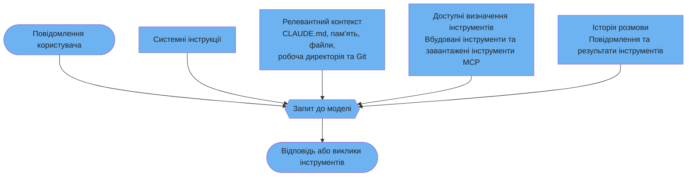
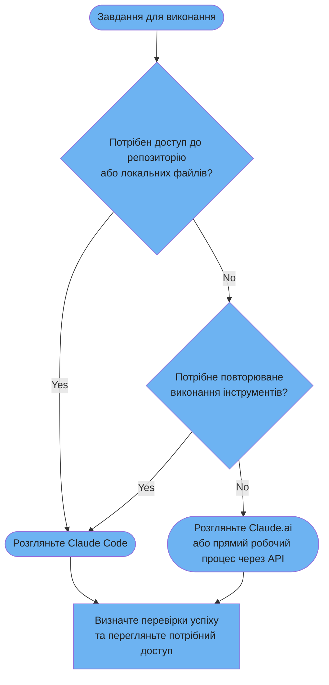

# Основи

Концептуальні моделі та задокументована поведінка дозволів для Claude Code.

---

### "Чат-бот проти системи контексту": 4-рівнева модель

Ця навчальна модель із чотирьох частин групує вхідні дані, які використовує Claude Code. Гілки є категоріями контексту, а не фіксованим порядком складання. Інструкції та визначення інструментів можуть завантажуватися в різний час; інструменти MCP можуть відкладатися до моменту потреби.



<details>
<summary>ASCII версія</summary>

```
Повідомлення користувача -------------+
Системні інструкції ------------------+
Релевантний контекст -----------------+--> Запит до моделі --> Відповідь / виклики інструментів
Доступні або завантажені визначення --+
інструментів                          |
Розмова та результати інструментів ---+

Концептуальне групування, а не фіксований порядок завантаження.
```

</details>

> **Джерело**: [Керування контекстом](../ultimate-guide.uk.md#22-context-management)
>
> **Офіційна довідка**: [Context Claude Code adds](https://code.claude.com/docs/en/how-claude-code-works#context-claude-code-adds-on-its-own) та [відкладені визначення MCP](https://code.claude.com/docs/en/how-claude-code-works#when-context-fills-up).

---

### 9-кроковий конвеєр робочого процесу

Цей дев'ятиетапний навчальний робочий процес узагальнює один хід із використанням інструментів. Claude може відповісти одразу, повторити дослідження або зупинитися після помилки чи переривання. Ці етапи не задають дев'ять обов'язкових внутрішніх функцій.

```mermaid
flowchart LR
    A([Повідомлення користувача]) --> B(Розуміння запиту)
    B --> C(Збір релевантного контексту)
    C --> D(Вибір наступної дії)
    D --> F{Потрібен<br/>інструмент?}
    F -->|Yes| P(Перевірка дозволів)
    P -->|Allowed| E(Виконання інструмента)
    P -->|Denied| D
    E --> G(Збір результату)
    G --> H(Оновлення контексту розмови)
    H --> D
    F -->|No| I(Генерація відповіді)
    I --> J([Відображення відповіді])
    style A fill:#6DB3F2,color:#222
    click A href "https://github.com/FlorianBruniaux/claude-code-ultimate-guide/blob/main/guide/core/architecture.md#1-the-master-loop" "The master loop"
    style B fill:#6DB3F2,color:#222
    click B href "https://github.com/FlorianBruniaux/claude-code-ultimate-guide/blob/main/guide/core/architecture.md#1-the-master-loop" "The master loop"
    style C fill:#6DB3F2,color:#222
    click C href "https://github.com/FlorianBruniaux/claude-code-ultimate-guide/blob/main/guide/core/architecture.md#1-the-master-loop" "The master loop"
    style D fill:#6DB3F2,color:#222
    click D href "https://github.com/FlorianBruniaux/claude-code-ultimate-guide/blob/main/guide/core/architecture.md#1-the-master-loop" "The master loop"
    style F fill:#6DB3F2,color:#222
    click F href "https://github.com/FlorianBruniaux/claude-code-ultimate-guide/blob/main/guide/core/architecture.md#1-the-master-loop" "The master loop"
    style P fill:#6DB3F2,color:#222
    click P href "https://github.com/FlorianBruniaux/claude-code-ultimate-guide/blob/main/guide/core/architecture.md#1-the-master-loop" "The master loop"
    style E fill:#6DB3F2,color:#222
    click E href "https://github.com/FlorianBruniaux/claude-code-ultimate-guide/blob/main/guide/core/architecture.md#1-the-master-loop" "The master loop"
    style G fill:#6DB3F2,color:#222
    click G href "https://github.com/FlorianBruniaux/claude-code-ultimate-guide/blob/main/guide/core/architecture.md#1-the-master-loop" "The master loop"
    style H fill:#6DB3F2,color:#222
    click H href "https://github.com/FlorianBruniaux/claude-code-ultimate-guide/blob/main/guide/core/architecture.md#1-the-master-loop" "The master loop"
    style I fill:#6DB3F2,color:#222
    click I href "https://github.com/FlorianBruniaux/claude-code-ultimate-guide/blob/main/guide/core/architecture.md#1-the-master-loop" "The master loop"
    style J fill:#6DB3F2,color:#222
    click J href "https://github.com/FlorianBruniaux/claude-code-ultimate-guide/blob/main/guide/core/architecture.md#1-the-master-loop" "The master loop"
```



<details>
<summary>ASCII версія</summary>

```
Повідомлення користувача
  -> 1. Розуміння запиту -> 2. Збір контексту -> 3. Вибір дії
     Потрібен інструмент?
       Так -> 4. Перевірка дозволів -> 5. Виконання -> 6. Збір результату
              відхилено -> вибір дії               -> 7. Оновлення контексту -> вибір дії
       Ні  -> 8. Генерація відповіді -> 9. Відображення відповіді
Помилки та переривання можуть завершити хід раніше.
```

</details>

> **Джерело**: [Основний цикл](../core/architecture.uk.md#1-основний-цикл-the-master-loop)
>
> **Офіційна довідка**: [Agentic loop](https://code.claude.com/docs/en/how-claude-code-works#the-agentic-loop).

---

### Швидке дерево рішень: "Чи варто використовувати Claude Code?"

Евристика автора для вибору інтерфейсу. Доступ до файлів і повторюване виконання інструментів можуть зробити Claude Code корисним; суто розмова може підійти для Claude.ai. Це не обмеження продукту й не виміряний часовий поріг.



<details>
<summary>ASCII версія</summary>

```
Потрібен доступ до репозиторію або локальних файлів?
  Так -> Розгляньте Claude Code
  Ні  -> Потрібне повторюване виконання інструментів?
           Так -> Розгляньте Claude Code
           Ні  -> Розгляньте Claude.ai або прямий робочий процес через API
Обидва шляхи: визначте перевірки успіху та перегляньте потрібний доступ.
```

</details>

> **Джерело**: [Перший робочий процес](../ultimate-guide.uk.md#12-перший-робочий-процес)
>
> **Офіційна довідка**: [Verify work and choose a workflow](https://code.claude.com/docs/en/best-practices#give-claude-a-way-to-verify-its-work).

---

### Порівняння режимів дозволів

Шість задокументованих режимів змінюють спосіб схвалення викликів інструментів. Це зведення: правила allow/ask/deny, межі робочих директорій і захищені дії все одно мають значення. Доступність режиму auto залежить від сесії.

```mermaid
flowchart TD
    ROOT[Режими дозволів] --> D[default / Manual<br/>Запитує підтвердження для дій, що його потребують<br/>Дозволене читання може виконуватися]
    ROOT --> A[acceptEdits<br/>Приймає редагування файлів і поширені<br/>команди файлової системи в дозволених директоріях]
    ROOT --> P[plan<br/>Читання та shell лише для читання<br/>Команди, схвалені класифікатором, якщо доступний auto<br/>Без редагування вихідних файлів]
    ROOT --> AUTO[auto, коли доступний<br/>Класифікатор перевіряє дії<br/>без рутинних запитів на дозвіл]
    ROOT --> N[dontAsk<br/>Відхиляє виклики, що потребували б підтвердження<br/>Дозволене читання та дозволені виклики можуть виконуватися]
    ROOT --> B[bypassPermissions<br/>Пропускає запити на дозвіл<br/>Задокументовані винятки все одно діють]
    style ROOT fill:#6DB3F2,color:#222
    click ROOT href "https://github.com/FlorianBruniaux/claude-code-ultimate-guide/blob/main/guide/ultimate-guide.md#14-permission-modes" "Permission modes"
    style D fill:#6DB3F2,color:#222
    click D href "https://github.com/FlorianBruniaux/claude-code-ultimate-guide/blob/main/guide/ultimate-guide.md#14-permission-modes" "Permission modes"
    style A fill:#6DB3F2,color:#222
    click A href "https://github.com/FlorianBruniaux/claude-code-ultimate-guide/blob/main/guide/ultimate-guide.md#14-permission-modes" "Permission modes"
    style P fill:#6DB3F2,color:#222
    click P href "https://github.com/FlorianBruniaux/claude-code-ultimate-guide/blob/main/guide/ultimate-guide.md#14-permission-modes" "Permission modes"
    style AUTO fill:#6DB3F2,color:#222
    click AUTO href "https://github.com/FlorianBruniaux/claude-code-ultimate-guide/blob/main/guide/ultimate-guide.md#14-permission-modes" "Permission modes"
    style N fill:#6DB3F2,color:#222
    click N href "https://github.com/FlorianBruniaux/claude-code-ultimate-guide/blob/main/guide/ultimate-guide.md#14-permission-modes" "Permission modes"
    style B fill:#6DB3F2,color:#222
    click B href "https://github.com/FlorianBruniaux/claude-code-ultimate-guide/blob/main/guide/ultimate-guide.md#14-permission-modes" "Permission modes"
```



<details>
<summary>ASCII версія</summary>

```
default / Manual : запитує підтвердження для дій, що його потребують; дозволене читання може виконуватися
acceptEdits      : редагування файлів і поширені команди файлової системи в дозволених директоріях
plan             : дослідження лише для читання; без редагування вихідних файлів
                    команди, схвалені класифікатором, можуть виконуватися, коли доступний режим auto
auto             : класифікатор перевіряє дії; доступність залежить від сесії
dontAsk          : виклики, що потребували б підтвердження, відхиляються; дозволені виклики виконуються
bypassPermissions: пропускає запити із задокументованими винятками; лише ізольовані середовища

Правила, межі директорій і захищені дії все одно потрібно перевіряти.
```

</details>

> **Джерело**: [Режими дозволів](../ultimate-guide.uk.md#14-режими-дозволів)
>
> **Офіційна довідка**: [Mode semantics and exceptions](https://code.claude.com/docs/en/permissions#permission-modes).
>
> Plan також може виконувати команди, схвалені класифікатором, коли доступний режим auto. Використовуйте bypassPermissions лише в ізольованому середовищі, як-от контейнер або VM, де його доступ не може завдати шкоди. dontAsk також відхиляє задокументовані інструменти взаємодії з користувачем, навіть якщо вони дозволені.

---
**Локалізація**: [Serhii (MacPlus Software)](https://macplus-software.com)
*Остання синхронізація: Травень 2026*
