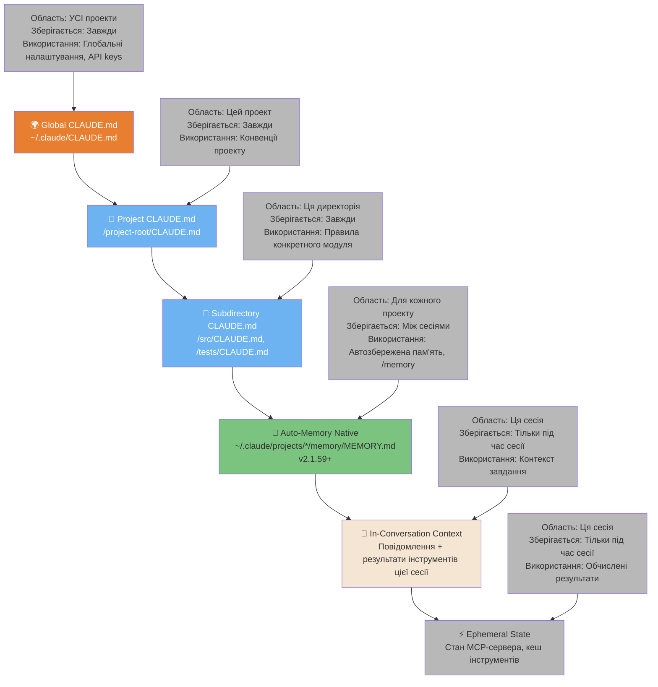
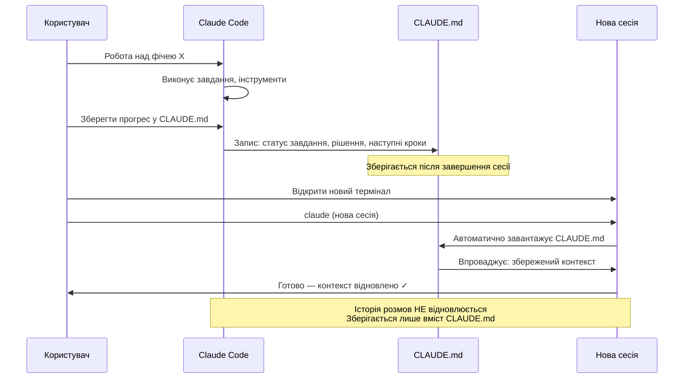

# Контекст і сесії

Як Claude Code керує контекстом, пам'яттю та сесіями під час вашої роботи.

---

### Зони керування контекстом

Ваше вікно контексту має 4 окремі зони, кожна з яких вимагає різних стратегій. Розуміння того, в якій зоні ви перебуваєте, запобігає роздуванню контексту та зберігає якість відповідей протягом тривалих сесій.

```mermaid
flowchart LR
    subgraph GREEN["🟢 0–50% — Комфортно"]
        G1(Доступні всі<br/>можливості)
        G2(Усі інструменти активні)
        G3(Детальні відповіді)
    end

    subgraph BLUE["🔵 50–75% — Нормально"]
        B1(Моніторинг використання)
        B2(Розгляньте /compact<br/>для старих гілок)
        B3(Нормальна робота)
    end

    subgraph ORANGE["🟠 75–85% — Обережно"]
        O1(Проактивна пропозиція<br/>/compact)
        O2(Зменшення деталізації)
        O3(Відкладення некритичних<br/>операцій)
    end

    subgraph RED["🔴 85–100% — Критично"]
        R1(Авто-compact<br/>спрацьовує на 80%)
        R2(Тільки критичні операції)
        R3(Запуск нової сесії<br/>для нових завдань)
    end

    GREEN --> BLUE --> ORANGE --> RED

    style G1 fill:#7BC47F,color:#333
    style G2 fill:#7BC47F,color:#333
    style G3 fill:#7BC47F,color:#333
    style B1 fill:#6DB3F2,color:#fff
    style B2 fill:#6DB3F2,color:#fff
    style B3 fill:#6DB3F2,color:#fff
    style O1 fill:#E87E2F,color:#fff
    style O2 fill:#E87E2F,color:#fff
    style O3 fill:#E87E2F,color:#fff
    style R1 fill:#E85D5D,color:#fff
    style R2 fill:#E85D5D,color:#fff
    style R3 fill:#E85D5D,color:#fff

    click G1 href "https://github.com/gerasimsergey/claude-code-ultimate-guide-ua/blob/main/guide/ultimate-guide.md#22-context-management" "0-50%: Доступні всі можливості"
    click G2 href "https://github.com/gerasimsergey/claude-code-ultimate-guide-ua/blob/main/guide/ultimate-guide.md#22-context-management" "0-50%: Усі інструменти активні"
    click G3 href "https://github.com/gerasimsergey/claude-code-ultimate-guide-ua/blob/main/guide/ultimate-guide.md#22-context-management" "0-50%: Детальні відповіді"
    click B1 href "https://github.com/gerasimsergey/claude-code-ultimate-guide-ua/blob/main/guide/ultimate-guide.md#22-context-management" "50-75%: Моніторинг використання"
    click B2 href "https://github.com/gerasimsergey/claude-code-ultimate-guide-ua/blob/main/guide/ultimate-guide.md#22-context-management" "50-75%: Розгляньте /compact"
    click B3 href "https://github.com/gerasimsergey/claude-code-ultimate-guide-ua/blob/main/guide/ultimate-guide.md#22-context-management" "50-75%: Нормальна робота"
    click O1 href "https://github.com/gerasimsergey/claude-code-ultimate-guide-ua/blob/main/guide/ultimate-guide.md#22-context-management" "75-85%: Пропозиція /compact"
    click O2 href "https://github.com/gerasimsergey/claude-code-ultimate-guide-ua/blob/main/guide/ultimate-guide.md#22-context-management" "75-85%: Зменшення деталізації"
    click O3 href "https://github.com/gerasimsergey/claude-code-ultimate-guide-ua/blob/main/guide/ultimate-guide.md#22-context-management" "75-85%: Відкладення некритичних"
    click R1 href "https://github.com/gerasimsergey/claude-code-ultimate-guide-ua/blob/main/guide/ultimate-guide.md#22-context-management" "85-100%: Авто-compact"
    click R2 href "https://github.com/gerasimsergey/claude-code-ultimate-guide-ua/blob/main/guide/ultimate-guide.md#22-context-management" "85-100%: Тільки критичні операції"
    click R3 href "https://github.com/gerasimsergey/claude-code-ultimate-guide-ua/blob/main/guide/ultimate-guide.md#22-context-management" "85-100%: Запуск нової сесії"
```



<details>
<summary>ASCII версія</summary>

```
0%──────50%──────75%──85%──100%
│ Зелений │ Синій  │Помаранч.│Червоний│
│ Повний  │ Норма  │Пропоз.  │Авто    │
│ доступ  │Монітор │/compact │cmp     │
│         │        │Зменш.   │Крит.   │
│         │        │детал.   │тільки  │
```

</details>

> **Джерело**: [Керування контекстом](../ultimate-guide.uk.md#керування-контекстом) — Рядок ~1335

---

### Ієрархія пам'яті — 6 типів

Claude Code має 6 окремих типів пам'яті з різними областями дії та персистентністю. Розуміння того, який тип пам'яті використовувати для кожної частини інформації, є ключем до ефективних сесій.



<details>
<summary>ASCII версія</summary>

```
ПОСТІЙНО ──────────────────────────────── ТІЛЬКИ СЕСІЯ

~/.claude/CLAUDE.md              Контекст бесіди
      │                                  │
/project/CLAUDE.md               Ефемерний стан MCP
      │
/subdir/CLAUDE.md
      │
Auto-Memory (MEMORY.md)  ← між сесіями, для конкретного проекту

Вище = ширша область, зберігається завжди
Нижче = вужча область, витримує перезапуски
Auto-Memory = зберігається між сесіями, обмежена проектом
```

</details>

> **Джерело**: [Система пам'яті](../ultimate-guide.uk.md#memory-system) — Рядок ~3160 & ~3986 | Auto-Memory: v2.1.59+ (v3.30.0)

---

### Безперервність сесії — Збереження та відновлення стану

Сесії не переносять контекст автоматично між різними терміналами. Ця діаграма демонструє, як зберегти стан та відновити його в новій сесії чи терміналі, що дозволяє реалізувати асинхронні робочі процеси.



<details>
<summary>ASCII версія</summary>

```
Сесія 1                      CLAUDE.md         Сесія 2
───────                      ─────────         ───────
Робота над завданням            │               Відкрити термінал
     │                          │                    │
Зберегти прогрес ─────────────► Запис             Завантажити CLAUDE.md
                              статусу,         ◄── Автоматично впроваджено
                              рішень,
                              наступних кроків
```

</details>

> **Джерело**: [Керування сесіями](../ultimate-guide.uk.md#session-management) — Рядок ~9477

---

### Антипатерн проти найкращої практики свіжого контексту

Тривалі сесії накопичують шум, що погіршує якість відповідей. Ця діаграма показує патерн деградації та рекомендований підхід "фокусованих сесій", який зберігає високу продуктивність.

```mermaid
flowchart TD
    subgraph BAD["❌ Антипатерн: Монолітна сесія"]
        B1([Старт великої сесії]) --> B2(Додати завдання A)
        B2 --> B3(Додати завдання B)
        B3 --> B4(Додати завдання C)
        B4 --> B5{Контекст роздутий<br/>>75%}
        B5 --> B6(Якість відповідей<br/>погіршується)
        B6 --> B7(Примусовий перезапуск<br/>втрачає весь контекст)
        style B1 fill:#E85D5D,color:#fff
        style B5 fill:#E85D5D,color:#fff
        style B6 fill:#E85D5D,color:#fff
        style B7 fill:#E85D5D,color:#fff
    end

    subgraph GOOD["✅ Найкраща практика: Фокусовані сесії"]
        G1([Старт фокусованої сесії]) --> G2(Завершити завдання A)
        G2 --> G3{Природна<br/>контрольна точка?}
        G3 -->|Yes| G4(Зберегти у CLAUDE.md)
        G4 --> G5([Нова сесія для завдання B])
        G3 -->|No| G6{Контекст >75%?}
        G6 -->|Yes| G7(/compact)
        G7 --> G2
        G6 -->|No| G2
        style G1 fill:#7BC47F,color:#333
        style G4 fill:#7BC47F,color:#333
        style G5 fill:#7BC47F,color:#333
        style G3 fill:#E87E2F,color:#fff
        style G6 fill:#E87E2F,color:#fff
        style G7 fill:#6DB3F2,color:#fff
    end

    click B1 href "https://github.com/gerasimsergey/claude-code-ultimate-guide-ua/blob/main/guide/ultimate-guide.md#22-context-management" "Антипатерн: Монолітна сесія"
    click B2 href "https://github.com/gerasimsergey/claude-code-ultimate-guide-ua/blob/main/guide/ultimate-guide.md#22-context-management" "Додати завдання A"
    click B3 href "https://github.com/gerasimsergey/claude-code-ultimate-guide-ua/blob/main/guide/ultimate-guide.md#22-context-management" "Додати завдання B"
    click B4 href "https://github.com/gerasimsergey/claude-code-ultimate-guide-ua/blob/main/guide/ultimate-guide.md#22-context-management" "Додати завдання C"
    click B5 href "https://github.com/gerasimsergey/claude-code-ultimate-guide-ua/blob/main/guide/ultimate-guide.md#22-context-management" "Контекст роздутий >75%"
    click B6 href "https://github.com/gerasimsergey/claude-code-ultimate-guide-ua/blob/main/guide/ultimate-guide.md#22-context-management" "Якість відповідей погіршується"
    click B7 href "https://github.com/gerasimsergey/claude-code-ultimate-guide-ua/blob/main/guide/ultimate-guide.md#22-context-management" "Примусовий перезапуск — втрата контексту"
    click G1 href "https://github.com/gerasimsergey/claude-code-ultimate-guide-ua/blob/main/guide/ultimate-guide.md#22-context-management" "Найкраща практика: Фокусовані сесії"
    click G2 href "https://github.com/gerasimsergey/claude-code-ultimate-guide-ua/blob/main/guide/ultimate-guide.md#22-context-management" "Завершити завдання A"
    click G3 href "https://github.com/gerasimsergey/claude-code-ultimate-guide-ua/blob/main/guide/ultimate-guide.md#22-context-management" "Природна контрольна точка?"
    click G4 href "https://github.com/gerasimsergey/claude-code-ultimate-guide-ua/blob/main/guide/ultimate-guide.md#31-memory-files-claudemd" "Зберегти у CLAUDE.md"
    click G5 href "https://github.com/gerasimsergey/claude-code-ultimate-guide-ua/blob/main/guide/ultimate-guide.md#22-context-management" "Нова сесія для завдання B"
    click G6 href "https://github.com/gerasimsergey/claude-code-ultimate-guide-ua/blob/main/guide/ultimate-guide.md#22-context-management" "Контекст >75%?"
    click G7 href "https://github.com/gerasimsergey/claude-code-ultimate-guide-ua/blob/main/guide/ultimate-guide.md#22-context-management" "/compact"
```



<details>
<summary>ASCII версія</summary>

```
ПОГАНО: Одна гігантська сесія
Завдання A → Завдання B → Завдання C → Роздуття контексту → Падіння якості → Перезапуск → Втрачено!

ДОБРЕ: Фокусовані сесії
Завдання A ──► Контр. точка? ──Yes──► Зберегти CLAUDE.md ──► Нова сесія для B
           │
           No
           │
         Контекст >75%? ──Yes──► /compact ──► Продовжити
           │
           No
           │
         Продовжити завдання
```

</details>

> **Джерело**: [Кращі практики контексту](../ultimate-guide.uk.md#context-best-practices) — Рядок ~1525

---
**Локалізація**: [Serhii (MacPlus Software)](https://macplus-software.com)
*Остання синхронізація: Травень 2026*
