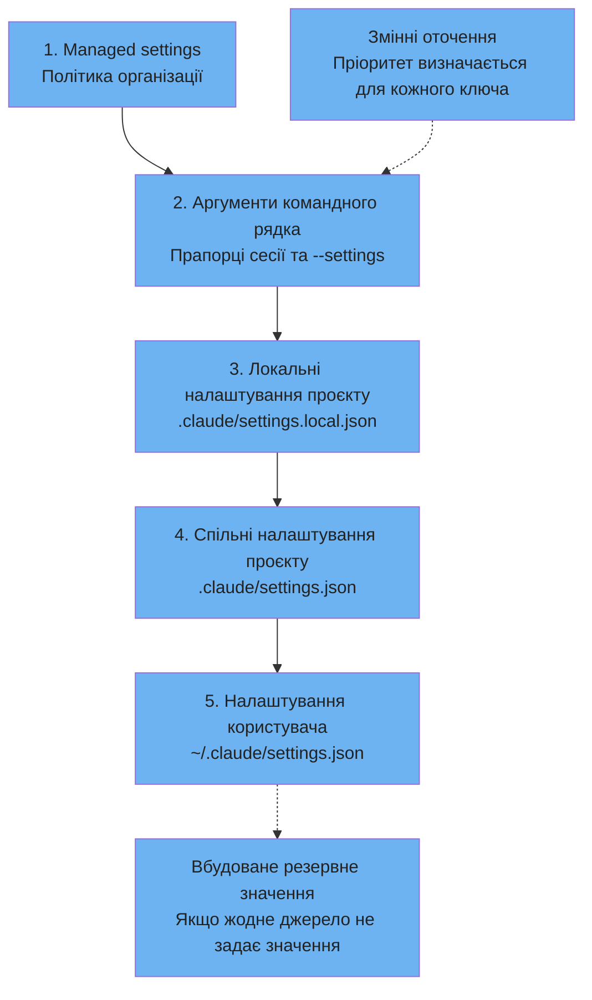
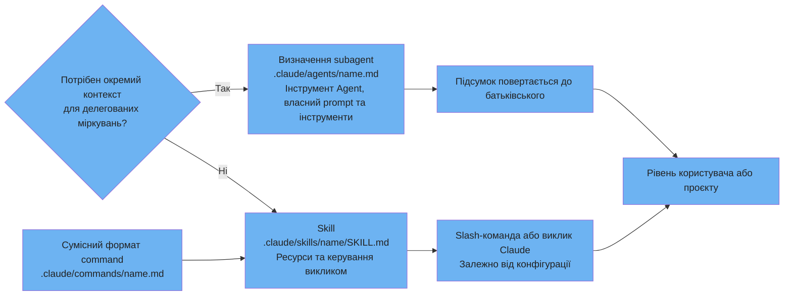
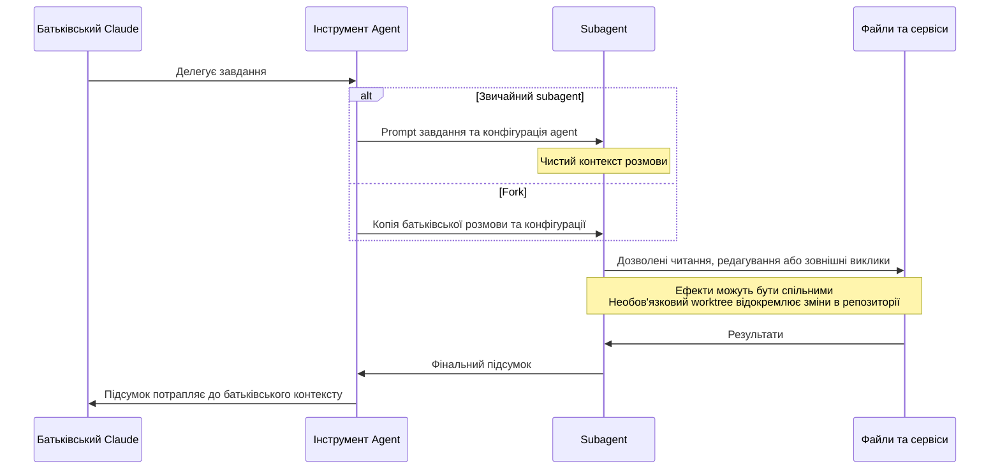
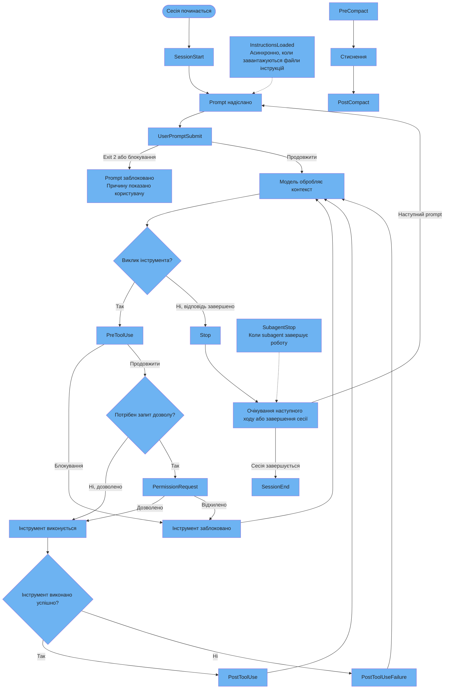

# Система конфігурації

Задокументований пріоритет налаштувань і спрощений огляд розширюваності та hooks.

---

### Пріоритет конфігурації (5 рівнів)

Для одного й того самого ключа налаштувань задокументований стек має п'ять рівнів, від найвищого. Списки можуть зливатися, а для чутливих до безпеки налаштувань діють винятки. Пріоритет змінних оточення визначається окремо для кожного налаштування; CLAUDE.md належить до контексту інструкцій, а не до цього стеку налаштувань.



<details>
<summary>ASCII версія</summary>

```
Найвищий пріоритет
1. Managed settings
2. Аргументи командного рядка
3. .claude/settings.local.json
4. .claude/settings.json
5. ~/.claude/settings.json
Резерв: вбудоване значення, якщо нічого не налаштовано

Змінні оточення: визначаються для кожного ключа, це не універсальний шостий рівень.
CLAUDE.md: інструкції, поза цим стеком налаштувань.
Списки можуть зливатися; див. задокументовані винятки для чутливих до безпеки налаштувань.
```

</details>

> **Джерело**: [Правила пріоритету](../ultimate-guide.uk.md#34-правила-пріоритету)
>
> **Офіційний довідник**: [Settings precedence](https://code.claude.com/docs/en/settings#settings-precedence) та [environment-variable precedence](https://code.claude.com/docs/en/env-vars#precedence).
>
> Для вибору моделі використовується змінна ANTHROPIC_MODEL. CLAUDE_CONFIG_DIR змінює каталог конфігурації. Вибір моделі через CLI залишається обмеженим managed-параметром availableModels і не перевизначає політику організації.

---

### Skills проти commands проти agents: коли що використовувати

Власні commands об'єднано зі skills. Обидва формати файлів створюють slash-команду; skills також підтримують вбудовані ресурси та виклик самим Claude. Subagent використовують окреме вікно контексту для делегованої роботи. Для цих механізмів існують рівні користувача й проєкту.



<details>
<summary>ASCII версія</summary>

```
Багаторазові інструкції / workflow:
  .claude/skills/name/SKILL.md -> /name або виклик Claude залежно від конфігурації
  .claude/commands/name.md    -> сумісний формат /name
  Обидва можуть діяти на рівні користувача або проєкту.

Делегована робота:
  .claude/agents/name.md -> інструмент Agent -> власний контекст, prompt і дозволені інструменти
  Підсумок повертається до батьківського; ефекти на файли й сервіси можуть бути спільними.
```

</details>

> **Джерело**: [Розуміння скілів](../ultimate-guide.uk.md#51-розуміння-skills)
>
> **Офіційний довідник**: [Skills and command compatibility](https://code.claude.com/docs/en/skills) та [subagent definitions](https://code.claude.com/docs/en/sub-agents).

---

### Життєвий цикл agent та ізоляція області видимості

Окреме вікно контексту не пускає проміжну активність інструментів у батьківську розмову, але не ізолює ефекти на файли чи сервіси. Звичайні subagent починають з чистого аркуша; fork успадковують розмову. Worktree може відокремити зміни в репозиторії.



<details>
<summary>ASCII версія</summary>

```
Батьківський -> інструмент Agent -> Subagent
  Звичайний: prompt завдання + визначення; чистий контекст розмови
  Fork:      успадковує батьківську розмову та конфігурацію
  Tools:     дозволені операції з файлами/сервісами; ефекти можуть бути спільними
  Необов'язковий worktree: окремий checkout репозиторію, зовнішні сервіси не ізольовані
Subagent -> фінальний підсумок -> батьківський контекст
```

</details>

> **Джерело**: [Архітектура під-агентів](../core/architecture.uk.md#4-архітектура-під-агентів)
>
> **Офіційний довідник**: [Forks and ordinary subagents](https://code.claude.com/docs/en/sub-agents#how-forks-differ-from-other-subagents).

---

### Конвеєр подій hooks

Цей спрощений життєвий цикл розрізняє події сесії, події ходу та події інструментів. PermissionRequest є умовною подією. Типи hook і керування рішеннями залежать від події; це не вичерпний перелік подій.



<details>
<summary>ASCII версія</summary>

```
SessionStart -> prompt -> UserPromptSubmit
  заблоковано (exit 2 / рішення): причину показано користувачу; prompt не обробляється
  продовжити -> модель обробляє контекст -> виклик інструмента?
    ні, відповідь завершено -> Stop -> наступний хід або SessionEnd
    так -> PreToolUse -> перевірка дозволів
              заблоковано -> інструмент заблоковано -> модель
              потрібен запит -> PermissionRequest -> allow / deny
              уже дозволено -> виконання
  успіх інструмента -> PostToolUse -> модель
  збій інструмента -> PostToolUseFailure -> модель

Окремі події: InstructionsLoaded (асинхронна), SubagentStop
Стиснення: PreCompact -> стиснення -> PostCompact
Типи hook: command, http, mcp_tool, prompt, agent; підтримка залежить від події.
```

</details>

> **Джерело**: [Система подій](../ultimate-guide.uk.md#71-система-подій)
>
> **Офіційний довідник**: [Hook lifecycle and decisions](https://code.claude.com/docs/en/hooks#hook-lifecycle).
>
> InstructionsLoaded також спрацьовує під час відкладеного (lazy) завантаження інструкцій. Stop спрацьовує на кожну відповідь, SessionEnd на кожну сесію; для помилок API є StopFailure. Деякі спеціальні інструменти пропускають звичайні hooks інструментів. Офіційний довідник перелічує ці винятки та підтримувані типи hook для кожної події.

---
**Локалізація**: [Serhii (MacPlus Software)](https://macplus-software.com)
*Остання синхронізація: Травень 2026*
