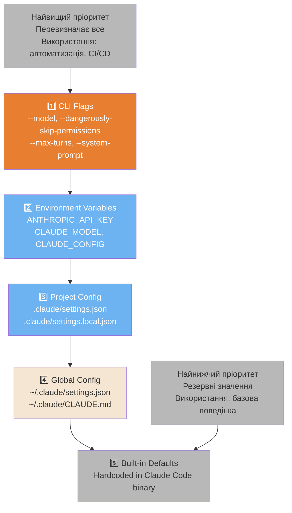
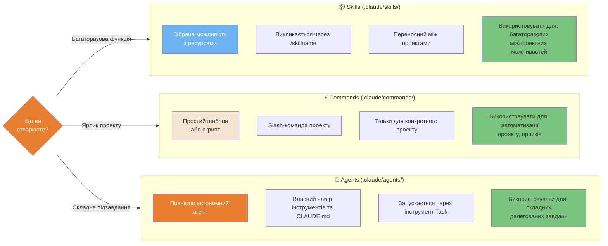
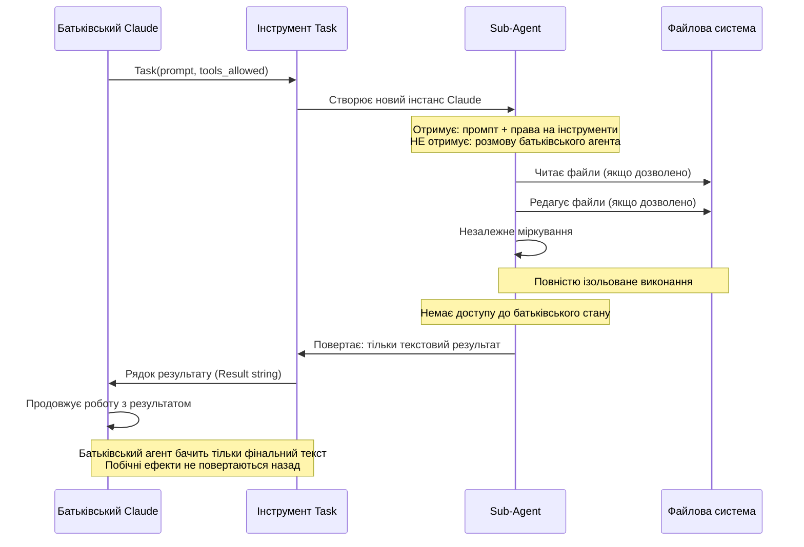

# Система конфігурації

Як Claude Code завантажує налаштування, вирішує конфлікти та організовує розширюваність.

---

### Пріоритет конфігурації (5 рівнів)

Claude Code визначає налаштування за суворою ієрархією пріоритетів. Вищі рівні перевизначають нижчі. Розуміння цього запобігає виникненню багів на кшталт "чому моя конфігурація не працює?".



<details>
<summary>ASCII версія</summary>

```
ПРІОРИТЕТ (від найвищого до найнижчого)
══════════════════════════════════════
1. CLI Flags            ← --model, --system-prompt
2. Environment Vars     ← ANTHROPIC_API_KEY
3. Project .claude/     ← settings.json, settings.local.json
4. Global ~/.claude/    ← settings.json, CLAUDE.md
5. Вбудовані defaults   ← жорстко закодовані значення
```

</details>

> **Джерело**: [Система конфігурації](../ultimate-guide.uk.md#configuration) — Рядок ~3760

---

### Skills проти Commands проти Agents — Коли що використовувати

Три механізми розширення з різними цілями та компромісами. Вибір неправильної абстракції призводить до надмірної складності (over-engineering) або недостатньо потужної автоматизації.



<details>
<summary>ASCII версія</summary>

```
                    Skills              Commands           Agents
Місце:         .claude/skills/     .claude/commands/  .claude/agents/
Тригер:        /skillname          /commandname       Інструмент Task
Область дії:   Міжпроектна         Цей проект         Будь-який контекст
Складність:    Середня (зібрана)   Низька (шаблон)    Висока (автономна)
Коли:          Багаторазові ф-ції  Швидкі ярлики      Складні завдання
```

</details>

> **Джерело**: [Система розширюваності](../ultimate-guide.uk.md#extensibility) — Рядок ~4495, ~5025, ~3900

---

### Життєвий цикл агента та ізоляція областей дії

Sub-agents працюють у повній ізоляції від батьківського агента. Вони отримують копію контексту, але не ділять спільний стан. Розуміння цього запобігає плутанині на кшталт "чому мій sub-agent не бачить X?".



<details>
<summary>ASCII версія</summary>

```
Батьківський ──Task(prompt, tools)──► Sub-Agent
                                          │
                                     [ізольоване виконання]
                                     - читання файлів
                                     - редагування файлів
                                     - bash (якщо дозволено)
                                          │
Батьківський ◄───── текстовий результат ──┘
(без спільного використання стану, без побічних ефектів)
```

</details>

> **Джерело**: [Sub-Agents](../ultimate-guide.uk.md#sub-agents) — Рядок ~3900

---

### Конвеєр подій Hooks

Hooks дозволяють виконувати власний код у ключових точках життєвого циклу Claude Code — для перевірки безпеки, логування, примусового виконання правил або сповіщень. Порядок виконання має значення.

```mermaid
flowchart TD
    INIT([Старт сесії]) -.->|v2.1.69+| INST{InstructionsLoaded Hook}
    INST -.-> A

    A([Користувач надсилає повідомлення]) --> UPS{UserPromptSubmit Hook}
    UPS -->|Exit 0: proceed| B{PreToolUse Hook}
    UPS -->|Exit 2: feedback| A
    B -->|Exit 0: allow| C[Інструмент виконується]
    B -->|Exit 1: block| D([Інструмент заблоковано<br/>Claude зупиняється])
    C --> E{PostToolUse Hook}
    E --> F[Наступний інструмент або відповідь]
    F --> G{Потрібні ще інструменти?}
    G -->|Yes| B
    G -->|No| H([Сесія завершується])
    H --> I{Stop / SessionEnd Hook}
    I --> J([Завершено])

    K{PreCompact Hook} -.->|Перед /compact| L[Виконується /compact]
    L --> M{PostCompact Hook}

    NOTE["Типи hooks:<br/>bash (exit 0/1/2)<br/>http (POST JSON → URL, v2.1.63+)"] -.-> B

    style INST fill:#6DB3F2,color:#fff
    style UPS fill:#6DB3F2,color:#fff
    style B fill:#E87E2F,color:#fff
    style D fill:#E85D5D,color:#fff
    style E fill:#E87E2F,color:#fff
    style I fill:#E87E2F,color:#fff
    style K fill:#6DB3F2,color:#fff
    style M fill:#6DB3F2,color:#fff
    style C fill:#7BC47F,color:#333
    style J fill:#7BC47F,color:#333
    style NOTE fill:#F5E6D3,color:#333

    click INIT href "https://github.com/gerasimsergey/claude-code-ultimate-guide-ua/blob/main/guide/ultimate-guide.md#71-the-event-system" "Старт сесії"
    click INST href "https://github.com/gerasimsergey/claude-code-ultimate-guide-ua/blob/main/guide/ultimate-guide.md#71-the-event-system" "InstructionsLoaded Hook — v2.1.69+"
    click A href "https://github.com/gerasimsergey/claude-code-ultimate-guide-ua/blob/main/guide/ultimate-guide.md#71-the-event-system" "Користувач надсилає повідомлення"
    click UPS href "https://github.com/gerasimsergey/claude-code-ultimate-guide-ua/blob/main/guide/ultimate-guide.md#71-the-event-system" "UserPromptSubmit Hook"
    click B href "https://github.com/gerasimsergey/claude-code-ultimate-guide-ua/blob/main/guide/ultimate-guide.md#71-the-event-system" "PreToolUse Hook"
    click C href "https://github.com/gerasimsergey/claude-code-ultimate-guide-ua/blob/main/guide/core/architecture.md#2-the-tool-arsenal" "Інструмент виконується"
    click D href "https://github.com/gerasimsergey/claude-code-ultimate-guide-ua/blob/main/guide/ultimate-guide.md#71-the-event-system" "Інструмент заблоковано"
    click E href "https://github.com/gerasimsergey/claude-code-ultimate-guide-ua/blob/main/guide/ultimate-guide.md#71-the-event-system" "PostToolUse Hook"
    click F href "https://github.com/gerasimsergey/claude-code-ultimate-guide-ua/blob/main/guide/ultimate-guide.md#71-the-event-system" "Наступний інструмент або відповідь"
    click G href "https://github.com/gerasimsergey/claude-code-ultimate-guide-ua/blob/main/guide/ultimate-guide.md#71-the-event-system" "Потрібні ще інструменти?"
    click H href "https://github.com/gerasimsergey/claude-code-ultimate-guide-ua/blob/main/guide/ultimate-guide.md#71-the-event-system" "Сесія завершується"
    click I href "https://github.com/gerasimsergey/claude-code-ultimate-guide-ua/blob/main/guide/ultimate-guide.md#71-the-event-system" "Stop / SessionEnd Hook"
    click J href "https://github.com/gerasimsergey/claude-code-ultimate-guide-ua/blob/main/guide/ultimate-guide.md#72-creating-hooks" "Завершено"
    click K href "https://github.com/gerasimsergey/claude-code-ultimate-guide-ua/blob/main/guide/ultimate-guide.md#71-the-event-system" "PreCompact Hook"
    click L href "https://github.com/gerasimsergey/claude-code-ultimate-guide-ua/blob/main/guide/ultimate-guide.md#71-the-event-system" "Виконується /compact"
    click M href "https://github.com/gerasimsergey/claude-code-ultimate-guide-ua/blob/main/guide/ultimate-guide.md#71-the-event-system" "PostCompact Hook"
```



<details>
<summary>ASCII версія</summary>

```
Старт сесії
     │ (InstructionsLoaded Hook — v2.1.69+)
Повідомлення користувача
     │
 UserPromptSubmit ──exit 2──► зворотний зв'язок для Claude (цикл)
     │ exit 0
 PreToolUse ──exit 1──► ЗАБЛОКОВАНО
     │ exit 0
     ▼
Інструмент виконується
     │
PostToolUse
     │
Потрібні ще інструменти? ──yes──► PreToolUse (цикл)
     │ no
Сесія завершується
     │
  Stop / SessionEnd Hook
     │
 Завершено

Окремо: PreCompact ──► /compact ──► PostCompact

Типи hooks: bash (exit 0/1/2) | http POST JSON (v2.1.63+)
```

</details>

> **Джерело**: [Система Hooks](../ultimate-guide.uk.md#hooks) — Рядок ~5350 | UserPromptSubmit + HTTP hooks: v2.1.63+ | InstructionsLoaded: v2.1.69+

---
**Локалізація**: [Serhii (MacPlus Software)](https://macplus-software.com)
*Остання синхронізація: Травень 2026*
