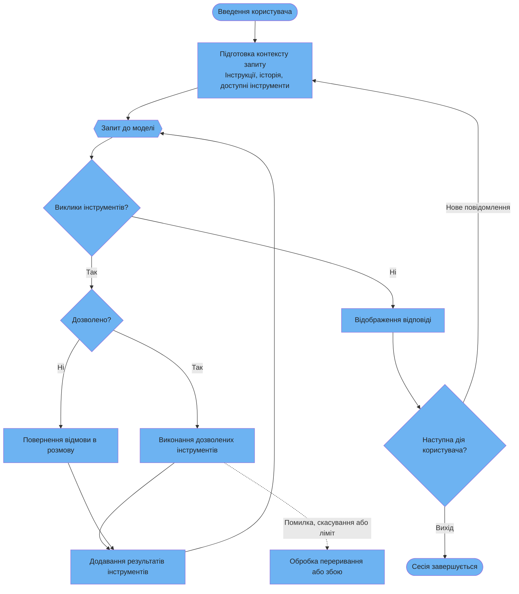
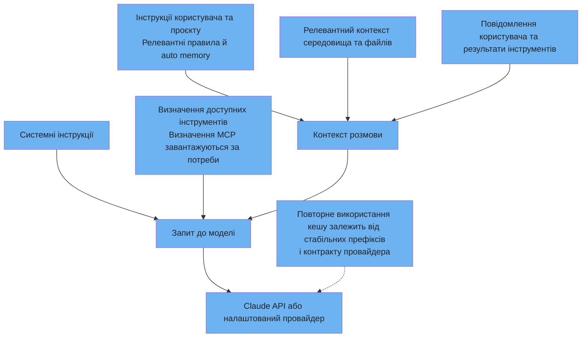
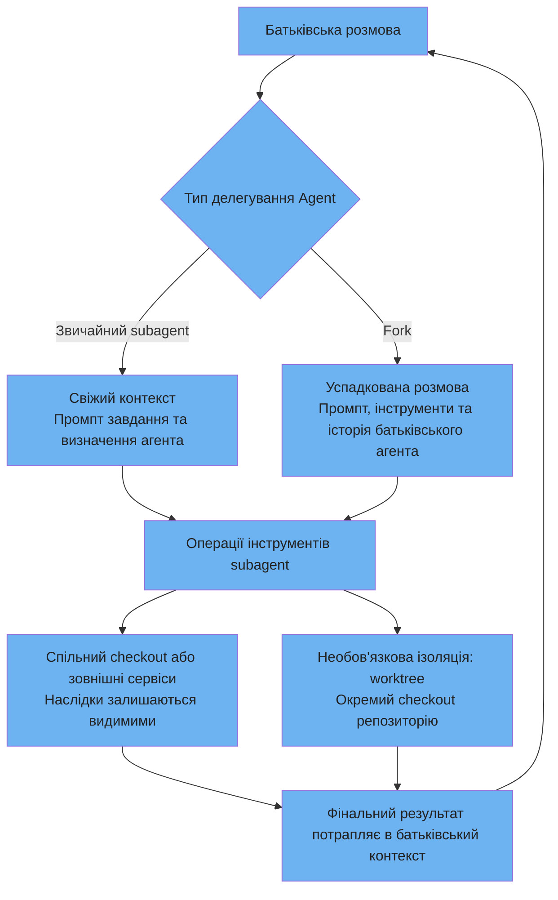
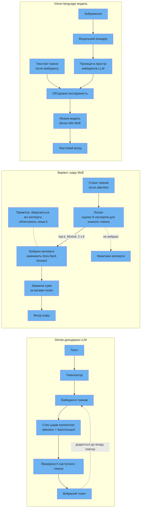

# Внутрішня архітектура

Концептуальні діаграми циклу «модель - інструменти», сімейств інструментів і меж контексту.

---

### Головний цикл (The master loop)

Спрощений цикл «модель - інструменти»: Claude запитує інструменти, дозволені операції виконуються, а їхні результати повертаються в розмову. Ходи також можуть завершуватися через помилки, скасування або ліміти. Незалежні операції можуть виконуватися паралельно; фіксований ліміт паралельності не стверджується.



<details>
<summary>ASCII версія</summary>

```
Введення користувача -> контекст запиту -> модель
                    ^             |
                    |        виклики інструментів?
                    |          Так -> дозволи -> виконати або відмовити -> додати результат
                    +-------------------------------------------------------------+
                               Ні -> показати відповідь -> наступне повідомлення або вихід
Помилки, скасування та ліміти можуть перервати цикл.
Незалежні операції можуть виконуватися паралельно.
```

</details>

> **Джерело**: [Головний цикл](../core/architecture.uk.md#1-основний-цикл-the-master-loop)
>
> **Офіційний довідник**: [Задокументований агентний цикл](https://code.claude.com/docs/en/how-claude-code-works#the-agentic-loop).

---

### Категорії інструментів і вибір

Ці шість категорій, визначених автором, упорядковують приклади із задокументованого переліку інструментів. Доступність залежить від версії Claude Code, моделі, поверхні та конфігурації; це не повний перелік інструментів і не нативна таксономія з шести категорій.

```mermaid
flowchart TD
    ROOT[Ілюстративні сімейства інструментів] --> READ[Читання та пошук<br/>Glob, Grep, Read]
    ROOT --> WRITE[Зміна файлів<br/>Write, Edit, NotebookEdit]
    ROOT --> EXEC[Виконання та делегування<br/>Bash, Agent]
    ROOT --> WEB[Доступ до вебу<br/>WebSearch, WebFetch]
    ROOT --> TRACK[Відстеження завдань, коли доступно<br/>TaskCreate, TaskGet,<br/>TaskList, TaskUpdate]
    ROOT --> CONTROL[Керування робочим процесом<br/>EnterPlanMode, ExitPlanMode,<br/>EnterWorktree, ExitWorktree,<br/>AskUserQuestion]
    style ROOT fill:#6DB3F2,color:#222
    click ROOT href "https://github.com/gerasimsergey/claude-code-ultimate-guide-ua/blob/main/guide/core/architecture.uk.md#2-арсенал-інструментів" "Арсенал інструментів"
    style READ fill:#6DB3F2,color:#222
    click READ href "https://github.com/gerasimsergey/claude-code-ultimate-guide-ua/blob/main/guide/core/architecture.uk.md#2-арсенал-інструментів" "Арсенал інструментів"
    style WRITE fill:#6DB3F2,color:#222
    click WRITE href "https://github.com/gerasimsergey/claude-code-ultimate-guide-ua/blob/main/guide/core/architecture.uk.md#2-арсенал-інструментів" "Арсенал інструментів"
    style EXEC fill:#6DB3F2,color:#222
    click EXEC href "https://github.com/gerasimsergey/claude-code-ultimate-guide-ua/blob/main/guide/core/architecture.uk.md#2-арсенал-інструментів" "Арсенал інструментів"
    style WEB fill:#6DB3F2,color:#222
    click WEB href "https://github.com/gerasimsergey/claude-code-ultimate-guide-ua/blob/main/guide/core/architecture.uk.md#2-арсенал-інструментів" "Арсенал інструментів"
    style TRACK fill:#6DB3F2,color:#222
    click TRACK href "https://github.com/gerasimsergey/claude-code-ultimate-guide-ua/blob/main/guide/core/architecture.uk.md#2-арсенал-інструментів" "Арсенал інструментів"
    style CONTROL fill:#6DB3F2,color:#222
    click CONTROL href "https://github.com/gerasimsergey/claude-code-ultimate-guide-ua/blob/main/guide/core/architecture.uk.md#2-арсенал-інструментів" "Арсенал інструментів"
```



<details>
<summary>ASCII версія</summary>

```
READ / SEARCH : Glob, Grep, Read
MODIFY        : Write, Edit, NotebookEdit
EXECUTE       : Bash, Agent
WEB           : WebSearch, WebFetch
TASK TRACKING : TaskCreate, TaskGet, TaskList, TaskUpdate, коли доступно
CONTROL       : EnterPlanMode / ExitPlanMode, EnterWorktree / ExitWorktree,
                AskUserQuestion

Ілюстративні сімейства, а не повний чи універсально доступний перелік.
Переглядайте директорії через команду оболонки; звіряйтеся з актуальним довідником інструментів.
```

</details>

> **Джерело**: [Арсенал інструментів](../core/architecture.uk.md#2-арсенал-інструментів)
>
> **Офіційний довідник**: [Актуальні інструменти та їх доступність](https://code.claude.com/docs/en/tools-reference).
>
> TodoWrite є альтернативним інструментом чекліста в підтримуваних конфігураціях, а не універсально активним типовим варіантом. Agent є актуальною назвою інструмента subagent; Task залишається псевдонімом у налаштуваннях і визначеннях.

---

### Збірка системного промпту

Ця концептуальна діаграма запиту групує стабільні інструкції разом зі змінним контекстом розмови. Вона не визначає точного внутрішнього порядку збірки, меж кешу чи моменту повторного читання кожного входу. Файли інструкцій і пам'ять можуть потрапляти в контекст розмови; визначення MCP можуть завантажуватися на вимогу.



<details>
<summary>ASCII версія</summary>

```
Системні інструкції ----------------------+
Доступні / завантажені визначення інструментів -+--> Запит до моделі -> налаштований провайдер
Контекст розмови --------------------------+
  - релевантні файли інструкцій, правила та доступна пам'ять
  - інформація про середовище та файли
  - повідомлення та результати інструментів

Концептуальне групування; не буквальний порядок промпту і не розкладка кешу.
Ізоляція та повторне використання кешу визначаються контрактом провайдера.
```

</details>

> **Джерело**: [Вміст системного промпту](../core/architecture.uk.md#вміст-системного-промпту)
>
> **Офіційний довідник**: [Завантаження контексту](https://code.claude.com/docs/en/how-claude-code-works#context-claude-code-adds-on-its-own) та [ізоляція кешу](https://platform.claude.com/docs/en/build-with-claude/prompt-caching#cache-storage-and-sharing).
>
> Кеші публічного Anthropic API не спільні між організаціями. Ізоляція за робочими просторами також діє в провайдерів, названих у документації з кешування. Повторне використання приватного вмісту CLAUDE.md між користувачами чи організаціями не стверджується.

---

### Ізоляція контексту sub-agent

Ізоляція розмови й ізоляція файлової системи це різні межі. Звичайний subagent має свіжий контекст; fork успадковує розмову батьківського агента. Обидва повертають фінальний результат, тоді як дозволені операції можуть впливати на спільні файли чи зовнішні сервіси.



<details>
<summary>ASCII версія</summary>

```
Батьківський -> Agent
  звичайний -> свіжий контекст із делегованим завданням і визначенням
  fork      -> успадкована розмова та конфігурація батьківського агента
       |
       +-> спільні файли й зовнішні сервіси: дозволені наслідки зберігаються
       +-> необов'язковий worktree: окремий checkout для змін у репозиторії
       |
       +-> фінальний результат потрапляє в батьківський контекст

Проміжні виклики інструментів не потрапляють у батьківський контекст.
Worktree не ізолює зовнішні сервіси.
```

</details>

> **Джерело**: [Архітектура під-агентів](../core/architecture.uk.md#4-архітектура-під-агентів)
>
> **Офіційний довідник**: [Контекст fork і необов'язкова ізоляція worktree](https://code.claude.com/docs/en/sub-agents#how-forks-differ-from-other-subagents).

---

### Три конвеєри моделей: dense, MoE та VLM

Це концептуальне спрощення. Dense проти mixture-of-experts (MoE) описує, як побудовано шари, а текстова модель проти vision-language (VLM) описує, які входи приймає модель. Це різні осі, що можуть поєднуватися: модель MoE також може приймати зображення. Anthropic публічно не документує внутрішню архітектуру Claude, тому діаграми показують опубліковані відкриті архітектури, а не Claude. Таблицю осей дивіться в розділі [архітектура, клас розміру, модальність і завдання](../core/ai-concept-boundaries.uk.md#архітектура-клас-розміру-модальність-і-завдання).



<details>
<summary>ASCII версія</summary>

```
Dense : текст -> токенізатор -> ембединги токенів
        -> стек шарів transformer (attention + feed-forward)
        -> ймовірності наступного токена -> вибраний токен
        -> додається до входу, повтор

Варіант шару MoE:
        стани токенів після attention -> router (оцінює N експертів для кожного токена)
        -> top-k, Mixtral: 2 з 8 -> вибрані експерти
           (замінюють блок feed-forward) -> зважена сума за вагами
           router -> вихід шару
        не вибрані -> неактивні експерти
        Примітка: зберігаються всі експерти, обчислюють лише k.

VLM   : зображення -> візуальний енкодер -> проєкція в простір ембедингів LLM
        текстові токени після ембедингу ----------------+
        спроєктоване зображення + текст після ембедингу -> об'єднана послідовність
        -> мовна модель (dense або MoE) -> текстовий вихід
```

</details>

> **Джерело**: [Архітектура, клас розміру, модальність і завдання](../core/ai-concept-boundaries.uk.md#архітектура-клас-розміру-модальність-і-завдання)

> Експерти це не окремі повноцінні моделі: вони розташовані всередині кожного шару, замість блоку feed-forward.
>
> Джерела: [технічний звіт Phi-3](https://ar5iv.labs.arxiv.org/html/2404.14219) (архітектура transformer-декодера), [глосарій Anthropic](https://platform.claude.com/docs/en/about-claude/glossary) (авторегресивна мовна модель), [Attention Is All You Need](https://ar5iv.labs.arxiv.org/html/1706.03762) (оригінальний transformer, енкодер-декодер), [Mixtral of Experts](https://arxiv.org/html/2401.04088), [Switch Transformers](https://ar5iv.labs.arxiv.org/html/2101.03961), [LLaVA](https://ar5iv.labs.arxiv.org/html/2304.08485), [документація Claude щодо зору](https://platform.claude.com/docs/en/build-with-claude/vision) (зображення споживають токени).

---
**Локалізація**: [Serhii (MacPlus Software)](https://macplus-software.com)
*Остання синхронізація: Листопад 2026 (v3.46.0)*
