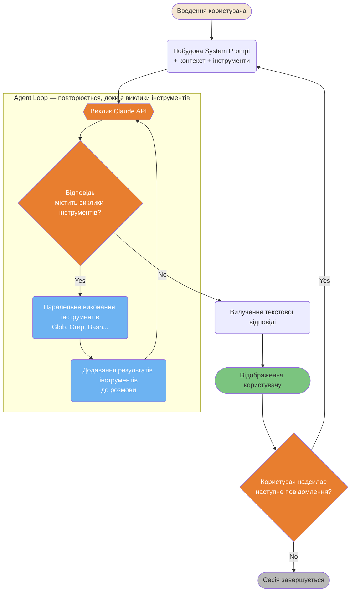
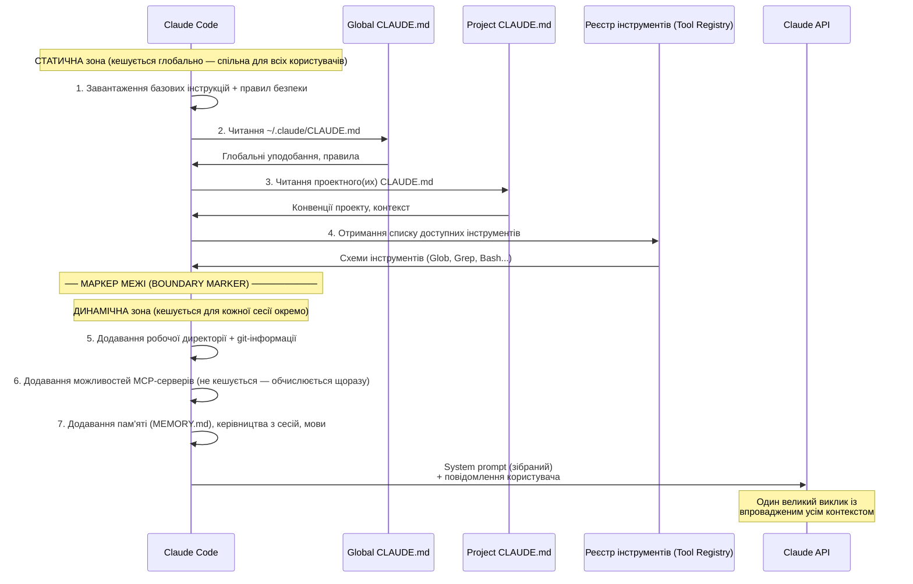
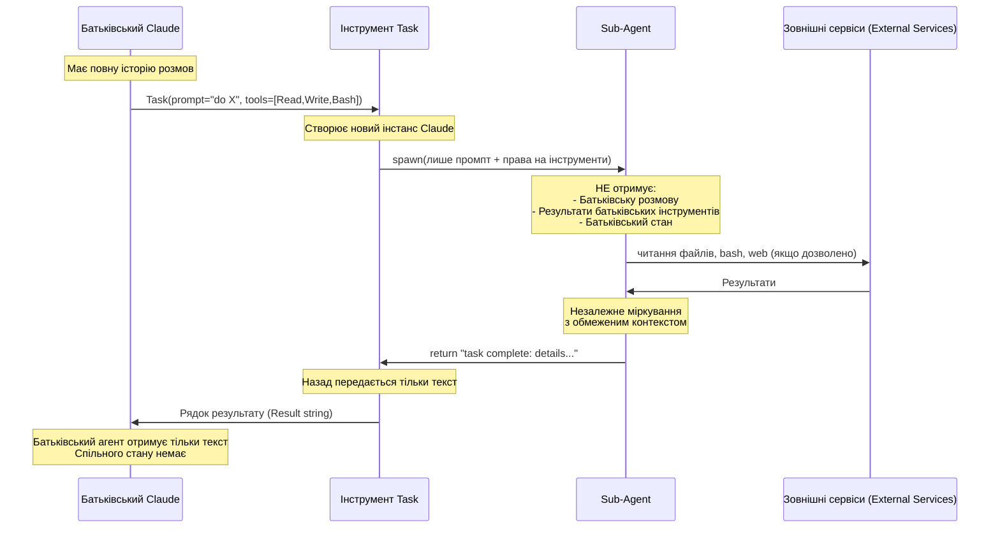

# Архітектурні нутрощі

Що відбувається "під капотом" під час роботи Claude Code.

---

### Головний цикл (The Master Loop)

Основне виконання Claude Code складається з двох вкладених циклів: **внутрішнього циклу агента (inner agent loop)**, який продовжує викликати API, доки повертаються виклики інструментів, та **зовнішнього циклу розмови (outer conversation loop)**, який починає новий раунд, коли користувач дає відповідь.



<details>
<summary>ASCII версія</summary>

```
Введення користувача
     │
Побудова промпту (system + context + tools)
     │
 ┌── Agent Loop ──────────────────────┐
 │ Claude API ◄────────────────────┐  │
 │      │                          │  │
 │ Виклики інструментів?           │  │
 │  ├─ Yes → Виконати інструменти ─┘  │
 │  └─ No  → вихід з циклу            │
 └────────────────────────────────────┘
               │
       Відображення відповіді
               │
       Користувач надсилає далі? ──► Yes → перебудувати промпт → цикл
               └─ No → Сесія завершується
```

</details>

> **Джерело**: [Архітектура: Головний цикл](../core/architecture.uk.md#master-loop) — Рядок ~72
>
> *Підтверджено джерелом (2026-03-31): Внутрішній цикл є асинхронним генератором `queryLoop()`. Інструменти виконуються через `StreamingToolExecutor` (до 10 паралельно). Цикл завершується з однієї з 10 кінцевих причин (`completed`, `max_turns`, `aborted_tools` тощо).*

---

### Категорії інструментів та вибір

Claude Code має 6 категорій інструментів, кожна з яких оптимізована для різних операцій. Розуміння того, який інструмент вибирає Claude (і чому), допомагає писати інструкції, що спрямовують до кращого вибору інструментів.

```mermaid
flowchart TD
    ROOT["Інструменти Claude Code"] --> READ
    ROOT --> WRITE
    ROOT --> EXECUTE
    ROOT --> WEB
    ROOT --> WORKFLOW
    ROOT --> CONTROL

    subgraph READ["📖 Інструменти читання (Read Tools)"]
        R1[Glob<br/>Пошук файлів за патерном]
        R2[Grep<br/>Пошук у вмісті файлів]
        R3[Read<br/>Читання вмісту файлу]
        R4[LS<br/>Список директорії]
    end

    subgraph WRITE["✏️ Інструменти запису (Write Tools)"]
        W1[Write<br/>Створення нового файлу]
        W2[Edit<br/>Зміна існуючого файлу]
        W3[MultiEdit<br/>Групові зміни]
    end

    subgraph EXECUTE["⚙️ Інструменти виконання (Execute Tools)"]
        E1[Bash<br/>Команди оболонки]
        E2[Task<br/>Запуск sub-agent]
    end

    subgraph WEB["🌐 Веб-інструменти (Web Tools)"]
        WB1[WebSearch<br/>Пошук в Інтернеті]
        WB2[WebFetch<br/>Отримання вмісту URL]
    end

    subgraph WORKFLOW["📋 Інструменти робочого процесу (Workflow Tools)"]
        WF1[TodoWrite<br/>Керування списком завдань]
        WF2[NotebookEdit<br/>Jupyter notebooks]
    end

    subgraph CONTROL["🎛️ Інструменти керування потоком (Control Flow Tools)"]
        CF1[EnterPlanMode / ExitPlanMode<br/>Перемикання режиму планування]
        CF2[EnterWorktree / ExitWorktree<br/>Навігація у worktree]
        CF3[AskUserQuestion<br/>Запит введення від користувача]
    end

    style ROOT fill:#E87E2F,color:#fff
    style R1 fill:#6DB3F2,color:#fff
    style R2 fill:#6DB3F2,color:#fff
    style R3 fill:#6DB3F2,color:#fff
    style R4 fill:#6DB3F2,color:#fff
    style W1 fill:#F5E6D3,color:#333
    style W2 fill:#F5E6D3,color:#333
    style W3 fill:#F5E6D3,color:#333
    style E1 fill:#E85D5D,color:#fff
    style E2 fill:#E87E2F,color:#fff
    style WB1 fill:#7BC47F,color:#333
    style WB2 fill:#7BC47F,color:#333
    style WF1 fill:#B8B8B8,color:#333
    style WF2 fill:#B8B8B8,color:#333
    style CF1 fill:#B8B8B8,color:#333
    style CF2 fill:#B8B8B8,color:#333
    style CF3 fill:#B8B8B8,color:#333

    click ROOT href "https://github.com/gerasimsergey/claude-code-ultimate-guide-ua/blob/main/guide/core/architecture.md#2-the-tool-arsenal" "Інструменти Claude Code"
    click R1 href "https://github.com/gerasimsergey/claude-code-ultimate-guide-ua/blob/main/guide/core/architecture.md#2-the-tool-arsenal" "Glob — Пошук файлів за патерном"
    click R2 href "https://github.com/gerasimsergey/claude-code-ultimate-guide-ua/blob/main/guide/core/architecture.md#2-the-tool-arsenal" "Grep — Пошук у вмісті файлів"
    click R3 href "https://github.com/gerasimsergey/claude-code-ultimate-guide-ua/blob/main/guide/core/architecture.md#2-the-tool-arsenal" "Read — Читання вмісту файлу"
    click R4 href "https://github.com/gerasimsergey/claude-code-ultimate-guide-ua/blob/main/guide/core/architecture.md#2-the-tool-arsenal" "LS — Список директорії"
    click W1 href "https://github.com/gerasimsergey/claude-code-ultimate-guide-ua/blob/main/guide/core/architecture.md#2-the-tool-arsenal" "Write — Створення нового файлу"
    click W2 href "https://github.com/gerasimsergey/claude-code-ultimate-guide-ua/blob/main/guide/core/architecture.md#2-the-tool-arsenal" "Edit — Зміна існуючого файлу"
    click W3 href "https://github.com/gerasimsergey/claude-code-ultimate-guide-ua/blob/main/guide/core/architecture.md#2-the-tool-arsenal" "MultiEdit — Групові зміни"
    click E1 href "https://github.com/gerasimsergey/claude-code-ultimate-guide-ua/blob/main/guide/core/architecture.md#2-the-tool-arsenal" "Bash — Команди оболонки"
    click E2 href "https://github.com/gerasimsergey/claude-code-ultimate-guide-ua/blob/main/guide/ultimate-guide.md#41-what-are-agents" "Task — Запуск sub-agent"
    click WB1 href "https://github.com/gerasimsergey/claude-code-ultimate-guide-ua/blob/main/guide/core/architecture.md#2-the-tool-arsenal" "WebSearch"
    click WB2 href "https://github.com/gerasimsergey/claude-code-ultimate-guide-ua/blob/main/guide/core/architecture.md#2-the-tool-arsenal" "WebFetch"
    click WF1 href "https://github.com/gerasimsergey/claude-code-ultimate-guide-ua/blob/main/guide/core/architecture.md#2-the-tool-arsenal" "TodoWrite — Список завдань"
    click WF2 href "https://github.com/gerasimsergey/claude-code-ultimate-guide-ua/blob/main/guide/core/architecture.md#2-the-tool-arsenal" "NotebookEdit — Jupyter"
    click CONTROL href "https://github.com/gerasimsergey/claude-code-ultimate-guide-ua/blob/main/guide/core/architecture.md#2-the-tool-arsenal" "Інструменти керування потоком"
    click CF1 href "https://github.com/gerasimsergey/claude-code-ultimate-guide-ua/blob/main/guide/core/architecture.md#2-the-tool-arsenal" "EnterPlanMode / ExitPlanMode"
    click CF2 href "https://github.com/gerasimsergey/claude-code-ultimate-guide-ua/blob/main/guide/core/architecture.md#2-the-tool-arsenal" "EnterWorktree / ExitWorktree"
    click CF3 href "https://github.com/gerasimsergey/claude-code-ultimate-guide-ua/blob/main/guide/core/architecture.md#2-the-tool-arsenal" "AskUserQuestion"
```



<details>
<summary>ASCII версія</summary>

```
READ:     Glob (пошук), Grep (пошук у вмісті), Read (вміст), LS (список)
WRITE:    Write (створити), Edit (змінити), MultiEdit (групове)
EXECUTE:  Bash (оболонка), Task (sub-agent)  ← найпотужніші/найризикованіші
WEB:      WebSearch, WebFetch
WORKFLOW: TodoWrite, NotebookEdit
CONTROL:  EnterPlanMode/ExitPlanMode, EnterWorktree/ExitWorktree, AskUserQuestion
```

</details>

> **Джерело**: [Архітектура: Інструменти](../core/architecture.uk.md#tools) — Рядок ~213
>
> *Спрощено — доступні додаткові інструменти. Див. [Архітектура: Арсенал інструментів](../core/architecture.uk.md#tools) для повного списку.*

---

### Збірка системного промпту

Перед кожним викликом API Claude Code збирає системний промпт з кількох джерел у певному порядку. Промпт розділений на дві зони кешування маркером межі.



<details>
<summary>ASCII версія</summary>

```
СТАТИЧНА зона (кешується глобально):
1. Базові інструкції (жорстко закодовані)
2. ~/.claude/CLAUDE.md
3. /project/CLAUDE.md + піддиректорії
4. Список визначень інструментів
────── МАРКЕР МЕЖІ (BOUNDARY MARKER) ──────────
ДИНАМІЧНА зона (кеш на сесію):
5. Робоча директорія + git status
6. Можливості MCP-серверів (завжди обчислюються наново)
7. Пам'ять, керівництво з сесій, мова
──────────────────────────────────────────────
→ Усе об'єднано → Виклик Claude API
```

</details>

> **Джерело**: [Архітектура: Системний промпт](../core/architecture.uk.md#system-prompt) — Рядок ~354
>
> *Підтверджено джерелом (2026-03-31): Двозонна архітектура за допомогою маркера `SYSTEM_PROMPT_DYNAMIC_BOUNDARY`. Статична зона має `cacheScope: 'global'` (спільна для всіх користувачів). Інструкції MCP явно не кешуються — коментар у коді: "servers connect/disconnect between turns".*

---

### Ізоляція контексту sub-agents

Sub-agents повністю ізольовані від батьківського агента — вони не можуть читати розмову батьківського агента чи змінювати його стан. Ця ізоляція є водночас захистом (безпека) та обмеженням (навмисний дизайн).



<details>
<summary>ASCII версія</summary>

```
Батьківський (повний контекст)
    │
    Task(prompt, tools=[...])
    │
    ▼
Sub-Agent (ІЗОЛЬОВАНИЙ)
  Введення: тільки промпт + дозволи на інструменти
  Може: використовувати надані інструменти незалежно
  Не може: бачити батьківську розмову, змінювати батьківський стан
  Вихід: ТІЛЬКИ текстовий результат
    │
    ▼
Батьківський отримує: текстовий рядок
```

</details>

> **Джерело**: [Архітектура: Sub-Agents](../core/architecture.uk.md#sub-agents) — Рядок ~444

---
**Локалізація**: [Serhii (MacPlus Software)](https://macplus-software.com)
*Остання синхронізація: Травень 2026*
