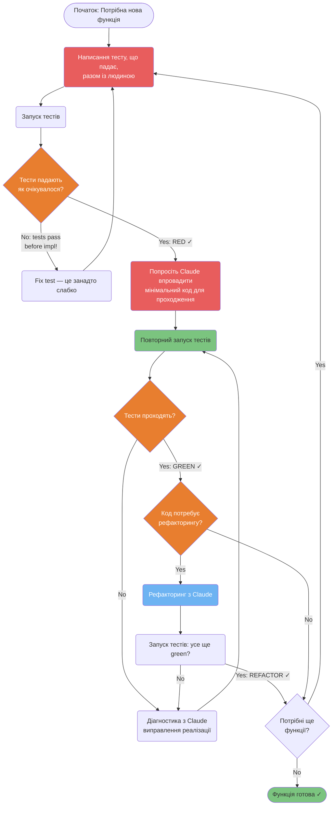
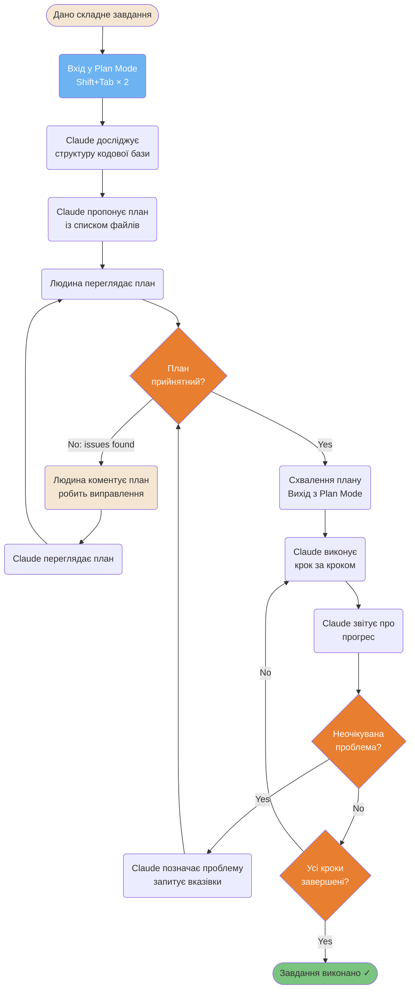
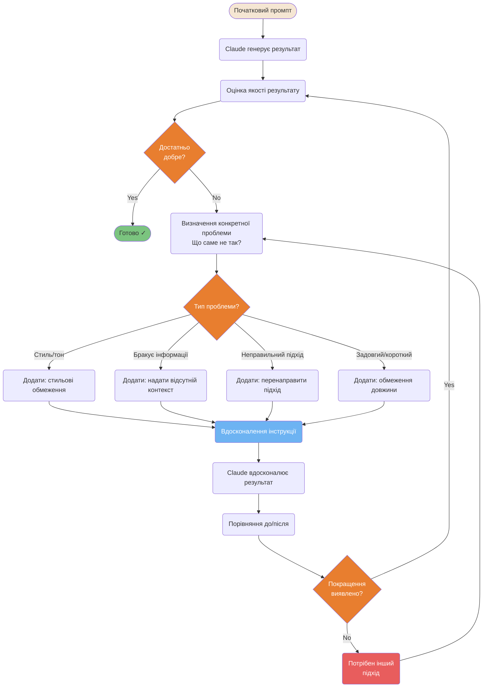
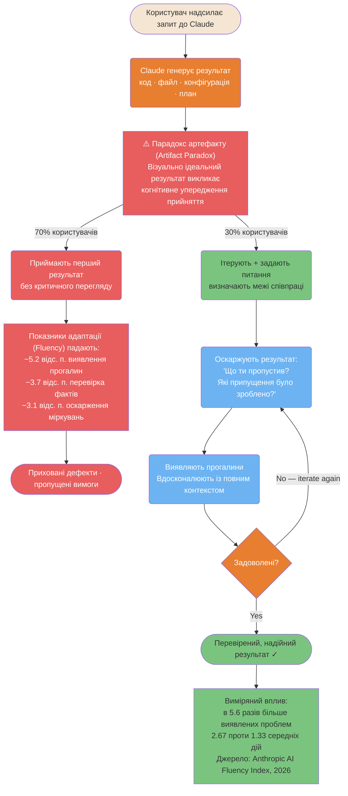

# Робочі процеси розробки

Перевірені патерни для структурування сесій розробки за допомогою AI.

---

### TDD Red-Green-Refactor з Claude

Розробка через тестування (TDD), адаптована для Claude Code: спочатку напишіть тест, що падає, а потім попросіть Claude реалізувати лише те, що необхідно для його проходження. Це запобігає надмірному ускладненню (over-engineering) та гарантує, що тести справді перевіряють поведінку.



<details>
<summary>ASCII версія</summary>

```
Написання тесту, що падає (RED)
        │
    Run tests
        │
  Падають як очікувалося?
  ├─ No  → Виправити тест (занадто слабкий)
  └─ Yes → Попросити Claude: написати мін. код
                │
           Запуск тестів
                │
           Проходять? (GREEN)
           ├─ No  → Діагностика + виправлення
           └─ Yes → Рефакторинг?
                    ├─ Yes → Рефакторинг (REFACTOR) → перезапуск тестів
                    └─ No  → Наступна функція
```

</details>

> **Джерело**: [TDD з Claude](../workflows/tdd-with-claude.uk.md)

---

### Конвеєр розробки "Спочатку специфікація" (Spec-First)

Створюйте специфікацію перед кодом. Claude використовує spec-файл як єдине джерело істини — це запобігає розбіжностям між запланованим і фактично побудованим кодом.

```mermaid
flowchart LR
    A([Ідея / Вимога]) --> B(Написання spec.md<br/>природною мовою)
    B --> C(Claude переглядає специфікацію<br/>на чіткість + повноту)
    C --> D{Специфікація схвалена<br/> людиною?}
    D -->|No: gaps found| E(Вдосконалення специфікації<br/>усунення прогалин)
    E --> C
    D -->|Yes| F(Генерація тестів<br/>на основі специфікації)
    F --> G(Генерація реалізації<br/>на основі специфікації + тестів)
    G --> H(Запуск набору тестів)
    H --> I{Усі тести<br/>проходять?}
    I -->|No| J(Claude виправляє<br/>реалізацію)
    J --> H
    I -->|Yes| K(Перевірка людиною<br/>специфікація проти результату)
    K --> L{Відповідає<br/>специфікації?}
    L -->|No| M(Оновлення специфікації<br/>або реалізації)
    M --> K
    L -->|Yes| N([Merge ✓])

    style A fill:#F5E6D3,color:#333
    style B fill:#6DB3F2,color:#fff
    style D fill:#E87E2F,color:#fff
    style I fill:#E87E2F,color:#fff
    style L fill:#E87E2F,color:#fff
    style N fill:#7BC47F,color:#333

    click A href "https://github.com/gerasimsergey/claude-code-ultimate-guide-ua/blob/main/guide/workflows/spec-first.md" "Ідея / Вимога"
    click B href "https://github.com/gerasimsergey/claude-code-ultimate-guide-ua/blob/main/guide/workflows/spec-first.md" "Write spec.md"
    click C href "https://github.com/gerasimsergey/claude-code-ultimate-guide-ua/blob/main/guide/workflows/spec-first.md" "Claude reviews spec"
    click D href "https://github.com/gerasimsergey/claude-code-ultimate-guide-ua/blob/main/guide/workflows/spec-first.md" "Spec approved by human?"
    click E href "https://github.com/gerasimsergey/claude-code-ultimate-guide-ua/blob/main/guide/workflows/spec-first.md" "Refine spec"
    click F href "https://github.com/gerasimsergey/claude-code-ultimate-guide-ua/blob/main/guide/workflows/spec-first.md" "Generate tests from spec"
    click G href "https://github.com/gerasimsergey/claude-code-ultimate-guide-ua/blob/main/guide/workflows/spec-first.md" "Generate implementation"
    click H href "https://github.com/gerasimsergey/claude-code-ultimate-guide-ua/blob/main/guide/workflows/spec-first.md" "Run test suite"
    click I href "https://github.com/gerasimsergey/claude-code-ultimate-guide-ua/blob/main/guide/workflows/spec-first.md" "All tests pass?"
    click J href "https://github.com/gerasimsergey/claude-code-ultimate-guide-ua/blob/main/guide/workflows/spec-first.md" "Claude fixes implementation"
    click K href "https://github.com/gerasimsergey/claude-code-ultimate-guide-ua/blob/main/guide/workflows/spec-first.md" "Human review"
    click L href "https://github.com/gerasimsergey/claude-code-ultimate-guide-ua/blob/main/guide/workflows/spec-first.md" "Matches spec?"
    click M href "https://github.com/gerasimsergey/claude-code-ultimate-guide-ua/blob/main/guide/workflows/spec-first.md" "Update spec or implementation"
    click N href "https://github.com/gerasimsergey/claude-code-ultimate-guide-ua/blob/main/guide/workflows/spec-first.md" "Merge ✓"
```



<details>
<summary>ASCII версія</summary>

```
Ідея → Написання spec.md → Перегляд Claude
                             │
                       Схвалено? ─No→ Вдосконалити специфікацію
                             │ Yes
                       Згенерувати тести зі специфікації
                             │
                       Згенерувати реалізацію
                             │
                       Запуск тестів → Проходять? ─No→ Виправлення Claude
                             │ Yes
                       Перевірка людиною → Відповідає специфікації? ─No→ Виправити
                             │ Yes
                           Merge ✓
```

</details>

> **Джерело**: [Розробка спочатку специфікація (Spec-First)](../workflows/spec-first.uk.md)

---

### Робочий процес на основі плану з коментуванням (Plan-Driven)

Для складних завдань корисний режим планування (Plan Mode): Claude досліджує кодову базу, пропонує план, ви коментуєте його, і лише після цього Claude починає виконання схваленого плану. Це запобігає несподіванкам під час великих рефакторингів.



<details>
<summary>ASCII версія</summary>

```
Складне завдання
     │
Plan Mode (Shift+Tab×2)
     │
Claude досліджує кодову базу
     │
Claude пропонує план
     │
Перевірка людиною ──No──► Коментарі + Claude переглядає ──► перегляд
     │ Yes
Схвалення + вихід з Plan Mode
     │
Claude виконує крок за кроком
     │
Неочікувано? ──Yes──► Позначити + запитати вказівки
     │ No
Готово? ──No──► продовжити
     │ Yes
Завершено ✓
```

</details>

> **Джерело**: [Робочий процес на основі плану](../workflows/plan-driven.uk.md)

---

### Цикл ітераційного вдосконалення

Результат рідко буває ідеальним з першої спроби. Цей цикл надає вам систематичний спосіб покращити результати за допомогою точкового зворотного зв'язку замість нечітких інструкцій на кшталт "зроби краще".



<details>
<summary>ASCII версія</summary>

```
Промпт → Результат → Оцінка → Добре? ──Yes──► Готово
                                 │ No
                       Визначити конкретну проблему
                                 │
                          ┌──────┴──────────────┐
                         Стиль  Бракує  Неправ.  Довжина
                          └──────┬──────────────┘
                         Вдосконалити інструкцію
                                 │
                          Claude вдосконалює
                                 │
                         Краще? ──Yes──► Оцінити знову
                                 │ No
                          Інший підхід
```

</details>

> **Джерело**: [Ітераційне вдосконалення](../workflows/iterative-refinement.uk.md) — Рядок ~347

---

### AI Fluency — Шляхи високої проти низької адаптації (High vs Low Fluency)

Коли Claude генерує ідеально оформлений результат, спрацьовує когнітивне упередження: що більш завершеним здається результат, то менш критично оцінює його більшість користувачів. Це "Парадокс артефакту" (Artifact Paradox), задокументований Anthropic на основі 9 830 розмов. Ця схема демонструє, що відрізняє 30% високоадаптованих користувачів від 70% тих, хто бездумно приймає перші ж результати — та показує вимірювану різницю в якості результатів.



<details>
<summary>ASCII версія</summary>

```
Запит користувача → Результат Claude (код · файл · конфігурація · план)
                        ↓
              ⚠️ Парадокс артефакту (Artifact Paradox)
          Ідеальний вигляд → когнітивне упередження
                        ↓
    ┌───────────────────┴──────────────────────┐
70% користувачів                         30% користувачів
Прийняття без перевірки              Ітерація + запитання
        ↓                                     ↓
Дії з перевірки (Fluency) падають:   Оскарження: "Що ти пропустив?
−5.2 відс. п. виявлення прогалин             Які припущення зробив?"
−3.7 відс. п. перевірка фактів                        ↓
−3.1 відс. п. оскарження міркувань   Виявлення прогалин → вдосконалення
        ↓                                     ↓
Приховані дефекти                    Задоволені? ──No──► ітерація
                                            ↓ Yes
                                     Перевірений результат ✓
                                            ↓
                                     в 5.6 разів більше виявлених проблем
                                     2.67 проти 1.33 середніх дій
```

</details>

> **Джерело**: [Anthropic AI Fluency Index](https://www.anthropic.com/research/AI-fluency-index) (Swanson et al., 2026-02-23) — [Розділ керівництва: Загальні помилки](../ultimate-guide.uk.md#common-pitfalls--best-practices)

---
**Локалізація**: [Serhii (MacPlus Software)](https://macplus-software.com)
*Остання синхронізація: Травень 2026*
