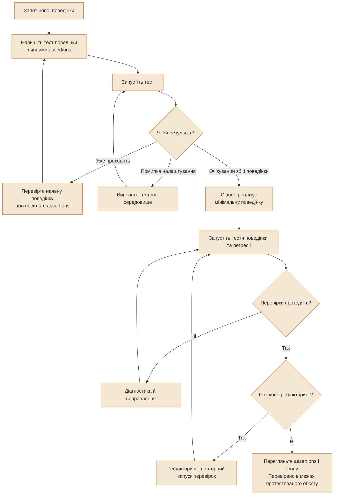
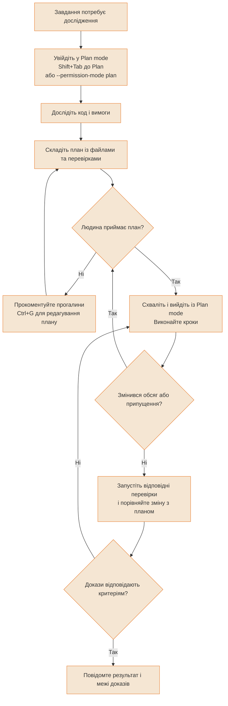
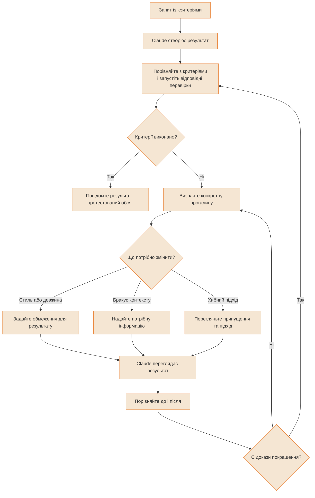
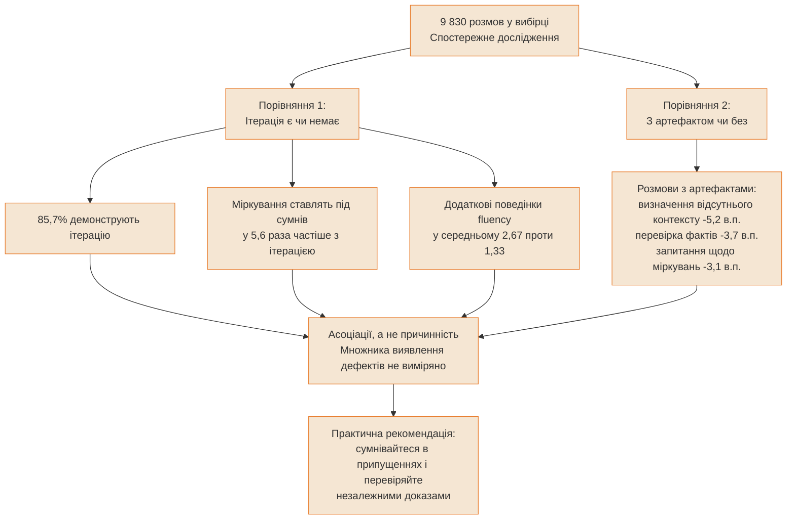

# Робочі процеси розробки

Методи структурування розробки за допомогою AI. Їхні кроки перевірки підтверджують лише ту поведінку й той обсяг, які справді перевірено.

---

### TDD red-green-refactor з Claude

Напишіть тест поведінки, з'ясуйте, чому він падає, реалізуйте потрібну поведінку, а потім робіть рефакторинг, тримаючи перевірки зеленими. Тест, що проходить, доводить лише свої твердження (assertions). Якщо новий тест проходить ще до реалізації, переконайтеся, що функції ще немає, і відрізняйте очікувані збої від помилок налаштування.



<details>
<summary>ASCII версія</summary>

```
Напишіть тест поведінки → запустіть його
├─ Уже проходить → наявна поведінка? за потреби посильте assertions
├─ Помилка налаштування → виправте середовище, запустіть знову
└─ Очікуваний збій (RED) → реалізуйте мінімальну поведінку
                            → запустіть тести поведінки + регресії
                            ├─ Збій → діагностика й виправлення
                            └─ Проходять (GREEN) → рефакторинг за потреби
                                              → повторний запуск перевірок
                                              → перегляд протестованого обсягу
```

</details>

> **Джерело**: [Посібник: TDD red-green-refactor з Claude](../workflows/tdd-with-claude.uk.md); [Критерії перевірки](https://code.claude.com/docs/en/best-practices)

---

### Конвеєр розробки Spec-First

Специфікація допомагає порівняти задуману поведінку з реалізацією, але не гарантує, що розбіжності неможливі. Цикл Maintain є налаштованим патерном автоматизації: детермінований тригер викликає Claude, власник сортує отриманий intent, а зміни проходять рев'ю та етапи розгортання. Claude Code не запускає цей цикл моніторингу лише тому, що існує файл специфікації.

```mermaid
flowchart TD
    IDEA["Вимога"] --> INTENT["Напишіть intent.md<br/>Проблема, власник і обмеження"]
    INTENT --> IA{"Intent схвалив власник?"}
    IA -->|Ні| INTENT
    IA -->|Так| SPEC["Напишіть і уточніть spec.md"]
    SPEC --> SA{"Людина схвалює spec?"}
    SA -->|Ні| SPEC
    SA -->|Так| TESTS["Згенеруйте тести поведінки"]
    TESTS --> IMPL["Реалізація за spec і тестами"]
    IMPL --> RUN["Запустіть перевірки"]
    RUN --> PASS{"Перевірки проходять?"}
    PASS -->|Ні| IMPL
    PASS -->|Так| REVIEW{"Рев'ю людини: відповідає spec?"}
    REVIEW -->|Ні| FIX["Перегляньте spec або реалізацію"]
    FIX --> RUN
    REVIEW -->|Так| MERGE["Merge після рев'ю"]
    MERGE --> DEPLOY["Етап розгортання та перевірки в runtime"]
    DEPLOY --> MON["Налаштований моніторинг<br/>Детермінований тригер"]
    MON --> BREACH{"Поріг перевищено?"}
    BREACH -->|Ні| MON
    BREACH -->|Так| DRAFT["Claude складає чернетку intent.md"]
    DRAFT --> TRIAGE{"Власник сервісу або черговий сортує"}
    TRIAGE -->|Виправити або запланувати| INTENT
    TRIAGE -->|Відхилити| MON
    classDef default fill:#F5E6D3,color:#333,stroke:#E87E2F
    click IDEA href "https://github.com/gerasimsergey/claude-code-ultimate-guide-ua/blob/main/guide/workflows/spec-first.uk.md" "Переглянути цей патерн у посібнику"
    click INTENT href "https://github.com/gerasimsergey/claude-code-ultimate-guide-ua/blob/main/guide/workflows/spec-first.uk.md" "Переглянути цей патерн у посібнику"
    click IA href "https://github.com/gerasimsergey/claude-code-ultimate-guide-ua/blob/main/guide/workflows/spec-first.uk.md" "Переглянути цей патерн у посібнику"
    click SPEC href "https://github.com/gerasimsergey/claude-code-ultimate-guide-ua/blob/main/guide/workflows/spec-first.uk.md" "Переглянути цей патерн у посібнику"
    click SA href "https://github.com/gerasimsergey/claude-code-ultimate-guide-ua/blob/main/guide/workflows/spec-first.uk.md" "Переглянути цей патерн у посібнику"
    click TESTS href "https://github.com/gerasimsergey/claude-code-ultimate-guide-ua/blob/main/guide/workflows/spec-first.uk.md" "Переглянути цей патерн у посібнику"
    click IMPL href "https://github.com/gerasimsergey/claude-code-ultimate-guide-ua/blob/main/guide/workflows/spec-first.uk.md" "Переглянути цей патерн у посібнику"
    click RUN href "https://github.com/gerasimsergey/claude-code-ultimate-guide-ua/blob/main/guide/workflows/spec-first.uk.md" "Переглянути цей патерн у посібнику"
    click PASS href "https://github.com/gerasimsergey/claude-code-ultimate-guide-ua/blob/main/guide/workflows/spec-first.uk.md" "Переглянути цей патерн у посібнику"
    click REVIEW href "https://github.com/gerasimsergey/claude-code-ultimate-guide-ua/blob/main/guide/workflows/spec-first.uk.md" "Переглянути цей патерн у посібнику"
    click FIX href "https://github.com/gerasimsergey/claude-code-ultimate-guide-ua/blob/main/guide/workflows/spec-first.uk.md" "Переглянути цей патерн у посібнику"
    click MERGE href "https://github.com/gerasimsergey/claude-code-ultimate-guide-ua/blob/main/guide/workflows/spec-first.uk.md" "Переглянути цей патерн у посібнику"
    click DEPLOY href "https://github.com/gerasimsergey/claude-code-ultimate-guide-ua/blob/main/guide/workflows/spec-first.uk.md" "Переглянути цей патерн у посібнику"
    click MON href "https://github.com/gerasimsergey/claude-code-ultimate-guide-ua/blob/main/guide/workflows/spec-first.uk.md" "Переглянути цей патерн у посібнику"
    click BREACH href "https://github.com/gerasimsergey/claude-code-ultimate-guide-ua/blob/main/guide/workflows/spec-first.uk.md" "Переглянути цей патерн у посібнику"
    click DRAFT href "https://github.com/gerasimsergey/claude-code-ultimate-guide-ua/blob/main/guide/workflows/spec-first.uk.md" "Переглянути цей патерн у посібнику"
    click TRIAGE href "https://github.com/gerasimsergey/claude-code-ultimate-guide-ua/blob/main/guide/workflows/spec-first.uk.md" "Переглянути цей патерн у посібнику"
```



<details>
<summary>ASCII версія</summary>

```
Вимога → intent, схвалений власником → spec, схвалена людиною
            → тести → реалізація → перевірки
                           ↑             │ збій
                           └─────────────┘
Перевірки проходять → людина порівнює spec/результат
├─ Розбіжність → перегляд spec або коду, повторні перевірки
└─ Збіг → рев'ю/merge → етап розгортання + перевірки в runtime
                          → налаштований моніторинг
                          ├─ Порогу не перевищено → продовжувати
                          └─ Перевищено → Claude складає чернетку intent
                                      → сортування власником/черговим
                                      ├─ Виправити/запланувати → цикл intent
                                      └─ Відхилити → моніторинг
```

</details>

> **Джерело**: [Посібник: конвеєр розробки Spec-First](../workflows/spec-first.uk.md); [Anthropic AI-native SDLC playbook](https://claude.com/resources/articles/the-ai-native-sdlc-playbook)

---

### Робочий процес Plan-Driven із коментуванням

Використовуйте Plan mode, щоб відокремити дослідження від змін у коді. Натискайте Shift+Tab, доки індикатор не покаже Plan, або запустіть із --permission-mode plan; кількість натискань залежить від початкового режиму. Перегляньте план, прокоментуйте його, а потім перевірте реалізацію щодо нього. Цей процес є дисципліною рев'ю, а не гарантією, що кожна дія відповідатиме плану.



<details>
<summary>ASCII версія</summary>

```
Завдання → Plan mode (Shift+Tab до Plan, або --permission-mode plan)
     → дослідження → пропозиція плану → рев'ю людини
                                 ├─ Переглянути → прокоментувати, скласти знову
                                 └─ Прийняти → схвалити й реалізувати
                                             ├─ Обсяг змінився → рев'ю знову
                                             └─ Запустити перевірки + порівняти з планом
                                                 → повідомити докази й межі
```

</details>

> **Джерело**: [Посібник: Plan-Driven із коментуванням](../workflows/plan-driven.uk.md); [Explore, plan, implement](https://code.claude.com/docs/en/best-practices)

---

### Цикл ітераційного вдосконалення

Давайте точковий зворотний зв'язок, порівнюйте редакції й зупиняйтеся, коли виконано явні критерії. Зовнішній вигляд і задоволення самі по собі не доводять фактичної правильності; запускайте перевірки, доречні для результату.



<details>
<summary>ASCII версія</summary>

```
Запит + критерії → результат → оцінка та відповідні перевірки
                              ├─ Критерії виконано → повідомити протестований обсяг
                              └─ Прогалина → конкретний зворотний зв'язок
                                        ├─ Обмеження стилю/довжини
                                        ├─ Бракує контексту
                                        └─ Інший підхід
                                        → редакція → порівняння
                                          ├─ Краще → оцінити знову
                                          └─ Без покращення → повернутися до прогалини
```

</details>

> **Джерело**: [Посібник: цикл ітераційного вдосконалення](../workflows/iterative-refinement.uk.md); [Provide verification and context](https://code.claude.com/docs/en/best-practices)

---

### AI Fluency: спостережувані поведінки співпраці

Anthropic дослідила 9 830 розмов у Claude.ai. Ітерація траплялася у 85,7% вибірки. В ітеративних розмовах користувачі в 5,6 раза частіше ставили під сумнів міркування, а додаткових поведінок fluency було 2,67 проти 1,33. У розмовах з артефактами визначення відсутнього контексту, перевірка фактів і запитання щодо міркувань траплялися рідше на 5,2, 3,7 і 3,1 відсоткового пункту. Це асоціації між поведінками в розмовах, а не виміряні виявлені помилки й не доказ того, що відшліфований результат спричиняє упередження прийняття.



<details>
<summary>ASCII версія</summary>

```
9 830 розмов у вибірці (спостережне дослідження)
├─ Ітерація є чи немає
│  ├─ 85,7% демонструють ітерацію
│  ├─ Сумнів у міркуваннях: у 5,6 раза частіше з ітерацією
│  └─ Додаткові поведінки fluency: у середньому 2,67 проти 1,33
└─ Розмови з артефактом і без нього
   ├─ Визначення відсутнього контексту: -5,2 відсоткового пункту
   ├─ Перевірка фактів: -3,7 відсоткового пункту
   └─ Запитання щодо міркувань: -3,1 відсоткового пункту

Асоціація не доводить причинності чи виявлених дефектів.
Рекомендація: сумнівайтеся в припущеннях, потім перевіряйте доказами.
```

</details>

> **Джерело**: [Посібник: AI Fluency: спостережувані поведінки співпраці](../ultimate-guide.uk.md#911-типові-помилки-та-найкращі-практики); [Anthropic AI Fluency Index](https://academy.claude.com/tutorials/the-ai-fluency-index)

---

### Три місця, де пояснюється зміна агента

Зміну агента може пояснити сам агент, огляд, згенерований постфактум із diff, або review-бот після push. Названі інструменти є прикладами, прочитаними для цього посібника, а не рекомендаціями, і жоден із них не повідомляє про виміряний вплив на якість рев'ю.

```mermaid
flowchart LR
    subgraph W [Пише агент]
        W1[Агент редагує код] --> W2[Агент записує своє обґрунтування<br/>під час редагування: glassbox<br/>у сесії або під час рев'ю: diffo, hunk]
    end
    subgraph L [Локальна поверхня рев'ю]
        L1[Diff із нотатками] --> L2{Відгук рев'юера}
    end
    subgraph C [CI review-боти]
        C1[Push або merge request] --> C2[Бот коментує diff]
    end
    A1[Огляд, згенерований постфактум<br/>ai-pr-review, guidedreview] --> L1
    W2 --> L1
    L2 -->|Запитання або запит на зміну| W1
    L2 -->|Готово для forge| C1
    C2 --> H([Рішення людини про merge])

    classDef diagramNode fill:#F5E6D3,color:#333,stroke:#A64B00
    class W1,W2,L1,L2,C1,C2,A1,H diagramNode
    click W1 href "https://github.com/gerasimsergey/claude-code-ultimate-guide-ua/blob/main/guide/workflows/multi-provider-code-review.uk.md#локальні-поверхні-ревю-для-змін-написаних-агентом" "Переглянути в посібнику"
    click W2 href "https://github.com/gerasimsergey/claude-code-ultimate-guide-ua/blob/main/guide/workflows/multi-provider-code-review.uk.md#локальні-поверхні-ревю-для-змін-написаних-агентом" "Переглянути в посібнику"
    click L1 href "https://github.com/gerasimsergey/claude-code-ultimate-guide-ua/blob/main/guide/workflows/multi-provider-code-review.uk.md#локальні-поверхні-ревю-для-змін-написаних-агентом" "Переглянути в посібнику"
    click L2 href "https://github.com/gerasimsergey/claude-code-ultimate-guide-ua/blob/main/guide/workflows/multi-provider-code-review.uk.md#локальні-поверхні-ревю-для-змін-написаних-агентом" "Переглянути в посібнику"
    click C1 href "https://github.com/gerasimsergey/claude-code-ultimate-guide-ua/blob/main/guide/workflows/multi-provider-code-review.uk.md#локальні-поверхні-ревю-для-змін-написаних-агентом" "Переглянути в посібнику"
    click C2 href "https://github.com/gerasimsergey/claude-code-ultimate-guide-ua/blob/main/guide/workflows/multi-provider-code-review.uk.md#локальні-поверхні-ревю-для-змін-написаних-агентом" "Переглянути в посібнику"
    click A1 href "https://github.com/gerasimsergey/claude-code-ultimate-guide-ua/blob/main/guide/workflows/multi-provider-code-review.uk.md#локальні-поверхні-ревю-для-змін-написаних-агентом" "Переглянути в посібнику"
    click H href "https://github.com/gerasimsergey/claude-code-ultimate-guide-ua/blob/main/guide/workflows/multi-provider-code-review.uk.md#локальні-поверхні-ревю-для-змін-написаних-агентом" "Переглянути в посібнику"
```



<details>
<summary>ASCII версія</summary>

```text
Пише агент               агент редагує код -> записує обґрунтування (під час редагування: glassbox; у сесії або під час рев'ю: diffo, hunk)
                                                  |
Постфактум               огляд із diff (ai-pr-review, guidedreview)
                                                  |
Локальна поверхня рев'ю  diff із нотатками -> відгук рев'юера
                           запитання або запит на зміну -> назад до агента
                           готово -> push або merge request
                                                  |
CI review-боти           бот коментує diff -> рішення людини про merge
```

</details>

> **Джерело**: [Локальні поверхні рев'ю для змін, написаних агентом](../workflows/multi-provider-code-review.uk.md#локальні-поверхні-ревю-для-змін-написаних-агентом)

---
**Локалізація**: [Serhii (MacPlus Software)](https://macplus-software.com)
*Остання синхронізація: Травень 2026*
