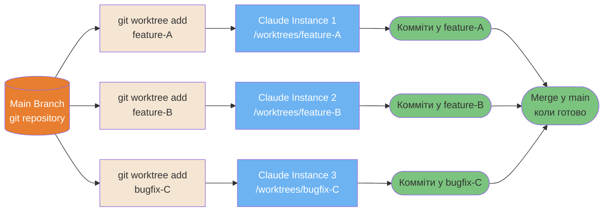
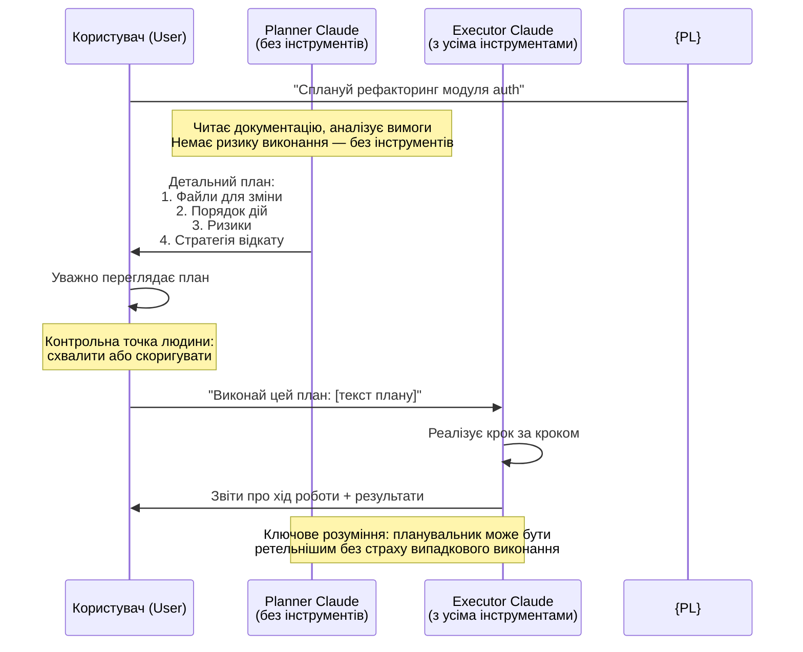

# Мультиагентні патерни

Патерни для координації кількох клієнтів Claude для паралельної та складної роботи.

---

### Команди агентів (Agent Teams) — 3 топології оркестрації

Три перевірені топології для мультиагентної координації. Вибирайте на основі незалежності завдань, вимог до черговості та необхідності спеціалізації.

```mermaid
flowchart TD
    subgraph ORCH["Патерн 1: Оркестратор + виконавці (Orchestrator + Workers)"]
        OL[Ведучий оркестратор (Lead Orchestrator)] --> OW1[Виконавець 1<br/>Frontend]
        OL --> OW2[Виконавець 2<br/>Backend]
        OL --> OW3[Виконавець 3<br/>Тести]
        OW1 & OW2 & OW3 --> OR([Агрегація результатів])
    end

    subgraph PIPE["Патерн 2: Конвеєр (Pipeline)"]
        PA[Агент A<br/>Вимоги] --> PB[Агент B<br/>Реалізація]
        PB --> PC[Агент C<br/>Огляд]
        PC --> PD([Кінцевий результат])
    end

    subgraph ROUTE["Патерн 3: Спеціалізований роутер (Specialist Router)"]
        RR{Агент-роутер<br/>аналізує завдання} --> RC[Code Agent]
        RR --> RT[Test Agent]
        RR --> RD[Docs Agent]
        RC & RT & RD --> RO([Спеціалізований результат])
    end

    style OL fill:#E87E2F,color:#fff
    style OW1 fill:#6DB3F2,color:#fff
    style OW2 fill:#6DB3F2,color:#fff
    style OW3 fill:#6DB3F2,color:#fff
    style OR fill:#7BC47F,color:#333
    style PA fill:#F5E6D3,color:#333
    style PB fill:#F5E6D3,color:#333
    style PC fill:#F5E6D3,color:#333
    style PD fill:#7BC47F,color:#333
    style RR fill:#E87E2F,color:#fff
    style RC fill:#6DB3F2,color:#fff
    style RT fill:#6DB3F2,color:#fff
    style RD fill:#6DB3F2,color:#fff
    style RO fill:#7BC47F,color:#333

    click OL href "https://github.com/FlorianBruniaux/claude-code-ultimate-guide/blob/main/guide/workflows/agent-teams.md" "Ведучий оркестратор"
    click OW1 href "https://github.com/FlorianBruniaux/claude-code-ultimate-guide/blob/main/guide/workflows/agent-teams.md" "Worker: Frontend"
    click OW2 href "https://github.com/FlorianBruniaux/claude-code-ultimate-guide/blob/main/guide/workflows/agent-teams.md" "Worker: Backend"
    click OW3 href "https://github.com/FlorianBruniaux/claude-code-ultimate-guide/blob/main/guide/workflows/agent-teams.md" "Worker: Tests"
    click OR href "https://github.com/FlorianBruniaux/claude-code-ultimate-guide/blob/main/guide/workflows/agent-teams.md" "Results aggregated"
    click PA href "https://github.com/FlorianBruniaux/claude-code-ultimate-guide/blob/main/guide/workflows/agent-teams.md" "Agent A: Requirements"
    click PB href "https://github.com/FlorianBruniaux/claude-code-ultimate-guide/blob/main/guide/workflows/agent-teams.md" "Agent B: Implementation"
    click PC href "https://github.com/FlorianBruniaux/claude-code-ultimate-guide/blob/main/guide/workflows/agent-teams.md" "Agent C: Review"
    click PD href "https://github.com/FlorianBruniaux/claude-code-ultimate-guide/blob/main/guide/workflows/agent-teams.md" "Final output"
    click RR href "https://github.com/FlorianBruniaux/claude-code-ultimate-guide/blob/main/guide/workflows/agent-teams.md" "Router Agent"
    click RC href "https://github.com/FlorianBruniaux/claude-code-ultimate-guide/blob/main/guide/workflows/agent-teams.md" "Code Agent"
    click RT href "https://github.com/FlorianBruniaux/claude-code-ultimate-guide/blob/main/guide/workflows/agent-teams.md" "Test Agent"
    click RD href "https://github.com/FlorianBruniaux/claude-code-ultimate-guide/blob/main/guide/workflows/agent-teams.md" "Docs Agent"
    click RO href "https://github.com/FlorianBruniaux/claude-code-ultimate-guide/blob/main/guide/workflows/agent-teams.md" "Specialized result"
```

<details>
<summary>ASCII версія</summary>

```
ОРКЕСТРАТОР + ВИКОНАВЦІ:       КОНВЕЄР (PIPELINE):     РОУТЕР (ROUTER):

   Lead Agent                Агент A (вимоги)        Router
  /    |     \                    │                  /  |  \
W1    W2     W3              Агент B (реаліз.)     Code Test Docs
  \   |     /                    │                  \  |  /
   Агрегація                 Агент C (огляд)         Результат
                                 │
                             Кінцевий результат
```

</details>

> **Джерело**: [Команди агентів](../workflows/agent-teams.uk.md) — Рядок ~59

---

### Патерн роботи з кількома клієнтами Git Worktree

Git worktrees забезпечують справжню паралельну розробку: кожен клієнт Claude працює в ізольованій гілці зі своїм власним робочим деревом. Ніяких конфліктів, ніякого змішування контекстів.



<details>
<summary>ASCII версія</summary>

```
Основний репозиторій
├── git worktree add feature-A → Claude 1 → комміти у feature-A
├── git worktree add feature-B → Claude 2 → комміти у feature-B
└── git worktree add bugfix-C  → Claude 3 → комміти у bugfix-C

Без конфліктів: окремі робочі дерева, окремі гілки
Усі зливаються (merge) назад у main після завершення
```

</details>

> **Джерело**: [Git Worktrees](../ultimate-guide.uk.md#git-worktrees) — Рядок ~10634

---

### Патерн планування з двома клієнтами (Dual-Instance Planning)

Розділення планування та виконання за допомогою двох клієнтів Claude запобігає дорогим помилкам: планувальник Claude не має інструментів, тому він не може випадково виконати щось під час аналізу.



<details>
<summary>ASCII версія</summary>

```
Користувач → Planner (без інструментів): "Сплануй X"
         │
    [безпечний аналіз, немає ризику виконання]
         │
Planner → Користувач: детальний план
         │
Користувач переглядає + схвалює
         │
Користувач → Executor (з інструментами): "Виконай: [план]"
         │
    [реалізує з повним контекстом]
         │
Executor → Користувач: результати
```

</details>

> **Джерело**: [Планування з двома клієнтами (Dual-Instance Planning)](../workflows/dual-instance-planning.uk.md)

---

### Патерн горизонтального масштабування Бориса Черного

Коли завдання можна розпаралелити, запускайте N клієнтів Claude одночасно замість того, щоб виконути їх послідовно. Прискорення пропорційне незалежності завдань.

```mermaid
flowchart LR
    BT([Велике завдання:<br/>Рефакторинг 50 файлів]) --> DEC{Декомпозиція<br/>на N підзавдань}

    DEC --> T1["Підзавдання 1<br/>Файли 1-10"]
    DEC --> T2["Підзавдання 2<br/>Файли 11-20"]
    DEC --> T3["Підзавдання 3<br/>Файли 21-30"]
    DEC --> TN["Підзавдання N<br/>..."]

    T1 --> CI1[Клієнт Claude<br/>(Instance 1)]
    T2 --> CI2[Клієнт Claude<br/>(Instance 2)]
    T3 --> CI3[Клієнт Claude<br/>(Instance 3)]
    TN --> CIN[Клієнт Claude<br/>(Instance N)]

    CI1 & CI2 & CI3 & CIN --> AGG(Агрегація<br/>результатів)
    AGG --> REV([Інтеграційний огляд<br/>~в 10 разів швидше, ніж послідовно])

    style BT fill:#F5E6D3,color:#333
    style DEC fill:#E87E2F,color:#fff
    style CI1 fill:#6DB3F2,color:#fff
    style CI2 fill:#6DB3F2,color:#fff
    style CI3 fill:#6DB3F2,color:#fff
    style CIN fill:#6DB3F2,color:#fff
    style AGG fill:#B8B8B8,color:#333
    style REV fill:#7BC47F,color:#333

    click BT href "https://github.com/FlorianBruniaux/claude-code-ultimate-guide/blob/main/guide/ultimate-guide.md#917-scaling-patterns-multi-instance-workflows" "Large Task"
    click DEC href "https://github.com/FlorianBruniaux/claude-code-ultimate-guide/blob/main/guide/ultimate-guide.md#917-scaling-patterns-multi-instance-workflows" "Decompose into subtasks"
    click T1 href "https://github.com/FlorianBruniaux/claude-code-ultimate-guide/blob/main/guide/ultimate-guide.md#917-scaling-patterns-multi-instance-workflows" "Subtask 1"
    click T2 href "https://github.com/FlorianBruniaux/claude-code-ultimate-guide/blob/main/guide/ultimate-guide.md#917-scaling-patterns-multi-instance-workflows" "Subtask 2"
    click T3 href "https://github.com/FlorianBruniaux/claude-code-ultimate-guide/blob/main/guide/ultimate-guide.md#917-scaling-patterns-multi-instance-workflows" "Subtask 3"
    click TN href "https://github.com/FlorianBruniaux/claude-code-ultimate-guide/blob/main/guide/ultimate-guide.md#917-scaling-patterns-multi-instance-workflows" "Subtask N"
    click CI1 href "https://github.com/FlorianBruniaux/claude-code-ultimate-guide/blob/main/guide/ultimate-guide.md#917-scaling-patterns-multi-instance-workflows" "Claude Instance 1"
    click CI2 href "https://github.com/FlorianBruniaux/claude-code-ultimate-guide/blob/main/guide/ultimate-guide.md#917-scaling-patterns-multi-instance-workflows" "Claude Instance 2"
    click CI3 href "https://github.com/FlorianBruniaux/claude-code-ultimate-guide/blob/main/guide/ultimate-guide.md#917-scaling-patterns-multi-instance-workflows" "Claude Instance 3"
    click CIN href "https://github.com/FlorianBruniaux/claude-code-ultimate-guide/blob/main/guide/ultimate-guide.md#917-scaling-patterns-multi-instance-workflows" "Claude Instance N"
    click AGG href "https://github.com/FlorianBruniaux/claude-code-ultimate-guide/blob/main/guide/ultimate-guide.md#917-scaling-patterns-multi-instance-workflows" "Aggregate results"
    click REV href "https://github.com/FlorianBruniaux/claude-code-ultimate-guide/blob/main/guide/ultimate-guide.md#917-scaling-patterns-multi-instance-workflows" "Integration review"
```

<details>
<summary>ASCII версія</summary>

```
Велике завдання
     │
Декомпозиція на N незалежних підзавдань
     │
┌────┼────┐
│    │    │
I1  I2  I3... (паралельно)
│    │    │
└────┼────┘
     │
Агрегація → Інтеграційний огляд
(~в 10 разів швидше, ніж послідовно)
```

</details>

> **Джерело**: [Горизонтальне масштабування](../ultimate-guide.uk.md#horizontal-scaling) — Рядок ~9617

---

### Матриця рішень для роботи з кількома клієнтами (Multi-Instance)

Не кожне завдання потребує запуску кількох клієнтів. Це дерево рішень допоможе вибрати правильний патерн на основі характеристик вашого завдання.

```mermaid
flowchart TD
    A([Завдання для виконання]) --> B{Потрібно кілька<br/>клієнтів Claude?}
    B -->|No| C([Одна сесія<br/>Стандартне використання])
    B -->|Yes| D{Скільки<br/>клієнтів?}
    B -->|"Planning separation?"| B2{Потрібне розділення<br/>планування/виконання?}

    D -->|2-3| E{Потрібна ізоляція<br/>гілок?}
    E -->|Yes| F([Git worktrees<br/>Окремі гілки])
    E -->|No| G([Кілька терміналів<br/>Один репозиторій])

    D -->|4+| H{Структура завдання?}
    H -->|Independent tasks| I([Task-інструмент<br/>Паралельні sub-agents])
    H -->|Sequential pipeline| J([Конвеєр агентів<br/>A → B → C])
    H -->|Mixed expertise| K([Спеціалізований роутер<br/>Маршрутизація за типом завдання])

    B2 --> L([Два клієнти (Dual-instance)<br/>Planner + Executor])

    style A fill:#F5E6D3,color:#333
    style B fill:#E87E2F,color:#fff
    style D fill:#E87E2F,color:#fff
    style E fill:#E87E2F,color:#fff
    style H fill:#E87E2F,color:#fff
    style B2 fill:#E87E2F,color:#fff
    style C fill:#B8B8B8,color:#333
    style F fill:#7BC47F,color:#333
    style G fill:#7BC47F,color:#333
    style I fill:#7BC47F,color:#333
    style J fill:#7BC47F,color:#333
    style K fill:#7BC47F,color:#333
    style L fill:#6DB3F2,color:#fff

    click A href "https://github.com/FlorianBruniaux/claude-code-ultimate-guide/blob/main/guide/ultimate-guide.md#917-scaling-patterns-multi-instance-workflows" "Task to complete"
    click B href "https://github.com/FlorianBruniaux/claude-code-ultimate-guide/blob/main/guide/ultimate-guide.md#917-scaling-patterns-multi-instance-workflows" "Need multiple instances?"
    click C href "https://github.com/FlorianBruniaux/claude-code-ultimate-guide/blob/main/guide/ultimate-guide.md#917-scaling-patterns-multi-instance-workflows" "Single session"
    click D href "https://github.com/FlorianBruniaux/claude-code-ultimate-guide/blob/main/guide/ultimate-guide.md#917-scaling-patterns-multi-instance-workflows" "How many instances?"
    click E href "https://github.com/FlorianBruniaux/claude-code-ultimate-guide/blob/main/guide/ultimate-guide.md#912-git-best-practices--workflows" "Need branch isolation?"
    click F href "https://github.com/FlorianBruniaux/claude-code-ultimate-guide/blob/main/guide/ultimate-guide.md#912-git-best-practices--workflows" "Git worktrees"
    click G href "https://github.com/FlorianBruniaux/claude-code-ultimate-guide/blob/main/guide/ultimate-guide.md#917-scaling-patterns-multi-instance-workflows" "Multiple terminals"
    click H href "https://github.com/FlorianBruniaux/claude-code-ultimate-guide/blob/main/guide/ultimate-guide.md#917-scaling-patterns-multi-instance-workflows" "Task structure?"
    click I href "https://github.com/FlorianBruniaux/claude-code-ultimate-guide/blob/main/guide/workflows/agent-teams.md" "Task tool sub-agents"
    click J href "https://github.com/FlorianBruniaux/claude-code-ultimate-guide/blob/main/guide/workflows/agent-teams.md" "Agent pipeline"
    click K href "https://github.com/FlorianBruniaux/claude-code-ultimate-guide/blob/main/guide/workflows/agent-teams.md" "Specialist router"
    click B2 href "https://github.com/FlorianBruniaux/claude-code-ultimate-guide/blob/main/guide/workflows/dual-instance-planning.md" "Need planning separation?"
    click L href "https://github.com/FlorianBruniaux/claude-code-ultimate-guide/blob/main/guide/workflows/dual-instance-planning.md" "Dual-instance: Planner + Executor"
```

<details>
<summary>ASCII версія</summary>

```
Потрібно кілька клієнтів Claude?
├─ Ні → Одна сесія
├─ Так → Скільки?
│        ├─ 2-3 → Потрібна ізоляція гілок?
│        │        ├─ Так → Git worktrees
│        │        └─ Ні  → Кілька терміналів
│        └─ 4+  → Структура завдання?
│                 ├─ Незалежні   → Task-інструмент (паралельні sub-agents)
│                 ├─ Послідовні  → Конвеєр агентів A→B→C
│                 └─ Змішані     → Спеціалізований роутер
└─ Розділення планування? → Два клієнти (Planner + Executor)
```

</details>

> **Джерело**: [Патерни роботи з кількома клієнтами (Multi-Instance)](../ultimate-guide.uk.md#multi-instance-patterns) — Рядок ~11176

---
**Локалізація**: [Serhii (MacPlus Software)](https://macplus-software.com)
*Остання синхронізація: Травень 2026*
