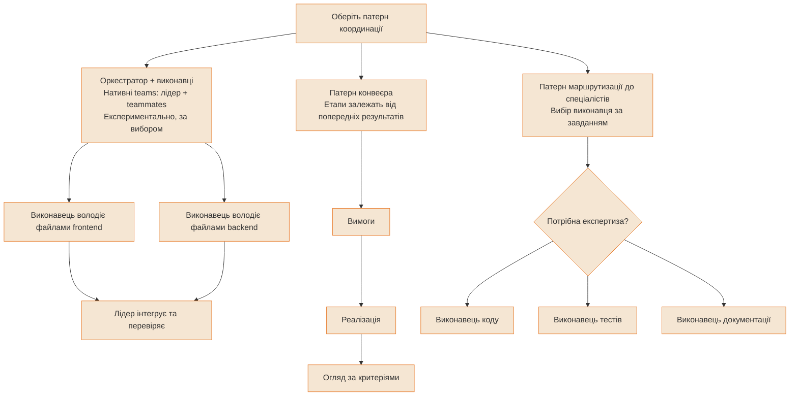
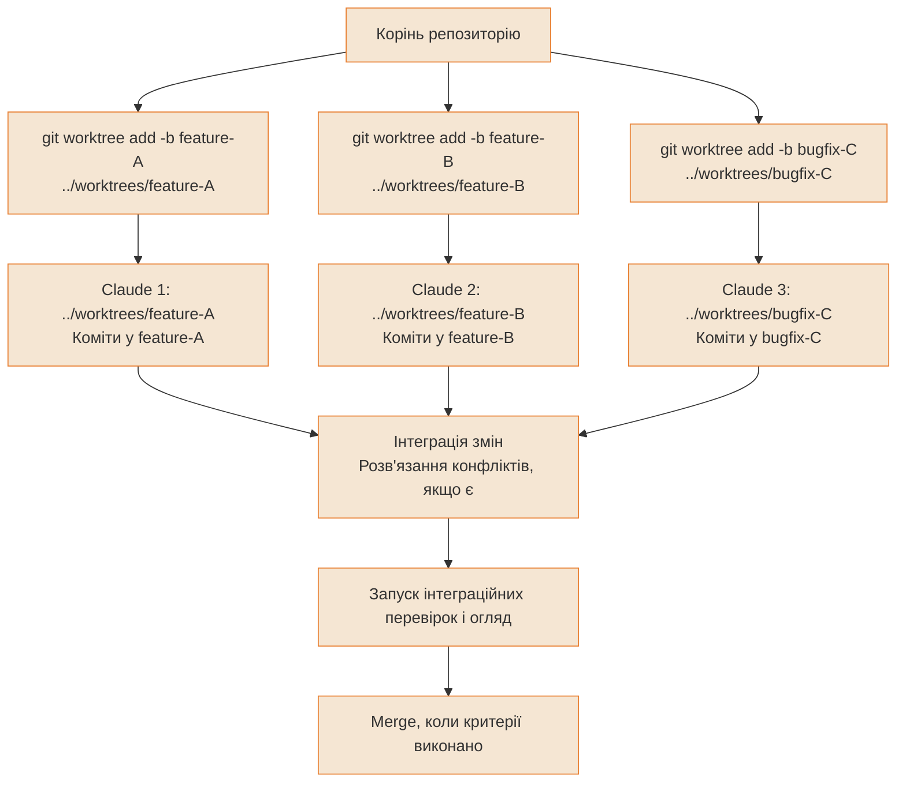
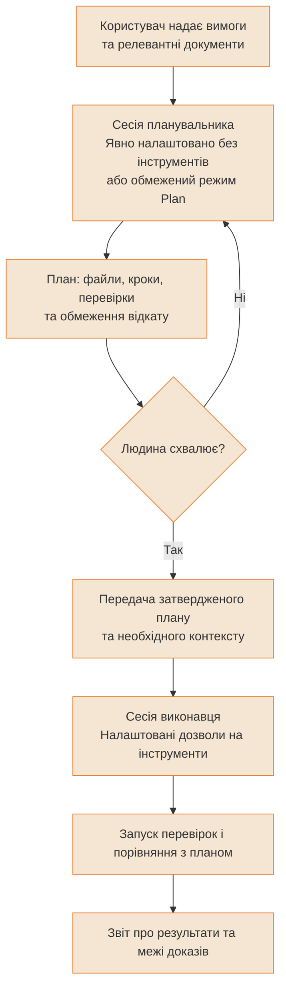
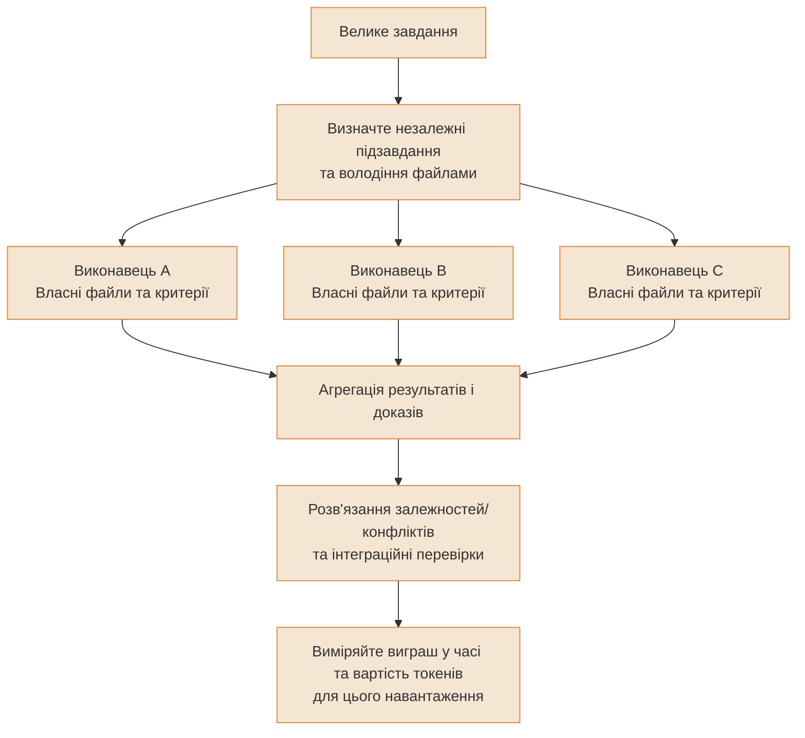
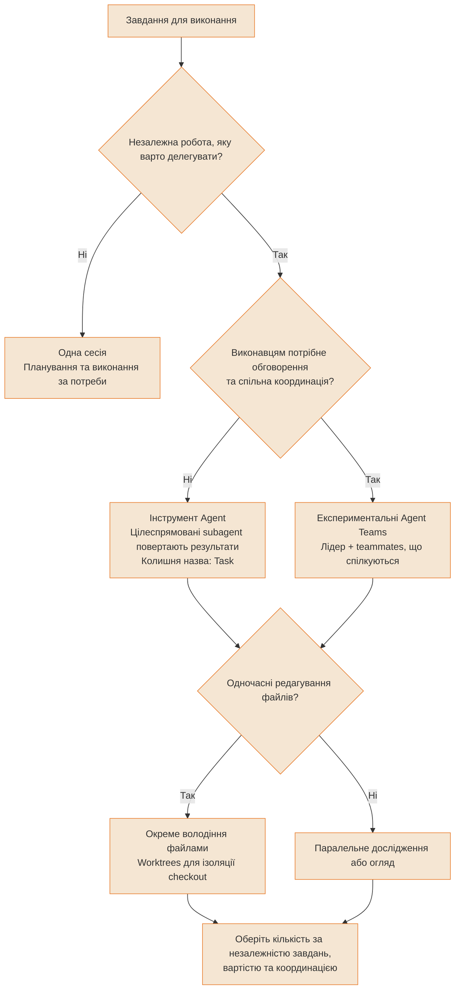
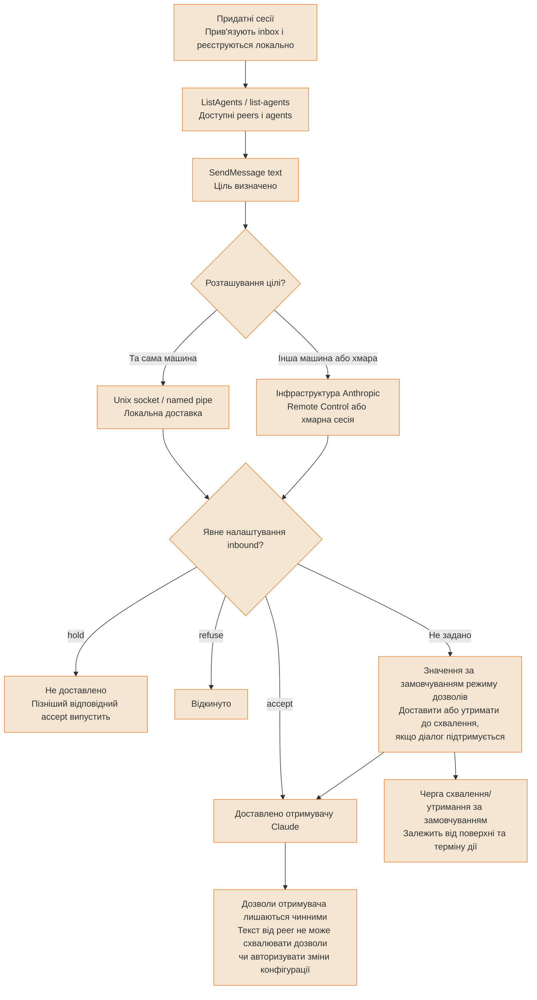

# Мультиагентні патерни

Координуйте незалежну роботу з чіткою відповідальністю за файли та перевірками інтеграції. Нативні можливості, концептуальні патерни та виміряні результати слід розрізняти.

---

### Agent teams: концептуальні топології оркестрації

Оркестратор, конвеєр і маршрутизація до спеціалістів є концептуальними патернами, а не трьома нативними режимами Agent Teams. Нативні Agent Teams використовують лідера та teammates, що спілкуються між собою; ця функція експериментальна й вимкнена за замовчуванням. Вона додає витрати на координацію та токени. Послідовні завдання й редагування одних і тих самих файлів часто краще підходять для однієї сесії або цілеспрямованих subagent.



<details>
<summary>ASCII версія</summary>

```
Концептуальні патерни координації
├─ Оркестратор → виконавці з явним володінням файлами → перевірки інтеграції
│  Нативні Agent Teams: лідер + teammates, що спілкуються, експериментальний opt-in
├─ Конвеєр → вимоги → реалізація → огляд
│  Патерн workflow; часто достатньо однієї сесії або subagent
└─ Роутер → потрібний спеціаліст (код / тести / документація)
   Патерн workflow, а не окремий нативний режим team

Teams витрачають більше токенів і потребують координації.
```

</details>

> **Джерело**: [Посібник: Agent teams: концептуальні топології оркестрації](../workflows/agent-teams.uk.md); [Доступність Agent Teams та компроміси](https://code.claude.com/docs/en/agent-teams)

---

### Патерн Git worktree з кількома інстансами

Worktrees дають одночасним інстансам окремі файли робочої копії та гілки. Частина метаданих репозиторію лишається спільною, а інтеграція змін усе ще може спричиняти конфлікти злиття. Команди нижче виконуються з кореня клонованого репозиторію; кожна команда створює показаний шлях.



<details>
<summary>ASCII версія</summary>

```
З кореня клонованого репозиторію:
git worktree add -b feature-A ../worktrees/feature-A
git worktree add -b feature-B ../worktrees/feature-B
git worktree add -b bugfix-C ../worktrees/bugfix-C

Кожен шлях → свій інстанс Claude → коміти у власну гілку
         → інтеграція → розв'язання конфліктів, якщо є
         → інтеграційні перевірки + огляд → merge

Окремі робочі файли; спільні метадані репозиторію.
Одночасне редагування ізольоване, конфлікти злиття залишаються можливими.
```

</details>

> **Джерело**: [Посібник: патерн Git worktree з кількома інстансами](../ultimate-guide.uk.md#912-git-найкращі-практики-та-робочі-процеси); [Семантика Git worktree](https://git-scm.com/docs/git-worktree)

---

### Патерн планування з двома інстансами (Dual-Instance)

Використовуйте дві сесії, коли корисна окрема межа планування. Планувальнику без інструментів потрібні релевантні документи, передані в його prompt. Або ж режим Plan дозволяє дослідження з обмеженими діями. Налаштовуйте обмеження явно: сама лише друга сесія не вимикає інструменти. Виконавцю потрібні затверджений план і необхідний контекст, а не автоматичне успадкування розмови планувальника.



<details>
<summary>ASCII версія</summary>

```
Надані документи → планувальник
                     (явна конфігурація без інструментів
                      або обмежений режим Plan для дослідження)
                   → план → огляд людиною
                            ├─ Доопрацювати → планувальник
                            └─ Схвалити → передати план + необхідний контекст
                                       → виконавець з налаштованими інструментами
                                       → перевірки + звіт про результат

Дві сесії самі по собі не забезпечують обмеження інструментів і не передають контекст.
```

</details>

> **Джерело**: [Посібник: патерн планування з двома інстансами](../workflows/dual-instance-planning.uk.md); [Plan permission mode](https://code.claude.com/docs/en/permissions), [Subagent tool restrictions](https://code.claude.com/docs/en/sub-agents)

---

### Патерн горизонтального масштабування

Розпаралелюйте незалежну роботу з явним володінням файлами, а потім вимірюйте результат після координації та інтеграції. Більше інстансів не гарантує пропорційного прискорення: витрати та залежності можуть переважити користь. Перш ніж стверджувати про продуктивність, виміряйте прискорення та вартість на власному навантаженні.



<details>
<summary>ASCII версія</summary>

```
Велике завдання → незалежні підзавдання з явним володінням файлами
            → паралельні виконавці A / B / C
            → агрегація доказів
            → розв'язання залежностей і конфліктів
            → інтеграційні перевірки
            → вимірювання виграшу в часі та вартості токенів

Гарантованого множника немає; координація зменшує виграш.
```

</details>

> **Джерело**: [Посібник: патерн горизонтального масштабування](../ultimate-guide.uk.md#917-scaling-patterns-multi-instance-workflows); [Team size, cost and diminishing returns](https://code.claude.com/docs/en/agent-teams)

---

### Матриця рішень для Multi-Instance

Обирайте за залежностями, потребою в комунікації та ізоляції, а вже потім за кількістю виконавців. Нативний інструмент делегування називається Agent; Task було його колишньою назвою, яка лишається псевдонімом для сумісності в налаштуваннях і визначеннях. Для використання subagent не потрібні чотири інстанси.



<details>
<summary>ASCII версія</summary>

```
Чи варто делегувати незалежну роботу?
├─ Ні → одна сесія, етапи за потреби
└─ Так → потрібне обговорення між виконавцями / спільна координація?
         ├─ Ні → subagent інструмента Agent повертають результати
         │       (Task — історичний псевдонім для сумісності)
         └─ Так → експериментальні Agent Teams
                    │
         Одночасні редагування файлів?
         ├─ Так → володіння файлами + окремі worktrees
         └─ Ні → паралельне дослідження/огляд
                    │
         Кількість за незалежністю, вартістю та координацією, а не за правилом 4+.
```

</details>

> **Джерело**: [Посібник: матриця рішень для Multi-Instance](../ultimate-guide.uk.md#917-scaling-patterns-multi-instance-workflows); [Agent tool rename and delegation](https://code.claude.com/docs/en/sub-agents), [Teams versus subagents](https://code.claude.com/docs/en/agent-teams)

---

### Обмін повідомленнями між сесіями: виявлення та доставка

Придатні незалежні сесії можуть виявляти одна одну через ListAgents і надсилати текст через SendMessage. Доставка в межах однієї машини використовує локальні сокети або іменовані канали (named pipes); доставка на іншу машину та в хмару використовує інфраструктуру Anthropic. Явне значення hold у crossSessionInbound утримує повідомлення, доки відповідний accept їх не випустить. Діалоги схвалення належать до деяких значень за замовчуванням у режимах дозволів у підтримуваних терміналах, а не до явного налаштування hold. Доступність залежить від версії, провайдера та вимог Remote Control.



<details>
<summary>ASCII версія</summary>

```
Придатні сесії → реєстр/inbox → ListAgents → SendMessage
Розташування цілі?
├─ Та сама машина → Unix socket / named pipe, локальна доставка
└─ Інша машина/хмара → інфраструктура Anthropic
                               │
Явний crossSessionInbound?
├─ accept → доставлено
├─ hold   → не доставлено; пізніший відповідний accept випустить
├─ refuse → відкинуто
└─ не задано → значення за замовчуванням залежить від режиму
            ├─ доставити
            └─ утримати до схвалення, залежно від терміналу/поверхні та терміну дії

Текст від peer не схвалює дозволи й не авторизує зміни конфігурації.
Доступність визначається вимогами версії/провайдера/Remote Control.
```

</details>

> **Джерело**: [Посібник: обмін повідомленнями між сесіями](../workflows/cross-session-messaging.uk.md); [Messaging controls and availability](https://code.claude.com/docs/en/cross-session-messaging)

---
**Локалізація**: [Serhii (MacPlus Software)](https://macplus-software.com)
*Остання синхронізація: Травень 2026*
