# Безпека та Production

Патерни для безпечного запуску Claude Code у чутливих та виробничих (production) середовищах.

---

### Трирівнева модель захисту безпеки

Глибокий захист для Claude Code: запобігання зупиняє більшість загроз, виявлення перехоплює те, що прослизнуло, а реагування обмежує радіус ураження. Жодного окремого рівня недостатньо.

```mermaid
flowchart LR
    THREAT([Загроза / Атака (Threat / Attack)]) --> L1

    subgraph L1["🛡️ Рівень 1: Запобігання (Layer 1: Prevention)"]
        P1[Перевірка MCP-серверів<br/>читання вихідного коду перед встановленням]
        P2[Обмеження CLAUDE.md<br/>визначення заборонених дій]
        P3[.claudeignore<br/>приховування конфіденційних файлів]
        P4[Мінімальні дозволи<br/>bypassPermissions тільки в CI]
    end

    subgraph L2["🔍 Рівень 2: Виявлення (Layer 2: Detection)"]
        D1[Хуки PreToolUse<br/>логування всіх викликів інструментів]
        D2[Логи аудиту (Audit logs)<br/>повна історія]
        D3[Сповіщення про аномалії<br/>неочікуваний доступ до файлів]
    end

    subgraph L3["🔒 Рівень 3: Реагування (Layer 3: Response)"]
        R1[Ізоляція в пісочниці (Sandbox)<br/>Docker / Firecracker]
        R2[Шлюзи дозволів<br/>затвердження людиною при ризиках]
        R3[Можливість відкату<br/>git revert, резервні копії]
    end

    L1 -->|Обійдено| L2
    L2 -->|Обійдено| L3
    L3 --> BLOCKED([Загрозу локалізовано])

    style THREAT fill:#E85D5D,color:#fff
    style P1 fill:#7BC47F,color:#333
    style P2 fill:#7BC47F,color:#333
    style P3 fill:#7BC47F,color:#333
    style P4 fill:#7BC47F,color:#333
    style D1 fill:#6DB3F2,color:#fff
    style D2 fill:#6DB3F2,color:#fff
    style D3 fill:#6DB3F2,color:#fff
    style R1 fill:#E87E2F,color:#fff
    style R2 fill:#E87E2F,color:#fff
    style R3 fill:#E87E2F,color:#fff
    style BLOCKED fill:#7BC47F,color:#333

    click THREAT href "https://github.com/FlorianBruniaux/claude-code-ultimate-guide/blob/main/guide/security/security-hardening.md" "Threat / Attack"
    click P1 href "https://github.com/FlorianBruniaux/claude-code-ultimate-guide/blob/main/guide/security/security-hardening.md#part-1-prevention-before-you-start" "MCP server vetting"
    click P2 href "https://github.com/FlorianBruniaux/claude-code-ultimate-guide/blob/main/guide/security/security-hardening.md#part-1-prevention-before-you-start" "CLAUDE.md restrictions"
    click P3 href "https://github.com/FlorianBruniaux/claude-code-ultimate-guide/blob/main/guide/security/security-hardening.md#part-1-prevention-before-you-start" ".claudeignore"
    click P4 href "https://github.com/FlorianBruniaux/claude-code-ultimate-guide/blob/main/guide/security/security-hardening.md#part-1-prevention-before-you-start" "Minimal permissions"
    click D1 href "https://github.com/FlorianBruniaux/claude-code-ultimate-guide/blob/main/guide/security/security-hardening.md#part-2-detection-while-you-work" "PreToolUse hooks"
    click D2 href "https://github.com/FlorianBruniaux/claude-code-ultimate-guide/blob/main/guide/security/security-hardening.md#part-2-detection-while-you-work" "Audit logs"
    click D3 href "https://github.com/FlorianBruniaux/claude-code-ultimate-guide/blob/main/guide/security/security-hardening.md#part-2-detection-while-you-work" "Anomaly alerts"
    click R1 href "https://github.com/FlorianBruniaux/claude-code-ultimate-guide/blob/main/guide/security/sandbox-native.md" "Sandbox isolation"
    click R2 href "https://github.com/FlorianBruniaux/claude-code-ultimate-guide/blob/main/guide/security/security-hardening.md#part-3-response-when-things-go-wrong" "Permission gates"
    click R3 href "https://github.com/FlorianBruniaux/claude-code-ultimate-guide/blob/main/guide/security/security-hardening.md#part-3-response-when-things-go-wrong" "Rollback capability"
    click BLOCKED href "https://github.com/FlorianBruniaux/claude-code-ultimate-guide/blob/main/guide/security/security-hardening.md" "Threat contained"
```

<details>
<summary>ASCII версія</summary>

```
Threat (Загроза)
  │
Рівень 1: ЗАПОБІГАННЯ
  - Перевірка MCP + обмеження CLAUDE.md + .claudeignore
  │ (обійдено) →
Рівень 2: ВИЯВЛЕННЯ
  - Логування хуків + логи аудиту + сповіщення про аномалії
  │ (обійдено) →
Рівень 3: РЕАГУВАННЯ
  - Sandbox + шлюзи дозволів + відкат
  │
Локалізовано
```

</details>

> **Джерело**: [Посилення безпеки (Security Hardening)](../security/security-hardening.md) — Повний довідник

---

### Дерево рішень щодо використання пісочниці (Sandbox)

Використання пісочниці створює додаткові накладні витрати. Скористайтеся цим деревом, щоб вирішити, коли вона є обов'язковою, рекомендованою або необов'язковою у вашій ситуації.

```mermaid
flowchart TD
    A([Використання Claude Code]) --> B{Запущено на<br/>production-сервері?}
    B -->|Yes| C([ЗАВЖДИ у пісочниці (Sandbox)<br/>Docker / Firecracker])
    B -->|No| D{Виконується ненадійний<br/>код чи невідомий MCP?}

    D -->|Yes| E{Яка платформа?}
    E -->|macOS| F([macOS Sandbox<br/>вбудована, безкоштовна])
    E -->|Linux| G([Docker sandbox<br/>рекомендовано])
    E -->|CI/CD| H([Одноразовий контейнер<br/>найкраща практика])

    D -->|No| I{Особистий проект<br/>відома кодова база?}
    I -->|Yes| J{Вас влаштовують<br/>дозволи за замовчуванням?}
    J -->|Yes| K([Режим за замовчуванням<br/>пісочниця необов'язкова])
    J -->|No| L([Режим acceptEdits<br/>ручний перегляд файлів])

    I -->|No / Unsure| M([Пісочниця рекомендована<br/>краще перестрахуватися])

    NOTE["Емпіричне правило:<br/>Якщо сумніваєтеся → у пісочницю (sandbox)<br/>Вартість: низька. Ризик без неї: високий."] --> A

    style C fill:#E85D5D,color:#fff
    style F fill:#7BC47F,color:#333
    style G fill:#7BC47F,color:#333
    style H fill:#7BC47F,color:#333
    style K fill:#7BC47F,color:#333
    style L fill:#6DB3F2,color:#fff
    style M fill:#E87E2F,color:#fff
    style B fill:#E87E2F,color:#fff
    style D fill:#E87E2F,color:#fff
    style E fill:#E87E2F,color:#fff
    style I fill:#E87E2F,color:#fff
    style J fill:#E87E2F,color:#fff
    style NOTE fill:#F5E6D3,color:#333

    click A href "https://github.com/FlorianBruniaux/claude-code-ultimate-guide/blob/main/guide/security/sandbox-native.md" "Using Claude Code"
    click B href "https://github.com/FlorianBruniaux/claude-code-ultimate-guide/blob/main/guide/security/sandbox-native.md" "Running on production server?"
    click C href "https://github.com/FlorianBruniaux/claude-code-ultimate-guide/blob/main/guide/security/sandbox-native.md" "ALWAYS sandbox"
    click D href "https://github.com/FlorianBruniaux/claude-code-ultimate-guide/blob/main/guide/security/sandbox-native.md" "Executing untrusted code?"
    click E href "https://github.com/FlorianBruniaux/claude-code-ultimate-guide/blob/main/guide/security/sandbox-native.md" "What platform?"
    click F href "https://github.com/FlorianBruniaux/claude-code-ultimate-guide/blob/main/guide/security/sandbox-native.md" "macOS Sandbox"
    click G href "https://github.com/FlorianBruniaux/claude-code-ultimate-guide/blob/main/guide/security/sandbox-native.md" "Docker sandbox"
    click H href "https://github.com/FlorianBruniaux/claude-code-ultimate-guide/blob/main/guide/security/sandbox-native.md" "Ephemeral container"
    click I href "https://github.com/FlorianBruniaux/claude-code-ultimate-guide/blob/main/guide/security/sandbox-native.md" "Personal project?"
    click J href "https://github.com/FlorianBruniaux/claude-code-ultimate-guide/blob/main/guide/security/sandbox-native.md" "Comfortable with defaults?"
    click K href "https://github.com/FlorianBruniaux/claude-code-ultimate-guide/blob/main/guide/security/sandbox-native.md" "Default mode"
    click L href "https://github.com/FlorianBruniaux/claude-code-ultimate-guide/blob/main/guide/security/sandbox-native.md" "acceptEdits mode"
    click M href "https://github.com/FlorianBruniaux/claude-code-ultimate-guide/blob/main/guide/security/sandbox-native.md" "Sandbox recommended"
    click NOTE href "https://github.com/FlorianBruniaux/claude-code-ultimate-guide/blob/main/guide/security/sandbox-native.md" "Rule of thumb"
```

<details>
<summary>ASCII версія</summary>

```
Production-сервер? → ТАК → ЗАВЖДИ у пісочницю (Docker/Firecracker)
     │ Ні
Ненадійний код чи невідомий MCP?
  ├─ Так → macOS sandbox / Docker / одноразовий контейнер
  └─ Ні  → Особистий проект з відомою кодовою базою?
            ├─ Так → За замовчуванням або acceptEdits (пісочниця необов'язкова)
            └─ Ні  → Рекомендовано пісочницю

Правило: Якщо сумніваєтеся — використовуйте пісочницю.
```

</details>

> **Джерело**: [Вбудована пісочниця (Sandbox Native)](../security/sandbox-native.md) — Рядок ~512

---

### Парадокс перевірки (The Verification Paradox)

Запит до Claude щодо перевірки своєї власної роботи є циклічним. Та сама модель, яка створила баг, часто пропускає його під час огляду. Цей антипатерн є частою причиною інцидентів на production.

```mermaid
flowchart TD
    subgraph BAD["❌ Антипатерн: Циклічна перевірка (Circular Verification)"]
        BA([Claude пише код]) --> BB(Запитати Claude:<br/>'Це правильно?')
        BB --> BC{Claude каже:<br/>'Так, виглядає добре!'}
        BC -->|Deploy| BD([Баг у production])
        BC --> BE["Чому це не працює:<br/>Та сама модель<br/>Ті самі упередження навчання<br/>Ті самі сліпі зони"]
        style BA fill:#E85D5D,color:#fff
        style BD fill:#E85D5D,color:#fff
        style BE fill:#E85D5D,color:#fff
        style BC fill:#E87E2F,color:#fff
    end

    subgraph GOOD["✅ Найкраща практика: Незалежна перевірка (Independent Verification)"]
        GA([Claude пише код]) --> GB(Людина переглядає<br/>критичні розділи)
        GA --> GC(Автоматичний набір тестів<br/>запускається незалежно)
        GA --> GD(Інший інструмент валідує<br/>Semgrep, ESLint тощо)
        GB & GC & GD --> GE{Усі перевірки<br/>проходять?}
        GE -->|Yes| GF([Безпечно для розгортання])
        GE -->|No| GG([Виправити перед розгортанням])
        style GA fill:#7BC47F,color:#333
        style GB fill:#7BC47F,color:#333
        style GC fill:#7BC47F,color:#333
        style GD fill:#7BC47F,color:#333
        style GF fill:#7BC47F,color:#333
        style GE fill:#E87E2F,color:#fff
        style GG fill:#6DB3F2,color:#fff
    end

    click BA href "https://github.com/FlorianBruniaux/claude-code-ultimate-guide/blob/main/guide/security/production-safety.md" "Claude writes code (anti-pattern)"
    click BB href "https://github.com/FlorianBruniaux/claude-code-ultimate-guide/blob/main/guide/security/production-safety.md" "Ask Claude to verify"
    click BC href "https://github.com/FlorianBruniaux/claude-code-ultimate-guide/blob/main/guide/security/production-safety.md" "Claude says looks good"
    click BD href "https://github.com/FlorianBruniaux/claude-code-ultimate-guide/blob/main/guide/security/production-safety.md" "Bug in production"
    click BE href "https://github.com/FlorianBruniaux/claude-code-ultimate-guide/blob/main/guide/security/production-safety.md" "Why it fails"
    click GA href "https://github.com/FlorianBruniaux/claude-code-ultimate-guide/blob/main/guide/security/production-safety.md" "Claude writes code (best practice)"
    click GB href "https://github.com/FlorianBruniaux/claude-code-ultimate-guide/blob/main/guide/security/production-safety.md" "Human reviews critical sections"
    click GC href "https://github.com/FlorianBruniaux/claude-code-ultimate-guide/blob/main/guide/security/production-safety.md" "Automated test suite"
    click GD href "https://github.com/FlorianBruniaux/claude-code-ultimate-guide/blob/main/guide/security/production-safety.md" "Different tool validates"
    click GE href "https://github.com/FlorianBruniaux/claude-code-ultimate-guide/blob/main/guide/security/production-safety.md" "All checks pass?"
    click GF href "https://github.com/FlorianBruniaux/claude-code-ultimate-guide/blob/main/guide/security/production-safety.md" "Safe to deploy"
    click GG href "https://github.com/FlorianBruniaux/claude-code-ultimate-guide/blob/main/guide/security/production-safety.md" "Fix before deploy"
```



<details>
<summary>ASCII версія</summary>

```
BAD: Claude пише → Claude перевіряє → "Все добре" → Деплой → Баг
     (та сама модель, ті самі упередження, циклічно)

GOOD: Claude пише → Перевірка людиною (критичні секції)
                    → Автотести (незалежні)
                    → Статичний аналіз (інший інструмент)
                    → Усе пройшло? → Деплой ✓
```

</details>

> **Джерело**: [Безпека на виробництві (Production Safety)](../security/production-safety.md) — Рядок ~639

---

### Конвеєр інтеграції CI/CD

Claude Code може працювати в неінтерактивному режимі всередині конвеєрів CI/CD для автоматичного огляду коду, генерації документації та перевірки якості для кожного PR.

```mermaid
flowchart LR
    PR([PR створено]) --> GH{Тригер<br/>GitHub Actions}
    GH --> ENV[Налаштування середовища<br/>секрет ANTHROPIC_API_KEY]
    ENV --> CC[claude --print --headless<br/>'Run quality checks']

    CC --> subgraph TASKS["Паралельні перевірки (Parallel Checks)"]
        T1[Перевірка лінтером<br/>ESLint / Prettier]
        T2[Набір тестів<br/>Vitest / Jest]
        T3[Сканування безпеки<br/>Semgrep MCP]
        T4[Повнота документації<br/>перевірка експортів]
    end

    T1 & T2 & T3 & T4 --> AGG{Усі перевірки<br/>проходять?}
    AGG -->|Yes| OK([✓ Перевірки green<br/>далі огляд людиною])
    AGG -->|No| FAIL([✗ Звіт про помилки<br/>у PR])
    FAIL --> FIX([Розробник виправляє<br/>повторний запуск CI])
    FIX --> CC

    style PR fill:#F5E6D3,color:#333
    style GH fill:#B8B8B8,color:#333
    style CC fill:#E87E2F,color:#fff
    style T1 fill:#6DB3F2,color:#fff
    style T2 fill:#6DB3F2,color:#fff
    style T3 fill:#6DB3F2,color:#fff
    style T4 fill:#6DB3F2,color:#fff
    style AGG fill:#E87E2F,color:#fff
    style OK fill:#7BC47F,color:#333
    style FAIL fill:#E85D5D,color:#fff
    style FIX fill:#F5E6D3,color:#333

    click PR href "https://github.com/FlorianBruniaux/claude-code-ultimate-guide/blob/main/guide/ultimate-guide.md#93-cicd-integration" "PR Created"
    click GH href "https://github.com/FlorianBruniaux/claude-code-ultimate-guide/blob/main/guide/ultimate-guide.md#93-cicd-integration" "GitHub Actions trigger"
    click ENV href "https://github.com/FlorianBruniaux/claude-code-ultimate-guide/blob/main/guide/ultimate-guide.md#93-cicd-integration" "Set up environment"
    click CC href "https://github.com/FlorianBruniaux/claude-code-ultimate-guide/blob/main/guide/ultimate-guide.md#93-cicd-integration" "claude --print --headless"
    click T1 href "https://github.com/FlorianBruniaux/claude-code-ultimate-guide/blob/main/guide/ultimate-guide.md#93-cicd-integration" "Lint check"
    click T2 href "https://github.com/FlorianBruniaux/claude-code-ultimate-guide/blob/main/guide/ultimate-guide.md#93-cicd-integration" "Test suite"
    click T3 href "https://github.com/FlorianBruniaux/claude-code-ultimate-guide/blob/main/guide/ultimate-guide.md#93-cicd-integration" "Security scan"
    click T4 href "https://github.com/FlorianBruniaux/claude-code-ultimate-guide/blob/main/guide/ultimate-guide.md#93-cicd-integration" "Doc completeness"
    click AGG href "https://github.com/FlorianBruniaux/claude-code-ultimate-guide/blob/main/guide/ultimate-guide.md#93-cicd-integration" "All checks pass?"
    click OK href "https://github.com/FlorianBruniaux/claude-code-ultimate-guide/blob/main/guide/ultimate-guide.md#93-cicd-integration" "Checks green"
    click FAIL href "https://github.com/FlorianBruniaux/claude-code-ultimate-guide/blob/main/guide/ultimate-guide.md#93-cicd-integration" "Report failures on PR"
    click FIX href "https://github.com/FlorianBruniaux/claude-code-ultimate-guide/blob/main/guide/ultimate-guide.md#93-cicd-integration" "Developer fixes"
```

<details>
<summary>ASCII версія</summary>

```
PR створено → GitHub Actions → налаштування ANTHROPIC_API_KEY
                                    │
                          claude --print --headless
                                    │
                    ┌───────────────┼────────────────┐
                   Lint           Tests           Security
                                    │
                          Усі пройшли? ──No──► PR впав + звіт
                            │ Yes
                          ✓ Green → огляд людиною → злиття (merge)
```

</details>

> **Джерело**: [Інтеграція CI/CD](../ultimate-guide.md#cicd-integration) — Рядок ~6835

---
**Локалізація**: [Serhii (MacPlus Software)](https://macplus-software.com)
*Остання синхронізація: Травень 2026*
