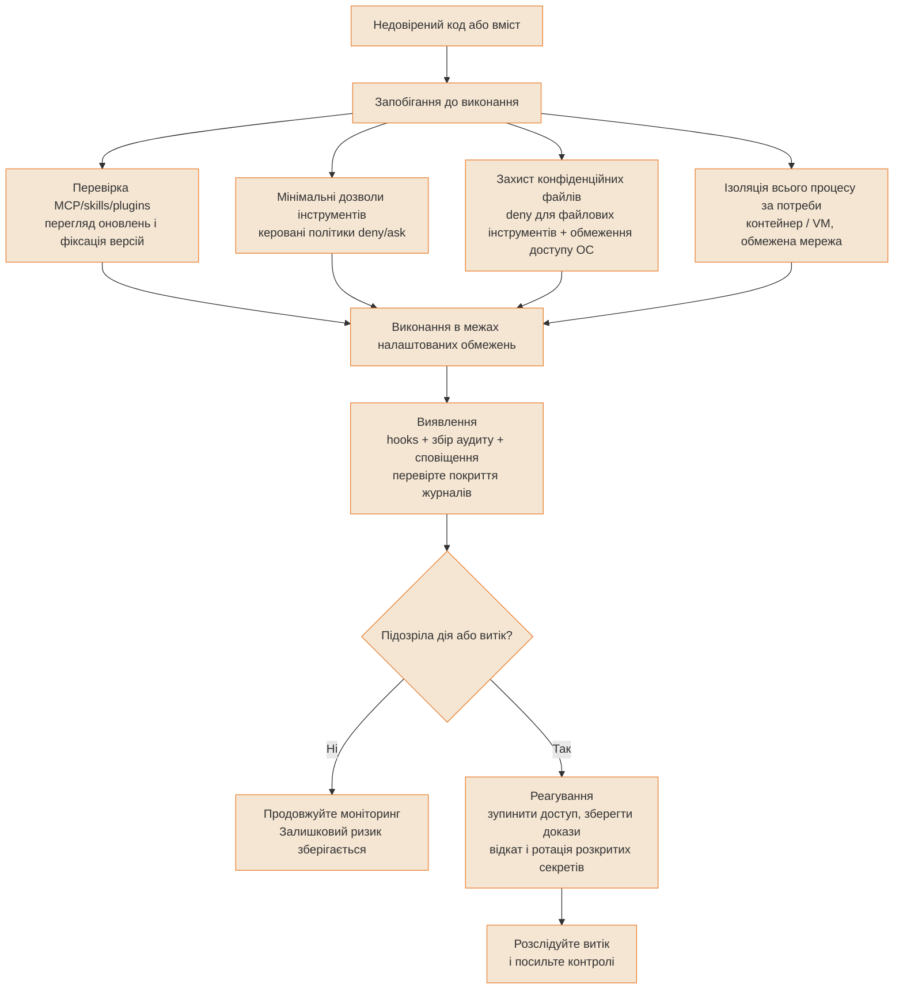
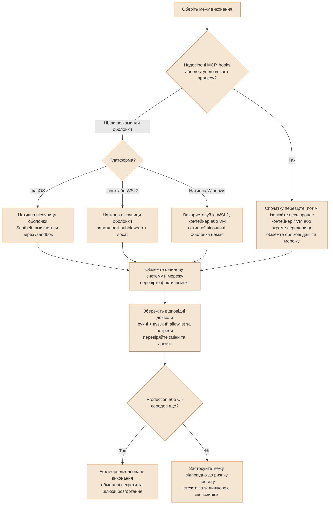
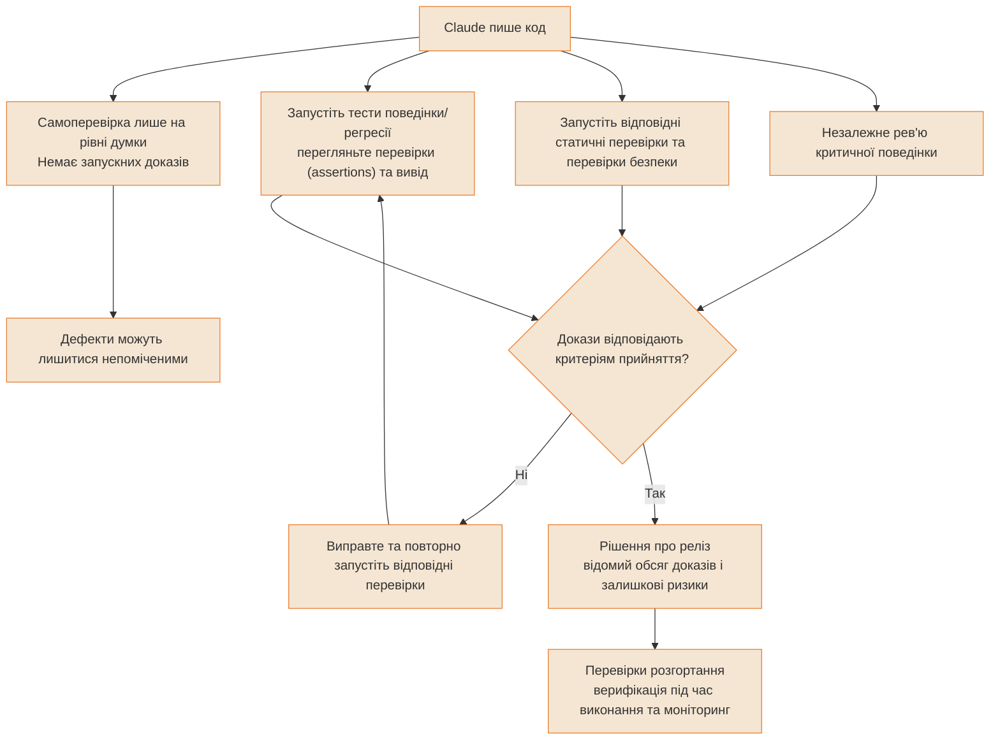
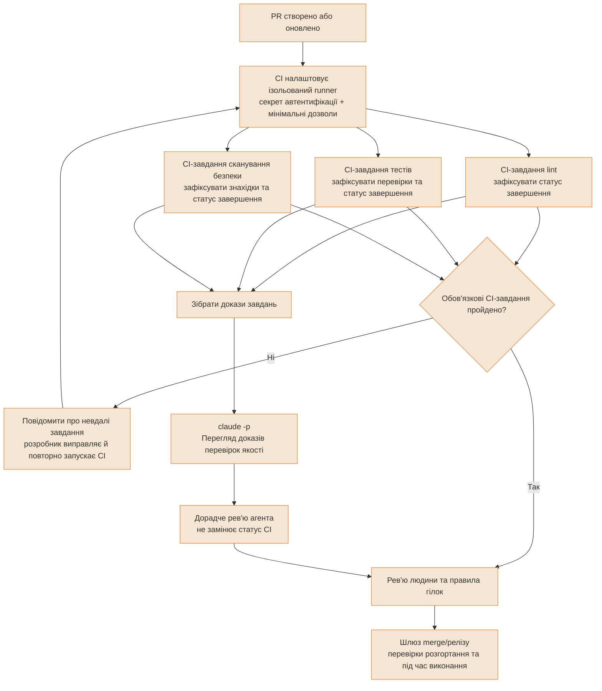

# Безпека та production

Під час роботи з Claude Code у чутливих середовищах спирайтеся на примусово застосовувані межі виконання та спостережувані докази. Жодна діаграма не гарантує універсальної ізоляції чи безпеки розгортання.

---

### Трирівнева модель захисту

Запобігання, виявлення та реагування знижують різні ризики. Налаштуйте примусові дозволи та ізоляцію процесу до запуску недовіреної роботи. CLAUDE.md спрямовує модель, але не є примусовою межею безпеки. Для захисту конфіденційних файлів потрібні правила дозволів для файлових інструментів та обмеження на рівні операційної системи, а не припущення про наявність ignore-файлу. Журнали потрібно налаштувати й перевірити їхнє покриття. Режим bypass permissions доречний лише в ізольованому середовищі, а не тільки тому, що завдання названо CI.



<details>
<summary>ASCII версія</summary>

```
ЗАПОБІГАННЯ (до виконання)
  Перевіряйте сервери й оновлення; мінімальні дозволи; керовані політики
  deny для файлових інструментів + обмеження доступу ОС до конфіденційних файлів
  Ізоляція всього процесу та обмежена мережа за потреби
                        │
ВИЯВЛЕННЯ
  Налаштовані hooks/збір журналів/сповіщення; перевірте покриття
                        │
Підозріла дія або витік?
├─ Ні → моніторьте залишковий ризик
└─ Так → РЕАГУВАННЯ: зупинити доступ, зберегти докази,
                    відкат, ротація розкритих секретів, розслідування

CLAUDE.md спрямовує поведінку; він не є примусовою межею безпеки.
Bypass лише в ізольованому середовищі, а не в будь-якому CI-завданні.
```

</details>

> **Джерело**: [Посібник: трирівнева модель захисту](../security/security-hardening.uk.md); [Обмеження дотримання CLAUDE.md](https://code.claude.com/docs/en/memory), [Дозволи](https://code.claude.com/docs/en/permissions), [Безпека MCP](https://code.claude.com/docs/en/security)

---

### Дерево рішень щодо пісочниці

Оберіть межу, яка покриває процес, що несе ризик. Нативна пісочниця оболонки підтримує macOS (Seatbelt) та Linux/WSL2 (bubblewrap і socat); для нативної Windows потрібен WSL2 або інше ізольоване середовище. Файлові інструменти, локальні MCP-сервери та hooks працюють поза пісочницею оболонки. Невідомі MCP або hooks потребують перевірки та, за потреби, ізоляції всього процесу Claude Code. acceptEdits автоматично схвалює редагування, тому це не суворіша альтернатива ручним дозволам. Типове читання в нативній пісочниці може охоплювати облікові дані, якщо його явно не обмежити.



<details>
<summary>ASCII версія</summary>

```
Що потребує ізоляції?
├─ Недовірені MCP/hooks/весь процес → спочатку перевірка + ізоляція всього процесу
│                                    обмежте секрети та мережу
└─ Команди оболонки → нативна пісочниця залежно від платформи
   ├─ macOS → Seatbelt, /sandbox
   ├─ Linux/WSL2 → bubblewrap + socat, /sandbox
   └─ Нативна Windows → WSL2/контейнер/VM
               │
Обмежте файлову систему/мережу; перевірте примусову межу
Збережіть відповідні дозволи та перевіряйте зміни
├─ Production/CI → ізольоване виконання + обмежені секрети + шлюзи релізу
└─ Локальний проєкт → межа відповідно до ризику проєкту

Пісочниця оболонки не охоплює файлові інструменти, MCP-сервери чи hooks.
acceptEdits автоматично приймає редагування, а не посилює перевірку перед ними.
Читання облікових даних потребує явних обмежень.
```

</details>

> **Джерело**: [Посібник: дерево рішень щодо пісочниці](../security/sandbox-native.uk.md); [Обсяг і платформи нативної пісочниці](https://code.claude.com/docs/en/sandboxing), [Режими дозволів](https://code.claude.com/docs/en/permissions)

---

### Парадокс верифікації

Прохання до генератора дати необґрунтовану думку не верифікує його роботу. Claude може запускати детерміновані тести та показувати результати; ці перевірки доводять лише те, що вони охоплюють. Критичну поведінку перевіряйте незалежно та розрізняйте перевірки коду, готовність до розгортання й спостережувану поведінку під час виконання. Самі лише пройдені перевірки не гарантують безпечного релізу.



<details>
<summary>ASCII версія</summary>

```
Лише думка: згенерований код → «виглядає добре» → дефекти можуть лишитися

Докази: згенерований код → тести поведінки + відповідні статичні перевірки
                         → незалежне рев'ю критичних ділянок
                         → критерії прийняття виконано?
                           ├─ Ні → виправити й повторно запустити перевірки
                           └─ Так → рішення про реліз для відомого обсягу
                                    → перевірки розгортання
                                    → верифікація/моніторинг під час виконання

Запускна перевірка, виконана Claude, є доказом у межах свого покриття.
Пройдені перевірки не гарантують безпечного релізу.
```

</details>

> **Джерело**: [Посібник: парадокс верифікації](../security/production-safety.uk.md); [Запускна верифікація та змагальне рев'ю](https://code.claude.com/docs/en/best-practices)

---

### Конвеєр інтеграції CI/CD

CI має запускати lint, тести та перевірки безпеки як окремі завдання й використовувати їхні статуси як шлюзи. Claude Code може прочитати ці докази та підготувати дорадче рев'ю в неінтерактивному режимі друку (print mode) через claude -p або --print. Сам промпт не гарантує паралельного виконання чи надійного зведення pass/fail. Явно налаштуйте автентифікацію, дозволи інструментів і виводи завдань; рішення про реліз забезпечуйте через CI та рев'ю людини, а не думку агента.



<details>
<summary>ASCII версія</summary>

```
PR → ізольований CI runner + секрет автентифікації + мінімальні дозволи
   → налаштовані завдання (паралельно, лише якщо CI це оголошує)
     ├─ Lint → статус завершення
     ├─ Тести → результати перевірок + статус завершення
     └─ Сканування безпеки → знахідки + статус завершення
           │
           ├─ Обов'язкові CI-завдання пройдено?
           │  ├─ Ні → повідомити про збій → виправити → повторно запустити CI
           │  └─ Так → рев'ю людини + правила гілок → шлюз релізу
           │                                      → перевірки під час виконання
           └─ Докази завдань → claude -p "Review quality-check evidence"
                              → дорадче рев'ю для людини

Шлюз — це статус CI-завдання; думка агента цим статусом не є.
```

</details>

> **Джерело**: [Посібник: конвеєр інтеграції CI/CD](../ultimate-guide.uk.md#93-інтеграція-cicd); [CLI режиму друку](https://code.claude.com/docs/en/cli-reference), [Запускна верифікація](https://code.claude.com/docs/en/best-practices)

---
**Локалізація**: [Serhii (MacPlus Software)](https://macplus-software.com)
*Остання синхронізація: Травень 2026*
