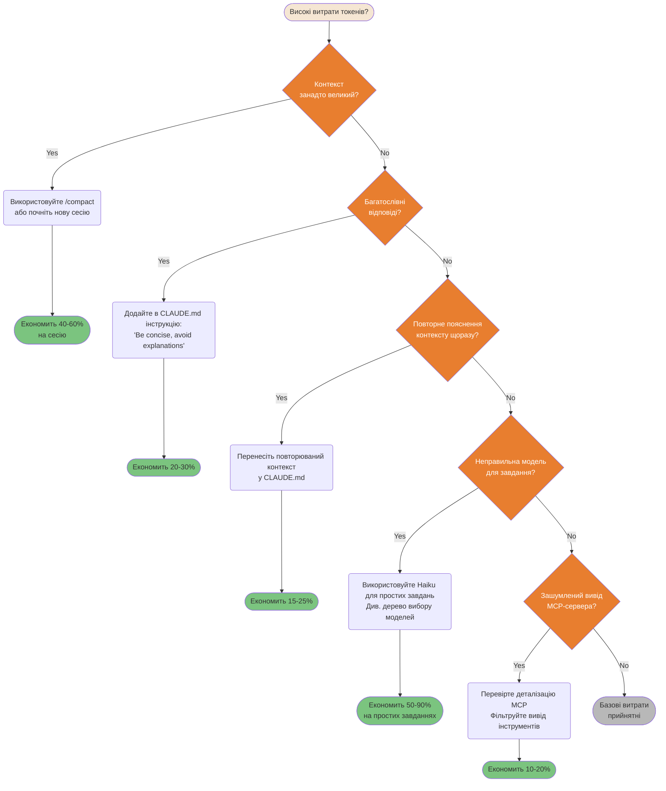
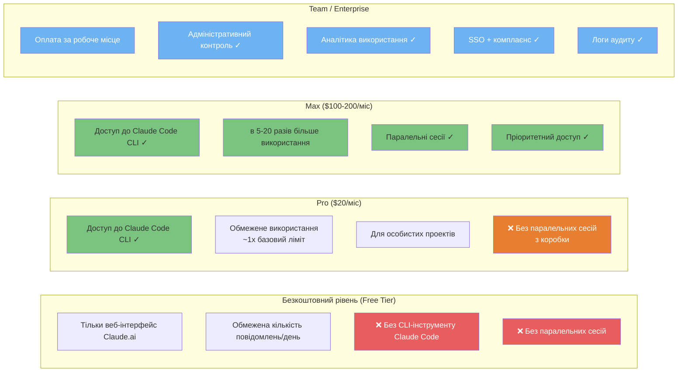

# Витрати та оптимізація

Як отримати максимальну користь від Claude Code, контролюючи споживання токенів та витрати.

---

### Схема рішень щодо вибору моделі

Не для всіх завдань потрібна найпотужніша модель. Використання правильної моделі для конкретного завдання знижує витрати в 5-10 разів без втрати якості.

> **Ця діаграма передбачає необмежений бюджет (Max/API).** На більш жорстких планах (Pro, Teams Standard) застосовуйте модифікатор бюджету нижче.

```mermaid
flowchart TD
    A([Завдання для виконання]) --> B{Складність завдання?}

    B -->|Simple| C["Прості завдання:<br/>виправлення друкарських помилок, перейменування,<br/>форматування, переклади"]
    C --> D([Haiku 4.5<br/>💰 Найдешевший, найшвидший<br/>~в 5 разів дешевший за Sonnet])

    B -->|Standard| E["Стандартні завдання:<br/>реалізація функцій,<br/>виправлення багів, рефакторинг"]
    E --> F([Sonnet 4.5/4.6<br/>💰💰 Збалансований<br/>Найкраще співвідношення ціна/якість])

    B -->|Complex| G{Потребує глибокого<br/>міркування (deep reasoning)?}
    G -->|Yes| H["Складні завдання:<br/>архітектурні рішення,<br/>огляд безпеки,<br/>аналіз кількох файлів"]
    H --> I([Opus 4.7 — Maximum capability xhigh<br/>Opus 4.6 — Deep analysis<br/>💰💰💰 Найпотужніший<br/>~в 5 разів дорожчий за Sonnet])

    G -->|No: just large| J["Великі, але зрозумілі завдання:<br/>масштабні рефакторинги,<br/>генерація документації"]
    J --> F

    style A fill:#F5E6D3,color:#333
    style B fill:#E87E2F,color:#fff
    style G fill:#E87E2F,color:#fff
    style D fill:#7BC47F,color:#333
    style F fill:#6DB3F2,color:#fff
    style I fill:#E87E2F,color:#fff
    style C fill:#B8B8B8,color:#333
    style E fill:#B8B8B8,color:#333
    style H fill:#B8B8B8,color:#333
    style J fill:#B8B8B8,color:#333

    click A href "https://github.com/gerasimsergey/claude-code-ultimate-guide-ua/blob/main/guide/ultimate-guide.md#25-model-selection--thinking-guide" "Task to complete"
    click B href "https://github.com/gerasimsergey/claude-code-ultimate-guide-ua/blob/main/guide/ultimate-guide.md#25-model-selection--thinking-guide" "Complexity?"
    click C href "https://github.com/gerasimsergey/claude-code-ultimate-guide-ua/blob/main/guide/ultimate-guide.md#25-model-selection--thinking-guide" "Simple tasks"
    click D href "https://github.com/gerasimsergey/claude-code-ultimate-guide-ua/blob/main/guide/ultimate-guide.md#25-model-selection--thinking-guide" "Haiku 4.5"
    click E href "https://github.com/gerasimsergey/claude-code-ultimate-guide-ua/blob/main/guide/ultimate-guide.md#25-model-selection--thinking-guide" "Standard tasks"
    click F href "https://github.com/gerasimsergey/claude-code-ultimate-guide-ua/blob/main/guide/ultimate-guide.md#25-model-selection--thinking-guide" "Sonnet 4.5/4.6"
    click G href "https://github.com/gerasimsergey/claude-code-ultimate-guide-ua/blob/main/guide/ultimate-guide.md#25-model-selection--thinking-guide" "Needs deep reasoning?"
    click H href "https://github.com/gerasimsergey/claude-code-ultimate-guide-ua/blob/main/guide/ultimate-guide.md#25-model-selection--thinking-guide" "Complex tasks"
    click I href "https://github.com/gerasimsergey/claude-code-ultimate-guide-ua/blob/main/guide/ultimate-guide.md#25-model-selection--thinking-guide" "Opus 4.7 / Opus 4.6 / Sonnet + --think-hard"
    click J href "https://github.com/gerasimsergey/claude-code-ultimate-guide-ua/blob/main/guide/ultimate-guide.md#25-model-selection--thinking-guide" "Large but clear tasks"
```

> **Ціноутворення**: Показано відносні витрати — перевіряйте поточні тарифи на [anthropic.com/pricing](https://www.anthropic.com/pricing).

**Модифікатор бюджету** — На планах з обмеженнями знижуйте рівень моделі на один крок для кожної фази:

| План | Фаза планування | Фаза виконання |
|------|-----------------|----------------|
| **Max / API unconstrained (xhigh)** | Opus 4.7 | Sonnet |
| **Max / API unconstrained** | Opus 4.6 | Sonnet |
| **Pro / Teams Standard** | Sonnet | Haiku (рутинні завдання) |
| **API tight budget** | Sonnet | Haiku |

> *Патерн спільноти (Teams Standard $25/міс): Sonnet для планування → Haiku для виконання. Такий самий якісний результат на механічних завданнях за незначну частку вартості.*

<details>
<summary>ASCII версія</summary>

```
Складність завдання?
├─ Прості (опечатки, формат, перейм.)  → Haiku 4.5       ($  — ~в 5 разів дешевше за Sonnet)
├─ Стандартні (функції, баги)          → Sonnet 4.5/4.6  ($$ — найкраща ціна/якість)
└─ Складні (архітектура, безпека)
   ├─ Потребує deep reasoning?    → Opus 4.7 (xhigh) / Opus 4.6  ($$$ — ~в 5 разів дорожче)
   └─ Просто великі/зрозумілі?    → Sonnet 4.6                    ($$ — впорається)

Модифікатор бюджету (знижуйте рівень на обмежених планах):
  Max/API (xhigh)  → Opus 4.7 для плану, Sonnet для викон.
  Max/API          → Opus 4.6 для плану, Sonnet для викон.
  Pro/Teams        → Sonnet для плану, Haiku для викон. (рутина)
```

</details>

> **Джерело**: [Вибір моделі](../ultimate-guide.uk.md#model-selection) — Рядок ~2634

---

### Дерево рішень щодо оптимізації витрат

Високі витрати токенів зазвичай можна виправити. Це систематичне дерево виявляє першопричину та вказує на правильне рішення для кожного патерну перевитрат.



<details>
<summary>ASCII версія</summary>

```
Високі витрати?
├─ Великий контекст?      → /compact або нова сесія   (економія 40-60%)
├─ Багатослівні відповіді? → CLAUDE.md: be concise      (економія 20-30%)
├─ Повторення контексту?  → Перенести в CLAUDE.md     (економія 15-25%)
├─ Неправильна модель?     → Haiku для простих завдань (економія 50-90%)
├─ Шумний вивід MCP?       → Фільтрувати вивід         (економія 10-20%)
└─ Нічого з переліченого?  → Базові витрати прийнятні
```

</details>

> **Слайдер зусиль (Effort slider)** — `/effort xlow/low/default/high/xhigh` (v2.1.111) дозволяє налаштовувати глибину міркувань (thinking depth) для кожного завдання. Менше зусиль = менше токенів, витрачених на міркування. Поєднуйте з вибором моделі для точного контролю витрат.

> **Джерело**: [Оптимізація витрат](../ultimate-guide.uk.md#cost-optimization) — Рядок ~8878

---

### Рівні підписки — Що розблоковує кожен з них

Різні рівні підписки відкривають різні можливості Claude Code. Розуміння обмежень допомагає планувати використання та обґрунтовувати перехід на вищі тарифи.



<details>
<summary>ASCII версія</summary>

```
FREE         PRO ($20)        MAX ($100-200)   TEAM/Enterprise
────         ─────────        ──────────────   ───────────────
Тільки веб   CLI ✓            CLI ✓            За місце
Обмеж. повід Обмеж. корист.   5-20x ліміт      Адмін. контроль
Без CLI      Особисте викор.  Паралельно ✓     Аналітика
             Без паралельних  Пріоритет ✓      SSO + комплаєнс
```

</details>

> **Джерело**: [Рівні підписки](../ultimate-guide.uk.md#subscription-tiers) — Рядок ~1933

---

### Конвеєр стратегій зменшення кількості токенів

Кілька стратегій можуть сумуватися для накопичувальної економії токенів. Застосовуйте їх по порядку: від найбільшого впливу до найменших зусиль.

```mermaid
flowchart LR
    BASE([Базовий рівень (Baseline):<br/>100% токенів]) --> RTK

    subgraph RTK["Стратегія 1: RTK Proxy"]
        R1[Сирий CLI-вивід<br/>→ відфільтрований вивід]
        R2["git status, cargo test,<br/>pnpm list → стиснуті"]
        R3[Економить 60-90%<br/>на CLI-командах]
    end

    RTK --> COMP

    subgraph COMP["Стратегія 2: /compact"]
        C1[Довга розмова<br/>→ резюмована]
        C2[Збереження рішень,<br/>видалення зайвих міркувань]
        C3[Економить 40-60%<br/>у контрольній точці]
    end

    COMP --> CLAUDE_MD

    subgraph CLAUDE_MD["Стратегія 3: CLAUDE.md"]
        CM1[Повторюваний контекст<br/>→ постійні інструкції]
        CM2[Без повторного пояснення<br/>конвенцій проекту]
        CM3[Економить 15-25%<br/>на сесію]
    end

    CLAUDE_MD --> MODEL

    subgraph MODEL["Стратегія 4: Вибір моделі (Model Selection)"]
        MO1[Haiku для простих завдань<br/>замість Sonnet]
        MO2[Така ж якість результату<br/>за мізерну ціну]
        MO3[Економить 50-90%<br/>на простих завданнях]
    end

    MODEL --> RESULT([Оптимізовано:<br/>10-20% від базового рівня<br/>при типовому використанні])

    style BASE fill:#E85D5D,color:#fff
    style R3 fill:#7BC47F,color:#333
    style C3 fill:#7BC47F,color:#333
    style CM3 fill:#7BC47F,color:#333
    style MO3 fill:#7BC47F,color:#333
    style RESULT fill:#7BC47F,color:#333

    click BASE href "https://github.com/gerasimsergey/claude-code-ultimate-guide-ua/blob/main/guide/ultimate-guide.md#913-cost-optimization-strategies" "Baseline: 100% tokens"
    click R1 href "https://github.com/gerasimsergey/claude-code-ultimate-guide-ua/blob/main/guide/ultimate-guide.md#913-cost-optimization-strategies" "Raw CLI output filtered"
    click R2 href "https://github.com/gerasimsergey/claude-code-ultimate-guide-ua/blob/main/guide/ultimate-guide.md#913-cost-optimization-strategies" "RTK commands"
    click R3 href "https://github.com/gerasimsergey/claude-code-ultimate-guide-ua/blob/main/guide/ultimate-guide.md#913-cost-optimization-strategies" "Saves 60-90% on CLI"
    click C1 href "https://github.com/gerasimsergey/claude-code-ultimate-guide-ua/blob/main/guide/ultimate-guide.md#913-cost-optimization-strategies" "Long conversation summarized"
    click C2 href "https://github.com/gerasimsergey/claude-code-ultimate-guide-ua/blob/main/guide/ultimate-guide.md#913-cost-optimization-strategies" "Keep decisions"
    click C3 href "https://github.com/gerasimsergey/claude-code-ultimate-guide-ua/blob/main/guide/ultimate-guide.md#913-cost-optimization-strategies" "Saves 40-60% at checkpoint"
    click CM1 href "https://github.com/gerasimsergey/claude-code-ultimate-guide-ua/blob/main/guide/ultimate-guide.md#31-memory-files-claudemd" "Repeated context persistent"
    click CM2 href "https://github.com/gerasimsergey/claude-code-ultimate-guide-ua/blob/main/guide/ultimate-guide.md#31-memory-files-claudemd" "No re-explaining conventions"
    click CM3 href "https://github.com/gerasimsergey/claude-code-ultimate-guide-ua/blob/main/guide/ultimate-guide.md#913-cost-optimization-strategies" "Saves 15-25% per session"
    click MO1 href "https://github.com/gerasimsergey/claude-code-ultimate-guide-ua/blob/main/guide/ultimate-guide.md#25-model-selection--thinking-guide" "Haiku for simple tasks"
    click MO2 href "https://github.com/gerasimsergey/claude-code-ultimate-guide-ua/blob/main/guide/ultimate-guide.md#25-model-selection--thinking-guide" "Same quality at lower cost"
    click MO3 href "https://github.com/gerasimsergey/claude-code-ultimate-guide-ua/blob/main/guide/ultimate-guide.md#25-model-selection--thinking-guide" "Saves 50-90% on simple"
    click RESULT href "https://github.com/gerasimsergey/claude-code-ultimate-guide-ua/blob/main/guide/ultimate-guide.md#913-cost-optimization-strategies" "Optimized: 10-20% of baseline"
```

<details>
<summary>ASCII версія</summary>

```
100% базовий рівень
    │
RTK proxy (стиснення виводу CLI)      → -60-90% на операціях CLI
    │
/compact (резюмування розмови)       → -40-60% в контрольній точці
    │
CLAUDE.md (уникнення повторів)       → -15-25% на сесію
    │
Вибір моделі (Haiku для простого)     → -50-90% на простих завданнях
    │
~10-20% від базового рівня при типовому використанні
```

</details>

> **Відстеження використання (Track usage)** — Використовуйте `/usage` для моніторингу споживання токенів та витрат (замінює `/cost`, починаючи з версії v2.1.118; `/cost` залишається валідним аліасом).

> **Джерело**: [Оптимізація токенів](../ultimate-guide.uk.md#token-optimization) — Рядок ~13355

---
**Локалізація**: [Serhii (MacPlus Software)](https://macplus-software.com)
*Остання синхронізація: Травень 2026*
