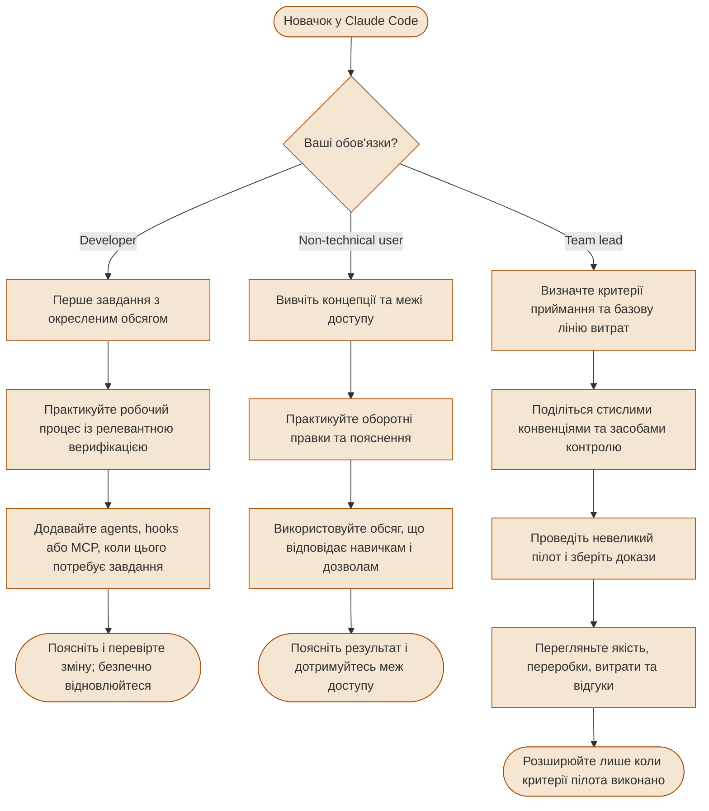
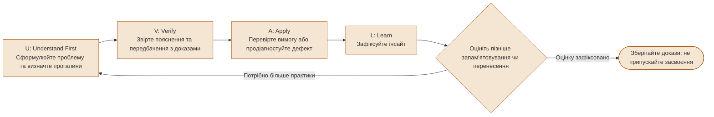
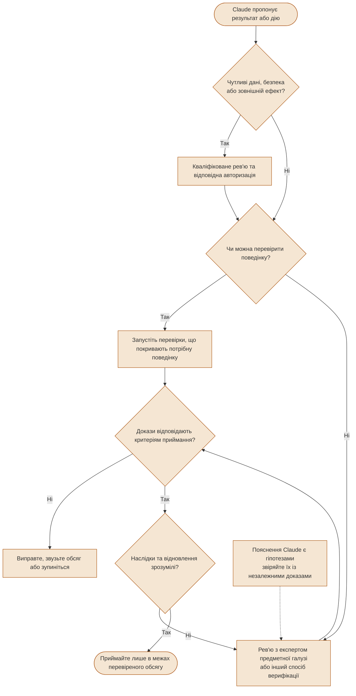
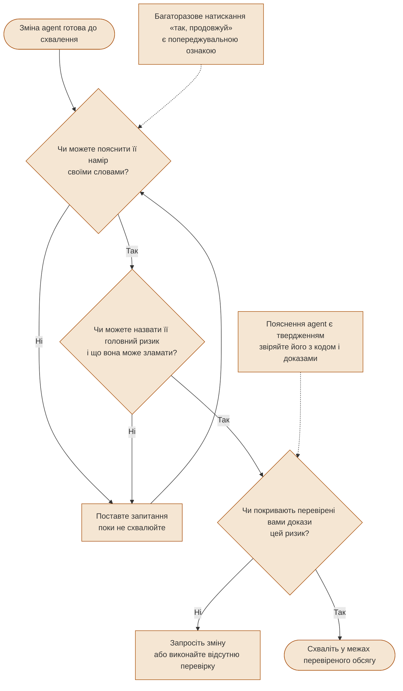

# Впровадження та навчання

Впроваджуйте Claude Code через завдання з чітко окресленим обсягом, релевантну верифікацію та явні перевірки людського розуміння. Виграш у навчанні та продуктивності потребує підтверджень від людей і завдань, яких він стосується.

---

### Шляхи адаптації та навчання (Onboarding Adaptive Paths)

Оберіть стартовий шлях за обов'язками та наявними навичками. Просувайтеся далі, коли спостережувані критерії виконано; жодна фіксована тривалість навчання чи впровадження в команді не мається на увазі.



<details>
<summary>ASCII версія</summary>

```text
Developer:
  Завдання з окресленим обсягом -> перевірений робочий процес -> додавання потрібних можливостей
  Критерій: поясніть/перевірте зміну та безпечно відновіться

Non-technical user:
  Концепції/межі доступу -> оборотна практика -> відповідний обсяг
  Критерій: поясніть результат і дотримуйтесь меж доступу

Team lead:
  Критерії приймання/базова лінія витрат -> спільні конвенції -> невеликий пілот
  Критерій: перегляньте якість, переробки, витрати та відгуки перед розширенням
```

</details>

> **Джерело**: [Підходи до впровадження](../roles/adoption-approaches.uk.md#start--build--scale-a-practical-navigation-layer)

> Це запропоновані шляхи, а не виміряний час проходження. Офіційний quickstart охоплює встановлення, підтримувані акаунти та перші завдання; організація має самостійно оцінювати результати свого пілота. [Офіційний quickstart](https://code.claude.com/docs/en/quickstart).


---

### Протокол навчання UVAL (UVAL Learning Protocol)

UVAL є запропонованою практикою перевірки розуміння під час роботи з підтримкою AI. Вона не доводить користі для запам'ятовування й не замінює політику прийняття змін.



<details>
<summary>ASCII версія</summary>

```text
UNDERSTAND -> VERIFY -> APPLY -> LEARN
U: Сформулюйте проблему та визначте прогалини в знаннях
V: Звірте пояснення та передбачення з доказами
A: Перевірте вимогу або продіагностуйте дефект; за потреби адаптуйте
L: Зафіксуйте інсайт

Оцініть пізніше запам'ятовування/перенесення -> практикуйтеся далі або зафіксуйте результат
Користь для запам'ятовування ще потрібно оцінити
```

</details>

> **Джерело**: [Протокол UVAL](../roles/learning-with-ai.uk.md#протокол-uval)


---

### Матриця калібрування довіри (Trust Calibration Matrix)

Оцініть чутливість даних, безпеку та зовнішні наслідки до того, як приймати результат. Тести та відкат підтверджують лише свій перевірений обсяг; Git revert не може скасувати розкриття даних чи кожну зовнішню дію.



<details>
<summary>ASCII версія</summary>

```text
Чутливі дані/безпека/зовнішній ефект?
  Так -> кваліфіковане рев'ю та відповідна авторизація
  Ні -> перехід до верифікації
      |
Чи можна перевірити поведінку?
  Так -> запустіть релевантні перевірки
  Ні -> рев'ю експертом галузі або інший спосіб верифікації
      |
Докази відповідають критеріям приймання?
  Ні -> виправте, звузьте обсяг або зупиніться
  Так -> зрозумійте наслідки та відновлення
      -> приймайте лише в межах перевіреного обсягу

Пояснення є гіпотезою; відкат у Git не скасовує розкриття даних
```

</details>

> **Джерело**: [Калібрування довіри](../ultimate-guide.uk.md#17-калібрування-довіри-коли-і-скільки-перевіряти)

> Рецензент залишається відповідальним за безпеку запропонованого коду й команд. Вимоги до рев'ю залежать від дії та її наслідків. [Настанови Anthropic щодо безпеки](https://code.claude.com/docs/en/security#user-responsibility).

---

### Схвалюйте лише те, що можете пояснити

Особиста перевірка перед схваленням зміни, внесеної agent. Це практика, яку варто оцінити у вашій команді, а не виміряне втручання. Пояснення agent є твердженням, яке слід звірити з кодом і доказами, а не доказом саме по собі.



<details>
<summary>ASCII версія</summary>

```text
Зміна agent готова до схвалення
  Чи можете пояснити її намір своїми словами?
    Ні  -> поставте запитання, поки не схвалюйте
    Так -> чи можете назвати її головний ризик і що вона може зламати?
             Ні  -> поставте запитання
             Так -> чи покривають перевірені вами докази цей ризик?
                      Ні  -> запросіть зміну або виконайте відсутню перевірку
                      Так -> схваліть у межах перевіреного обсягу

Попереджувальна ознака: багаторазове натискання «так, продовжуй»
Пояснення agent є твердженням, а не доказом
```

</details>

> **Джерело**: [Рев'ю результату машини як третій режим](../roles/learning-with-ai.uk.md#reviewing-machine-output-is-a-third-mode). Три запитання є синтезом цього посібника, що спирається на [Resisting Cognitive Surrender](https://knlb.dev/essays/surrender) і [Kaufman et al.](https://arxiv.org/abs/2607.08885), результат якого стосується пояснень згенерованих тверджень; застосування його до обґрунтувань agent є екстраполяцією.

---
**Локалізація**: [Serhii (MacPlus Software)](https://macplus-software.com)
*Остання синхронізація: Травень 2026*
