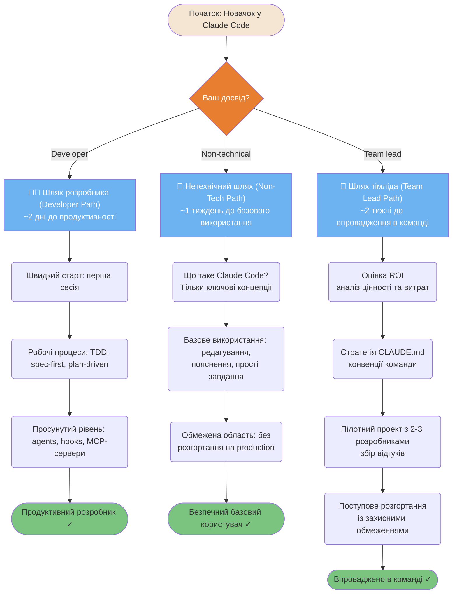
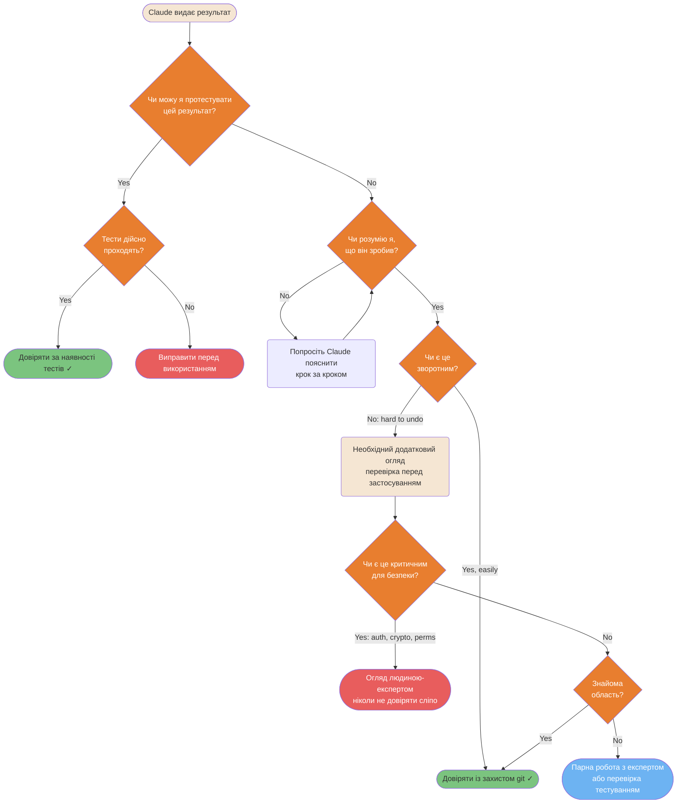

# Впровадження та навчання

Як окремі розробники та команди успішно впроваджують Claude Code без втрати навичок чи контролю.

---

### Шляхи адаптації та навчання (Onboarding Adaptive Paths)

Різний досвід вимагає різних підходів до адаптації. Навчання за базовою програмою для досвідчених розробників марнує час; натомість занурення нетехнічних користувачів у просунуті функції викликає розчарування.



<details>
<summary>ASCII версія</summary>

```
Ваш досвід?
├─ Розробник (~2 дні):
│  Швидкий старт → Робочі процеси (TDD/spec/plan) → Просунутий (agents/hooks/MCP)
│
├─ Нетехнічний (~1 тиждень):
│  Що таке CC? → Базове використання → Обмежена область (без prod-деплою)
│
└─ Тімлід (~2 тижні):
   Оцінка ROI → Стратегія CLAUDE.md → Пілот 2-3 розробники → Поступове розгортання
```

</details>

> **Джерело**: [Підходи до впровадження](../roles/adoption-approaches.uk.md)

---

### Протокол навчання UVAL (UVAL Learning Protocol)

Протокол UVAL запобігає "пастці копіпасту" (copy-paste trap) — коли ви використовуєте Claude Code без розуміння того, що він зробив. Кожен цикл будує реальну компетентність розробника, яка залишається навіть у разі недоступності інструменту AI.

```mermaid
flowchart LR
    U([U — Use It (Використай)<br/>Спочатку спробуй функцію<br/>самостійно]) --> V

    V([V — Verify (Перевір)<br/>Зрозумій, що зробив<br/>Claude та чому]) --> A

    A([A — Adapt (Адаптуй)<br/>Змінюй підхід,<br/>експериментуй з варіантами]) --> L

    L([L — Learn (Вчись)<br/>Занотуй патерн<br/>для майбутнього]) --> NEXT

    NEXT{Ще є завдання<br/>з цим патерном?} -->|Yes| U
    NEXT -->|No| DONE([Патерн засвоєно ✓])

    TRAP["❌ Пастка копіпасту (Copy-Paste Trap):<br/>Прийняття результату →<br/>Деплой → Баг →<br/>'Claude все зламав'"] -.->|уникнути| V

    style U fill:#6DB3F2,color:#fff
    style V fill:#E87E2F,color:#fff
    style A fill:#E87E2F,color:#fff
    style L fill:#7BC47F,color:#333
    style NEXT fill:#E87E2F,color:#fff
    style DONE fill:#7BC47F,color:#333
    style TRAP fill:#E85D5D,color:#fff

    click U href "https://github.com/gerasimsergey/claude-code-ultimate-guide-ua/blob/main/guide/roles/learning-with-ai.md" "Use It"
    click V href "https://github.com/gerasimsergey/claude-code-ultimate-guide-ua/blob/main/guide/roles/learning-with-ai.md" "Verify"
    click A href "https://github.com/gerasimsergey/claude-code-ultimate-guide-ua/blob/main/guide/roles/learning-with-ai.md" "Adapt"
    click L href "https://github.com/gerasimsergey/claude-code-ultimate-guide-ua/blob/main/guide/roles/learning-with-ai.md" "Learn"
    click NEXT href "https://github.com/gerasimsergey/claude-code-ultimate-guide-ua/blob/main/guide/roles/learning-with-ai.md" "More tasks using this pattern?"
    click DONE href "https://github.com/gerasimsergey/claude-code-ultimate-guide-ua/blob/main/guide/roles/learning-with-ai.md" "Pattern internalized"
    click TRAP href "https://github.com/gerasimsergey/claude-code-ultimate-guide-ua/blob/main/guide/roles/learning-with-ai.md" "Copy-Paste Trap"
```

<details>
<summary>ASCII версія</summary>

```
USE (ВИКОРИСТАЙ) → VERIFY (ПЕРЕВІР) → ADAPT (АДАПТУЙ) → LEARN (ВЧИСЬ) → (повторити для наступного)

U: Спочатку спробуй самостійно
V: Зрозумій, що і чому зробив Claude ← (антипатерн: просто копіювати)
A: Змінюй підхід, експериментуй
L: Занотуй патерн на майбутнє

Антипатерн (УНИКАЙТЕ): Прийняв вивід → Деплой → Баг → "Claude зламав"
```

</details>

> **Джерело**: [Навчання з AI](../roles/learning-with-ai.uk.md) — Рядок ~127

---

### Матриця калібрування довіри (Trust Calibration Matrix)

Розуміння того, коли варто довіряти виводу Claude, а коли перевіряти — це найважливіша навичка у розробці за допомогою AI. Надмірна довіра призводить до багів; недостатня довіра зводить нанівець приріст продуктивності.



<details>
<summary>ASCII версія</summary>

```
Чи можу я протестувати це?
├─ Так → Тести проходять? → Так → Довіряти з тестами ✓
│                        → Ні  → Виправити перед викор.
└─ Ні  → Чи розумію я це?
          ├─ Ні  → Попросити пояснити → зрозумів → продовжити
          └─ Так → Чи є зворотним?
                  ├─ Так → Довіряти із захистом git ✓
                  └─ Ні  → Критично для безпеки?
                               ├─ Так → Огляд експертом (ніколи не пропускати)
                               └─ Ні  → Знайома область?
                                        ├─ Так → Довіряти з обережністю ✓
                                        └─ Ні  → Робота з експертом
```

</details>

> **Джерело**: [Довіра та перевірка](../ultimate-guide.uk.md#trust-verification) — Рядок ~1039

---

*Назад до [diagrams/README.md](./README.uk.md) | Далі: [Оптимізація витрат](./09-cost-and-optimization.uk.md)*

---
**Локалізація**: [Serhii (MacPlus Software)](https://macplus-software.com)
*Остання синхронізація: Травень 2026*
