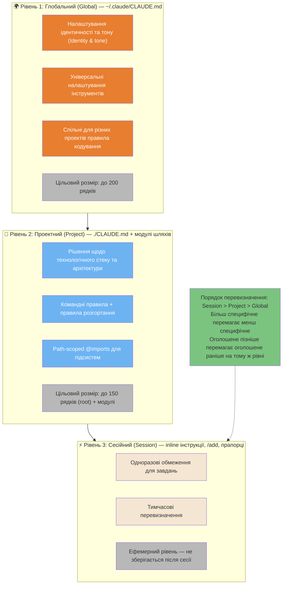
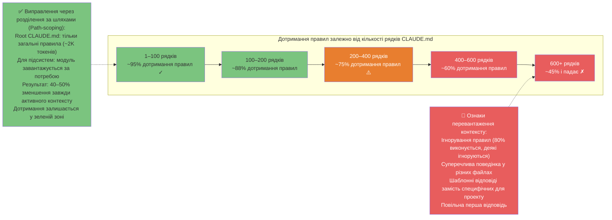

# Інженерія контексту (Context Engineering)

Як наповнити вікно контексту Claude правильною інформацією в потрібний час — і як архітектурні рішення визначають, чи буде Claude послідовно дотримуватися ваших правил проектування.

> «Інженерія контексту — це мистецтво наповнення вікна контексту правильною інформацією в потрібний час». — Андрій Карпати

---

### Трирівнева система контексту (The 3-Layer Context System)

Інженерія контексту працює на 3 різних рівнях із різними областями дії та життєвими циклами. Розуміння того, який рівень використовувати, запобігає найпоширенішій помилці: набиванню всього в один файл.



<details>
<summary>ASCII версія</summary>

```
GLOBAL ~/.claude/CLAUDE.md     → Ідентичність, універс. інструменти, спільні правила (<200 рядків)
    │ перевизначається ↓
PROJECT ./CLAUDE.md + modules  → Стек, архітектура, правила команди, path-scoped @imports (<150 р. root)
    │ перевизначається ↓
SESSION inline / /add / flags  → Одноразові обмеження, тимчасові перевизначення (ефемерні)

Порядок перевизначення: Session > Project > Global
Більш специфічне перемагає менш специфічне на тому самому рівні
```

</details>

> **Джерело**: [Інженерія контексту — Ієрархія конфігурації](../core/context-engineering.uk.md#3-ієрархія-конфігурацій)

---

### Бюджет контексту та деградація виконання правил

Дотримання правил у файлах типу CLAUDE.md передбачувано погіршується зі збільшенням розміру файлу. Понад ~150 правил моделі починають вибірково ігнорувати інструкції. Розділення за шляхами (path-scoping) — це основне виправлення; воно скорочує постійно активний контекст на 40-50% без втрати повноти покриття правил.



<details>
<summary>ASCII версія</summary>

```
Рядки в CLAUDE.md      Дотримання   Статус
──────────────────      ─────────   ──────
1 – 100               ~95%         ✓ Зелена зона
100 – 200             ~88%         ✓ Прийнятно
200 – 400             ~75%         ⚠️ Обережно
400 – 600             ~60%         ✗ Погіршено
600+                  ~45% ↓       ✗ Критично

Вирішення: розподіл за шляхами (path-scope) підсистем → root CLAUDE.md залишається <150 рядків
Результат: 40-50% економії постійного контексту, дотримання знову в зеленій зоні
```

</details>

> **Джерело**: [Бюджет контексту](../core/context-engineering.uk.md#2-бюджет-контексту) — Дані щодо дотримання правил: виробничі дані HumanLayer (покращення на 15-25% при структурованому контексті)

---

### Монолітна та модульна архітектура (Monolithic vs. Modular)

Монолітний CLAUDE.md — це найпоширеніша помилка при роботі в командах. Модулі, орієнтовані на конкретні шляхи (path-scoped), виправляють це шляхом завантаження лише тієї інформації, яка є релевантною для поточного завдання.

```mermaid
flowchart TD
    subgraph BAD["❌ Антипатерн: Монолітний CLAUDE.md (Monolithic)"]
        B1(["CLAUDE.md (600 рядків)<br/>Правила для API + для DB + для UI<br/>+ правила деплою — все змішано разом"])
        B2("Усі 600 рядків завантажуються<br/>для кожної сесії та файлу")
        B3("Правила 1–20 отримують ~95% уваги<br/>Правила 500+ отримують ~30% уваги")
        B4(["Дотримання правил постійно погіршується"])
        B1 --> B2 --> B3 --> B4
        style B1 fill:#E85D5D,color:#fff
        style B2 fill:#E85D5D,color:#fff
        style B3 fill:#E87E2F,color:#fff
        style B4 fill:#E85D5D,color:#fff
    end

    subgraph GOOD["✅ Найкраща практика: Модулі за шляхами (Path-Scoped)"]
        G1(["Root CLAUDE.md (~100 рядків)<br/>Тільки спільні правила + оголошення @import"])
        G2["src/api/CLAUDE-api.md<br/>Завантажується ТІЛЬКИ коли ви в src/api/"]
        G3["src/components/CLAUDE-components.md<br/>Завантажується ТІЛЬКИ коли ви в src/components/"]
        G4["prisma/CLAUDE-db.md<br/>Завантажується ТІЛЬКИ коли ви в prisma/"]
        G5(["Кожен модуль: повне охоплення<br/>Постійний контекст: на 40–50% менший"])
        G1 --> G2
        G1 --> G3
        G1 --> G4
        G2 & G3 & G4 --> G5
        style G1 fill:#7BC47F,color:#333
        style G2 fill:#6DB3F2,color:#fff
        style G3 fill:#6DB3F2,color:#fff
        style G4 fill:#6DB3F2,color:#fff
        style G5 fill:#7BC47F,color:#333
    end

    click B1 href "https://github.com/gerasimsergey/claude-code-ultimate-guide-ua/blob/main/guide/core/context-engineering.md#4-modular-architecture" "Anti-pattern: monolith"
    click B4 href "https://github.com/gerasimsergey/claude-code-ultimate-guide-ua/blob/main/guide/core/context-engineering.md#2-the-context-budget" "Adherence degradation"
    click G1 href "https://github.com/gerasimsergey/claude-code-ultimate-guide-ua/blob/main/guide/core/context-engineering.md#4-modular-architecture" "Root CLAUDE.md"
    click G2 href "https://github.com/gerasimsergey/claude-code-ultimate-guide-ua/blob/main/guide/core/context-engineering.md#4-modular-architecture" "API module"
    click G3 href "https://github.com/gerasimsergey/claude-code-ultimate-guide-ua/blob/main/guide/core/context-engineering.md#4-modular-architecture" "Components module"
    click G4 href "https://github.com/gerasimsergey/claude-code-ultimate-guide-ua/blob/main/guide/core/context-engineering.md#4-modular-architecture" "DB module"
    click G5 href "https://github.com/gerasimsergey/claude-code-ultimate-guide-ua/blob/main/guide/core/context-engineering.md#4-modular-architecture" "Result: coverage with less bloat"
```



<details>
<summary>ASCII версія</summary>

```
ПОГАНО: CLAUDE.md (600 рядків, все змішано разом)
  → Усі 600 рядків завантажуються під час кожної сесії
  → Правила 500+ отримують лише ~30% ваги уваги
  → Дотримання правил постійно погіршується

ДОБРЕ: Root CLAUDE.md (~100 рядків, тільки спільні правила)
  + src/api/CLAUDE-api.md      ← завантажується лише при редагуванні API файлів
  + src/components/CLAUDE-*.md ← завантажується лише при редагуванні компонентів
  + prisma/CLAUDE-db.md        ← завантажується лише при редагуванні DB файлів

Результат: 40-50% зменшення постійних токенів, повне покриття для кожної підсистеми
```

</details>

> **Джерело**: [Модульна архітектура](../core/context-engineering.uk.md#4-модульна-архітектура) — Патерн розподілу за шляхами (path-scoping)

---

### Дерево рішень щодо розміщення правил (Rule Placement)

Кожна нова інструкція або конвенція має знайти своє місце на правильному рівні. Неправильне розміщення витрачає токени (якщо воно занадто глобальне) або втрачає покриття (якщо занадто обмежене). Це дерево рішень робить процес вибору прозорим та зрозумілим.

```mermaid
flowchart TD
    A([Нове правило чи інструкція для розміщення]) --> B{Стосується\nкожного проекту,\nнад яким ви працюєте?}
    B -->|Yes| C([Глобальний CLAUDE.md<br/>~/.claude/CLAUDE.md])

    B -->|No| D{Стосується лише\nпевних файлів\nчи підсистем?}
    D -->|Yes| E([Модуль за шляхом (Path-scoped)<br/>наприклад, src/api/CLAUDE-api.md])

    D -->|No| F{Процедурний\nпокроковий\nробочий процес?}
    F -->|Yes: how to do something| G([Файл навичок (Skill file)<br/>.claude/skills/task-name.md<br/>Завантажується за потребою, не постійно])

    F -->|No: constraint or standard| H{Стосується\nвсього проекту?}
    H -->|Yes| I([Корінь проекту CLAUDE.md<br/>./CLAUDE.md])
    H -->|No: one task only| J([Сесійна inline інструкція<br/>Сказати Claude безпосередньо у цій сесії])

    RULE["Емпіричне правило:<br/>Якщо ви пишете це більше ніж один раз —<br/>йому місце в постійному рівні конфігурації"] -.-> J

    style A fill:#F5E6D3,color:#333
    style B fill:#E87E2F,color:#fff
    style D fill:#E87E2F,color:#fff
    style F fill:#E87E2F,color:#fff
    style H fill:#E87E2F,color:#fff
    style C fill:#E87E2F,color:#fff
    style E fill:#6DB3F2,color:#fff
    style G fill:#6DB3F2,color:#fff
    style I fill:#6DB3F2,color:#fff
    style J fill:#F5E6D3,color:#333
    style RULE fill:#7BC47F,color:#333

    click A href "https://github.com/gerasimsergey/claude-code-ultimate-guide-ua/blob/main/guide/core/context-engineering.md#3-configuration-hierarchy" "New rule to place"
    click B href "https://github.com/gerasimsergey/claude-code-ultimate-guide-ua/blob/main/guide/core/context-engineering.md#3-configuration-hierarchy" "Relevant to every project?"
    click C href "https://github.com/gerasimsergey/claude-code-ultimate-guide-ua/blob/main/guide/ultimate-guide.md#31-memory-files-claudemd" "Global CLAUDE.md"
    click D href "https://github.com/gerasimsergey/claude-code-ultimate-guide-ua/blob/main/guide/core/context-engineering.md#4-modular-architecture" "Specific to certain files?"
    click E href "https://github.com/gerasimsergey/claude-code-ultimate-guide-ua/blob/main/guide/core/context-engineering.md#4-modular-architecture" "Path-scoped module"
    click F href "https://github.com/gerasimsergey/claude-code-ultimate-guide-ua/blob/main/guide/core/context-engineering.md#4-modular-architecture" "Procedural workflow?"
    click G href "https://github.com/gerasimsergey/claude-code-ultimate-guide-ua/blob/main/guide/ultimate-guide.md#51-understanding-skills" "Skill file"
    click H href "https://github.com/gerasimsergey/claude-code-ultimate-guide-ua/blob/main/guide/core/context-engineering.md#3-configuration-hierarchy" "Whole project?"
    click I href "https://github.com/gerasimsergey/claude-code-ultimate-guide-ua/blob/main/guide/ultimate-guide.md#31-memory-files-claudemd" "Project CLAUDE.md root"
    click J href "https://github.com/gerasimsergey/claude-code-ultimate-guide-ua/blob/main/guide/core/context-engineering.md#3-configuration-hierarchy" "Session inline"
    click RULE href "https://github.com/gerasimsergey/claude-code-ultimate-guide-ua/blob/main/guide/core/context-engineering.md#3-configuration-hierarchy" "Rule of thumb"
```

<details>
<summary>ASCII версія</summary>

```
Нове правило для розміщення
│
Стосується кожного проекту? ──Так──► Глобальний CLAUDE.md (~/.claude/CLAUDE.md)
│ Ні
Лише для певних файлів/підсистем? ──Так──► Модуль за шляхом (src/area/CLAUDE-area.md)
│ Ні
Процедурний/покроковий? ──Так──► Файл навичок (.claude/skills/) [за запитом]
│ No
Для всього проекту? ──Так──► Корінь проекту CLAUDE.md (./CLAUDE.md)
│ Ні
└──► Сесійна inline інструкція (ефемерна)

Емпіричне правило: якщо ви кажете це більше одного разу, перенесіть на постійний рівень.
```

</details>

> **Джерело**: [Розміщення правил](../core/context-engineering.uk.md#3-ієрархія-конфігурацій) — Дерево рішень з розділу §3

---
**Локалізація**: [Serhii (MacPlus Software)](https://macplus-software.com)
*Остання синхронізація: Травень 2026*
