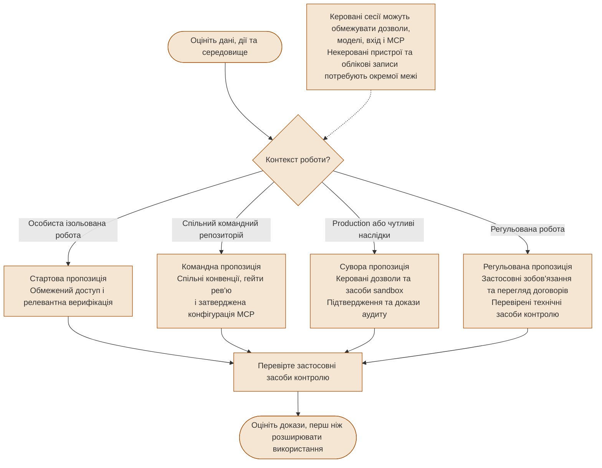
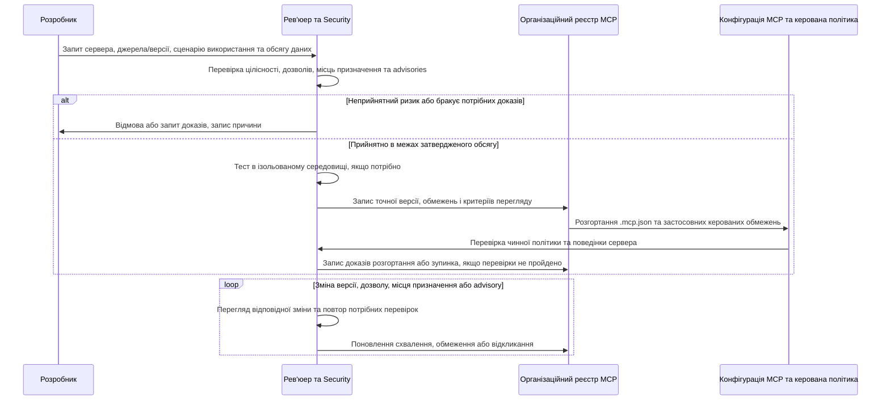
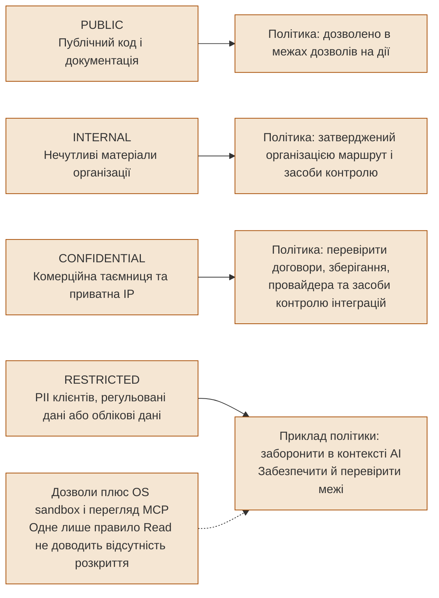
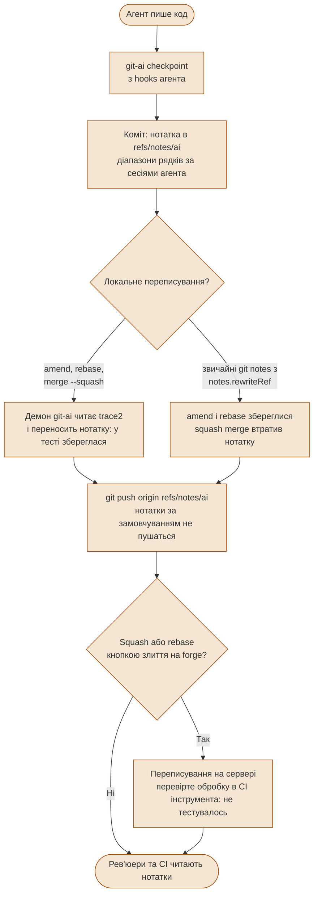

# Корпоративне управління (Enterprise Governance)

Ці діаграми пропонують організаційні політики для Claude Code. Адаптуйте їх до фактичних даних, дій, розгорнутих засобів контролю та договірних зобов'язань. Вони не засвідчують відповідність вимогам чи сертифікацію.

---

### Рівні ризику управління: що та коли контролювати

Обирайте засоби контролю за наслідками та чутливістю роботи, а потім перевіряйте, що політика справді діє в потрібній сесії. Чотири рівні є запропонованими організаційними патернами, а не рівнями продукту Anthropic чи регуляторними сертифікаціями.



<details>
<summary>ASCII-версія</summary>

```text
Особиста ізольована робота -> обмежений доступ + релевантна верифікація
Спільний командний репозиторій -> спільні конвенції + засоби контролю рев'ю/MCP
Production/чутливі наслідки -> керовані дозволи + sandbox + підтвердження
Регульована робота -> зобов'язання/договори + перевірені засоби контролю
    -> перевірте фактичне розгортання й наслідки, перш ніж розширювати використання

Керовані сесії можуть обмежувати дозволи, моделі, вхід і MCP
Некеровані пристрої/облікові записи лежать поза межею цього розгортання
Це запропоновані політики; тривалість налаштування чи відповідність вимогам не гарантуються
```

</details>

> **Джерело**: [Розподіл управління](../security/enterprise-governance.uk.md#1-локальне-vs-спільне-розподіл-управління)

> Організаційні політики можуть обмежувати сесії через керовані налаштування (managed settings), списки дозволених моделей та обмеження входу. Застосовність залежить від розгортання й поверхні; сама конвенція в репозиторії не доводить примусового виконання. [Managed settings](https://code.claude.com/docs/en/managed-settings), [Settings precedence](https://code.claude.com/docs/en/settings#settings-precedence).


---

### Робочий процес управління MCP

Розглядайте реєстр як організаційний облік, а розгорнуту конфігурацію MCP як окремий засіб контролю. Перевіряйте цілісність джерела, дозволи, місця призначення даних і advisories; популярність чи патч-версія не доводять безпеку сервера.



<details>
<summary>ASCII-версія</summary>

```text
Запит: джерело/версія, сценарій використання, обсяг даних
  -> перевірка цілісності, дозволів, місць призначення, advisories
  -> неприйнятний ризик або бракує доказів? Відмова/запит доказів
  -> прийнятний обсяг? Тест в ізоляції, якщо потрібно
  -> реєстр: версія, обмеження, критерії перегляду
  -> розгортання .mcp.json + застосовні керовані обмеження
  -> перевірка чинної політики й поведінки сервера; зупинка при невдалих перевірках

Зміна/advisory -> перегляд відповідної різниці -> перевірка -> поновлення/обмеження/відкликання
Жодного автоматичного схвалення лише тому, що приріст версії є патчем
```

</details>

> **Джерело**: [Робочий процес управління MCP](../security/enterprise-governance.uk.md#3-процес-управління-mcp)

> Проєктні сервери визначаються в `.mcp.json`. Обмеження, що застосовуються організацією, потребують керованої конфігурації MCP або керованих налаштувань; сам лише коміт спільної конфігурації не забороняє локальні перевизначення. Організаційний реєстр не є нативним форматом конфігурації Claude Code. [Project MCP scope](https://code.claude.com/docs/en/mcp#project-scope), [Managed MCP configuration](https://code.claude.com/docs/en/mcp#managed-mcp-configuration).

> Періодичність перегляду, строки дії та вимоги до пробного періоду є рішеннями організації. Встановлюйте їх за фактичним ризиком і тригерами змін; жодна фіксована тривалість перегляду чи універсальний інтервал схвалення не мається на увазі.


---

### Класифікація даних та правила доступу Claude Code

Це приклад політики класифікації в організації. Затверджуйте маршрут обробки й перевіряйте засоби контролю доступу для фактичних даних та інтеграцій. Публічний вміст також потребує дозволів на дії та може містити зловмисні інструкції.



<details>
<summary>ASCII-версія</summary>

```text
Приклад організаційної політики:
  PUBLIC -> дозволено в межах дозволів на дії
  INTERNAL -> затверджений маршрут обробки та засоби контролю
  CONFIDENTIAL -> перевірити договори, зберігання, провайдера та інтеграції
  RESTRICTED -> заборонено в контексті AI за цією прикладною політикою
      -> забезпечте й перевірте межі файлів, shell, мережі та MCP

Окремі приклади deny: Read(./.env), Read(./secrets/**)
Самі лише правила Read не доводять, що обмежені дані не потраплять у контекст
```

</details>

> **Джерело**: [Хартія використання ШІ](../security/enterprise-governance.uk.md#2-хартія-використання-ші)

> ZDR для Claude Code на Enterprise потребує окремої відповідності умовам і ввімкнення; він не охоплює сторонні інструменти чи сервіси MCP. Типові налаштування комерційного навчання, зберігання та організаційне схвалення обробки є окремими питаннями. [ZDR scope](https://code.claude.com/docs/en/zero-data-retention#what-zdr-does-not-cover), [Data policies](https://code.claude.com/docs/en/data-usage#data-policies).

> Дозволи та sandbox є взаємодоповнювальними засобами контролю. Використовуйте окремі правила для окремих шаблонів файлів, перевіряйте доступ до shell та інтеграцій і тестуйте як дозволені, так і заблоковані сценарії. Ні інструкція, ні одне правило `Read` не доводять повного обмеження даних. [Permission syntax](https://code.claude.com/docs/en/permissions#permission-rule-syntax), [Permissions and sandboxing](https://code.claude.com/docs/en/permissions#how-permissions-interact-with-sandboxing).

---

### Атрибуція AI через переписування історії

Де зберігається атрибуція AI, збережена в git notes: за локальним тестом git-ai 1.7.7 і звичайних нотаток git 2.56.0 для цього посібника. Кнопка злиття на forge переписує історію на сервері, поза обома механізмами; цей шлях не тестувався.



<details>
<summary>ASCII-версія</summary>

```text
Агент пише код -> git-ai checkpoint -> коміт із нотаткою в refs/notes/ai
Локальне переписування:
  демон git-ai (trace2)         amend, rebase, merge --squash: нотатка збереглася в тесті
  звичайний git + notes.rewriteRef  amend, rebase збереглися; squash merge втратив нотатку
Пуште нотатки явно: git push origin refs/notes/ai
Squash або rebase кнопкою злиття на forge: на сервері, перевірте обробку в CI інструмента (не тестувалось)
```

</details>

> **Джерело**: [Provenance in git notes](../ops/ai-traceability.uk.md) та [оцінка git-ai](https://github.com/FlorianBruniaux/claude-code-ultimate-guide/blob/main/docs/resource-evaluations/git-ai-provenance-notes.md)

---
**Локалізація**: [Serhii (MacPlus Software)](https://macplus-software.com)
*Остання синхронізація: Травень 2026*
