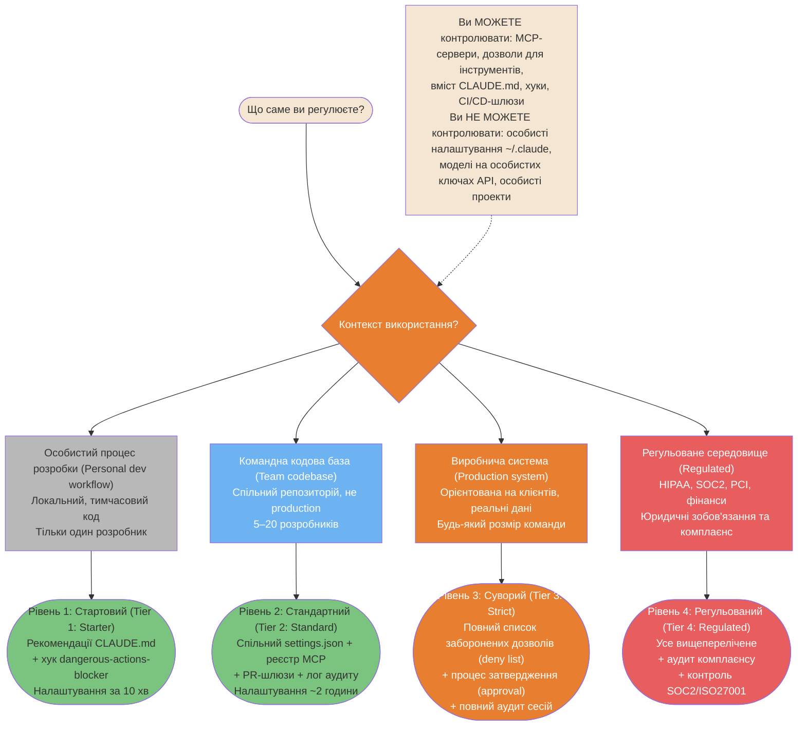
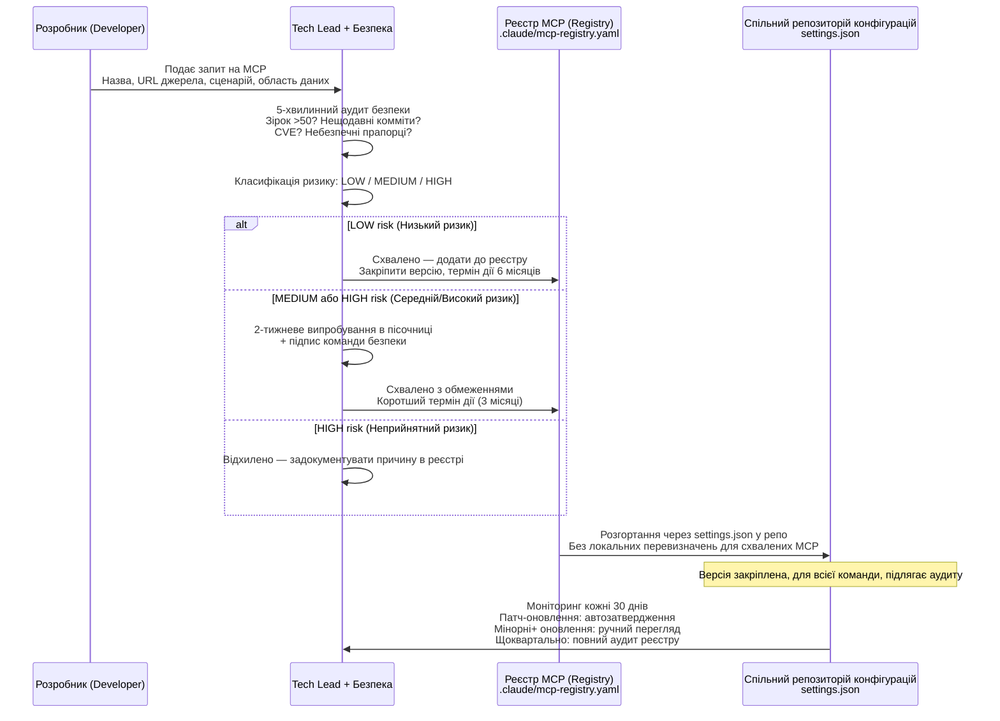

# Корпоративне управління (Enterprise Governance)

Патерни на рівні організації для команд, які розгортають Claude Code у масштабах підприємства — рівні використання, процеси схвалення MCP та конфігурації захисних обмежень (guardrails).

> **Цільова аудиторія**: Технічні лідери, інженерні менеджери, офіцери з безпеки. Для безпеки окремих розробників див. [Безпека та Production](./08-security-and-production.md).

---

### Рівні ризику управління — Що та коли контролювати

Не все потребує жорсткого та важкого регулювання. Це дерево рішень спрямовує ваші завдання на правильний рівень контролю на основі реального ризику — від особистого процесу розробки (мінімальний контроль) до регульованих корпоративних середовищ (повний стек комплаєнсу).



<details>
<summary>ASCII версія</summary>

```
Контекст використання?
├─ Особиста розробка (dev workflow)  → Рівень 1: Стартовий (CLAUDE.md + базові хуки, 10 хв)
├─ Командна кодова база (team)      → Рівень 2: Стандарт  (спільний settings.json + реєстр MCP + PR-шлюзи)
├─ Виробнича система (production)    → Рівень 3: Суворий   (повний deny list + затвердження + аудит)
└─ Регульоване (HIPAA/SOC2/PCI)      → Рівень 4: Регульом. (усе вищеперелічене + аудит комплаєнсу)

Ви МОЖЕТЕ контролювати: settings.json у репозиторії, CLAUDE.md, хуки, CI/CD-шлюзи, реєстр MCP
Ви НЕ МОЖЕТЕ контролювати: особистий ~/.claude, вибір моделі на особистих ключах API, особисті проекти
```

</details>

> **Джерело**: [Корпоративне управління](../security/enterprise-governance.md) — §1 Розділення управління, §4 Рівні захисних обмежень

---

### Робочий процес управління MCP (MCP Governance Workflow)

Індивідуальна перевірка MCP розробником займає 5 хвилин. Корпоративне управління MCP — це 5-кроковий конвеєр, який гарантує, що схвалені сервери залишаються безпечними, версії зафіксовані, а рівень ризику класифіковано ще до розгортання.



<details>
<summary>ASCII версія</summary>

```
Розробник подає запит на MCP (назва, джерело, сценарій, область даних)
    │
Tech Lead: 5-хвилинний аудит безпеки (зірки, комміти, CVE, прапорці)
    │
Класифікація ризику: LOW / MEDIUM / HIGH
    │
┌───┴────────────────────────────┐
LOW                             MED/HIGH
Швидке схвалення               2-тижневий тест у пісочниці
                                + підпис команди безпеки
    │
Додати до реєстру (.claude/mcp-registry.yaml)
  - Закріпити точну версію
  - Встановити термін (6 місяців для LOW, 3 для MED)
  - Задокументувати дозволену область
    │
Розгортання через settings.json у репозиторії (без локальних змін)
    │
Моніторинг кожні 30 днів:
  - Перевірка бюлетенів безпеки
  - Патч-оновлення: авто | Мінорні+ оновлення: ручний перегляд
  - Щоквартально: повний аудит реєстру
```

</details>

> **Джерело**: [Процес управління MCP](../security/enterprise-governance.md#3-mcp-governance-workflow) — §3.1 Процес схвалення

---

### Класифікація даних та правила доступу Claude Code

Класифікація даних визначає, які типи інформації дозволено читати та обробляти Claude Code. Помилка на цьому етапі є найкритичнішим збоєм управління. Чотири рівні, чіткі правила, жодних винятків для категорії RESTRICTED.

```mermaid
flowchart LR
    subgraph PUBLIC["🟢 ПУБЛІЧНІ (PUBLIC)"]
        PU1["Відкритий код (Open source)<br/>Публічна документація<br/>Контент блогів"]
        PU2(["Дозволено — без обмежень"])
    end

    subgraph INTERNAL["🔵 ВНУТРІШНІ (INTERNAL)"]
        IN1["Внутрішні інструменти<br/>Нечутливий кодова база<br/>Командна документація"]
        IN2(["Дозволено — стандартна конфігурація"])
    end

    subgraph CONFIDENTIAL["🟠 КОНФІДЕНЦІЙНІ (CONFIDENTIAL)"]
        CO1["Внутрішні комерційні таємниці<br/>Нерегульована IP<br/>Архітектурна документація"]
        CO2(["Тільки для тарифу Enterprise<br/>Вимагається політика Zero Data Retention"])
    end

    subgraph RESTRICTED["🔴 СУВОРО ОБМЕЖЕНІ (RESTRICTED)"]
        RE1["Персональні дані (PII) клієнтів<br/>Дані банківських карток PCI / PHI<br/>Секрети, паролі та API-ключі"]
        RE2(["НІКОЛИ не передавати в контекст AI<br/>Блокувати через permissions.deny<br/>Жодних винятків"])
    end

    PU1 --> PU2
    IN1 --> IN2
    CO1 --> CO2
    RE1 --> RE2

    style PU2 fill:#7BC47F,color:#333
    style IN2 fill:#6DB3F2,color:#fff
    style CO2 fill:#E87E2F,color:#fff
    style RE2 fill:#E85D5D,color:#fff
    style RE1 fill:#E85D5D,color:#fff

    click PU1 href "https://github.com/FlorianBruniaux/claude-code-ultimate-guide/blob/main/guide/security/enterprise-governance.md#2-ai-usage-charter" "PUBLIC data"
    click IN1 href "https://github.com/FlorianBruniaux/claude-code-ultimate-guide/blob/main/guide/security/enterprise-governance.md#2-ai-usage-charter" "INTERNAL data"
    click CO1 href "https://github.com/FlorianBruniaux/claude-code-ultimate-guide/blob/main/guide/security/enterprise-governance.md#2-ai-usage-charter" "CONFIDENTIAL data"
    click RE1 href "https://github.com/FlorianBruniaux/claude-code-ultimate-guide/blob/main/guide/security/enterprise-governance.md#2-ai-usage-charter" "RESTRICTED data"
    click PU2 href "https://github.com/FlorianBruniaux/claude-code-ultimate-guide/blob/main/guide/security/enterprise-governance.md#2-ai-usage-charter" "PUBLIC: allowed"
    click IN2 href "https://github.com/FlorianBruniaux/claude-code-ultimate-guide/blob/main/guide/security/enterprise-governance.md#2-ai-usage-charter" "INTERNAL: standard config"
    click CO2 href "https://github.com/FlorianBruniaux/claude-code-ultimate-guide/blob/main/guide/security/enterprise-governance.md#2-ai-usage-charter" "CONFIDENTIAL: Enterprise only"
    click RE2 href "https://github.com/FlorianBruniaux/claude-code-ultimate-guide/blob/main/guide/security/enterprise-governance.md#2-ai-usage-charter" "RESTRICTED: never in AI context"
```



<details>
<summary>ASCII версія</summary>

```
PUBLIC       → Дозволено, без обмежень
INTERNAL     → Дозволено, стандартна конфігурація
CONFIDENTIAL → Лише тариф Enterprise (вимагається Zero Data Retention)
RESTRICTED   → НІКОЛИ не передавати в контекст AI (PII, PCI, PHI, секрети)
               Блокувати через: permissions.deny Read(.env, *.key, *.pem, secrets/**)

Суворе правило: Дані з категорії RESTRICTED ніколи не потрапляють у вікно контексту.
Ні в промптах, ні у файлах, які читає Claude, ні в якості прикладів.
```

</details>

> **Джерело**: [Статут використання AI (AI Usage Charter)](../security/enterprise-governance.md#2-ai-usage-charter) — §2.1 Класифікація даних

---
**Локалізація**: [Serhii (MacPlus Software)](https://macplus-software.com)
*Остання синхронізація: Травень 2026*
