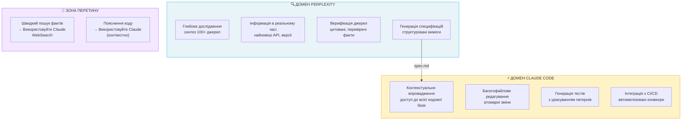
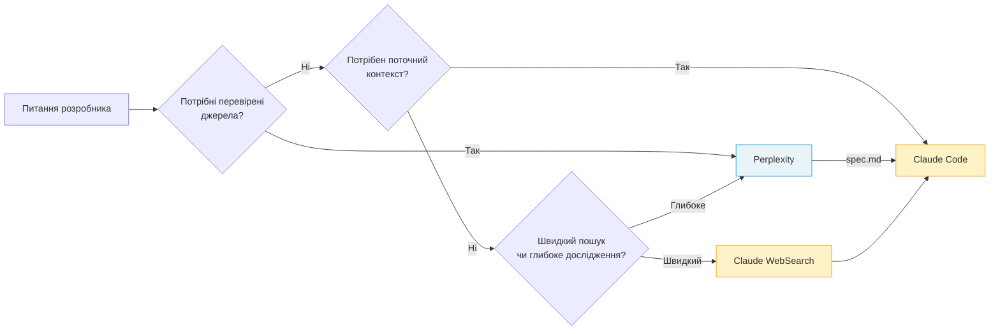
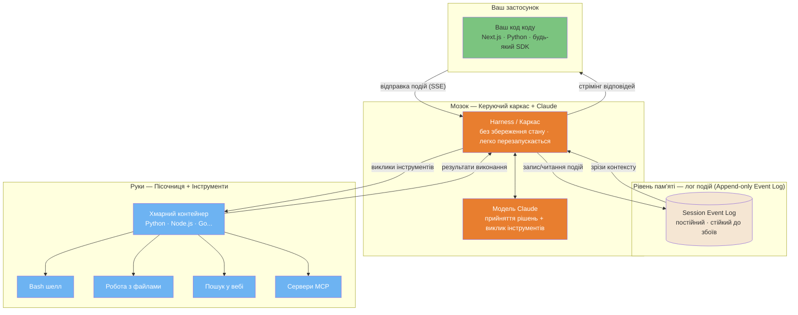
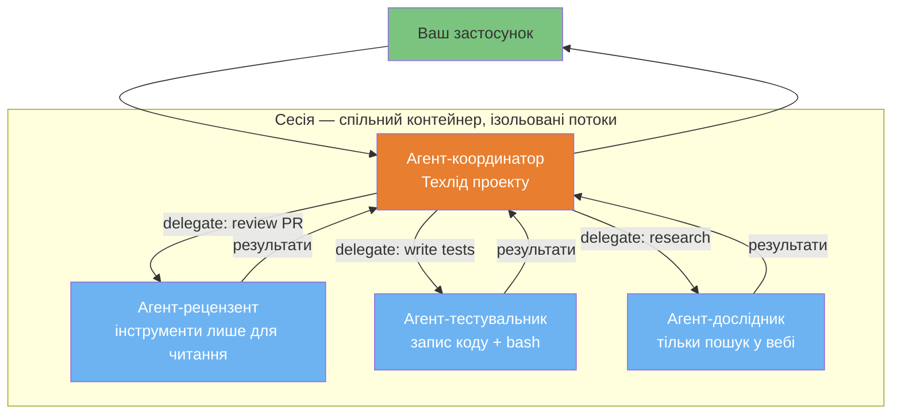

# ШІ-екосистема: Максимізація потенціалу Claude Code за допомогою допоміжних інструментів

> **Час читання**: ~25 хвилин
>
> **Мета**: Цей посібник допоможе вам зрозуміти, коли слід використовувати Claude Code, а коли — допоміжні ШІ-инструменти, та як об'єднувати їх у ланцюжки для досягнення оптимальних робочих процесів.

---

## Зміст

- [Вступ](#вступ)
- [1. Perplexity AI (Дослідження та пошук джерел)](#1-perplexity-ai-дослідження-та-пошук-джерел)
- [2. Google Gemini (Візуальне розуміння)](#2-google-gemini-візуальне-розуміння)
- [3. Kimi (Генерація PPTX та довгих документів)](#3-kimi-генерація-pptx-та-довгих-документів)
- [4. NotebookLM (Синтез та аудіо)](#4-notebooklm-синтез-та-аудіо)
- [5. Голосові інструменти введення (Wispr Flow, Superwhisper)](#5-голосові-інструменти-введення-wispr-flow-superwhisper)
- [6. Інструменти на базі IDE (Cursor, Windsurf, Cline)](#6-інструменти-на-базі-ide-cursor-windsurf-cline)
- [6.1 Google Antigravity (Агент-орієнтована IDE)](#61-google-antigravity-агент-орієнтована-ide)
- [7. UI-прототипувальники (v0, Bolt, Lovable)](#7-ui-прототипувальники-v0-bolt-lovable)
- [8. Оркестрація робочих процесів](#8-оркестрація-робочих-процесів)
- [9. Стратегія витрат та підписок](#9-стратегія-витрат-та-підписок)
- [10. Claude Cowork (Research Preview)](#10-claude-cowork-research-preview)
- [11. Матриця ШІ-агентів для кодингу](#11-матриця-ші-агентів-для-кодингу)
- [11.1 Goose: альтернатива з відкритим кодом (Block)](#111-goose-альтернатива-з-відкритим-кодом-block)
- [11.2 Інсайти практиків](#112-інсайти-практиків)
- [11.3 Коли розробляти власні рішення, а коли використовувати готові](#113-коли-розробляти-власні-рішення-а-коли-використовувати-готові)
- [11.4 Платформи дистрибуції навичок](#114-платформи-дистрибуції-навичок)
- [12. Інструменти пакування контексту](#12-інструменти-пакування-контексту)
- [14. Claude Managed Agents (Хмарна платформа)](#14-claude-managed-agents-хмарна-платформа)
- [15. Попередній перегляд Project Glasswing та Claude Mythos (Захисна безпека)](#15-попередній-перегляд-project-glasswing-та-claude-mythos-захисна-безпека)
- [Додаток: Готові до використання промпти](#додаток-готові-до-використання-промпти)
- [Альтернативні провайдери (Обхідні шляхи спільноти)](#альтернативні-провайдери-обхідні-шляхи-спільноти)

---

## Вступ

### Філософія: Доповнення, а не заміна

Claude Code чудово справляється з:
- **Контекстуальними міркуваннями** на рівні всієї кодової бази
- **Багатофайловим впровадженням** з інтеграцією тестування
- **Постійною пам'яттю** за допомогою файлів CLAUDE.md
- **Автоматизацією CLI** для CI/CD конвеєрів
- **Агентним виконанням завдань** з мінімальним наглядом

Чого Claude Code не робить добре (за дизайном):
- **Пошук у реальному часі в вебі з перевіркою джерел** (хоча WebSearch існує, він обмежений)
- **Генерація зображень** (немає вбудованої можливості)
- **Генерація презентацій PowerPoint** (немає виводу в PPTX)
- **Синтез аудіо** (немає TTS)
- **Прототипування в браузері** (немає візуального прев'ю)

Мета полягає не в тому, щоб знайти "кращі" інструменти, а в тому, щоб зв'язати **правильний інструмент для кожного кроку**.

### Матриця взаємодоповнюваності

| Завдання | Claude Code | Краща альтернатива | Чому |
|------|-------------|-------------------|-----|
| **Впровадження коду** | ✅ Найкраще | - | Контекстуальні міркування + редагування файлів |
| **Глибоке дослідження з джерелами** | ⚠️ Обмежено | Perplexity Pro | 100+ перевірених джерел |
| **Зображення → Код** | ⚠️ Обмежено | Gemini 2.5+ | Чудове візуальне розуміння |
| **Генерація слайдів** | ❌ Немає | Kimi.com | Нативний експорт у PPTX |
| **Аудіо-огляд** | ❌ Немає | NotebookLM | Синтез у стилі подкасту |
| **Браузерне прототипування** | ❌ Немає | v0.dev, Bolt | Живе прев'ю |
| **Автодоповнення в IDE** | ❌ Немає | Copilot, Cursor | Вбудовані пропозиції (inline) |

---

## 1. Perplexity AI (Дослідження та пошук джерел)

### Діаграма взаємодоповнюваності

Наступна діаграма ілюструє, як саме Perplexity та Claude Code доповнюють один одного протягом робочого процесу розробки:



**Ключове розуміння**: Perplexity відповідає на питання "Що ми маємо побудувати?" → Claude Code відповідає на питання "Як нам побудувати це саме тут?".

### Потік прийняття рішень



### Коли використовувати Perplexity замість Claude

| Сценарій | Використовуйте Perplexity | Використовуйте Claude |
|----------|---------------|------------|
| "Який останній API для X?" | ✅ | ⚠️ Обмеження знань датою зрізу |
| "Порівняй 5 бібліотек для auth" | ✅ Джерела | ⚠️ Можливі галюцинації |
| "Поясни це повідомлення про помилку" | ⚠️ Загальне пояснення | ✅ З урахуванням вашого контексту |
| "Впровадь auth у мою кодову базу" | ❌ Немає доступу до файлів | ✅ Повний доступ |

### Можливості Perplexity Pro для розробників

**Режим глибокого дослідження (Deep Research Mode)**
- Синтезує дані з понад 100 джерел у структурований вивід
- Потребує 3-5 хвилин, але створює вичерпні специфікації
- Експорт у форматі markdown → Передайте у Claude Code

**Вибір моделі (Model Selection)**
- Claude Sonnet 4: Найкраще для технічного опису та документації
- GPT-4o: Добре для фрагментів коду
- Sonar Pro: Швидкий пошук фактичних даних

**Функції Spaces та Labs**
- Spaces: Постійні контексти для проектів
- Блоки коду: Експорт коду з підсвічуванням синтаксису
- Діаграми: Автоматична генерація на основі даних

### Робочий процес інтеграції

#### Патерн 1: Дослідження → Специфікація → Код

```
┌─────────────────────────────────────────────────────────┐
│ 1. PERPLEXITY (Deep Research)                           │
│    "Research best practices for JWT refresh tokens      │
│     in Next.js 15. Include security considerations,     │
│     common pitfalls, and library recommendations."      │
│                                                         │
│    → Вивід: Специфікація на 2000 слів із джерелами      │
└───────────────────────────┬─────────────────────────────┘
                            ↓ Експорт як spec.md
┌─────────────────────────────────────────────────────────┐
│ 2. CLAUDE CODE                                          │
│    > claude                                             │
│    "Implement JWT refresh tokens following spec.md.     │
│     Use the jose library as recommended."               │
│                                                         │
│    → Вивід: Робоча реалізація з тестами                 │
└─────────────────────────────────────────────────────────┘
```

#### Патерн 2: Робочий процес із розділенням екрану (Parallel Pane)

Використовуючи tmux або розділення терміналу:

```bash
# Ліва панель: Perplexity (браузер або CLI)
perplexity "Best practices for rate limiting in Express"

# Права панель: Claude Code (впровадження)
claude "Add rate limiting to API. Check spec.md for approach."
```

### Порівняння: Claude WebSearch vs Perplexity

| Функція | Claude WebSearch | Perplexity Pro |
|---------|-----------------|----------------|
| Кількість джерел | ~5-10 | 100+ (Deep Research) |
| Верифікація джерел | Базова | Повні цитування |
| Дані в реальному часі | Так | Так |
| Формат експорту | Текст у контексті | Markdown, блоки коду |
| Найкраще для | Швидких перевірок | Комплексного дослідження |
| Вартість | Включено | $20/місяць Pro |

**Рекомендація**: Використовуйте Claude WebSearch для швидких перевірок фактів. Використовуйте Perplexity Deep Research перед будь-яким значним впровадженням, яке потребує розуміння екосистеми.

---

## 2. Google Gemini (Візуальне розуміння)

### Сценарії використання для розробників

**Візуальні суперсили Gemini**:
- Макет інтерфейсу → Код HTML/CSS/React (90%+ відповідність)
- Інтерпретація діаграм (блок-схеми → Mermaid/код)
- Наочне налагодження коду ("чому це виглядає зламаним?")
- Вилучення дизайн-токенів (кольори, відступи з зображень)

### Gemini 2.5 Pro для розробки

Найкращий у своєму класі для:
- **Складного перетворення UI**: Завантажте скріншот з Figma → Отримайте Tailwind-компоненти
- **Аналізу діаграм**: Схеми архітектури → План впровадження
- **Аналізу помилок**: Завантажте скріншот помилки → Отримайте кроки для її виправлення

Вибір моделі:
- **Gemini 2.5 Pro**: Складні візуальні міркування, великий контекст
- **Gemini 2.5 Flash**: Швидкі візуальні завдання, нижча вартість

### Робочий процес інтеграції

#### Патерн: Візуальне зображення → Код

```
┌─────────────────────────────────────────────────────────┐
│ 1. GEMINI 2.5 PRO                                       │
│    Завантаження: screenshot.png макету з Figma          │
│    Промпт: "Convert this to a React component using     │
│            Tailwind CSS. Use semantic HTML and          │
│            include responsive breakpoints."             │
│                                                         │
│    → Вивід: Код JSX + Tailwind                          │
└───────────────────────────┬─────────────────────────────┘
                            ↓ Копіювання в буфер обміну
┌─────────────────────────────────────────────────────────┐
│ 2. CLAUDE CODE                                          │
│    > claude                                             │
│    "Refine this component for our Next.js project.      │
│     Add proper TypeScript types, our Button component,  │
│     and connect to the auth context."                   │
│                                                         │
│    → Вивід: Готовий до продакшену компонент             │
└─────────────────────────────────────────────────────────┘
```

#### Патерн: Діаграма → План впровадження

```
┌─────────────────────────────────────────────────────────┐
│ 1. GEMINI                                               │
│    Завантаження: architecture-diagram.png               │
│    Промпт: "Analyze this architecture diagram.          │
│            Output a Mermaid diagram with the same       │
│            structure, and list the components."         │
│                                                         │
│    → Вивід: Код Mermaid + список компонентів            │
└───────────────────────────┬─────────────────────────────┘
                            ↓ Вставка Mermaid у CLAUDE.md
┌─────────────────────────────────────────────────────────┐
│ 2. CLAUDE CODE                                          │
│    "Implement the UserService component from the        │
│     architecture in CLAUDE.md. Start with the           │
│     interface, then the implementation."                │
│                                                         │
│    → Вивід: Реалізований сервіс                         │
└─────────────────────────────────────────────────────────┘
```

### Альтернативи для генерації зображень

Для генерації діаграм, макетів або візуальних ресурсів:

| Інструмент | Найкраще для | Формат | Якість |
|------|----------|--------|---------|
| Ideogram 3.0 | UI макети, іконки | PNG, SVG | Висока |
| Recraft v3 | Вектори, логотипи | SVG, PNG | Дуже висока |
| Midjourney | Художні візуальні матеріали | PNG | Художня |
| DALL-E 3 | Швидкі концепти | PNG | Добра |

**Робочий потік для згенерованих зображень**:
1. Згенеруйте зображення в обраному інструменті
2. Завантажте в Gemini для конвертації → в код
3. Доопрацюйте за допомогою Claude Code

---

## 3. Kimi (Генерація PPTX та довгих документів)

### Що таке Kimi?

[Kimi](https://kimi.ai) — це асистент від Moonshot AI, який вирізняється:
- **Нативною генерацією PPTX** (справжні слайди, а не просто markdown)
- **Контекстом понад 128K токенів** (вся кодова база)
- **Макетами з урахуванням коду** (підсвічування синтаксису на слайдах)
- **Багатомовністю** (чудова робота з китайською та англійською мовами)

### Сценарії використання для розробників

**Генерація презентацій**:
- Опис Pull Request → Презентація для зацікавлених сторін
- Архітектурна документація → Візуальна презентація
- Технічна специфікація → Слайди для онбордингу команди
- Розбір коду (walkthrough) → Навчальні матеріали

### Робочий процес інтеграції

#### Патерн: Код → Презентація

```
┌─────────────────────────────────────────────────────────┐
│ 1. CLAUDE CODE                                          │
│    "Generate a summary of all changes in the last       │
│     5 commits. Format as markdown with sections:        │
│     Overview, Key Changes, Breaking Changes, Migration."│
│                                                         │
│    → Вивід: changes-summary.md                          │
└───────────────────────────┬─────────────────────────────┘
                            ↓ Завантаження в Kimi
┌─────────────────────────────────────────────────────────┐
│ 2. KIMI                                                 │
│    Промпт: "Create a 10-slide presentation from this    │
│            summary for non-technical stakeholders.      │
│            Use business-friendly language.              │
│            Include one slide per major feature."        │
│                                                         │
│    → Вивід: stakeholder-update.pptx                     │
└─────────────────────────────────────────────────────────┘
```

#### Патерн: Архітектура → Навчання

```
┌─────────────────────────────────────────────────────────┐
│ 1. CLAUDE CODE (використовуючи /explain або аналог)     │
│    "Explain the authentication flow in this project.    │
│     Include sequence diagrams (mermaid) and key files." │
│                                                         │
│    → Вивід: auth-explanation.md з діаграмами            │
└───────────────────────────┬─────────────────────────────┘
                            ↓ Завантаження в Kimi
┌─────────────────────────────────────────────────────────┐
│ 2. KIMI                                                 │
│    "Create an onboarding presentation for new devs.     │
│     20 slides covering the auth system. Include         │
│     code snippets and diagrams where relevant."         │
│                                                         │
│    → Вивід: auth-onboarding.pptx                        │
└─────────────────────────────────────────────────────────┘
```

### Порівняння: Інструменти для презентацій

| Інструмент | Сильні сторони | Слабкі сторони | Найкраще для |
|------|-----------|------------|----------|
| **Kimi** | Нативний PPTX, підсвічування коду | Менш вишуканий дизайн | Технічні слайди |
| **Gamma.app** | Красиві шаблони | Слабша підтримка коду | Бізнес-презентації |
| **Tome** | ШІ-орієнтований, візуальний | Дорогий | Маркетинг |
| **Beautiful.ai** | Розумні шаблони | Потребує ручної роботи | Дизайн-орієнтовані слайди |
| **Marp** | Markdown → слайди | Ручний стайлінг | Презентації для розробників |

**Рекомендація**: Використовуйте Kimi для технічного контенту з фрагментами коду. Використовуйте Gamma для бізнес-презентацій та пітчів інвесторам.

---

## 4. NotebookLM (Синтез та аудіо)

### Сценарії використання для розробників

**Синтез документації**:
- Завантажте 50+ файлів → Отримайте єдину структуровану картину
- Задавайте питання про власну кодову базу
- Генеруйте аудіо-огляди для вивчення системи під час поїздки

**Функція аудіо-огляду (Audio Overview)**:
- Створює 10-15 хвилинний "подкаст" на основі завантаженого контенту
- Два ШІ-хости обговорюють вашу документацію у розмовній формі
- Ідеально підходить для онбордингу або ознайомлення зі складними системами

### Робочий процес інтеграції

#### Патерн: Кодова база → Аудіо-онбординг

```
┌─────────────────────────────────────────────────────────┐
│ 1. ЕКСПОРТ (через Claude Code або вручну)               │
│    "Export all markdown files from docs/ and the        │
│     main README to a single combined-docs.md file."     │
│                                                         │
│    → Вивід: combined-docs.md (50K токенів)              │
└───────────────────────────┬─────────────────────────────┘
                            ↓ Завантаження в NotebookLM
┌─────────────────────────────────────────────────────────┐
│ 2. NOTEBOOKLM                                           │
│    - Додайте combined-docs.md як джерело                │
│    - Натисніть "Generate Audio Overview"                │
│    - Зачекайте 3-5 хвилин для генерації                 │
│                                                         │
│    → Вивід: 12-хвилинне аудіо з поясненням системи      │
└───────────────────────────┬─────────────────────────────┘
                            ↓ Прослуховування дорогою на роботу
┌─────────────────────────────────────────────────────────┐
│ 3. ПОВЕРНЕННЯ ДО CLAUDE CODE                            │
│    "Based on my notes from the audio overview:          │
│     [paste notes]                                       │
│     Help me understand the auth flow in more detail."   │
│                                                         │
│    → Вивід: Контекстуальний глибокий аналіз             │
└─────────────────────────────────────────────────────────┘
```

#### Патерн: Синтез із багатьох джерел

```
┌─────────────────────────────────────────────────────────┐
│ NOTEBOOKLM                                              │
│ Завантаження багатьох джерел:                           │
│ - Документи кодової бази (combined-docs.md)             │
│ - Офіційна документація фреймворку (Next.js docs PDF)   │
│ - Супутні статті або специфікації (URL/PDF)             │
│                                                         │
│ Питання: "How does our auth implementation compare to   │
│           Next.js best practices?"                      │
│                                                         │
│    → Вивід: Порівняльний аналіз із цитуванням джерел    │
└─────────────────────────────────────────────────────────┘
```

### Експорт у CLAUDE.md

Після синтезу в NotebookLM експортуйте важливі висновки у ваш проект:

```markdown
## Архітектурні висновки (на основі синтезу NotebookLM)

### Ключові патерни
- Сервісний шар використовує патерн Репозиторій (Repository pattern)
- Процес авторизації відповідає специфікації OAuth2 з PKCE
- Управління станом реалізовано через React Query

### Виявлені потенційні проблеми
- Логіка оновлення токенів (token refresh) не задокументована
- Відсутні запобіжники помилок (Error Boundaries) у критичних точках системи

### Рекомендації
- Додати документацію щодо оновлення токенів
- Провести аудит та впровадити Error Boundaries
```

---

## 4.1 NotebookLM MCP Integration

**Доступно з версії**: Claude Code v2.1+ з підтримкою MCP

**Опис**: Робота з блокнотами NotebookLM безпосередньо з Claude Code зі збереженням контексту бесіди між різними питаннями.

### Встановлення

```bash
# Встановлення сервера NotebookLM MCP
claude mcp add notebooklm npx notebooklm-mcp@latest

# Налаштування профілю (опціонально, додайте у ~/.zshrc або ~/.bashrc)
export NOTEBOOKLM_PROFILE=standard  # minimal (5 інструментів) | standard (10 інструментів) | full (16 інструментів)

# Перевірка встановлення
claude mcp list
# Має показати: notebooklm: npx notebooklm-mcp@latest - ✓ Connected
```

**Порівняння профілів**:

| Профіль | Кількість інструментів | Призначення |
|---------|-------|----------|
| `minimal` | 5 | Базові запити, обмежений бюджет токенів |
| `standard` | 10 | **Рекомендовано** - Запити + керування бібліотекою |
| `full` | 16 | Розширені можливості (керування браузером, очищення) |

**Детальний опис інструментів**:

| Інструмент | minimal | standard | full | Опис |
|------|---------|----------|------|-------------|
| `ask_question` | ✅ | ✅ | ✅ | Запит до блокноту з контекстом розмови |
| `add_notebook` | ✅ | ✅ | ✅ | Додати новий блокнот до бібліотеки |
| `list_notebooks` | ✅ | ✅ | ✅ | Переглянути список усіх блокнотів |
| `get_notebook` | ✅ | ✅ | ✅ | Отримати деталі блокноту за ID |
| `setup_auth` | ✅ | ✅ | ✅ | Початкова автентифікація в Google |
| `select_notebook` | ❌ | ✅ | ✅ | Зробити блокнот активним |
| `update_notebook` | ❌ | ✅ | ✅ | Оновити метадані блокноту |
| `search_notebooks` | ❌ | ✅ | ✅ | Пошук у бібліотеці за ключовими словами |
| `list_sessions` | ❌ | ✅ | ✅ | Перелік активних сесій розмов |
| `get_health` | ❌ | ✅ | ✅ | Перевірка статусу авторизації та конфігурації |
| `remove_notebook` | ❌ | ❌ | ✅ | Видалити блокнот із бібліотеки |
| `re_auth` | ❌ | ❌ | ✅ | Зміна облікового запису Google |
| `cleanup_data` | ❌ | ❌ | ✅ | Видалення даних браузера та сесій |
| `get_browser_state` | ❌ | ❌ | ✅ | Ручна перевірка стану браузера |
| `execute_browser_action` | ❌ | ❌ | ✅ | Ручне керування браузером |
| `wait_for_element` | ❌ | ❌ | ✅ | Ручне очікування елемента браузера |

### Автентифікація

**Важливо**: NotebookLM MCP використовує ізольований профіль Chrome, окремий від вашої основної сесії в браузері.

```bash
# У Claude Code, під час першого запуску:
"Log me in to NotebookLM"

# Автоматично відкриється браузер для авторизації в Google
# Оберіть ваш обліковий запис (порада: використовуйте authuser=1 для додаткових акаунтів)
# Сесія збережеться у: ~/Library/Application Support/notebooklm-mcp/
```

**Налаштування кількох акаунтів**:

Якщо ви використовуєте кілька Google акаунтів та хочете обрати конкретний:

1. **Попередньо відкрийте в браузері**: Відкрийте `https://notebooklm.google.com/?authuser=1` (змініть цифру для інших акаунтів)
2. Увійдіть у потрібний акаунт
3. **Після цього** запустіть автентифікацію в Claude Code

MCP зберігає облікові дані в ізольованому профілі Chrome, тому файли cookie вашого основного браузера не впливатимуть на цей процес.

**Перевірка авторизації**:

```bash
"Check NotebookLM health status"

# Очікуваний вивід після успішного входу:
# {
#   "authenticated": true,
#   "account": "your-email@gmail.com",
#   "notebooks": <count>
# }
```

### Створення бібліотеки блокнотів

На відміну від веб-інтерфейсу, MCP працює через **посилання для спільного доступу (share links)**, а не за допомогою автоматичної синхронізації всіх блокнотів.

**Додавання блокноту**:

```bash
# 1. У веб-інтерфейсі NotebookLM:
#    - Відкрийте потрібний блокнот
#    - Натисніть "Share" → "Anyone with the link"
#    - Скопіюйте посилання

# 2. У Claude Code:
"Add notebook: https://notebooklm.google.com/notebook/abc123...
Name: LLM Engineer Handbook
Description: Comprehensive guide on LLM engineering practices
Topics: LLM, fine-tuning, RAG, deployment"

# Потрібно вказати мінімум метаданих — MCP проаналізує контент самостійно
```

**Перегляд списку бібліотеки**:

```bash
"List my NotebookLM notebooks"

# Покаже всі додані блокноти з темами, варіантами використання та часом останнього доступу
```

**Пошук у бібліотеці**:

```bash
"Search NotebookLM library for: React patterns"

# Повертає відповідні блокноти на основі назви, опису та тем
```

### Запити до блокнотів

**Прямий запит** (вказавши конкретний блокнот):

```bash
"In LLM Engineer Handbook, how do I implement RAG with embeddings?"

# Claude виконає наступне:
# 1. Обере вказаний блокнот
# 2. Запитає NotebookLM
# 3. Поверне відповідь із точними цитатами
# 4. Збереже session_id для подальших питань
```

**Контекстна бесіда**:

```bash
# Перше питання
"In Building Large-Scale Web Apps notebook, what are the caching strategies?"

# Наступне питання (використовує той самий session_id)
"How would that apply to a Next.js application?"

# Ще одне запитання
"What about Redis vs in-memory cache trade-offs?"

# Контекст сесії зберігається для всіх наступних запитів
```

**Вибір активного блокноту**:

```bash
"Select LLM Engineer Handbook as active notebook"

# Тепер можна запитувати без постійного вказування назви блокноту
"What are the fine-tuning techniques?"
"How does DPO compare to RLHF?"
```

### Розширені робочі процеси

**Дослідження кількох блокнотів**:

```bash
# Порівняння інсайтів з різних блокнотів
"What does LLM Engineer Handbook say about embeddings?"
"Now check Playwright Automation guide for testing strategies"
"How can I combine these approaches?"
```

**Оновлення метаданих блокноту**:

```bash
# Під час використання блокнотів уточнюйте їх метадані
"Update LLM Engineer Handbook:
 - Add topic: prompt engineering
 - Add use case: When designing LLM architectures"

# Це допоможе Claude автоматично обирати потрібний блокнот для майбутніх запитів
```

**Керування сесіями**:

```bash
"List active NotebookLM sessions"

# Показує всі активні сесії розмов із кількістю повідомлень та часом життя
# Корисно для відновлення попередніх ланцюжків дослідження
```

### Порівняння: MCP vs Web UI

| Функція | MCP Інтеграція | Web UI |
|---------|----------------|--------|
| Доступ з Claude Code | ✅ Прямий | ❌ Ручний копіпаст |
| Контекст бесіди | ✅ Постійний session_id | ⚠️ Тільки у веб-чаті |
| Запити до кількох блокнотів | ✅ Швидке перемикання | ⚠️ Ручна навігація |
| Генерація аудіо | ❌ Тільки через веб-інтерфейс | ✅ Нативно |
| Спільний доступ | ✅ Через бібліотеку | ✅ Нативно |
| Швидкість запитів | ✅ Миттєво | ⚠️ Навігація в браузері |

**Найкраща практика**: Використовуйте **MCP для запитів** під час розробки, та **веб-інтерфейс для генерації аудіо** під час онбордингу.

### Усунення несправностей

| Проблема | Вирішення |
|-------|----------|
| `notebooklm: not connected` | Виконайте `source ~/.zshrc` (або перезапустіть термінал), потім перезапустіть Claude Code |
| Порожній список блокнотів після входу | Ви авторизувалися, але ще не додали жодного блокноту — скористайтеся посиланнями спільного доступу |
| Неправильний обліковий запис Google | Очистіть дані: видаліть `~/Library/Application Support/notebooklm-mcp/chrome_profile/` та пройдіть авторизацію знову |
| Помилка "Tool not found" | Перевірте, чи правильно встановлена змінна оточення `NOTEBOOKLM_PROFILE` |
| Помилки обмеження лімітів (Rate limits) | Зачекайте 24 години або переавторизуйтеся з іншим Google акаунтом |

**Перевірка конфігурації MCP**:

```bash
# Перегляд конфігурації MCP в ~/.claude.json
cat ~/.claude.json | jq '.mcpServers.notebooklm'

# Має показувати:
# {
#   "type": "stdio",
#   "command": "npx",
#   "args": ["notebooklm-mcp@latest"],
#   "env": {}
# }
```

### Приклад: Робочий процес онбордингу

```bash
# День 1: Налаштування
"Log me in to NotebookLM"
"Add notebook: <share-link-1> - Codebase Architecture"
"Add notebook: <share-link-2> - API Documentation"

# День 2: Дослідження
"In Codebase Architecture, what's the auth flow?"
"How does that integrate with the API docs?"
"Select API Documentation notebook"
"What are the rate limiting strategies?"

# Тиждень 2: Розширені запити
"Search library for: database patterns"
"In Database Patterns notebook, explain connection pooling"
"How would I implement this in our codebase?"
```

---

## 4.2 Advanced Features (Full Profile)

**Коли використовувати профіль `full`**:
- Потрібно часто перемикати акаунти Google (`re_auth`)
- Бажаєте очистити всі дані MCP без ручного видалення файлів (`cleanup_data`)
- Необхідно видаляти блокноти з бібліотеки (`remove_notebook`)
- Складне налагодження, яке потребує безпосереднього контролю над браузером

**Увімкнення повного профілю**:

```bash
# Додайте в ~/.zshrc або ~/.bashrc
export NOTEBOOKLM_PROFILE=full

# Перезапустіть Claude Code
```

### Видалення блокноту з бібліотеки

```bash
"Remove notebook: LLM Engineer Handbook"

# Або за ідентифікатором:
"Remove notebook with ID: llm-engineer-handbook"
```

**Призначення**: Очищення бібліотеки, видалення застарілих блокнотів, виправлення дублікатів.

### Переавторизація (Зміна облікового запису)

**Сценарій**: Перехід з особистого облікового запису Google на робочий.

```bash
"Re-authenticate NotebookLM with different account"

# Відкриється браузер, оберіть інший акаунт Google
# Нові облікові дані будуть збережені, стару сесію буде видалено
```

**Різниця порівняно з `setup_auth`**:
- `setup_auth`: Перше налаштування авторизації
- `re_auth`: Перемикання акаунтів (очищує поточну сесію)

**Важливо**: Після переавторизації ваша бібліотека блокнотів **зберігається** (локально), але вам потрібно буде перевірити доступ до блокнотів (вони мають бути відкриті для нового акаунта).

### Очищення даних (Cleanup Data)

**Сценарій**: Почати з чистого аркуша, видалити всі дані MCP (авторизацію, бібліотеку, профіль браузера).

```bash
"Clean up NotebookLM MCP data"

# Опції:
# - preserve_library: Зберегти метадані бібліотеки (за замовчуванням: false)
# - confirm: Підтвердження безпеки (за замовчуванням: false)
```

**Що буде видалено**:
- Профіль браузера (`~/Library/Application Support/notebooklm-mcp/chrome_profile/`)
- Файли cookie автентифікації
- Активні сесії
- Бібліотеку блокнотів (якщо не вказано `preserve_library=true`)

**Коли використовувати**:
- Проблеми з авторизацією, які не вдається вирішити через `re_auth`
- Конфлікти або пошкодження даних браузера
- Початок роботи з чистого аркуша після тестування
- Перед видаленням MCP

**Приклад**:

```bash
"Clean NotebookLM data but keep my library"
# → cleanup_data(preserve_library=true, confirm=true)

"Completely reset NotebookLM MCP"
# → cleanup_data(preserve_library=false, confirm=true)
```

### Ручне керування браузером

**Інструменти для розширеного налагодження** (тільки в профілі `full`):

**1. Отримання стану браузера**:

```bash
"Show NotebookLM browser state"

# Повертає: current_url, cookies, local_storage, session_storage
```

**2. Виконання дій у браузері**:

```bash
"Navigate NotebookLM browser to specific notebook URL"
"Click element in NotebookLM browser"
"Type text in NotebookLM browser"
```

**3. Очікування елементів**:

```bash
"Wait for element to load in NotebookLM browser"
```

**Призначення**: Налагодження проблем із входом, інспектування стану браузера при помилках, ручний перехід по блокнотах.

---

## 4.3 Browser Options (All Profiles)

Керування поведінкою браузера для запитів та автентифікації.

### Доступні параметри

```javascript
{
  // Відображення
  "headless": true,        // Запуск без графічного вікна (за замовчуванням: true)
  "show": false,          // Показувати вікно браузера (за замовчуванням: false)

  // Продуктивність
  "timeout_ms": 30000,    // Таймаут операцій (за замовчуванням: 30000)

  // Розмір екрану (Viewport)
  "viewport": {
    "width": 1920,        // Ширина за замовчуванням: 1920
    "height": 1080        // Висота за замовчуванням: 1080
  },

  // Режим маскування (Stealth mode - імітація поведінки людини)
  "stealth": {
    "enabled": true,           // Головний перемикач (за замовчуванням: true)
    "human_typing": true,      // Симуляція швидкості друку (за замовчуванням: true)
    "random_delays": true,     // Випадкові паузи (за замовчуванням: true)
    "mouse_movements": true,   // Реалістичні рухи миші (за замовчуванням: true)
    "typing_wpm_min": 160,     // Мін. швидкість друку (за замовчуванням: 160)
    "typing_wpm_max": 240,     // Макс. швидкість друку (за замовчуванням: 240)
    "delay_min_ms": 100,       // Мін. затримка між діями (за замовчуванням: 100)
    "delay_max_ms": 400        // Макс. затримка між діями (за замовчуванням: 400)
  }
}
```

### Приклади використання

**Налагодження входу з видимим вікном**:

```bash
"Log me in to NotebookLM with visible browser"

# Claude викличе: setup_auth(show_browser=true)
```

**Кастомний таймаут для повільного інтернету**:

```bash
"Ask NotebookLM (with 60s timeout): What are the main concepts?"

# Claude викличе: ask_question(timeout_ms=60000, ...)
```

**Вимкнення маскування для прискорення запитів** (якщо немає ризику блокувань):

```bash
# Розширений варіант: потребує прямого виклику інструменту (не природною мовою)
ask_question(
  question="...",
  browser_options={
    "stealth": {"enabled": false},
    "timeout_ms": 10000
  }
)
```

**Коли змінювати параметри**:
- **Show browser**: Для налагодження авторизації, перевірки обраного акаунта
- **Increase timeout**: При повільному інтернеті, великих блокнотах, складних запитах
- **Disable stealth**: Для локального тестування, коли швидкість у пріоритеті
- **Custom viewport**: Для рідкісних випадків тестування адаптивності інтерфейсу NotebookLM

---

## 4.4 Session Management

NotebookLM MCP підтримує контекст розмови між запитами за допомогою `session_id`.

### Як працюють сесії

```bash
# Перший запит → Створення сесії
"In LLM Engineer Handbook, what is RAG?"
# → Повертає session_id: "abc123"

# Наступний запит → Використовує ту саму сесію
"How does it compare to fine-tuning?"
# → Автоматично застосовує session_id: "abc123"

# Запит до іншого блокноту → Нова сесія
"In Playwright Guide, how do I test?"
# → Новий session_id: "xyz789"
```

**Властивості сесій**:
- **Автоматичність**: Claude сам керує `session_id` для наступних запитань
- **Контекстна обмеженість**: Одна сесія на один блокнот в межах розмови
- **Таймаут**: 15 хвилин бездіяльності (можна налаштувати)
- **Максимум сесій**: 10 одночасних (можна налаштувати)

### Перегляд активних сесій

```bash
"List my active NotebookLM sessions"

# Повертає:
# - session_id
# - notebook_name
# - age_seconds
# - message_count
# - last_activity (часова мітка)
```

**Застосування**: Відновлення попередніх гілок дослідження, аналіз історії запитів, налагодження контексту.

### Ручне керування сесіями

**Продовження конкретної сесії**:

```bash
"Continue NotebookLM session abc123 with question: What about embeddings?"

# Claude викличе: ask_question(session_id="abc123", question="...")
```

**Створення нової сесії без врахування контексту**:

```bash
"Ask NotebookLM in fresh session: What is RAG?"

# Claude не передає session_id, створюючи нову сесію
```

**Очищення сесій**:

Сесії автоматично завершуються через 15 хвилин бездіяльності. Ручне очищення виконується через `cleanup_data`.

---

## 4.5 Library Management Best Practices

### Організація блокнотів

**Правила найменування**:

```bash
# Добре: Інформативно, легко шукати
"LLM Engineer Handbook"
"Playwright Testing Guide"
"Next.js Architecture Patterns"

# Погано: Незрозуміло, абстрактно
"Notebook 1"
"My Docs"
"Tech Stuff"
```

**Стратегія вибору тем (Topics)**:

```bash
# Конкретні, ієрархічні теми
topics: ["RAG", "embeddings", "vector databases", "LLM fine-tuning"]

# Занадто загальні теми
topics: ["AI", "programming"]
```

**Варіанти використання (Use Cases)** (допомагають Claude автоматично обирати джерело):

```bash
# Орієнтовані на дії
use_cases: [
  "When implementing RAG systems",
  "For fine-tuning LLM models",
  "To understand embeddings architecture"
]
```

### Робочий процес уточнення метаданих

Після додавання блокноту розширюйте та покращуйте метадані:

```bash
# Первинне додавання (мінімалістичне)
"Add notebook: <url>
Name: TypeScript Guide
Description: TypeScript best practices
Topics: TypeScript, types"

# Після використання (уточнення)
"Update TypeScript Guide:
 - Add topic: generics
 - Add topic: utility types
 - Add use case: When designing type-safe APIs
 - Add tag: advanced"
```

### Пошук та знаходження

**Пошук за ключовими словами**:

```bash
"Search library for: React hooks"
"Search library for: testing"
"Search library for: architecture patterns"
```

**Розумний вибір (пропонує Claude)**:

```bash
"Which notebook should I consult about database design?"
# Claude шукає у бібліотеці та пропонує найкращу відповідність

"I need help with TypeScript generics"
# Claude автоматично обирає TypeScript Guide, якщо метадані збігаються
```

### Життєвий цикл блокноту

```bash
# 1. Додавання
"Add notebook: <url> - Name: X, Description: Y, Topics: Z"

# 2. Використання
"In X notebook, ask: ..."

# 3. Уточнення
"Update X: Add topic: ..., Add use case: ..."

# 4. Архівування (тільки в профілі full)
"Remove notebook: X"  # Якщо блокнот застарів чи є дублікатом
```

### Вартість

**Безкоштовно**: Сервіс NotebookLM (включаючи інтеграцію MCP) безкоштовний при наявності акаунта Google.

**Обмеження**:
- Безкоштовний тариф: 100 блокнотів, 50 джерел на блокнот, 500 тисяч слів, 50 запитів на день.
- Тарифи Google AI Premium/Ultra: у 5 разів вищі ліміти.

---

## 5. Голосові інструменти введення (Wispr Flow, Superwhisper)

**Філософія**: "Vibe кодинг" — диктуйте свої наміри голосом, дозволяючи ШІ втілювати їх у коді.

Голосове введення забезпечує приблизно в 4 рази більшу швидкість (~150 слів на хвилину порівняно з ~40 словами на хвилину при звичайному друкуванні) та дозволяє передати значно більше деталей. Ви висловлюєте більше контексту та нюансів, коли вам не потрібно все це друкувати вручну.

### Порівняння інструментів

| Інструмент | Обробка | Затримка | Приватність | Ціна | Платформа |
|------|------------|---------|---------|-------|----------|
| **Wispr Flow** | Хмарна | ~500мс | Сертифікат SOC 2 | $12/міс | Mac, Win, iOS |
| **Superwhisper** | Локальна | 1-2с | 100% офлайн | ~$50 одноразово | Mac |
| **MacWhisper** | Локальна | Змінна | 100% офлайн | $49 одноразово | Mac |

### Коли зв'язка Голос + Claude Code працює найкраще

| Сценарій | Чому голос виграє |
|----------|---------------|
| Великі обсяги контексту | Ви природно згадуєте обмеження, крайові випадки та бізнес-логіку |
| Мозковий штурм (Brainstorming) | Менше самоцензури, більше сирих та свіжих ідей |
| Робота з кількома агентами | Можливість диктувати завдання у 3-4 сесії Claude одночасно |
| Спеціальні можливості (Accessibility) | Тунельний синдром (RSI), обмеження моторики чи втомлюваність очей |

### Робочий процес "Vibe кодингу"

1. Відкрийте термінал з Claude Code або редактор Cursor
2. Увімкніть запис голосу (гаряча клавіша Wispr або системне диктування)
3. Диктуйте свої вимоги природною мовою: "I need a component that shows user stats, it should have pagination because we have thousands of users, and sorting by name or signup date, use our existing Tailwind setup"
4. Дозвольте Claude обробити цей детальний запит
5. Уточнюйте голосом: "Add loading state and error handling"

### Переваги та обмеження

| Перевага | Обмеження |
|-----------|------------|
| Введення у ~4 рази швидше | У ~3 рази об'ємніший вихідний текст |
| Багатший контекст | Питання конфіденційності у хмарі (для Wispr) |
| Збереження стану "потоку" розробки | Додаткове навантаження на RAM (~800MB) |
| Природне висловлювання думок | Технічні терміни потребують навчання словника |

### Рекомендації

| Профіль розробника | Оптимальний інструмент |
|---------|------|
| Орієнтований на максимальну продуктивність | Wispr Flow Pro ($12/міс) |
| Високі вимоги до приватності | Superwhisper (Mac) |
| Оптимальний бюджет | MacWhisper ($49 одноразово) |
| Користувач Windows | Очікування стабілізації Wispr для Windows |

**Корисна порада**: Для складних промптів використовуйте проміжний крок "стиснення" або "рафінування" довгого розмовного тексту в структуровану інструкцію перед відправкою в Claude Code. Шаблон такої навички див. у `examples/skills/` під назвою `/voice-refine`.

---

## 5.1 Інструменти озвучування тексту (Agent Vibes)

**Філософія**: Голосовий супровід звільняє очі для виконання паралельних завдань.

Текстове озвучування (TTS) додає аудіо-нарацію до відповідей Claude Code, що дозволяє:
- **Проводити рев'ю коду паралельно**: Слухайте пояснення Claude, поки очима аналізуєте зміни в diff
- **Працювати під час довгих налагоджень (debugging)**: Отримуйте звукові сповіщення про завершення тривалих операцій
- **Забезпечувати доступність**: Допомога при втомі очей, RSI чи порушеннях зору
- **Моніторити роботу у фоновому режимі**: Голосові повідомлення про помилки або успішні збірки

### Інструмент: Agent Vibes (Спільнота MCP)

**Статус**: Опціональна інтеграція (не є офіційною функцією Claude Code)
**Вартість**: 100% безкоштовно (офлайн TTS)
**Підтримка**: Розвивається спільнотою (Paul Preibisch)

| Параметр | Значення |
|---------|-------|
| **Технологія** | Piper TTS (офлайн нейромережа) + macOS Say (нативний інструмент) |
| **Голоси** | 15+ (12 англійських, 4 французьких, включаючи 124 мульти-спікерів) |
| **Якість** | ⭐️⭐️⭐️⭐️ (Piper medium), ⭐️⭐️⭐️⭐️⭐️ (Piper high) |
| **Затримка** | ~280мс (Piper medium), ~50мс (macOS Say) |
| **Місце на диску** | ~1.3GB (Piper + моделі голосів + звукові ефекти) |
| **Час налаштування** | ~18 хвилин (5 інтерактивних фаз) |

### Коли TTS приносить найбільшу користь

| Сценарій | Перевага |
|----------|---------|
| Рев'ю коду | Прослуховування коментарів Claude під час візуального перегляду коду |
| Тривалі завдання | Голосове повідомлення, коли тести чи збірка проекту завершені |
| Налагодження систем | Сповіщення про помилки без необхідності постійно дивитися в термінал |
| Навчальний режим | Двомовна нарація (основна мова + мова вивчення) |
| Парне програмування | Один пише код, обидва чують коментарі та поради Claude |

### Переваги та обмеження

| Перевага | Обмеження |
|-----------|------------|
| 100% офлайн робота | Якість голосів поступається хмарним рішенням (як ElevenLabs) |
| Нульова вартість | Затримка ~280мс (порівняно з миттєвим macOS Say) |
| Багатомовність (50+) | Потребує ~1GB місця на диску для моделей голосів |
| Велика варіативність (124 голоси) | Встановлення потребує Homebrew та Bash 5.x |

### Швидкий старт

**Встановлення**: Детальний опис див. у розділі [Робочий процес налаштування TTS](./workflows/tts-setup.md) (18 хв)

**Базові команди**:
```bash
# У Claude Code
/agent-vibes:whoami          # Перевірити поточний голос та провайдера
/agent-vibes:list            # Переглянути всі 15 доступних голосів
/agent-vibes:switch fr_FR-tom-medium  # Перемкнути на французький чоловічий голос

# Тестування
> "Say hello in French"  # Пролунає голосове озвучування
```

**Тимчасове вимкнення звуку**:
```bash
/agent-vibes:mute    # Перейти в беззвучний режим
# ... час для концентрації ...
/agent-vibes:unmute  # Увімкнути звук знову
```

### Рекомендації

| Профіль користувача | Налаштування |
|---------|-------|
| **Активний рецензент коду** | ✅ Встановити з голосом `fr_FR-tom-medium`, параметр `verbosity: low` |
| **Фокусована робота** | ⚠️ Встановити, але тримати звук вимкненим, вмикати лише для сповіщень |
| **Економія батареї** | Використовувати провайдера macOS Say (миттєво, менше споживання, нижча якість) |
| **Робота в опенспейсі** | ❌ Не встановлювати TTS, щоб не заважати іншим колегам |

### Повна документація

- **[Інтеграційний посібник Agent Vibes](../examples/integrations/agent-vibes/README.md)** - Огляд, команди, сценарії
- **[Посібник із встановлення](../examples/integrations/agent-vibes/installation.md)** - Кроки 18-хвилинного налаштування
- **[Каталог голосів](../examples/integrations/agent-vibes/voice-catalog.md)** - 15 голосів з аудіоприкладами
- **[Усунення несправностей](../examples/integrations/agent-vibes/troubleshooting.md)** - Вирішення частих проблем

**Ресурси**:
- GitHub: https://github.com/paulpreibisch/AgentVibes
- Приклади голосів: https://rhasspy.github.io/piper-samples/

---

## 6. Інструменти на базі IDE (Cursor, Windsurf, Cline)

> **Технічне порівняння**: Об'єктивне порівняння Claude Code з понад 22 альтернативами за 11 критеріями (підтримка MCP, Skills, команди, суб-агенти, режим планування) див. у таблиці [AI Coding Agents Matrix](https://coding-agents-matrix.dev/) (оновлено в січні 2026 року).

### Коли інструменти в IDE доповнюють Claude Code

| Сценарій | Використовуйте інструмент IDE | Використовуйте Claude Code |
|----------|-------------|-----------------|
| Швидкі правки прямо в коді | ✅ Швидше | ⚠️ Потребує перемикання контексту |
| Автодоповнення при друкуванні | ✅ Критично важливо | ❌ Не підтримується |
| Багатофайловий рефакторинг | ⚠️ Обмежено | ✅ Чудово |
| Розуміння великої кодової бази | ⚠️ Обмежено | ✅ Значно краще |
| Автоматизація CI/CD | ❌ Тільки вручну | ✅ Нативна інтеграція |

### Гібридний робочий процес

**Ранкова сесія (стратегічна)**:
```bash
claude "Review the auth module and suggest improvements"
# Claude аналізує код та створює план рефакторингу для кількох файлів
```

**Під час написання коду (тактична робота)**:
```
# В Cursor чи VS Code з Copilot
# Швидке автодоповнення, вбудовані підказки
# Написання невеликих окремих функцій
```

**Перед коммітом (валідація)**:
```bash
claude "Review my changes and suggest tests"
# Claude переглядає різницю (diff), генерує детальні тести
```

### Реальний шлях міграції: Cursor → Windsurf → Claude Code

> **Джерело**: [Zadig&Voltaire Engineering Blog](https://tech.zadig-et-voltaire.com/blog/migration-nuxt/) — Benjamin Calef, лютий 2026 р.

Команда з 6 розробників у компанії Zadig&Voltaire детально описала свій досвід послідовної міграції інструментів під час 6-місячного переписування платформи e-commerce (липень 2025 – січень 2026):

| Період | Інструмент | Спостереження команди |
|-------|------|-------------|
| Липень 2025 | Cursor | Спільний кодинг, вбудовані пропозиції автодоповнення |
| Серпень 2025 | Windsurf | Схожа парадигма роботи, дещо інший інтерфейс користувача |
| Серпень 2025 | **Claude Code** | Глибоке розуміння всієї кодової бази — переломний момент |
| Листопад 2025 | Claude Opus 4.5 | Величезний стрибок у розумінні коду, надійна автономна генерація |

Команда зазначила, що перехід на Claude Code був зумовлений саме **розумінням проекту на рівні всієї кодової бази**, а не просто зручністю редагування окремого файлу. Вони розробили власні навички (`zv-commit`, `zv-code-review`, `zv-jira`, `zv-jira-qa`) та інтегрували готові рішення зі спільноти [skills.sh](https://skills.sh/) для стандартизації процесів.

**Застереження**: Показники покращення продуктивності (-33% рядків коду, -63% LCP), згадані в статті, перш за все пов'язані з переходом на Nuxt 3, а не безпосередньо з ШІ-інструментами. Головною цінністю цього кейсу є саме описана траєкторія зміни інструментів розробки.

### Специфіка інтеграції з Cursor

Файл `.cursor/rules` у Cursor може дзеркально відображати правила вашого `CLAUDE.md`:

```markdown
# .cursor/rules
# Скопійовано з CLAUDE.md для забезпечення єдиних стандартів

## Правила кодування
- Використовуйте суворий режим TypeScript (strict mode)
- Віддавайте перевагу іменованому експорту (named exports)
- Назви файлів тестів: *.test.ts

## Патерни
- Сервіси використовують впровадження залежностей (dependency injection)
- Компоненти використовують render props для гнучкості
```

### Синхронізація конфігурацій між кількома IDE

Коли ваша команда використовує різні ШІ-інструменти одночасно (Claude Code + Cursor + Copilot), підтримання однакових стандартів та інструкцій для моделей стає серйозним викликом.

#### Проблема розходження конфігурацій

| Інструмент | Конфігураційний файл | Формат |
|------|-------------|--------|
| Claude Code | `CLAUDE.md` | Markdown + директиви @import |
| Cursor | `.cursorrules` | Звичайний markdown |
| Codex/ChatGPT | `AGENTS.md` | Стандарт AGENTS.md |
| Copilot | `.github/copilot-instructions.md` | Специфічний формат GitHub |

**Якщо не налаштувати синхронізацію**: Кожен файл буде змінюватися окремо → ШІ поводитиметься по-різному в різних інструментах, створюючи хаос.

#### Рішення 1: Нативний імпорт @import (Рекомендовано для Claude Code)

Claude Code підтримує імпорт інших файлів за допомогою синтаксису `@шлях/до/файлу.md` з коробки:

```markdown
# CLAUDE.md
@docs/conventions/coding-standards.md
@docs/conventions/architecture.md
```

**Плюси**: Вбудована підтримка, відсутність потреби у додаткових збірках, офіційно підтримується Anthropic.
**Мінуси**: Cursor та його `.cursorrules` не підтримують такий імпорт.

#### Рішення 2: Скриптова синхронізація (Для змішаних команд)

Для команд, яким потрібні **абсолютно ідентичні правила в усіх інструментах**:

```
docs/ai-instructions/           # Єдине джерело правди
├── core.md                     # Загальні конвенції для всіх
├── claude-specific.md          # Додаткові правила для Claude Code
├── cursor-specific.md          # Додаткові правила для Cursor
└── codex-specific.md          # Додаткові правила для AGENTS.md

        ↓ скрипт синхронізації (bash/node)

CLAUDE.md     = core + claude-specific
.cursorrules  = core + cursor-specific
AGENTS.md     = core + codex-specific
```

**Приклад скрипту синхронізації** (bash):

```bash
#!/bin/bash
CORE="docs/ai-instructions/core.md"

cat "$CORE" > CLAUDE.md
echo -e "\n---\n" >> CLAUDE.md
cat "docs/ai-instructions/claude-specific.md" >> CLAUDE.md

cat "$CORE" > .cursorrules
echo -e "\n---\n" >> .cursorrules
cat "docs/ai-instructions/cursor-specific.md" >> .cursorrules
```

**Коли використовувати цей підхід**:
- У вашій команді розробники працюють у різних IDE (Claude Code, Cursor, VS Code)
- Необхідно забезпечити 100% однакове дотримання архітектурних правил усіма ШІ
- Реалізовано перевірку правил у CI/CD

#### ⚠️ Статус підтримки стандарту AGENTS.md

**Claude Code НЕ підтримує формат AGENTS.md нативно** ([GitHub issue #6235](https://github.com/anthropics/claude-code/issues/6235), 171 коментар, відкрито станом на лютий 2026 року).

**Рішення**: Створення символьного посилання: `ln -s AGENTS.md .claude/CLAUDE.md`

Стандарт AGENTS.md підтримується такими інструментами: Cursor, Windsurf, Cline, GitHub Copilot. Детальніше див. на [AI Coding Agents Matrix](https://coding-agents-matrix.dev).

### Експорт коду з IDE в Claude

Коли вам потрібен детальний та глибокий аналіз від Claude:

1. Виділіть код в IDE
2. Скопіюйте його разом із контекстом (повний шлях до файлу, номери рядків)
3. Вставте у Claude Code із промптом: "Analyze this and suggest architectural improvements"

---

## 6.1 Google Antigravity (Агент-орієнтована IDE)

> **Джерела**: [Google Codelabs](https://codelabs.developers.google.com/getting-started-google-antigravity), [Google Cloud Blog](https://cloud.google.com/blog/topics/developers-practitioners/choosing-antigravity-or-gemini-cli), відгуки спільноти (лютий 2026 р.)

Google Antigravity — це **агент-орієнтована IDE** (форк VS Code), випущена наприкінці 2025 року. На відміну від традиційних інструментів, які додають ШІ-функції до редактора, Antigravity будує роботу навколо автономних агентів. Розробник виконує роль супервізора через інтерфейс "командного центру", замість прямого написання коду.

### Claude Code vs Antigravity: Дві філософії

| Критерій | Claude Code | Google Antigravity |
|-----------|-------------|-------------------|
| **Основна парадигма** | Термінал-орієнтований, CLI-native | Агент-орієнтований, IDE-native |
| **Контроль розробника** | Явне покрокове затвердження змін | Вищий рівень автономності агентів |
| **Модель контексту** | Рівень кодової бази через CLAUDE.md | Багатоплощинний (редактор + браузер + CLI) |
| **Мульти-агентність** | Агентні команди (v2.1+) | Вбудована оркестрація багатьох агентів |
| **Збірки в CI/CD** | Нативна (без графічного інтерфейсу) | Ще не готова для стабільного використання |
| **Профіль ризику** | Передбачуваний, консервативний | Високий рівень автономії = ризик зайвих змін |
| **Формат навичок** | `.claude/skills/` (YAML-фронтматтер) | Папки з окремою структурою |
| **Моделі** | Тільки Claude (Anthropic) | Мультимодельність (Gemini, Claude, Liquid) |

### Міст: antigravity-claude-proxy

Спільнотою розроблено [npm пакет](https://www.npmjs.com/package/antigravity-claude-proxy), який пропонує Anthropic-сумісний API на базі хмарного сервісу Antigravity. Це дає змогу використовувати моделі Claude в інтерфейсі Antigravity або поєднувати обидва інструменти в одному робочому ланцюжку.

### Коли варто обрати Antigravity

| Сценарій | Рекомендація |
|----------|---------------|
| Швидке створення прототипів ("vibe кодинг") | Antigravity (вища автономність, візуальний фідбек) |
| Продакшн-код із CI/CD конвеєрами | Claude Code (передбачуваність, консольний запуск) |
| Робота та експерименти з багатьма моделями | Antigravity (~150 моделей через OpenRouter) |
| Стандартизація всередині команди | Claude Code (система CLAUDE.md, навички, гачки-hooks) |
| Розробники, які не люблять працювати в CLI | Antigravity (нативно в IDE, менше терміналу) |

### Важливі trade-offs

**Переваги Antigravity**: Більш широкий візуальний контекст (агенти "бачать" браузер та редактор одночасно), паралельна оркестрація агентів, низький поріг входу для тих, хто уникає CLI.

**Недоліки Antigravity**: Високе когнітивне навантаження (необхідно контролювати дії кількох агентів одночасно), менш передбачувана поведінка, незрілість для CI/CD процесів, ризик незворотного псування файлів через надмірну автономність агентів.

**Підсумок**: Claude Code оптимізовано для **передбачуваності та безшовної інтеграції в існуючі інженерні процеси**. Antigravity оптимізовано для **максимальної автономії ШІ з певними експериментальними ризиками**. Це два різні філософські підходи — обирайте той, який відповідає вашим вимогам до безпеки та стилю роботи.

---

## 7. UI-прототипувальники (v0, Bolt, Lovable)

### Коли використовувати UI-прототипувальники

| Сценарій | Використовуйте прототипувальник | Використовуйте Claude Code |
|----------|---------------|-----------------|
| "Створи посадкову сторінку" | ✅ v0 (візуально) | ⚠️ Немає прев'ю |
| "Додай форму до нашого застосунку" | ⚠️ Потрібен контекст проекту | ✅ Має повний контекст |
| "Швидка ітерація дизайну" | ✅ Живе візуальне прев'ю | ⚠️ Повільніше |
| "Використай наш дизайн-систем" | ⚠️ Згенерує загальні класи | ✅ Читає ваші дизайн-токени |

### Порівняння інструментів

| Інструмент | Сильні сторони | Технологічний стек | Найкраще для |
|------|-----------|-------|----------|
| **v0.dev** | Shadcn/Tailwind | React | Компонентні прототипи |
| **Bolt.new** | Шаблони цілих застосунків | Різноманітний | Швидкі MVP |
| **Lovable** | Переклад дизайну в код | React | Передача дизайну в розробку |
| **WebSim** | Експериментальні інтерфейси | Web | Креативні дослідження |

### Робочий процес інтеграції

#### Патерн: Прототип → Продакшн

```
┌─────────────────────────────────────────────────────────┐
│ 1. V0.DEV                                               │
│    Промпт: "A user profile card with avatar,            │
│            stats, and action buttons"                   │
│                                                         │
│    → Вивід: React + Shadcn компонент з прев'ю           │
│    → Експорт: Скопіювати код                            │
└───────────────────────────┬─────────────────────────────┘
                            ↓ Вставка з буфера обміну
┌─────────────────────────────────────────────────────────┐
│ 2. CLAUDE CODE                                          │
│    "Adapt this v0 component for our Next.js app:        │
│     - Use our existing Button, Avatar components        │
│     - Add TypeScript types matching User interface      │
│     - Connect to getUserProfile API endpoint            │
│     - Add loading and error states"                     │
│                                                         │
│    → Вивід: Готовий до продакшену інтегрований компонент│
└─────────────────────────────────────────────────────────┘
```

---

## 8. Оркестрація робочих процессов

### Повний конвеєр розробки

Для максимальної ефективності об'єднуйте інструменти в такий ланцюжок:

```
┌─────────────────────────────────────────────────────────────────────┐
│                          ФАЗА ПЛАНУВАННЯ                            │
│ ├───────────────────────────────────────────────────────────────────┤
│ │                                                                   │
│ │  [PERPLEXITY]              [GEMINI]              [NOTEBOOKLM]     │
│ │  Глибоке дослідження       Аналіз діаграм        Синтез доків     │
│ │  "Best practices for..."   Завантажити схему     Завантажити доки │
│ │       ↓                         ↓                      ↓          │
│ │  spec.md                   mermaid + план        аудіо-огляд      │
│ │                                                                   │
│ └──────────────────────────────┬────────────────────────────────────┘
│                                ↓
│ ┌─────────────────────────────────────────────────────────────────────┐
│ │                        ФАЗА ВПРОВАДЖЕННЯ                            │
│ │ ├───────────────────────────────────────────────────────────────────┤
│ │ │                                                                   │
│ │ │  [CLAUDE CODE]                          [IDE + COPILOT]           │
│ │ │  Багатофайлова реалізація               Вбудоване автодоповнення  │
│ │ │  "Implement per spec.md..."             Швидкі дрібні правки      │
│ │ │       ↓                                       ↓                   │
│ │ │  Робочий код + тести                   Відполірований код        │
│ │ │                                                                   │
│ └──────────────────────────────┬────────────────────────────────────┘
│                                ↓
│ ┌─────────────────────────────────────────────────────────────────────┐
│ │                          ФАЗА ДОСТАВКИ                              │
│ │ ├───────────────────────────────────────────────────────────────────┤
│ │ │                                                                   │
│ │ │  [CLAUDE CODE]                          [KIMI]                    │
│ │ │  Опис Pull Request                     Звіт для стейкхолдерів    │
│ │ │  /release-notes                         "Create slides from..."   │
│ │ │       ↓                                       ↓                   │
│ │ │  GitHub PR                              презентація.pptx          │
│ │ │                                                                   │
│ └─────────────────────────────────────────────────────────────────────┘
```

### Шаблони сесій

#### Розробка фічі з глибоким дослідженням (Research-Heavy Feature)

```bash
# 1. Дослідження (Perplexity - 10 хв)
# "Best practices for WebSocket implementation in Next.js 15"
# → Експортувати результати у websocket-spec.md

# 2. Впровадження (Claude Code - 40 хв)
claude
> "Implement WebSocket following websocket-spec.md.
   Add to src/lib/websocket/. Include reconnection logic."

# 3. Презентація результатів (Kimi - 5 хв)
# Завантажити: зміни + скріншоти роботи
# → Створити короткий звіт на 5 слайдів для демонстрації
```

#### Розробка фічі з упором на дизайн (Visual-Heavy Feature)

```bash
# 1. Створення прототипу UI (v0 - 10 хв)
# Згенерувати макет дашборду

# 2. Покращення дизайну (Gemini - 5 хв)
# Завантажити Figma-макет → Отримати фінальний код інтерфейсу

# 3. Інтеграція в проект (Claude Code - 30 хв)
claude
> "Integrate this dashboard component.
   Connect to our data fetching hooks.
   Add proper TypeScript types."
```

#### Онбординг у новий проект (Onboarding New Codebase)

```bash
# 1. Аудіо-огляд системи (NotebookLM - 15 хв)
# Завантажити всі доки → Створити аудіо → Прослухати

# 2. Детальні запитання (Claude Code - 20 хв)
claude
> "I just listened to an overview of this codebase.
   Help me understand the payment flow in detail."

# 3. Перший внесок / таска (Claude Code - 30 хв)
claude
> "Add a new endpoint to the payments API.
   Follow the patterns I see in existing endpoints."
```

---

### 8.1 Multi-Agent Orchestration Systems

Коли завдання виходять за межі однієї сесії Claude Code, зовнішні системи оркестрації координують роботу багатьох агентів одночасно.

#### Загальний огляд

| Система | Призначення | База | Зрілість | Моніторинг |
|--------|---------|---------|----------|------------|
| **Gas Town** | Менеджер простору багатьох агентів | Інстанси Claude Code | Експериментальна | agent-chat (SSE + SQLite) |
| **multiclaude** | Локальний спавнер агентів | Агенти Claude Code | Активна розробка (383⭐) | agent-chat (JSON логи) |
| **agent-chat** | Моніторинг комунікації в реальному часі | Читання логів систем | Рання версія (v0.2.0) | Веб-панель |

#### Gas Town (Steve Yegge)

**Опис**: Оркестратор, що керує десятками інстансів Claude Code з ролями у стилі фільму "Шалений Макс":
- **Мер (Mayor)**: Головний координатор, ставить завдання розробникам
- **Тхори (Polecats)**: Ефемерні робочі агенти, що виконують написання коду
- **Свідок (Witness)**: Контролює розробників, допомагає при блокуваннях
- **Нафтопереробник (Refinery)**: Керує чергою злиття (merge queue), вирішує конфлікти

**Важливі нюанси**:
- ✅ Відкриває можливості паралельного проектування через Claude Code
- ⚠️ Дуже дорогий у використанні (автору довелося створити окремий акаунт Anthropic через ліміти витрат)
- ❌ Знаходиться в експериментальному статусі, не рекомендовано для продакшену
- 🔗 [GitHub репозиторій](https://github.com/steveyegge/gastown)

**Коли використовувати**: Для масштабних архітектурних завдань, що легко піддаються паралелізації.

#### multiclaude (dlorenc)

**Опис**: Самостійно розміщувана система запуску автономних агентів Claude Code:
- Кожен агент: окреме tmux вікно + git worktree + гілка
- Автоматично створює Pull Requests, інтеграція з CI
- Ролі агентів: виконавець, супервізор, черга злиття, рецензент

**Важливі нюанси**:
- ✅ Здатний розвивати сам себе (multiclaude збирає власний код)
- ✅ Легко розширюється за допомогою Markdown-файлів конфігурацій агентів
- ✅ Публічні Go-пакети: pkg/tmux, pkg/claude
- 🔗 [GitHub репозиторій](https://github.com/dlorenc/multiclaude)

**Коли використовувати**: Командам, які прагнуть мати повний контроль над оркестрацією у власній закритій інфраструктурі (on-prem/airgap).

#### agent-chat (Justin Abrahms)

**Опис**: Slack-подібний інтерфейс для моніторингу спілкування між ШІ-агентами в реальному часі:
- Читає базу `beads.db` (SQLite) системи Gas Town та JSON-файли multiclaude
- Використовує SSE для миттєвого оновлення даних, канали для розмов, індикатори непрочитаного
- Має темну тему, не потребує складних налаштувань

**Важливі нюанси**:
- ✅ Єдина панель для спостереження за кількома системами оркестрації
- ⚠️ Дуже новий інструмент (створений нещодавно, версія v0.2.0)
- ⚠️ Не сумісний з одиночним запуском Claude Code (потребує наявності Gas Town або multiclaude)
- 🔗 [GitHub репозиторій](https://github.com/justinabrahms/agent-chat)

**Архітектурний патерн (який можна застосувати і в Claude Code)**:
```
1. Гачок (Hook) перехоплює запуск агента → Запис в SQLite
2. Зберігаються зв'язки між батьківськими та дочірніми процесами
3. Ендпоінт SSE стрімко передає оновлення
4. Панель моніторингу відображає потік подій розробнику
```

Див. також: `guide/observability.md` для нативного відстеження сесій Claude Code.

#### Entire CLI: Governance-First Orchestration

**Опис**: Агент-орієнтована платформа, орієнтована на **контроль (governance) та послідовну передачу завдань (handoffs)**, на відміну від чисто паралельної координації.

**Запущено**: У лютому 2026 року Томасом Домке (колишнім CEO GitHub), залучено $60M інвестицій.

**Порівняння архітектурних підходів:**

| Аспект | Gas Town / multiclaude | Entire CLI |
|--------|------------------------|-----------|
| **Основна парадигма** | Координація (мультиплексування через tmux) | Контроль (точки затвердження людиною) |
| **Створення агентів** | Вручную (tmux/worktrees) | Автоматично (протокол передачі handoff) |
| **Паралельне виконання**| Так (5+ агентів одночасно) | Ні (лише послідовні кроки) |
| **Збереження контексту**| Ручне (через спільні файли) | Автоматичне (точки збереження - checkpoints) |
| **Аудит та логування** | Відсутній | Вбудований (Compliance-ready) |
| **Функція відкату (Rewind)**| Ні | Так (повернення до попередніх чекпоінтів) |

**Важливі нюанси**:
- ✅ Повний аудит змін: промпти → роздуми моделі → результати (відповідність SOC2, HIPAA)
- ✅ Надійна передача завдань між різними моделями (Claude → Gemini → Claude)
- ✅ Точки затвердження людиною перед деплоєм (Human-in-the-loop)
- ⚠️ Тільки послідовна робота, немає паралелізму
- ⚠️ Дуже новий проект (запуск у лютому 2026 року) — обмежений досвід промислового використання
- 🔗 [GitHub репозиторій](https://github.com/entireio/cli) | [entire.io](https://entire.io)

**Процес передачі контексту між агентами (handoff flow):**

```
Claude Code                    Gemini CLI                   Entire
-----------                    ----------                   ------

працює над фічею
"blocked on X,
 delegate to Gemini" ---------> hook PreToolUse[Task]
                                (перехоплює передачу)
                                                   |
                                отримує повний      |
                                контекст:           |
                                - ланцюжок думок    |
                                - змінені файли     |
                                - прийняті рішення  |
                                - відкинуті підходи |
                                                    |
                                працює...           |
                                завершує            |
                                                    v
                                               hook PostToolUse[Task]
                                               (записує результат)

Результат: кожен наступний агент бачить логіку міркувань попередніх.
Немає проблеми "холодного старту" — контекст повністю збережено.
```

**Коли обирати Entire CLI:**

```bash
# Приклад 1: Процеси з суворим аудитом безпеки
entire capture --agent="claude-code" --require-approval="security-team"
# [... Claude вносить зміни у код ...]
# Зміни заблоковані, поки безпечники не підтвердять їх через: entire approve

# Приклад 2: Послідовна передача роботи іншому агенту (Claude → Gemini)
entire capture --agent="claude-code" --task="architecture"
# [... Claude створює архітектуру ...]
entire handoff --to="gemini" --task="visual-design"
# Gemini отримує весь контекст роздумів та роботи Claude

# Приклад 3: Відлагодження помилок з можливістю повернення
entire log  # Переглянути всі збережені кроки прийняття рішень
entire rewind --to="before-refactor"  # Миттєво відновити попередній стан
```

**Матриця вибору інструментів:**

| Завдання | Найкращий інструмент |
|----------|-----------|
| **Паралельна робота над фічами** (5+ агентів) | Gas Town |
| **Візуальний моніторинг розмов** | agent-chat |
| **Паралельна робота на macOS з GUI** | Conductor |
| **Послідовна передача завдань + контроль** | **Entire CLI** |
| **Один агент + детальний контроль витрат** | Нативний Claude Code + ccusage |

**Реальний змішаний сценарій роботи:**

```bash
# 1. Запускаємо паралельну роботу над різними частинами фічі через Gas Town
gastown spawn --agents=5 --tasks="auth, tests, docs, refactor, deploy"

# 2. Використовуємо Entire для фінального шліфування та безпеки
entire capture --agent="claude-code"
# [... впровадження критичної логіки ...]
entire checkpoint --name="feature-complete"
entire handoff --to="gemini" --task="ui-polish" --require-approval
```

**Статус:** Реліз v1.0+ (macOS/Linux, Windows через WSL).

> **Повна документація**: [AI Traceability Guide](../ops/ai-traceability.md#51-entire-cli), [Third-Party Tools](./third-party-tools.md).

#### Попередження щодо безпеки та витрат

**Перед початком використання зовнішніх оркестраторів врахуйте ризики**:

| Ризик | Спосіб мінімізації |
|------|------------|
| **Вибухове зростання витрат** | Встановіть жорсткі ліміти в Anthropic API, використовуйте Haiku для підпорядкованих агентів |
| **Втрата проміжних результатів** | "Vibe кодинг" допускає втрату коду заради швидкості — завжди майте чіткий план відкату змін |
| **Експериментальний статус інструментів** | Не використовуйте для критичних систем на продакшені, тестуйте на ізольованих стейджинг-серверах |
| **Витік контексту та ключів** | Логи розмов містять конфіденційні дані — перевіряйте їх перед запуском веб-панелей моніторингу |

#### Коли НЕ варто використовувати оркестратори

**Залишайтеся в межах однієї сесії Claude Code, якщо**:
- Завдання займає <3 кроків або зачіпає <5 файлів
- Вам необхідний 100% особистий контроль над кожним символом коду
- Обмежений бюджет не дозволяє витрачати кошти на паралельних агентів (витрати множаться на N)
- Кодова база є досить простою для послідовного виконання завдань

**Обирайте оркестратори, коли**:
- Завдання природно ділиться на паралельні незалежні потоки (наприклад, написання тестів до різних модулів)
- Ви готові платити за паралельну роботу ШІ
- Маєте високу толерантність до помилок та готові переробляти невдалі спроби
- У вашій команді є ресурси (SRE) для моніторингу та швидкого втручання в процеси

---

### 8.2 Domain-Specific Agent Frameworks

Окрім загальних асистентів, існують вузькоспеціалізовані фреймворки, що мають вбудований контекст та інструменти оцінки якості для конкретних доменів.

#### nao (Analytics Agents)

**Посилання**: [github.com/getnao/nao](https://github.com/getnao/nao/) | **Стек**: TypeScript 58.9%, Python 38.5%

**Опис**: Фреймворк з відкритим кодом для створення та деплою аналітичних агентів. Архітектура складається з двох кроків: збірка контексту агента через CLI (бази даних, доки, метадані) → запуск веб-інтерфейсу чату, де користувач може робити запити до даних природною мовою.

**Основні переваги**:
- Підтримка багатьох БД (PostgreSQL, BigQuery, Snowflake, Databricks)
- Вбудоване середовище для юніт-тестування та оцінки відповідей агента
- Візуалізація даних безпосередньо у вікні чату
- Просте розгортання на власному сервері через Docker
- Сучасний стек: Fastify, Drizzle ORM, tRPC, React, shadcn UI

**Зв'язок із Claude Code**: Хоча nao запускає агентів як окремі веб-сервіси (а не навички для Claude Code), його архітектура дає чудові приклади:
- **Шаблони побудови контексту**: Як правильно організувати контекст для великих аналітичних баз (схоже на конвенції `.claude/agents/`)
- **Методологія оцінки (Evaluation)**: Оцінка відповідей агента за допомогою метрик та фідбек-лупів (чого зараз не вистачає стандартним процесам Claude Code)
- **Інтеграція з БД**: Ефективні патерни підготовки схем баз даних для запитів ШІ

**Коли використовувати**: Аналітичним командам для швидкого запуску інтерфейсів роботи з даними для бізнес-користувачів. Для користувачів Claude Code проект nao є чудовим архітектурним референсом.

**Статус**: Активний опенсорсний проект, готовий до використання на продакшені, має гарну документацію.

---

## 9. Стратегія витрат та підписок

### Порівняння щомісячних витрат

| Інструмент | Безкоштовний тариф | Вартість Pro | Найкраще для |
|------|-----------|----------|----------|
| **Claude Code CLI** | Pay-per-use (за токени) | ~$20-50/міс в середньому | Основна робота з кодом |
| **Perplexity Pro** | 5 пошуків на день | $20/місяць | Глибоке дослідження ринку та бібліотек |
| **Gemini Advanced** | Базові моделі безкоштовно | $19.99/місяць | Робота з макетами UI та графіками |
| **NotebookLM** | 100% безкоштовно | Безкоштовно | Організація документації проекту |
| **Kimi.ai** | Generous free tier | Безкоштовно | Нативна генерація PPTX та звітів |
| **v0.dev** | Обмежена кількість спроб | $20/місяць | Швидке візуальне прототипування UI |
| **Cursor Pro** | Лімітовані запити | $20/місяць | Глибока інтеграція ШІ в кодовий редактор |

### Рекомендовані набори підписок за профілями

**Мінімальний інженерний стек ($40-70/місяць)**:
- Claude Code CLI (оплата за фактично використані токени API) - $20-50
- Perplexity Pro - $20
- Усі інші інструменти: Безкоштовні тарифи

**Збалансований стек ($80-110/місяць)**:
- Claude Code CLI - $30-50
- Perplexity Pro - $20
- Gemini Advanced - $20
- Cursor Pro - $20
- Безкоштовні версії: NotebookLM, Kimi

**Максимальний стек розробника ($120-150/місяць)**:
- Claude Code CLI (активна розробка) - $50-80
- Perplexity Pro - $20
- Gemini Advanced - $20
- Cursor Pro - $20
- v0 Pro - $20
- Безкоштовні версії: NotebookLM, Kimi

### Поради щодо оптимізації витрат

1. **Використовуйте модель Haiku** для простих завдань кодування (`/model haiku`). Вона у ~10 разів дешевша за Sonnet.
2. **Плануйте глибокі дослідження** заздалегідь, щоб максимально ефективно використовувати режим Deep Research у Perplexity.
3. **Не переплачуйте за візуальні моделі**: Безкоштовні версії Gemini Flash чудово справляються з більшістю простих завдань розпізнавання макетів.
4. **Контролюйте обсяг контексту** перед кожним запитом (`/status`), щоб уникнути непотрібного надсилання зайвих файлів та марнування токенів.
5. **Залишайте Opus для найважчих завдань**: Застосовуйте топову модель лише для глобальних архітектурних рішень.

---

## 10. Claude Cowork (Research Preview)

> **Статус**: Дослідницький реліз (Research Preview, січень 2026 р.). Обмежена документація, можливі помилки, локальний запуск. Не рекомендовано для критичних бізнес-процесів.

Cowork розширює можливості Claude на користувачів без технічних навичок за допомогою десктопного додатка Claude Desktop. Замість написання консольних команд розробника, додаток отримує безпечний доступ до локальних папок для аналізу та створення офісних файлів.

**Офіційне джерело**: [claude.com/blog/cowork-research-preview](https://claude.com/blog/cowork-research-preview).

### Швидке порівняння можливостей

| Критерій | Claude Code | Cowork | Claude Projects |
|--------|-------------|--------|----------|
| **Аудиторія** | Інженери, програмісти | Офісні працівники, менеджери | Усі користувачі |
| **Інтерфейс** | Термінал / CLI | Десктопний застосунок | Веб-чат |
| **Доступ до ПК** | Повний шелл + файлова система | Тільки виділена папка (пісочниця) | Лише завантажені документи |
| **Виконання коду** | Так | **Ні** | Ні |
| **Результат роботи** | Код, скрипти, збірки | Документи Word, Excel, PPTX | Текст розмови, артефакти |
| **Зрілість** | Стабільний продакшн | **Експериментальний прев'ю** | Стабільний продакшн |
| **Підключення MCP**| Нативне (3000+ серверів) | **Тільки локальні папки** | Хмарні інтеграції |
| **Платформа** | Усі операційні системи | Тільки macOS | Усі пристрої через браузер |
| **Вартість** | За токени API | Підписки Pro або Max | Доступно на всіх тарифах |

### Що обрати?

```
Потрібно запускати та перевіряти код?       → Claude Code
Потрібно автоматизувати звіт Excel чи PPTX? → Cowork (для локальних папок)
Потрібно працювати з хмарними файлами?       → Очікуйте хмарних конекторів
Потрібно просто покреативити чи написати текст? → Projects
```

### Основні сценарії використання

| Задача | Вхідні дані | Результат роботи Cowork |
|----------|-------|--------|
| **Організація файлів** | Хаотична папка "Завантаження" | Чітка структура папок за датами та темами |
| **Облік витрат** | Фотографії та скріншоти чеків | Таблиця Excel з формулами та сумами |
| **Синтез звітів** | Розкидані нотатки, статті та PDF | Гарно оформлений документ Word / PDF |
| **Підготовка до зустрічі**| Документи компанії + профіль LinkedIn | Зручний бриф для ознайомлення |

### Безпека використання

> **Наразі офіційна детальна документація з безпеки Cowork відсутня.**

**Найкращі практики захисту даних**:
1. Створіть окрему порожню папку `~/Cowork-Workspace/` — ніколи не давайте системі доступ до всього Робочого столу чи папки Документи.
2. Уважно перечитуйте план дій агента перед підтвердженням (особливо при перенесенні чи видаленні файлів).
3. Уникайте обробки файлів, отриманих з ненадійних джерел, оскільки вони можуть містити приховані промпт-ін'єкції.
4. Не залишайте в робочій папці файли з паролями, приватними ключами чи API-токенами.
5. Завжди робіть бекап перед запуском масових автоматичних змін.

**Матриця ризиків**:
| Загроза | Рівень ризику | Як захиститися |
|------|-------|------------|
| Промпт-ін'єкції через файли | ВИСОКИЙ | Працюйте в окремій папці, перевіряйте чужі файли перед додаванням |
| Неконтрольовані дії в браузері | ВИСОКИЙ | Перевіряйте кожен крок взаємодії з веб-сторінками |
| Витік важливих локальних файлів | СЕРЕДНІЙ | Обмежуйте дозвіл на доступ мінімально необхідною папкою |

### Спільні процеси: Розробник ↔ Менеджер

**Сценарій**: Технічна специфікація згенерована інженером в Claude Code → Менеджер доопрацьовує її для презентації клієнту за допомогою Cowork:

```
┌─────────────────────────────────────────────────────────────┐
│ РОЗРОБНИК (Claude Code)                                     │
│ > "Generate a technical spec. Output to ~/Shared/specs/"    │
└──────────────────────────────┬──────────────────────────────┘
                               ↓
┌─────────────────────────────────────────────────────────────┐
│ МЕНЕДЖЕР (Cowork)                                            │
│ > "Create stakeholder summary from ~/Shared/specs/.         │
│    Output as Word doc with timeline and risks."             │
└─────────────────────────────────────────────────────────────┘
```

Спільний контекст забезпечується розміщенням файлу `CLAUDE.md` у папці `~/Shared/`.

### Доступність інструменту

| Компонент | Поточний статус |
|--------|--------|
| Варіанти підписок | Тарифи Pro ($20/міс) або Max ($100-200/міс) |
| Операційні системи | Тільки macOS (Windows у планах, Linux не анонсовано) |
| Рівень стабільності | Ранній дослідницький прев'ю |

> **Глибокий аналіз**: Детальні інструкції з налаштування безпеки, усунення помилок та приклади реальних кейсів див. у розділі [guide/cowork.md](./cowork.md).

---

## Appendix: Ready-to-Use Prompts

### Perplexity: Дослідження технічної специфікації

```
Research [TECHNOLOGY/PATTERN] implementation best practices in [FRAMEWORK].

Requirements:
- Production-ready patterns only (no experimental)
- Include security considerations
- Compare top 3 library options with pros/cons
- Include code examples where helpful
- Cite all sources

Output format: Markdown spec I can feed to a coding assistant.
```

### Gemini: Зображення інтерфейсу → у код

```
Convert this UI screenshot to a [FRAMEWORK] component using [STYLING].

Requirements:
- Use semantic HTML
- Include responsive breakpoints (mobile/tablet/desktop)
- Extract color values as CSS variables
- Add accessibility attributes (aria labels, roles)
- Include hover/focus states visible in the design

Output: Complete component code ready to paste.
```

### Kimi: Переклад коду в презентацію

```
Create a [N]-slide presentation from this technical content.

Audience: [TECHNICAL/NON-TECHNICAL]
Purpose: [STAKEHOLDER UPDATE/TRAINING/PITCH]

Requirements:
- One key message per slide
- Include code snippets where relevant (syntax highlighted)
- Add speaker notes for each slide
- Business-friendly language for non-tech audiences
- Include a summary/next steps slide

Output: Downloadable PPTX file.
```

### NotebookLM: Розуміння нової кодової бази

Після завантаження документів проекту задайте такий промпт:

```
Based on all sources, explain:
1. The overall architecture pattern used
2. How data flows through the system
3. Key integration points with external services
4. Potential areas of technical debt or complexity
5. How authentication/authorization works

Format as a structured summary I can add to my CLAUDE.md file.
```

### Claude Code: Інтеграція результатів сторонніх інструментів

```
I have [DESCRIBE SOURCE] from [TOOL].

Context: [PASTE CONTENT]

Integrate this into our project:
- Location: [TARGET DIRECTORY/FILE]
- Adapt to our patterns (check CLAUDE.md)
- Add TypeScript types matching our interfaces
- Connect to existing [STATE/API/HOOKS]
- Add tests following our testing patterns

Validate against existing code before implementing.
```

---

## Quick Reference Card

### Матриця вибору інструментів

| Поточна задача | Інструмент для вибору |
|--------------|-----|
| Безпосередньо впровадити фічу в коді | Claude Code CLI |
| Дослідити нові бібліотеки чи версії API | Perplexity Deep Research |
| Перетворити Figma макет на Tailwind-компоненти | Gemini Pro → для адаптації в Claude CLI |
| Створити красиві слайди для колег | Claude CLI → Kimi.ai |
| Швидко розібратися в чужому проекті | NotebookLM → для реалізації в Claude CLI |
| Створити швидкий інтерактивний інтерфейс | v0/Bolt → для шліфування в Claude CLI |
| Невеликі правки під час звичайного написання коду | IDE + Copilot / Cursor |

### Популярні ланцюжки інтеграцій (Chaining Patterns)

```
Дослідження → Код:      Perplexity → Claude Code
Дизайн → Код:          Gemini → Claude Code
Прототип → Продакшн:   v0/Bolt → Claude Code
Код → Презентація:     Claude Code → Kimi.ai
Аналіз → Розуміння:    NotebookLM → Claude Code
```

---

## 11. AI Coding Agents Matrix

**Адреса проекту**: [coding-agents-matrix.dev](https://coding-agents-matrix.dev) | **Репозиторій GitHub**: [PackmindHub/coding-agents-matrix](https://github.com/PackmindHub/coding-agents-matrix) | **Ліцензія**: Apache-2.0

**Контейнери проекту**: [Packmind](https://packmind.com) (Cédric Teyton, Arthur Magne)

### Що це таке?

Це **інтерактивна таблиця порівняння** 23 різноманітних ШІ-агентів для написання коду за 11 технічними критеріями:

| Група | Критерії оцінки |
|----------|----------|
| **Загальні відомості**| Опенсорсність, кількість зірок на GitHub, дата першого релізу |
| **Пакування / Доступ**| Консольний запуск (CLI), власна IDE, розширення для IDE, підтримка власних моделей (BYO LLM), підтримка протоколу MCP |
| **Можливості** | Підтримка власних правил поведінки, стандарт AGENTS.md, створення навичок (Skills), використання команд, запуск суб-агентів, режим планування (Plan Mode) |

До списку порівняння включено такі інструменти: Aider, Claude Code, Cursor, GitHub Copilot, Continue, Goose, Windsurf та 16 інших рішень.

### Чому це корисно

**Інструмент вибору**: Під час підбору оптимального асистента для вашої команди таблиця дозволяє легко фільтрувати варіанти за критично важливими технічними вимогами:

- "Show me open source CLI agents with MCP support" (Покажи мені консольні опенсорсні агенти з підтримкою MCP)
- "Which agents support the AGENTS.md standard?" (Які агенти підтримують стандарт правил AGENTS.md?)
- "Compare Claude Code vs Cursor features side-by-side" (Порівняй можливості Claude Code та Cursor пліч-о-пліч)

**Об'єктивні факти**: Жодного маркетингового шуму, лише сухий аналіз наявності чи відсутності функції (Yes / No / Partial). Оновлення таблиці здійснюються безпосередньо спільнотою через тикети на GitHub.

### Взаємодоповнюваність з цим посібником

| Інтерактивна таблиця (Вибір інструменту) | Цей посібник (Майстерність та практика) |
|-------------------|---------------------|
| "Які ШІ-інструменти взагалі існують?" | "Як витиснути максимум з Claude Code?" |
| Швидке порівняння можливостей 23 агентів | Аналіз процесів, архітектури, методологій TDD/SDD |
| Поверхневий огляд багатьох рішень | Глибоке занурення в один найкращий інструмент |
| Списки сухих технічних характеристик | 120+ практичних шаблонів промптів та 264 тестових питання |

**Сценарій використання**: Скористайтеся таблицею для **порівняння та вибору** → Зупиніться на Claude Code → Відкрийте цей посібник для **опанування його можливостей на рівні експерта**.

### Інтерактивні можливості сайту

- **Сортування колонок**: Натисніть на будь-який технічний критерій для сортування за зростанням чи спаданням.
- **Складні фільтри**: Комбінуйте кілька умов за допомогою логічного "ТА" (наприклад: "Open Source + MCP Support + Plan Mode").
- **Миттєвий пошук**: Знаходьте агентів за назвою, категорією чи описом.
- **Внесок спільноти**: Легко пропонуйте нових агентів чи критерії порівняння через шаблони GitHub Issues.

### Обмеження таблиці

- **Статичний зріз даних**: Агенти швидко змінюються, критерії доопрацьовуються. Завжди перевіряйте дату останнього оновлення даних на сайті (останнє оновлення: 19 січня 2026 р.).
- **Тільки наявність/відсутність функції**: Таблиця не пояснює *якість* чи зручність реалізації можливості.
  - Наприклад: Вона покаже, що у Claude Code є режим планування (Plan Mode: Yes), але не розкриє практичні нюанси роботи з ним.
- **Відсутність сценаріїв**: Вона не навчить вас писати код за допомогою асистента (це задача нашого гайду).
- **Відсутність тестів швидкості**: Сайт не містить бенчмарків швидкості генерації, вартості використання чи точності відповідей.

### Додаткові корисні ресурси

- [Packmind](https://packmind.com): Управління контекстом та контроль для ШІ-агентів кодування.
- [Packmind OSS](https://github.com/PackmindHub/packmind): Фреймворк для керування версіями контексту розробника.
- [Context-Evaluator](https://context-evaluator.ai) ([GitHub](https://github.com/PackmindHub/context-evaluator)): Відкритий сканер файлів інструкцій (CLAUDE.md / AGENTS.md / copilot-instructions.md). Містить 17 правил аналізу (13 пошукових шаблонів помилок + 4 алгоритми генерації рекомендацій). Підтримує Claude Code, Cursor, Copilot, OpenCode, Codex. CLI + веб-панель. Ліцензія Apache-2.0, версія v0.3.0 (лютий 2026 р.).
- [Claude Code Templates](https://github.com/davila7/claude-code-templates): Велика збірка з понад 200 готових шаблонів (17k+ зірок на GitHub).
- [Awesome Claude Code](https://github.com/hesreallyhim/awesome-claude-code): Каталог корисних утиліт від спільноти.

**Позиціонування**: Порівняльна таблиця допомагає вам **визначитися** з обраним інструментом. А наш посібник вчить вас **використовувати Claude Code на межі його технологічних можливостей**.

---

## 11.1 Goose: альтернатива з відкритим кодом (Block)

Для інженерів, які стикаються з лімітами підписок Claude Code або потребують більшої гнучкості у виборі моделей, проект [Goose](https://github.com/block/goose) є важливою опенсорсною альтернативою.

### Що таке Goose?

Це **локальний ШІ-агент для написання коду**, створений фінтех-гігантом Block (колишній Square), випущений під вільною ліцензією Apache 2.0. На відміну від Claude Code, Goose працює повністю на вашому пристрої та **не залежить від конкретної моделі** — ви можете підключити до нього Claude, GPT-4, Gemini, Groq або локальні LLM.

| Показник | Значення (березень 2026 р.) |
|--------|------------------|
| **Зірки на GitHub** | 33,000+ |
| **Розробники спільноти** | 400+ |
| **Кількість релізів** | 175+ з січня 2025 року |
| **Ліцензія** | Apache 2.0 (дозволяє комерційне використання) |
| **Основний стек коду** | Rust (64%) + TypeScript (26%) |

### Claude Code vs Goose: Ключові відмінності

| Критерій | Claude Code | Goose |
|--------|-------------|-------|
| **Вибір моделей** | Тільки моделі Claude | Будь-які моделі (GPT, Gemini, Claude, Groq, локальні) |
| **Розгортання** | Хмара Anthropic | Повністю локально на вашому комп'ютері |
| **Вартість** | Щомісячна підписка ($20-$200) | Безкоштовний клієнт + ваша оплата за токени API |
| **Обмеження запитів** | Тижневі / 5-годинні ліміти Anthropic | Обмеження обраного вами провайдера API |
| **Контроль токенів** | Непрозорий (немає детального підрахунку за промпт)| Повна прозорість витрат |
| **Підтримка MCP** | Нативна (швидкий розвиток) | Підключення тисяч готових серверів MCP |
| **Складність запуску** | Дуже просто (`npm install`) | Середня (потребує налаштування Rust та ключів API) |

### Коли варто обрати Goose

**Найкраще підходить, якщо**:
- Ви регулярно вичерпуєте тижневі ліміти Claude Code
- Вам потрібна модельна гнучкість (наприклад: писати код через Claude, а інші тексти — через GPT-4)
- Необхідно мати повну фінансову звітність та контроль витрат на розробку
- Ви працюєте над величезними проектами з багатьма мовами, що потребують тривалого рефакторингу
- Бажаєте працювати повністю офлайн без передачі коду в хмару (використовуючи Ollama)

**Не підходить, якщо**:
- Ви цінуєте простоту запуску над гнучкістю налаштувань
- Віддаєте перевагу фіксованому бюджету підписки замість динамічної оплати за токени API
- Для ваших завдань критично важлива саме логіка роздумів Claude і ви не готові її міняти
- Ви не бажаєте самостійно налаштовувати та контролювати ключі доступу до API моделей

### Рецепти (Recipes): Аналог навичок та команд

У Goose реалізовано концепцію **Рецептів (Recipes)** — готових послідовностей дій, які можна версіонувати, передавати колегам та налаштовувати параметрами. На відміну від навичок Claude Code (які описують можливості агента) чи команд (одноразові дії), Рецепти задають повний ланцюжок кроків: що саме виконувати, у якій послідовності та яку модель задіяти на кожному етапі. Ними можна ділитися через посилання та додавати в комміти git.

### Оркестрація суб-агентів

З середини 2025 року Goose підтримує запуск спеціалізованих суб-агентів. Головний агент може делегувати підзадачі окремим помічникам з різними ролями (Planner, Architect, Frontend Dev, Backend Dev), причому кожен з них може використовувати свою модель, оптимізовану під задачу. Це відрізняє систему від суб-агентів Claude Code, де копіюється та сама модель — Goose дозволяє будувати гетерогенні команди ШІ. Роботу з мульти-агентністю в Claude Code див. у Розділі 9.

### Портативність навичок

Обидва клієнти підтримують відкритий стандарт **Agent Skills** ([agentskills.io](https://agentskills.io)). Будь-яка навичка, яку ви опишете в форматі `SKILL.md`, працюватиме на понад 26 різноманітних платформах розробки (включаючи Cursor, VS Code, Gemini CLI). Специфічні блоки налаштувань Claude Code будуть просто проігноровані іншими інструментами без втрати працездатності.

### Переваги та недоліки

| Плюси Goose | Мінуси Goose |
|-----------------|------------------|
| Немає штучних лімітів на використання | Витрати на API можуть неконтрольовано зростати |
| Свобода вибору будь-яких моделей | Потрібно самостійно створювати акаунти та ключі API |
| 100% прозорість витрати токенів | Відсутність вбудованої пам'яті між сесіями |
| Справжній Open Source | Менша база користувачів та кількість гайдів |
| Можливість повної локальної роботи | Локальні моделі поки значно слабші за хмарні аналоги |

### Вимоги до комп'ютера

Сам по собі Goose є дуже легким Rust-додатком. Вимоги залежать виключно від обраного методу запуску моделей:

| Метод запуску | Вимоги до заліза |
|----------|-------------|
| **Хмарні API** (Claude, GPT, Gemini) | Будь-який ПК з доступом до мережі Інтернет |
| **Локальні моделі** (через Ollama) | 16-32GB RAM, обов'язкова наявність потужного GPU |

### Швидкий запуск

```bash
# macOS
brew install goose

# Або за допомогою cargo
cargo install goose-cli

# Налаштування провайдера моделей
goose configure
```

Детальні інструкції див. на сторінці [Goose Quickstart](https://block.github.io/goose/docs/quickstart/).

### Порівняльна таблиця вибору

Маєте сумніви щодо вибору інструменту? Спробуйте цю матрицю:

| Пріоритет у роботі | Найкращий вибір |
|----------|--------|
| Максимальна простота, логіка роздумів Claude | Claude Code |
| Повний контроль бюджету, гнучкість вибору моделей | Goose |
| Фіксований щомісячний ліміт витрат | Підписка Claude Code |
| Оплата за фактом використання, відсутність лімітів | Goose + хмарний API |

Для більшості інженерів, які вже налаштували свої процеси під Claude Code, перехід матиме відчутну ціну. Goose є чудовим варіантом для команд, яким потрібна різноманітність моделей, або розробників, які постійно вичерпують ліміти підписок Anthropic.

---

## 11.2 Інсайти практиків

Корисні матеріали від досвідчених розробників, що підтверджують та розширюють описані в посібнику практики.

### Дейв Ван Він (Stanford PhD, HOPPR)

**Адреса матеріалу**: [davevanveen.com/blog/agentic_coding/](https://davevanveen.com/blog/agentic_coding/)

**Відомості про автора**:
- PhD в галузі машинного навчання, Стенфордський університет (2021-2024 рр.)
- Головний спеціаліст з AI у компанії HOPPR (медичні AI-конвеєри обсягом у терабайти даних)
- Співавтор наукової праці: "Agentic Systems in Radiology" (ArXiv 2025 р.)

**Зміст публікації**: Практичні правила надійного агентного кодингу з 6 запобіжниками:
- **TDD** (Розробка через тестування)
- **Принцип простоти** / **YAGNI** (Вам це не знадобиться)
- **Повторне використання** перед переписуванням з нуля
- **Ізоляція в робочих деревах git** (Git worktrees)
- **Виключно ручні комміти** (чітка межа відповідальності інженера)

**Відповідність нашому посібнику**: Усі ці тези детально описані в наших матеріалах:

| Теза Ван Віна | Посилання в нашому гайді |
|------------------|---------------------|
| Обов'язковість тестування (TDD) | `guide/methodologies.md` (Режим TDD, Цикли валідації) |
| Робота з Git worktrees | `examples/commands/git-worktree.md` (+ розгалуження БД) |
| Фаза планування | Режим планування Plan Mode (Розділ 3.3) |
| Ручний контроль коммітів | Правила роботи з Git (Розділ 9.9) |

**Цінність**: Додаткове підтвердження від Стенфордського науковця та практика, що описані в нашому посібнику патерни кодування є дійсно ефективними на практиці.

**Примітка**: Відома фраза "English is the new programming language" (англійська — це нова мова програмування), яку іноді приписують цій статті, насправді належить Андрію Карпатому та Бінду Редді, а не Дейву Ван Віну.

### Маттео Колліна (Голова Node.js TSC)

**Адреса матеріалу**: [adventures.nodeland.dev/archive/the-human-in-the-loop/](https://adventures.nodeland.dev/archive/the-human-in-the-loop/)

**Відомості про автора**:
- Голова технічного комітету Node.js (TSC)
- Автор та мейнтейнер найпопулярніших бібліотек: Fastify, Pino, Undici (17 млрд завантажень на рік)
- Співзасновник та CTO компанії Platformatic
- PhD в галузі систем Інтернету речей (2014 р.)

**Контекст появи**: Відповідь на гучну статтю Майка Арнальді "The Death of Software Development" (Смерть програмування, січень 2026 р.).

**Зміст публікації**: Теза про зміщення вузького місця — ШІ змінює *характер нашої роботи*, а не робить інженера непотрібним:
- ШІ пише код, людина рецензує — критичне судження інженера стає головним обмежуючим фактором продуктивності
- "I review every single change. Every behavior modification. Every line that ships." (Я перевіряю кожну зміну. Кожну зміну поведінки. Кожен рядок, що йде на продакшн).
- Попередження: виправдання на кшталт "це написав ШІ" ніколи не повинно ставати приводом для поверхневого розуміння коду
- Аналогія з промисловою революцією: нові масштаби виробництва → нові типи помилок → нові підходи до безпеки

**Цікаві статистичні дані** (з суміжних досліджень):
- Час на рецензування коду (review time) зріс на 91% у 2025 році (дані CodeRabbit)
- 96% інженерів не довіряють ШІ-коду без детальної перевірки (дані Sonar 2026 р.)
- Співвідношення генерації до рецензування становить 1:12 (7 хвилин на написання коду ШІ проти 85 хвилин перевірки людиною)

**Ключова цитата**:
> "The human in the loop isn't a limitation. It's the point." (Людина в ланцюжку контролю — це не обмеження. Це сенс процесу).

**Відповідність нашому посібнику**:

| Думка Колліни | Посилання в нашому гайді |
|---------------|---------------------|
| Верифікація як нове вузьке місце | Калібрування довіри (Розділ 2.5) |
| Детальна перевірка кожної зміни | Золоті правила (Правило №1) |
| Важливість досвіду розробника | Спектр валідації (рядок 1077) |
| Особиста відповідальність за код | Пастка "Vibe кодингу" (`learning-with-ai.md:81`) |

**Цінність**: Авторитетна думка лідера опенсорс-спільноти. Доводить, що культура детального рев'ю коду стає ще більш критичною в епоху ШІ-розробки. Чудовий аргумент для переконання скептичних менеджерів чи колег.

**Контекст дискусії**: Ця публікація стала яскравою відповіддю Майку Арнальді (CEO Effect/Effectful), який стверджував, що професія програміста зникає. Їхня полеміка стала однією з ключових тем обговорень у січні 2026 року.

### Петер Штайнбергер (Засновник PSPDFKit, автор Moltbot)

**Адреса матеріалу**: [Shipping at Inference-Speed](https://steipete.me/posts/2025/shipping-at-inference-speed)

**Відомості про автора**:
- Засновник компанії PSPDFKit (SDK для роботи з документами, 60+ співробітників, серед клієнтів: Dropbox, DocuSign, SAP)
- Творець Moltbot (колишній Clawdbot) — опенсорсного персонального ШІ-помічника
- Описав свій досвід зміни інженерних процесів у грудні 2025 року

**Зміст публікації** (модельно-незалежні спостереження):
- **Стрімінг-моніторинг**: Перехід від лінійного читання коду до спостереження за процесом генерації ШІ в реальному часі, з втручанням розробника лише в ключових точках
- **Паралельне ведення проектів**: Одночасна робота над 3-8 проектами з лінійними коммітами та перенесенням знань між ними через посилання на файли
- **Свіжий контекст на кожну таску**: Підтверджує важливість правила "одна задача — одна свіжа сесія" (Розділ 2.2)
- **Ітеративний кодинг**: Швидке написання коду → перевірка роботи → уточнення, замість тривалого попереднього проектування на папері

**Відповідність нашому посібнику**:

| Спостереження Штайнбергера | Посилання в нашому гайді |
|---------------------|---------------------|
| Правило свіжого контексту | Розділ 2.2 Fresh Context Pattern (рядок 1525) |
| Паралельні воркфлоу | Розділ 9.13 Multi-Instance Workflows (рядок 9583) |
| Швидкі ітерації коду | Робочі процеси: Ітеративне уточнення |

**Цінність**: Практичний погляд на організацію роботи розробника в епоху ШІ від досвідченого засновника продуктової компанії. Підтверджує ефективність підходів із ізоляцією контекстів розмов.

**Примітка**: Петер є автором Moltbot. Його висновки базуються на загальному досвіді використання моделей, тому перед застосуванням у Claude Code їх варто протестувати в конкретних умовах CLI.

### Адді Османі (Команда Google Chrome)

**Адреса матеріалу**: [The 80% Problem in Agentic Coding](https://addyo.substack.com/p/the-80-problem-in-agentic-coding)

**Відомості про автора**:
- Один з технічних лідерів команди розробки Google Chrome
- Відомий автор книг з програмування, має понад 600K підписників
- Публікація від 28 січня 2026 р.

**Зміст публікації**: Детальний аналіз "проблеми 80%" — коли ШІ бере на себе генерацію понад 80% обсягу коду, інженери стикаються з трьома новими викликами (надмірне проектування - overengineering, накопичення неперевірених припущень моделі, сліпа згода моделі з розробником - sycophantic agreement). Це призводить до накопичення "боргу розуміння" (comprehension debt), який є небезпечнішим за класичний технічний борг. Автор наводить дані DORA та Stack Overflow щодо парадоксу продуктивності: кількість PR-ів зростає на 98%, час на рев'ю — на 91%, проте загальне навантаження на інженерів не зменшується.

**Ключові статистичні дані**:
- 44% розробників пишуть менше 10% коду вручну (згідно з опитуванням Ronacher)
- Лише 48% інженерів проводять систематичне рев'ю згенерованого ШІ коду перед відправкою (дані SonarSource)
- 66% розробників відчувають розчарування через "майже правильні", але не робочі рішення ШІ (дані Stack Overflow 2025 р.)
- 99% інженерів зазначають, що економлять понад 10 годин на тиждень завдяки ШІ, проте їхнє загальне тижневе робоче навантаження не зменшилося (дослідження Atlassian 2025 р.)

**Відповідність нашому посібнику**:

| Концепція Османі | Посилання в нашому гайді |
|----------------|---------------------|
| Борг розуміння (Comprehension debt) | Пастка "Vibe кодингу" (learning-with-ai.md:81) |
| Перевірка як нове вузьке місце | Калібрування довіри (ultimate-guide.md:1061) |
| Розробник як диригент / оркестратор | Режим планування Plan Mode + інструменти роботи з тасками |
| Зростання часу рев'ю на 91% | Вже згадувалося в нашому гайді вище (рядок 1977) |

**Цінність**: Чудово сформульована концепція "боргу розуміння" та "проблеми 80%". Відмінне теоретичне підґрунтя для пояснення необхідності впровадження суворих правил верифікації коду в команді.

**Примітка**: Стаття узагальнює результати багатьох досліджень. Для детальнішого аналізу першоджерел див. офіційні звіти DORA Report 2025 та опитування розробників Stack Overflow 2025.

### Alan Engineering (Шарль Горентен, Максим Ле Бра)

**Адреса матеріалу**: [Le principe de la Tour Eiffel (et Ralph Wiggum)](https://www.linkedin.com/pulse/le-principe-de-la-tour-eiffel-et-ralph-wiggum-maxime-le-bras-psmxe/)

**Відомості про авторів**:
- Шарль Горентен: Співзасновник та CTO фінтех-єдинорога Alan (€500M залучених інвестицій, 300K клієнтів), колишній аналітик даних у Facebook/Instagram/Twitter, член правління Mistral AI
- Максим Ле Бра: Керівник відділу пошуку талантів у Alan, піонер впровадження ШІ у процеси рекрутингу у Франції
- Публікація від 2 лютого 2026 р.

**Зміст публікації**: Концептуальна модель трансформації інженерної професії через дві метафори:
1. **Принцип Ейфелевої вежі**: ШІ-інструменти не просто прискорюють старі процеси розробки, а створюють принципово нові архітектурні можливості (так само, як винахід ліфтів дозволив побудувати хмарочоси та створити форму Ейфелевої вежі)
2. **Модель програмування Ральфа Віггама**: Робота в агентних циклах, де людина стає редактором та архітектором системи, а не просто автором рядків (відсилання до персонажа Сімпсонів, який "допомагає" збирати меблі)
3. **Парадокс верифікації**: Коли ШІ працює ідеально у 99% випадків, людська увага природно притупляється, і розробник легко пропускає критичну помилку в 1% — єдиним виходом є побудова повністю автоматизованих тестів-запобіжників (guardrails) замість виключно ручного рев'ю
4. **Точність як головна валюта**: Здатність чітко та детально описати задачу (ЩО/ДЕ/ЯК) стає головною цінністю інженера, повністю замінюючи швидкість набору коду
5. **Масштабування амбіцій**: Можливість ставити перед собою завдання, які раніше вважалися неможливими для виконання малими командами

**Ключова цитата**:
> "L'intelligence est la faculté de fabriquer des objets artificiels, en particulier des outils à faire des outils." (Інтелект — це здатність створювати штучні об'єкти, зокрема — інструменти для створення інших інструментів). — Анрі Бергсон, "Творча еволюція" (1907 р.)

**Відповідність нашому посібнику**:

| Концепція Alan | Посилання в нашому гайді |
|--------------|---------------------|
| Парадокс верифікації | Правило безпеки продакшену 7 (production-safety.md:639) |
| Вимоги до точності описів | Формулювання промптів Що/Де/Як/Перевірка (ultimate-guide.md:1512) |
| Агентні цикли Ральфа Віггама | Робочі процеси: Ітеративне уточнення (workflows/iterative-refinement.md:107) |
| Зміна ролі на архітектора | Ментальна модель: розробник як диригент (ultimate-guide.md:1189) |

**Цінність**: Досвід успішного масштабного впровадження ШІ в крупній європейській компанії, що працює у жорстко регульованому секторі (медичне страхування, GDPR, захист медичних даних). Перше чітке формулювання "парадоксу верифікації". Доводить, що трансформація процесів кодування ефективно працює не лише у маленьких стартапах з Кремнієвої долини.

**Контекст появи**: Матеріал містить інтерв'ю зі Станісласом Полу (співзасновником Dust, колишнім розробником OpenAI), який згадує досвід компанії Mirakl, де понад 75% співробітників навчилися самостійно створювати ШІ-асистентів на платформі Dust. Це підтверджує глобальний характер змін у підходах до розробки.

**Мовна примітка**: Оригінальний матеріал опубліковано французькою мовою; ключові тези перекладено для цього посібника.

### Zadig&Voltaire Engineering (Бенджамін Калеф)

**Адреса матеріалу**: [tech.zadig-et-voltaire.com/blog/migration-nuxt/](https://tech.zadig-et-voltaire.com/blog/migration-nuxt/)

**Відомості про автора**:
- Технічний керівник проектів у будинку моди Zadig&Voltaire (luxury e-commerce)
- Керував командою з 6 інженерів під час масштабного переписування фронтенду (липень 2025 – січень 2026 рр.)
- Публікація від 2 лютого 2026 р.

**Зміст звітних даних**: Перші детальні публічні дані продуктивності команди розробки з чіткою часовою шкалою адаптації інструментів. Під час міграції проекту з Vue Storefront на Nuxt 3 команда фіксувала швидкість злиття Pull Requests за тиждень та рівень допомоги ШІ:

| Період | Середня кількість PR за тиждень | Рівень задіяння ШІ у коді |
|-------|----------|-------------|
| Липень 2025 | ~7 коммітів | 30% |
| Листопад 2025 | ~15 коммітів | 70% |
| Січень 2026 | ~27 коммітів | 90%+ |

**Прискорення розробки у 4 рази** за 6 місяців, при цьому частка коду, створеного за допомогою ШІ, зросла з 30% до понад 90%.

**Відповідність нашому посібнику**:

| Висновки Z&V | Посилання в нашому гайді |
|-------------|---------------------|
| Еволюція вибору інструментів | Інструменти на базі IDE (Розділ 6 вище) |
| Зміна мислення на роль диригента | Ментальна модель розробника (ultimate-guide.md:2360) |
| Створення кастомних навичок | Розділ "Навички" (ultimate-guide.md) |
| Адаптація технологій у команді | Варіанти впровадження у командах (adoption-approaches.md) |

**Цінність**: Доповнює внутрішні звіти Anthropic (які показують +67% PR на інженера в день) **реальними даними сторонньої розробки** з чіткою динамікою зростання швидкості впровадження змін у часі (30% → 90% за півроку).

**Застереження**: Показники швидкості завантаження сайту (-63% LCP) та зменшення кодової бази (-33% LOC) пов'язані з перевагами Nuxt 3, а не безпосередньо з Claude Code. Головна цінність кейсу — динаміка зростання швидкості роботи розробників. Матеріал опубліковано авторами самостійно (без зовнішнього аудиту).

### Outcome Engineering — Маніфест o16g (Корі Ондрейка)

**Адреса матеріалу**: [o16g.com](https://o16g.com/)

**Відомості про автора**:
- CTO у компанії Onebrief (інформаційні ШІ-платформи військового призначення)
- Співзасновник легендарного віртуального світу Second Life (CTO Linden Lab)
- Колишній віце-президент Google Experience (керував 1,500+ інженерів, особистий радник Сундара Пічаї)
- Колишній віце-президент з мобільної розробки у Meta
- Публікація від 13 лютого 2026 р.

**Зміст публікації**: Філософський маніфест, що містить 16 фундаментальних принципів переходу від "проєктування софту" (software engineering) до "інженерії результату" (outcome engineering) — де пріоритетом стає саме вимірюваний бізнес-результат, а не просто кількість написаного коду. Маніфест ділиться на два розділи:
1. **Цілі (1-8)**: Наміри людини спрямовують дії ШІ, фокус на реальних результатах замість сухих метрик розробки, управління через бюджети замість класичних беклогів завдань, творчість замість рутини, підготовка контексту перед запуском моделі, активне створення прототипів для перевірки гіпотез, аналіз помилок ШІ як цінних джерел навчання
2. **Побудова систем (9-16)**: Правила оркестрації агентів, конституційне кодування правил, використання графів знань, гнучкі системи пріоритетів, якісна документація, постійне самовдосконалення моделей, безпекові шлюзи перед деплоєм, регулярний аудит результатів

**Вплив на культуру**: Назва "o16g" наслідує відомі нумероніми (i18n, k8s, a11y) та розрахована на активну популяризацію в ІТ-спільноті. Компанія Honeycomb вже включила посилання на маніфест у свій 10-річний стратегічний план. Публікація отримала широке обговорення на Hacker News. Позиціонує себе як логічний наступник гнучкої методології Agile Manifesto (2001 р.) для нової епохи автономних агентів.

**Відповідність нашому посібнику**:

| Концепція o16g | Посилання в нашому гайді |
|--------------|---------------------|
| Перехід від кодера до архітектора | Ментальна модель: інженер як диригент (ultimate-guide.md:2360) |
| Безпекові фільтри та перевірки | Правила безпеки продакшену (production-safety.md) |
| Правила оркестрації ШІ-помічників | Агентні команди (workflows/agent-teams.md) |
| Контекст понад усе | Система CLAUDE.md + Режим планування (Розділи 3.1, 2.3) |
| Важливість автоматичних тестів | Калібрування довіри (ultimate-guide.md:1039) |

**Цінність**: Матеріал не містить конкретних налаштувань чи команд для Claude Code. Його цінність є виключно філософською: авторитетний лідер індустрії формулює правила мислення, які стоять за кожним технічним кроком цього посібника. Якщо концепція "outcome engineering" стане новим стандартом індустрії (як це сталося з терміном "vibe coding"), цей маніфест буде її головним першоджерелом.

**Статус**: Новий концепт, що швидко набирає популярність у спільноті розробників.

---

## 11.3 Коли розробляти власні рішення, а коли використовувати готові

Для більшості інженерів можливостей Claude Code CLI цілком достатньо. Проте розуміння межі між готовими агентами та розробкою власних ШІ-помічників допомагає обрати правильний шлях.

### Готові рішення (Pre-Built Agents)

**Claude Code, Cursor, Windsurf, Goose**: Готові клієнти та плагіни, оптимізовані під класичні інженерні задачі. Встановив та почав працювати.

**Коли обирати**:
- Вам потрібен надійний кодинг-асистент прямо зараз
- Виконуються стандартні задачі (написання функцій, рефакторинг, виправлення багів)
- Важливі регулярні оновлення клієнта та допомога великої спільноти
- Віддаєте перевагу фіксованому зрозумілому бюджету підписок замість гнучкої тарифікації API

### Фреймворки для розробки власних агентів (Agent Builder Frameworks)

**Google ADK, LangChain, Vercel AI SDK**: Інструменти розробника для створення унікальних спеціалізованих агентів з нуля.

**Ключові можливості**:
- **Підтримка багатьох моделей**: Підключення Claude, GPT, Gemini чи локальних рішень з можливістю резервного перемикання (fallback)
- **Сумісність з MCP**: Використання тих самих серверів розширення функцій, що й у Claude Code (понад 3,000 готових серверів)
- **Унікальні робочі процеси**: Програмування логіки ШІ під конкретні потреби вашого бізнесу чи продукту
- **Вбудовуваність**: Легка інтеграція створених агентів безпосередньо у ваші веб- чи мобільні додатки

**Коли обирати**:
- Ви створюєте власний комерційний продукт навколо ШІ-агентів (а не просто користуєтеся ними)
- Потрібна логіка перемикання моделей (наприклад: писати код через Claude, аналізувати дані через GPT)
- Потрібна унікальна складна логіка роздумів, яка виходить за межі класичного кодингу
- Необхідно мати повний контроль над промптами, пам'яттю та координацією помічників

| Фреймворк | Фокус роботи | Підтримка Claude | Зрілість рішення |
|-----------|-------|----------------|----------|
| **[Google ADK](https://google.github.io/adk-docs/)** | Багатомовний (TypeScript, Python, Go, Java) | ✅ Нативна підтримка | Готовий до продакшену (17.6K⭐, використовують Renault/Box) |
| **[LangChain](https://python.langchain.com/)** | Екосистеми Python/JS, найбільша спільнота | ✅ Через `@anthropic-ai/sdk` | Зрілий та стабільний (100K+⭐) |
| **[Vercel AI SDK](https://sdk.vercel.ai/)** | Робота на Edge-серверах, орієнтація на React | ✅ Нативний провайдер | Дуже активна розробка (15K+⭐) |

### Пряме підключення до API

**Anthropic API, OpenAI API**: Прямий доступ до моделей без використання додаткових бібліотек та каркасів.

**Коли обирати**:
- Створення простих лінійних чат-ботів чи скриптів обробки тексту
- Потрібна максимальна швидкість роботи та мінімум зайвих залежностей у коді
- Ви готові самостійно реалізувати логіку виклику інструментів (tool calling), збереження пам'яті та оркестрацію

### Проста схема вибору шляху

```
Потрібен кодінг-помічник прямо зараз?   → Claude Code CLI
Створюєте власний продукт на базі ШІ?   → ADK / LangChain
Потрібен звичайний текстовий чат-бот?   → Пряме підключення до API
Необхідно поєднувати різні моделі?      → ADK / LangChain
Потрібна складна унікальна бізнес-логіка?→ ADK / LangChain
Виконуєте стандартні інженерні задачі?  → Готовий агент (Claude Code)
```

### MCP: Єдиний стандарт екосистеми

Усі сучасні підходи (Claude Code, ADK, LangChain) підтримують єдиний стандарт **Model Context Protocol** (MCP). Це означає, що:
- Будь-який сервер MCP, який ви створите, працюватиме в усіх цих інструментах однаково
- Вам доступна величезна екосистема з понад 3,000 готових серверів розширень
- Навички, промпти та ресурси стають повністю переносними між різними клієнтами

**Приклад**: Написаний сервер `mcp-server-github` буде абсолютно однаково виконувати запити в Claude Code CLI, вашому власному агенті на ADK чи системі на LangChain.

**Корисні ресурси**:
- [Офіційна специфікація MCP](https://modelcontextprotocol.io)
- [Каталог серверів MCP](https://github.com/modelcontextprotocol/servers)
- [Детальний опис MCP у нашому гайді](../guide/ultimate-guide.md#mcp-servers) (Розділ 6)

---

## 11.4 Платформи дистрибуції навичок

Для пошуку, встановлення та публікації готових навичок розробника (skills) поза межами локального написання:

### skills.sh (Vercel Labs)

**Адреса проекту**: [skills.sh](https://skills.sh/) | **Репозиторій GitHub**: [vercel-labs/agent-skills](https://github.com/vercel-labs/agent-skills) | **Запущено**: 21 січня 2026 р.

**Опис**: Головний маркетплейс навичок для ШІ-агентів зі швидким встановленням однією командою. Містить рейтинги популярності, розділ трендів та понад 200 навичок від розробників Vercel, Anthropic, Supabase та незалежних авторів спільноти.

**Встановлення навичок**:
```bash
npx add-skill vercel-labs/agent-skills  # Для розробки на React/Next.js (35K+ встановлень)
npx add-skill supabase/agent-skills     # Готові патерни для роботи з Postgres
npx add-skill anthropics/skills         # Створення інтерфейсів + конструктор навичок
npx add-skill anthropics/claude-plugins-official  # Аудит CLAUDE.md + інструменти створення плагінів
```

**Підтримувані клієнти**: Понад 20 інструментів, включаючи Claude Code, Cursor, GitHub Copilot, Windsurf, Cline, Goose.

**Статус**: Експериментальний проект Vercel Labs, дуже новий (січень 2026 р.), демонструє вибухове зростання популярності на ранньому етапі розвитку.

**Формат файлів**: 100% сумісний зі структурою `.claude/skills/` у Claude Code (формат `SKILL.md` з YAML-фронтматтером).

### claude-code-templates (GitHub)

**Адреса проекту**: [github.com/davila7/claude-code-templates](https://github.com/davila7/claude-code-templates) | **Зірки**: 17K+

**Опис**: Збірка на GitHub, яка містить комплексні робочі процеси розробки (агенти + набір команд + гачки-hooks + навички). Орієнтована на готові шаблони конфігурації всього проекту, а не просто окремі дрібні навички.

**Встановлення**: Клонування репозиторію та ручне копіювання необхідних конфігурацій у ваш проект.

**Статус**: Популярний ресурс спільноти розробників, має ширшу область застосування порівняно з skills.sh (містить готові папки `.claude/` під ключ).

### SkillsMP (Каталог спільноти)

**Адреса проекту**: [skillsmp.com](https://skillsmp.com/)

**Опис**: Незалежний каталог із понад 7000 навичок розробника з рейтингом якості на основі ШІ-аудиту (категорії S / A / B / C).

**Фокус**: Зручний пошук та каталогізація інструментів для всієї екосистеми ШІ-розробки.

### Що та коли обирати

| Сценарій використання | Платформа для вибору |
|----------|----------|
| Пошук найпопулярніших навичок для фреймворків | skills.sh (рейтинги популярності) |
| Встановлення офіційних інструментів однією командою | skills.sh (офіційні скіли Vercel, Supabase) |
| Шаблони налаштування всього проекту під ключ | claude-code-templates |
| Внутрішні стандарти вашої компанії | Приватні GitHub-репозиторії вашої організації |
| Унікальні навички під ваш проект | Локальна папка `.claude/skills/` |

### Зв'язок із цим посібником

Детальніше див. у розділі [Розділ 5.5: Маркетплейс навичок skills.sh](#skills-marketplace-skillssh):
- Кроки встановлення
- Найкращі навички за категоріями (Фронтенд, Бази даних, Авторизація, Тестування)
- Сумісність форматів
- Важливі нюанси та поради

---

## 12. Інструменти пакування контексту

Під час роботи з великими проектами **пакування контексту (context packing)** означає збір та оптимізацію структури коду для його передачі в моделі найбільш ефективним способом.

### Навіщо це потрібно

Claude Code автоматично читає необхідні файли на вашому ПК під час роботи. Проте зовнішні пакувальники корисні у випадках:
- **Підготовки до початку сесії**: Збір ключових файлів перед стартом роботи
- **Роботи з іншими моделями**: Передача коду в інтерфейси, які не мають прямого доступу до вашої файлової системи (наприклад, веб-чат ChatGPT чи Gemini)
- **Офлайн-аналізу**: Підготовка структурованого коду для подальшого аналізу без інтернету

### Доступні утиліти

| Інструмент | Головне призначення | Як він працює |
|------|---------|--------------|
| **gitingest** | Переклад репозиторію у текст | Збирає весь код та структуру папок в один текстовий файл, оптимізований для ШІ |
| **repo2txt** | Форматований збір коду | Аналог gitingest з додатковими налаштуваннями форматування виводу |
| **Context7 MCP** | Пошук документації | Завантажує та надає потрібну технічну документацію на вимогу (див. [Розділ MCP](#8-mcp-servers)) |

### Коли використовувати пакувальники (а коли ні)

| Ситуація | Найкращий підхід |
|----------|---------------|
| Робота безпосередньо в Claude Code CLI | Дозвольте Claude читати файли самостійно в процесі роботи — додаткова підготовка не потрібна |
| Передача коду в веб-інтерфейс ChatGPT / Gemini | Використовуйте gitingest / repo2txt для створення єдиного текстового зліпку проекту |
| Створення архітектурного опису для колег | Експортуйте структуру ключових папок в окремий markdown-файл |
| Робота з гігантськими монорепозиторіями (>1M рядків) | Пакувальники допоможуть виділити та зібрати окремий модуль для аналізу моделями |

> **Важливо**: Вбудованих засобів доступу до файлів у Claude Code CLI зазвичай цілком достатньо. Зовнішні пакувальники корисні в першу чергу для роботи з іншими моделями чи інструментами без прямого доступу до ПК.

### Першоджерело

- Адді Османі: [My AI Coding Workflow in 2026](https://addyosmani.com/blog/ai-coding-workflow/) (Мій процес ШІ-розробки у 2026 році) — Детально аналізує пакування контексту як частину щоденної роботи інженера.

### Архітектурні діаграми як контекст (Розширений патерн)

Для великих об'єктно-орієнтованих систем дослідження підтверджують, що моделі зазнають серйозних труднощів з аналізом поліморфізму та залежностей, коли обробляють файли окремими невеликими частинами ([ACM 2024](https://dl.acm.org/doi/10.1145/3639474.3640052): "LLMs Still Can't Avoid Instanceof").

**Проблема**: Розбиття файлів на частини призводить до втрати загальної картини зв'язків (ієрархії класів, реалізації інтерфейсів, залежностей між окремими модулями).

**Вирішення**: Додавання архітектурних діаграм безпосередньо в контекст проекту для надання моделі чіткої картини взаємозв'язків.

#### Доступні підходи

| Інструмент | Складність підтримки | Вартість у токенах | Найкраще для |
|----------|-------------|------------|----------|
| **Archy MCP** | Нульова (автогенерація) | На вимогу | Репозиторії GitHub зі складною ієрархією класів |
| **Inline Mermaid** | Ручне оновлення | 200-500 токенів | Опису унікальних архітектурних рішень |
| **PlantUML посилання**| Ручне оновлення | Мінімальна | Великих корпоративних проектів |

#### Спеціалізовані сервери MCP для діаграм

**Archy MCP** (phxdev1, квітень 2025 р.):
- Автоматично генерує Mermaid-діаграми на основі коду GitHub чи текстових описів
- Підтримує: блок-схеми, діаграми класів, діаграми послідовностей (sequence diagrams)
- URL: [pulsemcp.com/servers/phxdev1-archy](https://www.pulsemcp.com/servers/phxdev1-archy)

**Mermaid MCP** (hustcc, понад 61.4K користувачів):
- Кастомні теми, керування кольорами фону
- Візуалізація та рендеринг у реальному часі

**Blueprint MCP** (ArcadeAI):
- Створення складних технічних діаграм на основі звичайних текстових описів
- Зручна підтримка черг асинхронних завдань

#### Приклад інтеграції в CLAUDE.md

```markdown
## Загальна архітектура системи

\`\`\`mermaid
classDiagram
    class UserService {
        +authenticate()
        +getProfile()
    }
    class AuthProvider {
        <<interface>>
        +validate()
    }
    UserService --> AuthProvider
\`\`\`
```

#### Коли це необхідно

- Великі ООП-проекти з понад 20 окремими модулями та складним успадкуванням
- Проекти на Java / Spring з глибоким рівнем поліморфізму
- Коли стандартного огляду символів через Serena стає недостатньо

#### Рекомендований процес роботи

1. **Спочатку спробуйте Serena**: Використовуйте `get_symbols_overview` та `find_symbol` (це не потребує ручного оновлення)
2. **Якщо цього мало**: Задійте **Archy MCP** для автоматичної генерації діаграм класів
3. **Крайній захід**: Пишіть та оновлюйте діаграми Mermaid в коді вручну

#### Головне правило

> "Структура контексту важливіша за його обсяг" — Наявність чітко описаних зв'язків суттєво покращує логічні роздуми ШІ над складними об'єктно-орієнтованими архітектурами.

**Джерело**: [ LinkedIn обговорення (січень 2026 р.)](https://www.linkedin.com/posts/tigraff_uml-claude-wibecoding-activity-7420595633826258944-gGO5).

**Примітка**: Патерн протестовано на великих проектах на Java/Spring. Немає офіційного підтвердження ефективності для інших технологічних стеків. Спільне використання інструментів Serena та grepai зазвичай показує аналогічні результати без потреби у веденні діаграм.

---

## 13. Autonomous Research Loops (autoresearch pattern)

**Джерело**: [karpathy/autoresearch](https://github.com/karpathy/autoresearch) — 57K зірок на GitHub за перші 3 тижні після публікації (березень 2026 р.).

Концепція **автономних дослідницьких циклів (autoresearch)** дозволяє ШІ-агенту самостійно працювати над покращенням вашої кодової бази (наприклад, вночі), ітеративно перевіряючи результати без будь-якої участі людини. Спочатку підхід був розроблений для наукових досліджень в галузі машинного навчання, проте він чудово підходить для автоматичного покращення якості коду та рефакторингу за наявності чітко вимірюваної метрики.

### Базовий цикл роботи

```
вимірювання → пропозиція зміни → впровадження → повторне вимірювання → збереження (якщо стало краще) / відкат змін git (якщо стало гірше) → повторення кроків
```

Для успішного запуску циклу необхідні 4 складові:

1. **Чітка об'єктивна метрика** — конкретне число, яке потрібно зменшити чи збільшити. Жодних компромісів чи суб'єктивних оцінок. Приклад метрики: `grep -r "as any" src/ | wc -l` (кількість небезпечних приведень типів у TypeScript)
2. **Обмежений бюджет** — одна невелика атомарна зміна за одну ітерацію циклу. Це дозволяє легко порівнювати спроби.
3. **Контроль версій (Git) як механізм безпеки** — невдалі зміни миттєво скасовуються командою `git checkout -- .`, запобігаючи накопиченню помилок у проекті.
4. **Специфікація поведінки `program.md`** — markdown-файл, що чітко описує правила: що ШІ дозволено робити, а що суворо заборонено. Це аналог CLAUDE.md чи файлу опису навички розробника.

### Як працює оригінальний karpathy/autoresearch

Репозиторій запускає повністю автономне дослідження моделей машинного навчання на одній відеокарті:

| Компонент | Роль у процесі |
|-----------|------|
| `train.py` | Єдиний файл коду, який ШІ дозволено редагувати (параметри, шари, оптимізатори) |
| `prepare.py` | Незмінний каркас оцінки — токенізація, дані, тести. Доступний лише для читання. |
| `program.md` | Правила та обмеження — бюджет часу, напрями дослідження, ліміти |
| Метрика | `val_bpb` (validation bits per byte) — що менше число, то краща модель |
| Бюджет | Рівно 5 хвилин часу відеокарти на один експеримент |
| При покращенні | Автоматичне створення комміту `git commit` |
| При погіршенні | Миттєве повернення до робочої версії: `git reset --hard HEAD` |

Результат: ~100 успішних експериментів за 8 годин сну розробника на відеокарті H100. Цікавий факт: два комміти у самому репозиторії мають підпис `Co-Authored-By: Claude Opus 4.6` — модель самостійно оптимізувала код системи автодослідження.

### Адаптація під якість коду проекту

Цей самий цикл можна легко налаштувати для монотонного покращення якості коду вашого проекту. Замініть складні розрахунки нейромереж на звичайний підрахунок проблем через утиліту grep:

| Дослідження ML | Якість коду проекту |
|-------------|-------------|
| Редагування `train.py` | Зміни у файлах папки `src/` |
| Оцінка метрики `val_bpb` | Оцінка значення команди `grep pattern src/ | wc -l` |
| 5 хвилин роботи GPU | Одна невелика зміна коду за ітерацію |
| Збереження при покращенні `val_bpb` | Збереження, якщо кількість знайдених grep рядків зменшилася |
| Відкат змін через `git reset` | Скасування комміту через `git checkout -- .` при помилці |
| Інструкція `program.md` | Інструкція `program.md` |

**Приклади налаштування циклів для проектів на TypeScript:**

| Назва циклу | Метрика оцінки | Очікувана мета |
|------|--------|--------|
| `loop-remove-as-any` | Кількість рядків `as any` у папці `src/` | 0 |
| `loop-export-fn` | Кількість `export function ` у папці `src/` | 0 |
| `loop-interface-type` | Кількість `export interface ` у папці `src/` | 0 |
| `loop-eslint-disable` | Кількість коментарів `eslint-disable` у файлах | 0 |

### Структура файлу `program.md`

Цей документ є найважливішим елементом безпеки — він детально описує дозволені межі роботи. Ніколи не доручайте його генерацію ШІ. Напишіть правила самостійно під кожен окремий цикл:

```markdown
# Специфікація: loop-remove-as-any

## Мета
Зменшити кількість приведень типів `as any` у папці src/ до 0. Не більше однієї зміни за ітерацію.

## Вимірювання метрики
Виконати скрипт: bash scripts/autoresearch/loop-remove-as-any/measure.sh
Що менше число, то краще. Цільове значення: 0.

## Що ДОЗВОЛЕНО робити ШІ
- Замінювати приведення `x as any` на конкретні TypeScript-типи або тип `unknown`
- Додавати коментарі-пояснення з обґрунтуванням необхідності assertion

## Що СУВОРО ЗАБОРОНЕНО робити ШІ
- Редагувати файли тестів
- Змінювати публічні інтерфейси та сигнатури функцій API
- Чіпати файли за межами папки src/

## Умови завершення роботи
Значення метрики дорівнює 0, або не залишилося простих варіантів автозаміни.
```

Це опис правил поведінки ШІ, повністю аналогічний CLAUDE.md, але обмежений рамками однієї конкретної автономної задачі.

### Керування за допомогою Claude Code

Використовуйте команду `/autoresearch` (доступну в каталозі [examples/commands/](../../examples/commands/autoresearch.md)) для сканування проекту, виявлення проблем та автоматичної підготовки конфігурацій:

```
/autoresearch                              # Просканувати проект та запропонувати цикли
/autoresearch --scaffold loop-remove-as-any  # Створити файли measure.sh, direction.txt, files.txt
/autoresearch --run loop-remove-as-any       # Запустити автономний цикл роботи
/autoresearch --status                       # Перевірити статус виконання запущених циклів
```

### Коли цей патерн є ефективним

Чудово підходить для:
- **Механічного рефакторингу коду** за чіткими правилами (заміна застарілого методу, видалення антипатернів, впровадження нових правил оформлення)
- **Покращення покриття тестами** (мета: більше відсотків, метрика: `jest --coverage | grep Statements`)
- **Видалення застарілих залежностей** (пошук та заміна імпортів старого модуля)
- **Будь-яких інших задач**, де прогрес можна легко порахувати числом через утиліту grep

Не підходить для:
- Задач, що потребують суб'єктивної оцінки розробника чи розуміння складного бізнес-контексту
- Питань архітектурного вибору та стилю написання коду
- Змін, де в окремих випадках допускається тимчасове погіршення коду заради інших переваг

### Забезпечення безпеки

Цей підхід є абсолютно безпечним завдяки механізму відкату версій git. ШІ ніколи не зможе зіпсувати ваш проект чи накопичити помилки — невдала спроба моментально зникає. Єдиним ризиком є занадто слабкі обмеження у файлі `program.md`. Завжди пишіть жорсткі правила, розширюючи межі дозволеного лише за необхідності.

---

## Альтернативні провайдери (Обхідні шляхи спільноти)

> ⚠️ **Важливе застереження**: Цей розділ наведено **виключно для ознайомлення**
> з рішеннями, які створюються ентузіастами в ІТ-спільноті. Ці підходи:
> - **Не тестувалися** автором цього посібника
> - **Не рекомендуються** для промислового використання на продакшені
> - **Не підтримуються** компанією Anthropic
> - Можуть **порушувати Умови використання (ToS)** окремих провайдерів
>
> **Наша однозначна рекомендація**: Використовуйте Claude Code з офіційними моделями Claude,
> або оберіть спеціалізовані мультимодельні інструменти (Aider, Continue.dev).

### Що відомо на практиці

Клієнт Claude Code зчитує параметр `ANTHROPIC_BASE_URL` зі змінних оточення операційної системи, дотримуючись стандартів розробки Anthropic SDK. Зазвичай це використовується великими компаніями для налаштування внутрішніх проксі-серверів та корпоративних шлюзів безпеки, проте технічно цей параметр дозволяє перенаправити запити на будь-який сумісний сторонній API.

### Відомі змінні оточення

| Змінна | Призначення | Офіційний статус |
|----------|---------|--------|
| `ANTHROPIC_BASE_URL` | Перевизначення кінцевої точки (endpoint) API | Не документовано для Claude Code |
| `ANTHROPIC_MODEL` | Назва моделі за замовчуванням | Частково документовано |
| `ANTHROPIC_AUTH_TOKEN` | Ключ авторизації в API | Офіційний параметр |

### Чому ми не радимо використовувати проксі

1. **Втрата унікальних функцій**: Такі можливості, як глибокий пошук у вебі (WebSearch), підключення серверів MCP та розширений режим роздумів (extended thinking), оптимізовані саме під Claude і будуть працювати з помилками або повністю вимкнуться на інших моделях
2. **Юридичні ризики (ToS)**: Спроби обходу систем авторизації (наприклад, для безкоштовного використання через GitHub Copilot) прямо порушують правила надання послуг
3. **Відсутність будь-якої підтримки**: Служба підтримки Anthropic не зможе допомогти вам при виникненні помилок у неофіційних конфігураціях
4. **Постійні збої роботи**: Будь-яке оновлення API з боку провайдерів миттєво зламає роботу стороннього проксі-сервера
5. **Непередбачувана поведінка**: Відповіді інших моделей можуть не відповідати очікуваному клієнтом формату, викликаючи збої у виконанні команд на вашому ПК

### Кращі альтернативні варіанти

Якщо вам критично важливо працювати з локальними моделями чи іншими провайдерами API:

| Ваша потреба | Рекомендований інструмент |
|------|------------------|
| Робота з локальними моделями (Ollama, vLLM) | [Aider](https://aider.chat) |
| Робота у змішаному середовищі IDE | [Continue.dev](https://continue.dev) |
| Поєднання Claude та локальних моделей | Клієнт Aider (підтримує обидва підходи) |

### Корисні посилання для вивчення (зовнішні ресурси)

Для тих, хто усвідомлює всі ризики та бажає провести власні експерименти:
- Гілки обговорень у спільноті r/LocalLLaMA на Reddit
- Офіційна документація утиліти LiteLLM для створення сумісних проксі-серверів
- Пошукові запити на GitHub: "claude-code proxy"

*Ми свідомо не наводимо покрокових інструкцій з налаштування таких рішень.*

---

---

## 14. Claude Managed Agents (Хмарна платформа)

> **Статус**: Офіційний запуск 8 квітня 2026 року — публічна бета-версія, автоматично увімкнена для всіх акаунтів розробників в Anthropic API.

**Claude Managed Agents** — це хмарна інфраструктура Anthropic для запуску агентів. Якщо Claude Code CLI — це робочий інструмент, який *ви використовуєте особисто* для написання коду на власному ПК, то Managed Agents — це готова інфраструктура, яку *ви можете додати у свій продукт* для надання автономних можливостей вашим кінцевим користувачам у хмарі.

Головна ментальна модель: **Клієнт Claude Code CLI є зручним інтерфейсом, побудованим поверх саме цієї технології**. Тепер ця хмарна платформа доступна безпосередньо кожному розробнику через API.

---

### Порівняння трьох підходів до інтеграції

Компанія Anthropic пропонує три різні рівні побудови систем на базі Claude. Помилка у виборі архітектурного рівня може коштувати тижні марної роботи.

| Критерій | Messages API | Claude Managed Agents | Claude Code CLI |
|---|---|---|---|
| **Що це таке** | Прямі запити до моделі | Хмарна керована інфраструктура | Консольний асистент розробника |
| **Хто керує циклом** | Ви самостійно пишете код циклу | Anthropic бере на себе всю інфраструктуру | Ви особисто керуєте процесом |
| **Найкраще для** | Швидких лінійних задач, повного контролю | Автономних тривалих завдань у вашому продукті | Щоденної інтерактивної роботи з кодом |
| **Де виконується код** | На ваших власних серверах | В ізольованій хмарі Anthropic | Безпосередньо на вашому ПК |
| **Збереження сесій** | Ви керуєте збереженням стану | Вбудоване, стійке до збоїв з'єднання | Зберігається в межах поточної сесії |
| **Мульти-агентність** | Реалізується розробником вручну | Вбудовані потоки розмов (research preview) | Суб-агенти через інструмент Task |
| **Метод доступу** | Ключ API | Ключ API (та сама фінансова модель) | Підписка Max/Pro або ваш ключ API |
| **Типові задачі** | Чат-боти, прості конвеєри обробки | Фонові автономні процеси у додатках | Написання та тестування софту |

**Просте правило вибору**: Якщо дії агента запускають ваші користувачі (клієнти продукту) — використовуйте **Managed Agents**. Якщо користувачем агента є ви особисто (пишете код) — використовуйте **Claude Code CLI**.

---

### Архітектура системи: Мозок, Руки, Пам'ять

Платформа чітко розділяє три важливі компоненти, які у старіших архітектурних підходах намагалися об'єднати в один нестабільний контейнер.



**Чому цей розподіл критично важливий на практиці**:

- **Стара монолітна архітектура**: Один контейнер містив у собі логіку, пам'ять та інструменти. Будь-який збій чи падіння контейнера призводили до повної втрати сесії розмови.
- **Нова модульна архітектура**: Кожен шар повністю незалежний. Перезапуск керуючого каркаса не призводить до втрати збереженого логу подій розмови. Збої у роботі пісочниці не зачіпають логічний ланцюжок думок моделі. Результат на тестах: середній показник TTFT (час до першого токену) знизився на ~60%, а показники p95 покращилися на понад 90%.
- **Безпека**: Важливі ключі та паролі ніколи не потрапляють у простір виконання згенерованого коду. Токени доступу до Git використовуються лише під час запуску пісочниці, після чого моментально видаляються. Ключі авторизації OAuth зберігаються у захищених зовнішніх сховищах та надаються лише через спеціальні проксі-сервери.

---

### Ключові концепції API

Робота будується навколо 4 основних об'єктів (вказано в порядку їх створення):

| Об'єкт | Що він собою являє | Періодичність створення |
|---------|-----------|--------------------------|
| **Agent (Агент)** | Модель + системні правила + набір інструментів + сервери MCP | Створюється один раз, використовується багаторазово |
| **Environment (Оточення)** | Шаблон хмарного контейнера (встановлені пакети, правила мережі) | Створюється один раз, використовується багаторазово |
| **Session (Сесія)** | Конкретний запущений інстанс агента під окрему задачу | Створюється під кожне нове завдання користувача |
| **Events (Події)** | Потік обміну повідомленнями між вашим кодом та хмарою (SSE) | Безперервно протягом усього часу життя сесії |

**Важливо**: Кожен запит до API під час бета-тестування має містити обов'язковий заголовок: `anthropic-beta: managed-agents-2026-04-01`.

---

### Мульти-агентна координація (Research Preview)

Головний агент-координатор може створювати підпорядковані потоки розмов та делегувати завдання вузькоспеціалізованим помічникам, що працюють паралельно. Кожен помічник має свій ізольований контекст — історія спілкування та доступ до інструментів між ними не перетинаються.



**Поточні обмеження** (у версії research preview): Допускається лише один рівень вкладеності делегування — дочірні помічники не можуть запускати своїх агентів. Усі помічники працюють у межах спільної файлової системи контейнера, але виконуються в ізольованих потоках розмови.

---

### Реальні бізнес-кейси застосування

| Сценарій використання | Чому Managed Agents підходить ідеально |
|----------|------------------------|
| **Робот авторев'ю коду у вашому SaaS** | Завдання тривале за часом, запускається користувачами, потребує доступу до файлів та виконання команд bash |
| **Автономні фонові процеси збору даних**| Працює годинами, стійкий до розривів зв'язку, виконується без нагляду з боку розробника |
| **Інтерактивний помічник онбордингу клієнтів**| Потребує збереження контексту між різними сесіями відвідування сайту, використовує пошук та створює PDF-звіти |
| **Системи автоматичної генерації документів** | Задіє мульти-агентний підхід: збір інформації + написання тексту + форматування результату паралельно |
| **Повністю автономний QA-тестувальник** | Самостійно пише тести, запускає їх, аналізує логи помилок та виправляє код у циклі самооцінки (research preview) |

**Досвід впровадження крупними компаніями** (з офіційного анонсу релізу): Команда Notion успішно використовує паралельних агентів для виконання складних операцій з документами користувачів, Rakuten запускає тематичних ШІ-експертів менш ніж за тиждень на кожного, Asana впроваджує інтерактивних коворкерів для командної роботи, а сервіс Sentry поєднує агентів виявлення багів з автоматичним написанням патчів виправлень.

---

### Шаблон інтеграції на Next.js

Найбільш поширений архітектурний патерн: API-ендпоінт на Next.js створює робочу сесію агента, відправляє йому опис завдання від користувача та стрімить процес його виконання на фронтенд у реальному часі за допомогою Server-Sent Events (SSE).

**Встановлення бібліотеки**:

```bash
npm install @anthropic-ai/sdk
```

**Реалізація API-ендпоінту** (`app/api/agent/route.ts`):

```typescript
import Anthropic from "@anthropic-ai/sdk";

const client = new Anthropic({ apiKey: process.env.ANTHROPIC_API_KEY });

// Агент (Agent) та середовище (Environment) створюються один раз (наприклад, через скрипт налаштування)
// Збережіть отримані ідентифікатори в змінні оточення: AGENT_ID, ENVIRONMENT_ID

export async function POST(req: Request) {
  const { task } = await req.json();

  // 1. Створюємо унікальну сесію для виконання цього конкретного завдання
  const session = await client.beta.sessions.create({
    agent: process.env.AGENT_ID!,
    environment_id: process.env.ENVIRONMENT_ID!,
    title: task,
  });

  // 2. Повертаємо стрімінгову відповідь (SSE) у браузер користувача
  const encoder = new TextEncoder();
  const stream = new ReadableStream({
    async start(controller) {
      // Відкриваємо потік подій від хмарного агента
      const agentStream = await client.beta.sessions.events.stream(session.id);

      // Відправляємо опис завдання від нашого користувача в сесію
      await client.beta.sessions.events.send(session.id, {
        events: [{ type: "user.message", content: [{ type: "text", text: task }] }],
      });

      // Перенаправляємо події хмарного виконання у браузер
      for await (const event of agentStream) {
        if (event.type === "agent.message") {
          for (const block of event.content) {
            controller.enqueue(
              encoder.encode(`data: ${JSON.stringify({ text: block.text })}\n\n`)
            );
          }
        } else if (event.type === "agent.tool_use") {
          controller.enqueue(
            encoder.encode(`data: ${JSON.stringify({ tool: event.name })}\n\n`)
          );
        } else if (event.type === "session.status_idle") {
          controller.enqueue(encoder.encode(`data: ${JSON.stringify({ done: true })}\n\n`));
          break;
        }
      }
      controller.close();
    },
  });

  return new Response(stream, {
    headers: {
      "Content-Type": "text/event-stream",
      "Cache-Control": "no-cache",
      Connection: "keep-alive",
    },
  });
}
```

**Реалізація React-хука на фронтенді** (`hooks/useAgent.ts`):

```typescript
import { useState } from "react";

export function useAgent() {
  const [output, setOutput] = useState<string[]>([]);
  const [tools, setTools] = useState<string[]>([]);
  const [running, setRunning] = useState(false);

  async function run(task: string) {
    setRunning(true);
    setOutput([]);
    setTools([]);

    const res = await fetch("/app/api/agent", {
      method: "POST",
      headers: { "Content-Type": "application/json" },
      body: JSON.stringify({ task }),
    });

    const reader = res.body!.getReader();
    const decoder = new TextDecoder();

    while (true) {
      const { done, value } = await reader.read();
      if (done) break;

      for (const line of decoder.decode(value).split("\n")) {
        if (!line.startsWith("data: ")) continue;
        const data = JSON.parse(line.slice(6));
        if (data.text) setOutput((prev) => [...prev, data.text]);
        if (data.tool) setTools((prev) => [...prev, data.tool]);
        if (data.done) setRunning(false);
      }
    }
  }

  return { run, output, tools, running };
}
```

**Файл налаштування змінних оточення** (`.env.local`):

```
ANTHROPIC_API_KEY=your-api-key
AGENT_ID=agt_...         # отримано після client.beta.agents.create()
ENVIRONMENT_ID=env_...   # отримано після client.beta.environments.create()
```

> **Порада щодо оптимізації**: Створюйте об'єкти Agent та Environment один раз (наприклад, під час першого розгортання проекту) та просто зберігайте їхні ID. Не потрібно генерувати нові сутності під кожен HTTP-запит користувача.

---

### Чек-лист вибору архітектурного рівня

Обирайте хмарну платформу **Managed Agents**, якщо ви можете відмітити **хоча б два пункти** з переліку:

- [ ] Виконання завдання користувача триває довше, ніж ліміт звичайного HTTP-запиту (хвилини, а не секунди)
- [ ] Агента запускають безпосередньо ваші *кінцеві користувачі* застосунку (а не ви як розробник)
- [ ] Сесія роботи має успішно продовжуватися після обривів мережі чи перезапусків вашого сервера
- [ ] ШІ потребує ізольованого хмарного середовища для запуску коду, редагування файлів чи пошуку в мережі
- [ ] Вам потрібна детальна аналітика виконання без розробки власної панелі (консоль Anthropic відображає кожен крок та виклик інструментів)
- [ ] Ви будуєте комерційну фічу у своєму продукті, а не інструмент автоматизації для своєї команди

Обирайте класичний **Messages API**, якщо вам потрібен 100% детальний контроль над кожним промптом, унікальна логіка обробки помилок та ручне керування викликами інструментів.

Залишайтеся на **Claude Code CLI**, якщо єдиним користувачем інструменту є ви особисто — пишете софт, проводите рев'ю чи аналізуєте логи на власному комп'ютері.

---

### Функції у статусі Research Preview

Три потужні можливості, доступні за окремим запитом — інтерфейси робочі, проте структури API можуть змінюватися до фінального релізу.

#### Outcomes (Цикл автоматичної самооцінки)

Агент самостійно перевіряє та аналізує якість створених ним файлів на відповідність заданим вами критеріям якості, запускаючи виправлення за необхідності без залучення вашого сервера.

```typescript
const agent = await client.beta.agents.create({
  name: "Report Writer",
  model: "claude-sonnet-4-6",
  system: "You write concise executive summaries.",
  tools: [{ type: "agent_toolset_20260401" }],
  outcomes: [
    { description: "Summary is under 300 words" },
    { description: "Key metrics are cited with sources" },
    { description: "No jargon — readable by a non-technical executive" },
  ],
});
```

Показники тестів Anthropic демонструють зростання успішності виконання складних багатокрокових задач генерації файлів на 10 відсоткових пунктів, причому найбільший прогрес спостерігається саме на найважчих завданнях.

#### Memory (Векторна пам'ять між сесіями)

Агент здатний запам'ятовувати факти та вподобання користувача між різними сесіями спілкування. Дані зберігаються у керованій векторній базі на стороні Anthropic — вам не потрібно налаштовувати сторонні рішення.

Це відкриває чудові можливості для створення розумних персональних помічників, що навчаються у процесі взаємодії з клієнтом.

#### Multi-Agent (Оркестрація кількох ШІ)

Можливість детально описана вище. Один лід-координатор, N вузьких спеціалістів у паралельних потоках, один рівень вкладеності делегування.

**Надіслати запит на доступ до прев'ю**: [claude.com/form/claude-managed-agents](https://claude.com/form/claude-managed-agents).

---

### Фінансова модель та оптимізація витрат

**Тарифікація**: Оплата здійснюється за стандартними тарифами використання токенів Anthropic API. Жодних додаткових націнок за час обчислень контейнера чи хмарні ресурси немає. Технології кешування промптів (prompt caching) та авто-стиснення сесій працюють за замовчуванням, суттєво зменшуючи підсумкові витрати.

**Головний інструмент економії — правильний вибір моделі**:

| Модель | Ціна за 1M In токенів | Ціна за 1M Out токенів | Оптимальні задачі |
|-------|-------|--------|-------------|
| Haiku 4.5 | ~$0.80 | ~$4.00 | Класифікація запитів, проста перевірка, маршрутизація |
| Sonnet 4.6 | ~$3.00 | ~$15.00 | Більшість стандартних задач кодування та аналізу — вибір за замовчуванням |
| Opus 4.6 | ~$30.00 | ~$150.00 | Найскладніші логічні задачі, створення глобальних архітектур |

**Приблизна вартість однієї сесії** (на базі Sonnet 4.6, з урахуванням кешування):

| Рівень складності | Кількість токенів у сесії | Очікувана вартість |
|----------------|----------------|----------------|
| Простий (1-2 виклики інструментів) | ~20-50K токенів | ~$0.05 - 0.15 |
| Середній (5-15 викликів інструментів) | ~100-300K токенів | ~$0.30 - 1.00 |
| Складний (30+ кроків, понад година роботи) | ~500K - 2M токенів | ~$1.50 - 8.00 |

**Поради щодо контролю бюджету**:

1. **Багаторівнева маршрутизація**: Задійте дешеву модель Haiku для аналізу складності запиту користувача, та підключайте Sonnet чи Opus лише тоді, коли оцінка складності перевищує заданий ліміт.
2. **Оптимізуйте системні промпти**: Кожен токен у правилах агента кешується після першого виклику, проте занадто великі описи все одно збільшують вартість при масових паралельних запусках сесій.
3. **Визначайте критерії успіху (Outcomes)**: Це дозволить агенту самостійно виправляти помилки в один клік, замість запуску розробником нових дорогих сесій з нуля при кожній невдачі.
4. **Контролюйте ліміти користувачів**: Платформа має жорстке обмеження на створення не більше 60 нових сесій на хвилину на рівні організації. Обов'язково реалізуйте чергу запитів на вашому сервері, щоб уникнути блокувань.

---

### Консольна утиліта `ant`

Компанія Anthropic пропонує спеціальну CLI-утиліту для зручного створення та керування агентами, середовищами виконання та робочими сесіями безпосередньо з вашого терміналу.

**Встановлення** (для macOS):

```bash
brew install anthropics/tap/ant
xattr -d com.apple.quarantine "$(brew --prefix)/bin/ant"  # зняти карантин системи безпеки macOS
```

**Встановлення** (для Linux / WSL):

```bash
VERSION=1.0.0
OS=$(uname -s | tr '[:upper:]' '[:lower:]')
ARCH=$(uname -m | sed -e 's/x86_64/amd64/' -e 's/aarch64/arm64/')
curl -fsSL "https://github.com/anthropics/anthropic-cli/releases/download/v${VERSION}/ant_${VERSION}_${OS}_${ARCH}.tar.gz" \
  | sudo tar -xz -C /usr/local/bin ant
```

**Популярні команди**:

```bash
# Створити нового агента через інтерактивний YAML-шаблон
ant beta:agents create \
  --name "My Agent" \
  --model claude-sonnet-4-6 \
  --system "You are a helpful assistant." \
  --tool '{type: agent_toolset_20260401}'

# Показати список створених агентів
ant beta:agents list

# Запустити сесію роботи в інтерактивному режимі
ant beta:sessions create --agent $AGENT_ID --environment $ENVIRONMENT_ID

# Підключитися до живого стріму виконання сесії
ant beta:sessions stream --session-id $SESSION_ID

# Переглянути підпорядковані потоки розмови (для мульти-агентів)
ant beta:sessions:threads list --session-id $SESSION_ID
```

Утиліта автоматично додає всі необхідні бета-заголовки до запитів. Вона є незамінною для швидкого налаштування, ручного розблокування завислих сесій або написання скриптів автоматизації хмарних середовищ у CI/CD.

---

### Підтримка в офіційних SDK

Managed Agents API повністю підтримується у 8 офіційних бібліотеках розробника, які автоматично додають заголовок `managed-agents-2026-04-01` до кожного запиту.

| Мова програмування | Пакет інтеграції | Команда для встановлення |
|----------|---------|---------|
| TypeScript / Node.js | `@anthropic-ai/sdk` | `npm install @anthropic-ai/sdk` |
| Python | `anthropic` | `pip install anthropic` |
| Go | `anthropic-sdk-go` | `go get github.com/anthropics/anthropic-sdk-go` |
| Java | `anthropic-java` | Встановити через Gradle: `com.anthropic:anthropic-java:2.20.0` |
| C# | `Anthropic` | `dotnet add package Anthropic` |
| Ruby | `anthropic` | `bundle add anthropic` |
| PHP | `anthropic-ai/sdk` | `composer require anthropic-ai/sdk` |
| Термінал (CLI) | `ant` | `brew install anthropics/tap/ant` |

---

### Історія створення: Чому змінилася архітектура

Інформація з офіційного інженерного блогу Anthropic, що допомагає краще зрозуміти логіку прийнятих технічних рішень.

**Проблема "домашніх тварин та худоби" (Pets vs Cattle)**: Перша версія платформи будувалася навколо єдиного контейнера, що створювало класичну інфраструктурну проблему "домашнього улюбленця" — коли систему доводиться ретельно оберігати від збоїв, адже будь-яке падіння призводило до втрати всього накопиченого стану сесії. Перехід до модульної архітектури змінив це: тепер кожен компонент є безстатевим, взаємозамінним та може бути миттєво перезапущений без втрати даних користувача.

**Запобігання застаріванню інструментів**: Попередні версії керуючих каркасів розроблялися під обмеження старих моделей — містили безліч обхідних шляхів для вирішення "контекстної тривожності" Sonnet 4.5 чи логіку відновлення після збоїв, які сучасні моделі на кшталт Sonnet 4.6 чи Opus 4.6 більше не демонструють. З часом ці костилі ставали важким баластом. Нова модульна архітектура вирішує цю проблему: реалізація внутрішніх кроків може змінюватися під капотом стабільних публічних інтерфейсів, дозволяючи миттєво отримувати переваги оновлень моделей без переписування вашого коду.

**Стабільність публічних інтерфейсів**: Усі компоненти комунікують через мінімально необхідні контракти — наприклад, функція `execute(name, input) → string` для контейнерів інструментів чи методи `wake(sessionId)` / `getSession(id)` для відновлення сесій після збоїв розриву мережі. Це повністю копіює підходи віртуалізації операційних систем: так само, як стабільний системний виклик `read()` не змінюється при оновленні заліза вашого ПК, ваш застосунок взаємодіє з незмінними API сесій та подій Anthropic, незалежно від будь-яких внутрішніх інженерних оновлень на стороні хмари.

---

### Корисні посилання

- [Офіційний портал документації](https://platform.claude.com/docs/en/managed-agents/overview)
- [Швидкий старт для розробників](https://platform.claude.com/docs/en/managed-agents/quickstart)
- [Довідник з API Managed Agents](https://platform.claude.com/docs/en/api/beta/sessions)
- [Інженерний блог: Повний поділ логіки від інструментів виконання](https://www.anthropic.com/engineering/managed-agents)
- [Документація щодо мульти-агентної координації](https://platform.claude.com/docs/en/managed-agents/multi-agent)
- [Запит на отримання доступу до функцій Research Preview](https://claude.com/form/claude-managed-agents)
- [Сторінка релізів консольної утиліти ant](https://github.com/anthropics/anthropic-cli/releases)

---

## 15. Попередній перегляд Project Glasswing та Claude Mythos (Захисна безпека)

> **Статус**: Анонсовано 7 квітня 2026 року. **Доступ**: Виключно за спеціальними індивідуальними запрошеннями, не є публічним сервісом API.

**Project Glasswing** — це масштабна ініціатива компанії Anthropic у сфері побудови систем автоматичного ШІ-пошуку критичних вразливостей в інфраструктурному програмному забезпеченні. Це не є інструментом чи плагіном для Claude Code CLI. Проект описано у цьому посібнику, оскільки він демонструє вектор розвитку технологій моделі Claude, а його результати безпосередньо впливають на розробників, що створюють чи використовують популярні бібліотеки з відкритим кодом.

---

### Опис технології

В межах Glasswing розгорнуто нову спеціалізовану модель **Claude Mythos Preview**, навчену виключно завданням виявлення та аналізу складних вразливостей коду. Модель Mythos недоступна через стандартні хмарні ендпоінти API. Доступ надається лише перевіреним організаціям-партнерам, що працюють у сфері кібербезпеки та підтримки критичної інфраструктури.

Серед перших партнерів ініціативи на етапі запуску: AWS, Apple, Broadcom, Cisco, CrowdStrike, Google, JPMorgan Chase, Linux Foundation, Microsoft, NVIDIA, Palo Alto Networks, а також понад 40 некомерційних організацій, що відповідають за роботу ключових опенсорсних проектів світу.

### Що вдалося виявити за допомогою Mythos

Згідно з офіційними прес-релізами Anthropic, підтвердженими публікаціями у TechCrunch, PBS NewsHour та Forbes:

- Виявлено тисячі раніше невідомих критичних вразливостей (включаючи баги десятирічної давнини) у коді таких проектів, як OpenBSD, FFmpeg та в самому ядрі ОС Linux.
- Знайдено раніше невідомі edge-case баги в коді всіх популярних сучасних операційних систем та веб-браузерів.

### Що це означає для звичайних розробників

**Вектор розвитку моделей**: Спеціалізовані суперсили моделі Mythos (глибокий статичний аналіз коду, побудова складних ланцюжків взаємозв'язків між багатьма файлами проекту, моделювання потенційних шляхів експлуатації вразливостей) з часом обов'язково будуть інтегровані у загальні хмарні моделі лінійки Claude. Коли це станеться, інструменти безпекового аудиту в Claude Code CLI отримають величезний крок уперед.

**Вплив на Open Source спільноту**: Якщо ви є автором чи мейнтейнером популярної бібліотеки, яка використовується у великих проектах чи інфраструктурі, партнери Glasswing можуть надіслати вам детальні звіти про знайдені баги та вразливості в межах програм безпечного координованого розкриття через організації OpenSSF, Alpha-Omega або Apache Software Foundation.

**Поступове розгортання можливостей**: Компанія Anthropic планує детально протестувати та налаштувати безпекові обмеження (safeguards) моделі Mythos на майбутній версії Claude Opus, перш ніж відкривати будь-який публічний доступ. Це стандартна схема релізів Anthropic для надпотужних можливостей: спочатку закриті тести з партнерами, потім інтеграція в Opus, і лише після цього — широкий реліз.

### Доступ та фінансування програми

- Доступ надається виключно за погодженням з персональними менеджерами Anthropic Enterprise.
- Виділено бюджет у розмірі $100 млн у вигляді грантів та API-кредитів для некомерційних партнерських організацій.
- Фінансову допомогу в межах Glasswing вже спрямовано проектам Alpha-Omega, OpenSSF та Apache Software Foundation.

---

### Супутнє оновлення: Доступ до Messages API через Amazon Bedrock (Research Preview)

Одночасно з анонсом Glasswing 7 квітня 2026 року Anthropic оголосила про запуск доступу до стандартного Messages API через хмару **Amazon Bedrock** в регіоні `us-east-1` у режимі дослідницького прев'ю. Схеми запитів повністю відповідають стандартам прямих хмарних викликів Anthropic API, проте виконання розрахунків відбувається повністю на серверах під керуванням AWS.

Практичні нотатки для корпоративних користувачів Claude Code CLI:

- Абсолютно ідентичні формати запитів та відповідей — перехід на Bedrock здійснюється зміною лише одного рядка адреси підключення (endpoint) у вашому застосунку.
- Доступ відкривається за запитом до ваших менеджерів Anthropic.
- Інтеграція чудово працює разом з оновленням Claude Code v2.1.101, яке отримало нативну підтримку читання системних сертифікатів ОС (для тимчасового відкату до попередньої логіки використовуйте змінну оточення `CLAUDE_CODE_CERT_STORE=bundled`), суттєво спрощуючи налаштування роботи через корпоративні TLS проксі-сервери без потреби у додатковому прописуванні сертифікатів.

### Ресурси

- [Офіційний прес-центр Anthropic](https://www.anthropics.com/news) — Анонс старту програми Project Glasswing
- [TechCrunch: Детальний аналіз можливостей та безпеки Claude Mythos AI](https://techcrunch.com/2026/04/07/anthropic-mythos-ai-model-preview-security/)

---

*Повернутися до [Головного посібника](#ШІ-екосистема-Максимізація-потенціалу-Claude-Code-за-допомогою-допоміжних-інструментів) | [Головний README](../README.md)*

---
**Локалізація**: [Serhii (MacPlus Software)](https://macplus-software.com)
*Остання синхронізація: Травень 2026*
