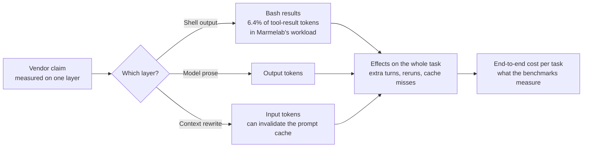

# Контекстна інженерія: Інструменти та екосистема

> **Впевненість**: Рівень 1/2. Основні концепції базуються на опублікованих дослідженнях та виробничих даних. Деталі сторонніх інструментів базуються на публічній документації, кількість зірок GitHub API перевірено 2026-07-07.
>
> **Пов'язано**: [Контекстна інженерія (посібник із конфігурації)](../core/context-engineering.uk.md) | [Сторонні інструменти](third-party-tools.uk.md) | [Екосистема MCP-серверів](mcp-servers-ecosystem.uk.md) | [карта ландшафту інструментів контекстної інженерії](https://www.florian.bruniaux.com/blog/articles/context-engineering-tools-map/) (чотири шари, а не рейтинг)

Ця сторінка описує екосистему інструментів, які допомагають керувати тим, що потрапляє у вікно контексту, а що — ні. Вона доповнює [орієнтований на конфігурацію посібник із контекстної інженерії](../core/context-engineering.uk.md), який охоплює структуру `CLAUDE.md` та обмеження шляхів (path-scoping). Тут основна увага зосереджена на ширшому ландшафті інструментарію: стисненні виводу, стисненні промптів, ШІ-шлюзах, оптимізації RAG, спостережуваності (observability) та інфраструктурі інференсу.

---

## Зміст

1. [Ментальна модель](#1-ментальна-модель)
2. [Основні концепції](#2-основні-концепції) (MVC, context rot, семантичний праймінг, ghost tokens)
3. [Стиснення виводу: CLI та результати роботи інструментів](#3-стиснення-виводу-cli-та-результати-роботи-інструментів) ([незалежні бенчмарки](#незалежні-бенчмарки), RTK, Headroom, pxpipe, shunt, Token Savior, context-mode, stacklit, Cloudflare Code Mode MCP)
4. [Стиснення промптів](#4-стиснення-промптів) (LLMLingua, Selective Context, AutoCompressors/Gisting, RECOMP, AttnComp, TOON)
5. [ШІ-шлюзи](#5-ші-шлюзи)
6. [Оптимізація RAG](#6-оптимізація-rag)
7. [Системи пам'яті](#7-системи-памяті)
8. [KV-кеш інфраструктура](#8-kv-кеш-інфраструктура)
9. [LLMOps та спостережуваність (Observability)](#9-llmops-та-спостережуваність-observability)
10. [Вибір інструментів за сценаріями використання](#10-вибір-інструментів-за-сценаріями-використання)
11. [Ландшафт досліджень](#11-ландшафт-досліджень)

---

## 1. Ментальна модель

Головна теза, завдяки якій усе стає на свої місця: **вікно контексту — це оперативна пам'ять (RAM), а не диск**.

RAM швидка, дорога та обмежена. Ви не завантажуєте все, що є на диску, в RAM перед запуском програми. Ви завантажуєте рівно те, що потрібно програмі прямо зараз. Те саме стосується контексту LLM: кожен токен, який ви туди кладете, витісняє щось інше, коштує грошей і змагається за увагу моделі.

Це змінює суть інженерного завдання. Питання не в тому, "як надати моделі більше інформації?", а в тому, "який мінімально життєздатний набір інформації потрібен моделі для успішного виконання завдання?". Кожна техніка на цій сторінці є відповіддю на це друге запитання.

Паралель із системною архітектурою є абсолютно точною. Процесор без належного керування пам'яттю починає буксувати. LLM без належного керування контекстом починає галюцинувати, втрачає зв'язність і збивається на шаблонні, загальні результати. Оптимізація контексту — це не просто спосіб зменшити витрати, це інвестиція в надійність.

---

## 2. Основні концепції

### Мінімально життєздатний контекст (Minimum Viable Context, MVC)

MVC — це принцип надання саме тієї інформації, яка необхідна для виконання завдання, і нічого більше. Він має два режими відмови, які здаються протилежними, але походять від однієї причини:

- **Недолік контексту (Under-context)**: моделі бракує необхідної інформації, вона галюцинує або видає загальні відповіді.
- **Надлишок контексту (Over-context)**: модель перевантажена нерелевантною інформацією, її увага розсіюється, а точність дотримання правил знижується.

Дослідження деградації дотримання правил (див. [посібник із контекстної інженерії, розділ 2](../core/context-engineering.uk.md#2-бюджет-контексту)) кількісно визначають проблему надлишку контексту: якщо файл `CLAUDE.md` перевищує 400 рядків, точність дотримання інструкцій зазвичай падає до ~60%. Причиною є розсіювання уваги — занадто багато потенційно релевантних сигналів конкурують за обмежений бюджет уваги моделі.

MVC — це не про мінімалізм заради мінімалізму. Це про точність. Системний промпт на 300 токенів, який охоплює саме те, що потрібно моделі, працює краще, ніж промпт на 3000 токенів, який ховає ключову інструкцію на п'ятій сторінці.

### "Гниття" контексту (Context Rot)

"Гниття" контексту (context rot) описує погіршення поведінки моделі зі збільшенням довжини контексту під час сесії. Найбільш дослідженою формою є феномен "втрати в середині" (lost-in-the-middle): моделі послідовно приділяють менше уваги інформації, розташованій посередині довгого контексту, фокусуючись переважно на початку та наприкінці.

Практичні емпіричні наслідки:

- Інструкції ближче до початку файлу `CLAUDE.md` виконуються стабільніше, ніж інструкції внизу.
- У тривалих агентних сесіях початкові обмеження втрачають свою значущість, оскільки новий контент виштовхує їх ближче до середини.
- Виведення інструментів з початку сесії часто фактично "забувається" після кількох раундів взаємодії.

Способи пом'якшення: викликайте команду `/compact` при досягненні 70% заповнення контексту (а не 90%), використовуйте структуровані хуки для ведення нотаток і перезапускайте сесію для фундаментально нових завдань. Команда `/compact` підсумовує історію розмови, прибираючи застарілий контент із активного вікна уваги та зберігаючи безперервність роботи.

### Семантичний праймінг (Semantic Priming Hypothesis)

Спостереження з досліджень стиснення, яке має практичне значення: коли ви ультра-стискаєте контекст (видаляючи більшість токенів), модель не відтворює видалену інформацію дослівно. Замість цього стиснений контекст діє як *семантичний праймер (semantic prime)* — він активує релевантні приховані знання, які вже є у вагах моделі завдяки попередньому навчанню.

Це важливо, оскільки означає, що сильно стиснений контекст може працювати краще, ніж дозволяє припустити його інформаційна щільність. Модель не реконструює факти з контексту, її просто спрямовують до релевантних знань, якими вона вже володіє. Для добре вивчених областей підказка з 10 токенів може активувати більше релевантних знань, ніж дослівна витримка з 100 токенів.

Практичний висновок: віддавайте перевагу ключовим словам та структурним підказкам перед прозою, коли обсяг контексту обмежений. Фраза "Use OpenAPI 3.1, strict mode, no nullable" активує точнішу поведінку, ніж два абзаци з детальними поясненнями того самого процесу.

### "Гниття" контексту vs Вартість токенів: Два протилежні чинники тиску

Керування контекстом відбувається під впливом двох одночасних чинників тиску, які тягнуть у протилежних напрямках:

| Чинник тиску | Причина | Ефект | Спосіб пом'якшення |
|--------------|---------|-------|--------------------|
| **"Гниття" контексту** | Забагато контенту | Розсіювання уваги, lost-in-middle | Очищення, компактизація, обмеження шляхів |
| **Вартість токенів** | Оплата за кожен токен | Перевищення бюджету, зростання затримки | Стиснення, фільтрація, кешування |

Стиснення вирішує проблему вартості. Очищення вирішує проблему "гниття". Ефективна контекстна інженерія робить і те, і інше.

### Якість контексту після компактизації («Ghost Tokens»)

Більшість інструментів на цій сторінці відповідають на запитання «скільки токенів ми заощадили?». Новіший, вужчий підхід ставить інше запитання: після `/compact` або будь-якого стиснення з втратами, яка частина того, що залишилося, досі є корисною, а яка є мертвим вантажем, що пережив компактизацію випадково? Для другого явища ходить термін «ghost tokens»: вміст, що коштує бюджету, але більше не виконує корисної роботи, на відміну від шуму, на який націлений MVC ще до запуску компактизації.

`alexgreensh/token-optimizer` є інструментом, найтісніше пов'язаним із цим підходом (1 748 зірок станом на 2026-07-27, проти 1 565 у червні та 947 у травні 2026, найшвидше зростання за відсотками в цій категорії). Замість того щоб повідомляти один відсоток скорочення, він націлений на те, що переживає компактизацію, і на те, чи залишається цей вміст релевантним до поточного завдання.

Це справді окреме питання порівняно з метриками сирого скорочення, наведеними деінде на цій сторінці (скорочення токенів Headroom за сценаріями, до 90% у RTK на виводі оболонки). Сире скорочення вимірює, скільки відрізано. Якість після компактизації вимірює, чи те, що залишили, досі коректне й релевантне. Інструмент може добре показати себе за першою метрикою й погано за другою, якщо випадково відсіче не той вміст. Сприймайте це як вимір, що з'являється, а не як зрілу категорію інструментів. Спостерігайте за цим підходом, а не приймайте його як розв'язану проблему.

---

## 3. Стиснення виводу: CLI та результати роботи інструментів

Результати роботи інструментів, команд оболонки, логи тестів та відповіді на запити до баз даних мають спільну структурну проблему: ввони містять 70–95% шаблонів (boilerplate). Успішне тестування записує сотні рядків успіху заради однієї помилки, яка вас цікавить. Команда `git log` видає купу метаданих для кожного коміту, коли вам потрібні лише три поля. Цей шум потрапляє у вікно контексту дослівно, якщо його не перехопити.

### Незалежні бенчмарки

Вісім публічних бенчмарків вимірювали інструменти економії токенів на цілих агентних завданнях або відтворювали реальні сесії, а не на одному шарі. Прочитані 2026-09-30, вони сходяться в одному: інструмент, що скорочує вивід оболонки, прозу моделі чи один тип вмісту, рідко зменшує рахунок на ту саму величину, а кілька інструментів зробили завдання дорожчими. Жоден інструмент не перемагає в кожному бенчмарку, і кожен результат належить одному harness, одній моделі та одному налаштуванню effort. Протестовані моделі: `claude-sonnet-4-6`, `claude-sonnet-5`, GPT-5.6 Sol і неназвана версія Claude Sonnet, а відтворення Codepointer застосувало ціни Opus 4.8; жоден із восьми не тестував Claude Sonnet 5.5, Claude Opus 5.5 чи моделі GPT-6, наведені в [огляді ринку LLM](../ops/llm-market-snapshot.uk.md), тож сприймайте результати як датований доказ про механізм, а не як чинні рейтинги.

Два з восьми не є незалежними від усіх інструментів, які вимірюють: Dasein Labs проводить свій bench і робить Parsec, а мейнтейнер THOL є автором Tokenade. Їхні рядки Parsec і Tokenade є власним бенчмарком кожного виробника, а не стороннім вимірюванням; інші рядки в цих двох бенчмарках вимірюють інструменти, яких видавець не створює.

> **Розкриття**: автор цього посібника на ранньому етапі зробив внесок у RTK і лишається його прихильником, не беручи активної участі в його коді нині. Цей розділ не рекомендує інструмент: він повідомляє, що заявляє кожен проєкт і що виміряли треті сторони, із джерелами, і наводить результати RTK як виміряні, зокрема несприятливі. [Сторінка token-savings](https://cc.bruniaux.com/token-savings/) розширює його каталогом із 45 проєктів, відібраних за фіксованим правилом (публічний, не заархівований, орієнтований на кодингових агентів і щонайменше 100 зірок GitHub, або виміряний одним із цих бенчмарків, або вже охоплений посібником), кожен зі своїм твердженням, одиницею, яку використовує твердження, і будь-яким сторонім вимірюванням.

| Бенчмарк | Метод | Інтерес видавця |
|---|---|---|
| [Dasein Code-Compression Bench](https://github.com/daseinlabs/code-compression-bench), 2026-07-04 | 100 завдань SWE-bench Verified, headless Claude Code, `claude-sonnet-4-6`, офіційний Docker-грейдер, один запуск на варіант, вартість з урахуванням кешу | Спонсорується й проводиться Dasein Labs, що створює Parsec, один із варіантів. Варіант Parsec також вставляє бриф нульового ходу та рішення про зупинку, окрім стиснення |
| [Stet, "Six Ways to Save"](https://www.stet.sh/blog/gpt-56-token-saving-modes), 2026-07-20 | 10 злитих змін з одного продакшн-репозиторію, Codex CLI з GPT-5.6 Sol, 7 варіантів, 2 повторення, 140 запусків | Неназваний автор створює Stet.sh, інструмент оцінювання, що використовується; жоден із порівнюваних інструментів не його |
| [Marmelab, "Cutting the Coding Agent Bill"](https://marmelab.com/blog/2026/08/27/which-agent-based-plugin-should-you-use-in-2026.html), 2026-08-27 | Завдання Atomic CRM Builder, від 1 до 4 завдань на інструмент, 3-4 запуски на конфігурацію; harness, модель і версії інструментів не вказано | Marmelab створює навантаження; жоден із порівнюваних інструментів не його |
| [JetBrains, RTK](https://blog.jetbrains.com/ai/2026/07/rtk-claude-code-token-savings/), липень 2026 | 86 завдань SkillsBench, 425 тарифікованих випробувань, Claude Code 2.1.201, rtk 0.43.0, `claude-sonnet-5`, низький і високий effort, тест Вілкоксона за медіанами завдань | Не вказано |
| [JetBrains, Caveman](https://blog.jetbrains.com/ai/2026/07/speak-to-ai-agents-like-cavemen-tosave-tokens/), липень 2026 | 86 завдань SkillsBench, 82 чисті пари, `claude-sonnet-5` на низькому effort, Caveman активовано примусово | Не вказано |
| [Token-Harness Optimizer Leaderboard](https://pi-infected.github.io/token-harness-optimizer-leaderboard/) (THOL), кампанія Claude Code 2.1.206, результати закомічено 2026-07-18 | Headless Claude Code з `claude-sonnet-4-6`, 17 завдань, 10 запусків на завдання та інструмент; основний показник бере 7 завдань, де контроль без інструмента використав щонайменше 200 000 токенів (70 запусків на інструмент), наскрізна вартість у USD з bootstrap 95% інтервалами. Сторінка використовує протилежну конвенцію знаків; тут цифри перераховано | Підтримується автором Tokenade, що очолює таблицю; сторінка про це каже |
| [Tura, token-saving plugins](https://github.com/Tura-AI/benchmark/tree/main/blog_data/token-saving-plugin-eza), 2026-07-19 | Одне завдання (переписати Rust-інструмент `eza` на Python, 52 твердження), Codex CLI 0.144.1 з GPT-5.6 Sol на високому reasoning, 2 запуски на варіант, вартість змодельована з кількості токенів за прайсовими цінами | Опубліковано мейнтейнером Tura, конкурентного кодингового агента; автор каже, що це не незалежний огляд |
| [Codepointer, "Cutting LLM token costs"](https://codepointer.dev/p/cutting-llm-token-costs-with-rtk), 2026-06-18 | Контрфактичне відтворення 500 сесій з власної історії Claude Code автора (614M токенів, $926.31 за прайсовими цінами); без живих запусків, успіх завдань не вимірювався | Зв'язок із порівнюваними проєктами не вказано |

**Результати.** Від'ємне значення означає дешевше, ніж той самий агент без інструмента.

| Інструмент | Бенчмарк | Що вимірювали | Результат |
|---|---|---|---|
| RTK | Dasein | Загальна вартість | +13%, 54 завдання розв'язано проти 57 без нього |
| RTK | JetBrains | Медіанна вартість завдання, низький, потім високий effort | +7.6% (p=0.004), потім +0.1% (p=0.99); якість не змінилася. Мейнтейнери RTK оскаржують дизайн з одним запуском на завдання (дивіться розділ RTK) |
| RTK | Stet | Вартість навантаження, запуск 1, потім запуск 2 | +13%, потім -9% |
| RTK | THOL | Наскрізна вартість, 7 довгих завдань | +7.1% (95% інтервал від -7.2% до +26.0%) |
| RTK | Tura | Змодельована вартість, одне завдання, 2 запуски | +7.2%, на 44% більше раундів агента; автор каже, що дані не ідентифікують ефект plugin |
| RTK | Codepointer | Частка відтворених витрат | -0.5%, скорочуючи від 33% до 99% розпізнаного ним виводу оболонки |
| Caveman | JetBrains | Токени виводу, примусова активація | -8.5%. README тепер повідомляє про 50% медіанне скорочення токенів виводу проти контролю «Answer concisely.» (лише skill); опис на GitHub усе ще каже «cuts 65% of tokens» |
| Caveman | Dasein | Загальна вартість | -19% |
| Caveman | Stet | Вартість навантаження, запуск 1, потім запуск 2 | +9%, потім -12% |
| Caveman | THOL | Наскрізна вартість, 7 довгих завдань | -13.6% (інтервал від -30.2% до +3.6%) |
| Caveman | Tura | Змодельована вартість, одне завдання, 2 запуски | -3.9% |
| Caveman | Codepointer | Частка відтворених витрат | -0.4% |
| Headroom | Dasein | Загальна вартість | +44% |
| Headroom | Marmelab | Вартість операції, режим кешу, потім режим токенів | -4% (автори називають шумом), потім +32% |
| Headroom | THOL | Наскрізна вартість, 7 довгих завдань | +52.8% (інтервал від +10.2% до +120.2%) |
| Headroom | Codepointer | Частка відтворених витрат | -2.8%, із медіанним скороченням 54% на виводі grep і diff, якого він торкається |
| Ponytail | Stet | Вартість навантаження, запуск 1, потім запуск 2 | +20%, потім -2%; тести: 1 перемога, 4 поразки, 15 нічиїх |
| Ponytail | THOL | Наскрізна вартість, 7 довгих завдань | -3.5% (інтервал від -18.1% до +12.4%) |
| Ponytail | Tura | Змодельована вартість, одне завдання, 2 запуски | -8.9%; два запуски розходяться на 51.7% свого середнього |
| Context Mode | Stet | Вартість навантаження, запуск 1, потім запуск 2 | +72%, потім +33% |
| Graphify | Marmelab | Вартість на великій трансформації | +1% |
| Graphify, code-review-graph | THOL | Наскрізна вартість, 7 довгих завдань | -3.3% і -8.5%, але THOL повідомляє, що агент жодного разу не викликав жоден із інструментів, тож розрив не є ефектом інструмента |
| CodeGraph | THOL | Наскрізна вартість, 7 довгих завдань | -7.6% (інтервал від -21.6% до +8.7%) |
| lean-ctx | THOL | Наскрізна вартість, 7 довгих завдань | +10.3% (інтервал від -12.6% до +46.4%) |
| Edgee | THOL | Наскрізна вартість, 7 довгих завдань | -14.7% (інтервал від -37.1% до +11.1%); THOL позначає відсутність обліку токенів для цього інструмента |
| claude-token-efficient | THOL | Наскрізна вартість, 7 довгих завдань | -11.6% (інтервал від -24.2% до +1.4%) |
| LSP code navigation | Marmelab | Вартість на великій трансформації | -13% |
| Parsec | Dasein (варіант спонсора) | Загальна вартість | -39%, 62 завдання розв'язано |
| Fermat | Dasein | Загальна вартість | -22%, 55 завдань розв'язано; запуск 2026-09-21 на пізнішому harness, не поєднаний з іншими варіантами |
| Woz | Dasein | Загальна вартість | -13%, 55 завдань розв'язано, реальний час (wall clock) +23% |
| Tokenade | THOL (інструмент автора) | Наскрізна вартість, 7 довгих завдань | -38.9% (інтервал від -53.2% до -22.3%); агент викликав інструмент у 5 із 70 запусків |
| Перехід на GPT-5.6 Terra xhigh | Stet | Вартість навантаження, запуск 1, потім запуск 2 | -49%, потім -49%: зміна моделі, єдине повторюване зниження в цьому дослідженні |

**Препринти досліджень (2025 до вересня 2026).** Ці препринти arXiv, ще не рецензовані, перевіряють скорочення токенів проти тарифікованої чи оціночної вартості, успіху або часу. Їхні анотації прочитано 2026-09-30; [сторінка token-savings](https://cc.bruniaux.com/token-savings/#research) наводить 15, відокремлюючи дослідження від статей, чиї автори вимірюють власний метод.

| Препринт | Налаштування | Висновок |
|---|---|---|
| [Token Reduction Is Not Cost Reduction](https://arxiv.org/abs/2607.12161) (Weinberger, Hozez; v1 2026-07-13, v5 2026-08-12) | Три підходи до скорочення токенів проти незміненого Claude Code, тарифікована провайдером вартість, підмножина SWE-bench Go | Найбільше налаштування стиснення скоротило доставлені токени виводу інструментів на 38.4% і підвищило тарифіковану вартість на 6.8%; між завданнями скорочення токенів і скорочення вартості корелювали слабко (Pearson r = 0.15) |
| [An Empirical Cost Attribution of Context-Compression Gateways in Multi-Turn Coding Agents](https://arxiv.org/abs/2609.22114) (Chen, Shi; v1 2026-08-19) | Paritok, продакшн-шлюз між Claude Code чи Codex і Claude Sonnet чи GPT-5 | Фільтрація схем інструментів прибирає приблизно від 21K до 57K токенів за хід; стиснення вмісту економить близько 2% за хід; автори застерігають, що одноразові бенчмарки стиснення не слід цитувати як аргумент про вартість багатоходових сесій. Стаття інструментує власний шлюз авторів |
| [What Does Context Compression Cost an Agent?](https://arxiv.org/abs/2608.16370) (Liu; v1 2026-08-17) | Три моделі, два середовища завдань, горизонт 24 ходи | З GPT-5.5 виконання зросло з 80% до 85% (p = 1.0), тоді як виклики пошуку зросли з 21.0 до 63.9 (p = .002): агент знову здобуває стан, який стиснення відкинуло |
| [CAVEWOMAN](https://arxiv.org/abs/2606.24083) (Adeyemi, Rossi, Dernoncourt; v1 2026-06-23) | Вісім моделей, п'ять наборів даних, одиночні генерації замість циклу агента | Стиснення виводу скоротило реалізовану вартість у 1.4-2.4 раза на модель для більшості API-моделей; стиснення вводу підвищило чисту вартість, приблизно в 1.15 раза за середнім п'яти бенчмарків |
| [Don't Break the Cache](https://arxiv.org/abs/2601.06007) (Lumer, Nizar, Jangiti та ін.; v2 2026-01-31) | Три стратегії кешування, три провайдери, понад 500 сесій агентів | Кешування промптів скоротило вартість API на 41%-80%: збереження кешу цілим важливіше за зменшення того, що в нього потрапляє |
| [Agentic Coding in the Wild](https://arxiv.org/abs/2608.00101) (Liu, Qiu, Goiri та ін.; v1 2026-07-30) | Траси GitHub Copilot за червень 2026: 3.2M користувачів, 13M сесій, 761M викликів | Частка влучань у кеш у середньому становить 90% в межах ходу і падає до 55% між межами ходів |
| [Can your AI agent be cheaper?](https://arxiv.org/abs/2608.25399) (Smekal; v1 2026-08-26) | 2 700 запусків із Kimi K3 на трьох рівнях effort | Заміна повної специфікації завдання на голу user story підвищила витрату токенів на 29.7% |
| [Beyond Token Savings: A Systematic Study of Context Compression in LLM Agents](https://arxiv.org/abs/2609.32961) (Satish, Sinha, Kawada, Yadwadkar; v1 2026-09-26) | Майже 35 000 запусків, три open-weight моделі, SWE-bench Verified і Terminal-Bench 1.0 | На Terminal-Bench із Qwen політики, що використовують приблизно третину токенів, можуть тривати на 20%-80% довше, а та сама політика поводиться по-різному на різних моделях |

**Чому економія на одному шарі не стає економією в рахунку.** У базових запусках Marmelab результати `Read` становили 90.6% токенів результатів інструментів, а `Bash` 6.4%. JetBrains виявила, що виклики Bash, які RTK може переписати, несуть трохи менше 20% символів результатів інструментів, і що результати інструментів є лише частиною того, що тарифікує сесія, бо той самий контекст перечитується на кожному ході. За свій запуск на низькому effort `rtk gain` повідомив про 96.2 мільйона заощаджених токенів, тоді як виміряний рахунок зріс.




**Як використовувати ці результати.**

- **Порівнюйте знаменники раніше за числа.** «До 90% менше токенів у виводі оболонки» і «+7.6% вартості за завдання» описують різні величини; обидва можуть бути правдою.
- **Знижуйте вагу одиничних запусків.** Dasein запускає кожен варіант один раз на 100 завданнях, а знаки Stet перевертаються між його двома повтореннями для Caveman, Ponytail і RTK.
- **Зважуйте інтерес видавця.** Два бенчмарки, що ставлять інструмент на перше місце, проводяться його виробником (Dasein для Parsec, мейнтейнер THOL для Tokenade), а бенчмарк Tura походить від мейнтейнера конкурентного агента.
- **Вимірюйте на власних завданнях.** Запустіть своє навантаження з інструментом і без нього, парно, та порівняйте вартість за прийняте завдання, як описано в [AI unit economics](../ops/ai-unit-economics.uk.md#2-побудова-вартості-прийнятого-завдання). [Карта важелів AI FinOps](../ops/ai-finops.uk.md#3-карта-важелів) розміщує стиснення серед інших важелів вартості.

### RTK (Rust Token Killer)

RTK — це проксі-утиліта для CLI, яка перехоплює вивід команд до того, як він потрапить до контексту Claude, застосовуючи спеціалізовані фільтри, які виділяють корисний сигнал і відсіюють шум. Вона інтегрується через хук Claude Code, тому стандартні команди переписуються прозоро.

| Атрибут | Деталі |
|-----------|---------|
| **Джерело** | [github.com/rtk-ai/rtk](https://github.com/rtk-ai/rtk) |
| **Встановлення** | `brew install rtk`, скрипт встановлення з README або `cargo install --git https://github.com/rtk-ai/rtk` (на crates.io існує інший crate «rtk») |
| **Зірки** | 82 094 (GitHub API, 2026-09-30), проти 69 042 на 2026-07-07, 24 397 у квітні 2026 та 446 у лютому 2026 |
| **Інтеграція** | Хук Claude Code через `rtk init --global` |

Стрибок від квітня до липня, приблизно у 2.8 раза, є крутою кривою для CLI-проксі. Це правдоподібно з огляду на дедалі ширше включення інструмента до типових налаштувань інших агентів (дивіться нижче), але сприймайте цифру як неперевірену за повним графіком історії зірок, а не як підтверджене зростання, і перевіряйте її, перш ніж цитувати у відповідальному контексті.

Власні показники RTK за командами, що враховують лише вивід оболонки:

| Команда | Скорочення |
|---------|-----------|
| `rtk git log` | 92% |
| `rtk git status` | 76% |
| `rtk vitest run` | 99%+ |
| `rtk cargo test` | в середньому 89% |
| `rtk pnpm outdated` | 70–85% |

Філософія дизайну: придушувати успішний вивід, показувати помилки. Тестовий набір, який проходить 300 тестів і провалює 2, має показувати 2 рядки, а не 302. Це відповідає тому, як розробник читає вивід. Контекст повинен відповідати цій когнітивній моделі.

RTK підтримує кастомні фільтри через TOML DSL (`.rtk/filters.toml`) для специфічних проектних шаблонів без необхідності писати код на Rust. Дивіться [Сторонні інструменти: RTK](third-party-tools.uk.md#rtk-rust-token-killer) для повного опису функцій.

**Реальний вплив на вартість**: README RTK сам указує межу: він скорочує до 90% виводу bash, який читає агент, що «is not the same as cutting your bill by 90%», а вбудовані інструменти Claude Code Read, Grep і Glob обходять його хук. Контрфактичне відтворення 500 власних сесій Claude Code від Codepointer ($926.31 за прайсовими цінами) показало, що RTK заощаджує 0.5% витрат, скорочуючи від 33% до 99% розпізнаного ним виводу оболонки. Автор агента maki повідомляє, що bash становить близько 12% його загального використання токенів, а читання файлів близько 65%. Економія за командами реальна; вона стосується одного зрізу контексту.

**Відповідь мейнтейнерів RTK**: у статті ["RTK on SkillsBench: What the Benchmark Measures"](https://www.rtk-ai.app/blog/rtk-on-skillsbench/) (RTK AI Labs, 2026-08-07) мейнтейнери стверджують, що головний висновок JetBrains спирається на один запуск на завдання, а додаткові ходи (+13.8%) походять від поведінки агента, а не від стиснення. Повторивши запуск з RTK v0.45.0, вони повідомляють про -4.8% вартості на 13 dev-завданнях (permutation p = 0.305), результати на рівні завдань від -32% до +14%, варіацію між запусками близько 22% на тому самому завданні та стелю стиснення близько 3%-4% рахунку, бо RTK переписав близько третини викликів Bash, що охоплюють близько 20% символів виводу інструментів. Це власний аналіз вендора. Дивіться також [issue #3157](https://github.com/rtk-ai/rtk/issues/3157). Опис репозиторію на GitHub каже «60-90% on common dev commands», тоді як заголовок README каже «up to 90% of the bash output your agent reads».

**Вимірювання третіх сторін**: на цілих завданнях JetBrains виміряла медіанну вартість завдання +7.6% з RTK на низькому effort (p=0.004) і +0.1% на високому, за незмінної якості; Dasein виміряла +13% загальної вартості; Stet виміряла +13%, потім -9% за два запуски; THOL виміряла +7.1% на довгих сесіях з інтервалом, що перетинає нуль. Методи й застереження дивіться в [незалежних бенчмарках](#незалежні-бенчмарки). Автор цього посібника на ранньому етапі зробив внесок у RTK і лишається його прихильником, не беручи активної участі в його коді нині.

### Headroom

Headroom стискає те, що потрапляє в контекст із виводу інструментів, структурованих даних та історії розмови. Його output shaper також зменшує те, що повертається від моделі, що робить його одним із небагатьох інструментів, які працюють по обидва боки виклику LLM.

| Атрибут | Деталі |
|-----------|---------|
| **Джерело** | [GitHub: headroomlabs-ai/headroom](https://github.com/headroomlabs-ai/headroom) |
| **Документація** | [headroom-docs.vercel.app](https://headroom-docs.vercel.app/docs) |
| **Зірки** | 74 156 (GitHub API, 2026-09-30), проти 62 778 на 2026-07-27 і 57 223 на 2026-07-07 |
| **Автор** | Tejas Chopra (Senior Engineer, Netflix) |
| **Ліцензія** | Apache 2.0 |
| **Встановлення** | `pip install "headroom-ai[all]"` або `npm install headroom-ai` |
| **Версія** | v0.39.1 (остання версія, 2026-09-26) |

> **Виправлення URL**: Попередні версії цього посібника посилалися на `headroom.ai` (непов'язаний домен), а згодом на `github.com/chopratejas/headroom` (особистий форк автора). Відтоді проєкт перейшов до організації `headroomlabs-ai`; старий особистий slug тепер перенаправляє, це стандартна передача організації GitHub.

**Заявлений вплив на вартість**: мейнтейнер наводить сукупну економію «~$700K across 200B tokens processed». Це самозвітність без знайденого стороннього аудиту. Сприймайте це як маркетинговий сигнал, а не підтверджену цифру, окремо від показників бенчмарків за навантаженнями нижче, які публікують методологію.

**П'ять режимів розгортання**:

1. Бібліотека Python: `compress(messages)` безпосередньо в коді застосунку
2. TypeScript/npm: `withHeadroom()` / `compress()`
3. HTTP-проксі: `headroom proxy --port 8787`, потім встановіть `ANTHROPIC_BASE_URL=http://localhost:8787`
4. MCP-сервер: `headroom mcp install` (відкриває `headroom_compress`, `headroom_retrieve`, `headroom_stats`)
5. Обгортка агента: `headroom wrap claude|codex|cursor|aider|copilot`

**Compress-Cache-Retrieve (CCR)**: замість надсилання багатослівного виводу інструмента моделі Headroom замінює його заповнювачем `{{HEADROOM_TAG_N}}`, зберігає оригінал у локальному сховищі SQLite (векторний індекс HNSW + повнотекстовий індекс FTS5) і реєструє дескриптор пошуку. Модель викликає `headroom_retrieve(tag)`, коли потребує оригінальних даних. Кілька агентів (Claude + Codex) можуть ділити те саме сховище SQLite для передачі контексту між агентами.

**Output shaper** (`HEADROOM_OUTPUT_SHAPER=1`): додає інструкцію про стислість наприкінці системного промпту (префікс кешу зберігається) і знижує effort моделі на ходах після успішних результатів інструментів. Економія повідомляється як «оціночна» за допомогою контрольної групи holdout 10% з 95% довірчими інтервалами.

**Обсяг бенчмарків**: опис репозиторію, прочитаний 2026-09-30, каже «20% fewer tokens for coding agents, 60-95% fewer tokens for JSON, same answers». Нинішні скорочення токенів у README (налагодження інцидентів SRE 57%, дослідження кодової бази 42%, тріаж issue GitHub 30%, пошук коду 21%, прочитано 2026-09-30) виміряно на чотирьох заздалегідь підготовлених офлайн-сценаріях, побудованих із форматів виводу MCP-серверів, а не на витратах цілої сесії; раніші версії наводили 73%-92% на тих самих видах вмісту. Сторонні результати на цілих завданнях: Dasein виміряла +44% загальної вартості, THOL +52.8% на довгих сесіях, Marmelab -4%, потім +32%, а відтворення Codepointer -2.8% витрат (дивіться [незалежні бенчмарки](#незалежні-бенчмарки)). Бенчмарки точності (GSM8K 0.870 до 0.870, TruthfulQA 0.530 проти 0.560) складають N=100 зразків і незалежно не відтворені. Команда відтворення: `python -m headroom.evals suite --tier 1`.

**Відомі проблеми (червень 2026, перевіряйте трекер issue для поточного статусу вирішення)**:

- **Issue #714**: оригінали CCR спливають через 5 хвилин (LRU TTL). Довготривалі завдання агентів, що роблять паузи між кроками, натраплять на збої пошуку, коли кеш спливе. Постійного запасного варіанта для цього випадку не задокументовано.
- **Issue #1158**: `headroom wrap claude` мовчки обмежує контекст до 200K для підписників Claude Max (beta-заголовок `context-1m-2025-08-07` відкидається). Користувачам Claude Max слід використовувати `headroom mcp install` замість `wrap`.
- **Issue #1227** (безпека, не вирішено станом на червень 2026): кінцеві точки CCR не мають захисту loopback і використовують дозвільний CORS. Локальна вебсторінка може читати кешований вивід інструментів без автентифікації. Уникайте CCR, якщо хост працює поряд із недовіреним локальним вебвмістом.
- **Issue #1209**: у деяких конфігураціях CCR зберігає заповнювач `{{HEADROOM_TAG_N}}` як оригінал, тож `headroom_retrieve` повертає заповнювач, а не справжні дані. PR #1208 подано.
- **Issue #1233**: `CodeAwareCompressor` генерує некоректний синтаксис Python приблизно для 28% реальних файлів із сучасним синтаксисом (match/case, оператор walrus, вкладений async). У таких випадках відбувається тихий перехід до нестиснутого виводу.

**Коли обирати Headroom замість RTK**: RTK обробляє неструктурований текст CLI та відкидає вміст, який вам точно не потрібен. Headroom є правильним вибором для структурованих даних (JSON-payload, результати баз даних, відповіді API), де ви не можете наперед передбачити, які частини знадобляться моделі, і де обов'язковий пошук без втрат. Ці інструменти доповнюють один одного; RTK працює на шарі виводу оболонки, Headroom на шарі структурованих даних.

**Примітка щодо продакшену**: основне стиснення працює. CCR має проблеми з надійністю через помилки #714 і #1209 вище. Для користувачів Claude Max віддавайте перевагу режиму MCP, а не `headroom wrap`.

### pxpipe

pxpipe є першим продакшн-інструментом, побудованим на оптичному/візуальному стисненні контексту спеціально для Claude Code та API Anthropic: замість того щоб зменшувати текст, він переписує великі блоки контексту як зображення, перш ніж запит залишить машину. Про дослідницьку лінію (DeepSeek-OCR, AgentOCR, Glyph, VIST) дивіться [Context Engineering: Optical and Visual Context Compression](../core/context-engineering.uk.md#оптичне-й-візуальне-стиснення-контексту).

| Атрибут | Деталі |
|-----------|---------|
| **Джерело** | [github.com/teamchong/pxpipe](https://github.com/teamchong/pxpipe) |
| **Ліцензія** | MIT, TypeScript |
| **Зірки** | 4 277 (GitHub API, 2026-07-07), проти 586 під час запуску в травні 2026, приблизно у 7 разів менш ніж за два місяці |
| **Встановлення** | `npx pxpipe-proxy` |

**Механізм**: локальний проксі перехоплює виклики `/v1/messages` і, понад обчислений поріг економічної ефективності, переписує великі блоки `tool_result`, уже згорнуті старіші ходи та статичний блок системного промпту/документації інструментів у PNG-зображення (колонки шириною 1928px, приблизно 92 000 символів на сторінку, приблизно 4 761 токен зору на сторінку). Він ніколи не чіпає вивід моделі, нещодавні ходи чи розріджену прозу, де текст лишається дешевшим на символ. Точка беззбитковості текст проти зображення становить близько 19 символів на токен; спостережений трафік Claude Code мейнтейнера в середньому дає 1.91 символа на токен, тож більшість великого вмісту варто перетворювати на зображення. Вміст з точними байтами (паролі, хеші, ID) явно виключено з рендерингу й позначено в README як задокументований ризик втрати пам'яті, а не розв'язана проблема.

```bash
npx pxpipe-proxy
ANTHROPIC_BASE_URL=http://127.0.0.1:47821 claude
```

**Бенчмарки**: скорочення наскрізного рахунку на 59-70%, виміряне для кожного запиту через паралельний контрфактичний виклик `count_tokens`, що журналюється в `~/.pxpipe/events.jsonl` і звіряється з фактично тарифікованим використанням, тобто відтворювана методологія, а не маркетингова оцінка. Пілот SWE-bench Lite: 10/10 успішних в обох варіантах при -65% розміру запиту (мала вибірка, про що розкрито в README). Дослівне відтворення 12-символьних hex-рядків: 13/15 правильно на Fable 5, 0/15 на Sol; README говорить про ці цифри прямо, а не ховає їх.

**Allowlist моделей**: за замовчуванням `claude-fable-5` і `gpt-5.6`. Opus 4.7/4.8 і GPT-5.5 вмикаються за бажанням через виміряну вищу частку помилкових прочитань зображень.

**Коли обирати pxpipe замість Headroom**: той самий шар API-шлюзу, інша модальність. Headroom стискає текст у текст (оборотно, на основі пошуку); pxpipe растеризує текст у зображення (з втратами для точних рядків, без пошуку). Вони доповнюють, а не конкурують: pxpipe специфічний для Claude Code/API Anthropic з обмеженою підтримкою GPT, а не мультиагентний універсал на кшталт Headroom.

### tilth

> **Видалено в листопаді 2026: не встановлюйте.** Облікового запису мейнтейнера tilth на GitHub більше не існує. Вихідний репозиторій і домашня сторінка `jahala.github.io` повертають 404, а на crates.io crate `tilth` тепер належить видаленому обліковому запису (`ghost_388354`), тож ніхто не може опублікувати виправлення. Оскільки ім'я `jahala` знову вільне, новий обліковий запис міг би перехопити посилання, на які раніше вказував цей запис. Якщо ви його встановили, виконайте `cargo uninstall tilth` і видаліть його запис MCP-сервера (`claude mcp list` його покаже). Для структурного читання файлів дивіться [Token Savior](#token-savior) нижче та [lean-ctx](third-party-tools.uk.md#lean-ctx).

Чому читання файлів є великою мішенню: у виміряному навантаженні Marmelab результати `Read` становили 90.6% токенів результатів інструментів, а `Bash` 6.4%, а автор агента maki повідомляє про читання на рівні близько 65% свого загального використання токенів проти близько 12% для bash. Менше читання не гарантує меншого рахунку, з причин, наведених у [незалежних бенчмарках](#незалежні-бенчмарки).

### shunt (делегування, а не стиснення)

shunt націлений на той самий пул, що й lean-ctx, читання файлів, але іншим механізмом. Він не стискає те, що читає Claude. Він узагалі тримає файл подалі від Claude: hook блокує читання, а скрипт надсилає файли й запитання дешевшій моделі, яка відповідає підсумком. Claude бачить лише цей підсумок.

| Атрибут | Деталі |
|-----------|---------|
| **Джерело** | [github.com/spotify/portal-ai-plugins](https://github.com/spotify/portal-ai-plugins) (`plugins/shunt`, Apache-2.0) |
| **Стаття** | [Portal by Spotify cut my Claude Code token usage by 90%](https://engineering.atspotify.com/2026/9/portal-by-spotify-cut-my-claude-code-token-usage-by-90) |
| **Вимагає** | Екземпляр Spotify Portal (комерційний керований Backstage, безкоштовна пробна версія, потім ціни за запитом) з асистентом AiKA |
| **Робоча модель** | За замовчуванням Gemini 2.5 Flash, налаштовується для кожного «режиму» Portal |
| **Оцінка** | [spotify-portal-shunt.md](https://github.com/FlorianBruniaux/claude-code-ultimate-guide/blob/main/docs/resource-evaluations/spotify-portal-shunt.md) (3/5) |

**Як це працює**: hook `PreToolUse` на `Read` блокує повні читання файлів понад 350 рядків і називає skill `/bulk-reader` у своїй відмові. Другий hook робить те саме для `cat`, `head`, `tail`, `less` і `more` у Bash. Скрипт `bulk-read` надсилає файли робочій моделі через CLI Portal. Скрипт `code-write` генерує шаблонний код зі специфікації та одного еталонного файлу й записує його одразу на диск, тож Claude ніколи не читає згенерований код.

**Як читати «90%»**: це середнє з трьох сценаріїв читання (82%, 94%, 94%) на приватному монорепозиторії, підраховане лише за токенами, що потрапляють у контекст Claude. Токени робочої моделі, додатковий хід, спричинений кожним блокуванням, і точність відповідей не вимірювались. Вартість переміщується в інший рахунок, а не зникає. Автор також повідомляє про обмеження: підсумки робочої моделі несуть ненадійні номери рядків, тож для редагувань усе ще потрібне точкове читання, а Gemini Flash пропустив помилку потокобезпеки, яку Claude знайшов, коли отримав відповідний розділ. Застосуйте чекліст із [How to read a vendor's cost-reduction claim](../ops/ai-unit-economics.uk.md#6-як-читати-заяву-вендора-про-зниження-вартості), перш ніж цитувати число.

**Виміряні дефекти** (живий тест, Claude Code 2.1.284, без екземпляра Portal):

- Блокування Read працює на текстових файлах, але PDF теж блокується: кількість рядків береться з бінарного вмісту, тож PDF із 4 471 байтом нового рядка відправляється шляхом делегування.
- Hook Bash ігнорує шляхи, що починаються з `~`: `head -100 ~/project/file.ts` проходить, тоді як та сама команда з абсолютним шляхом блокується. Hook перевіряє буквальний рядок, а `~` у лапках не розгортається.
- Читання з діапазоном завжди проходять, зокрема `offset: 0`, а саме повідомлення про відмову пропонує перечитати з `offset` і `limit`. Hook скеровує Claude; він не примусово забезпечує бюджет.
- `code-write --target` записує через Bash, поза будь-яким hook чи правилом дозволів з областю `Edit` і `Write`.

**Що з цього взяти**: шаблон, а не продукт. Перша версія автора була блоком правил маршрутизації в `CLAUDE.md`, які Claude міг ігнорувати. Hook змушує маршрутизацію діяти на кожному виклику. Те саме примусове виконання можна відтворити без Portal і без надсилання коду другому вендору, перенаправляючи на subagent, що працює на Haiku:

```markdown
<!-- .claude/agents/bulk-reader.md -->
---
name: bulk-reader
description: Answers a precise question about large files. Use when a full read was refused for size.
tools: Read, Grep, Glob
model: haiku
---
Read the files named in the task and answer only the question asked, in short bullets.
Lead each bullet with the exact symbol name and line number. Do not propose edits.
```

```bash
#!/usr/bin/env bash
# PreToolUse hook (matcher: Read): send full reads of large text files to a Haiku subagent
MIN_LINES="${BULK_READ_MIN_LINES:-350}"
input=$(cat)
# The subagent itself must be able to read the files it was sent
[ "$(jq -r '.agent_type // empty' <<<"$input")" = "bulk-reader" ] && exit 0
# Ranged reads (offset or limit set, including 0) are targeted: let them through
[ "$(jq -r '.tool_input | has("offset") or has("limit")' <<<"$input")" = "true" ] && exit 0
path=$(jq -r '.tool_input.file_path // empty' <<<"$input")
[ -f "$path" ] || exit 0
# Text files only: PDFs, images and notebooks go to Read as usual
case "$(file -b --mime-type "$path")" in
  text/*|application/json|application/xml|application/javascript) ;;
  *) exit 0 ;;
esac
lines=$(wc -l < "$path" | tr -d ' ')
[ "$lines" -le "$MIN_LINES" ] && exit 0
jq -n --arg r "File is $lines lines (threshold: $MIN_LINES). Ask the bulk-reader subagent a precise question about it, or re-read only the section you need with offset and limit." \
  '{hookSpecificOutput: {hookEventName: "PreToolUse", permissionDecision: "deny", permissionDecisionReason: $r}}'
```

Зареєструйте його в `hooks.PreToolUse` з `"matcher": "Read"` у `.claude/settings.json`. Hook використовує чинний формат `hookSpecificOutput`, мовчки завершується, коли немає що вирішувати, і читає `agent_type`, щоб subagent не блокувався правилом, якому служить. Читання файлів Claude Code вже розв'язує в абсолютні шляхи, тож проблема `~` вище не стосується hook Read. Компроміс лишається тим самим, що й у shunt: підсумок замінює файл, що годиться для «що робить цей модуль» і не годиться для «виправ рядок 212». Вимірюйте до й після через `/cost` на тих самих запитаннях і перевіряйте відповіді, а не лише кількість токенів.

**Порівняння з lean-ctx**: він скорочує токени читання локально, не додаючи моделі, і зберігає точний вміст доступним. shunt і варіант із subagent замінюють читання відповіддю іншої моделі: більша економія на дослідницьких запитаннях, втрати за конструкцією і марно для редагувань.

### Token Savior

Token Savior — це MCP-сервер «три в одному»: структурна навігація кодом за символами (замість читання цілих файлів), компактизація виводу Bash для 34 поширених CLI-інструментів і постійна міжсесійна пам'ять через SQLite з FTS5.

| Атрибут | Деталі |
|-----------|---------|
| **Джерело** | [GitHub: Mibayy/token-savior](https://github.com/Mibayy/token-savior) |
| **Встановлення** | `pip install "token-savior-recall[mcp]"` потім `ts init --agent claude --yes` |
| **Зірки** | ~1 000 (червень 2026) |
| **Мова** | Python 3.11+ |
| **Останній коміт** | Квітень 2026 (додано підтримку C99/C11 і GLSL) |

**Основні інструменти навігації** (через профіль `optimized`, 15+ інструментів):

- `find_symbol(name)` - знайти функції та класи в індексованій кодовій базі
- `get_function_source(name)` - отримати реалізацію без завантаження повного файлу
- `get_full_context(identifier)` - розширений контекст навколо символу
- `get_change_impact(identifier)` - ланцюжок залежностей для аналізу радіуса впливу перед рефакторингом
- `build_commit_summary` - нещодавні зміни git без читання кожного файлу
- `memory_index` / `memory_search` - зберігати й отримувати висновки сесій між запусками
- `ts_discover()` - сканувати минулі транскрипти на пропущені можливості оптимізації

**Компактизація Bash**: 34 компактори виводу для git, pytest, jest, kubectl та подібних інструментів, активуються через `TS_BASH_COMPACT=1` і hooks PostToolUse. Вивід понад 4KB повертається до повного захоплення. Ця функція вмикається за бажанням і становить значну частку заявлених виграшів; без неї економія суттєво зменшується.

**6 профілів інструментів** (керують тим, скільки інструментів бачить модель, корисно, коли бюджет маніфесту обмежений): `full`, `core`, `nav`, `lean`, `ultra`, `tiny`. Профіль `tiny` відкриває 6 інструментів; приблизно 60 інших доступні через `ts_search` на вимогу.

**Підтримка мов**: Python, TypeScript/JavaScript, Go, Rust, C#, C/C99/C11, GLSL, а також формати конфігурацій (JSON, YAML, TOML, INI, ENV, HCL/Terraform, Dockerfile, Markdown).

**Результати tsbench** (Claude Opus 4.7, 96 завдань, синтетична кодова база на 2 000 рядків, `--seed 42`, бенчмарк, створений автором):

| Метрика | Без Token Savior | З Token Savior |
|--------|---------------------|-------------------|
| Виконання завдань | 78.3% | 97.9% |
| Активних токенів/завдання | ~16 800 | ~3 929 (-77%) |
| Астрономічний час/завдання | ~111с | ~26.6с (-76%) |

README, прочитаний 2026-09-30, тепер каже, що ці цифри стоять лише «as reported and unverified»: репозиторій tsbench не є публічним, а повторне вимірювання, опубліковане 2026-08-09, було відкликано наступного дня, бо лише 1 із 143 сесій викликала інструмент Token Savior (відкладене завантаження інструментів MCP їх приховало). Повторне вимірювання зазначено як відкриту роботу. Незалежного стороннього відтворення не опубліковано. Поведінку на великих кодових базах (100K+ рядків) не бенчмаркували в контрольованих умовах.

```bash
# Recommended install
pip install "token-savior-recall[mcp]"
ts init --agent claude --yes   # merges hooks into ~/.claude/settings.json

# Or without global install
WORKSPACE_ROOTS=/your/project uvx token-savior
```


### context-mode

context-mode — це MCP-сервер, що працює на межі між інструментами та контекстом: перехоплює вивід викликів інструментів, перш ніж він потрапить у вікно розмови, і застосовує стиснення або вибіркове отримання. Він також реалізує шар відстеження сесій на SQLite з повнотекстовим пошуком FTS5, що дає змогу семантично отримувати ранній вміст сесії після того, як `/compact` відкидає сиру історію.

| Атрибут | Деталі |
|-----------|---------|
| **Джерело** | [GitHub: mksglu/context-mode](https://github.com/mksglu/context-mode) |
| **Зірки** | 18 654 (GitHub API, 2026-07-07), проти 14 149 у травні 2026 (+32% приблизно за 2 місяці) |
| **Ліцензія** | ELv2 (комерційний SaaS планується) |
| **Платформи** | Plugin Claude Code, Gemini CLI, Copilot, Cursor, Kiro, Zed та 11 інших (17 загалом, проти 12 у травні 2026) |
| **Твердження** | «315 KB becomes 5.4 KB. 98% reduction»: байти сирого виводу інструментів, утримані поза вікном контексту на сценаріях вендора (близько 60% без hooks, за його власною таблицею платформ). Не токени й не рахунок |
| **Ліцензія** | Elastic License 2.0 (source-available) |
| **Вимірювання третьої сторони** | Stet: вартість навантаження +72%, потім +33% за два запуски (дивіться [незалежні бенчмарки](#незалежні-бенчмарки)) |

Темп зростання виглядає як консолідація вже зрілого інструмента, а не сплеск новачка: інші проєкти тепер цитують context-mode як залежність чи довідник, що свідчить про формування екосистеми навколо нього, а не лише про прийняття кінцевими користувачами.

**Як працює MCP-пісочниця виводу**: замість спрямування сирого виводу виклику інструмента прямо в розмову context-mode перехоплює результат, застосовує стиснення та вставляє підсумок із дескриптором пошуку. Повний вивід доступний на вимогу, якщо модель його запросить, за духом схоже на архітектуру без втрат у Headroom, але саме на межах інструментів MCP.

**Пам'ять сесії після `/compact`**: context-mode використовує SQLite + FTS5 для індексації історії сесії. Коли `/compact` виконується й відкидає сиру історію розмови, індекс SQLite зберігається. Подальші запити пошуку використовують ранжування BM25, щоб виводити релевантний ранній контекст без перезавантаження повного транскрипту.

**Патерн «Think in Code»**: context-mode v1.0.64 задокументував патерн, за якого замість читання файлів для відповіді на дослідницьке запитання модель пише й виконує скрипт, що запитує чи рахує, а потім читає лише результат. Це докладно розглянуто як іменовану техніку в [посібнику з контекстної інженерії](../core/context-engineering.uk.md).

**Коли обирати context-mode**: якщо ви запускаєте Claude Code поряд з іншими платформами (Cursor, Gemini CLI) і хочете єдиний шар керування контекстом, що працює на всіх. Також корисно, коли вивід інструментів MCP великий і структурований, а вам потрібен пошук по сесії після компактизації понад те, що дає самий лише `/compact`.

**Порівняння з RTK та Headroom**: RTK працює на рівні команд оболонки (вивід CLI), Headroom на рівні структурованих даних/відповідей API. context-mode працює саме на межі інструментів MCP і додає збереження сесії. Ці інструменти доповнюють один одного.

### stacklit

stacklit генерує машинозчитуваний індекс структури пакетів репозиторію, експортованих символів і залежностей. Агент читає цей індекс одним викликом (~250 токенів) замість витрати 50 000+ токенів на дослідження файлів, щоб зрозуміти структуру кодової бази.

| Атрибут | Деталі |
|-----------|---------|
| **Джерело** | [GitHub: glincker/stacklit](https://github.com/glincker/stacklit) |
| **Встановлення** | `npm install -g stacklit` |
| **Інтеграція** | Автоматично налаштовує Claude Code, Cursor і Aider через `stacklit setup` |
| **Заявлене скорочення** | 50 000+ токенів дослідження стиснуто до ~250 токенів |

**Як це працює**: `stacklit generate-json` сканує репозиторій і записує `stacklit.json`, структуровану карту пакетів, експортів із сигнатурами типів, графа залежностей, теплової карти git-активності та підказок щодо фреймворків. `stacklit setup` автоматично вставляє компактну карту кодової бази у файли конфігурації агентів. `stacklit diff` визначає, що індекс застарів після додавання чи видалення файлів.

```bash
# One-time setup per repository
stacklit generate-json    # create the index
stacklit setup            # inject into Claude Code / Cursor / Aider config

# Maintenance
stacklit diff             # check if index is stale
stacklit generate-json    # re-index after structure changes
```

**Сумісність з worktree**: генерує індекси для кожного репозиторію без централізованого стану. На відміну від grepai (що вимагає локального індексу embedding) чи Serena (що підключається до мовного сервера), stacklit створює статичний файл JSON, який працює в git worktrees та ефемерних CI-середовищах без додаткового налаштування.

**Порівняння з RTK та context-mode**: RTK перехоплює вивід CLI під час сесії. context-mode перехоплює вивід інструментів MCP у реальному часі. stacklit усуває витрату токенів на етапі дослідження до початку сесії, роблячи структуру репозиторію відомою з першого повідомлення. Ці три інструменти націлені на різні моменти життєвого циклу сесії і доповнюють один одного.

### Cloudflare code mode MCP

Інша категорія вартості схем інструментів: MCP-сервер із сотнями чи тисячами кінцевих точок завантажує схему для кожного інструмента, і ці накладні витрати на схеми можуть перевищити саме завдання. Code Mode MCP від Cloudflare (`cloudflare/mcp`) розв'язує це на рівні поверхні API, а не виводу.

Замість того щоб відкривати один інструмент MCP на кожну кінцеву точку, він відкриває рівно два мета-інструменти, `search()` та `execute()`, на основі типізованого SDK. Модель пише й виконує JavaScript в ізольованому екземплярі V8 (Dynamic Worker Loader), що викликає типізований SDK, замість того щоб наперед отримувати визначення схеми для кожної можливої кінцевої точки. Для повної поверхні API Cloudflare (2 500+ кінцевих точок) це знижує вартість завантаження схем із приблизно 1.17M токенів до близько 1 000, на 99.9% за цим конкретним виміром.

Це поставлена продакшн-функція в великого інфраструктурного вендора, а не побічний проєкт чи дослідницький прототип. Вона узагальнює патерн, який варто назвати: коли поверхня інструментів велика й здебільшого не використовується за сесію, відкриття інтерфейсу виконання коду поверх API замість одного інструмента MCP на кінцеву точку переносить вартість токенів із «завантажується наперед для кожної сесії» на «сплачується лише за кінцеві точки, що реально викликані». Дивіться [Екосистему MCP-серверів](mcp-servers-ecosystem.uk.md), щоб зрозуміти, як це взаємодіє з рекомендацією Claude Code щодо кількості інструментів MCP ([Progressive Disclosure](../core/context-engineering.uk.md#прогресивне-розкриття) в основному посібнику з контекстної інженерії радить менше 80 інструментів загалом на активних серверах; MCP-сервер із виконанням коду повністю обходить цю стелю, відкриваючи 2 інструменти незалежно від розміру поверхні API).

### Підхід без встановлення: claude-token-efficient

[claude-token-efficient](https://github.com/drona23/claude-token-efficient) (6 072 зірки, GitHub API, 2026-09-30) — це один файл `CLAUDE.md`, що наказує Claude генерувати стислі відповіді. Без бінарного файлу, без MCP-сервера, без hooks.

Цифра 63% з README є підрахунком слів за чотирма промптами, по одному запуску кожен, що сам README називає «directional indicator»; його новіший бенчмарк із поточним файлом дає близько 4%, 12% і 7% менше токенів виводу на Haiku, Sonnet і Opus. THOL виміряв -11.6% наскрізної вартості на довгих сесіях з інтервалом, що перетинає нуль. Підхід працює в реальних, але вузьких межах: якщо основний чинник вартості для вас багатослівний вивід моделі, інструкція зі стилю в `CLAUDE.md` нічого не коштує, щоб її спробувати. Вона не може стиснути вивід оболонки, читання файлів чи відповіді інструментів. Для цього потрібні інструменти на кшталт RTK, lean-ctx чи Headroom. Майже 6 тисяч зірок відображають справжній попит на варіанти без конфігурації, а не підтверджену продуктивність на різноманітних навантаженнях.

Використовуйте його як відправну точку. Коли ви впираєтесь у стелю, наведені вище інструменти розв'язують те, чого файл `CLAUDE.md` не може.

---

## 4. Стиснення промптів

Стиснення промптів працює на рівні вхідних даних моделі: зменшення кількості токенів у самому промпті до того, як він буде надісланий до LLM. Це відрізняється від стиснення виводу (яке перехоплює відповіді інструментів) та очищення контексту (яке керує історією сесії).

### LLMLingua / LLMLingua-2

LLMLingua (Microsoft Research) — це найдокладніше досліджений фреймворк для стиснення промптів. Він використовує невелику мовну модель для оцінки "важливості" кожного токена в промпті, а потім видаляє найменш важливі токени до досягнення цільового коефіцієнта стиснення.

| Атрибут | Деталі |
|-----------|---------|
| **Джерело** | [github.com/microsoft/LLMLingua](https://github.com/microsoft/LLMLingua) |
| **Макс. стиснення** | 20x |
| **Втрата якості** | ~1.5% на бенчмарках GSM8K та BBH |
| **Підхід (v1)** | Оцінювання токенів на основі перплексії через малу LM |
| **Підхід (v2)** | Дистиляція даних із GPT-4, класифікація токенів |

LLMLingua-2 покращує оригінал, трактуючи стиснення як проблему класифікації (залишити чи видалити), а не ранжування. Класифікатор навчається шляхом дистиляції з анотацій GPT-4, що робить його швидшим та більш універсальним для різних доменів.

Гіпотеза семантичного праймінгу (див. розділ 2) пояснює, чому 20-кратне стиснення може зберігати 98.5% якості виконання завдань: модель не згадує стиснений текст буквально. Вона використовує стиснені токени як семантичні якорі для своїх власних попередньо навчених знань. Високочастотні токени (службові слова, сполучники) часто вилучаються; доменні ключові слова та структурні маркери зберігаються.

**Коли використовувати**: Довгі системні промпти, повторювані контексти RAG, few-shot приклади з великою кількістю тексту. Не підходить для коду (синтаксис має критичне значення) або числових даних (кожна цифра важлива).

### Selective context

Selective Context (Li та ін., 2023) з'явився раніше за LLMLingua й оцінює лексичні одиниці (токени, фрази чи речення) за власною інформацією Шеннона, а не за сирою перплексією. Його зазвичай називають прямим попередником LLMLingua, і на практиці LLMLingua його витіснив. Заявлені показники стиснення/якості для нього різняться залежно від джерела; сприймайте будь-яке конкретне співвідношення, яке знайдете, як цитату з вторинного джерела, а не підтверджений результат бенчмарка.

### AutoCompressors і gist tokens (стиснення soft-prompt)

Окрема родина, що стискає контекст у навчені вектори замість коротшого тексту. **AutoCompressors** (Chevalier та ін., EMNLP 2023) донавчають базову модель, щоб підсумовувати довгі сегменти в повторно використовувані «summary vectors». **Gisting** (Mu, Li & Goodman, Stanford, NeurIPS 2023) навчає модель стискати промпт у кілька кешованих «gist tokens», змінюючи маски уваги під час стандартного донавчання, із заявленим стисненням до 26x при мінімальній втраті якості на наборі даних Alpaca+.

Жодна з цих технік не розгорнута в продакшн-інструментах станом на середину 2026: обидві вимагають донавчання самої цільової моделі, що порушує переносимість «працює з будь-яким LLM», яка зробила LLMLingua придатним до впровадження. Вони існують як категорія, за якою слід стежити, а не як щось, що варто встановлювати.

### RECOMP (стиснення, специфічне для RAG)

RECOMP (Xu та ін., arXiv 2310.04408) стискає отримані документи до того, як вони потраплять у промпт, а не стискає зібраний промпт цілком (доповнює підхід Anthropic Contextual Retrieval, описаний у §6 нижче). Два навчані компресори: екстрактивний, що вибирає корисні речення, та абстрактивний, що генерує дистильований підсумок кількох документів. Заявлені виграші на Natural Questions, TriviaQA та HotpotQA для заморожених LM. Це все ще дослідницька техніка, а не галузевий стандартний інструмент, але основний принцип (стискати під час пошуку, а не під час збирання промпту) вплинув на пізніші роботи зі стиснення RAG.

### AttnComp (напрямок досліджень)

AttnComp (станом на березень 2026 року ще не випущений як готовий продукт) пропонує замінити оцінку перплексії на паттерни перехресної уваги (cross-attention) як метрику стиснення. Аргументація: перплексія вимірює, наскільки токен є "неочікуваним" з огляду на його попередників. Це корисно для мовного моделювання, але лише слабо корелює з релевантністю завдання. Паттерни перехресної уваги безпосередньо показують, на які токени модель звертає увагу для створення конкретного виводу, що робить цей метод обґрунтованішим показником важливості.

Опубліковані результати показують, що AttnComp перевершує LLMLingua при однакових коефіцієнтах стиснення. Слідкуйте за релізами з відкритим кодом.

### TOON (token-oriented object notation)

TOON працює на іншому рівні, ніж LLMLingua чи AttnComp: це формат серіалізації даних, а не алгоритм стиснення, застосований постфактум. Замість оцінювання та відкидання токенів з наявного промпту він перекодовує структуровані дані (масиви об'єктів, табличні записи) у щільнішу текстову нотацію ще до того, як ці дані досягнуть моделі: іменовані стовпці оголошуються один раз замість повторення в кожному рядку, так само як CSV уникає повторення назв полів.

`xaviviro/python-toon` надає Python-кодувальник/декодувальник, а виробничі кейси (Scalevise, серед інших, на які посилаються в пресі) повідомляють про скорочення токенів на 50%+ плюс покращення затримки на 15% на структурованих табличних навантаженнях.

Виграш цілком залежить від формату: близький до нуля на глибоко вкладеному неоднорідному JSON (немає повторюваної пласкої структури, яку можна використати), максимальний на пласких табличних масивах (відповіді API зі списками, результати запитів до баз даних, дані у формі CSV). Перш ніж впроваджувати TOON, перевірте, чи ваші реальні навантаження табличні; якщо це глибоко вкладені об'єкти, семантичне оцінювання LLMLingua підходить краще.

---

## 5. ШІ-шлюзи

ШІ-шлюзи (AI gateways) розташовуються між налаштованими застосунками та їхніми провайдерами LLM. Вони можуть виконувати маршрутизацію, обмеження частоти запитів (rate limiting), керування витратами та активну трансформацію контексту для запитів, що проходять через них. Трафік, що обходить налаштовану кінцеву точку, лишається поза їхньою телеметрією та політичним контролем.

### Edgee

Edgee — це ШІ-шлюз на Rust для кодингових агентів (Claude Code, Codex та інших). Він продає два важелі вартості: стиснення токенів, випущене як **Compressor V2** (анонсовано 2 липня 2026) і маршрутизацію моделей. Стиснення — це важіль, для якого Edgee опублікував вимірювання; для маршрутизації опублікованого бенчмарка ще немає (дивіться [Маршрутизація](#маршрутизація) нижче). Розділ переглянуто за публічними сторінками Edgee 30 вересня 2026.

#### Compressor V2: три шари, виміряні окремо

| Шар | Що стискає | Виміряний ефект (власний бенчмарк Edgee) |
|-------|--------------------|-------------------------------------------|
| **Brevity** | Вивід моделі (прибирає розповідне планування, «I'll first read the file, then...») | 27.5% медіанне скорочення вартості за завдання, 6 завдань SWE-bench Lite, 6/6 на користь Edgee (p = 0.031) |
| **Tool Surface Reduction (TSR)** | Каталог MCP `tools[]`, згорнутий в один віртуальний інструмент `search` | На 33.0% менше токенів, 8 завдань MCP з великою кількістю інструментів, 8/8 (p = 0.008); вартість ~10%, 5/8, не значущо |
| **Tool result trimming** | Історія розмови / вивід інструментів | 10.4% медіанне скорочення вартості, 6 завдань SWE-bench Lite, 4/6, не значущо |

**Джерела**: [Edgee Blog, методологія Compressor V2](https://www.edgee.ai/blog/posts/introducing-compressor-v2-three-compression-layers-measured-end-to-end-for-a-50-cost-reduction) (Khaled Maâmra, 2 липня 2026) | [Документація Edgee, Token Compression](https://www.edgee.ai/docs/features/token-compression) | [github.com/edgee-ai/edgee](https://github.com/edgee-ai/edgee)

З 16 вересня 2026 TSR увімкнено за замовчуванням для нових ключів Claude Code і Codex ([edgee#244](https://github.com/edgee-ai/edgee/pull/244)). Кожен шар і далі можна перемикати для кожного API-ключа.

**Продакшн проти бенчмарка: Edgee тепер розділяє ці дві речі.** Поточна документація наводить дві цифри й застерігає від їх змішування: **15-20%** скорочення рахунку за токени «across active Edgee customers, rolling 30 days, from compression alone, no routing» («Plan on this one»), і **50%** на SWE-bench Lite з усіма трьома шарами, описані як «a ceiling under controlled conditions». Документація додає: «never quote the 50% without naming SWE-bench Lite». Раніші версії документації Edgee наводили середні продакшн-значення для кожного шару (brevity ~6.5%, trimming ~19%, TSR ~25% «in development»); цих цифр більше немає, і поточні сторінки публікують лише сукупний діапазон.

**Критичне читання цифри 50%**: допис про методологію стверджує, що «V2's three strategies were evaluated independently against workloads matched to their design target», тож його таблиці не містять жодного запуску з усіма трьома шарами. Документація та [сторінка продукту](https://www.edgee.ai/token-compression) тепер підкріплюють 50% однією сесією SWE-bench Lite, «18,420 → 9,210 tokens with all three on», розбитою на частки для кожного шару: 10%, 10% і 30%. Діють два обмеження. Ця сесія має n=1 і не з'являється в дописі про методологію. А три частки виходять рівно 10.0%, 10.0% і 30.0% від базової лінії (1 842 + 1 842 + 5 526 токенів), що більше схоже на ілюстрацію, ніж на виміряну декомпозицію. Підсумовування окремо виміряних ефектів шарів також не дало б комбінованого виграшу: менше розповіді залишає менше історії для обрізання.

Статистичний дизайн експериментів для кожного шару ретельний: парне порівняння за завданнями, тест знаків, обраний замість парного t-тесту, бо різниці вартості мають важкі хвости, bootstrap на 10 000 ресемплів і nonce, що вводиться в кожну репліку, щоб запобігти забрудненню кешу промптів між запусками. Розміри вибірок усе одно важливі: за n=6 найкраще досяжне двостороннє p-значення тесту знаків становить 0.031, тож ідеальний результат 6 із 6 був *єдиним* результатом, що міг подолати звичайний поріг 0.05; одне завдання, що перевертається, знижує його до 5/6, p=0.22, не значуще. Ефект вартості TSR (5/8) і trimming (4/6) значущості не досягли.

**Розв'язання завдань досі не виміряне.** Жоден із опублікованих матеріалів Edgee не повідомляє про фактичну метрику SWE-bench, частку розв'язаних завдань (частку issue, чий патч і далі проходить тести), зі стисненням і без нього. Документація відповідає одним рядком, «zero measurable drift on SWE-Bench Verified samples», без розміру вибірки, списку екземплярів, базової частки чи довірчого інтервалу. Репозиторій [`compression-lab`](https://github.com/edgee-ai/compression-lab) вимірює споживання токенів і вартість, а не розв'язання. Дешевший агент, що розв'язує менше тікетів, не є чистим виграшем, тож сприймайте «semantically lossless on code tasks» як твердження для перевірки на власному навантаженні.

**Відношення до RTK**: допис про методологію Edgee називає RTK прямим натхненням для шару tool-result trimming. Структурно RTK може охопити лише цей один шар: він працює як локальний hook оболонки й не має доступу до каталогу інструментів MCP чи власного виводу моделі. Для користувача Claude Code, який уже запускає RTK, шар brevity в Edgee є справді новою можливістю, а trimming перетинається з тим, що RTK уже робить локально. TSR перетинається з рідним Tool Search MCP у Claude Code (§ [MCP Tool Search](../core/architecture.uk.md#ледаче-завантаження-інструментів-mcp-lazy-loading)); лаунчер Edgee примусово вмикає Tool Search Claude, коли TSR увімкнено ([edgee#150](https://github.com/edgee-ai/edgee/pull/150)), і жоден опублікований експеримент не виділяє виграш TSR порівняно з самим лише рідним Tool Search. Єдине пряме порівняння — звіт Edgee до V2 від березня 2026 ([battle report](https://github.com/edgee-ai/compression-lab/blob/main/reports/battle-report-2026-03-12T07-09-26-635Z.md)): 19.5% скорочення вартості для Edgee проти 19.0% для RTK на тому самому наборі інструкцій, при цьому тривалість API в RTK нижча (676 с проти 712 с). Звіт не публікує кількості реплік чи тесту значущості, тож він показує, що обидва інструменти перебувають в одному діапазоні, а не називає переможця.

#### Результати compression-lab (опубліковано 30 вересня 2026)

README Edgee [`compression-lab`](https://github.com/edgee-ai/compression-lab) тепер публікує результати Compressor V2 за шарами на SWE-bench Lite як скорочення проти звичайного Claude Code (сукупне / середнє / медіана за завданням), з парним тестом знаків для вартості на 300 порівняннях на шар:

| Шар | Вартість | Токени | Токени виводу | Тест знаків (вартість) |
|-------|------|--------|---------------|------------------|
| Brevity | 30.6% / 30.0% / 33.3% | 23.9% / 23.4% / 25.4% | 61.3% / 63.4% / 77.2% | 277/300, p ≈ 1.6×10⁻⁵⁶ |
| Tool result trimming | 6.3% / 5.6% / 6.0% | 6.9% / 6.0% / 6.0% | 2.0% / 2.5% / 4.3% | 202/300, p ≈ 1.9×10⁻⁹ |
| TSR | 16.7% / 14.4% / 14.0% | 18.8% / 15.9% / 15.8% | 17.2% / 16.0% / 17.0% | 260/300, p ≈ 1.1×10⁻⁴⁰ |

Той самий README повідомляє про тест витривалості на плані підписки: виконано 26.5 інструкції замість 21, загальна вартість сесії $12.26 проти $10.25 (+19.6%) і вартість однієї інструкції на 5.1% нижча ($0.463 проти $0.488).

Що README заявляє про власний вибір: SWE-bench не розроблений для MCP, тому його «artificially augment[ed]» запитами MCP, щоб було що вимірювати; запуски використовують випадково обрану підмножину, бо повні запуски SWE-bench дорогі; а три шари вимірювалися по одному, а не разом, з аргументом, що вони націлені на різні частини промпту. Використання токенів береться з журналів сесій Claude Code, а вартість обчислюється локально за прайсом Anthropic, а не за рахунками; шлюз не вносить жодних чисел. Таблиця README повідомляє вартість і токени, а не частку розв'язань SWE-bench.

#### Маршрутизація

[Стратегії маршрутизації](https://www.edgee.ai/docs/features/routing-strategies) Edgee бувають у двох формах: ручні правила (відображення запитаної моделі на модель-виконавець, з необов'язковими бюджетами для моделі чи етапами бюджету) і **smart routing, у beta**, що класифікує кожне завдання як low, medium, high або max за складністю й надсилає його на модель, обрану для цього рівня. Документація Edgee не публікує цифри економії для маршрутизації. Його сторінка продукту згадує «up to 70% combined reduction» для стиснення плюс стратегії на основі бюджету, без методології.

Єдина знайдена цифра щодо маршрутизації — інтерв'ю з клієнтом на блозі Edgee ([Qonto, 22 вересня 2026](https://www.edgee.ai/blog/posts/edgee-has-become-our-governance-layer-for-ai-usage-an-interview-with-qontos-kevin-prettre)): лише стиснення з «17% median» скорочення вартості, а стиснення плюс перенаправлення з «37.7%» в останньому вимірюванні Qonto, після політики від 1 вересня, що перемістила трафік виконання завдань на «a cheaper frontier model of the same class». Частка маршрутизації не виділена. Qonto заявляє, що «not yet run a formal evaluation platform»; її докази якості складаються зі зворотного зв'язку команди, швидкості доставки та дводенного сліпого випробування, у якому десять інженерів непомітно перенаправили на open-weight модель, і «none of them could tell the difference».

#### Нотатки щодо розгортання

- **Затримка**: «<12ms P50 gateway overhead» на сторінці продукту — це час стиснення на периферії. Власний [бенчмарк шлюзів](https://www.edgee.ai/blog/posts/i-benchmarked-six-ai-gateways-including-ours) Edgee (10 серпня 2026) виміряв накладні витрати time-to-first-token +24 мс на `gpt-5.4` і +101 мс на `claude-sonnet-4-6` на коротких промптах за два дні; власна примітка щодо обсягу виключає довгі контексти й виклики інструментів.
- **Шлях даних**: хостований шлюз обробляє промпти, контекст коду та результати інструментів у транзиті. [Варіант on-premise](https://www.edgee.ai/blog/posts/edgee-on-premise-gateway) (16 липня 2026) тримає «prompts and provider keys» усередині вашої інфраструктури, з headless-режимом для мереж з повітряним зазором (air-gapped).
- **Незалежні докази**: станом на 30 вересня 2026 ми не знайшли незалежного відтворення бенчмарків Edgee. Єдине стороннє вимірювання — THOL, що повідомляє, що Edgee на 14.7% дешевший на довгих сесіях з інтервалом, який перетинає нуль, і позначає, що трафік Edgee невидимий для його обліку токенів. Сторонні огляди, як-от [аналіз SFEIR](https://www.sfeir.com/articles/edgee-compression-contexte-agents-codage/) (французькою), перечитують опубліковані дані Edgee, а не перезапускають їх.

### Portkey

Portkey є керованим ШІ-шлюзом, зосередженим на уніфікованій маршрутизації між кількома провайдерами LLM.

| Атрибут | Деталі |
|-----------|---------|
| **Джерело** | [portkey.ai](https://portkey.ai) |
| **Підтримка моделей** | 250+ LLM через єдиний API |
| **Функції** | Маршрутизація, резервні варіанти (fallbacks), балансування навантаження, кешування, обмеження |
| **Спостережуваність** | Вбудоване трасування та відстеження витрат |

Шар семантичного кешування Portkey є особливо корисним для оптимізації контексту: однакові або дуже схожі запити кешуються та повертаються без повторного виклику LLM. У додатках із повторюваними шаблонами запитів (служби підтримки, роботи з перевірки коду, внутрішній пошук) коефіцієнт попадання в кеш може знизити загальну кількість викликів LLM на 30–60%.

**Шлюзи vs Стиснення виводу**: ці категорії доповнюють одна одну. RTK/Headroom стискають те, що потрапляє в контекст із виводу інструментів. Шлюзи стискають або маршрутизують зібраний промпт перед тим, як він потрапить до моделі. Обидва підходи знижують загальні витрати токенів, але перехоплюють їх у різних точках конвеєра.

### LiteLLM

[LiteLLM](https://github.com/BerriAI/litellm) — це проксі на Python з ліцензією MIT із кешуванням на Redis, віртуальними ключами та налаштовуваними обмеженнями бюджету для команди чи користувача. На відміну від Edgee чи Portkey, він не постачає власного активного шару стиснення: його важелі вартості — кешування та маршрутизація, а не стиснення токенів того, що надсилається. Його можна поєднати з RTK чи lean-ctx, що відповідають за стиснення, коли мета також включає централізоване застосування бюджету для маршрутизованого трафіку команди. Про межу застосування бюджету дивіться [api-gateway.md](../ops/api-gateway.uk.md).

### Семантичне кешування як бібліотека: GPTCache

Семантичне кешування Portkey (вище) і кешування промптів Anthropic (§8) обидва вимагають точного або майже точного збігу префікса. [GPTCache](https://github.com/zilliztech/GPTCache) (Zilliz, Apache 2.0) націлений на інший випадок: він кешує повну *відповідь*, ключ якої — embedding запиту, і віддає її для будь-якого нового запиту вище порога косинусної подібності, повністю пропускаючи виклик LLM, а не зменшуючи те, що йому надсилається. Це бібліотека для інтеграції у ваш власний код (а не drop-in шлюз) зі змінними векторними бекендами (Milvus, FAISS) і бекендами сховища (Redis, MongoDB); пошук embedding додає приблизно 3-8 мс. Показники попадання в кеш 30-70% циркулюють у матеріалах вендорів і блогів, але незалежно не підтверджені. Сприймайте їх як порядок величини, а не виміряне число, доки не виміряєте власний трафік.

---

## 6. Оптимізація RAG

Пошук із розширеною генерацією (Retrieval-Augmented Generation, RAG) має добре задокументовану проблему відмови: крок пошуку повертає фрагменти (chunks), які є семантично релевантними окремо, але не мають контексту для практичного використання. Фрагмент із текстом "Q3 revenue grew 3%" є безглуздим без назви компанії та року, які могли міститися в тому самому документі, але в іншому фрагменті.

### Anthropic Contextual Retrieval

Метод Contextual Retrieval від Anthropic вирішує проблему ізоляції фрагментів шляхом їхньої попередньої контекстуалізації перед індексацією. До кожного фрагмента додається короткий вступ (преамбула), згенерований LLM, який позиціонує його в межах вихідного документа.

```
До: "Revenue grew 3% in Q3."

Після: "From Acme Corp Q3 2024 earnings report: Revenue grew 3% in Q3."
```

Преамбула генерується один раз для кожного фрагмента під час індексації, а не під час пошуку. Завдяки кешуванню промптів вартість генерації преамбул для великої бази документів знижується приблизно на 90% (документ кешується; змінюється лише інструкція для конкретного фрагмента).

Опубліковані результати оцінки Anthropic:

| Метод | Зниження відсотку помилок |
|--------|----------------------|
| Лише контекстні ембеддинги | 35% |
| Контекстний BM25 (ключові слова + семантика) | 49% |
| Контекстні ембеддинги + BM25 + реранкінг | 67% |

Поєднання семантичного пошуку (ембеддинги), пошуку за ключовими словами (BM25) та кроку реранкінгу (reranking), який перевпорядковує результати за релевантністю до конкретного запиту, забезпечує найкращі результати. Провайдерами послуг реранкінгу є Cohere та Voyage AI.

Вартість масштабування: генерація контекстних преамбул для 1 мільйона токенів документа коштує приблизно $1.02 після застосування кешування промптів. Для більшості виробничих баз даних це одноразові витрати на індексацію.

### JIT / Агентний пошук (Agentic Search)

Традиційний RAG завантажує результати пошуку на початку запиту. JIT (Just-in-Time) пошук відкладає це: агент починає з мінімальним контекстом і отримує інформацію за запитом, коли завдання показує, що саме йому дійсно потрібно.

Це важливо для агентних воркфлоу з непередбачуваними вимогами до інформації. Агенту для налагодження коду може знадобитися один набір документації для помилки Python і зовсім інший — для помилки бази даних, виявленої через два кроки. Попереднє завантаження обох варіантів марнує контекст; відсутність завантаження призводить до галюцинацій. JIT-пошук знаходить ідеальний баланс.

Для Claude Code: це те, що агент робить природно, використовуючи інструменти (`list_directory`, `read_file`, `grep`) замість отримання заздалегідь підготовленого контексту. Шаблон "пошук за потреби" — це принцип проектування, а не просто функція Claude.

### Індексація на боці запиту: семантичний чанкінг і синтетичні запитання

Дві техніки на етапі індексації постійно покращують якість пошуку понад те, що дають самі лише кращі embeddings.

**Семантичний чанкінг (Semantic chunking)** розбиває документи за логічною одиницею (абзац, розділ, блок аргументації), а не за фіксованою кількістю токенів. Межа на 500 токенах, проведена посеред речення, створює два фрагменти, кожен з яких окремо неоднозначний і погано знаходиться за будь-яким запитом. Розбиття за межами абзаців чи розділів зберігає одиницю змісту, навіть коли розміри фрагментів стають нерівними.

**Генерація синтетичних запитань** бере кожен фрагмент і питає LLM: на які запитання відповідав би цей фрагмент? Ці згенеровані запитання індексуються поряд зі сирим текстом фрагмента (або замість нього). Під час запиту запитання користувача збігаються з проіндексованими запитаннями значно надійніше, ніж із прозою, бо словник і формулювання краще узгоджуються. Техніка формалізована в лінійці робіт doc2query (Nogueira & Lin, 2019) і в HyDE (Hypothetical Document Embeddings, Gao та ін., 2022). У продакшн-системах практики спостерігали покращення пошуку в межах 10% на своїх оцінних наборах, хоча виграш суттєво залежить від набору даних і моделі embedding.

Ці дві техніки добре поєднуються з підходом Anthropic Contextual Retrieval, описаним вище: спершу контекстуалізуйте кожен фрагмент, потім генеруйте синтетичні запитання з контекстуалізованої версії. Запитання успадковують навколишній контекст документа й дають багатші записи індексу.

*Джерело: Guillaume Laforge (Developer Advocate, Google Cloud), [IFTTD ep 361 "Pourquoi le RAG n'est pas mort"](https://www.ifttd.io/episodes/rag); doc2query: Nogueira & Lin (2019); HyDE: Gao та ін. (2022).*

### Оцінка тріади RAG (RAG Triad Evaluation)

Тріада RAG — це фреймворк для оцінки якості виводу RAG за трьома вимірами:

| Вимір | Запитання | Що він виявляє |
|-----------|----------|----------------|
| **Релевантність контексту** | Чи релевантний знайдений контекст запитанню? | Помилки пошуку |
| **Релевантність відповіді** | Чи релевантна відповідь запитанню? | Зсув генерації |
| **Обґрунтованість (Groundedness)** | Чи підтверджується відповідь знайденим контекстом? | Галюцинації |

Усі три параметри можуть виходити з ладу незалежно. Система може знайти ідеально релевантний контекст і все одно згенерувати галюцинацію (помилка обґрунтованості). Вона може згенерувати релевантну відповідь, яка не підтверджується знайденими даними. Одночасна оцінка всіх трьох параметрів дозволяє визначити, яка саме частина конвеєра RAG є слабкою ланкою.

Arize Phoenix реалізує тріаду RAG як фреймворк для оцінки виробничих систем (див. розділ 9).

---

## 7. Системи пам'яті

Довготривалі агенти стикаються з варіантом проблеми "гниття" контексту: історія сесії зростає доти, доки не перевищить вікно контексту або доки ранній контекст не почне фактично ігноруватися. Системи пам'яті вирішують це, переносячи інформацію з вікна контексту до постійного сховища й отримуючи її за потреби.

### Короткострокова пам'ять: Компактизація та структуровані нотатки

Для Claude Code два механізми керують пам'яттю на рівні сесії:

**`/compact`** підсумовує історію розмови, замінюючи сирий обмін репліками на стислий підсумок. Модель зберігає безперервність, але кількість токенів суттєво скидається. Використовуйте при 70% заповнення контексту, а не при 90%.

**Структуровані нотатки через хуки** — це агентна версія: хук `PostToolUse` записує ключові рішення, виявлені факти та стан завдання у файл нотаток. Агент завантажує цей файл на початку наступної сесії. Це повністю обходить "гниття" контексту для роботи, що охоплює кілька сесій: файл нотаток розташований на початку контексту (максимальна увага) і містить лише відібрану інформацію.

**Auto Memory (v2.1.59+)** та **Auto Dream** надають рідні альтернативи в CC: Claude сам пише свій `MEMORY.md` між сесіями, а фоновий sub-agent консолідує його після ≥5 сесій і ≥24 годин. Дивіться [Memory Systems: Auto Memory](../core/memory-systems.uk.md#22-auto-memory-v2159).

### Довгострокова пам'ять: Зовнішні системи пам'яті

Для робочих процесів з кількома сесіями та кількома агентами системи постійної пам'яті зберігають інформацію поза вікном контексту й отримують її вибірково. Екосистема CC має триярусну модель:

**Індивідуальний (без команди)**: claude-mem (111K зірок, автозахоплення на основі hooks), agentmemory (30K зірок, злиття BM25+вектор+граф, самозаявлений 95.2% R@5, ін'єкція контексту вмикається за бажанням), ICM (бінарний файл на Rust, подвійна архітектура згасання+граф, `brew install icm`). Зірки перевірено 2026-11-03. Показники recall не доводять, що ін'єктована пам'ять використовується; дивіться [шестиетапний конвеєр](../core/memory-systems.uk.md#від-захопленого-до-дієвого-шестиетапний-конвеєр).

**Спільний доступ у команді**: CLAUDE.md + `.mcp.json` + skills, закомічені в репозиторій (Trinity, нуль інфраструктури). Mem0 Cloud MCP для спільної пам'яті команди. Zep/Graphiti для темпоральних графів знань. Про те, як зробити цей спільний контекст стійким для цілої команди, а не однієї сесії, дивіться [context engineering for the team, not just the session](https://www.florian.bruniaux.com/blog/articles/context-engineering-team-system/).

**Різниця між RAG та пам'яттю**: RAG надає моделі доступ до зовнішніх світових знань (документація, кодова база, інтернет). Пам'ять надає їй доступ до знань про конкретного користувача й конкретну сесію (вподобання, минулі рішення, безперервність). Обидві є системами пошуку, що обслуговують різні частини архітектури інформації. Добре спроєктований агент використовує обидві.

> **Канонічне джерело**: [посібник Memory Systems](../core/memory-systems.uk.md): таблиця порівняння 20 інструментів, архітектурні шаблони, матриця ризиків, блок-схема рішень і бенчмарки.

---

## 8. KV-кеш інфраструктура

Цей розділ має дві частини. Перша охоплює механіку кешування промптів Anthropic стосовно Claude Code, зокрема те, як Claude Code структурує запити, щоб максимізувати частку влучань. Друга охоплює інфраструктуру самостійно хостованого інференсу для команд, що розгортають власні LLM.

### Що таке KV-кеш?

Під час фази префілу (обробки вхідних даних) трансформер обчислює пари Ключ-Значення (Key-Value) для кожного токена в контексті. Ці пари зберігаються у VRAM GPU, а не як сирий текст чи хеші токенів. Для префікса з 100K токенів на Opus дані KV займають приблизно 500МБ-1ГБ VRAM.

Для наступних запитів, що ділять префікс (наприклад, той самий системний промпт), ці збережені значення KV можна повторно використати замість повторного обчислення. Це і є повторне використання KV-кешу. Авторегресійна природа трансформерів накладає одне суворе обмеження: кешувати можна лише префікси. Якщо токен N змінюється, записи KV для токенів N+1 і далі мають бути перераховані. Зміна будь-де в префіксі інвалідує все, що йде далі.

Без повторного використання KV-кешу кожен запит обробляє повний контекст з нуля. З ефективним кешуванням свіжого обчислення потребує лише унікальна частина кожного запиту (повідомлення користувача, нові результати інструментів). Кешування промптів Anthropic знижує і затримку, і вартість: кешовані токени на Opus тарифікуються приблизно по $0.50/М проти $5/М для некешованих вхідних токенів. Влучання в кеш вимагають, щоб спільний префікс був достатньо довгим (зазвичай 1 024+ токенів) і достатньо свіжим (кеш спливає приблизно через 5 хвилин без доступу).

### Стиснення KV-кешу: дослідницький фронтир

Відмінне від *кешування* промптів (повторного використання незмінного префікса) *стиснення* KV-кешу: зменшення самих кешованих тензорів, оскільки KV-кеш може споживати до 70% пам'яті інференсу на довгих контекстах. Домінують три родини технік у поточних дослідженнях: вибіркове витіснення токенів (залишити найрелевантніші, відкинути решту), квантування (нижча числова точність) і низькорангове стиснення. Нові роботи, як-от ChunkKV, стискають за семантичним чанком, а не токен за токеном, щоб зберегти лінгвістичну узгодженість, а TurboQuant (ICLR 2026) застосовує випадкове ортогональне обертання перед квантуванням, щоб вирівняти дисперсію. Це активна галузь досліджень систем/MLOps станом на 2026, а не стандартизований інструментарій, який можна встановити. Вона важлива передусім для команд, що запускають самостійно хостований інференс (нижче), а не для користувачів API Claude Code, чиє кешування повністю керується Anthropic.

### Як Claude Code використовує кешування промптів

Claude Code структурує кожен запит так, щоб максимізувати частку влучань у кеш. Порядок запиту має значення через обмеження префікса: елементи, що змінюються найчастіше, мають з'являтися останніми.

**Структура запиту (від найстабільнішого до найменш стабільного)**:

1. **Системний промпт**: однаковий для всіх користувачів Claude Code тієї самої версії. Спільний кеш: усі користувачі тієї самої версії отримують вигоду від тих самих кешованих записів KV, коли Anthropic віддає системний промпт зі спільної пам'яті GPU.
2. **Визначення інструментів**: статичні в межах сесії. Фіксуються на початку сесії. Додавання чи видалення інструментів посеред сесії інвалідує весь кеш розмови, тому Claude Code блокує список інструментів, коли сесія починається.
3. **Конфігурація проєкту / CLAUDE.md**: вставляється як вміст повідомлень (через блоки `<system-reminder>` у повідомленнях), а не в системний промпт.
4. **Історія розмови**: ковзна точка розриву, свіжого обчислення потребують лише нові ходи.

**Чому CLAUDE.md не в системному промпті**: якби вміст CLAUDE.md вставлявся в системний промпт, префікс кожного користувача був би унікальним (різні проєкти, різні конфігурації), і вигода від спільного кешування системного промпту на ~30K токенів зникла б. Тримаючи системний промпт однаковим для всіх користувачів і вставляючи CLAUDE.md як вміст повідомлення, Anthropic може амортизувати вартість обчислення системного промпту на кожну одночасну сесію Claude Code. CLAUDE.md усе одно кешується, щойно з'являється в історії розмови, але сам системний промпт лишається універсально спільним.

**Продакшн-частка влучань**: у реальних сесіях Claude Code кешування промптів досягає приблизно 96% влучань. Проста причина в тому, що системний промпт, визначення інструментів, вміст CLAUDE.md і попередні ходи розмови потрапляють у кеш; свіжого обчислення потребують лише новий хід користувача та відповідь моделі.

### Антипатерни кешу

**Мітки часу в системному промпті**: будь-яке значення, що часто змінюється, у префіксі системного промпту ламає кешування, роблячи префікс кожного користувача унікальним. Один користувач Hacker News повідомив, що повернув понад 20 відсоткових пунктів частки влучань у кеш, перенісши поле мітки часу з префікса системного промпту в повідомлення. Виправлення: переносьте динамічні значення (поточна дата, гілка git, часи зміни файлів) у вміст повідомлень, а не в системний промпт.

**Додавання чи видалення інструментів посеред сесії**: оскільки визначення інструментів розташовані між системним промптом та історією розмови в префіксі запиту, будь-яка зміна списку інструментів інвалідує кеш для всієї розмови. Claude Code уникає цього, фіксуючи визначення інструментів на початку сесії.

### Plan mode: патерн дизайну, стабільний для кешу

Plan Mode обмежує доступ на запис під час фаз планування. Наївною реалізацією було б прибрати інструменти запису зі списку інструментів, поки діє Plan Mode. Проблема: видалення інструментів зі списку змінює префікс, інвалідуючи весь кеш сесії.

Фактична реалізація Claude Code: замість видалення інструментів додаються два нові інструменти (`EnterPlanMode` і `ExitPlanMode`). Повний список інструментів лишається сталим при перемиканні режимів. Поведінка режиму передається через інструкції в повідомленнях, а не через зміни у визначеннях інструментів. Префікс кешу лишається ідентичним, незалежно від того, чи Plan Mode увімкнено.

Це конкретний приклад ширшого принципу проєктування: віддавайте перевагу перемиканню режимів на рівні інструкцій над структурними змінами префікса запиту.

### Компактизація vs `/clear` для безперервності кешу

Компактизація (`/compact`) зберігає кеш. Запит компактизації повторно використовує той самий префікс системного промпту та визначень інструментів, тож кешовані записи KV з раніших етапів сесії лишаються чинними після виконання компактизації. Підсумком замінюється лише частина історії розмови.

`/clear`, за яким слідує понад приблизно 5 хвилин бездіяльності, може призвести до повного холодного старту. TTL кешованих записів спливає під час простою, тож наступний запит не знаходить кешованих записів KV для системного промпту чи визначень інструментів. Це одна з причин, чому Claude Code за замовчуванням віддає перевагу компактизації, а не жорстким скиданням для довгих сесій: компактизація зберігає безперервність, не запускаючи спливання кешу.

### Самостійно хостована інфраструктура KV-кешу

Наведені нижче інструменти стосуються команд, що розгортають власні LLM, а не використовують керований API Anthropic.

### vLLM (PagedAttention)

vLLM є провідним рушієм інференсу з відкритим кодом для самостійного хостингу LLM. Його ключовою інновацією є PagedAttention: пам'ять KV-кешу виділяється у вигляді сторінок фіксованого розміру (аналогічно до сторінок віртуальної пам'яті ОС), а не безперервних блоків.

Традиційне виділення KV-кешу марнує 60–80% пам'яті GPU через фрагментацію (виділення простору за найгіршим сценарієм для кожної послідовності). PagedAttention зменшує ці втрати до рівня менше 4%, розподіляючи сторінки між запитами та виділяючи їх за потреби.

| Атрибут | Деталі |
|-----------|---------|
| **Джерело** | [github.com/vllm-project/vllm](https://github.com/vllm-project/vllm) |
| **Ключова інновація** | PagedAttention (небезперервний KV-кеш) |
| **Втрати пам'яті** | Знижено з 60–80% до <4% |

### SGLang (RadixAttention)

SGLang представляє RadixAttention: записи KV-кешу організовані як префіксне дерево (структура radix tree/trie), ключем для якого є послідовність токенів. Коли два запити мають спільний префікс, їхні KV-записи для цього префікса перевикористовуються автоматично.

Це надзвичайно ефективно для:

- Багатьох запитів із однаковим системним промптом (дерево зберігає його один раз).
- Конвеєрів RAG, де знайдений документ залишається незмінним для багатьох запитів.
- Мультиагентних систем, де базовий контекст розподіляється між субагентами.

| Атрибут | Деталі |
|-----------|---------|
| **Джерело** | [github.com/sgl-project/sglang](https://github.com/sgl-project/sglang) |
| **Ключова інновація** | RadixAttention (автоматичне перевикористання кешу на основі дерева) |
| **Найкраще для** | Робочих навантажень зі спільним префіксом, мультиагентних систем |

### Семантичне кешування (Semantic Caching)

Семантичне кешування працює над рівнем моделі: замість кешування KV-активацій воно кешує повні відповіді LLM на основі семантичної схожості запиту. Новий запит, який є семантично близьким до вже збереженого в кеші, повертає готову відповідь без звернення до LLM.

Найпоширенішою реалізацією є Redis з розширеннями для векторного пошуку. На робочих навантаженнях із високою повторюваністю (боти FAQ, внутрішній пошук, конвеєри перевірки коду зі схожими шаблонами) можна досягти 30–60% попадань у кеш, а деякі виробничі системи повідомляють про зниження витрат на 73%.

Ризик: кешовані відповіді застарівають. Семантичне кешування вимагає налаштування політик TTL відповідно до того, як часто змінюються базові знання.

---

## 9. LLMOps та спостережуваність (Observability)

Ви не можете оптимізувати те, що не вимірюєте. Категорія інструментів LLMOps забезпечує рівень інструментарію: трасування, відстеження витрат, оцінка якості та виявлення зсуву (drift) для систем на базі LLM.

### Локальні інспектори сесій: claude-devtools і tokview

Перш ніж братися за хостовану платформу, два інструменти без хмари читають власні локальні журнали сесій Claude Code (`~/.claude/projects/**/*.jsonl`) напряму й перетворюють їх на атрибуцію за ходами, без проксі чи змін у коді для історичних даних.

| Інструмент | Механізм | Відмітна особливість |
|------|-----------|------------------------|
| **claude-devtools** ([github.com/matt1398/claude-devtools](https://github.com/matt1398/claude-devtools), MIT, `brew install --cask claude-devtools`) | Десктопний застосунок на Electron, що розбирає локальні транскрипти сесій | Атрибуція токенів за ходами в 7 категоріях: CLAUDE.md (глобальний/проєкту/директорії), активації skills, файли з @-згадками, вхід/вихід викликів інструментів, розширене мислення, накладні витрати team/subagent, текст користувача. Дрібніша за трисегментну смугу рідної команди `/context`. |
| **tokview** ([github.com/headroomlabs-ai/tokview](https://github.com/headroomlabs-ai/tokview), MIT, `uv tool install token-viewer`) | Локальний проксі плюс термінальна/браузерна панель; `tokview import claude` заповнює з наявної історії JSONL без проксі для минулих сесій | Атрибуція до окремого виклику інструмента, наживо під час роботи агента, плюс оцінка вартості для використання за підпискою (не API) |

Обидва працюють повністю на локальних файлах: без телеметрії, без входу, без облікового запису. tokview постачається від headroomlabs-ai, тієї ж команди, що створила Headroom (§3): сприймайте його підказки про гарячі точки як вхід до власних інструментів стиснення Headroom, а не як нейтральну до вендорів рекомендацію, з тим самим застереженням, яке цей посібник уже застосовує до самозаявлених цифр Headroom.

Для кодової бази, достатньо малої, щоб оглянути її вручну, ту саму розбивку на 7 категорій можна наблизити 20-рядковим скриптом, що підсумовує `usage.input_tokens` за блоками `tool_use` у файлі JSONL сесії. Без встановлення, без залежностей, і він вчить, що категорії означають насправді, перш ніж братися за готову панель.

### Langfuse

Провідне рішення з відкритим кодом. Langfuse відстежує виклики LLM у складних багатокрокових агентних воркфлоу, фіксуючи вхідні та вихідні дані на кожному кроці, затримку, вартість кожного виклику та повне дерево виконання.

| Атрибут | Деталі |
|-----------|---------|
| **Джерело** | [github.com/langfuse/langfuse](https://github.com/langfuse/langfuse) |
| **Ліцензія** | З відкритим кодом (MIT) |
| **Розгортання** | Self-hosted або хмара |
| **Найкраще для** | Вимог до самостійного хостингу, аналізу витрат, відладки трасувань |

Ключові функції для оптимізації контексту: детальний розподіл вартості токенів за сесіями, порівняння трасувань (який варіант промпту є дешевшим?) та кастомні метрики оцінки, які ви можете запускати на збережених трасуваннях без повторного запуску агента.

### LangSmith

LangSmith є близьким до рішень Anthropic (екосистема LangChain) і є стандартним вибором, якщо ви розробляєте на LangChain или LangGraph. Він чудово підходить для налагодження ланцюжкових операцій, де розуміння графа виконання є так само важливим, як і окремі виклики LLM.

| Атрибут | Деталі |
|-----------|---------|
| **Джерело** | [smith.langchain.com](https://smith.langchain.com) |
| **Найкраще для** | Робочих навантажень LangChain/LangGraph, налагодження ланцюжків, A/B тестування |
| **Функції** | Керування наборами даних, автоматизована оцінка, регресійне тестування |

### Arize Phoenix

Phoenix спеціалізується на оцінці якості RAG, реалізуючи тріаду RAG на рівні ядра. Він відстежує операції пошуку разом із генерацією, тому ви можете зіставити якість пошуку з якістю кінцевої відповіді.

| Атрибут | Деталі |
|-----------|---------|
| **Джерело** | [github.com/Arize-ai/phoenix](https://github.com/Arize-ai/phoenix) |
| **Ліцензія** | З відкритим кодом |
| **Спеціалізація** | Оцінка RAG, метрики "LLM-як-суддя", зсув ембеддингів |

Особливо корисно для: виявлення випадків, коли слабкою ланкою є саме пошук (помилки релевантності контексту) чи генерація (помилки обґрунтованості). Ця різниця визначає, що саме вам потрібно виправити: пошуковий алгоритм чи промпт.

### Maxim AI

Maxim AI фокусується на безперервній оцінці: запуску автоматизованих оцінок (evals) для кожного виробничого трасування, а не лише для офлайн-тестів. Він підтримує воркфлоу "LLM-як-суддя" (використання однієї LLM для оцінки результатів іншої) та A/B тестування варіантів промптів на реальному виробничому трафіку.

| Атрибут | Деталі |
|-----------|---------|
| **Джерело** | [getmaxim.ai](https://www.getmaxim.ai) |
| **Найкраще для** | Безперервної оцінки, виробничого A/B тестування, виявлення регресій |

### TruLens

TruLens реалізує оцінку тріади RAG як бібліотеку з відкритим кодом. Її можна впровадити безпосередньо у код вашого додатка, виконуючи оцінку inline у межах самого додатка, а не в окремій платформі спостережуваності.

| Атрибут | Деталі |
|-----------|---------|
| **Джерело** | [github.com/truera/trulens](https://github.com/truera/trulens) |
| **Ліцензія** | З відкритим кодом |
| **Найкраще для** | Інлайнової оцінки RAG, інтеграції бібліотек, підрахунку метрик тріади RAG |

### Вибір інструменту спостережуваності

| Потреба | Рекомендовано |
|------|------------|
| Повний self-host, детальний аналіз витрат | Langfuse |
| Екосистема LangChain, налагодження ланцюжків | LangSmith |
| Виключно оцінка якості RAG | Arize Phoenix |
| Безперервна оцінка на продакшені, A/B тестування | Maxim AI |
| Інтеграція тріади RAG безпосередньо в код додатка | TruLens |

Ці інструменти не є взаємовиключними. Трасування за допомогою Langfuse разом із оцінкою RAG через Phoenix є дуже поширеним поєднанням.

---

## 10. Вибір інструментів за сценаріями використання

### Ви є користувачем Claude Code (окремий розробник)

| Проблема | Інструмент |
|---------|------|
| Виведення команд переповнює контекст | RTK |
| Читання файлів споживає більшу частину бюджету контексту | lean-ctx або Token Savior |
| Дослідницькі запитання до великих файлів, де достатньо підсумку | Hook Read, що перенаправляє на subagent Haiku (патерн [shunt](#shunt-делегування-а-не-стиснення)) |
| Контроль за витратами токенів | ccusage (див. [Сторонні інструменти](./third-party-tools.uk.md)) |
| Контекст стає занадто довгим під час сесії | `/compact` на рівні 70% використання |
| Втрата рішень попередніх сесій | Система пам'яті ICM |
| Claude ігнорує правила з довгого `CLAUDE.md` | Path-scoping (див. [посібник із контекстної інженерії](../core/context-engineering.uk.md)) |

### Ви створюєте ШІ-додаток

| Проблема | Інструмент |
|---------|------|
| Виведення JSON-інструментів занадто детальне | Headroom |
| Промпти занадто довгі, потрібне стиснення | LLMLingua |
| Маршрутизація між кількома провайдерами LLM | Portkey |
| Стиснення + маршрутизація моделей для кодингових агентів | Edgee |
| Фрагменти RAG втрачають контекст | Anthropic Contextual Retrieval |
| Трасування виконання агентів | Langfuse або LangSmith |
| Вимірювання якості RAG | Arize Phoenix |
| Безперервна оцінка роботи системи | Maxim AI |

### Ви розгортаєте самостійно хостовану LLM

| Проблема | Інструмент |
|---------|------|
| Ефективність використання пам'яті GPU | vLLM (PagedAttention) |
| Кешування спільного префікса (мультиагентні системи, RAG) | SGLang (RadixAttention) |
| Семантичне кешування повторюваних запитів | Redis із векторним пошуком |

---

## 11. Ландшафт досліджень

Активні напрямки досліджень, які станом на березень 2026 року ще не випущені як готові інструменти, плюс новіша добірка статей за квітень-липень 2026 з конкретними архітектурами пом'якшення, а не подальшим документуванням початкової проблеми context rot: ACON, Recursive Language Models, Context Kubernetes, AMA-Bench, ContextBudget і Classifier Context Rot. Повне резюме з рівнями впевненості: [Context Engineering: New Research Directions](../core/context-engineering.uk.md#нові-дослідницькі-напрями-квітень-липень-2026).

### SlimInfer (Динамічне очищення токенів)

SlimInfer ідентифікує надлишкові представлення токенів у проміжних шарах трансформера та видаляє (prunes) їх під час інференсу. Опубліковані результати: прискорення часу до першого токена (TTFT) у 2.53 рази для LLaMA 3.1 без вимірюваного погіршення якості. Механізм: представлення багатьох токенів на середніх шарах збігаються до майже ідентичних значень; видалення цих надлишкових представлень економить обчислення без втрати інформації.

### TopV (Очищення візуальних токенів)

Для мультимодальних моделей (зорово-мовних моделей, VLM) візуальні токени домінують у використанні контексту. Зображення розміром 1024x1024 може генерувати тисячі візуальних токенів, більшість із яких кодують малоінформативні ділянки (фон, поля). TopV формулює вибір патчів як проблему оптимізації (алгоритм Сінкхорна), зберігаючи лише ті візуальні області, які є релевантними для завдання міркування. Опубліковані результати показують значне скорочення TTFT для інференсу VLM при збереженні якості виконання завдань.

### Вплив зменшення токенів на галюцинації

Відкриття, спільне для кількох напрямків досліджень: зменшення токенів у генеративних моделях не просто знижує витрати: воно вимірювано зменшує галюцинації та "надмірне міркування (overthinking)" для простих запитів. Механізм досі не вивчений повністю, але кореляція є стабільною у різних дослідженнях. Коротші, точніші контексти забезпечують більш обґрунтовані та менш детальні відповіді. Це підтверджує важливість MVC як принципу підвищення надійності, а не лише економічної ефективності.

---

> **Перехресні посилання**
>
> - [Контекстна інженерія (посібник із конфігурації)](../core/context-engineering.uk.md) — ієрархія `CLAUDE.md`, обмеження шляхів (path-scoping), керування бюджетом токенів
> - [Сторонні інструменти](./third-party-tools.uk.md) — повний опис RTK, ccusage, ICM та інших специфічних для CC інструментів
> - [Екосистема MCP-серверів](./mcp-servers-ecosystem.uk.md) — MCP як динамічне впровадження контексту
> - [Спостережуваність](../ops/observability.uk.md) — моніторинг Claude Code у виробничому середовищі
> - [Основний посібник: Системи пам'яті](.#memory-hierarchy) — повна архітектура пам'яті для Claude Code

---
**Локалізація**: [Serhii (MacPlus Software)](https://macplus-software.com)
*Остання синхронізація: Травень 2026*
