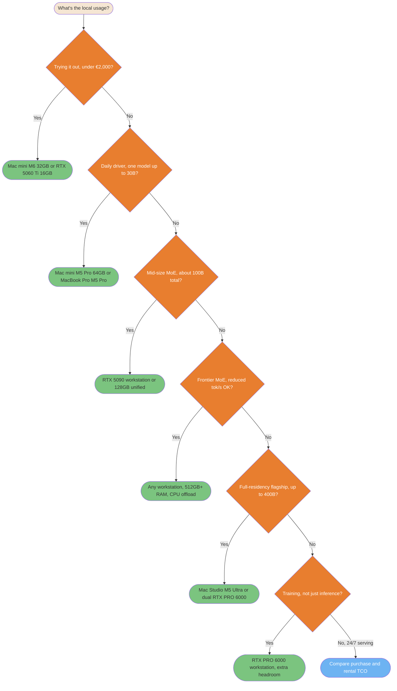
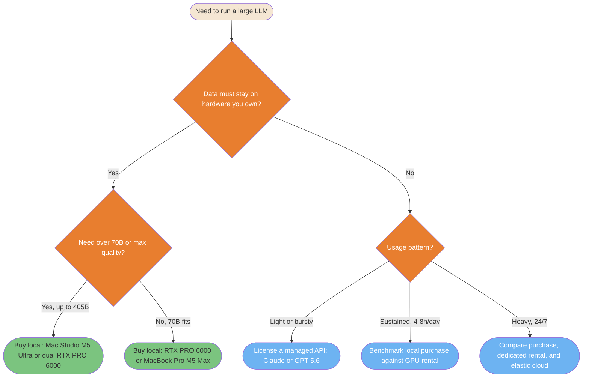

# Локально чи в хмарі: апаратне забезпечення для LLM та економіка інференсу

> **Час читання**: ≈35 хвилин
>
> **Мета**: відповісти на одне питання числами, а не відчуттями: коли для запуску великої open-weight моделі (від 70B до 400B+ параметрів) купівля локального заліза виграє в оренди хмарного GPU чи оплати за токени, і що насправді вміщується на якій машині.

---

## Зміст

- [Дата знімка даних](#data-snapshot-date)
- [Підбір локального заліза за допомогою llmfit](#sizing-local-hardware-with-llmfit)
- [Протокол бенчмарків перед купівлею](#benchmark-protocol-before-you-buy)
- [Чотирнадцять порівнянних апаратних конфігурацій](#fourteen-comparable-hardware-configurations)
- [Пропускна здатність пам'яті, prefill та ECC](#memory-bandwidth-prefill-and-ecc)
- [Що насправді вміщується: іменовані моделі](#what-actually-fits-named-models)
- [Яка локальна машина для якого використання](#which-local-machine-for-which-usage)
- [Тюнінг рушія обслуговування: vLLM у продакшені](#serving-engine-tuning-vllm-in-production)
- [Налаштування кодувального агента: Apple Silicon з MLX](#coding-agent-setup-apple-silicon-with-mlx)
- [Ціни на оренду хмарних GPU](#cloud-gpu-rental-pricing)
- [Річні проєкції витрат](#one-year-cost-projections)
- [Енергоспоживання: вати, ват-години, джоулі на токен](#power-consumption-watts-watt-hours-joules-per-token)
- [Енергоефективність за архітектурою моделі](#energy-efficiency-by-model-architecture)
- [Пропускна здатність хмарних API: Claude проти GPT-5.6](#cloud-api-throughput-claude-vs-gpt-56)
- [Чому хмарні та локальні tokens/sec непорівнянні](#why-cloud-and-local-tokenssec-are-not-comparable)
- [Діаграма рішень](#decision-diagram)
- [Фреймворк ухвалення рішень](#decision-framework)
- [Підбір self-hosted інференсу для команди](#sizing-self-hosted-inference-for-a-team)
- [Одна машина для невеликої команди](#one-machine-for-a-small-team)
- [Робочий приклад: що я зважую в жовтні 2026](#worked-example-what-i-am-weighing-in-october-2026)
- [Перемикання провайдерів на рівні CLI](#switching-providers-at-the-cli-level)

---

## Дата знімка даних

Кожна ціна, специфікація та показник пропускної здатності на цій сторінці є знімком за **серпень 2026**, окрім випадків, коли рядок чи абзац каже, що його перевірено повторно **1 жовтня 2026** (рядки Mac Studio, Strix Halo та Gorgon Halo, таблиця пропускної здатності пам'яті та розділ про невелику команду), або **21 жовтня 2026** (ціни на DGX Spark і GB10, 64-гігабайтний варіант GB10, оголошення Strix Halo і Gorgon Halo, ноутбуки RTX Spark та вимірювання на довгих промптах у розділі про пропускну здатність), або **22 жовтня 2026** (робочий приклад наприкінці сторінки), або **24 жовтня 2026** (багатосесійні показники Qwen3.6-35B-A3B у розділах про MLX, невелику команду та робочий приклад, а також примітка про виклики інструментів під префіксним кешуванням), або **3 листопада 2026** (ціни Mac Studio M5 Ultra 256 GB і 512 GB на Apple France, ціни GB10 і Mac Studio у робочому прикладі та рядки GLM-5.3-Flash і DeepSeek-V4.1-Flash-1017), або **4 листопада 2026** (spot-ціни Nebius у розділі про оренду хмарних GPU, примітка про пропускну здатність на сесію, випадок Revolut та абзац про паралельність на профіль у розділі про підбір ресурсів для команди). Ціни на пам'ять різко зросли протягом 2026 року: TrendForce повідомила про зростання контрактних цін на звичайну DRAM на 93-98% кварталу до кварталу в Q1 2026 і спрогнозувала ще 58-63% у Q2 ([TrendForce, 1 червня 2026](https://www.trendforce.com/presscenter/news/20260601-13070.html), у цій редакції повторно не перечитувалося), тож машини класу 128 GB можуть коштувати помітно дорожче, ніж на старті продажів. Ціни на GPU змінюються на десятки відсотків за лічені тижні, хмарні провайдери переглядають тарифи без попередження, а родини моделей замінюються новими. Сприймайте таблиці як метод, який слід відтворити, а не як постійний прайс-лист. Запити та CLI-команди, використані для створення цієї сторінки, наведено, щоб ви могли виконати їх знову.

Для актуальної картини замість цього фіксованого знімка є два трекери, що оновлюються безперервно, а не за фіксованим графіком: [llm-stats.com](https://llm-stats.com/llm-updates) (результати бенчмарків, голоси арени та ціни API, отримані безпосередньо від провайдерів) і [benchlm.ai](https://benchlm.ai/) (понад 401 модель у 46 категоріях рейтингів, зокрема tokens/sec і time-to-first-token; явно виключає алгоритмічно згенеровані дані бенчмарків). Жоден із них не замінює розрахунків щодо вміщуваності на залізо з цієї сторінки, для яких усе одно потрібен `llmfit` проти вашої цільової моделі.

---

## Підбір локального заліза за допомогою llmfit

Перш ніж щось купувати, перевірте, що насправді може запустити заданий обсяг пам'яті. [`llmfit`](https://github.com/AlexsJones/llmfit) (MIT, `brew install llmfit`) визначає ваше залізо та оцінює свою базу моделей за вміщуваністю, швидкістю й якістю.

```bash
llmfit system                                    # detect current hardware
llmfit --memory 96G --ram 128G fit --json         # simulate a different memory budget
llmfit --memory 96G --ram 128G info "meta-llama/Llama-3.3-70B-Instruct"
```

Два обмеження, які варто знати, перш ніж довіряти його виводу:

**`--memory` перевизначає VRAM GPU, `--ram` перевизначає системну RAM. Вони не взаємозамінні.** На дискретному GPU від Nvidia ваги моделі зазвичай розташовуються у VRAM. CPU-offload може залишати частину моделі або MoE-експертів у системній RAM, але кожне перенесення чи експерт, обчислений на CPU, додає втрат продуктивності. Результат залежить від пропускної здатності PCIe, пропускної здатності пам'яті хоста, архітектури моделі та стратегії offload; універсальної межі в 5 tokens/sec не існує. На Apple Silicon та уніфікованих чипах AMD Ryzen AI обидва значення слід задавати рівними, оскільки існує лише один фізичний пул пам'яті.

**Інструмент не вміє перемикати бекенд інференсу.** Він визначає бекенд машини, на якій працює (Metal, CUDA, ROCm), і продовжує використовувати модель швидкості цього бекенду, навіть коли ви перевизначаєте обсяг пам'яті, щоб змоделювати інше залізо. Запускайте його на машині Nvidia, щоб отримати числа для Nvidia, і на машині Apple Silicon, щоб отримати числа для Apple. Симуляція RTX PRO 6000 із MacBook дає правильну відповідь щодо місткості пам'яті (що вміщується) і хибну відповідь щодо пропускної здатності (tokens/sec), бо інструмент усе ще обчислює швидкість за roofline-моделлю Metal на Mac, а не за CUDA.

---

## Протокол бенчмарків перед купівлею

Перевірка місткості відповідає лише на питання, чи можна завантажити ваги. Вона не показує, чи лишається модель придатною до використання з реальним промптом, кількома користувачами або бекендом інференсу, який ви плануєте запускати. Перевірте саме ту модель, квантизацію, довжину контексту й цільову паралельність, перш ніж порівнювати машини.

| Вимірювання | Від чого застерігає |
|---|---|
| Резидентність ваг плюс запас під runtime і KV-кеш | Модель успішно завантажується, але вичерпує пам'ять на довгому промпті |
| Пропускна здатність prefill і time to first token | Приховування повільної обробки промпта за швидким показником decode |
| Пропускна здатність decode | Ототожнення швидкостей вхідних і згенерованих токенів в одну метрику |
| Прогони для одного користувача та для цільової паралельності | Ігнорування одного KV-кешу на кожну активну послідовність, батчингу та черг |
| Потужність у розетці під час того самого прогону | Перетворення стелі TDP на вигаданий вимір джоулів на токен |
| Купівля, електроенергія, обслуговування та виміряне використання | Порівняння купівлі заліза з погодинною ціною оренди так, ніби обидва мають однакову місткість і вартість експлуатації |

Доповіді, проіндексовані під час огляду цієї сторінки, показують, чому важливе кожне поле. В експерименті на Devoxx із Ryzen AI Max+ 395, що запускав Q4-модель Qwen 122B, доповідачі розділяють prefill і decode, визначають пропускну здатність пам'яті як вузьке місце decode та показують, що GPU offload міняє місткість на вартість перенесення ([пропускна здатність пам'яті на 21:58](https://youtube.com/watch?v=DXEsG3Vo6F4&t=1318s), [GPU offload на 28:46](https://youtube.com/watch?v=DXEsG3Vo6F4&t=1726s), [запуск на залізі на 37:05](https://youtube.com/watch?v=DXEsG3Vo6F4&t=2225s)). Демонстрація RamaLama повідомляє приблизно 1 300 вхідних tokens/sec і 60-70 вихідних tokens/sec на тому ж ноутбуці: два числа, які не можна звести до єдиного результату "tokens/sec" ([17:24](https://youtube.com/watch?v=CYxwXobrL28&t=1044s)).

Одна презентація Framework Desktop повідомляє 80-130 Вт під час використання, у середньому 25-60 tokens/sec із піками близько 80-90 та вартість машини, що змінилася приблизно з €2 400 до €3 000 ([потужність на 15:57](https://youtube.com/watch?v=RTQdC6IgBzc&t=957s), [вартість на 16:20](https://youtube.com/watch?v=RTQdC6IgBzc&t=980s), [пропускна здатність на 17:25](https://youtube.com/watch?v=RTQdC6IgBzc&t=1045s)). Це польові спостереження, наведені доповідачами, а не контрольовані бенчмарки між різним залізом. Використовуйте їх, щоб визначити, що вимірювати на власному навантаженні, а не щоб ранжувати машини в таблиці нижче.

---

## Чотирнадцять порівнянних апаратних конфігурацій

Голі GPU непорівнянні з ноутбуками чи готовими пристроями. У таблиці нижче наведено лише повні системи: CPU, пам'ять, GPU та накопичувач разом, відсортовані за зростанням ціни станом на знімок серпня 2026. Переоцінка DGX Spark у жовтні 2026 зсуває рядки 5 і 10 вище за шкалою цін, ніж підказує їхня позиція. Для робочих станцій навколо голого GPU Nvidia (де вендор не фіксує CPU) стовпець CPU показує один реалістичний приклад, а не специфікацію. Перші три рядки становлять початковий рівень, про який прямо просив читач: машини з GPU (дискретним чи уніфікованим), обмеженим приблизно 16-32 GB, достатньо дешеві, щоб спробувати локальний інференс без зобов'язання купувати збірку за €4 000+.


| # | Конфігурація | CPU | Системна пам'ять | GPU | Накопичувач | Ціна (серп. 2026) |
|---|---|---|---|---|---|---|
| 1 | Mac mini, Apple M6 | Apple M6, 12 ядер (2 super + 4 performance + 6 efficiency) | 16-32 GB уніфікованої | Інтегрований GPU, 12 ядер, пропускна здатність 170 GB/s | SSD 256 GB-2 TB | €1 049 (базова 16 GB/256 GB) / ≈€1 500 за оцінкою при максимумі 32 GB (+$400 BTO) |
| 2 | Робоча станція, 1x RTX 5060 Ti 16 GB | *Приклад*: AMD Ryzen 5 7600, 6 ядер | 32-64 GB DDR5 (лише хост) | RTX 5060 Ti, 4 608 ядер CUDA, 16 GB GDDR7 виділеної, 448 GB/s | NVMe 1-2 TB | ≈€1 300-1 600 (лише GPU: $429 MSRP, ≈€590-730 вулична ціна в серп. 2026) |
| 3 | Mac mini, Apple M5 Pro | Apple M5 Pro, 15 або 18 ядер | 24-64 GB уніфікованої | Інтегрований GPU, 16 або 20 ядер, пропускна здатність 307 GB/s | SSD 512 GB-8 TB | €1 999 (базова 24 GB/512 GB) / ≈€3 000 за оцінкою при максимумі 64 GB (+$1 000 BTO) |
| 4 | AMD Ryzen AI Halo (той самий чип у Framework Desktop, GMKtec EVO-X2, HP Z2 Mini G1a) | Ryzen AI Max+ 395, Zen 5, 16 ядер/32 потоки | 128 GB уніфікованої LPDDR5x | Radeon 8060S інтегрований, 40 CU RDNA 3.5, без виділеної VRAM | SSD 2 TB | ≈$3 999 (≈€3 700-4 000) за платформу AMD (прайс-лист травня 2026). Framework Desktop 128 GB: запущений за $1 999, $3 449 DIY на 16 жовтня 2026, немає в наявності, накопичувач та ОС не включено. GMKtec EVO-X2 128 GB: $3 499,99 (1 TB) або $3 649,99 (2 TB) у його американському магазині, та сама дата (перевірено повторно 21 жовт. 2026) |
| 5 | NVIDIA DGX Spark | Grace, 20 ядер Arm (10x Cortex-X925 + 10x Cortex-A725) | 128 GB уніфікованої LPDDR5x | GB10 Blackwell, 6 144 ядра CUDA (48 SM), без виділеної VRAM | NVMe 4 TB (у комплекті) | $6 950 на американському Marketplace від NVIDIA, спостерігалося 2-6 жовтня 2026, немає в наявності. Запущений за $3 999 у жовтні 2025, піднятий до $4 699 23 лютого 2026. Німеччина: €6 989 з доставкою через кілька місяців, €7 349,99 у наявності. 64-гігабайтний варіант лише для OEM стартує від $4 999 з 23 жовтня 2026 (перевірено повторно 21 жовт. 2026) |
| 6 | MacBook Pro, Apple M5 Pro | Apple M5 Pro, 15 або 18 ядер | 48 GB уніфікованої | Інтегрований GPU, 20 ядер | SSD 2 TB | ≈€4 500-5 000 |
| 7 | Робоча станція, 1x RTX 5090 | *Приклад*: AMD Ryzen 9 9950X, 16 ядер | 64-128 GB DDR5 (лише хост) | RTX 5090, 21 760 ядер CUDA, 32 GB GDDR7 виділеної | NVMe 2-4 TB | ≈€5 000-6 000 |
| 8 | MacBook Pro, Apple M5 Max | Apple M5 Max, 18 ядер | 128 GB уніфікованої | Інтегрований GPU, 40 ядер | SSD 2 TB | ≈€5 500-6 500 |
| 9 | AMD Ryzen AI Max PRO 400 ("Gorgon Halo") | Ryzen AI Max+ PRO 495, Zen 5, 16 ядер/32 потоки, до 5,2 GHz | До 192 GB уніфікованої LPDDR5X-8533, до 160 GB адресується з боку GPU | Radeon 8065S інтегрований, 40 CU RDNA 3.5 | 2-4 TB (оцінка) | Анонсований AMD; станом на 27 вересня 2026 не постачається за даними Petronella, яка повідомляє про ціни HP ZBook Ultra G3a: $5 999 (128 GB) і $7 449 (192 GB). Оголошення на 16 жовтня 2026: Framework Desktop 400 (192 GB) $6 799 DIY, передзамовлення з відправленням у листопаді, Acemagic F9A $6 499, GMKtec EVO-X5 Pro $6 799, Minisforum MS-S1 MAX-P495 $7 399. Незалежного бенчмарка серійного заліза не знайдено (перевірено повторно 21 жовт. 2026) |
| 10 | Пара робочих станцій, 2x NVIDIA DGX Spark | 2x Grace, по 20 ядер Arm (10x Cortex-X925 + 10x Cortex-A725) | 256 GB уніфікованої LPDDR5x разом (2x128 GB) | 2x GB10 Blackwell, 12 288 ядер CUDA разом (96 SM), без виділеної VRAM, без NVLink | 2x NVMe 4 TB (у комплекті) | ≈$13 900, вдвічі більше за вказану вище жовтневу ціну $6 950 за 2026 рік (≈$9 398 за ціною $4 699 з лютого по вересень). Ціну комплекту не перевіряли |
| 11 | Робоча станція, подвійний RTX 5090 | *Приклад*: AMD Threadripper 7960X, 24 ядра | 128-256 GB DDR5 (лише хост) | 2x RTX 5090, 43 520 ядер CUDA разом, 64 GB GDDR7 разом, без NVLink | NVMe 4 TB | ≈€8 000-12 000 |
| 12 | Mac Studio, Apple M5 Ultra | Apple M5 Ultra, 30 або 36 ядер | 96-512 GB уніфікованої, 1,2 TB/s | Інтегрований GPU, 64 або 80 ядер | SSD 1-16 TB | Від $5 499 (96 GB); 256 GB від $9 499 (30-ядерний CPU, 1 TB). Французька базова ціна €6 599 (перевірено повторно 1 жовт. 2026). Освітні ціни Apple France на 3 листопада 2026, 36-ядерний CPU та 80-ядерний GPU з SSD 4 TB: €12 851 (256 GB) і €24 236 (512 GB), відправлення через 13-15 тижнів |
| 13 | Робоча станція, RTX PRO 6000 Blackwell | *Приклад*: AMD Threadripper PRO 7975WX, 32 ядра | 128-256 GB DDR5 ECC (лише хост) | RTX PRO 6000, 24 064 ядра CUDA, 96 GB GDDR7 ECC виділеної | NVMe 4 TB | ≈€16 000-18 000 (одна лише карта ≈€14 000) |
| 14 | Робоча станція, подвійний RTX PRO 6000 Blackwell | *Приклад*: AMD Threadripper PRO 7995WX, 96 ядер | 256 GB+ DDR5 ECC (лише хост) | 2x RTX PRO 6000, 48 128 ядер CUDA разом, 192 GB GDDR7 разом, без NVLink | NVMe 4-8 TB | ≈€30 000-32 000+ |

Джерела: ядра Nvidia RTX 5090 і RTX PRO 6000 Blackwell та обсяг VRAM підтверджено через [Central Computer](https://www.centralcomputer.com/pny-nvidia-rtx-pro-6000-graphics-card-96gb-gddr6-24-064-cuda-cores-pci-express-5-0-x16-600w-vcnrtxpro6000b-pb.html) і [Schneider Digital](https://shop.schneider-digital.com/en/graphics-cards/nvidia/rtx-pro-blackwell-series/nvidia-rtx-pro-6000-blackwell-workstation-edition-96gb-pcie-5.0-x16) (ціна карти ≈€14 000). Специфікації та MSRP RTX 5060 Ti 16 GB з [VideoCardz](https://videocardz.com/newz/nvidia-announces-geforce-rtx-5060-ti-at-429-16gb-and-379-8gb-299-rtx-5060-launches-next-month), діапазон вуличних цін із [серпневого трекера BestValueGPU 2026](https://bestvaluegpu.com/history/new-and-used-rtx-5060-ti-16gb-price-history-and-specs/). Специфікації GB10 з [Arm Learning Paths](https://learn.arm.com/learning-paths/laptops-and-desktops/dgx_spark_llamacpp/1_gb10_introduction/) та [NVIDIA DGX Spark](https://www.nvidia.com/en-us/products/workstations/dgx-spark/). Кількість CU Radeon 8060S з [TechPowerUp](https://www.techpowerup.com/342635/amd-readies-ryzen-ai-max-388-8c-16t-and-full-40-cu-radeon-8060s-gpu). Специфікації чипів Apple M5 Pro/Max (кількість ядер, пропускна здатність пам'яті, підтверджені рівні 24/48/64 GB) зі [сторінки технічних характеристик самої Apple](https://support.apple.com/en-mide/126318). Ціни Mac Studio M5 Max і M5 Ultra, стелі пам'яті та пропускну здатність взято з [серпневого анонсу Apple 2026](https://www.apple.com/newsroom/2026/08/apple-introduces-new-mac-studio-with-m5-max-and-m5-ultra/) та [релізу про доступність від 22 вересня](https://www.apple.com/newsroom/2026/09/the-new-mac-mini-and-mac-studio-are-available-today/); ціни конфігурацій 256 GB і французьку базову ціну €6 599 узято з конфігуратора магазину Apple, як повідомлялося в дослідженні для цієї редакції, без повного построкового перечитування. Mac Studio з M5 Max (від $2 499, до 128 GB, 614 GB/s) не є рядком цієї таблиці; див. таблицю пропускної здатності нижче. Специфікації Gorgon Halo зі [сторінки AMD Ryzen AI Max+ PRO 495](https://www.amd.com/en/products/processors/laptop/ryzen-pro/ai-max-pro-400-series/amd-ryzen-ai-max-plus-pro-495.html); доступність і ціни HP з [Petronella Technology Group, 27 вересня 2026](https://petronellatech.com/blog/dgx-spark-vs-strix-halo-vs-gorgon-halo-local-llm-benchmarks/). Стартові ціни Framework Desktop з [огляду Strix Halo від BotMonster](https://botmonster.com/hardware/amd-strix-halo-mini-pcs-ryzen-ai-max-395-homelab/). Mac mini M6 і M5 Pro анонсовано 25 серпня 2026 (відправлення 22 вересня 2026): специфікації чипів і рівні пам'яті з [висвітлення запуску від 9to5Mac](https://9to5mac.com/2026/08/25/apple-announces-new-mac-mini-heres-everything-new/), французькі базові ціни з [MacGeneration](https://www.macg.co/mac/2026/08/de-700-eu-1-050-eu-en-moins-de-deux-ans-le-tarif-du-mac-mini-nen-finit-plus-de-bouger-310595), ціни на апгрейд пам'яті BTO в USD (основа для наведених вище оцінок у EUR, оскільки французьких цін Apple за конфігураціями незалежно дістатися не вдалося) з [розбору конфігурацій від Daring Fireball](https://daringfireball.net/2026/08/configurations_and_pricing_for_new_mac_minis_and_mac_studios). Історія цін DGX Spark, перевірено повторно 21 жовтня 2026: лютнева зміна походить з "2/23/2026 Price Change Announcement" від NVIDIA, що підняла MSRP Founders Edition з $3 999 до $4 699 "через світові обмеження постачання пам'яті" (цитата з [форуму розробників NVIDIA](https://forums.developer.nvidia.com/t/september-2026-availability-of-gb10s/382068?page=2)). Про лістинг на Marketplace за $6 950 для тієї самої конфігурації 128 GB/4 TB повідомляли користувачі форуму 2-5 жовтня ([сторінка 9](https://forums.developer.nvidia.com/t/september-2026-availability-of-gb10s/382068?page=9)) та [аудит Marketplace від AI Compute Scout](https://aicomputescout.com/articles/nvidia-dgx-spark-who-is-it-for/) ($4 699 11 вересня, без ціни 29 вересня, $6 950 немає в наявності 4 і 6 жовтня); заяви NVIDIA про причину не знайдено. Німецькі пропозиції з [billiger.de, жовтень 2026](https://www.billiger.de/products/5414860266-nvidia-dgx-spark-gb10-founders-edition-blackwell-tensor-core-128-gb-ram-4-tb-ssd-dgx-os-ubuntu-linux). 64-гігабайтний варіант, "доступний виключно через партнерів-OEM", наведено на [сторінці NVIDIA DGX Spark](https://www.nvidia.com/en-us/products/workstations/dgx-spark/) з тими самими 273 GB/s і ConnectX-7; його стартову ціну $4 999 взято з [Tom's Hardware](https://www.tomshardware.com/pc-components/gpus/nvidia-introduces-64gb-dgx-spark-to-throw-local-ai-fans-a-lifeline-amid-the-rampocalypse-new-gb10-config-starts-at-usd4999-for-those-who-can-work-with-less), а дату 23 жовтня від AI Compute Scout. Лістинги Framework, GMKtec та Ryzen AI Max+ PRO 495 походять із [посібника з вибору від S5 Labs, оновленого 16 жовтня 2026](https://s5labs.io/resources/local-llm-machines/), датованого знімка американської вітрини до оподаткування.

---

## Пропускна здатність пам'яті, prefill та ECC

Обсяг пам'яті визначає, яка модель завантажиться. Пропускна здатність пам'яті задає стелю швидкості decode, бо щільна модель читає приблизно весь файл ваг на кожен згенерований токен. Prefill, тобто читання промпта, залежить більше від обчислень. Кодувальний агент надсилає довгі промпти на кожному ході, тож важливі обидва показники.

| Машина | Уніфікована пам'ять | Пропускна здатність пам'яті | ECC | Джерело та статус |
|---|---|---|---|---|
| Mac mini M6 | 16-32 GB | 170 GB/s | Не заявлено | Apple, серпень 2026 |
| Mac mini / MacBook Pro M5 Pro | 24-64 GB | 307 GB/s | Не заявлено | Технічні характеристики Apple |
| AMD Ryzen AI Max+ 395 (Strix Halo) | До 128 GB | 256 GB/s теоретично, 234-235 GB/s виміряно на одному ноутбуці | Ні: LPDDR5X на таких швидкостях не налаштовується з ECC згідно з оглядом Strix Halo | Специфікація AMD; вимірювання Petronella, 27 вер. 2026 |
| NVIDIA DGX Spark (GB10) | 128 GB, або 64 GB у системах лише для OEM з 23 жовтня 2026 | 273 GB/s номінально для обох, 258,8 GB/s виміряно на 128 GB | Ні (у записі GB10 на TechPowerUp ECC позначено як непідтримуваний; сторінку не перечитано, вона повернула 403) | Специфікація NVIDIA; вимірювання Petronella |
| Ноутбуки NVIDIA RTX Spark (N1X) | До 128 GB; у Windows фіксований розподіл GPU/CPU, 62,5 GB доступно GPU на пристрої зі 128 GB при розподілі 64/64 | ≈300 GB/s, обчислено з 256-бітної LPDDR5X-9400 | Не заявлено | Конфігурація пам'яті зі StorageReview, 16 жовт. 2026 |
| AMD Ryzen AI Max+ PRO 495 (Gorgon Halo) | До 192 GB | ≈273 GB/s, обчислено з 256-бітної LPDDR5X-8533 | Не заявлено | Сторінка специфікацій AMD; ще не постачається |
| Mac Studio M5 Max | До 128 GB | 614 GB/s | Не заявлено | Newsroom Apple, серпень 2026 |
| Mac Studio M5 Ultra | До 512 GB (можна замовити в Apple France 3 листопада 2026, відправлення через 13-15 тижнів) | 1,2 TB/s | Не заявлено | Newsroom Apple, серпень 2026; освітній магазин Apple France, 3 листопада 2026 |
| RTX PRO 6000 Blackwell | 96 GB виділеної GDDR7 | Специфікація карти, не уніфікована пам'ять | Так, GDDR7 з ECC | NVIDIA |

**Пропускна здатність передбачає стелю decode для щільних моделей.** Бенчмарк щільної Qwen3.8-27B на одній машині, DGX Spark (ASUS GX10), показав для ваг FP8 (29 GB) 7,8 tok/s проти приблизно 23 tok/s для Q4_K_M (19,6 GB): більший файл читає більше байтів на токен, тому декодує повільніше попри новіші формати тензорних ядер. Той самий репозиторій повідомляє 8-16 tok/s для цієї щільної моделі через llama.cpp і 24 tok/s для повсякденного чату через vLLM з NVFP4 і префіксним кешуванням, виміряно 5-8 вересня 2026. Джерело: [HAOyezi/qwen38-27b-dgx-spark-benchmarks](https://github.com/HAOyezi/qwen38-27b-dgx-spark-benchmarks), один автор, одна машина.

**Саме в prefill GB10 випереджає Strix Halo.** З тією ж збіркою llama.cpp і тими ж файлами моделі Petronella виміряла обробку промпта Qwen3.6-35B-A3B: 2 323 проти 1 313 tok/s з порожнім контекстом, 2 165 проти 1 028 на 8K і 1 907 проти 638 на 32K, DGX Spark проти ноутбука зі Strix Halo (HP ZBook Ultra G1a). Decode, виміряний через Ollama 0.34.0, був ближчим: 74,5 проти 54,4 tok/s на MoE-моделі та 12,6 проти 11,4 tok/s на щільній Qwen3.6-27B. Джерело: [Petronella Technology Group, 27 вересня 2026](https://petronellatech.com/blog/dgx-spark-vs-strix-halo-vs-gorgon-halo-local-llm-benchmarks/). Ціна повільного prefill для кодувальних агентів цілком конкретна: на GMKtec EVO-X2 (Ryzen AI Max+ 395, Windows, llama.cpp Vulkan) холодному запиту OpenCode приблизно з 13 264 токенів промпта та 41 визначенням інструментів знадобилося близько 154,5 секунди на читання, тоді як кешовані наступні ходи обробляли нові частини промпта зі швидкістю понад 200 tok/s, а стала генерація трималася на 16,45 tok/s при контексті 128K. Джерело: [erstmalreden/qwen3.8-27b-ryzen-ai-max-395-benchmarks](https://github.com/erstmalreden/qwen3.8-27b-ryzen-ai-max-395-benchmarks), протестовано 15 серпня 2026, одна машина.

**Глибина контексту коштує пропускної здатності навіть на GB10.** Власний прогін llama.cpp на DGX Spark (`llama-bench`, збірка `11fb327bf (7941)`, 5 лютого 2026) показує, що gpt-oss-120b MXFP4 падає з 2 443,91 до 1 567,08 tok/s на промпті з 2 048 токенів і з 58,72 до 42,76 tok/s на decode, коли попередній контекст зростає від 0 до 32 768 токенів. Кодувальний агент, що пропрацював кілька ходів сесії, працює в кінці цієї таблиці, а не на показнику порожнього контексту, який наводить більшість специфікацій. Джерело: [`benches/dgx-spark/dgx-spark.md`](https://github.com/ggml-org/llama.cpp/blob/master/benches/dgx-spark/dgx-spark.md), лютий 2026, залишено тут як базову лінію поза вікном знімка цієї сторінки.

**M5 Ultra на довжині промпта кодувального агента.** Один автор прогнав gpt-oss-120b (`mlx-community/gpt-oss-120b-mxfp4-bf16`, ≈65 GB) через `mlx_lm.server` на Mac Studio M5 Ultra 256 GB та M3 Ultra 96 GB, три виміряні прогони на кейс з унікальним nonce в кожному промпті, щоб префіксне кешування не приховало prefill. На промпті ≈24 400 токенів M5 Ultra досяг ≈3 955 tok/s prefill, 6,17 с time to first token та 76 tok/s decode проти ≈1 101 tok/s, 22,17 с і 55 tok/s на M3 Ultra. Сервери не використовували ідентичних прапорців (prompt cache і паралельність decode лише на M5 Ultra), версію MLX не вказано, а потужність не вимірювалася. Джерело: [Elite Test Engineering, 29 вересня 2026](https://elitetestengineering.substack.com/p/gpt-oss-120b-on-two-generations-of). Порівнянного прогону з довгим промптом на DGX Spark чи Strix Halo з тією ж моделлю та runtime не знайдено, тож цей результат не ранжує M5 Ultra відносно них.

**Ноутбуки RTX Spark: 128 GB на коробці, близько половини для GPU у Windows.** Ноутбуки NVIDIA з N1X надійшли в продаж 16 жовтня 2026; висвітлення запуску дає стартову ціну $2 599 (S5 Labs). Огляд HP OmniBook Ultra 16 від StorageReview виявив, що Windows використовує фіксований розподіл, заданий у застосунку NVIDIA: пристрій зі 128 GB віддавав GPU 62,5 GB при 64/64. HP оцінила протестовані конфігурації у $3 199,99 (32 GB, 1 TB), $4 999,99 (64 GB, 2 TB) і $6 229,99 (128 GB, 2 TB, HP.com, 14 жовтня). У тесті кодувального агента Codex CLI через Ollama при контексті 64K Qwen3.6-35B-A3B генерувала 89,5 tok/s з медіанним часом виконання 72,0 с і трьома успіхами з трьох, а gpt-oss:20b генерувала 58,0 tok/s. Огляд не вказує квантизацію чи версію Ollama, не повідомляє окремого prefill для цих прогонів і не вимірював споживання потужності. Джерело: [StorageReview, 16 жовтня 2026](https://www.storagereview.com/review/hp-omnibook-ultra-16-review-rtx-spark-n1x).

**ECC: прогалина, яку не закриває жодна з машин з уніфікованою пам'яттю.** Жодна з наведених вище систем Mac, GB10 чи Strix Halo не продається з уніфікованою пам'яттю з ECC. Тихий бітовий збій мало важить для чату одного розробника і більше для спільного сервісу, чий вивід потрапляє в code review, збірки чи дата-пайплайни. ECC означає професійні карти (клас RTX PRO 6000) або серверні платформи.

**CUDA: окреме рішення.** Якщо робота включає fine-tuning, інструменти лише для CUDA або подальше розгортання тієї ж моделі на серверах NVIDIA, DGX Spark або робоча станція NVIDIA зберігає єдиний програмний стек від початку до кінця. Лише для інференсу MLX на Apple Silicon та llama.cpp Vulkan чи ROCm на AMD цілком придатні, з застереженнями щодо runtime з [розділу про MLX](#coding-agent-setup-apple-silicon-with-mlx).

---

## Що насправді вміщується: іменовані моделі

Сортування бази `llmfit` за сирою кількістю параметрів виводить на поверхню маловідомі або орієнтовані на рольові ігри fine-tune, що випадково вміщуються в пам'ять, а не флагманські моделі, які більшість людей насправді хоче запускати. Запит `llmfit info` до офіційного репозиторію кожної лабораторії (а не стороннього дзеркала з квантами) дає чистішу відправну точку, але власний скрейп HuggingFace в `llmfit` має прогалини в якості даних (див. рядок Kimi K3 нижче, де він помилився приблизно вдвічі). Кожну кількість параметрів і кількість MoE-експертів у цій таблиці було ще раз перевірено за власною карткою моделі лабораторії, її репозиторієм GitHub або офіційним анонсом, а не лише за `llmfit`.

Ця таблиця використовує поточне покоління станом на серпень 2026, а не моделі середини 2024/2025 (Llama 3.x, Qwen2.5, Mixtral, початкова DeepSeek-V3), які датували попередню версію цієї сторінки.

**Доповнення від 6 жовтня: Mistral Large 4 поки не є підтвердженим рядком вміщуваності.** Його [документація моделі](https://docs.mistral.ai/models/mistral-large-4-0) вказує 1,05T-параметрову MoE з 52B активних параметрів. [Сторінка релізу Mistral на Hugging Face](https://huggingface.co/mistralai/Mistral-Large-4.0-1T05-A52B) уточнює цифру 49B із запуску: 49B активних на токен, 52B з урахуванням embeddings і вихідних шарів. Жодне з цих чисел не є обсягом пам'яті, потрібним для зберігання всіх експертів. При 1,05T параметрів простий розрахунок ваг у чотирьох бітах дає **525 GB** до метаданих квантизації, виділень runtime та KV-кешу. Ця арифметика не є розміром випущеного чекпойнта чи результатом перевірки вміщуваності на залізо. Ваги анонсовано на пізніше в жовтні; ліцензія, придатні квантизації, сумісність обслуговування та виміряна продуктивність лишаються неперевіреними. Тримайте Large 4 поза рекомендаціями щодо вміщуваності на залізо, доки це не вдасться перевірити. Див. [оцінку джерела](https://github.com/FlorianBruniaux/claude-code-ultimate-guide/blob/main/docs/resource-evaluations/mistral-large-4.md#specifications-and-availability).

У таблиці "MoE" означає mixture of experts (суміш експертів). Шари MoE такої моделі містять кілька feed-forward блоків, які називаються експертами, а маршрутизатор спрямовує кожен токен до кількох із них (top-k) ([Mixtral](https://arxiv.org/html/2401.04088), [Switch Transformers](https://ar5iv.labs.arxiv.org/html/2101.03961)). Обчислюють лише вибрані експерти, тож обчислення на токен слідують за кількістю "активних" параметрів (швидкість decode залежить також від пропускної здатності пам'яті), але кожен експерт має лишатися в пам'яті, тож пам'ять слідує за "загальною" кількістю параметрів.

[](../images/model-axes/moe-memory-compute-en-gemini.webp)

*Приклад Mixtral: підбирайте машину за загальною кількістю параметрів, а обчислення на токен очікуйте за активними. Відкрийте зображення, щоб побачити повний розмір. [Походження зображення](https://github.com/FlorianBruniaux/claude-code-ultimate-guide/blob/main/guide/images/model-axes/README.md).*

| Обсяг пам'яті заліза | Модель, що вміщується | Архітектура | Орієнтовна резидентність ваг при заданій точності чи квантизації |
|---|---|---|---|
| 16 GB VRAM (RTX 5060 Ti) або 16-32 GB уніфікованої (Mac mini M6) | **`openai/gpt-oss-20b`** (серп. 2025, Apache 2.0) вміщується із запасом; `Qwen/Qwen3.8-27B` досягає цього рівня лише при важчій квантизації (Q3_K_M), на межі при 99% використання пам'яті | MoE, 21B загалом, 3,6B активних (4/32 експертів) | 11,0 GB для gpt-oss-20b, 15,84 GB для Qwen3.8-27B при Q3_K_M |
| 32 GB VRAM (1x RTX 5090) або 32-48 GB уніфікованої (MacBook Pro M5 Pro) | **`Qwen/Qwen3.8-27B`** (серп. 2026, Apache 2.0) вміщується з великим запасом; **`Qwen/Qwen3.6-35B-A3B`** (квіт. 2026, Apache 2.0, MoE) також вміщується при 4-6 бітах і декодує швидше на залізі з уніфікованою пам'яттю, бо на токен активуються лише ≈3B параметрів | Щільна ≈27B, або MoE 35B загалом / 3B активних (256 експертів, 8 маршрутизованих + 1 спільний на токен) | 14,2 GB для Qwen3.8-27B; ≈20-26 GB для Qwen3.6-35B-A3B при 4-6 бітах |
| 48 GB уніфікованої (MacBook Pro M5 Pro) | Qwen3.8-27B вміщується легко; **`meta-llama/Llama-4-Scout-17B-16E`** (109B загалом, MoE) трохи не вміщується | MoE, 17B активних / 16 експертів | Потрібно 55,6 GB, перевищує 48 GB |
| 64 GB VRAM (подвійний RTX 5090) | **`meta-llama/Llama-4-Scout-17B-16E`** | MoE, 109B загалом, 17B активних | 55,6 GB для ваг; вона завантажується, але решта 8,4 GB обмежена, якщо врахувати runtime і KV-кеш |
| 96-128 GB (RTX PRO 6000, MacBook Pro M5 Max, DGX Spark, Ryzen AI Halo) | Llama-4-Scout вміщується з великим запасом; жодного підтвердженого флагмана поточного покоління, що потрапляє саме між 56 GB і 200 GB, на момент цього знімка немає | | |
| 192-256 GB (подвійний RTX PRO 6000, Mac Studio M5 Ultra) | **`deepseek-ai/DeepSeek-V4-Flash-0731`** (MIT, GA-реліз 30-31 липня 2026) вміщується в межах опублікованих сторонніх оцінок ваг на обох конфігураціях; `meta-llama/Llama-4-Maverick-17B-128E` (≈400B загалом, MoE, ліцензія спільноти) вміщується лише на конфігурації 256 GB | MoE, 304B загалом / 13B активних за офіційною карткою моделі NVIDIA Build; попередня preview-збірка мала 284B загалом при тих самих 13B активних, і ані DeepSeek, ані NVIDIA не пояснюють, чому загальна кількість у GA-релізі зросла | Офіційного показника VRAM немає. Сторонні оцінки квантизованого GA-релізу групуються навколо 100-170 GB (Unsloth: ≈103 GB при 3 бітах, ≈162 GB при "lossless" 8 бітах; Spheron: ≈166 GB при INT4; `llmfit`: 155,8 GB). Верхня межа лишає близько 22 GB до runtime і KV-кешу на системі 192 GB. Llama-4-Maverick-17B-128E потребує 205,7 GB, тож за цією оцінкою вміщується в 256 GB і не вміщується в 192 GB |
| 256 GB (Mac Studio M5 Ultra 256 GB, подвійний DGX Spark) | **`LibertAIDAI/GLM-5.3-Flash-NVFP4`**, сторонній NVFP4-квант `GLM-5.3-Flash` від Zhipu/Z.ai (ліцензія MIT, контекст 1 048 576 токенів, перша нативно мультимодальна модель лінійки GLM-5: текст, зображення та відео). Z.ai офіційно анонсувала її 26 серпня 2026 після анонімного запуску під назвою "Ox Alpha" на OpenRouter і OpenCode з 20 серпня | MoE, 320B загалом / 18B активних у 45 шарах, відмінна від флагманського SKU `GLM-5.3` на 743B параметрів нижче | ≈181 GiB, проти 598,5 GiB у BF16. Weight-only NVFP4 на тензорах routed FFN (≈97% параметрів, решта лишається в BF16); автори чекпойнта повідомляють про ≈0,99665 косинусної точності round-trip на експерта відносно джерела BF16. 181 GiB це близько 194 GB, тож чекпойнт не вміщується в систему на 192 GB, як-от подвійний RTX PRO 6000, всупереч твердженню попередньої редакції цієї сторінки; 256 GB лишає щонайбільше близько 62 GB для runtime і KV-кешу. На парі 2x DGX Spark картка моделі повідомляє, що 8 запитів з контекстом 128K завершуються помилкою, а 2 запити з 64K працюють (перевірено 3 листопада 2026). Чекпойнт перевірили лише його автори на парі 2x DGX Spark (SGLang, tensor-parallel 2); їхній README стверджує, що vLLM на цій комбінації не працює |
| Будь-яка конфігурація на цій сторінці | **`zai-org/GLM-5.2`** (≈753B загалом, MoE, MIT). `GLM-5.3` (743B загалом, MoE, анонсована 14 серпня 2026, а не 17 серпня, як помилково стверджувала попередня редакція цієї сторінки) є тією ж базовою моделлю з апґрейдом пост-тренування для кодування; ваги випускаються поетапно, приблизно через два тижні після анонсу. Це окремий SKU від `GLM-5.3-Flash` вище, меншої, відмінної моделі, яка після квантизації таки вміщується в залізо цієї сторінки | MoE, ≈40B активних / 256 експертів | 385,9 GB, перевищує все наведене тут |
| Будь-яка конфігурація на цій сторінці | **`deepseek-ai/DeepSeek-V4-Pro-0813`** (1,6T загалом, MoE, MIT, GA 13 серпня 2026) | MoE, **49B активних** (офіційно підтверджено) | 845,4 GB, не вміщується |
| Будь-яка конфігурація на цій сторінці | **`Qwen/Qwen3.8-2.4T-A95B`** (2,4T загалом, MoE, open-weight база хостованої Qwen3.8-Max) | MoE, ≈95B активних / 512 експертів | 1 253 GB, не вміщується |
| Будь-яка конфігурація на цій сторінці | **`MoonshotAI/Kimi-K3`** (**2,8T загалом**, підтверджено власним репозиторієм Moonshot на GitHub, серп. 2026) | MoE, активні 16 з 896 експертів (≈50B активних, розрахунково) | ≈1 430 GB за оцінкою (екстрапольовано зі співвідношення VRAM на параметр у DeepSeek-V4-Pro; власний запис `llmfit` для цього репозиторію повідомляє хибні 5 527B загалом і не використовувався) |

Джерела для офіційно підтверджених показників: [картка моделі gpt-oss-20b](https://huggingface.co/openai/gpt-oss-20b), [Qwen3.8-27B](https://huggingface.co/Qwen/Qwen3.8-27B), [Qwen3.6-35B-A3B](https://huggingface.co/Qwen/Qwen3.6-35B-A3B), [Qwen3.8-2.4T-A95B](https://huggingface.co/Qwen/Qwen3.8-2.4T-A95B), [анонс Llama 4](https://ai.meta.com/blog/llama-4-multimodal-intelligence/), [картка моделі Llama-4-Scout](https://huggingface.co/meta-llama/Llama-4-Scout-17B-16E), [картка моделі DeepSeek-V4-Flash-0731](https://huggingface.co/deepseek-ai/DeepSeek-V4-Flash-0731) та [картка моделі NVIDIA Build](https://build.nvidia.com/deepseek-ai/deepseek-v4-flash-0731/modelcard) для показників 304B/13B (сторонні оцінки VRAM з [посібника з розгортання Unsloth](https://unsloth.ai/docs/models/deepseek-v4) і [GPU-рекомендатора Spheron](https://www.spheron.network/tools/gpu-recommender/deepseek-ai/DeepSeek-V4-Flash-0731/)), [картка моделі DeepSeek-V4-Pro](https://huggingface.co/deepseek-ai/DeepSeek-V4-Pro), [анонс GLM-5.2](https://datanorth.ai/news/zhipu-ai-releases-glm-5-2), [репозиторій Kimi K3 на GitHub](https://github.com/MoonshotAI/Kimi-K3), [картка моделі GLM-5.3-Flash](https://huggingface.co/zai-org/GLM-5.3-Flash), [Artificial Analysis GLM-5.3-Flash](https://artificialanalysis.ai/models/glm-5-3-flash), [чекпойнт GLM-5.3-Flash-NVFP4](https://huggingface.co/LibertAIDAI/GLM-5.3-Flash-NVFP4), [репозиторій розгортання на 2x DGX Spark від Tutanka01](https://github.com/Tutanka01/glm5.3-flash-2x-dgx-spark-nvfp4), [репозиторій бенчмарка на 2x DGX Spark від kingjones30](https://github.com/kingjones30/GLM-5.3-Flash-2x-DGX-Spark).

**Власні мейнтейнери GLM-5.3-Flash-NVFP4 не публікують жодного показника пропускної здатності для чекпойнта**, заявляючи у своєму репозиторії, що "краще не публікувати нічого, ніж публікувати число, яке ми не вимірювали". Три сторонні автори запустили чекпойнт на однаковому класі заліза, парі 2x DGX Spark, протягом двох днів один від одного (26-27 серпня 2026) і повідомили три різні результати. `Tutanka01/glm5.3-flash-2x-dgx-spark-nvfp4`, репозиторій одного автора, створений 26 серпня з однією зіркою, використовує SGLang і виміряв ≈18 tokens/sec наскрізно, без документованого методу бенчмарка. `kingjones30/GLM-5.3-Flash-2x-DGX-Spark`, опублікований у гілці форуму розробників NVIDIA 27 серпня, використовує модифікований vLLM (NoPE-MLA zero-padding, ядра Marlin MoE) плюс власне спекулятивне декодування MTP-5 чекпойнта та повідомляє медіану трьох прогонів 24,74 tok/s для коду, 30,30 tok/s для структурованого виводу й 19,58 tok/s для прози; без спекулятивного декодування те саме налаштування падає до рівних 14,6 tok/s, що його автор пояснює обмеженістю decode пропускною здатністю пам'яті MoE. Окрема гілка форуму NVIDIA, озаглавлена з твердженням "43.4 tok/s PEAK", повідомляє це єдине число без розкриття методу бенчмарка взагалі. Розрив між 18, діапазоном 24,7-30,3 і 43,4 tok/s на тих самих двох машинах найправдоподібніше пояснюється вибором рушія (SGLang проти вручну пропатченого vLLM) та наявністю чи відсутністю спекулятивного декодування MTP-5; цю гіпотезу підтримують дві задокументовані гілки, але жодна не підтверджує її остаточно. Ставтеся до всіх трьох чисел як до польових результатів, про які повідомила спільнота, а не як до незалежно перевірених бенчмарків, і повторіть розділ Протокол бенчмарків вище, перш ніж підбирати купівлю під будь-яке з них.

**Стовпець резидентності вище припускає, що кожен експерт має бути резидентним у VRAM чи уніфікованій пам'яті. Він охоплює ваги, а не повний бюджет runtime.** `llmfit` повідомляє і показник "повної моделі", і значно менший показник "активної" (наприклад, DeepSeek-V4-Pro-0813 показує 845,4 GB повної проти 63,6 GB активної). Показник активної описує вартість обчислень одного прямого проходу; показник повної моделі це те, що потрібно для наївного розгортання повністю в пам'яті акселератора. Виділення runtime, довжина контексту, точність KV-кешу, розмір батча та одночасні послідовності споживають додаткову пам'ять. Для MoE-моделей існує обхідний шлях, але він переносить обмеження, а не усуває його: повний набір експертів має лишатися резидентним десь швидко (в системній RAM, а не у VRAM), і лише експерти, вибрані для поточного токена, передаються на GPU або обчислюються на CPU.

Це реалізують два реальні проєкти. Прапорці `--n-cpu-moe`/`--cpu-moe` у `llama.cpp` тримають тензори MoE-експертів у RAM CPU, передаючи активних на GPU через PCIe на кожен токен; це підтверджено документацією проєкту на GitHub та обговореннями issue. [FreeToken](https://github.com/FlashML-org/FreeToken) (Apache 2.0, [стаття на arXiv](https://arxiv.org/abs/2608.16157), серед авторів Song Han та Ion Stoica) іде далі з адаптивним до пропускної здатності режимом `hybrid`: він профілює співвідношення пропускної здатності PCIe та пам'яті хоста (`ft bench bw`) і розподіляє промахи кешу експертів між "отримати через PCIe" та "обчислити на місці на CPU", з LRU-кешем експертів на GPU, що повторно використовує тих, які були активні на попередньому токені. Власний README FreeToken стверджує, що decode у 3-4 рази швидший, а prefill у 6-30 разів швидший, ніж в Ollama, на MoE-моделях; ця цифра походить від авторів статті, а не з незалежного бенчмарка. FreeToken офіційно підтримує, серед іншого, DeepSeek-V4-Flash, GLM-5.2, GLM-4.7, Qwen3.6/3.5 MoE та gpt-oss, а його команда `ft launch claude` напряму підключає локально обслуговувану модель до Claude Code через Anthropic-сумісний API FreeToken. Повідомлені спільнотою (не перевірені незалежно) показники пропускної здатності, передані у Slack: GPU 8 GB у ноутбуці з 64 GB RAM, що запускає MoE-модель 35B на 39,3 tokens/sec, RTX 5090 зі 192 GB RAM, що запускає DeepSeek-V4-Flash (284B) на 22 tokens/sec, та GPU робочої станції 96 GB з 512 GB RAM, що запускає GLM-5.2 (753B) на 14,9 tokens/sec.

Практично це означає, що вердикти "не вміщується" для GLM-5.2 та DeepSeek-V4-Pro в таблиці вище правдиві лише для наївного завантаження повністю у VRAM. За наявності достатньої системної RAM (класу 512 GB, а не показників VRAM 96-256 GB, які ця сторінка використовує в інших місцях) та рушія з підтримкою CPU-offload обидві моделі стають придатними до використання з реальною, хоч і зниженою пропускною здатністю на залізі, яке вже охоплене чотирнадцятьма конфігураціями цієї сторінки.

Розрив із фронтиром усе ж таки збільшився, а не зменшився порівняно з попереднім поколінням, розглянутим тут: DeepSeek-V3 потребувала 350,6 GB при 4 бітах, її наступниця серпня 2026 DeepSeek-V4-Pro потребує 845,4 GB у термінах повної VRAM, і ні 2,4T-параметрова MoE від Qwen, ні 2,8T-параметрова Kimi-K3 від Moonshot не вміщуються ні на чому в цьому наборі заліза навіть із CPU offload, зокрема на робочій станції з двома RTX PRO 6000 за €30 000+. Дістатися до цього класу моделей зі зручною швидкістю потребує або квантизації настільки агресивної, що `llmfit` більше не вважає її придатною, або бюджету та міжз'єднання (класу NVLink, а не збірок з багатьма GPU лише на PCIe, як на цій сторінці) далеко за межами цієї сторінки.

---

## Яка локальна машина для якого використання

Дві таблиці вище відповідають на питання "що де вміщується". Цей розділ відповідає на інше, поширеніше питання: що ви насправді хочете робити, і яка з чотирнадцяти конфігурацій правильна для купівлі. Ті самі дані, організовані за сценарієм використання, а не за ціною.


| Використання | Рекомендовані конфігурації | Клас моделей, на який це націлено | Чому |
|---|---|---|---|
| Дешево спробувати локальний інференс, побічний проєкт, бюджет до €2 000 | Mac mini M6 (32 GB) або робоча станція з RTX 5060 Ti 16 GB | `gpt-oss-20b`, `Qwen3.8-27B` при важчій квантизації | Найдешевша точка входу, що запускає справжню модель поточного покоління, а не іграшковий fine-tune |
| Щоденний кодувальний асистент, одна модель до ≈30B, реальне вікно контексту | Mac mini M5 Pro (64 GB) або MacBook Pro M5 Pro (48 GB) | `Qwen3.8-27B` комфортно; `Llama-4-Scout` затісно | 48-64 GB дає одній моделі простір і достатньо контексту, щоб бути корисною, а не лише проходити бенчмарк |
| Середня MoE (≈100B загалом, ≈17B активних) з хорошою пропускною здатністю | Робоча станція з двома RTX 5090 (64 GB сумарно, з бекендом, що підтримує tensor splitting) або конфігурація з 96-128 GB уніфікованої (DGX Spark, Ryzen AI Halo, MacBook Pro M5 Max) | `Llama-4-Scout-17B-16E` | 55,6 GB ваг не вміщується в один RTX 5090 на 32 GB; 64 GB лишають обмежений запас під runtime і контекст, а 96-128 GB безпечніші |
| Фронтирна MoE (GLM-5.2, DeepSeek-V4-Pro), прийнятна знижена, але придатна пропускна здатність | Будь-яка робоча станція з цієї сторінки з доданою системною RAM 512 GB+, що запускає `llama.cpp --n-cpu-moe` або [FreeToken](https://github.com/FlashML-org/FreeToken) | `GLM-5.2`, `DeepSeek-V4-Pro-0813` | Повний набір експертів лишається резидентним у системній RAM; на GPU передаються лише активні експерти на токен, тож VRAM перестає бути жорсткою межею |
| Найбільша модель, яку підтримує ця сторінка при повній резидентності в пам'яті акселератора, без трюків з offload | Mac Studio M5 Ultra (256 GB) або подвійний RTX PRO 6000 Blackwell (192 GB сумарно) | `DeepSeek-V4-Flash-0731` вміщується в межах доступних сторонніх оцінок ваг на обох; `Llama-4-Maverick-17B-128E` вміщується лише на конфігурації 256 GB | ≈100-170 GB (сторонні оцінки квантизації, офіційного показника немає) для DeepSeek-V4-Flash-0731; верхня оцінка лишає обмежений запас runtime на 192 GB. Llama-4-Maverick потребує 205,7 GB і не вміщується в 192 GB |
| Локальний fine-tuning чи тренування, а не лише інференс | Робоча станція RTX PRO 6000 Blackwell (одна або подвійна) | Залежить від цільової моделі | Тренування потребує запасу VRAM понад резидентність ваг для станів оптимізатора й градієнтів; цієї вартості показники цієї сторінки, розраховані лише на інференс, не моделюють |
| Тривале інтенсивне або продакшен-обслуговування 24/7 | Порівняйте купівлю, виділену оренду та еластичну оренду | Точна продакшен-модель і рівень сервісу | Результат визначають використання, потужність, обслуговування, доступність і потрібний клас GPU; сама погодинна ціна його не визначає |
| Потрібна CUDA (fine-tuning, інструменти лише для CUDA, подальше розгортання на серверах NVIDIA) | DGX Spark або робоча станція NVIDIA | Залежить від цільової моделі | Один програмний стек від робочого столу до сервера; GB10 також виміряно в 1,8-3,8 разу швидшим prefill, ніж у ноутбука зі Strix Halo, при контексті 0-32K. З жовтня 2026 128-гігабайтний Spark коштує $6 950; 64-гігабайтний варіант OEM (від $4 999) зберігає CUDA і 273 GB/s, але вдвічі зменшує пам'ять, що визначає, яка модель завантажиться |
| Кілька людей, що ділять одну машину | Див. [Одна машина для невеликої команди](#one-machine-for-a-small-team) | ≈27-35B, квантизована | Послідовне використання працює; паралельні агенти конкурують за ту саму пропускну здатність, а сервери в стилі llama.cpp можуть втрачати сукупну пропускну здатність під паралельним навантаженням |



<details>
<summary>ASCII-версія</summary>

```
What's the local usage?
└─ Trying it out, under €2,000?
   ├─ Yes → Mac mini M6 32GB or RTX 5060 Ti 16GB
   └─ No  → Daily driver, one model up to 30B?
            ├─ Yes → Mac mini M5 Pro 64GB or MacBook Pro M5 Pro
            └─ No  → Mid-size MoE, about 100B total?
                     ├─ Yes → RTX 5090 workstation or 128GB unified
                     └─ No  → Frontier MoE, reduced tok/s OK?
                              ├─ Yes → Any workstation, 512GB+ RAM, CPU offload
                              └─ No  → Full-residency flagship, up to 400B?
                                       ├─ Yes → Mac Studio M5 Ultra or dual RTX PRO 6000
                                       └─ No  → Training, not just inference?
                                                ├─ Yes             → RTX PRO 6000 workstation, extra VRAM headroom
                                                └─ No, 24/7 serving → Compare purchase and rental TCO
```

</details>

---

## Тюнінг рушія обслуговування: vLLM у продакшені

Таблиці вище відповідають на питання, яке залізо купувати. Вони нічого не кажуть про те, чи пропускна здатність цього заліза реально доходить до користувачів: це визначають рушій обслуговування та його конфігурація. [vLLM](https://docs.vllm.ai/) є типовим open-source рушієм обслуговування за більшістю self-hosted розгортань, сумісних з OpenAI, зокрема за рядком MoE з CPU-offload вище. Це важелі конфігурації з документованим ефектом і те, що офіційна документація насправді каже про кожен із них, за [посібником з оптимізації vLLM](https://docs.vllm.ai/en/stable/configuration/optimization/) (знімок серпня 2026; vLLM випускає нові релізи приблизно кожні два тижні, тож перевіряйте точні значення за замовчуванням, перш ніж на них покладатися).

### Рівні оптимізації компіляції

Задаються через `-O` у `vllm serve` або `compilation_config` у Python API.

| Рівень | Що робить |
|---|---|
| `-O0` | Без оптимізацій. Найшвидший старт, найнижча продуктивність під час роботи. |
| `-O1` | Проста компіляція, швидкі fusion, CUDA-графи `PIECEWISE`. |
| `-O2` | За замовчуванням. Додаткові діапазони компіляції, більше fusion, CUDA-графи `FULL_AND_PIECEWISE`. |
| `-O3` | Задокументовано як "наразі дорівнює `-O2`", зарезервовано для майбутніх експериментальних оптимізацій. |

`-O2` як задокументоване значення за замовчуванням відповідає формулюванню "оптимальна точка для продакшену", що ходить у матеріалах про обслуговування. Не підтверджується інше: трактування `-O3` як окремого, агресивнішого продакшен-рівня. Станом на цей знімок власна документація vLLM стверджує, що `-O3` на практиці ідентичний `-O2`.

### Префіксне кешування

Автоматичне префіксне кешування хешує кожен блок KV-кешу за вмістом його токенів плюс токенами, що йдуть перед ним, тож другий запит зі спільним префіксом промпта (фіксований системний промпт, повторюваний few-shot шаблон) повторно використовує вже обчислені блоки замість повторного обчислення. У V1 воно ввімкнене за замовчуванням; налаштовується `--prefix-caching-hash-algo` (за замовчуванням `sha256`). У дизайн-документах vLLM це названо "майже безкоштовним обідом", але ні офіційно, ні в інших джерелах кількісного показника Time To First Token чи вартості не публікується. Ставтеся до будь-якого конкретного відсотка, прив'язаного до цієї функції (серед іншого, часто повторюване "скорочення вартості на 30-50%"), як до анекдотичного, доки його не виміряно на власному навантаженні зі спільним префіксом.

**На гібридних моделях перевіряйте префіксне кешування разом зі спекулятивним декодуванням і викликами інструментів.** Рецепт NVIDIA для DGX Spark з `nvidia/Qwen3.6-35B-A3B-NVFP4` запускав vLLM 0.24.0 зі спекулятивним декодуванням MTP, префіксним кешуванням і KV-кешем FP8. Коли в запиті було 46 інструментів, модель записувала виклик інструмента як некоректний XML у `content`, повертала `finish_reason: stop` і жодного `tool_calls`; 20-45 інструментів проходили. Автор повідомлення спершу звинуватив квантизацію NVFP4, а потім пов'язав збій з поєднанням MTP та префіксного кешування на гібридній архітектурі Gated-DeltaNet у Qwen3.6. Незалежний тестувальник виміряв 1 збій у 111 викликах на vLLM 0.24.0 з обома функціями, 120 з 120 лише з префіксним кешуванням і 120 з 120 на vLLM 0.26.0 з обома; після цього автор повідомлення отримав 120 викликів і 0 некоректних на 0.26.0 з MTP на трьох спекулятивних токенах. Issue лишалося відкритим станом на 5 вересня 2026, з окремо зазначеною помилкою пам'яті FlashInfer на GB10 з MTP. Джерело: [NVIDIA/dgx-spark-playbooks#89](https://github.com/NVIDIA/dgx-spark-playbooks/issues/89), перечитано 24 жовтня 2026. Збій був періодичним, тож короткий smoke-тест може його пропустити: програйте довгий список інструментів багато разів, перш ніж довіряти конфігурації обслуговування для агента.

### Chunked prefill

У V1 ввімкнено за замовчуванням. Розбиває prefill довгого промпта на частини та чергує їх з decode-кроками інших запитів, що виконуються, замість того щоб дозволити одному великому prefill блокувати батч. Регулятор тюнінгу це `max_num_batched_tokens`: менші значення (близько 2048) віддають перевагу затримці decode, бо менше prefill-частин уповільнює токен-за-токеном генерацію для інших запитів, тоді як більші значення віддають перевагу time-to-first-token. Власна рекомендація vLLM: `max_num_batched_tokens > 8192` для менших моделей на великих GPU.

### Витіснення KV-кешу (preemption)

Коли місце в KV-кеші для поточного батча закінчується, vLLM витісняє (preempts) запит і пізніше перераховує його, замість того щоб аварійно завершуватися з out-of-memory. У V1 режим витіснення за замовчуванням це `RECOMPUTE`, а не swap-на-CPU-і-відновлення, бо перерахунок має менші накладні витрати в поточній архітектурі. Важелі, що зменшують частоту витіснення: збільшити `gpu_memory_utilization`, зменшити `max_num_seqs`, збільшити `tensor_parallel_size` і `pipeline_parallel_size` (обидва шардують модель і звільняють пам'ять кожного GPU під KV-кеш). Витіснення це резервний механізм коректності на випадок нестачі пам'яті; саме ці чотири налаштування насправді не дають до нього дійти.

### Стратегії паралелізму

Чотири незалежні осі, які можна [комбінувати](https://docs.vllm.ai/en/latest/serving/parallelism_scaling/):

| Режим | Що розділяє | Типове використання |
|---|---|---|
| TP (tensor parallel) | Вагові матриці між GPU | Модель завелика для VRAM одного GPU |
| PP (pipeline parallel) | Шари між GPU або вузлами | Масштабування на кілька вузлів, зазвичай TP всередині вузла та PP між вузлами |
| DP (data parallel) | Повна модель, репліковану на кожен GPU/групу | Масштабування сирої паралельності, коли модель уже вміщується на одному GPU/групі |
| EP (expert parallel) | Ваги MoE-експертів між GPU | Mixture-of-experts моделі; кожен GPU/ранг тримає підмножину експертів |

Задокументований продакшен-патерн для великих MoE-моделей: 1-спрямований tensor parallel, 8-спрямована data-parallel attention, 8-спрямовані expert-parallel шари MoE, де ваги attention реплікуються на всіх 8 GPU, а ваги експертів шардуються між ними. Поширена конвенція: розмір TP дорівнює кількості GPU на вузол, розмір PP дорівнює кількості вузлів.

### CPU та NUMA: справжнє вузьке місце, але не прапорець vLLM на CUDA

Токенізація, рендеринг chat-шаблонів, планування запитів і мультимодальна передобробка виконуються на CPU, перш ніж щось досягне GPU. За довгих послідовностей і великих батчів токенізація сама по собі, за вимірюваннями, давала до приблизно 80% доданої затримки в конфігураціях із суперництвом за CPU ([arXiv:2603.22774](https://arxiv.org/html/2603.22774v1)). Ця частина підтверджується: інференс не зводиться лише до GPU. Не підтверджується те, як це зазвичай подають: задокументована в vLLM функція прив'язки до CPU та NUMA-пінінгу обмежена [плагіном `vllm-ascend`](https://docs.vllm.ai/projects/ascend/en/latest/user_guide/feature_guide/cpu_binding.html) (NPU від Huawei, лише ARM-сервери): його власна документація прямо каже "No action needed on x86_64". Для стандартного багатосокетного CUDA-сервера, як-от конфігурації з двома RTX PRO 6000 чи двома RTX 5090 на цій сторінці, задокументованого NUMA-аргументу рушія vLLM, до якого можна було б звернутися, немає. Доступний важіль це пінінг процесу vLLM за допомогою `numactl` на рівні ОС, зроблений поза vLLM, а не налаштування vLLM.

### Мультимодальне (VLM) обслуговування

Три прапорці зменшують повторну передобробку зображень або відео для vision-language моделей:

- `mm_encoder_tp_mode="data"` розподіляє батчований мультимодальний вхід між TP-рангами (data-parallel кодування), тоді як кожен ранг усе одно тримає повні ваги енкодера.
- `mm_processor_cache_gb` задає розмір у GiB кешу, що уникає повторної обробки вже бачених мультимодальних входів; за замовчуванням 4 GiB, `0` вимикає його.
- `mm_processor_cache_type="shm"` переносить вміст кешу в спільну пам'ять, доступну між робочими процесами, лишаючи на первинному процесі лише ключі кешу.

### Що тюнити першим

Офіційного рейтингу пріоритетів від vLLM не існує. Порядок нижче відповідає тому, де кожна функція розташована в шляху запиту (планування prefill/decode раніше за уникнення OOM раніше за масштабування вшир), а не бенчмарк-рейтингу:

1. Префіксне кешування та chunked prefill (у V1 ввімкнено за замовчуванням; переконайтеся, що їх не вимкнено)
2. `gpu_memory_utilization` та `max_num_batched_tokens`
3. `max_num_seqs` і запас під витіснення KV-кешу
4. Стратегія паралелізму (TP/PP/DP/EP), коли тюнінг на одному GPU вичерпано
5. Прапорці мультимодального кешу, якщо обслуговуєте VLM

---

## Налаштування кодувального агента: Apple Silicon з MLX

vLLM не націлений на Apple Silicon; на Mac еквівалентне рішення (модель, runtime, бюджет пам'яті) проходить через [MLX](https://github.com/ml-explore/mlx), власний масивний фреймворк Apple, та екосистему довкола нього. Цей розділ розглядає, що запускати і як, для конкретного випадку локального кодувального агента на Mac з уніфікованою пам'яттю (конфігурації 96-128 GB на цій сторінці: MacBook Pro M5 Max, Mac Studio, Mac mini M5 Pro).

### Вибір моделі: одна MoE для щоденного використання, одна щільна модель у запасі

| Модель | Архітектура | Ліцензія | Контекст | Опубліковані бенчмарки |
|---|---|---|---|---|
| [`Qwen/Qwen3.6-35B-A3B`](https://huggingface.co/Qwen/Qwen3.6-35B-A3B) | MoE, 35B загалом / ≈3B активних (256 експертів, 8 маршрутизованих + 1 спільний на токен) | Apache 2.0 | 262 144 нативно, розширюється до ≈1,01M | SWE-Bench Verified 73,4, LiveCodeBench v6 80,4, MMLU-Pro 85,2, GPQA 86,0 (картка моделі) |
| [`Qwen/Qwen3.8-27B`](https://huggingface.co/Qwen/Qwen3.8-27B) | Щільна, ≈27B | Apache 2.0 | 262 144 нативно | Та сама архітектура, що й у `Qwen3.6-27B` квітня 2026, усі покращення від пост-тренування: Terminal-Bench 2.1 73,0 (проти 63,4), SWE-Bench Pro 61,7 (проти 53,5), LiveCodeBench v6 90,3 (проти 83,9) |

Обидва набори показників узято безпосередньо з картки кожної моделі на HuggingFace та перевірено в цій сесії. `Qwen3.8-27B` уже є референсною щільною моделлю цієї сторінки (див. апаратну таблицю вище); вона замінює старіший щільний реліз `Qwen3.6-27B`, що ходить у деяких матеріалах серпня 2026 (зокрема в широко поширеному звіті про локальний інференс на Mac, переглянутому під час написання цього розділу) як "якісна" пара для `Qwen3.6-35B-A3B`. Оскільки `Qwen3.8-27B` строго краща за кожним бенчмарком, де порівняння існує, і вже є моделлю, яку ця сторінка використовує в інших місцях, використовуйте її замість `Qwen3.6-27B` як щільний запасний варіант: той самий обсяг ваг, жодних причин запускати старішу.

Розподіл "MoE для швидкості, щільна для глибини" відповідає [обговоренню CPU-offload для MoE на цій сторінці](#what-actually-fits-named-models) у меншому масштабі: `Qwen3.6-35B-A3B` активує ≈3B параметрів на токен, тож декодує ближче до швидкості 3B-моделі, зберігаючи натреновану місткість 35B-моделі, ціною ≈20-26 GB резидентних ваг (4-6 біт) замість ≈2 GB 3B-моделі. На Mac з уніфікованою пам'яттю 96-128 GB обидві моделі вміщуються одночасно із запасом під великий KV-кеш, тобто можна тримати MoE-модель завантаженою для щоденних ходів агента та підміняти щільною для одного складнішого запиту, замість того щоб обирати одну назавжди.

### Порівняння runtime: що перевірено, що заявлено вендором, а що не те й не інше

Чотири runtime надають OpenAI-сумісний локальний API на Apple Silicon. На практиці вони не взаємозамінні, і розмір розриву між ними є єдиним найбільшим важелем у цьому розділі, більшим за вибір моделі для заданої цільової якості.

| Runtime | Що це | Перевірено в цій сесії |
|---|---|---|
| [MLX](https://github.com/ml-explore/mlx) / [`mlx-lm`](https://github.com/ml-explore/mlx-lm) | Власний масивний фреймворк Apple; `mlx-lm` надає завантаження моделей, квантизацію та OpenAI-сумісний сервер через `mlx_lm.server` | Поточний реліз v0.31.3 (перевірено безпосередньо на сторінці релізів GitHub); спекулятивне декодування існує в кодовій базі (запис у changelog v0.31.2 згадує виправлення до нього), що підтверджує, що функція справжня й актуальна, хоча конкретні відсотки прискорення та прийняття чернеток, що ходять про неї, походять зі сторонніх блогів, а не з офіційного бенчмарка MLX, і тут незалежно не відтворювалися |
| [`llama.cpp`](https://github.com/ggml-org/llama.cpp) (бекенд Metal) | `llama-server`, зібраний з `-DGGML_METAL=ON`; той самий OpenAI-сумісний сервер, що використовується на CUDA в інших місцях цієї сторінки | Спекулятивне декодування MTP на Metal задокументоване як **чиста втрата**: [GitHub issue #23752](https://github.com/ggml-org/llama.cpp/issues/23752), відкрите й нерозв'язане на момент написання, виміряло падіння Qwen3.5-9B-Q4_K_M з неспекулятивної базової лінії 25,3 tok/s до 19,3-22,4 tok/s (від -11% до -24%) для кожної перевіреної довжини чернетки MTP, а висновок самого issue полягає в тому, що накладні витрати на оцінку чернетки перевищують виграш від спекуляції на Metal. **Застереження**: залізо в цьому issue це MacBook Pro M1 Max 2021 року, а не M5 Max; механізм (накладні витрати чернетки на Metal) архітектурний і, ймовірно, узагальнюється, але масштаб на поточному поколінні Apple Silicon незалежно не підтверджено |
| [LM Studio](https://lmstudio.ai/) (`mlx-engine`) | Власний MLX-бекенд LM Studio на Mac | [Власний блог-пост LM Studio](https://lmstudio.ai/blog/mlx-engine-agentic-workloads) про `mlx-engine` v1.8.5, офіційне першоджерело, повідомляє для M3 Max/36 GB: на 82% менше додаткової RAM у паралельних навантаженнях із довгими промптами (з 6,47 GB до 1,18 GB), пропускна здатність паралельних чатів зросла в 2,2 раза (з 15,24 до 33,97 вихідних tok/s), а промпт із повторюваним зображенням скоротився з 23,79 с до 6,88 с (некешовані токени промпта впали з ≈3 730 до 145) завдяки відновленню KV-кешу з диска. Це опубліковано вендором і незалежно не відтворено, але джерелом є власний інженерний блог LM Studio, а не сторонній агрегатор |
| [Ollama](https://ollama.com/) | Runtime загального призначення, що перейшов на бекенд MLX на Mac | Справжнє (задокументоване у власних release notes Ollama), але конкретні цифри "у 1,6-2 рази швидше, від 1 100 до 1 851 tok/s prefill", що приписуються цьому переходу в поширених матеріалах, походять зі стороннього блогу-огляду, а не з власних бенчмарків Ollama; тут незалежно не відтворювалися |

Практичний висновок, узгоджений з усім, на що вказують усі чотири рядки: віддавайте перевагу MLX-нативному серверу (`mlx_lm.server`, `mlx-engine` від LM Studio або виділеному MLX-серверу на кшталт [oMLX](https://omlx.ai/) чи [vMLX](https://vmlx.net/)) перед бекендом Metal у `llama.cpp` для циклу кодувального агента на Mac, конкретно через підтверджену регресію MTP на Metal та підтверджену обробку префіксного кешу в рушіях на основі MLX. Не вмикайте спекулятивне декодування `llama.cpp` на Metal, не виміряйте спершу власну модель і залізо; issue #23752 показує, що воно може погіршити ситуацію.

### Застереження щодо "бенчмарк"-сайтів про Apple Silicon

Дослідження для цього розділу виявило групу контентних сайтів, що з'явилися протягом 2026 року й спеціалізуються на показниках пропускної здатності LLM на Apple Silicon (назви доменів тут не наводяться, бо покладатися на жоден із них не слід): кілька з них прямо позначають свої головні показники tok/s як "оцінки, екстрапольовані з даних родини чипів", а не виміряні прогони, але подають їх у таблиці, що на перший погляд не відрізняється від виміряних результатів. Одне джерело, наведене під час початкового проходу дослідження для цього розділу, подане як "власна стаття Apple про масштабований інференс", що повідомляла про 5,8-кратне покращення TTFT (з 245 мс до 42 мс) завдяки префіксному кешуванню, не існує в такому вигляді: відповідна стаття на arXiv (2601.19139) є незалежним поданням (не від Apple), чия анотація повідомляє зовсім інші показники (21-87% приросту пропускної здатності, 24,7-кратне прискорення відеокешу та падіння мультимодальної затримки з 21,7 с до менш ніж 1 с, жодних цифр TTFT 245 мс/42 мс узагалі). Ставтеся до будь-якого конкретного показника tok/s для M5 Max, знайденого поза власною карткою моделі лабораторії, release notes офіційного runtime або відтворюваним репозиторієм бенчмарків спільноти (як-от опубліковані сторінки прогонів `omlx.ai`, які опубліковано вендором, але принаймні для кожного числа вказано конкретну модель, квантизацію та довжину контексту), як до неперевіреного, доки ви не виміряєте його самі за [Протоколом бенчмарків](#benchmark-protocol-before-you-buy) вище.

### Бюджет пам'яті та довжина контексту

Уніфікована пам'ять ділиться між CPU, GPU і NPU; macOS обмежує, скільки з неї GPU може адресувати одночасно, через `iogpu.wired_limit_mb`. Посібники спільноти з LLM на Apple Silicon (не цифра, опублікована Apple) сходяться на тому, щоб вважати безпечно придатними для ваг моделі плюс KV-кешу приблизно 60-70% загальної RAM, до того як почнуться тиск на пам'ять і swap; на машині зі 128 GB це практична стеля близько 90 GB для моделі+KV, що лишає запас для macOS, Docker, IDE та браузера. `Qwen3.6-35B-A3B` при 4-6 бітах (≈20-26 GB ваг) лишає щедрий простір під цією стелею для великого KV-кешу; щільна 70B-модель при Q4/Q5 (≈40-50 GB ваг) лишає значно менше. Це відповідає загальній закономірності, задокументованій вище: [довжина контексту суттєво знижує пропускну здатність](#benchmark-protocol-before-you-buy) зі зростанням KV-кешу, тож вважайте 32k-64k токенів практичним робочим контекстом для безперервного циклу агента на Mac зі 128 GB із запущеними іншими застосунками, а довші контексти резервуйте для епізодичного аналізу великих кодових баз, а не для використання агентом на кожному ході.

### Кілька сесій на одному Mac: пропускна здатність спільна

Одна сесія `Qwen3.6-35B-A3B` швидка на M5 Max. Один прогін oMLX (v0.5.3, M5 Max із 64 GB, 4 біти, 31 липня 2026) декодує зі швидкістю 131,0 tok/s при 1K контексту, 122,4 при 4K, 118,4 при 8K, 113,3 при 16K і 104,3 при 32K, з піковою пам'яттю 22,9 GB ([сторінка прогону oMLX](https://omlx.ai/benchmarks/nul8lotd)). Це відповідає на питання для одного користувача. Навантаження кодувального агента з п'ятьма і більше паралельними сесіями ставить інше питання: як та сама машина ділить свою пропускну здатність.

Єдине знайдене порівняння паралельності на одній машині це відкрите issue oMLX на MacBook Pro M5 Max 128 GB із `mlx-community/Qwen3.6-35B-A3B-8bit`, зі спільним префіксом ≈8K токенів, 256 вихідними токенами та температурою 0:

| Паралельні потоки | oMLX 0.6.4, сукупно | `mlx-lm` main (коміт `77c33b14`), сукупно |
|---|---|---|
| 1 | ≈88 tok/s | ≈81 tok/s |
| 3 | 88,5 tok/s | 136,0 tok/s |
| 5 | 98,2 tok/s | 173,6 tok/s |

З `mlx-lm` кожен із п'яти потоків декодував приблизно на 40 tok/s. Джерело: [jundot/omlx#3348](https://github.com/jundot/omlx/issues/3348), відкрито 1 вересня 2026, перечитано 24 жовтня 2026.

**Плоска крива oMLX походить від префіксного кешу, а не від батчингу.** Мейнтейнер пояснює, що для гібридів Gated-DeltaNet, таких як Qwen3.5 і Qwen3.6, префіксний кеш зберігає й зіставляє лише повні блоки, бо рекурентний стан знімається на межах блоків: 2 048 токенів на M5 Max, 4 096 на хостах pre-NAX із 64 GB+. Тестовий префікс закінчувався приблизно на 1,9K токенів у межах блока, тож кожен запит перечитував цей хвіст і зупиняв decode-батч. На M3 Ultra доповнення того самого префікса трохи за межу блока підняло 3 і 5 потоків з 68 і 76 tok/s до 129 і 174. На M5 Max автора повідомлення, з іншою гібридною моделлю, доповнення скоротило time to first token для теплого префікса з 0,91-0,93 с до 0,33 с, а п'ять паралельних запитів з 6,8 с до 2,5 с за настінним годинником. Pull request, на який посилається issue (#3388), пропонує відкрити ефективний розмір блока через API; часткове кешування хвоста відстежується окремо й досі було відкритим. Сесії Claude Code ділять довгий системний промпт і схеми інструментів, що є саме цим патерном, тож вимірюйте зі своїм префіксом, а не з окремими короткими промптами.

**Негібридні моделі батчаться на тому самому сервері інакше.** `gpt-oss-120b` на oMLX v0.4.1 та M5 Max 128 GB піднялася з 71,6 tok/s для одного запиту до 132,5, 231,9 і 470,1 tok/s сукупно на 2, 4 і 8 запитах (5 червня 2026; квантизацію та контекст батча не вказано). Decode однієї сесії в цьому прогоні впав із 71,6 tok/s при 1K до 19,8 при 128K ([сторінка прогону oMLX](https://omlx.ai/benchmarks/performance/5bpi935l)). Сервер, архітектура моделі та форма промпта змінюють паралельну пропускну здатність так само, як і чип.

Ще два результати на M5 Max 128 GB для тієї самої моделі вказують у тому ж напрямку. Змішана 4-бітна картка EigenLabs повідомляє ≈132 tok/s для одного потоку з `mlx-lm` та ≈254 tok/s сукупно на шести з їхнім планувальником MLX-Swift, без версій рушія чи розміру промпта ([картка EigenLabs](https://huggingface.co/EigenLabs/Qwen3.6-35B-A3B-MLX-mixed-4bit)). Таблиця форка `vllm-mlx` дає 65,6 tok/s послідовно та 131,5 на чотирьох для 4-бітної MoE, виміряно 4 вересня 2026 на Mac Studio, чий точний чип на сторінці неоднозначний ([TimotejLabsky/vllm-mlx](https://github.com/TimotejLabsky/vllm-mlx)).

**Квантизація змінює надійність викликів інструментів, а не лише швидкість.** Два агентні тестові стенди спільноти розходяться. На M4 Max 128 GB з п'ятьма фейковими інструментами `mlx-community/Qwen3.6-35B-A3B-4bit-DWQ` пройшла 210 з 210 раундів чисто за три проходи, тоді як звичайний 4-бітний контроль мав одну порожню відповідь за 70 раундів ([BrownBear127/qwen-mlx-bench](https://github.com/BrownBear127/qwen-mlx-bench), 18 квітня 2026). Другий воркспейс повідомляє, що звичайна 4-бітна збірка "створила приблизно 200-викличний нестримний цикл інструментів в обох повних проходах на стелі 36 GB", а `mlx-community/Qwen3.6-35B-A3B-OptiQ-4bit` "не створила жодного"; його старіший висновок про DWQ виміряно через забруднений системний промпт і позначено як застарілий ([navikt/mlx-workspace](https://github.com/navikt/mlx-workspace/blob/main/MODELS.md)). Квантизації Unsloth "UD" (Dynamic 2.0), які часто рекомендують для цієї моделі, обирають тип квантизації на кожен шар; порівняння виклику інструментів між UD та наведеними вище збірками MLX не знайдено. Обирайте чекпойнт, програючи власний цикл агента, а не за perplexity чи швидкістю decode.

Практичний висновок для 5-10 агентів на одному M5 Max: очікуйте приблизно 35-40 tok/s на сесію при п'яти сесіях із `Qwen3.6-35B-A3B` (виміряно на 8-бітному чекпойнті з `mlx-lm`), а не показник однієї сесії, і перевіряйте це на реальній довжині контексту. Вимірювання 10 паралельних сесій при контексті 64-128K на M5 Max не знайдено.

### Запуск як постійного локального API

```bash
# Install (Python 3.12, isolated venv recommended)
pip install mlx-lm

# Serve an OpenAI-compatible endpoint at http://127.0.0.1:8080/v1
mlx_lm.server \
  --model mlx-community/Qwen3.6-35B-A3B-4bit \
  --port 8080
```

Щоб тримати його запущеним як фонову службу, що переживає перезавантаження й перезапускається після збою, користувацький агент `launchd` є macOS-еквівалентом юніта systemd:

```xml
<!-- ~/Library/LaunchAgents/local.mlx-llm.plist -->
<?xml version="1.0" encoding="UTF-8"?>
<!DOCTYPE plist PUBLIC "-//Apple//DTD PLIST 1.0//EN" "http://www.apple.com/DTDs/PropertyList-1.0.dtd">
<plist version="1.0">
<dict>
  <key>Label</key><string>local.mlx-llm</string>
  <key>ProgramArguments</key>
  <array>
    <string>/usr/local/bin/mlx_lm.server</string>
    <string>--model</string><string>mlx-community/Qwen3.6-35B-A3B-4bit</string>
    <string>--port</string><string>8080</string>
  </array>
  <key>RunAtLoad</key><true/>
  <key>KeepAlive</key>
  <dict><key>SuccessfulExit</key><false/></dict>
</dict>
</plist>
```

```bash
launchctl load ~/Library/LaunchAgents/local.mlx-llm.plist
launchctl start local.mlx-llm
```

`RunAtLoad` запускає сервер під час входу; `KeepAlive` з `SuccessfulExit: false` перезапускає його, якщо процес аварійно завершується. Замініть `ProgramArguments` на `llama-server` або `mlx-openai-server launch`, щоб запускати інший runtime під тим самим патерном нагляду. Спрямуйте базовий OpenAI-сумісний URL вашого кодувального агента на `http://127.0.0.1:8080/v1`.

---

## Ціни на оренду хмарних GPU

Погодинно, за запитом (on-demand), на один GPU. Суми в USD залишено так, як опубліковано; EUR наведено лише там, де провайдер напряму вказує EUR.

| Провайдер | GPU | Ціна/година |
|---|---|---|
| OVHcloud | H100 80 GB | €2,80 ($2,99) |
| OVHcloud | A100 80 GB | $3,07 |
| OVHcloud | L40S 48 GB | $1,80 |
| RunPod (Secure Cloud) | L40S 48 GB | $0,99 |
| RunPod (Community Cloud) | L40S 48 GB | $0,79 |
| Lambda | H100 80 GB SXM | $3,99-4,29 залежно від розміру вузла |
| Lambda | A6000 48 GB (робочий GPU попереднього покоління) | $1,09 |
| GMI Cloud | H100 80 GB | $2,00 |
| GMI Cloud | H200 | $2,60 |
| Hetzner (`GEX131`, виділений bare-metal, не еластична погодинна хмара) | RTX PRO 6000 Blackwell Max-Q 96 GB | €1,4247 (€889/місяць фіксовано, без ПДВ) |
| Децентралізована (маркетплейс класу Vast.ai) | H100 80 GB | $2,50-3,89 |
| AWS | H100 80 GB (прямого тарифу AWS не знайдено; ринковий діапазон за [AltStreet](https://altstreet.investments/tools/gpu/gpu-price-comparison)) | $8,00-12,29, середня оцінка $10 |
| AWS | H200, `p5en.48xlarge`, on-demand (вузол із 8 GPU, на GPU) | $7,91 |
| AWS | H200, `p5en.48xlarge`, spot (на GPU) | $3,37 |

AWS не продає інстансу з одним H200: найменший вузол P5en це вже 8 GPU за $63,30/годину загалом. Для сценарію "один GPU як віддалена робоча станція" OVHcloud, Lambda, GMI Cloud чи RunPod краще відповідають формі потреби, ніж AWS. GMI Cloud зокрема дешевший за OVHcloud на H100 (\$2,00/год проти \$2,99/год в OVH). Hetzner GEX131 це виділений сервер, а не посекундно еластичний хмарний інстанс: він виставляє фіксовану місячну ставку незалежно від того, скільки годин ви насправді його використовуєте протягом місяця, тому він не з'являється в таблиці з погодинним розрахунком нижче. Джерела: [прайс-лист OVHcloud](https://us.ovhcloud.com/public-cloud/prices/), [Cloud Mercato H100-380](https://pcr.cloud-mercato.com/providers/ovh/flavors/H100-380), [ціни Lambda](https://lambda.ai/pricing), [RunPod L40S](https://www.runpod.io/gpu-models/l40s), [Vantage EC2 P5en](https://instances.vantage.sh/aws/ec2/p5en.48xlarge), [ціни GMI Cloud](https://www.gmicloud.ai/en/pricing), [прес-реліз Hetzner GEX131](https://www.hetzner.com/pressroom/new-gex131/).

**Spot-ціни, які можна запитати самостійно.** Nebius публікує ціни на переривані (spot) GPU через неавтентифікований API, `GET https://api.nebius.cloud/billing/v1alpha1/spot-price`, з історією до 30 днів через ендпоінт `list-series` ([документація Nebius](https://docs.nebius.com/signup-billing/spot-prices)). Знімок, зроблений 4 листопада 2026 о 13:43 UTC, за GPU-годину:

| GPU | Код регіону | Spot-ціна/година |
|---|---|---|
| B200 | `us-central1` / `me-west1` | $6,00 / $7,10 |
| B300 | `us-north1` / `uk-south1` / `eu-west2` | $6,00 / $6,79 / $8,60 |
| H200 | `us-central1` / `eu-north1` / `eu-west1` | $1,79 / $2,00 / $4,00 |
| H100 | `eu-north1` | $1,50 |
| RTX PRO 6000 | `uk-south2` / `eu-south1` / `us-central1` | $0,79 / $1,38 / $1,49 |

Spot-потужності можуть бути відкликані будь-коли, ціни змінюються протягом години, і spot-ціни на B200 у жодному регіоні ЄС у той момент не було. Зіставте кожен код регіону з країною у власному списку регіонів Nebius, перш ніж вважати рядок розміщеним у ЄС; ця сторінка цього не робить. За $6 за GPU-годину 8-GPU вузол B200 коштує близько $35 000 за 730 годин, проти близько $83 000 за Capacity Blocks `p6-b200.48xlarge` від AWS у Парижі за $113,666/годину, прочитано 28 жовтня 2026 для того самого порівняння. Вони не еквівалентні: один є переривним і поза ЄС, інший це зарезервований блок у Франції.

---

## Річні проєкції витрат

`річна вартість = ціна/година × годин/день × 365`. Три шаблони використання, той самий клас GPU (H100/H200), по провайдерах.

Це модель витрат на оренду, а не повний розрахунок сукупної вартості володіння. Вона виключає постійне сховище, передачу даних, знижки на зарезервоване використання, локальну електроенергію й охолодження, час на обслуговування, фінансування, залишкову вартість, простої та вартість утримання резервної потужності. Вона також не робить оренду H100 еквівалентною за продуктивністю дешевшій локальній системі на Mac чи Ryzen.

| Провайдер / GPU | 4 год/день | 8 год/день | 24/7 |
|---|---|---|---|
| OVH H100 80 GB | ≈€4 088 | ≈€8 176 | ≈€24 528 |
| GMI Cloud H100 80 GB | ≈$2 920 (≈€2 716) | ≈$5 840 (≈€5 431) | ≈$17 520 (≈€16 294) |
| GMI Cloud H200 | ≈$3 796 (≈€3 530) | ≈$7 592 (≈€7 061) | ≈$22 776 (≈€21 182) |
| Децентралізований H100 (≈$3/год) | ≈$4 380 | ≈$8 760 | ≈$26 280 |
| Lambda H100 80 GB | ≈$6 263 (≈€5 825) | ≈$12 527 (≈€11 650) | ≈$37 580 (≈€34 955) |
| AWS H200 spot | ≈$4 925 (≈€4 580) | ≈$9 850 (≈€9 161) | ≈$29 547 (≈€27 479) |
| AWS H200 on-demand | ≈$11 552 (≈€10 743) | ≈$23 104 (≈€21 487) | ≈$69 309 (≈€64 457) |
| AWS H100 (оцінка ≈$10/год) | ≈$14 600 (≈€13 578) | ≈$29 200 (≈€27 156) | ≈$87 600 (≈€81 468) |

GEX131 від Hetzner (RTX PRO 6000 Blackwell 96 GB) не вписується в цей формат погодинного розрахунку, бо виставляє фіксовані €889/місяць незалежно від кількості використаних годин, але за 12 місяців безперервної оренди (€10 668/рік) його варто порівняти безпосередньо з купівлею: див. нижче.

Перехресне порівняння з апаратною таблицею вище:

**При легкому використанні (4 год/день) витрати на оренду H100 в OVH за один рік (≈€4 088) наближаються до ціни купівлі Ryzen AI Halo або DGX Spark (≈€3 700-4 700).** Це перетин за готівковими витратами, а не порівняння продуктивності. Системи H100, Ryzen і DGX відрізняються пам'яттю, пропускною здатністю, програмною підтримкою та доступністю. Купівля стає дешевшим варіантом лише тоді, коли локальна машина може виконувати те саме навантаження на потрібному рівні сервісу після врахування електроенергії та експлуатації.

**Виділена оренда Hetzner на 96 GB за один рік коштує менше, ніж купівля самої лише картки для робочої станції, але апаратні варіанти не еквівалентні.** Повний рік оренди GEX131 коштує €10 668. Hetzner вказує RTX PRO 6000 Blackwell Max-Q до 300 Вт, тоді як порівняння з купівлею за ≈€14 000 використовує Workstation Edition з номіналом 600 Вт. Обидві надають 96 GB, але енергетичний режим може впливати на стійку пропускну здатність. Витрати лише на картку перевищують €10 668 приблизно через 15,7 місяця; порівняння з повною робочою станцією за €16 000-18 000 зсуває номінальний перетин приблизно на 18-20 місяців до врахування локальної електроенергії, обслуговування та залишкової вартості. Підтверджений висновок вужчий, ніж "оренда завжди вигідніша за купівлю": GEX131 є сильним однорічним варіантом, коли 96 GB пам'яті акселератора достатньо, але виміряйте точне навантаження, перш ніж вважати його еквівалентним за продуктивністю картці для робочої станції.


*Лише порівняння витрат. Оренда використовує 300-ватний варіант Max-Q; ціна купівлі використовує 600-ватний Workstation Edition. Графіка не доводить еквівалентної пропускної здатності.*

**GMI Cloud є найдешевшим еластичним (посекундним, не виділеним) варіантом H100/H200, знайденим на цій сторінці, і дешевший навіть за OVHcloud.** При 24/7 вказана ціна H100 у GMI дає ≈€16 294/рік проти ≈€24 528/рік за вказаною ціною H100 в OVH. Назва акселератора збігається, але хост-CPU, сховище, мережа, доступність і умови сервісу можуть відрізнятися.

**Прайсові ціни AWS on-demand у цьому знімку не є конкурентними для навантаження інференсу з одним GPU у форматі робочої станції.** Навіть при 4 год/день оцінені витрати на AWS H100 (≈€13 578/рік) наближаються до ціни купівлі однієї робочої станції з RTX PRO 6000. При 24/7 оцінка сягає ≈€81 468/рік. Корпоративні знижки, наявні зобов'язання перед AWS, регіональна доступність, керовані сервіси та мережева локальність можуть змінити це рішення; таблиця підтверджує лише висновок про публічні ціни й форму навантаження, які тут порівнюються.

---

## Енергоспоживання: вати, ват-години, джоулі на токен

OVHcloud, AWS, Lambda, GMI Cloud та Hetzner не розкривають ват на токен, кВт·год на 1000 токенів чи показник енергії на запит для GPU-інстансів, перевірених для цієї сторінки. Anthropic і OpenAI також не розкривають енергії на токен чи на запит для Claude Opus 5, Sonnet 5 або GPT-5.6 Sol/Terra/Luna. Таблиці нижче розділяють офіційні стелі потужності, вимірювання вендорів, незалежні вимірювання та невелику кількість доступних вимірювань енергії на токен.

**Офіційні специфікації TDP та потужності плати** (стеля, на яку розраховано охолодження та живлення, а не те, що навантаження реально споживає):

| Залізо | Специфікація потужності | Джерело |
|---|---|---|
| RTX 5090 | 575 Вт TDP, рекомендований БЖ 950 Вт | [TechPowerUp](https://www.techpowerup.com/gpu-specs/geforce-rtx-5090.c4216) |
| RTX PRO 6000 Blackwell Server Edition | 400-600 Вт | [NVIDIA](https://www.nvidia.com/en-us/data-center/rtx-pro-6000-blackwell-server-edition/) |
| RTX PRO 6000 Blackwell Workstation Edition | 600 Вт | [NVIDIA](https://www.nvidia.com/en-us/products/workstations/professional-desktop-gpus/rtx-pro-6000-family/) |
| RTX PRO 6000 Blackwell Max-Q | 300 Вт | [NVIDIA](https://www.nvidia.com/en-us/products/workstations/professional-desktop-gpus/rtx-pro-6000-family/) |
| AMD Ryzen AI Max+ 395 (SoC Ryzen AI Halo) | 55 Вт номінально, 45-120 Вт налаштовується | [TechPowerUp](https://www.techpowerup.com/cpu-specs/ryzen-ai-max-395.c3994) |
| MacBook Pro 14" M5 Pro/M5 Max | USB-C адаптер 96 Вт, акумулятор 72,4 Вт·год | [Технічні характеристики Apple](https://support.apple.com/en-mide/126318) |
| NVIDIA DGX Spark | USB-PD адаптер 240 Вт (лише стеля) | [NVIDIA](https://www.nvidia.com/en-us/products/workstations/dgx-spark/) |

**Вимірювання цілої системи** (показники Apple опубліковані вендором; результат DGX Spark походить із незалежного огляду):

| Залізо | Виміряна потужність | Примітки |
|---|---|---|
| Mac Studio, M3 Ultra (32-ядерний CPU, 80-ядерний GPU, 512 GB, SSD 16 TB) | 9 Вт у простої, 270 Вт макс. | [Власний документ підтримки Apple](https://support.apple.com/en-us/102027), виміряно в розетці |
| Mac Studio, M1 Ultra (20-ядерний CPU, 48-ядерний GPU, 64 GB, SSD 1 TB) | 13 Вт у простої, 215 Вт макс. | Той самий документ Apple, для масштабу між поколіннями |
| NVIDIA DGX Spark | 40-45 Вт у простої, **60-90 Вт під час типового інференсу LLM**, менше 200 Вт під комбінованим навантаженням CPU+GPU | [Огляд ServeTheHome](https://www.servethehome.com/nvidia-dgx-spark-review-the-gb10-machine-is-so-freaking-cool/4/), єдиний незалежно виміряний показник для LLM на цій сторінці |

Незалежно виміряного показника потужності, специфічного для LLM, у перевірених джерелах для RTX 5090, родини RTX PRO 6000 Blackwell чи платформи Ryzen AI Halo не існує. Будь-хто, хто сьогодні наводить число ват на токен для цих конкретних GPU, екстраполює з TDP, а не повідомляє вимірювання, і ця сторінка не вигадуватиме фальшиво-точного числа, щоб заповнити цю прогалину.

**Єдиний знайдений безпосередньо виміряний показник джоулів на токен** з [лонгітюдного аналізу ML.Energy](https://ml.energy/blog/measurement/energy/llm-inference-energy-a-longitudinal-analysis/): Llama 3.1 8B на H100, розмір батча 64, впала з 0,20 J/token (v2.0, вересень 2024) до 0,12 J/token (v3.0, грудень 2025), тобто на 41% лише завдяки покращенням програмного забезпечення та ядер, на тому самому залізі. Моделі Llama 3.1 70B і 405B показали зіставні зниження (до 15% і 39% відповідно) між тими самими двома поколіннями програмного забезпечення, хоча публічний звіт ML.Energy не наводить абсолютного значення J/token для цих більших розмірів. Для вимірювання на 8B новіший стек видав приблизно в 1,67 раза більше токенів на джоуль на тому самому залізі. Цей програмний ефект достатньо великий, щоб зробити недійсними порівняння, побудовані лише на TDP GPU.

**[Neuralwatt](https://portal.neuralwatt.com/pricing)** є єдиним знайденим провайдером інференсу, що публікує справжній показник енергії на запит у ват-годинах для варіантів GLM-5.2 поряд зі своїм ціноутворенням за токен. Точне число змінюється: перевірка під час дослідження для цієї сторінки показала ≈1,96 Вт·год для стандартного варіанта та ≈1,17 Вт·год для "швидкого" варіанта, тоді як раніший автоматичний пошук того самого дня повернув ≈2,29 Вт·год і ≈1,73 Вт·год для тих самих двох варіантів. Neuralwatt веде живу сторінку енергетичного ціноутворення, тож сприймайте точне число як знімок, що змінюється, а не фіксовану константу, і переводьте в джоулі на токен лише якщо знаєте реальну кількість токенів у ваших запитах (Вт·год × 3600 ÷ токени).

**Щоб виміряти власне залізо, а не вгадувати**, [TokenPowerBench](https://github.com/chenxuniu/TokenPowerBench) (open source, інструмент бенчмаркінгу в стилі MIT, [стаття на arXiv](https://arxiv.org/html/2512.03024v1)) знімає потужність GPU та системи через програмну телеметрію й обчислює метрики джоулів на токен, джоулів на відповідь та energy-delay product з урахуванням фаз, без потреби в зовнішньому вимірювальному обладнанні. Формула, що лежить в основі кожного числа на цій сторінці, проста: енергія на токен (джоулі) дорівнює потужності системи (вати), поділеній на пропускну здатність (токени за секунду). Будь-хто може обчислити це для власної конфігурації за допомогою ватметра або `nvidia-smi`/`powermetrics` і секундоміра; ніхто не повинен довіряти числу ват на токен, зокрема й тому, що пізніше буде додано на цю сторінку, не знаючи, чи воно походить зі специфікації, вимірювання в розетці чи здогадки.

---

## Енергоефективність за архітектурою моделі

Апаратний розділ вище відповідає на питання "скільки ват споживає GPU". Окреме питання: "чи важить сама модель": чи архітектура Mixture-of-Experts, менша кількість активних параметрів або формат нижчої точності справді скорочують енергію на токен, і чи кажуть про це лабораторії за моделями, названими на цій сторінці. Перевірено безпосередньо за офіційною карткою чи репозиторієм кожної моделі, а також двома дослідницькими бенчмарками, що вимірюють це незалежно (ML.Energy, EnergyLLM-Bench).

**Meta є єдиною лабораторією на цій сторінці, що взагалі розкриває енергію тренування та показники вуглецю.** [Офіційна картка моделі Llama 4](https://github.com/meta-llama/llama-models/blob/main/models/llama4/MODEL_CARD.md) повідомляє для кожної моделі: Llama 4 Scout використала 5,0 мільйона GPU-годин H100 при 700 Вт на GPU, що дає 1 354 тонни CO2eq за локацією (0 тонн за ринковим методом, тобто власні закупівлі електроенергії Meta збігалися з чистими джерелами); Llama 4 Maverick використала 2,38 мільйона GPU-годин, що дає 645 тонн CO2eq за локацією. Це показники тренування, а не вимірювання інференсу. Перевірено безпосередньо й підтверджено відсутність для кожної іншої моделі на цій сторінці: власні картки моделей Qwen3.8-27B, Qwen3.8-2.4T-A95B, GLM-5.2, Kimi K3 та DeepSeek-V4-Pro наводять архітектуру, точність і (для DeepSeek) твердження про відносну ефективність, але жодного абсолютного показника джоулів, GPU-годин, кВт·год чи CO2. Ні Anthropic, ні OpenAI не публікують нічого подібного для Claude Opus 5/Sonnet 5 чи GPT-5.6 Sol/Terra/Luna. Один сторонній сайт, [Know Your Compute](https://www.knowyourcompute.com/models/llama-4-maverick/), оцінює ≈0,60 Вт·год на запит для Llama 4 Scout та ≈1,8 Вт·год для Maverick, але прямо вказує, що це виведено зі специфікацій заліза та бенчмарків API, а не з даних Meta, і сприймати це слід як оцінку, а не розкриття.

**Співвідношення активних параметрів у MoE зменшує арифметику на токен, але ненадійно передбачає виміряну енергію, і один реальний бенчмарк показує, що воно може працювати у зворотний бік.** Власна картка моделі DeepSeek стверджує, що DeepSeek-V4-Pro (1,6T загалом, 49B активних) потребує лише 27% FLOPs інференсу одного токена та 10% KV-кешу порівняно зі своєю попередницею DeepSeek-V3.2 при контексті в 1 мільйон токенів: це архітектурне твердження щодо власної попередньої моделі DeepSeek, а не порівняння зі щільною моделлю й не показник у джоулях. [Рейтинг ML.Energy v3.0](https://ml.energy/blog/measurement/energy/diagnosing-inference-energy-consumption-with-the-mlenergy-leaderboard-v30/) (46 моделей, 7 завдань, GPU H100 і B200) дає найближче реальне міжмодельне вимірювання: Qwen 3 30B-A3B (MoE) використовує в 3,56 раза менше енергії на токен, ніж щільна Qwen 3 32B на тому самому залізі, але Qwen 3 235B-A22B, попри активацію подібних 22B параметрів на токен, споживає *більше* енергії, ніж щільна 32B, бо її 235B загальних параметрів потребують більше GPU для зберігання в пам'яті, і цей апаратний слід переважує обчислення, заощаджені розрідженістю. Загальна кількість параметрів усе ще має значення, а не лише активна. Друга точка даних показує це ще різкіше: [EnergyLLM-Bench](https://openreview.net/pdf/03dfc5242cdec04c87b1c5d436fb275adfeafba9.pdf) виміряв Mixtral-8x7B (MoE, активні 2 з 8 експертів) на 271,44 J/token проти 4,59 J/token для щільної Mistral-7B та 0,80 J/token для GPT-2; результат зумовлений реалізацією та апаратною конфігурацією, а не контрольованим порівнянням з урівняними можливостями, але це чітка демонстрація того, що "менше активних параметрів" не гарантує нижчої виміряної енергії.

**Енергетична користь квантизації реальна, але залежить від розміру батча, а не є фіксованим відсотком.** Бенчмарк Llama 3 405B повідомив про приблизно 30% нижчу енергію на токен при переході з FP16 на FP8 під важким батчованим навантаженням (з 45 кДж до 32 кДж для того самого батча). Але контрольоване порівняння FP8 проти BF16 від ML.Energy для Qwen 3 235B-A22B на H100 виявило протилежне на малих розмірах батча: при батчі 8-16 FP8 використовував до 56% *більше* енергії, ніж BF16 (FP8 виграв 0 із 7 порівнянь), бо накладні витрати на конвертацію та квантизацію переважують перевагу формату в пропускній здатності, доки навантаження не стане достатньо великим, щоб насичити тензорні ядра. При батчі 65-256 FP8 виграв 11 із 12 порівнянь із медіанним зниженням енергії на 11%. Отже, чатбот із низькою паралельністю та пакетне завдання з високою пропускною здатністю на ідентичній моделі та GPU можуть дати протилежні результати від одного й того ж перемикання точності. Вимірювання на тому самому залізі й тій самій моделі, що ізолювало б енергетичний ефект INT4 чи AWQ (на відміну від обсягу пам'яті), не знайдено; окреме дослідження низькобітної точності повідомляє нормалізовані показники приблизно 0,55x для NVFP4 і 0,34x для NVINT4 відносно власної базової лінії, але прив'язує результат до конкретних ядер і заліза, а не до незалежної від моделі константи.

**Надійного рейтингу джоулів на токен на однаковому залізі з урівняними можливостями для GLM-5.2, DeepSeek-V4-Pro, Qwen3.8, Kimi K3 і GPT-5.6 разом не існує.** ML.Energy є найближчим до міжродинного бенчмарка в списку моделей цієї сторінки, але його опубліковані результати v3.0 не охоплюють усі з них на ідентичному залізі й програмному забезпеченні, а форма завдання перекриває вибір моделі: той самий рейтинг показує завдання розв'язання проблем із середнім 6 988 вихідних токенів і 4 625 J на відповідь проти завдання текстової розмови із середнім 717 токенів і 184 J, 25-кратна різниця, зумовлена цілком довжиною виводу, а не ефективністю моделі. Будь-яке енергетичне порівняння між моделями, що не фіксує залізо, точність, розмір батча й форму завдання, не вимірює модель.

---

## Пропускна здатність хмарних API: Claude проти GPT-5.6

Родина GPT-5.6 від OpenAI (запущена 9 липня 2026) постачається у трьох тривалих рівнях можливостей, названих на честь небесних тіл: **Sol** (флагман), **Terra** (збалансований середній рівень), **Luna** (швидкий, дешевий). Усі три доступні в ChatGPT, Codex та API, а також загальнодоступні в Amazon Bedrock. Вимірювання Claude нижче стосуються **Opus 5** і **Sonnet 5**. Це історичні результати для конкретних моделей, а не вимірювання Opus 5.5 чи Fable 5.1. Про поточні аліаси, типові значення та ціни див. [вибір моделі](../ultimate-guide.uk.md#25-model-selection--thinking-guide).

| Модель | Типова пропускна здатність | Пропускна здатність при максимальних зусиллях/бенчмарку | Time to first token | Ціна ($/M токенів, вхід/вихід) |
|---|---|---|---|---|
| GPT-5.6 Sol | ≈70 tok/s (OpenRouter P50) | 74,3 tok/s (ArtificialAnalysis) | ≈138,6 с у режимі максимального міркування | $5 / $30 |
| GPT-5.6 Terra | ≈58 tok/s (OpenRouter P50) | н/д | ≈2,48 с | $2 / $12 (знижено на 20% від запуску, діє з 30 липня 2026) |
| GPT-5.6 Luna | ≈112 tok/s (OpenRouter P50) | 140,7 tok/s (ArtificialAnalysis) | ≈150,7 с у режимі максимального міркування | $0,20 / $1,20 (знижено на 80% від запуску, діє з 30 липня 2026) |
| Claude Sonnet 5 | ≈75,9 tok/s (ArtificialAnalysis, максимальні зусилля) | н/д | не опубліковано | $2 / $10 |
| Claude Opus 5 | **≈26 tok/s у середньому** (продакшен-телеметрія LLM-Benchmarks, мін. 5,3, макс. 60,9) | н/д | ≈2,87 с | $5 / $25 (fast mode research preview: $10 / $50) |

Середні ≈26 tok/s Claude Opus 5 походять із продакшен-телеметрії реальних викликів, а не з одного пресета бенчмарка; це суттєво нижче за показники ≈55-80 tok/s, повідомлені для Opus 5 за пресетами легших зусиль на інших трекерах. Anthropic оптимізує Opus 5 під глибину міркувань, а не під сиру швидкість стрімінгу.

На спеціалізованому залізі (системи Cerebras wafer-scale, а не стандартний хмарний GPU) Sol досягає приблизно **750 tok/s**, близько 10 разів більше за типову швидкість хмарного API. Це підтверджує, що стелю пропускної здатності задають інфраструктура розгортання та багатоорендне планування, а не лише архітектура моделі.

Джерела: [OpenRouter Sol](https://openrouter.ai/openai/gpt-5.6-sol), [OpenRouter Terra](https://openrouter.ai/openai/gpt-5.6-terra), [OpenRouter Luna](https://openrouter.ai/openai/gpt-5.6-luna), [ArtificialAnalysis Sol](https://artificialanalysis.ai/models/gpt-5-6-sol), [ArtificialAnalysis Luna](https://artificialanalysis.ai/models/gpt-5-6-luna), [ArtificialAnalysis Sonnet 5](https://artificialanalysis.ai/models/claude-sonnet-5), [LLM-Benchmarks Anthropic](https://llm-benchmarks.com/providers/anthropic), [оновлення price-performance від OpenAI](https://openai.com/index/advancing-the-price-performance-frontier-with-gpt-5-6/), [Cerebras](https://www.cerebras.ai/blog/getting-the-most-out-of-gpt-5-6-sol-terra-and-luna).

---

## Чому хмарні та локальні tokens/sec непорівнянні

Порівнювати tokens/sec хмарного API з tokens/sec локального GPU це все одно що порівнювати швидкість авто на забитій трасі зі швидкістю того самого авто на порожній дорозі. Розрив спричиняють три конкретні механізми:

**Хмарний time-to-first-token може включати міркування, яке не стрімиться клієнтові.** Показники TTFT 138-150 секунд для Sol і Luna за пресетами максимального міркування включають внутрішні обчислення до видимого виводу. Локальний інференс не гарантує TTFT у мілісекундному масштабі: prefill промпта зростає разом із довжиною входу, локальна модель міркування все одно може генерувати токени міркування, а ваги може знадобитися завантажувати чи переміщувати між пам'яттю хоста й акселератора. Фіксуйте час prefill і видимий decode окремо для обох шляхів.

**Хмарна інфраструктура оптимізує сукупну пропускну здатність між паралельними користувачами, тоді як локальна робоча станція одного користувача може зарезервувати акселератор для одного запиту.** Динамічний батчинг, спільні черги та платні пріоритетні рівні міняють індивідуальну затримку на загальне використання системи. Self-hosted сервіс із кількома користувачами повертає ту саму проблему планування: кожна активна послідовність споживає KV-кеш, безперервний батчинг змінює затримку та пропускну здатність, а запити можуть стояти в черзі. [Доповідь про обслуговування LLM-D](https://youtube.com/watch?v=ZcpD1M0Wa8Q&t=899s) демонструє компроміс між статичним і безперервним батчингом, а пізніше визначає розмір черги та використання KV-кешу як вхідні дані для балансування навантаження ([47:14](https://youtube.com/watch?v=ZcpD1M0Wa8Q&t=2834s)).

**Хмарні фронтирні моделі та локальні моделі не розкриваються й не налаштовуються на одній основі.** API-провайдери не публікують достатньо деталей, щоб стверджувати розгорнуту кількість параметрів, квантизацію, політику батчингу чи топологію акселераторів для кожного запиту. Локальне розгортання відкриває ці вибори й зазвичай використовує 4-8-бітні квантизовані ваги. Наведені вище польові спостереження показують отриманий розкид: одна демонстрація на ноутбуці повідомила приблизно 1 300 вхідних tokens/sec, але лише 60-70 вихідних tokens/sec, тоді як доповідь про Framework Desktop повідомила в середньому 25-60 вихідних tokens/sec. Швидкість стримінгового виводу хмарного API та локальний бенчмарк стають зіставними лише після вирівнювання визначень моделі, завдання, контексту, паралельності, prefill, decode і затримки.

**Показник на сесію нічого не означає без архітектури моделі, класу заліза та паралельності.** Опубліковані сторонні результати, наведені на цій сторінці (жоден не відтворено тут), дають decode на сесію від 15-18 tok/s (щільна Qwen3.8-27B на одному GB10, яким ділиться вісім сесій) до 41 tok/s (MoE Qwen3.6-35B-A3B, той самий пристрій, вісім сесій), приблизно 107 tok/s (MoE Qwen3-Coder-30B-A3B на одному RTX PRO 6000 при десяти коротких запитах) і 200 tok/s (налаштоване розгортання GLM-5.3 від Revolut на B200, див. [розділ про підбір ресурсів для команди](#sizing-self-hosted-inference-for-a-team)). Щільна модель перечитує всі свої ваги на кожен токен, тож найбільше потерпає від повільної спільної пам'яті; модель mixture-of-experts читає лише свої активні експерти. Фраза "локальний GPU видає 15-20 tok/s" або "GPU дорівнює хмарі" без цих трьох уточнень хибна в той чи інший бік. Для кодувальних агентів ближчим порівнянням зазвичай є time to first token на довгому контексті, а не швидкість decode.

**Виправлення до попередньої версії цього розділу**: раніше він повідомляв, що `llmfit system` на MacBook Pro M5 Max показує "171 GB/s виміряної пропускної здатності RAM". Це було хибно в обох відношеннях. Триразовий запуск тієї самої команди підряд на тій самій машині щоразу повертає рівно 614,0 GB/s, нульова дисперсія, а так живе вимірювання не виглядає. Власна діагностика заліза `llmfit doctor` це підтверджує: виявлені специфікації системи взагалі не мають поля пропускної здатності. Незалежний опис інструмента ([огляд `llmfit` від ModelFit](https://modelfit.io/blog/llmfit-find-best-llm-for-your-hardware/)) прямо стверджує те саме: `llmfit` підтримує статичну таблицю пропускної здатності, ключем якої є назва чипа й бекенд, відкалібровану за публічними специфікаціями та внесками спільноти, а не runtime-зонд вашої машини. Власний опублікований теоретичний пік Apple для M5 Max становить 600-614 GB/s ([Apple Newsroom, серп. 2026](https://www.apple.com/newsroom/2026/08/apple-introduces-new-mac-studio-with-m5-max-and-m5-ultra/)).

Рукописний багатопотоковий CPU-бенчмарк у стилі STREAM на тій самій машині дав справжній результат, що змінюється: медіана 164,7 GB/s на 8 потоках, з низькою дисперсією між повторними прогонами. Сприймайте це як нижню межу, а не стелю. Бенчмарки STREAM спільноти на M4 Max нижчої специфікації (546 GB/s теоретично, нижче за 600-614 в M5 Max) сягають 321-402 GB/s з оптимізованою реалізацією на основі BLAS, прив'язаною до P-ядер; швидкий рукописний цикл CPU на швидшому чипі, що не досягає цього, є артефактом якості бенчмарка, а не доказом того, що залізо обмежене.

Корисніша перевірка виявилася такою: звіряти власний виміряний tokens/sec із числами спільноти для тієї самої моделі на зіставному залізі, а не ганятися за абстрактним показником пропускної здатності. На тому самому M5 Max `Qwen3.6-35B-A3B-4bit` показала 71,5 tok/s середньої пропускної здатності decode за розмірами контексту, де парне порівняння зі щільною моделлю пройшло чисто. Показники спільноти для майже ідентичної Qwen 3.5 35B-A3B 4bit ставлять M4 Max (546 GB/s теоретично) на 55-70 tok/s, а M3 Ultra (800 GB/s теоретично) на 80-110 tok/s; 71,5 tok/s на чипі 600-614 GB/s лежить рівно між цими двома, там, де розрив пропускної здатності й передбачає. Реальна стійка пропускна здатність на вашій фактичній машині все одно є числом, що передбачає ваші фактичні tokens/sec. Достовірно виміряти її можна або належно оптимізованим мікробенчмарком, або, практичніше, порівнянням власних tok/s з еталоном спільноти для тієї самої моделі, а не пошуком у специфікації за допомогою CLI-інструмента.

---

## Діаграма рішень



<details>
<summary>ASCII-версія</summary>

```
Need to run a large LLM
└─ Data must stay on hardware you own?
   ├─ Yes → Need over 70B or max quality?
   │        ├─ Yes, up to 405B → BUY: Mac Studio M5 Ultra or dual RTX PRO 6000
   │        └─ No, 70B fits    → BUY: RTX PRO 6000 or MacBook Pro M5 Max
   └─ No  → Usage pattern?
            ├─ Light or bursty     → LICENSE: managed API (Claude or GPT-5.6)
            ├─ Sustained, 4-8h/day → BENCHMARK: local purchase against GPU rental
            └─ Heavy, 24/7         → COMPARE: purchase, dedicated rental, elastic cloud
```

</details>

## Фреймворк ухвалення рішень

**Легке або нерегулярне використання, без вимоги володіти залізом**: почніть із керованого API (Claude, GPT-5.6) або спеціалізованого провайдера інференсу. Це уникає простою заліза та його обслуговування. Перевірте якість моделі, поводження з даними та ліміти запитів, перш ніж порівнювати самі лише ціни за токени.

**Стійке використання, 4-8 годин на день**: проведіть бенчмарк точної моделі локально та на орендованому GPU. Якщо навантаження потребує акселератора класу H100, таблиця погодинної оренди дає релевантну відправну точку. Якщо квантизована модель 20-30B уже відповідає цільовій якості на Mac mini чи робочій станції, дешевша локальна система та H100 не є порівнянними покупками. Публічні ціни AWS on-demand лишаються поганим вибором для навантаження з одним GPU, змодельованого на цій сторінці, але наявні корпоративні зобов'язання можуть змінити ефективну ціну.

**Інтенсивне або 24/7 використання**: порівняйте повну сукупну вартість володіння при купівлі з виділеною та еластичною орендою. При високому завантаженні прайсові витрати на еластичну погодинну оренду можуть перетнути ціну купівлі заліза протягом року, але електроенергія, охолодження, обслуговування, доступність і залишкова вартість змінюють результат. GEX131 від Hetzner є контрприкладом у цьому знімку: один рік його сервера Max-Q на 96 GB коштує менше, ніж сама картка для робочої станції, і при цьому надає ще й хост-систему. Його нижчий енергетичний режим означає, що навантаження все одно потребує прямого тесту продуктивності.

**Потрібні справді величезні моделі (до ≈300-400B) локально**: Mac Studio M5 Ultra 256 GB та робоча станція з двома RTX PRO 6000 Blackwell 192 GB можуть вмістити ваги DeepSeek-V4-Flash-0731 у межах доступних сторонніх оцінок 100-170 GB. Верхня оцінка лишає обмежений запас під runtime і KV-кеш на 192 GB, тож контекст і паралельність потрібно тестувати. Оцінка 205,7 GB для Llama 4 Maverick вміщується лише на Mac Studio 256 GB. GLM-5.2, DeepSeek-V4-Pro та MoE-релізи з багатьма трильйонами параметрів потребують CPU offload або заліза, що виходить за межі описаних тут конфігурацій із повною резидентністю.

**Дані мають залишатися на залізі, яким володіє ваша організація**: керовані API та орендоване хмарне залізо цій вимозі не відповідають. Купуйте локальне залізо, підібране та протестоване для реальної моделі. Якщо вимога стосується регіону, доступу оператора, шифрування чи договірного контролю, а не володіння залізом, виділене або суверенне хмарне розгортання все ще може відповідати після перевірки безпеки та комплаєнсу.

Свідчення практика з двох RAG-проєктів над застарілими системами дає суміжний приклад цього компромісу. Susanne Pieterse розповіла, що обидва проєкти починалися з хмарних API, а потім тестували self-hosted Llama, бо клієнти не хотіли надсилати приватну інформацію до публічної хмари. Self-hosted шлях спрацював, але був повільнішим, менш відполірованим і зміщував витрати в бік дорогого заліза. Це свідчення того, що суверенітет може виправдати self-hosting попри слабшу економіку експлуатації. Це не бенчмарк кодувального агента й не розрахунок точки беззбитковості. Джерело: [Susanne Pieterse, "RAG in the wild," 09:38](https://www.youtube.com/watch?v=_Hbn-WhMiHA&t=578s), опубліковано 2026-04-08.

---

## Підбір self-hosted інференсу для команди

Усе вище підбирає залізо для одного навантаження на одній машині. Інше питання виникає щоразу, коли компанія оцінює self-hosting для обслуговування багатьох розробників, що паралельно запускають кодувальних агентів: скільки паралельних сесій може реально витримати задана конфігурація GPU, і чи виграє ця арифметика в підписки на одне робоче місце при такій кількості людей? Для контексту щодо боку підписки в цьому порівнянні див. [Стратегія підписок на масштабі команди](../ops/subscription-strategy.uk.md).

**Спільному розгортанню потрібна паралельність, а не швидкість одного потоку.** Один інтерактивний користувач рідко насичує GPU; економіка спільного інференсу походить від обслуговування багатьох запитів в одному батчі. Рядки GeneralCompute нижче використовували vLLM 0.8.x, моделі Llama 3.1 у FP8, префіксне кешування, входи по 1 024 токени, виходи по 256 токенів та H100 on-demand за $2,99/годину. Рядок 671B походить з окремого аналізу на 4 бітах, 8xH100. Це різні навантаження, а не єдиний порівнянний рейтинг. Джерела: [методологія GeneralCompute](https://www.generalcompute.com/blog/generalcompute-vs-vllm-throughput-latency-and-cost-benchmarks) та [аналіз беззбитковості від Developers Digest](https://www.developersdigest.tech/blog/self-hosting-open-weights-models-break-even-math), перевірено 2026-08-30.

| Модель | Залізо | Паралельність | Сукупна пропускна здатність | Пропускна здатність на запит | P99 TTFT |
|---|---|---|---|---|---|
| Llama 8B | 1x H100 | 64 | н/д | 48 tok/s | 890 мс |
| Llama 8B | 1x H100 | 256 | ≈11 200 tok/s | н/д | н/д |
| Llama 70B | 4x H100 | 64 | н/д | 22 tok/s | 2 400 мс |
| Llama 70B | 4x H100 | 256 | ≈3 400 tok/s | н/д | н/д |
| 671B MoE (клас DeepSeek), 4 біти | 8x H100 | ~100 | ≈620 tok/s | ≈33 tok/s (один потік) | не повідомлено |

Джерела: [бенчмарки vLLM від GeneralCompute](https://www.generalcompute.com/blog/generalcompute-vs-vllm-throughput-latency-and-cost-benchmarks) для рядків Llama, [аналіз беззбитковості від Developers Digest](https://www.developersdigest.tech/blog/self-hosting-open-weights-models-break-even-math) для рядка 671B MoE. GeneralCompute продає керований сервіс, використаний для порівняння, і прямо розкриває цей конфлікт інтересів. Це сторонні бенчмарки на конкретному залізі та налаштуваннях квантизації, а не гарантія того, що відтворить будь-яке окреме розгортання.

Читайте стовпець пропускної здатності на запит разом із TTFT, а не замість нього. Кодувальний агент відчуває і очікування першого токена, і час на кожен згенерований токен у послідовності залежних викликів. Жодне з цих чисел не каже, чи достатньо можлива відкрита модель 8B або 70B для цільових завдань кодування. Розгортання має задовольняти поріг успішності завдань і цілі затримки, перш ніж його сукупна пропускна здатність зможе підтримати бізнес-обґрунтування.

**Шляхи Devstral від Mistral мають різну форму експлуатації.** Vibe це керований продукт для робочої сили, Devstral можна споживати через API Mistral, а моделі з відкритими вагами можна розгортати приватно. Рекомендації Mistral до запуску Devstral 2 радять щонайменше чотири GPU класу H100 для більшої моделі, тоді як Devstral Small 2 націлена на один GPU і може працювати на деяких споживчих системах або в конфігураціях лише з CPU. Це відправна точка з вміщуваності моделі, а не результат паралельності для організації розробників. Менше розгортання все одно має пройти той самий поріг якості завдань кодування, а розгортання на чотирьох H100 усе одно потребує виміряного батчингу, затримки, доступності та навантаженої вартості експлуатації. Джерела: [Mistral, Devstral 2 і Vibe CLI](https://mistral.ai/news/devstral-2-vibe-cli/) та [Mistral Vibe 2.0](https://mistral.ai/news/mistral-vibe-2-0/), перевірено 2026-08-31. Порівняйте три шляхи закупівлі Mistral у [вправі з вибору провайдера для 300 інженерів](../ops/subscription-strategy.uk.md#exercise-choose-a-provider-portfolio-for-300-engineers).

У січні 2026 року стартова ціна Devstral 2 становила $0,40 за мільйон вхідних токенів і $2,00 за мільйон вихідних, а Devstral Small 2 коштувала $0,10 і $0,30. Фіксуйте це як датований знімок на момент запуску, а не поточну пропозицію. Перш ніж розраховувати беззбитковість, перевірте актуальний ідентифікатор моделі, ліцензію, тариф API, регіональний шлях обробки та договір на приватне розгортання. Французький провайдер і типове хостинг в ЄС не доводять, що кожна опційна функція чи субпроцесор лишаються у Франції чи ЄС; [вправа про підписки](../ops/subscription-strategy.uk.md#exercise-choose-a-provider-portfolio-for-300-engineers) містить цю перевірку контролю.

**Large 4 змінює еталон для API, а не виміряну базову лінію self-hosting.** Станом на 2026-10-06 Mistral вказує розпродажні ціни $0,68 за вхід, $0,07 за кешований вхід та $2,09 за вихід за мільйон токенів, з початковими цінами $1,36 / $0,14 / $4,18. Використовуйте обидва випадки в розрахунку чутливості; дати завершення розпродажу не знайдено. [Еталонне навантаження](../ops/llm-market-snapshot.uk.md#5-cost-of-one-reference-workload) коштує $4,68 за розпродажними цінами або $9,35 за початковими за своїх гіпотетичних припущень щодо кешу. Ні рекомендації щодо чотирьох H100 для Devstral, ні наведений нижче приклад 671B на восьми H100 не встановлюють потреб Large 4 у залізі, його паралельності чи точки беззбитковості. Джерело: [ціни інференсу Mistral](https://docs.mistral.ai/inference/pricing).


**Розрахунок беззбитковості на одному прикладі фронтирного масштабу.** Аналіз Developers Digest моделює MoE-модель на 671B параметрів (клас DeepSeek), орендовану як вузол 8xH100 із загальною фіксованою вартістю близько $16 000/місяць, і доходить таких висновків:

| Завантаження | Вихідних токенів/місяць | Вартість за 1M вихідних токенів |
|---|---|---|
| 100% | ≈1,6B | ≈$10 |
| 50% | ≈800M | ≈$20 |
| 20% | ≈320M | ≈$50 |
| 5% | ≈80M | ≈$200 |

Порівняння джерела за червень 2026 використовувало DeepSeek V4 Pro за $0,87 за 1M вихідних токенів. За такою ціною ≈$10 self-hosted було цілком слушно більше ніж у 11 разів дорожчим за ціну хостованого API. Цей еталон змінився. DeepSeek тепер вказує вихід V4 Pro за $1,98 у непіковий час і $3,96 у піковий за 1M токенів. Якщо зафіксувати оцінку self-host з джерела, поточний розрив становить близько 5,1 раза у непіковий час або 2,5 раза у піковий:

| Хостований еталон | Ціна хостованого виходу / 1M токенів | Кратність до ≈$10 self-host |
|---|---:|---:|
| DeepSeek V4 Pro, знімок червня 2026 | $0,87 | >11x |
| DeepSeek V4 Pro, поточна непікова | $1,98 | ≈5,1x |
| DeepSeek V4 Pro, поточна пікова | $3,96 | ≈2,5x |

Джерела: [червневий аналіз беззбитковості від Developers Digest](https://www.developersdigest.tech/blog/self-hosting-open-weights-models-break-even-math) та [DeepSeek Models and Pricing](https://api-docs.deepseek.com/quick_start/pricing/), перевірено 2026-08-30. DeepSeek заявляє, що ціни можуть змінюватися, тож бізнес-обґрунтування має фіксувати дату порівняння, а не переносити одну кратність уперед безстроково.

Джерело Developers Digest стверджує, що це розгортання окупається лише тоді, коли стійкий обсяг заповнює батч, замінюваний API має преміальну ціну, а не є дешевим хостом з відкритими вагами, і витрати на експлуатацію амортизуються на цей обсяг. Його підсумкове емпіричне правило: приблизно від 50 до 100 паралельних запитів у польоті більшу частину часу. Тримайте цей поріг у межах цього сценарію класу 671B, 4 біти, 8xH100.

**Витрати на експлуатацію не є необов'язковими накладними, вони є рядком у тому ж порівнянні.** Той самий аналіз додає від $5 000 до $15 000/місяць навантаженого часу інженера на ведення розгортання (планування потужності, оновлення, реагування на інциденти) понад оренду чи купівлю GPU. Розрахунок беззбитковості, що зупиняється на GPU-годинах, занижує реальну вартість на цю суму.

**Опубліковані дослідження обслуговування показують, чому єдиний поріг паралельності не переноситься.** Стаття про vLLM повідомляє про в 2-4 рази вищу пропускну здатність, ніж у її оцінених базових ліній, за тієї самої затримки, і стверджує, що покращення зростає з довшими послідовностями, більшими моделями та складнішим декодуванням. Її оцінювання використовувало синтетичні процеси надходження, виведені з ShareGPT і Alpaca, а не продакшен-трафік кодувальних агентів. DistServe вимірює *goodput*, тобто частоту запитів, що вкладається в цілі TTFT та часу на вихідний токен, і повідомляє про до 7,4 раза більше запитів або в 12,6 раза жорсткіші SLO, ніж у його оціненого state of the art. Splitwise повідомляє про дизайн кластера з розділенням фаз із в 1,4 раза вищою пропускною здатністю за на 20% нижчої вартості порівняно з базовою лінією. Ці результати використовують різні моделі, залізо, навантаження та базові лінії, тож жоден не передбачає точної економії для прикладів H100 цього посібника. Разом вони показують, що довжина промпта, довжина виводу, цілі затримки та топологія обслуговування можуть суттєво змінити місткість і вартість. Джерела: [Kwon et al., PagedAttention and vLLM](https://arxiv.org/pdf/2309.06180), PDF стор. 1-2 та розділ 6, стор. 9-12; [Zhong et al., DistServe](https://www.usenix.org/system/files/osdi24-zhong-yinmin.pdf), матеріали OSDI 2024 стор. 193-194 та розділ 6, стор. 201-205; і [Patel et al., Splitwise](https://arxiv.org/pdf/2311.18677), PDF стор. 1-2 та оцінювання стор. 8-12.

**Агентні навантаження роблять вибір планувальника ще однією змінною підбору.** Agentix, опублікований на NSDI 2026, планує залежні виклики LLM як програми, а не як незалежні запити. На ShareGPT, BFCL, LATS та змішаному навантаженні він повідомив про в 4-15 разів вищу пропускну здатність програм, ніж у vLLM, за тієї самої програмної затримки на токен. Оцінювання використовувало пуассонівські надходження, синтезовані з бенчмарк-програм, один однорідний вузол із вісьмома GPU A100-SXM4-80GB та vLLM 0.6.1. Порівняння якості чи вартості завдань кодування не повідомлялося. Результат показує, що бенчмарк vLLM на рівні запитів може хибно оцінити місткість для агентів; він не дає продакшен-множника чи кількості GPU для 300 інженерів. Джерело: [Luo et al., Agentix](https://www.usenix.org/system/files/nsdi26-luo.pdf), матеріали NSDI 2026 стор. 2451-2454, розділи 6.1-6.4 та рисунки 11-18.

**Звичайні мережі є реальним контрприкладом до припущення, що виграш в обслуговуванні потребує преміальної фабрики.** EcoServe, опублікований на OSDI 2026, оцінив Llama-30B, CodeLlama2-34B та Qwen2-72B на кластерах L20, A800 та H100. Його основний кластер L20 використовував 10-гігабітний Ethernet, а результат на 32 GPU показав покращення goodput у 1,96-2,51 раза у чотирьох порівняннях із vLLM, Sarathi, DistServe та MoonCake. Детальне оцінювання повідомляє різні відсотки за моделлю, SLO та кластером; воно також зазначає, що оцінений прототип DistServe не підтримувався та що деякі базові випадки не могли досягти цільового SLO. Результат є свідченням того, що архітектура може змінити точку перетину на звичайній інфраструктурі, а не переносимим множником. Джерело: [Du et al., Efficient LLM Serving on Commodity GPU Clusters](https://www.usenix.org/system/files/osdi26-du.pdf), матеріали OSDI 2026 стор. 1787-1790 та розділ 4, стор. 1794-1799.

ThunderServe дає другий контрприклад щодо заліза й мережі. Його оцінювання MLSys 2025 обслуговувало LLaMA-30B на 32 гетерогенних хмарних GPU й повідомило про до 2,1 раза, у середньому 1,7 раза, вищу пропускну здатність, ніж у його базових ліній за того самого бюджету. В окремому тесті 4xA40 плюс 4xRTX 3090 Ti недезагрегована базова лінія давала 1 610 токенів/с, ThunderServe давав 3 292 токени/с через 40 Gbps, а його розміщення на 5 Gbps усе одно давало 2 196 токенів/с. 4-бітний результат стискає передачі KV-кешу, а не ваги моделі. Ціни брали з датованого знімка Vast.ai, надходження відтворювали сліди Azure для кодування та розмов через пуассонівський процес, а стаття не тестувала якість завдань кодування, резервування чи працю операторів. Це зсуває апаратну точку перетину під протестованим навантаженням, але не встановлює економічної рівності з фронтирною хостованою моделлю. Джерело: [Jiang et al., ThunderServe](https://proceedings.mlsys.org/paper_files/paper/2025/file/c2a0e26dd9ee7d57e92bb1c24b39659a-Paper-Conference.pdf), PDF стор. 8-10 і 16-17, рисунки 7-12 і 16 та таблиці 5-8.

**Економія енергії не переходить напряму в таку саму економію коштів.** Оцінювання DynamoLLM на HPCA 2025 повідомило про на 57%, 42% та 15% нижчу енергію, ніж у його базової лінії SinglePool, при синтетичних низькому, середньому та високому навантаженнях. У тижневій симуляції на основі продакшен-слідів розмов та кодування середня кількість серверів впала з 40 до 24,6, заощаджуючи змодельовані $1 362,70 на годину на оренді GPU, тоді як пов'язана економія електроенергії склала лише $4,40 на годину. Дослідження моделює інфраструктуру обслуговування й виключає працю операторів. Воно підтримує еластичність з урахуванням навантаження та показує, що орендна плата за простоюючі GPU може домінувати над електрикою, але його симуляція на слідах H100 не є пропозицією self-hosting для однієї команди розробників. Джерело: [Stojkovic et al., DynamoLLM](https://iacoma.cs.uiuc.edu/iacoma-papers/hpca25_2.pdf), PDF стор. 10-11, рисунки 13-17.

**Довготривалі продакшен-свідчення підтримують відстеження попиту перед купівлею заліза.** OpenTela це стаття про операційні системи з OSDI 2026 про гетерогенний міжінституційний дослідницький сервіс, а не дослідження вартості кодувальних агентів. Проте його розгортання дає сильніше свідчення про навантаження, ніж синтетичний бенчмарк: понад 22 місяці, 13 мільйонів запитів, 15 мільярдів токенів, 142 моделі та понад 1 000 дослідників, з анонімізованим слідом, що охоплює період від липня 2024 до жовтня 2025. Системі знадобилися автентифікація, облік використання, маршрутизація, виявлення сервісів, моніторинг стану, балансування навантаження та керування життєвим циклом вузлів на додачу до рушіїв інференсу. Ці функції належать до моделі вартості self-hosting, навіть коли наявна потужність HPC робить придбання GPU дешевим на вигляд. Джерело: [Yao et al., OpenTela](https://www.usenix.org/system/files/osdi26-yao.pdf), матеріали OSDI 2026 стор. 1821-1822 та розділ 6, стор. 1829-1833.

**Попит кодувального агента також змінюється в межах того самого завдання.** Препринт 2026 року, що аналізував траєкторії восьми фронтирних моделей на SWE-bench Verified, виявив до 30-кратну варіацію використання токенів між повторними прогонами одного завдання, де вхідні токени визначають загальну вартість, а вище використання токенів не означає вищої точності. Другий препринт провів 2 700 випробувань на п'яти завданнях з однією моделлю й виявив, що скорочення повної специфікації до голої user story збільшило сукупні витрати токенів на 29,7%, тоді як ідентичні конфігурації зберігали медіанний розкид між прогонами в 1,34 раза. Обидва є бенчмарк-дослідженнями, а не продакшен-телеметрією, і дизайн другого дослідження з однією моделлю та п'ятьма завданнями є суттєвим обмеженням. Разом вони виключають підбір парку за кількістю місць, одним промптом чи лише середніми вихідними токенами. Джерела: [Bai et al., How Do AI Agents Spend Your Money?](https://arxiv.org/pdf/2604.22750), PDF стор. 1-6 і 10-12; та [Smékal, Can your AI agent be cheaper?](https://arxiv.org/pdf/2608.25399), PDF стор. 3-6 і 9-10.

**Спостережені сліди кодувальних агентів показують, які частини цього розподілу важливі для обслуговування.** TraceLab охоплює 4 265 сесій Claude Code та Codex від 43 розробників за вісім місяців. Медіанний крок читає 126 180 токенів префікса для Claude або 115 584 для Codex, створюючи при цьому 252 або 184 вихідні токени відповідно. Його зважений за токенами показник влучань у префіксний кеш становить 95,7%, проте промахи кешу спричиняють у 3,8 раза більше токенів prefill, ніж вимагав би лише справді новий вхід. Окремий слід GitHub Copilot охоплює один тиждень червня 2026, 13,5 мільйона сесій та 3,2 мільйона користувачів зі США. Він повідомляє 50-кратний діапазон споживання токенів за хід між п'ятьма архетипами користувачів, неглибоку паралельність LLM серед ходів, що перекриваються (медіана 1,15, P90 1,4), та збої інструментів у 9% ходів, що можуть підсилювати обчислення до 4 разів через цикли повторів. TraceLab відтворює вартість за прайсовими цінами API й не вимірює прийняття завдань; стаття про Copilot анонімізує моделі та не розкриває ні GPU-інфраструктуру, ні вартість обслуговування. Ці сліди підтримують моделювання кешу, prefill, збоїв та перцентилів на рівні сесій, але жоден не дає кількості GPU чи беззбитковості хостованого проти self-hosted. Джерела: [Zhu et al., TraceLab](https://arxiv.org/pdf/2606.30560), PDF стор. 1-6 і 11-13, таблиці 1, 5, 8 і 11; та [Liu et al., Agentic Coding in the Wild](https://arxiv.org/pdf/2608.00101), PDF стор. 1-6 і 15-16, таблиці 1, 3 і 7 та рисунок 7.

Експеримент практика показує, чому пілот має відтворювати точний шаблон повідомлень агента. У локальному налаштуванні кодувального агента на llama.cpp доповідачі виявили, що заголовок із часовою міткою, який змінювався з кожним повідомленням, анулював KV-кеш. Вони оцінили отримане падіння продуктивності приблизно в 95%. У тій самій доповіді зазначено, що кожен паралельний користувач додає окремий KV-кеш, але не наведено ні кількості користувачів, ні пропускної здатності, ні TTFT, ні результату на залізі, ні артефакту бенчмарка. Сприймайте відсоток як оцінку інциденту, специфічну для тієї інтеграції, а не константу llama.cpp чи vLLM. Перевірте стабільні префікси, реальні довжини контексту, паралельні сесії, витіснення кешу, TTFT, час на вихідний токен та глибину черги, перш ніж підбирати розгортання. Джерело: [Maestri and Soldano, "Running Your Coding Agent Locally", 31:58](https://www.youtube.com/watch?v=DXEsG3Vo6F4&t=1918s) та [41:58](https://www.youtube.com/watch?v=DXEsG3Vo6F4&t=2518s), Devoxx, опубліковано 2026-04-01.

**Опублікований випадок self-hosting: Revolut.** На AI Engineer NYC 13 жовтня 2026 керівник AI-операцій Revolut описав перехід кодувальних агентів від Claude Code та Codex як типових до self-hosted моделі з відкритими вагами. Наведені нижче цифри походять з автоматичних субтитрів трансляції, а не зі слайдів, і були прочитані 4 листопада 2026 ([трансляція AI Engineer NYC, доповідь з 5:36:58](https://www.youtube.com/watch?v=akEqiXFo3GM&t=20218s)):

| Що каже доповідь | Часова мітка |
|---|---|
| До цього: інженери витрачали "a [thousand] a month, 10,000 a month with not so much ROI", тож Claude Code запустили з жорсткими бюджетними лімітами, і він мало вплинув на lead time | [5:39:34](https://www.youtube.com/watch?v=akEqiXFo3GM&t=20374s) |
| Після self-hosting GLM (5.1 з квітня 2026): на 60% коротший час кодування та на 70% коротший lead time на вибірці з 2 000 інженерів. Зміна моделі й зняття лімітів токенів відбулися одночасно, тож доповідь їх не розділяє | [5:38:01](https://www.youtube.com/watch?v=akEqiXFo3GM&t=20281s), [5:40:06](https://www.youtube.com/watch?v=akEqiXFo3GM&t=20406s) |
| Фронтирні моделі лишаються доступними "as exception" | [5:40:36](https://www.youtube.com/watch?v=akEqiXFo3GM&t=20436s) |
| "So to serve 2,000 engineers, we roughly need 56 B200", для GLM 5.3, за датованою часовими мітками стенограмою організатора ([AI Engineer, сторінка доповіді, 5:41:18](https://ai.engineer/nyc/2026/talks/revolut)). Автоматичні субтитри трансляції читаються як "200" | [5:41:08](https://www.youtube.com/watch?v=akEqiXFo3GM&t=20468s) |
| Ціль: менше 3 с до першого токена, скарги після 5 с; інтерактивність 200 tok/s протягом дня, 800 tok/s після робочих годин | [5:41:08](https://www.youtube.com/watch?v=akEqiXFo3GM&t=20468s) до [5:42:11](https://www.youtube.com/watch?v=akEqiXFo3GM&t=20531s) |
| "Blended cost of token is 30 cents per million", рахунок у десять разів менший за попередній | [5:42:11](https://www.youtube.com/watch?v=akEqiXFo3GM&t=20531s) |
| Ті самі 56 GPU, приблизно з 3 до понад 7 запитів на секунду, час до першого токена з понад 10 с до близько 1,6 с, лише завдяки тюнінгу. Доповідач підсумовує: "88% improvement in performance for 76% increased demand". Підсумок організатора, а не стенограма, дає 14,26 с до 1,68 с; "приблизно з 3 до понад 7" запитів на секунду більше, ніж 76%, про які повідомляє підпис до слайда, і сторінка цього не узгоджує | [5:42:43](https://www.youtube.com/watch?v=akEqiXFo3GM&t=20563s) |
| Налаштування: ліміт контексту 256K ("long context is a scam"), ваги NVFP4, tensor parallel 8 замість 4 заради місця під KV-кеш, понад 90% влучань у кеш, спекулятивне декодування | [5:43:43](https://www.youtube.com/watch?v=akEqiXFo3GM&t=20623s) до [5:44:46](https://www.youtube.com/watch?v=akEqiXFo3GM&t=20686s) |
| Регульований банк ЄС: ваги хостяться поза Китаєм, пісочниця з людиною в циклі, щоб регулятор не вважав агентів автономними, OpenTelemetry для інцидентів | [5:46:20](https://www.youtube.com/watch?v=akEqiXFo3GM&t=20780s) до [5:47:55](https://www.youtube.com/watch?v=akEqiXFo3GM&t=20875s) |

Що переноситься на меншу організацію: історія з пісочницею для регулятора, ліміт контексту, частка влучань у кеш як відстежувана метрика та фронтирні моделі як виняток. Не переноситься масштаб. За ціною Capacity Block AWS у Парижі вище 56 B200 коштують близько $580 000 на місяць, приблизно $290 на інженера на 2 000 людей. Revolut володіє своєю потужністю або орендує її на умовах, яких доповідь не розкриває.

**Паралельність на розробника як робоча гіпотеза.** Місця не є паралельними запитами, але агентні розробники таки запускають кілька сесій одночасно. Моя власна робоча гіпотеза, а не вимірювання якоїсь організації: дві-три паралельні сесії для звичайного розробника через кілька місяців використання агентів, п'ять-шість для просунутого користувача та від п'ятнадцяти до тридцяти для інтенсивного користувача на кшталт мене (26 паралельних агентів на 95-му перцентилі та 67 на піку за тиждень, виміряний у [робочому прикладі](#worked-example-what-i-am-weighing-in-october-2026)). Для 100 розробників з 10-15% просунутих користувачів і до двох інтенсивних це дає від 230 до 400 відкритих сесій на піку. Не всі вони генерують одночасно: наведений вище слід GitHub Copilot повідомляє медіанну паралельність LLM 1,15 серед ходів, що перекриваються. Підбирайте пілот за обома числами.

**Що це означає для організації на 300 інженерів:** не переводьте 300 місць у 300 паралельних запитів і не вважайте 50-100 паралельних запитів універсальною точкою беззбитковості. Проведіть репрезентативний пілот і збережіть слід надходжень, перцентилі сесій і ходів, варіант специфікації, зусилля міркування, довжини промптів і виводу, поведінку влучань і витіснення кешу, частоти збоїв інструментів і повторів, одночасні виклики на завдання, цілі TTFT та часу на вихідний токен, частку прийнятих завдань, вартість прийнятого завдання та завантаження GPU. Включіть до тієї ж моделі виявлення сервісів, маршрутизацію, моніторинг, перемикання при збої, оновлення та час операторів. Порівнюйте хостовані й self-hosted варіанти за однакових порогів успішності завдань і затримки. Випадок 8xH100 вище лишається свідченням того, що пікуватий трафік розробників може лишати дорогу потужність простоювати, тоді як системні й операційні статті показують, що форма навантаження та архітектура обслуговування можуть зсунути точку перетину.

---

## Одна машина для невеликої команди

Розділ вище підбирає кластери GPU. Багато команд спершу ставлять менше питання: чи може один десктоп обслуговувати чотирьох-п'ятьох людей? Виміряні результати кажуть, що це залежить від того, чи запити перекриваються, і яке серверне ПЗ їх батчить.

| Налаштування | Паралельність | Результат | Джерело |
|---|---|---|---|
| Ноутбук Strix Halo (HP ZBook Ultra G1a), llama.cpp | 1 → 4 запити | 47,1 tok/s **разом** для чотирьох одночасних запитів, що автори описують як менше, ніж отримував один користувач наодинці (модель не названо поруч із цією цифрою; для масштабу, gpt-oss-20b працювала на 76,1 tok/s для одного користувача на Vulkan RADV) | [Petronella, 27 вер. 2026](https://petronellatech.com/blog/dgx-spark-vs-strix-halo-vs-gorgon-halo-local-llm-benchmarks/) |
| DGX Spark, SGLang, Qwen3.8-27B NVFP4 | 16 потоків | 227,6 tok/s сукупно (≈14 tok/s на потік), результат спільноти | Цитується в [репозиторії бенчмарків HAOyezi](https://github.com/HAOyezi/qwen38-27b-dgx-spark-benchmarks) з MiaAI-Lab |
| DGX Spark, vLLM FP8 + DSpark, Qwen3.8-27B | 8 потоків | 208,7 tok/s сукупно, результат спільноти | Той самий репозиторій, цитуючи 0xBakeer |
| DGX Spark, vLLM ≈0.26 з MTP (2 токени), `unsloth/Qwen3.6-35B-A3B-NVFP4` | 1 → 8 потоків | 95,1 tok/s для одного потоку; 317,0 tok/s сукупно на 8 (41,1 на потік), 500 токенів завершення, розмір промпта не вказано, результат спільноти | [MiaAI-Lab](https://github.com/MiaAI-Lab/Unsloth-Qwen3.6-35b-NVFP4-DGX-Spark), перечитано 24 жовт. 2026 |
| DGX Spark, vLLM 0.27.2 з DSpark (K=8), Qwen3.6-35B-A3B NVFP4 | 1 → 8 потоків | Завдання агента/інструментів: 103,1 tok/s для одного потоку, 232,7 на 4, 309,8 сукупно на 8; розмір промпта не вказано, файли результатів датовані 15 серпня 2026 | [рецепт sojufx](https://github.com/sojufx/Qwen3.6-35B-NVFP4-DGX-Spark-Recipe) |
| DGX Spark, vLLM з MTP, Qwen3.6-35B-A3B NVFP4 (збірка з vision) | 1 → 8 потоків, промпт ≈20K токенів кожен | 52 tok/s для одного потоку; 231 tok/s сукупно на 8 (33 на запит), time to first token ≈25 с на 8 проти ≈5 с на 1 | [картка frischeDaten](https://huggingface.co/frischeDaten/Qwen3.6-VL-35B-A3B-NVFP4-DGX-Spark-VisionSafe) |
| MacBook Pro M5 Max 128 GB, `Qwen3.6-35B-A3B-8bit`, спільний префікс ≈8K | 5 потоків | 173,6 tok/s сукупно з `mlx-lm` (≈40 на потік); 98,2 з oMLX 0.6.4 на тому самому промпті, див. [кілька сесій на одному Mac](#several-sessions-on-one-mac-the-throughput-is-shared) | [jundot/omlx#3348](https://github.com/jundot/omlx/issues/3348) |
| Mac Studio M5 Max / M5 Ultra | Кілька користувачів | Незалежного багатокористувацького вимірювання для цієї редакції не знайдено | Apple публікує пропускну здатність та твердження про RDMA-кластеризацію, а не пропускну здатність на користувача |

Три практичні наслідки:

- **Послідовне спільне використання це простий випадок.** Якщо члени команди користуються по черзі, одна машина з квантизованою моделлю 27-35B може обслужити кількох людей; кожен запит усе одно отримує швидкість одного користувача.
- **Паралельні агенти це складний випадок.** П'ять агентів зі своїми довгими контекстами ділять одну шину пам'яті й один бюджет KV-кешу. Використовуйте сервер, що батчить (vLLM, SGLang або MLX-сервер з батчингом), і вимірюйте сукупну та користувацьку пропускну здатність на реальній паралельності, перш ніж обіцяти час відповіді.
- **Одна машина це одна точка відмови.** Плануйте запасний варіант (друга машина або хостований API), якщо команда від неї залежить, і зберігайте результати [протоколу бенчмарків](#benchmark-protocol-before-you-buy), щоб порівняння можна було повторити.

**Купівля проти лізингу проти оренди в місячному вимірі.** Apple Upgrade надає Mac Studio в лізинг від $48,99/місяць (M5 Max) або $110,10/місяць (M5 Ultra) на 36 місяців, без податку ([Apple, 22 вересня 2026](https://www.apple.com/newsroom/2026/09/the-new-mac-mini-and-mac-studio-are-available-today/)). Оренда одного H100 за [погодинними тарифами вище](#cloud-gpu-rental-pricing) коштує приблизно $120-180 на місяць при двох годинах на день і $1 460-2 200 на місяць при 24/7. Це не еквівалентні машини: H100 обслуговує більші моделі та більше паралельних запитів, а локальна коробка додає налаштування, обслуговування й електрику, які ціна лізингу не включає. Порівнюйте їх лише після того, як та сама модель пройде ті самі пороги за завданнями й затримкою на обох.

---

## Робочий приклад: що я зважую в жовтні 2026

Цей розділ це мій власний випадок, як автора цього посібника, написаний, поки я ухвалюю рішення. Він застосовує метод цієї сторінки до одного реального навантаження замість узагальненого. Сприймайте висновок як одну точку даних, а не рекомендацію для вашого налаштування.

**Що я виміряв, а що ні.** Моє навантаження, мої хмарні швидкості на виклик та переоцінка Copilot нижче походять з моїх власних логів. Кожен показник локальної пропускної здатності в цьому розділі, для однієї сесії чи кількох, походить від когось іншого: опубліковані бенчмарки, картки моделей, рецепти спільноти та звіти користувачів, кожен із посиланням там, де з'являється. Я не запускав GB10, Mac Studio M5 Ultra чи RTX PRO 6000 з кількома агентами, і жодне з тих чисел не відтворено на моєму боці. Єдиний показник локального decode на цій сторінці, який я виміряв сам, це прогін однієї сесії на моєму MacBook M5 Max (71,5 tok/s, у розділі [чому хмарні та локальні tokens/sec непорівнянні](#why-cloud-and-local-tokenssec-are-not-comparable)).

**Навантаження.** Мої локальні логи Claude Code та Codex за сім днів до 21 жовтня 2026 дають разом близько 511 мільйонів некешованих вхідних і вихідних токенів плюс 18,3 мільярда читань з кешу (97,5% влучань у кеш). Рахуючи сесію активною, коли вона записала подію протягом попередніх п'яти хвилин, я мав 26 агентів одночасно на 95-му перцентилі та 67 на піку. Виміряно так само від середини серпня 2026, не рахуючи одного розгалуження воркфлоу, агенти якого жили близько двох секунд, найвищими піками були 42 основні сесії (5 вересня) та 89 агентів (27 вересня), тож той тиждень типовий, а не максимальний. Усереднена за активні хвилини, сесія реалізації потребує близько 108 tok/s некешованого промпта та 15 tok/s виводу. Ці цифри походять з моїх власних логів і не опубліковані; метод (дедубльований `usage` на повідомлення Claude, кумулятивні дельти `token_count` для Codex) відтворюється на ваших.

**Обмеження.** Замовлення клієнта вимагає 5-10 паралельних сесій з усім, що зберігається локально, на Unix-системі, з бюджетом близько €1 000 на місяць, запланованим на використання API. Я вже маю MacBook Pro M5 Max зі 128 GB, тож питання в тому, що купити на додачу.

**Що хмара дає мені сьогодні.** Ділення вихідних токенів кожного виклику на час між запитом і кінцем відповіді (виклики від 200 вихідних токенів, сім днів до 22 жовтня 2026) дає такі медіани: Claude Haiku 5.5 171 tok/s, Sonnet 5.5 83, Opus 5.5 76, GPT-6 Sol 55, GPT-6.1 Sol 37, GPT-6 Astra 30. Вони включають черги, prefill і time to first token, тож чистий decode швидший; Codex рахує токени міркування як вихід.

**Чому суверенний API не вкладається в бюджет.** Paris Generative APIs від Scaleway вказують Qwen3.6-35B-A3B за €0,25 вхід / €1,50 вихід та gpt-oss-120b за €0,15 / €0,60 за мільйон токенів, без ПДВ, без ціни кешованого входу для цих двох моделей ([ціни Scaleway](https://www.scaleway.com/fr/tarifs/model-as-a-service/), перевірено 22 жовтня 2026). Кодувальний агент надсилає свій контекст заново на кожному ході: у моїх логах читання з кешу в 39,4 раза перевищують некешований вхід, тож одна сесія надсилає близько 4 400 вхідних токенів на секунду. При 8 годинах на день, 22 днях на місяць, 5 сесій коштували б близько €3 530 (Qwen3.6-35B-A3B) або €2 100 (gpt-oss-120b) на місяць, а 10 сесій близько €7 060 або €4 200. Оцінювання лише некешованої частини, як робила перша оцінка, занижує рахунок приблизно в 20 разів.

[](../images/local-vs-cloud-worked-example-purchase.webp)

| Варіант (французькі ціни, без ПДВ) | Купівля | Щомісяця за 3 роки | Проста окупність, лише якщо €1 000/місяць витрат на API зникнуть | ОС |
|---|---|---|---|---|
| GB10 128 GB: Dell Pro Max with GB10, 2 TB | €5 595,52 ([Dell France](https://www.dell.com/fr-fr/shop/desktop-computers/spd/dellpromaxwithgb10fcm1253), 3 лист.; €5 608,52 22 жовт.) | ≈€164 | ≈6 місяців | NVIDIA DGX OS 7 (Linux), без варіанта Windows |
| Mac Studio M5 Ultra 256 GB, 1 TB | €10 357,50 ([LDLC.pro](https://www.ldlc.pro/fiche/PB00760889.html), "+ de 15 jours") | ≈€297 | ≈10 місяців | macOS |
| Mac Studio M5 Ultra 256 GB, 4 TB, освітня ціна Apple | €10 709 (€12 851 з ПДВ, освітній магазин apple.com/fr) | ≈€306 | ≈11 місяців | macOS |
| Mac Studio M5 Ultra 512 GB, 4 TB, освітня ціна Apple | €20 197 (€24 236 з ПДВ, освітній магазин apple.com/fr) | ≈€570 | ≈20 місяців | macOS |
| Робоча станція RTX PRO 6000 Max-Q, 128 GB ECC | від €21 990, остаточна ціна за запитом ([Happy Mining](https://happymining.fr/products/station-ia-threadripper-rtx-pro-6000)) | ≈€631 | ≈22 місяці | Ubuntu LTS |

Лістинги Dell, LDLC та Happy Mining вперше прочитано 22 жовтня 2026. Dell і LDLC перечитано 3 листопада 2026: Dell змінив ціну на €5 595,52, LDLC не змінився. Два рядки Apple походять з французького освітнього магазину Apple 3 листопада 2026, який вказував 13-15 тижнів до відправлення для обох конфігурацій (36-ядерний CPU, 80-ядерний GPU); їхні суми без ПДВ припускають, що показана ціна містить 20% ПДВ. Освітня ціна вимагає права на неї, а стандартну ціну Apple не читали. Місячний стовпець додає електрику за €0,1624/кВт·год без ПДВ ([Selectra, EDF Tarif Bleu Pro, оновлено 8 жовтня 2026](https://entreprises.selectra.info/energie/fournisseurs/edf)) на 176 активних годин і 544 годин простою на місяць, з припущеними споживаннями 200 Вт / 30 Вт (GB10), 250 Вт / 20 Вт (Mac Studio) та 450 Вт / 80 Вт (робоча станція). Ці споживання є бюджетними припущеннями, а не вимірюваннями; за такого використання електрика коштує €8-20 на місяць на машину. Залишкова вартість, фінансування чи обслуговування не враховані, а стовпець окупності припускає, що купівля справді прибирає €1 000 щомісячних витрат на API. Це ділення, а не встановлена беззбитковість: €1 000 це запланований бюджет, а не виміряний рахунок, і звільнення квоти всередині підписки, що лишається, не економить готівки. Доки пілот не виміряє, які саме витрати зникають, купівля не має доведеного терміну окупності.

[](../images/local-vs-cloud-worked-example-models.webp)

*Як читати підписи: "published" означає сторонній бенчмарк, що публікує свій метод, а не моє вимірювання; "reported" означає звіт користувача, який ніхто не відтворив; "estimated" означає обчислене з мого навантаження. Лише два хмарні стовпчики походять з моїх власних викликів.*

**Що кожна машина, як показано, запускає з кількома агентами.** Свідчень небагато, і здебільшого вони самозвітні:

- **GB10, vLLM, 8 паралельних синтетичних запитів:** 313,4 tok/s сукупно для Qwen3-30B-A3B NVFP4, 289,0 для qwen3-coder-next INT4, 116-153 для gpt-oss-120b MXFP4. Ollama на тій самій коробці лишається біля швидкості одного потоку, бо не батчить: на qwen3-coder-next 60,4 tok/s для 8 запитів проти 59,2 для одного, де vLLM сягає 289,0; на Qwen3-30B-A3B 87,5 проти 85,2 ([sergioamsilva/dgx-spark-field-notes](https://github.com/sergioamsilva/dgx-spark-field-notes/blob/main/benchmarks/RESULTS.md)).
- **GB10, Qwen3.8-27B NVFP4, опубліковані рецепти:** 122,8 tok/s сукупно на 8 потоках з vLLM та спекулятивним декодуванням DSpark ([kosztyua/Qwen3.8-27B-DGX-Spark](https://github.com/kosztyua/Qwen3.8-27B-DGX-Spark), виміряно 15-16 серпня 2026), 148 на 8 потоках з SGLang та DFlash2 ([hasso5703/dgx-spark-qwen38](https://github.com/hasso5703/dgx-spark-qwen38)) і від 84,3 до 105,8 на 10 запитах зі звичайним vLLM, без MTP і з MTP ([Kubesimplify, 17 серпня 2026](https://blog.kubesimplify.com/qwen3-8-27b-on-dgx-spark)). Це 15-18 tok/s на сесію на восьми сесіях і 8-11 на десяти, близько до потрібних мені 15 tok/s.
- **GB10, Qwen3.8 Flash-Next, один звіт користувача, на який я більше не покладаюся:** 265,7 tok/s на 6 потоках, 44,6 на потік ([провідний список у issue 722 evanwtf/local-llm](https://github.com/evanwtf/local-llm/issues/722), числа самозвітні). Чекпойнт NVFP4 має 126 GiB, включно з n-gram таблицею 47,7 GiB, тож не вміщується в 128 GB одного Spark у тому вигляді, в якому постачається: один Spark запускає його лише з читанням цієї таблиці з NVMe, і SGLang тоді обмежує його 8 паралельними запитами з MTP ([SGLang cookbook](https://docs.sglang.io/cookbook/autoregressive/Qwen/Qwen3.8-Flash-Next), прочитано 22 жовтня 2026). Єдиний відтворюваний рецепт, який я знайшов, на двох Spark, дає 97,9 tok/s сукупно на шести потоках, близько 16 на потік ([tonyd2wild](https://github.com/tonyd2wild/Qwen3.8-Flash-Next-NVFP4-DGX-Spark)). Той самий провідний список містить єдиний виміряний багатоагентний прогін на двох зв'язаних Spark: два агенти Codex на 36-38 tok/s разом.
- **RTX PRO 6000 Max-Q, один звіт користувача:** Claude Code з одним оркестратором і до трьох субагентів на Qwen3.8 Flash-Next NVFP4, 326 tok/s сукупно на 4 запитах, що виконуються ([результати спільноти](https://github.com/jpezzulli/sglang-rtxpro6000/blob/pennyroyal-main-sm120-final/COMMUNITY-RESULTS.md), вибірки з логу планувальника, не відтворено).
- **GB10, Qwen3.6-35B-A3B NVFP4, один рецепт спільноти (додано 24 жовтня 2026):** 95,1 tok/s для одного потоку та 317,0 tok/s сукупно на 8 потоках, 41,1 на потік, з vLLM ≈0.26 та MTP на два токени; розмір промпта не вказано ([MiaAI-Lab](https://github.com/MiaAI-Lab/Unsloth-Qwen3.6-35b-NVFP4-DGX-Spark)). Два інші рецепти дають 309,8 tok/s на 8 потоках на завданні агента/інструментів з DSpark ([sojufx](https://github.com/sojufx/Qwen3.6-35B-NVFP4-DGX-Spark-Recipe)) та 231 tok/s, 33 на запит, з промптами ≈20K токенів і близько 25 с до першого токена ([frischeDaten](https://huggingface.co/frischeDaten/Qwen3.6-VL-35B-A3B-NVFP4-DGX-Spark-VisionSafe)); прогін із довгим промптом найближчий до кодувального агента. Навіть це більш ніж удвічі перевищує швидкість на сесію Qwen3.8-27B на восьми сесіях, для моделі з 3B активних параметрів, оцінка якої від вендора подана за SWE-bench Verified, а не Pro, тож ці дві оцінки не порівнюються.
- **MacBook M5 Max (оновлено 24 жовтня 2026):** з `Qwen3.6-35B-A3B-8bit` і спільним префіксом ≈8K `mlx-lm` досягла 173,6 tok/s сукупно на п'яти потоках, близько 40 на потік, тоді як oMLX 0.6.4 лишився на 98,2 через свій префіксний кеш, вирівняний за блоками, на гібридних моделях ([деталі](#several-sessions-on-one-mac-the-throughput-is-shared)). Одна сесія декодує на 131 tok/s при 1K контексту та 104 при 32K на oMLX.
- **Mac Studio M5 Ultra:** лише показники однієї сесії (76 tok/s для gpt-oss-120b, у [розділі про пропускну здатність](#memory-bandwidth-prefill-and-ecc); 32-75 tok/s у самозвітних дописах про M5 Max з того самого провідного списку). Багатоагентного вимірювання не знайдено.

**Яка модель з відкритими вагами, станом на 22 жовтня 2026.** Єдине порівняння на одному стенді, якому я довіряю, це прогін Vals Terminal-Bench 4.0, де кожна модель отримує однакового мінімального bash-агента (Mini-SWE-agent, три проходи): Claude Opus 5.5 65,15%, Sonnet 5.5 64,14%, GPT-6.1 Sol 55,05%, GPT-6 Sol 44,44%, далі найкращі моделі з відкритими вагами: GLM-5.3 38,89% (753B, завелика для будь-якої машини тут), GLM-5.3-Flash 37,37% та DeepSeek-V4.1-Flash-1017 31,82% ([Vals, 19 жовтня 2026](https://www.vals.ai/benchmarks/terminal-bench-4); GLM-5.3 з [дзеркала AIEvals](https://aievals.app/benchmarks/terminal-bench-4)). Найкраща відкрита модель, що вміщується в два GB10, на цій дошці приблизно на 28 пунктів нижча за Opus 5.5. Моделей, що комфортно вміщуються в один GB10, там немає, тож існують лише оцінки їхніх вендорів:

| Модель | Розмір | Ліцензія | Вміщується | Оцінка агентного кодування |
|---|---|---|---|---|
| [Qwen3.8-27B](https://huggingface.co/Qwen/Qwen3.8-27B) | 27B щільна, ≈22 GB NVFP4 | Apache 2.0 | Один GB10, MacBook | SWE-bench Pro 61,7, вендор, харнес Claude Code |
| [Laguna S 2.1](https://huggingface.co/poolside/Laguna-S-2.1-NVFP4) (Poolside) | 117,6B MoE, 8,5B активних, ≈71 GB NVFP4 | OpenMDW-1.1, пермісивна | Один GB10, MacBook | SWE-bench Pro 59,4, вендор, харнес Poolside |
| [GLM-5.3-Flash](https://huggingface.co/zai-org/GLM-5.3-Flash) | 320B MoE, 18B активних, чекпойнт FP8 | MIT | Два GB10 приблизно при 4 бітах | Terminal-Bench 4.0 37,37, Vals |
| [DeepSeek-V4.1-Flash-1017](https://huggingface.co/deepseek-ai/DeepSeek-V4.1-Flash) | 763B MoE за карткою моделі (попередня редакція казала 552B; перевірено 3 лист. 2026), 8B / 16B активних | MIT | Два GB10 при 2,9 bpw (рушій TensorFold від спільноти): 414 GB файлів, таблиці Engram лишаються на диску, а головний вузол тримає близько 108 GiB ([README рецепта](https://github.com/Elevatormusic/DeepSeek-V4.1-Flash-1017-EXL3-TensorFold-2x-DGX-Spark)) | Terminal-Bench 4.0 31,82, Vals |
| Qwen3.8 Flash-Next | 125B MoE + 51B n-gram таблиця, 6B активних | qwen-community-1.0, не Apache | Один GB10 лише з таблицею на NVMe | немає на дошці Vals |
| [Qwen3.6-35B-A3B](https://huggingface.co/Qwen/Qwen3.6-35B-A3B) (додано 24 жовт.) | 35B MoE, 3B активних, ≈20-26 GB при 4-6 бітах | Apache 2.0 | Один GB10, MacBook | SWE-bench Verified 73,4, вендор |
| [KAT-Coder-V2.5-Dev](https://huggingface.co/Kwaipilot/KAT-Coder-V2.5-Dev) (Kwaipilot, додано 24 жовт.) | 35B MoE, 3B активних | Apache 2.0 | Один GB10, MacBook (той самий клас розміру, що й Qwen3.6-35B-A3B) | SWE-bench Verified 69,40, позначено як внутрішнє відтворення |
| [Laguna XS 2.1](https://huggingface.co/poolside/Laguna-XS-2.1) (Poolside, додано 24 жовт.) | 33B MoE, 3B активних | OpenMDW-1.1 | Один GB10, MacBook | SWE-bench Verified 70,9, вендор |
| [Nemotron 3.5 Super VL 120B-A12B](https://huggingface.co/nvidia/NVIDIA-Nemotron-3.5-Super-VL-120B-A12B-NVFP4) (NVIDIA, 15 жовт. 2026) | 120B MoE, 12B активних | OpenMDW-1.1 | Один GB10 у NVFP4, за карткою NVIDIA | SWE-bench Verified 71,07, Pro 51,30 (NVFP4), вендор |
| [Ling-3.0-flash](https://huggingface.co/inclusionAI/Ling-3.0-flash) (inclusionAI, додано 24 жовт.) | MoE, 5,1B активних; картка каже 124B загалом у тексті та 127B у метаданих | MIT | Не перевірено; ≈62 GB при 4 бітах за простою арифметикою, до runtime та KV-кешу | SWE-bench Pro 56,6, вендор |

Оцінки вендорів змішують SWE-bench Verified та SWE-bench Pro і різні харнеси, тож рядки не ранжуються одне проти одного; лише стовпець Vals є порівнянним на одному стенді. П'ять рядків, доданих 24 жовтня, походять з інвентаризації моделей того дня, з повторним прочитанням кожної картки; жоден із них поки не має незалежної агентної оцінки. Ліцензії прочитано на кожній картці моделі 22 жовтня 2026, окрім ліцензії Flash-Next, яка походить зі [вторинного огляду](https://www.systemdesign.academy/explained/qwen-3-8) і її слід перевірити перед використанням для клієнта. Два GB10 з DeepSeek-V4.1-Flash досягають близько 57 tok/s на прозі та 92 на коді для одного потоку і близько 140 tok/s разом на чотирьох потоках, у рецепті спільноти, що квантизує до 2,9 біта без опублікованого вимірювання якості ([Elevatormusic, 17-18 жовтня 2026](https://github.com/Elevatormusic/DeepSeek-V4.1-Flash-1017-EXL3-TensorFold-2x-DGX-Spark)).

**Де я зупиняюся.** Один GB10 128 GB на Linux виконує сесії клієнта через vLLM, без запасного варіанта у хмарному API; MacBook лишає собі планування та рев'ю. Це найдешевший варіант, що має хоч якісь свідчення для кількох сесій, і він поставляється без трьохмісячного очікування. Спершу я планував Qwen3.8 Flash-Next та заявлені 45 tok/s на потік; перевірки вище прибрали обидва, тож пілот тепер порівнює Qwen3.8-27B і Laguna S 2.1, дві моделі, що працюють на одному GB10 без патчів за пермісивною ліцензією, і додає GLM-5.3-Flash через API. На восьми сесіях опубліковані рецепти ставлять Qwen3.8-27B на 15-18 tok/s на сесію, якраз на моїй вимозі; я не відтворював цієї цифри, тож паралельність потрібно вимірювати, а не припускати. Перш ніж купувати, я проведу [протокол бенчмарків](#benchmark-protocol-before-you-buy) на MacBook із реальними завданнями клієнта. Три результати змінили б рішення: моделі з відкритими вагами не справляються з цими завданнями, prefill на довгих контекстах виявляється вузьким місцем, або GLM-5.3-Flash явно перевершує моделі для одного GB10, що виправдало б другий GB10.

### Що купують $1 000 на місяць кредитів Copilot

Той самий клієнт також надає кожному $1 000 на місяць кредитів GitHub Copilot, тож хмарна сторона заслуговує на таку саму виміряну обробку. Copilot Business коштує $19 за користувача на місяць і включає 1 900 кредитів GitHub AI Credits; Enterprise коштує $39 і включає 3 900. Включені кредити надходять в один пул для всієї біллінгової сутності, один кредит коштує $0,01, а кожна модель тарифікується за мільйон токенів ([GitHub, models and pricing](https://docs.github.com/en/copilot/reference/copilot-billing/models-and-pricing); [seats and billing cycles](https://docs.github.com/en/copilot/concepts/billing-and-usage/organizations-and-enterprises/seats-and-billing-cycles), обидва перевірено 22 жовтня 2026). GitHub публікує власні тарифи за моделями й не обіцяє, що вони відстежують тарифи Anthropic; на перевірені дати його тарифи Claude збігалися з прайсовими цінами Anthropic: Opus 5.5 це $4 вхід, $0,20 кешований вхід, $5 запис у кеш і $20 вихід; Sonnet 5.5 це $2 / $0,10 / $2,50 / $10. GPT-6.1 Sol збігається із Sonnet, а GPT-6 Astra коштує $10 вхід і $50 вихід. Понад 272K вхідних токенів в одному запиті моделі GPT подвоюють ціни входу та кешу й піднімають вихід наполовину; Haiku 5.5 коштує у п'ять разів дорожче понад 100K.

**Що відбувається на ліміті.** Використання понад об'єднаний ліміт тарифікується за тими самими ставками, а платне використання ввімкнене за замовчуванням. Коли бюджет користувача вичерпується, GitHub зупиняє функції Copilot цього користувача, що споживають кредити, навіть якщо в пулі організації ще є кредити, і "there is no automatic fallback to lower-cost models". Доповнення коду та пропозиції наступного редагування не тарифікуються в кредитах ([GitHub, usage-based billing for organizations and enterprises](https://docs.github.com/en/copilot/concepts/billing-and-usage/organizations-and-enterprises/billing), перевірено 22 жовтня 2026). Ціни вказані в доларах США; [загальні умови](https://github.com/customer-terms/general-terms) GitHub (розділ 8.3) залишають податки на клієнті, а документація Copilot не каже, як ПДВ застосовується до бізнесу в ЄС. Тому бюджет користувача $1 000 це жорстка зупинка, а не мета.

[](../images/local-vs-cloud-copilot-hours.webp)

**За моделями.** Застосовуючи мій виміряний профіль сесії (97,5% входу читається з кешу, 15 tok/s генерується) до цих тарифів, при одній повноденній сесії, що рахується як 176 годин (8 годин, 22 дні):

| Модель | Вартість за активну годину | Годин за $1 000 | Повноденних сесій |
|---|---|---|---|
| Haiku 5.5, контекст понад 100K | $1,14 | 874 год | 5 |
| Sonnet 5.5 | $3,04 | 329 год | 1,9 |
| GPT-6.1 Sol | $3,04 | 329 год | 1,9 |
| GPT-6 Sol | $4,58 | 219 год | 1,2 |
| Opus 5.5 | $6,09 | 164 год | 0,9 |
| GPT-6 Astra | $22,88 | 44 год | 0,25 |

У сирих токенах $1 000 купують 250 мільйонів вхідних токенів Opus 5.5 або 50 мільйонів вихідних, удвічі більше на Sonnet 5.5 чи GPT Sol. За моєї суміші це покриває близько 2,6 мільярда токенів Opus, з яких лише 64 мільйони є некешованим входом і 9 мільйонів є виходом. Haiku 5.5 оцінено за його довгоконтекстним рівнем, бо сесії агентів переходять 100K токенів контексту; нижче цього вона у п'ять разів дешевша. Рядки GPT використовують типовий рівень: за мої останні 30 днів 6,5% викликів Codex перейшли 272K вхідних токенів і коштували б дорожче.

[](../images/local-vs-cloud-copilot-days.webp)

**На реальних проєктах.** Переоцінка 30 днів моїх логів Claude Code та Codex (з 22 вересня по 22 жовтня 2026, дедубльовані виклики, включно зі стиснутими архівами Codex) за тарифами Copilot із застосуванням довгоконтекстних рівнів дає $12 036 для одного продуктового проєкту та $9 034 для іншого. Codex становить 80% і 54% цих сум. На день це $388 у середньому та $312 медіана буднього дня для першого, з найгіршим днем на $1 314, і $291 у середньому та $245 медіана для другого. $1 000 вистачає приблизно на 3 робочі дні на першому та 4 на другому. Перенесення всього на Sonnet 5.5 та GPT-6.1 Sol розтягує це до 8-12 днів і 7-8 днів. За моїм поточним темпом 22-денний місяць потребував би від $5 400 до $8 200 на людину, або від $1 900 до $3 000 на цій дешевшій парі. Перша версія цього розділу, опублікована того ж дня, читала лише нестиснуті логи Codex і повідомила $6 306 та $4 886.

Старіші моделі, яких Copilot більше не показує, оцінено за прайсовими ставками Anthropic. Логи Codex не повідомляють записів у кеш: якщо GitHub тарифікує некешований вхід GPT як записи в кеш ($2,50 замість $2,00 за мільйон), частка Codex зростає до чверті вартості його некешованого входу. Найбільша невідома це харнес: агент Copilot не є Claude Code чи Codex. GitHub заявляє, що використовує кешування промптів для моделей Anthropic, що кеші спливають після 24 годин неактивності для моделей OpenAI та однієї години для більшості інших, і що перемикання моделей, зусиль міркування чи інструментів посеред сесії надсилає весь контекст знову як свіжий вхід; частку влучань він не публікує ([GitHub, optimize AI usage](https://docs.github.com/en/copilot/tutorials/optimize-ai-usage); [model hosting](https://docs.github.com/en/copilot/reference/ai-models/model-hosting)). Без кешування рахунок різко зростає.

[](../images/local-vs-cloud-copilot-vs-max.webp)

**Проти підписки Claude Max.** Anthropic не публікує токенової квоти для Max, лише відносні множники 5x і 20x та тижневі ліміти. SemiAnalysis оцінила повний місяць кожного плану за прайсовими ставками Opus 5.5 на агентній суміші з 96,6% кешованого входу: близько $5 725 для Max 5x ($100) і $11 726 для Max 20x ($200) ([підсумок оцінки SemiAnalysis від explainx.ai](https://www.explainx.ai/blog/semianalysis-claude-vs-chatgpt-subscription-api-value-limit-testing-2026), жовтень 2026; повна методологія лише для підписників). Це в 5,7 та 11,7 раза більше за бюджет Copilot $1 000 за десяту й п'яту частину його ціни. Ця цифра є індексом порівняння, а не економією, і Anthropic може змінювати ліміти без попередження.

---

## Перемикання провайдерів на рівні CLI

Усе вище стосується того, на якому залізі чи API запускати інференс. Окрема, додаткова проблема це як спрямувати сам Claude Code на обраний бекенд без переписування конфігурації щоразу. [cc-copilot-bridge](https://ccbridge.bruniaux.com/) це шар маршрутизації для CLI Claude Code, що перемикається між трьома бекендами трисимвольною командою: `ccd` для прямого Anthropic (оплата за токен), `ccc` для підписки GitHub Copilot та `cco` для повністю офлайнового локального інференсу через Ollama. Він не змінює жодних розрахунків вміщуваності на залізо чи вартості на цій сторінці, він змінює, з яким бекендом Claude Code розмовляє, коли ви вже визначилися. Поточний реліз v1.5.3, v2 у розробці. Варто зазначити: маршрут Copilot спирається на API, отриманий зворотною розробкою, що, як зазначає документація самого проєкту, може порушувати Умови користування GitHub Copilot.

### Де знаходиться решта цього питання

Вибір бекенду, відмінного від Claude, охоплює чотири сторінки, кожна з яких відповідає на інше питання. Почніть з тієї, що відповідає вашому.

| Ваше питання | Сторінка |
|---|---|
| Яке залізо, і скільки мені коштує обслуговування одного токена? | Ця сторінка |
| Як обмежувати й відносити на рахунок витрати розробників? | [API Gateway для Claude Code у масштабі](../ops/api-gateway.uk.md) |
| Місця, службові ідентичності чи обидва? | [Стратегія підписок](../ops/subscription-strategy.uk.md) |
| Чи взагалі легітимно спрямовувати Claude Code деінде? | [Спрямування Claude Code на інший бекенд](./ai-ecosystem.uk.md#pointing-claude-code-at-another-backend) |

Два обмеження проходять через усі чотири, і жодне не є питанням заліза чи цін. Агрегатор дає один комерційний договір, але не один периметр відповідальності: маршрутизація до десяти провайдерів усе одно означає десять політик даних для перевірки. А опублікований опис великої міграції приписує її економію поєднанню підміни моделей та бюджету на розробника, запроваджених разом, а не самому шлюзу. Жодне з цих тверджень не змінює розрахунків вміщуваності на залізо на цій сторінці; обидва змінюють те, що економія насправді доводить.
