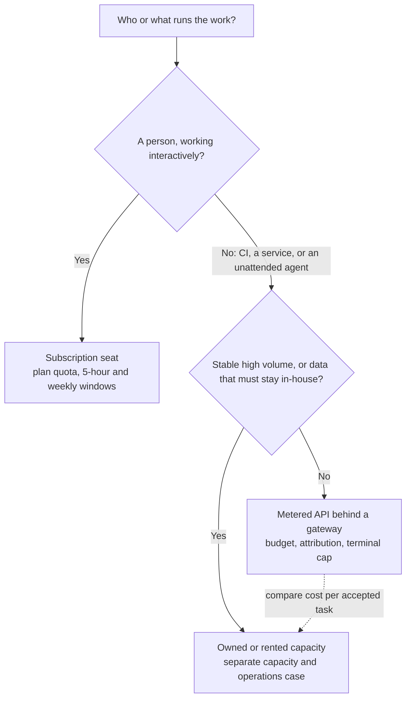

# Довідник AI FinOps для coding-агентів

> **Час читання**: ≈12 хвилин
>
> **Аудиторія**: розробники, які самостійно оплачують використання агентів, техліди, що відповідають за бюджет команди, та власники платформи чи закупівель, які обирають тарифи й провайдерів.
>
> **Мета**: використовуйте цей довідник, щоб визначити метрику вартості, порівняти важелі економії на конкретному навантаженні та встановити контроль витрат. Для розрахованого прикладу відкрийте [візуальне порівняння та калькулятор вартості](https://cc.bruniaux.com/finops/). Ціни з датами зібрано в [знімку ринку LLM](./llm-market-snapshot.uk.md).

---

## TL;DR

| Питання | З чого почати |
|---|---|
| Ціни на LLM зростають чи падають? | [Знімок ринку LLM, §1](./llm-market-snapshot.uk.md#1-тренд-квоти-скорочуються-ціни-на-токени-падають) |
| Скільки коштує один день роботи агента в кожного провайдера? | [Знімок ринку LLM, §5](./llm-market-snapshot.uk.md#5-вартість-одного-еталонного-навантаження) |
| Як виміряти, скільки насправді коштує робота моїх агентів? | [Юніт-економіка ШІ, §2](./ai-unit-economics.uk.md#2-побудова-вартості-прийнятого-завдання) |
| Які важелі знижують витрати і що кожен із них ламає? | [§3 нижче](#3-карта-важелів) |
| Підписка, API чи обидва варіанти для команди? | [Стратегія підписок](./subscription-strategy.uk.md) |
| Як обмежити витрати на команду чи на ключ? | [API-шлюз](./api-gateway.uk.md) |
| Коли локальне чи орендоване обладнання вигідніше за API? | [Локальний vs хмарний inference](../ecosystem/local-vs-cloud-inference.uk.md) |
| Як відстежувати власні сесії? | [Observability, відстеження витрат](./observability.uk.md#відстеження-витрат) |

---

## 1. Три режими вартості, що змінюються незалежно

За роботу агентів платять трьома різними механізмами. Кожен має свою одиницю виміру, і кожен може змінитися без руху решти.

| Режим | Що ви купуєте | Одиниця, яку можна порівнювати | Що його змінює |
|---|---|---|---|
| **Квота підписки** | Місце (seat) із включеним використанням (Claude Pro, Max, Team; ChatGPT Plus, Pro; Cursor; Copilot) | Частка ліміту, який вендор не публікує в токенах | Множники тарифів, 5-годинні та тижневі вікна, вага моделі, правила перевитрати, які клієнти можуть використовувати seat |
| **Тарифікація API за токени** | Доступ до моделі з оплатою за використання | Ціна за мільйон вхідних, кешованих вхідних і вихідних токенів | Прейскурантна ціна, множники кешу, знижки на batch і неспікові години, регіональні надбавки, швидкі режими, зміни токенізатора |
| **Власні або орендовані потужності** | Машина чи GPU-години для open-weight моделей | Вартість GPU-години, поділена на корисну роботу за вашого рівня завантаження | Ціни на обладнання, орендні ставки, відповідність моделі, завантаження, обслуговувальний персонал |

Приклад OpenAI у вересні 2026 року показує, чому ця відмінність важлива. На DevDay 29 вересня OpenAI оголосила, що використання, включене в ChatGPT Pro за $200, 30 жовтня знижується з 20 до 10 разів від ліміту Plus за тієї самої ціни. 30 вересня її прайс-лист API показав GPT-6.1 Sol за $2 за мільйон вхідних і $10 за мільйон вихідних токенів, що в п'ять разів нижче за ставку GPT-6 Astra. Підписник Pro $200 втрачає половину включеного використання, а клієнт API отримує дешевшу модель. [Знімок ринку](./llm-market-snapshot.uk.md#1-тренд-квоти-скорочуються-ціни-на-токени-падають) перелічує датовані зміни та їхні джерела.

Звідси два висновки:

- **Знайте, який режим несе ваше навантаження.** Заголовок про «зростання цін» нічого не каже про ваш рахунок, доки ви не знаєте, якого режиму він стосується.
- **Не перетворюйте квоту на токени.** Вендори описують ліміти як кратні іншому тарифу («5x Pro», «20x Plus») і зважують їх за моделлю, зусиллям (effort) та розміром контексту. Будь-яка отримана вами цифра в токенах — це оцінка, а не контракт. Натомість вимірюйте власне споживання (див. [§2](#2-цикл-finops-застосований-до-агентів)).

Який режим має нести навантаження, залежить від того, хто або що його виконує. Наведена нижче маршрутизація стисло відтворює таблицю рішень зі [стратегії підписок](./subscription-strategy.uk.md):

---

## 2. Цикл FinOps, застосований до агентів

[Фреймворк FinOps Foundation](https://www.finops.org/framework/phases/) організовує роботу з витратами в три фази: **Inform** (вивчення даних про вартість, використання та ефективність), **Optimize** (пошук шляхів підвищення ефективності й цінності) та **Operate** (впровадження змін).

| Фаза | Питання для роботи агента | Що робити | Де |
|---|---|---|---|
| **Inform** | Скільки сьогодні коштує одиниця прийнятої роботи? | Фіксуйте токени на спробу, частку влучань у кеш, повторні спроби та час рев'ю. Діліть на прийняті завдання, а не на запити. | [Юніт-економіка ШІ, §2](./ai-unit-economics.uk.md#2-побудова-вартості-прийнятого-завдання), [Observability](./observability.uk.md#відстеження-витрат), `/usage` у Claude Code |
| **Inform** | Наскільки ми близькі до лімітів тарифу? | Журналюйте, як часто ліміти переривають роботу і яка модель була активна в ці моменти. | [Підписки та ліміти](../ultimate-guide.uk.md#підписки-та-ліміти) |
| **Optimize** | Який важіль дає найкраще співвідношення економії та ризику для цього навантаження? | Оберіть із [карти важелів](#3-карта-важелів), перевірте на вибірці, порівняйте вартість прийнятого завдання до і після. | [Юніт-економіка ШІ, §3](./ai-unit-economics.uk.md#3-реальні-важелі-зниження-вартості) |
| **Optimize** | Чи достатньо хороший дешевший провайдер або модель? | Проведіть бенчмарк власних завдань на тому самому harness. Оцінки вендорів вимірюють модель плюс harness плюс налаштування effort. | [Знімок ринку LLM, §4](./llm-market-snapshot.uk.md#4-можливості-спершу-читайте-умови-бенчмарків) |
| **Operate** | Хто може витрачати скільки? | Бюджети на команду, віртуальні ключі, allowlist моделей, прогресивні політики витрат для інтерактивних користувачів, жорсткі ліміти для агентів без нагляду. | [API-шлюз](./api-gateway.uk.md), [Юніт-економіка ШІ, §5](./ai-unit-economics.uk.md#5-бюджет-і-врядування-для-кожної-команди) |
| **Operate** | Які тарифи та провайдерів ми тримаємо? | Розділіть місця для працівників і виробничий API-трафік, проведіть пілот до того, як брати зобов'язання. | [Стратегія підписок, §7](./subscription-strategy.uk.md#7-шлюз-рішення-та-пілота) |
| **Operate** | Коли ми перевіряємо ціни повторно? | Перевіряйте повторно за першоджерелом перед кожним рішенням про закупівлю й принаймні щокварталу. | [Знімок ринку LLM, §8](./llm-market-snapshot.uk.md#8-правило-оновлення) |

---

## 3. Карта важелів

Другий стовпець називає режим, на який діє важіль. В останньому стовпці перелічено, що важіль залишає нерозв'язаним або може погіршити, тому для кожного потрібне вимірювання вартості прийнятого завдання до і після.

| Важіль | Режим | Документовано в | Чого він не розв'язує |
|---|---|---|---|
| Маршрутизація за складністю завдання | API, підписка | [Юніт-економіка ШІ](./ai-unit-economics.uk.md#маршрутизація-за-складністю) | Завдання, що справді потребує найсильнішої моделі, лишається дорогим, а хибний маршрут коштує повторної спроби |
| Кешування prompt | API | [Важелі оптимізації витрат](../ultimate-guide.uk.md#cost-optimization-levers-native-vs-api-level) | Будь-яка зміна закешованого префікса знецінює кеш; проксі, що переписують контекст, можуть його зламати |
| Пакетна обробка | API | [Message Batches API](../core/architecture.uk.md#message-batches-api) | Запити обробляються асинхронно протягом 24-годинного вікна, тому batch не підходить для інтерактивного циклу |
| Ціноутворення в неспікові години | API, деякі coding-тарифи | [Знімок ринку LLM, §2](./llm-market-snapshot.uk.md#2-ціни-api) | Серед перевірених провайдерів його публікують лише DeepSeek (API) та Z.AI (coding-тариф), а розклади змінюються |
| Стиснення виводу інструментів | API, підписка | [Інструменти інженерії контексту, §3](../ecosystem/context-engineering-tools.uk.md#3-стиснення-виводу-cli-та-результати-роботи-інструментів), [незалежні бенчмарки](../ecosystem/context-engineering-tools.uk.md#незалежні-бенчмарки) | Фільтр із втратами може відкинути рядок, який був потрібен агентові, і це може спричинити повторний запуск; сторонні бенчмарки виявили наскрізні ефекти значно нижчі за заяви вендорів, іноді вищу вартість |
| Делегування читання дешевшій моделі | API, підписка | [shunt](../ecosystem/context-engineering-tools.uk.md#shunt-делегування-а-не-стиснення) | Токени робочої моделі все одно тарифікуються, і вона може витягнути не ті файли |
| Ізоляція субагентів та ліміти ітерацій | API, підписка | [Юніт-економіка ШІ, §3](./ai-unit-economics.uk.md#ізоляція-важкої-роботи-в-sub-agent) | Погано окреслені субагенти повторюють роботу паралельно |
| Переносимість між провайдерами (шлюз, harness із власним ключем) | API | [API-шлюз](./api-gateway.uk.md), [OpenCode](../ecosystem/agentic-tools.uk.md#15-opencode-anomaly-раніше-sst) | Моделі не взаємозамінні: схеми інструментів, кешування та міркування поводяться по-різному |
| Портфель тарифів | Підписка | [Стратегія підписок](./subscription-strategy.uk.md) | Квоти лишаються відкличними й не гарантовані в токенах |
| Локальний або орендований inference | Потужності | [Локальний vs хмарний inference](../ecosystem/local-vs-cloud-inference.uk.md) | Доступні лише open-weight моделі, що вміщуються в обладнання, а простоююче обладнання все одно коштує грошей |

Щоб оцінити заяву вендора, що інструмент «знижує витрати на X%», застосуйте контрольний список із [Юніт-економіки ШІ, §6](./ai-unit-economics.uk.md#6-як-читати-заяву-вендора-про-зниження-вартості): чи парне порівняння на тих самих завданнях, скільки завдань воно охоплює, чи наведено медіану чи середнє, і чи зменшення токенів є також зменшенням доларів.

---

## 4. Чого цей розділ не охоплює

- **Прогнозу.** Розділ документує факти з датами та метод. Він не передбачає, куди рухатимуться ціни.
- **Договірних цін.** Знижки за обсяг, зобов'язані витрати та резервовані потужності зазвичай є приватними контрактами, і знімок їх не перелічує.
- **Бізнес-цінності.** Вартість прийнятого завдання — це знаменник. Виручка, уникнуті дефекти та вплив на клієнтів лишаються окремою вправою для кожної команди.

---

## Дивіться також

- [Знімок ринку LLM](./llm-market-snapshot.uk.md): ціни з датами, квоти та тренд
- [Юніт-економіка ШІ](./ai-unit-economics.uk.md): фреймворк вимірювання
- [Стратегія підписок](./subscription-strategy.uk.md): місця, API та портфелі провайдерів для команд
- [API-шлюз](./api-gateway.uk.md): бюджети, віртуальні ключі та allowlist
- [Візуальний огляд AI FinOps](https://cc.bruniaux.com/finops/): ті самі режими й важелі як інтерактивна сторінка з калькулятором вартості
- [Інструменти економії токенів: виміряно](https://cc.bruniaux.com/token-savings/): заяви вендорів проти шести публічних бенчмарків
- [Інструменти інженерії контексту](../ecosystem/context-engineering-tools.uk.md): інструменти стиснення та делегування з виміряними ефектами
- [Локальний vs хмарний inference](../ecosystem/local-vs-cloud-inference.uk.md): обладнання, оренда та точка беззбитковості з API
