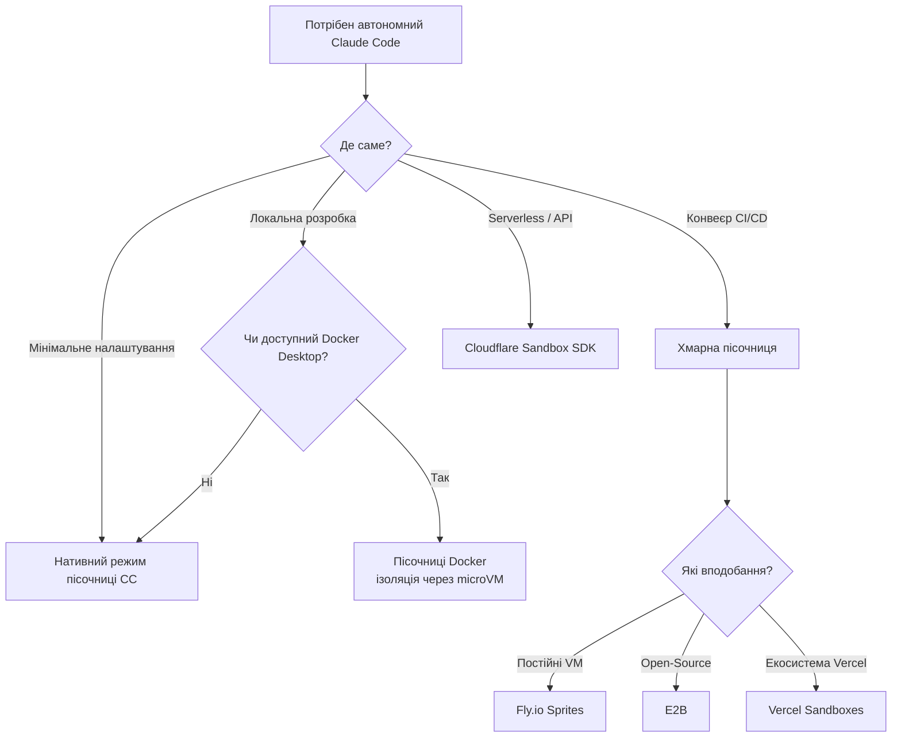

# Ізоляція в пісочниці для кодувальних агентів

> **Рівень достовірності**: Tier 2 (Офіційна документація Docker + верифікована документація постачальників)
>
> **Час читання**: ~10 хвилин
>
> **Сфера застосування**: Безпечний запуск Claude Code в ізольованих середовищах
>
> **Додаткове читання**: [чому ізоляція, а не дозволи, є справжньою межею безпеки](https://www.florian.bruniaux.com/guides/claude-code-attack-surface/) глибше розглядає саме цей компроміс.

---

## Коротко (TL;DR)

| Рішення | Рівень ізоляції | Локально/Хмара | Найкраще для |
|----------|-----------|-------------|----------|
| **Пісочниці Docker** | microVM (гіпервізор) | Локально | Максимальна безпека, коли потрібен Docker-in-Docker |
| **Нативна пісочниця CC** | Процес (Seatbelt/bubblewrap) | Локально | Легка щоденна розробка, робота з довіреним кодом |
| **Fly.io Sprites** | Firecracker microVM | Хмара | API-керовані автономні воркфлоу агентів |
| **E2B** | Firecracker microVM | Хмара | Створення складних ШІ-додатків для різних фреймворків |
| **Vercel Sandboxes** | Firecracker microVM | Хмара | Екосистема Next.js / Vercel |
| **Cloudflare Sandbox SDK** | Контейнер | Хмара | Serverless-рішення на базі Workers |
| **agentOS** (Rivet) | V8 isolate + WASM-пісочниця, без гіпервізора | У процесі, без хмарного акаунта | Агенти, вбудовані в Node, без залежності від провайдера |
| **just-bash** (Vercel) | Немає (симульована оболонка, жодної VM) | У процесі, без хмарного акаунта | Вбудований інструмент bash, розробка/тестування, демонстраційні термінали |

Швидкий старт:

```bash
docker sandbox run claude ~/my-project
```

---

## 1. Проблема: безпечна автономія

Система дозволів Claude Code надійно захищає вас від небажаних дій. Проте вона створює певну дилему:

- **`--dangerously-skip-permissions`** повністю прибирає всі обмеження: Claude може виконувати `rm -rf`, `git push --force` або `DROP TABLE` без жодного запиту на згоду. На реальній (хостовій) машині це вкрай небезпечно.
- **Втома від дозволів (Permission fatigue)**: необхідність підтверджувати кожну зміну файлу чи CLI-команду сильно уповільнює роботу автономних агентів. Для масштабних рефакторингів чи запусків у CI/CD ручне підтвердження є неможливим.
- **Прогалина**: Як дозволити Claude Code працювати повністю автономно, але водночас гарантувати 100% безпеку хост-системи?

**Рішення**: Ізолюйте середовище виконання. Дозвольте агенту вільно працювати всередині пісочниці, де будь-яка потенційна шкода локалізована. Межею безпеки в цьому випадку стає сама пісочниця (sandbox), а не система інтерактивних дозволів.

---

## 2. Підходи до ізоляції



---

## 3. Пісочниці Docker (Docker Sandboxes)

> **Джерело**: [docs.docker.com/ai/sandboxes/](https://docs.docker.com/ai/sandboxes/)
>
> **Вимоги**: Docker Desktop 4.58+ (macOS або Windows)

Пісочниці Docker запускають кодувальних ШІ-агентів у ізольованому середовищі на базі microVM на вашому комп'ютері. Кожна пісочниця отримує власний ізольований демон Docker та приватну файлову систему. Ці пісочниці **НЕ відображаються** у стандартному списку `docker ps`, оскільки вони є віртуальними машинами, а не звичайними контейнерами.

### Швидкий старт

```bash
# Створити та запустити пісочницю з вашим проєктом
docker sandbox run claude ~/my-project

# Запустити в автономному режимі (цілком безпечно всередині пісочниці)
docker sandbox run claude ~/my-project -- --dangerously-skip-permissions

# Передати промпт безпосередньо при запуску
docker sandbox run claude ~/my-project -- "Refactor auth module to use JWT"

# Продовжити попередній сеанс роботи
docker sandbox run my-sandbox -- --continue
```

### Архітектура

```
┌──────────────────────────────────────────────────────────┐
│                     ХОСТ-МАШИНА                          │
│                                                          │
│  ┌────────────────────────────────────────────────────┐  │
│  │              DOCKER SANDBOX (microVM)               │  │
│  │                                                    │  │
│  │  ┌──────────────┐  ┌───────────────────────────┐  │  │
│  │  │ Claude Code  │  │ Приватний демон Docker    │  │  │
│  │  │ (режим --dsp)│  │ (ізольований від хоста)   │  │  │
│  │  └──────────────┘  └───────────────────────────┘  │  │
│  │                                                    │  │
│  │  ┌──────────────────────────────────────────────┐  │  │
│  │  │ Робоча область: ~/my-project (синхр. з хост) │  │  │
│  │  │ Той самий абсолютний шлях, що й на хості     │  │  │
│  │  └──────────────────────────────────────────────┘  │  │
│  │                                                    │  │
│  │  База: Ubuntu, Node.js, Python 3, Go, Git,        │  │
│  │        Docker CLI, GitHub CLI, ripgrep, jq         │  │
│  │  Користувач: non-root 'agent' з правами sudo      │  │
│  └────────────────────────────────────────────────────┘  │
│                                                          │
│  Хост-демон Docker: НЕ доступний із пісочниці            │
│  Хост-файлова система: НЕ доступна (крім робочої папки)   │
└──────────────────────────────────────────────────────────┘
```

Ключові властивості:
- **Синхронізація робочої області**: Каталог хоста монтується за тим самим абсолютним шляхом усередині пісочниці.
- **Повна ізоляція**: Агент не може отримати доступ до основного демона Docker хост-машини, інших контейнерів хоста чи файлів за межами змонтованого каталогу проєкту.
- **Приватний Docker**: Кожна пісочниця має власний ізольований демон Docker для збирання та запуску контейнерів проєкту.
- **Claude працює з прапорцем `--dangerously-skip-permissions`**: Це зроблено навмисно, оскільки межею безпеки стає сама пісочниця, а не інтерактивні запити.

### Мережеві політики (Network Policies)

Контролюйте, до яких ресурсів мережі пісочниця має доступ.

```bash
# Переглянути мережеву активність пісочниці
docker sandbox network log my-sandbox

# Режим чорного списку (заблокувати все, дозволити конкретні ресурси)
docker sandbox network proxy my-sandbox \
  --policy deny \
  --allow-host api.anthropic.com \
  --allow-host "*.npmjs.org" \
  --allow-host "*.pypi.org" \
  --allow-host github.com

# Режим білого списку (дозволити все, заблокувати конкретні хости)
docker sandbox network proxy my-sandbox \
  --policy allow \
  --block-host "*.malicious-domain.com" \
  --block-cidr "192.168.0.0/16"
```

| Режим | Поведінка за замовчуванням | Сценарій використання |
|------|-----------------|----------|
| **Білий список** (allowlist) | Дозволяє весь трафік, крім вказаних напрямків | Звичайна розробка |
| **Чорний список** (denylist) | Блокує весь трафік, крім явно дозволених адрес | Середовища з підвищеними вимогами до безпеки |

**Блокування за замовчуванням**: Локальні та приватні діапазони CIDR (`10.0.0.0/8`, `127.0.0.0/8`, `172.16.0.0/12`, `192.168.0.0/16`, `169.254.0.0/16`) та їхні аналоги в IPv6 заблоковані для запобігання скануванню локальної мережі.

**Шаблони відповідності**: Підтримуються точні збіги (`example.com`), специфічні порти (`example.com:443`) та маски піддоменів (`*.example.com` матчить тільки піддомени). Застосовується найбільш точний шаблон.

**Застереження щодо безпеки**: Фільтрація доменів не перевіряє вміст зашифрованого трафіку. Дозвіл на доступ до великих ресурсів (наприклад, `github.com`) автоматично дає можливість завантажувати будь-який користувацький контент. HTTPS-інспекція в режимі обходу (bypass) не проводиться.

**Збереження конфігурацій**: Налаштування проксі зберігаються для кожної пісочниці за шляхом `~/.docker/sandboxes/vm/[name]/proxy-config.json` та не скидаються після перезапусків.

### Створення власних шаблонів (Custom Templates)

Для команд, які потребують відтворюваних середовищ розробки зі специфічними встановленими інструментами:

```dockerfile
FROM docker/sandbox-templates:claude-code

USER root

# Встановлення потрібних залежностей
RUN apt-get update && apt-get install -y \
    postgresql-client \
    redis-tools

# Встановлення глобальних пакетів npm
RUN npm install -g pnpm turbo

USER agent
```

Збирання та використання:

```bash
# Зібрати шаблон
docker build -t my-team-sandbox:v1 .

# Створити пісочницю на основі власного шаблону
docker sandbox create my-sandbox \
  --template my-team-sandbox:v1 \
  --load-local-template ~/my-project
```

Власні шаблони варто використовувати для стандартизації командних середовищ, фіксації версій інструментів чи налаштування складних конфігурацій. Для простих разових завдань цілком достатньо шаблону за замовчуванням — агент зможе сам встановити потрібні пакети у процесі роботи.

### Довідник команд

| Команда | Опис |
|---------|-------------|
| `docker sandbox run <agent> <path>` | Створити та запустити пісочницю |
| `docker sandbox create <name>` | Створити без автоматичного запуску |
| `docker sandbox ls` | Перелічити всі створені пісочниці |
| `docker sandbox run <name> -- "prompt"` | Надіслати промпт безпосередньо |
| `docker sandbox run <name> -- --continue` | Продовжити перервану сесію |
| `docker sandbox run <name> -- --dsp` | Скорочення для --dangerously-skip-permissions |
| `docker sandbox network proxy <name>` | Налаштувати мережеві правила проксі |
| `docker sandbox network log <name>` | Переглянути лог мережевої активності |

### Автентифікація

**Варіант 1: Через API-ключ (рекомендовано для автоматичних запусків)**

Встановіть змінну `ANTHROPIC_API_KEY` у файлах `~/.bashrc` або `~/.zshrc`. Демон пісочниці зчитує змінні з цих файлів, а не з оточення поточної сесії терміналу. Перезапустіть демон після внесення змін. Налаштування зберігаються між перествореннями пісочниць.

**Варіант 2: Інтерактивний вхід (на одну сесію)**

Запускається автоматично, якщо облікові дані не виявлені. Ви можете виконати команду `/login` у інтерфейсі Claude Code для примусового запуску авторизації. Дані автентифікації зникають після видалення пісочниці.

### Підтримувані агенти

| Агент | Постачальник | Статус підтримки |
|-------|----------|--------|
| Claude Code | Anthropic | Повна підтримка |
| Codex CLI | OpenAI | Підтримується |
| Gemini CLI | Google | Підтримується |
| cagent | Docker | Підтримується |
| Kiro | AWS | Підтримується |

### Обмеження

- **Лише macOS та Windows** підтримують повноцінний режим ізоляції на базі microVM. На Linux використовуються звичайні контейнерні пісочниці (потрібен Docker Desktop 4.57+).
- **Необхідна наявність Docker Desktop**: рішення не працює зі стандартним автономним Docker Engine. Альтернативи від спільноти, такі як `dclaude` (автор Patrick Debois), запускають Claude Code у звичайному контейнері Docker, але вони використовують контейнерну ізоляцію (а не microVM) та вимагають прокидання сокета Docker хоста (`/var/run/docker.sock`), що значно послаблює межу безпеки.
- **Шлюзи MCP (MCP Gateway) поки не підтримуються** всередині пісочниць.
- **Немає прокидання GPU**: середовище не підходить для навчання моделей машинного навчання.
- **Синхронізація робочої області є односторонньою**: зміни з пісочниці миттєво потрапляють на хост, але паралельне редагування файлів на хості може викликати конфлікти.

---

## 4. Нативна пісочниця Claude Code

> **Джерело**: [code.claude.com/docs/en/sandboxing](https://code.claude.com/docs/en/sandboxing)
>
> **Вимоги**: macOS (вбудована підтримка) або Linux/WSL2 (пакети bubblewrap + socat)
>
> **Наявність**: Починаючи з версії Claude Code v2.1.0+

Claude Code має вбудовану **нативну пісочницю (native sandboxing)**, яка використовує системні примітиви ОС для ізоляції на рівні окремих процесів. Встановлення Docker не потрібне.

### Архітектура

```
┌──────────────────────────────────────────────────────┐
│                    ХОСТ-МАШИНА                       │
│                                                      │
│  Claude Code (основний процес)                       │
│       │                                              │
│       ├─ запуск команди bash                         │
│       │                                              │
│       ▼                                              │
│  Оболонка пісочниці (Seatbelt/bubblewrap)            │
│       │                                              │
│       ├─ Файлова система: чит. всього, запис лише CWD│
│       ├─ Мережа: проксі SOCKS5, фільтрація доменів   │
│       ├─ Процес: ізольоване середовище               │
│       │                                              │
│       ▼                                              │
│  Команда виконується з обмеженнями                   │
│       │                                              │
│       └─ Порушення блокуються на рівні ОС            │
│                                                      │
└──────────────────────────────────────────────────────┘
```

**Головні відмінності від пісочниць Docker**:

| Аспект | Нативна пісочниця | Пісочниці Docker |
|--------|---------------|------------------|
| **Рівень ізоляції** | На рівні процесу (Seatbelt/bubblewrap) | На рівні microVM (гіпервізор) |
| **Ядро ОС** | Спільне з хост-машиною | Окреме ізольоване ядро для кожної VM |
| **Встановлення** | 0 залежностей (macOS), 2 пакети (Linux) | Потребує Docker Desktop 4.58+ |
| **Накладні витрати** | Мінімальні (~1-3% CPU) | Помірні (~5-10% CPU, +200MB RAM) |
| **Docker-in-Docker** | ❌ Не підтримується | ✅ Власний приватний демон Docker |
| **Кращий сценарій** | Щоденна розробка, робота з перевіреним кодом | Робота з невідомим кодом, максимальний захист |

### Системні примітиви

**macOS**: Використовує механізм **Seatbelt** (TrustedBSD Mandatory Access Control)
- Вбудовано в систему, працює відразу без додаткових налаштувань.
- Забезпечує фільтрацію системних викликів на рівні ядра ОС.

**Linux/WSL2**: Використовує **bubblewrap** (ізоляція через Linux namespaces + seccomp)
- Потребує встановлення залежностей: `sudo apt-get install bubblewrap socat`
- Створює повністю ізольований простір імен (namespace) для кожної CLI-команди.

**WSL1**: ❌ Не підтримується (в архітектурі WSL1 відсутні необхідні для bubblewrap ядерні функції).

**Windows (нативно)**: ❌ Не підтримується, команди виконуються без пісочниці (використовуйте WSL2 або задайте `failIfUnavailable: true`, щоб відмовитися від запуску)

### Швидкий старт

```bash
# Увімкнути пісочницю (інтерактивне меню налаштування)
/sandbox

# Тільки для Linux/WSL2: спочатку встановіть залежності
sudo apt-get install bubblewrap socat  # Ubuntu/Debian
sudo dnf install bubblewrap socat      # Fedora
```

**Доступні два режими роботи**:

1. **Режим автосхвалення (Auto-allow mode)**: CLI-команди виконуються автоматично без запиту, якщо вони запущені всередині пісочниці (найбільш зручно для щоденної розробки).
2. **Звичайний режим дозволів (Regular permissions mode)**: Кожна окрема команда все одно вимагає ручного схвалення користувача (для критичних середовищ).

### Приклад конфігурації

```json
{
  "sandbox": {
    "enabled": true,
    "failIfUnavailable": true,
    "autoAllowBashIfSandboxed": true,
    "network": {
      "allowedDomains": [
        "api.anthropic.com",
        "registry.npmjs.org",
        "github.com"
      ]
    },
    "credentials": {
      "files": [
        { "path": "~/.ssh", "mode": "deny" },
        { "path": "~/.aws", "mode": "deny" }
      ]
    }
  }
}
```

Ключа `network.policy` не існує; додайте `"strictAllowlist": true` у `network`, щоб без запиту відмовляти всім хостам поза списком. `sandbox.credentials` це механізм, який документація пісочниці призначає для приховування файлів облікових даних від Bash; чому одного правила читання `permissions.deny` недостатньо, дивіться в розділі [Нативна пісочниця](./sandbox-native.uk.md#поведінка-за-замовчуванням).

### Коли обирати нативну пісочницю, а коли Docker

**Обирайте нативну пісочницю, якщо**:
- ✅ Ви ведете щоденну розробку з перевіреним кодом і командою.
- ✅ Потрібно швидко запуститися без встановлення Docker Desktop.
- ✅ Пріоритетом є мінімальні накладні витрати на ресурси процесора та пам'яті.
- ✅ Код є загалом довіреним.
- ✅ Немає потреби запускати Docker-контейнери всередині сесії Claude.

**Обирайте пісочницю Docker, якщо**:
- ✅ Ви запускаєте абсолютно невідомий або сторонній код.
- ✅ Потрібен максимальний рівень безпеки (захист від вразливостей нульового дня на рівні ядра ОС).
- ✅ Необхідно збирати та запускати Docker-контейнери безпосередньо з діалогу з Claude.
- ✅ Ви тестуєте складні або потенційно деструктивні ШІ-скрипти.
- ✅ Інструмент запускається у конвеєрі CI/CD для тестування чутливих задач.

**Схема прийняття рішень**:

```
Повсякденна розробка?
├─ Перевірений код + своя команда → Нативна пісочниця (легка й швидка)
└─ Сторонні скрипти / експерименти → Docker Sandboxes (максимальний захист)

Чи потрібен Docker всередині сесії?
├─ Так → Docker Sandboxes (єдиний доступний варіант)
└─ Ні → Підійдуть обидва варіанти, нативний є простішим у налаштуванні

Рівень вимог до безпеки?
├─ Надвисокий (захист на рівні ядра) → Docker Sandboxes
└─ Стандартний (ізоляції процесів досить) → Нативна пісочниця
```

### Застереження щодо безпеки

**⚠️ Обмеження нативної пісочниці** (див. детальний аналіз у [guide/security/sandbox-native.uk.md](./sandbox-native.uk.md)):

1. **Спільне з хостом ядро**: Існує теоретичний ризик виходу з пісочниці у разі експлуатації вразливостей ядра хоста (microVM у Docker надійно захищає від цього).
2. **Domain fronting**: Можливий обхід мережевих обмежень через великі мережі доставки контенту CDN (Cloudflare, Akamai).
3. **Unix-сокети**: За неправильного налаштування можуть надавати приховані підвищені привілеї.
4. **Занадто широкі права запису**: У деяких конфігураціях широкі права запису у робочу директорію можуть призвести до підвищення привілеїв у системі.

**Для запуску повністю неперевіреного коду** завжди використовуйте Docker Sandboxes.

### Відкритий рушій (Open-Source Runtime)

Реалізація нативної пісочниці доступна для спільноти як відкритий npm-пакет:

```bash
# Безпосередній запуск команди в ізольованому рушії
npx @anthropic-ai/sandbox-runtime <command-to-sandbox>

# Приклад: запуск сервера MCP у пісочниці
npx @anthropic-ai/sandbox-runtime node mcp-server.js
```

**Репозиторій проєкту**: [github.com/anthropics/sandbox-runtime](https://github.com/anthropics/sandbox-runtime)

### Додаткова інформація

Для вивчення глибоких технічних деталей, прикладів конфігурацій, вирішення проблем та детального аналізу безпеки:

→ **[Посібник із нативного розгортання пісочниць (Native Sandboxing Guide)](./sandbox-native.uk.md)**

У ньому описано: системні примітиви, архітектуру мережевого проксі, режими роботи, механізм аварійного виходу (escape hatch), обмеження безпеки та кращі практики.

---

## 5. Огляд хмарних пісочниць (Cloud Sandboxes)

### Fly.io Sprites

Апаратно ізольовані середовища виконання, побудовані на базі Firecracker microVM від компанії Fly.io.

- **Ізоляція**: Повна апаратна ізоляція за допомогою Firecracker microVM.
- **Персистентність**: Повноцінна файлова система ext4 із підтримкою автоматичного розділу до 100 ГБ.
- **Збереження стану (Checkpoint/restore)**: Швидкісні знімки стану (checkpoints) за ~300 мс, відновлення роботи менш ніж за 1 секунду.
- **Доступ через HTTP**: Кожен Sprite отримує власну унікальну URL-адресу з можливістю автоматичного прокидання запитів (холодний старт до 1 секунди).
- **Мережа**: Контроль вихідного трафіку на рівні L3, гнучке налаштування публічного та приватного доступу.
- **Ресурси**: Конфігурації до 8 ядер CPU та 16 ГБ RAM на одну віртуальну машину.
- **Інструменти**: Керування через CLI (`sprite`), REST API, а також готові бібліотеки для JavaScript та Go.
- **Ціни**: Оплата за фактичне використання ($0.07 за CPU-годину, $0.04 за GB-годину). Надається $30 вітальних кредитів.

### Cloudflare Sandbox SDK

Безпечний запуск коду в ізольованих контейнерах на базі хмарної платформи Cloudflare Workers.

- **Ізоляція**: Контейнери (не microVM) у безсерверному (serverless) середовищі виконання Cloudflare.
- **Мови**: Підтримка Python, JavaScript/TypeScript та команд терміналу shell.
- **Файлова система**: Монтування бакетів Cloudflare R2 як локальних директорій.
- **Інтеграція через API**: TypeScript SDK (`getSandbox()`, `exec()`, `runCode()`, робота з файлами, веб-сокети).
- **Сценарій**: Claude генерує та надсилає код, Sandbox виконує його на межі мережі (edge) та повертає результати чи візуалізації.
- **Ціни**: Вимагає платного тарифу Workers Paid. Розрахунок базується на вартості платформи Containers.
- **Інструкція**: [developers.cloudflare.com/sandbox/tutorials/claude-code/](https://developers.cloudflare.com/sandbox/tutorials/claude-code/)

### Vercel Sandboxes

Тимчасові Linux microVM для виконання завдань ШІ-агентами та генерації коду. Доступні у статусі General Availability з 30 січня 2026 року.

- **Ізоляція**: Гіпервізор Firecracker, повна ізоляція від змінних оточення хоста, баз даних та інших хмарних ресурсів.
- **Швидкість**: Старт менш ніж за секунду, автоматичне завершення роботи після виконання поставленого завдання.
- **Таймаути**: 5 хвилин за замовчуванням, до 45 хвилин для тарифу Hobby, до 5 годин на тарифах Pro/Enterprise.
- **Інструменти SDK**: Наявність класів `Sandbox`, `Command`, `Snapshot`. Можливість швидкого розгортання завдяки знімкам файлової системи (Snapshots).
- **Автентифікація**: Через токени Vercel OIDC (рекомендовано) або статичні токени доступу для зовнішніх систем CI/CD.

### E2B

Спеціалізована open-source платформа пісочниць для ШІ-агентів та додатків на базі великих мовних моделей.

- **Ізоляція**: Віртуальні машини Firecracker microVM (технологія, на якій працює AWS Lambda).
- **Швидкодія**: Холодний запуск за ~150 мс, відновлення з режиму очікування менш ніж за 25 мс.
- **Власні образи**: Підтримка образів розміром до 10 ГБ зі стартом менш ніж за 2 секунди (Blueprints).
- **Збереження стану**: Створення повних знімків стану VM для подальшого відновлення.
- **Мови**: Підтримка Python, JavaScript, Ruby, C++ та будь-якого софту, що працює на Linux. Повна незалежність від конкретних моделей ШІ.
- **Сумісність**: Готові плагіни для LangChain, LangGraph, LlamaIndex, Vercel/Next.js, Ollama.
- **Варіанти розгортання**: У хмарі E2B, у вашому власному хмарному контурі BYOC (AWS/GCP/Azure) або локально (on-premises/VPC).
- **Ціни**: Безкоштовний тариф ($100 кредитів, ліміт сесії 1 год), тариф Pro від $150/місяць (ліміт сесії до 24 год).

### Нативна пісочниця Claude Code (Native Sandbox Mode)

Вбудований у Claude Code механізм ізоляції процесів (Рівень 4 у загальній [архітектурі системи](../core/architecture.uk.md)).

- **Без сторонніх залежностей**: Працює відразу після інсталяції CLI.
- **Ізоляція процесів**: Обмеження переліку команд, які Claude може виконувати на хості.
- **Гнучке налаштування**: Через параметр `allowedTools` у конфігураційних файлах.
- **Обмеження**: це не повноцінна ізоляція на рівні віртуальної машини, ядро ОС та файлова система залишаються спільними з хостом.

### agentOS (Rivet): внутрішньопроцесний контрприклад

Кожен із наведених вище постачальників виставляє рахунок через хмарний акаунт. [agentOS](https://agentos-sdk.dev) (`@rivet-dev/agentos`, Apache 2.0, прев'ю `0.0.1`) цього не робить: `npm install` дає Linux-подібну VM, що працює всередині вашого власного процесу Node, без microVM для завантаження, без контейнера для витягування та без реєстрації в провайдера.

Довірений Rust-sidecar володіє ядром (багатошарова віртуальна файлова система з overlay і монтуванням S3, Google Drive чи каталогу хоста; віртуальна таблиця процесів зі справжніми `fork`/`exec`/сигналами; сокети, pipes, PTY, DNS). Жоден системний виклик гостя не досягає хоста напряму. Недовірена сторона виконує гостьовий JavaScript на нативному V8 з повним JIT, а 42 скомпільовані програмні пакети, зокрема справжні upstream `git`, `ripgrep`, `sqlite3` і `duckdb`, працюють як WASM, зібраний проти sysroot, яким команда володіє від початку до кінця. Це суттєво глибший підхід, ніж ізоляція інструментів MCP через WebAssembly у §7b нижче, яка обмежує окремий виклик інструмента, а не майже повний userland Linux.

Відмінність від звичайної пісочниці полягає в bindings: визначена хостом функція зі схемою з'являється всередині VM як звичайна команда оболонки, тож агент викликає API компанії так само, як `ls`, а облікові дані взагалі не потрапляють у VM.

Перед тим як вважати це готовим до продакшену, варто пам'ятати про дві речі. По-перше, власні бенчмарки вендора (4,8 мс на створення VM, приблизно 22-131 МБ залежно від навантаження, виміряні на одному i7-12700KF, станом на 2026-03-30) незалежно не відтворені, а подача «у 92 рази швидше за хмарну microVM» порівнює запуск ізолята V8 із повним завантаженням microVM Linux, тобто різні речі. По-друге, «VM» це маркетинговий вибір: у стеку немає ні KVM, ні Firecracker, ні апаратної віртуалізації. Модель загроз самого проєкту прямо стверджує, що межею безпеки є процес sidecar і executor, а не гіпервізор: це надійно для звичайного недовіреного коду агента, але слабше за апаратну ізоляцію проти зловмисника, що шукає вихід із V8. Повне оцінювання: [`docs/resource-evaluations/agentos-in-process-agent-vm.md`](https://github.com/FlorianBruniaux/claude-code-ultimate-guide/blob/main/docs/resource-evaluations/agentos-in-process-agent-vm.md).

### just-bash (Vercel): симулювати, а не ізолювати

[just-bash](https://github.com/vercel-labs/just-bash) (`npm install just-bash`, версія вже за `3.x`) розташований на протилежному від agentOS краї спектра внутрішньопроцесних рішень. Тут узагалі немає VM, навіть без гіпервізора. Це лексер, парсер та інтерпретатор bash, написані прямо на TypeScript і виконувані над віртуальною файловою системою в пам'яті. Нічого не запускається, жодна межа процесу не перетинається, а вся модель безпеки це звичайна ізоляція JavaScript: `DefenseInDepthBox`, що обмежує патчі до `Function`, `eval`, `setTimeout` і `process.*` усередині контексту `AsyncLocalStorage`, об'єкти з null-прототипом усюди, де скрипт керує ключем (змінні середовища, асоціативні масиви), та налаштовувані ліміти ресурсів (`maxCallDepth`, `maxSubstitutionDepth`, `maxExecutionTimeMs` та ще з десяток), кожен із яких відповідає названому вектору атаки в `THREAT_MODEL.md` самого проєкту.

Понад 90 команд, еквівалентних coreutils, вбудовано (`grep`, `sed`, `awk`, `find`, `tar`, `jq`), а Python (CPython через Emscripten), JavaScript (QuickJS) і SQLite (sql.js) доступні як явне ввімкнення, і кожен задокументований як додаткова поверхня атаки, а не безкоштовна можливість. Чотири бекенди файлової системи охоплюють практичний діапазон: лише в пам'яті, copy-on-write поверх справжнього каталогу, пряме читання-запис справжнього каталогу або таблиця монтування, що поєднує кілька. Клас `Sandbox` свідомо повторює API `@vercel/sandbox`, тож проєкт може почати тут і пізніше перейти на справжню microVM Vercel Sandbox без переписування місць виклику.

У README сказано без вагань: «All execution happens without VM isolation.» Це справжній компроміс, а не застереження, повз яке можна пробігти. Порівняно з межею V8-isolate плюс Rust-sidecar в agentOS, just-bash дає менше стримування в обмін на нуль рухомих частин, кодову базу, яку можна перевірити за вечір, і оболонку, що працює однаково у вкладці браузера. Він підходить для вбудованого інструмента bash для агента, якому ви вже певною мірою довіряєте, для тестового/девелоперського середовища чи живої демонстрації в терміналі, але не як межа проти справді ворожого скрипта. Одну прогалину варто перевірити перед будь-яким комерційним використанням: у корені репозиторію немає файла `LICENSE`, попри заяву README про Apache-2.0. Повне оцінювання: [`docs/resource-evaluations/just-bash-simulated-shell.md`](https://github.com/FlorianBruniaux/claude-code-ultimate-guide/blob/main/docs/resource-evaluations/just-bash-simulated-shell.md).

---

## 6. Порівняльна матриця

| Критерій порівняння | Docker Sandboxes | Нативна CC | Fly.io Sprites | Cloudflare SDK | E2B | Vercel Sandboxes |
|-----------|-----------------|-----------|----------------|----------------|-----|-----------------|
| **Тип ізоляції** | microVM (гіпервізор) | Процес (Seatbelt/bubblewrap) | Firecracker microVM | Контейнер | Firecracker microVM | Firecracker microVM |
| **Ізоляція ядра ОС** | ✅ Окреме ядро | ❌ Спільне ядро | ✅ Окреме ядро | Часткова | ✅ Окреме ядро | ✅ Окреме ядро |
| **Локальний запуск** | Так | Так | Ні (лише хмара) | Ні (лише хмара) | Ні (лише хмара) | Ні (лише хмара) |
| **Налаштування** | Docker Desktop 4.58+ | Без залежностей (macOS), 2 пакети (Linux) | API-ключ | Тариф Workers Paid | API-ключ | Набір SDK |
| **Docker-in-Docker** | ✅ Приватний демон | ❌ Не підтримується | Так | Ні | Так | Так |
| **Мережевий контроль** | Білі/чорні списки | Білі/чорні списки (SOCKS5) | Політики L3 egress | Не деталізовано | Не деталізовано | Не деталізовано |
| **Платформа** | macOS, Windows (WSL2) | macOS, Linux, WSL2 | Будь-яка (через API) | Будь-яка (Workers) | Будь-яка (API/SDK) | Будь-яка (SDK) |
| **Накладні витрати** | Помірні (~5-10% CPU) | Мінімальні (~1-3% CPU) | Хмара | Хмара | Хмара | Хмара |
| **Безкоштовний тариф** | У складі Docker Desktop | Безкоштовно | $30 кредитів | Лише платний Workers | $100 кредитів | Так (обмежений) |
| **Найкраще для** | Високої безпеки та Docker | Щоденної розробки | Автономних агентів | Serverless-архітектур | Мульти-фреймворків | Next.js/Vercel |

---

## 7. Безпечні автономні робочі процеси

### Патерн: Docker Sandbox + --dangerously-skip-permissions

Рекомендований підхід для локальної автономної розробки без постійних запитів дозволу:

```bash
# 1. Створити нову ізольовану пісочницю для вашої фічі
docker sandbox create my-feature ~/my-project

# 2. Налаштувати мережевий проксі (рекомендовано для безпеки вашого коду)
docker sandbox network proxy my-feature \
  --policy deny \
  --allow-host api.anthropic.com \
  --allow-host "*.npmjs.org" \
  --allow-host github.com

# 3. Запустити Claude повністю автономно (безпечно, оскільки він запертий в VM)
docker sandbox run my-feature -- --dangerously-skip-permissions \
  "Refactor the auth module to use JWT. Run all tests before finishing."

# 4. Після завершення перевірити зміни на хості (директорія синхронізується автоматично)
cd ~/my-project && git diff

# 5. Якщо результати вас влаштовують — робимо коміт. Якщо ні — скасовуємо зміни.
git add -A && git commit -m "feat: JWT auth (sandbox-generated)"
```

### Патерн: конвеєр CI/CD із пісочницею

Приклад налаштування робочого процесу для GitHub Actions:

```yaml
jobs:
  agent-task:
    runs-on: ubuntu-latest
    steps:
      - uses: actions/checkout@v4

      - name: Run Claude in E2B sandbox
        uses: e2b-dev/e2b-github-action@v1
        with:
          api-key: ${{ secrets.E2B_API_KEY }}
          command: |
            claude --dangerously-skip-permissions \
              -p "Run the full test suite and fix any failures"
```

Для систем CI/CD хмарні пісочниці (E2B, Vercel, Fly.io) є значно кращим вибором, оскільки вони не потребують встановлення та запуску важкого Docker Desktop у віртуальному оточенні раннера.

---

## 7b. Ізоляція інструментів MCP на основі WebAssembly (експериментально)

> **Рівень достовірності**: Tier 3, первинні джерела перевірено (репозиторії GitHub, Microsoft Open Source Blog). Станом на червень 2026 підтверджених промислових розгортань немає.
> **Зрілість**: Експериментальна. Жоден із наведених тут інструментів не готовий до продакшену.

Підходи до пісочниць у розділах 2-7 ізолюють те, де *працює* Claude Code. Окрема межа ізоляції стосується того, до чого в ОС можуть мати доступ *інструменти* MCP, коли їх викликає Claude Code. Без неї скомпрометований або неправильно налаштований сервер MCP працює з тими самими привілеями ОС, що й ваш процес Claude Code, зокрема з необмеженим читанням/записом файлової системи та вихідним мережевим доступом.

**MCP-сервер, виставлений через HTTP, потребує такого самого рівня безпеки, як і будь-який інший API, який ви запускали б у продакшені.** Автентифікація, авторизація та HTTPS для MCP не є необов'язковими доповненнями, а базовим мінімумом. Локальний MCP-сервер без автентифікації або з небезпечними типовими налаштуваннями залишається придатною до експлуатації поверхнею атаки, навіть коли в самій моделі немає жодного недоліку. Вразливість лежить в експозиції самого сервера, а не в чомусь, що робить LLM.

*Daniel Garnier-Moiroux, Devoxx, 2025 (і Makan Sepehrifar, 2026)*

WebAssembly пропонує іншу модель: скомпілювати кожен інструмент MCP у компонент `.wasm`, запускати його всередині середовища виконання Wasm і явно оголошувати надані можливості. Інструмент отримує рівно те, що ви надали, і нічого більше. Модель «заборонено за замовчуванням» забезпечується на рівні середовища виконання, а не покладається на код самого інструмента.

**Детермінованіша альтернатива полягає в тому, щоб узагалі винести рішення про доступ за межі циклу міркувань агента.** Замість оголошення можливостей усередині самого інструмента, обгорніть доступ агента MCP-сервером, оточеним окремим детермінованим шаром контролю доступу, з правами, точно обмеженими через OAuth і дрібнозернисту авторизацію на основі відносин (модель OpenFGA). Скомпрометований або маніпульований агент не може «домірковувати» собі ширші дозволи, якщо він ніколи не мав повноважень надавати їх собі.

*Christoph Bühler, Devoxx, 2026 (і Deepu Sasidharan, 2025)*

### Доступні інструменти

| Інструмент | Роль | Зрілість |
|------|------|----------|
| [Wassette](https://github.com/microsoft/wassette) (Microsoft) | Середовище виконання, що запускає MCP-сервери як компоненти Wasm, із наданням можливостей через YAML (шляхи файлової системи, мережеві хости, змінні середовища) | v0.4.0, не готовий до продакшену (самооголошено) |
| [wasmcp](https://github.com/wasmcp/wasmcp) | Компілює MCP-сервери в компоненти Wasm з ізоляцією на межі WIT | Рання стадія, документації щодо примусового застосування немає |
| [whamm](https://github.com/ejrgilbert/whamm) | DSL за мотивами DTrace для інструментування та спостережуваності Wasm | Не пісочниця, лише спостережуваність |
| [splicer](https://github.com/ejrgilbert/splicer) | Проміжний шар для композиції компонентів Wasm | Інтеграції з MCP не задокументовано |

**Wassette** єдиний тут інструмент, що безпосередньо розв'язує цю проблему. Файл політик YAML оголошує, до яких шляхів файлової системи, мережевих хостів і змінних середовища може мати доступ кожен компонент MCP. Основою є середовище [Wasmtime](https://wasmtime.dev/), яке Microsoft описує як таке, що забезпечує «ізоляцію рівня браузера». Така подача навмисна: сучасні браузери запускають недовірений сторонній код у Wasm на тому самому рівні ізоляції, що є змістовною гарантією, але не тим самим, що сертифікована корпоративна межа безпеки.

Примітка про CVE Wasmtime: у середовища виконання є підтверджена історія вразливостей виходу з пісочниці, зокрема CVE-2026-34971 (помилкова компіляція Cranelift на aarch64 із увімкненим wasm_memory64, виправлено у 36.0.7 / 42.0.2 / 43.0.1). Якщо ви оцінюєте цей підхід, стежте безпосередньо за [повідомленнями безпеки Bytecode Alliance](https://github.com/bytecodealliance/wasmtime/security/advisories).

### Чого ізоляція Wasm не покриває

Цей шар ізоляції керує доступом інструментів MCP на рівні ОС. Він не забезпечує:

- Облік використання токенів або відстеження витрат (для цього використовуйте LiteLLM Gateway)
- Журнали аудиту чи простежуваність (використовуйте OpenTelemetry / Grafana)
- Воркфлоу схвалення MCP в усій організації (див. [enterprise-governance.uk.md §3](./enterprise-governance.uk.md#3-процес-управління-mcp))

Це взаємодоповнювальні засоби контролю, а не альтернативи один одному.

### Коли варто стежити за цим напрямом

Якщо ваша модель загроз включає скомпрометовані або сторонні MCP-сервери з непередбачуваним доступом до файлової системи, ізоляція на основі Wasm є правильним архітектурним напрямом. Для більшості команд сьогодні практичний шлях це воркфлоу схвалення з enterprise-governance.uk.md у поєднанні з ізоляцією середовища на основі Docker. Переоцініть, коли Wassette опублікує готовий до продакшену реліз.

---

## 8. Небезпечні антипатерни

| Антипатерн | Чому це небезпечно | Як діяти правильно |
|-------------|-------------------|------------|
| Запуск з `--dangerously-skip-permissions` без пісочниці | ШІ-агент отримує повний та неконтрольований доступ до вашої файлової системи, мережі та облікових даних | Завжди використовуйте пісочницю як надійну межу безпеки |
| Плутанина контейнерів із повноцінними VM | Звичайні контейнери ділять ядро з хостом. У разі виходу з контейнера під загрозою опиняється вся система. | Для надійної ізоляції невідомого коду використовуйте microVM (Docker Sandboxes, E2B, Sprites) |
| Монтування всієї файлової системи комп'ютера у пісочницю | Це повністю нівелює концепцію ізоляції. Агент зможе прочитати ваші ключі SSH, паролі та системні файли. | Монтуйте виключно каталог конкретного проєкту, над яким працює агент |
| Дозвіл на доступ до всіх адрес (`*`) у мережевих налаштуваннях | Агент отримує технічну можливість непомітно передати ваші дані на будь-який сторонній сервер у мережі | Використовуйте режим чорного списку (denylist) із точковим дозволом надійних доменів |
| Відсутність перевірки `git diff` після завершення роботи агента | Автономний ШІ-агент міг зробити помилкові або шкідливі зміни, які потраплять до репозиторію | Завжди ретельно вивчайте дифи коду перед створенням коміту |
| Використання пісочниці як заміни традиційного рев'ю коду | Ізоляція захищає ваш комп'ютер від зламу, але вона не гарантує високу якість архітектури та відсутність логічних багів | Пісочниця та рев'ю коду колегами мають доповнювати один одного, а не заміняти |

---

## Див. також

- [AI Design Patterns: Bulkhead](../core/ai-design-patterns.uk.md#bulkhead): ізоляція контексту subagent і worktree, прочитана як патерн стійкості
- [architecture.uk.md](../core/architecture.uk.md): детальний опис Рівня 4 (архітектура субагентів) та моделі керування дозволами
- [security-hardening.uk.md](./security-hardening.uk.md): аудит серверів MCP, захист від ін'єкцій та відстеження вразливостей CVE
- [code.claude.com/docs/en/sandboxing](https://code.claude.com/docs/en/sandboxing): офіційна документація щодо пісочниць від Anthropic
- [docs.docker.com/ai/sandboxes/](https://docs.docker.com/ai/sandboxes/): офіційні матеріали про Docker Sandboxes

---

**Локалізація**: [Serhii (MacPlus Software)](https://macplus-software.com)
*Остання синхронізація: Листопад 2026 (v3.46.0)*
