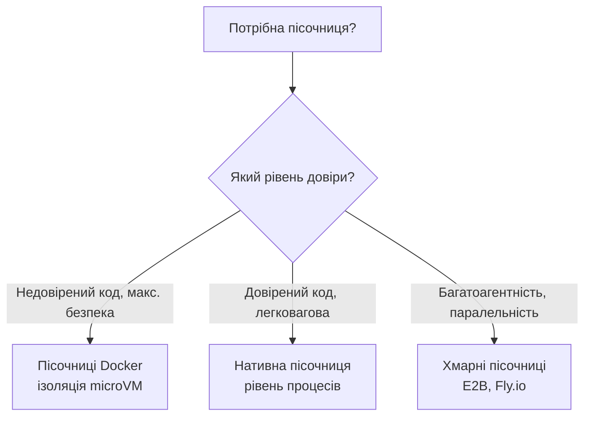
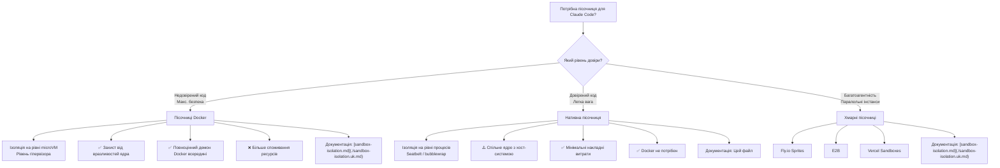

# Нативна пісочниця в Claude Code

> **Впевненість**: Рівень 1 — Офіційна документація Anthropic
> **Час читання**: ~15 хвилин
> **Область охоплення**: Розуміння та налаштування нативної ізоляції на рівні процесів у Claude Code
> **Останнє оновлення**: 2026-02-02

---

## Стисло (TL;DR)

Claude Code включає вбудовану **нативну пісочницю** (v2.1.0+), яка використовує примітиви ОС для ізоляції команд bash:

| Аспект | Деталі |
|--------|---------|
| **macOS** | Seatbelt (вбудований, працює «з коробки») |
| **Linux/WSL2** | bubblewrap + socat (необхідно встановити) |
| **Файлова система** | Читання всього (налаштовується), запис тільки в межах робочої директорії (CWD) |
| **Мережа** | SOCKS5-проксі, білий/чорний список доменів |
| **Режими** | Автоматичний дозвіл (bash-команди схвалюються авто) vs Звичайні дозволи |
| **Аварійний вихід** | `dangerouslyDisableSandbox` для несумісних інструментів |
| **Підтримка платформ** | ✅ macOS, Linux, WSL2 • ❌ WSL1 • ⏳ Windows (планується) |

**Швидкий старт**:

```bash
# Увімкнути пісочницю
/sandbox

# Передумови для Linux/WSL2
sudo apt-get install bubblewrap socat  # Ubuntu/Debian
sudo dnf install bubblewrap socat      # Fedora
```

**Коли використовувати нативну пісочницю порівняно з Docker**:



---

## 1. Чому нативна пісочниця?

### Дилема «Автономність проти Безпеки»

Система дозволів Claude Code створює фундаментальну дилему:

- **`--dangerously-skip-permissions`** прибирає всі обмеження → швидка, автономна робота, але небезпечна на голій хост-системі.
- **Інтерактивні дозволи** → безпечно, але повільно й непрактично для великих рефакторингів.

**Нативна пісочниця вирішує це**: дозвольте Claude вільно виконувати команди всередині встановлених ОС кордонів. Пісочниця стає периметром безпеки, а не сама система дозволів.

### Переваги

1. **Зменшення втоми від схвалень** - безпечні команди автоматично схвалюються всередині пісочниці.
2. **Автономні робочі процеси** - масштабні рефакторинги, CI-конвеєри без постійних запитів.
3. **Захист від ін'єкцій промптів** - шкідливі інструкції не можуть вийти за межі пісочниці.
4. **Безпека залежностей** - скомпрометовані npm-пакети ізольовані всередині робочої директорії.
5. **Прозорість роботи** - порушення правил пісочниці миттєво викликають сповіщення користувача.

---

## 2. Примітиви ОС

Нативна пісочниця використовує вбудовані механізми безпеки операційної системи для забезпечення ізоляції:

### macOS: Seatbelt

**Вбудований, працює «з коробки»** - встановлення не потрібне.

- **Механізм**: Фреймворк macOS Sandbox (TrustedBSD Mandatory Access Control).
- **Застосування**: Фільтрація системних викликів на рівні ядра.
- **Область дії**: Обмеження для кожного процесу на файлову систему, мережу та IPC.
- **Продуктивність**: Мінімальні накладні витрати (~1-2% CPU для типових робочих навантажень).

**Принцип роботи**:

```
┌─────────────────────────────────────────────────────┐
│             Архітектура macOS Seatbelt              │
├─────────────────────────────────────────────────────┤
│                                                     │
│  Процес Claude Code                                 │
│       │                                             │
│       ├─ запуск команди bash                        │
│       │                                             │
│       ▼                                             │
│  Застосовано політику Seatbelt                      │
│       │                                             │
│       ├─ Правила ФС: читання всього, запис у CWD    │
│       ├─ Правила мережі: проксі для всіх з'єднань   │
│       ├─ Правила IPC: обмежений зв'язок процесів    │
│       │                                             │
│       ▼                                             │
│  Ядро впроваджує обмеження                          │
│       │                                             │
│       ├─ Дозволено: операції в межах кордонів       │
│       ├─ Заблоковано: операції поза кордонами       │
│       └─ Сповіщення: користувач отримує попередження│
│                                                     │
└─────────────────────────────────────────────────────┘
```

### Linux/WSL2: bubblewrap

**Вимагає встановлення** - необхідно встановити пакети `bubblewrap` та `socat`.

- **Механізм**: Простори імен Linux (namespaces) + фільтрація системних викликів seccomp-bpf.
- **Застосування**: Ізоляція просторів імен ядра (mount, network, PID, IPC).
- **Область дії**: Створює ізольоване контейнероподібне середовище для кожної команди.
- **Продуктивність**: Мінімальні накладні витрати (~2-3% CPU, <10мс на запуск кожної команди).

**Необхідні пакети**:

```bash
# Ubuntu/Debian
sudo apt-get install bubblewrap socat

# Fedora
sudo dnf install bubblewrap socat

# Arch Linux
sudo pacman -S bubblewrap socat
```

**Принцип роботи**:

```
┌─────────────────────────────────────────────────────┐
│           Архітектура Linux bubblewrap              │
├─────────────────────────────────────────────────────┤
│                                                     │
│  Процес Claude Code (простір імен хоста)            │
│       │                                             │
│       ├─ запуск команди bash                        │
│       │                                             │
│       ▼                                             │
│  bubblewrap створює ізольований простір імен        │
│       │                                             │
│       ├─ Mount namespace: власний вигляд ФС         │
│       ├─ Network namespace: проксі через socat      │
│       ├─ PID namespace: ізольоване дерево процесів  │
│       ├─ IPC namespace: без спільної пам'яті        │
│       │                                             │
│       ▼                                             │
│  Команда виконується в ізольованому середовищі      │
│       │                                             │
│       ├─ ФС: бачить лише дозволені шляхи            │
│       ├─ Мережа: всі з'єднання проксуються          │
│       ├─ Процеси: не бачать процесів хоста          │
│       │                                             │
│       ▼                                             │
│  Результат повертається до Claude Code               │
│                                                     │
└─────────────────────────────────────────────────────┘
```

### WSL2 проти WSL1

- **WSL2**: ✅ Підтримується (використовує bubblewrap, як і Linux).
- **WSL1**: ❌ **Не підтримується** - bubblewrap потребує функцій ядра (namespaces, cgroups), які відсутні у трансляційному шарі WSL1.

**Необхідна міграція**: Якщо ви використовуєте WSL1, [оновіться до WSL2](https://learn.microsoft.com/en-us/windows/wsl/install) для використання нативної пісочниці.

---

## 3. Ізоляція файлової системи

### Поведінка за замовчуванням

- **Доступ на читання**: Весь комп'ютер (за винятком явно заборонених каталогів).
- **Доступ на запис**: Тільки поточна робоча директорія (CWD) та її підкаталоги.
- **Блокування**: Будь-які модифікації за межами CWD без явного дозволу заборонені.

### Чому «Читання всього, запис тільки в CWD»?

Ця асиметрична політика балансує між зручністю та безпекою:

- **Читання всього**: Claude повинен мати можливість шукати/аналізувати весь код, читати системні конфігурації та інспектувати залежності.
- **Запис тільки в CWD**: Більшість розробницьких завдань відбувається всередині директорії проекту; обмеження на запис запобігає випадковій або навмисній зміні системних файлів.

### Налаштування обмежень файлової системи

Обмеження файлової системи використовують як **правила дозволів** (для блокування читання), так і **блок конфігурації `sandbox.filesystem`** (для розширення прав запису та тонкого налаштування читання).

**Блокування читання чутливих директорій** (забороняючі правила дозволів):

```json
{
  "permissions": {
    "deny": [
      "Read(~/.ssh/**)",
      "Read(~/.aws/**)",
      "Read(~/.kube/**)",
      "Edit(~/.ssh/**)",
      "Edit(~/.aws/**)",
      "Edit(~/.kube/**)"
    ]
  }
}
```

**Розширення доступу на запис або точкове налаштування дозволів на читання** (`sandbox.filesystem`):

```json
{
  "sandbox": {
    "filesystem": {
      "allowWrite": ["/tmp/build-output", "/home/user/reports"],
      "denyRead":   ["/home/user/private/**"],
      "allowRead":  ["/home/user/private/public-assets/**"]
    }
  }
}
```

| Параметр | Призначення | Примітки |
|---------|---------|-------|
| `allowWrite` | Розширює доступ на запис за межі CWD | Використовуйте абсолютні шляхи (v2.1.78+) |
| `denyRead` | Блокує доступ на читання до певних шляхів | Підтримуються glob-шаблони |
| `allowRead` | Дозволяє читання всередині заблокованої зони `denyRead` (v2.1.77+) | Корисно для створення білих списків піддерев |

> **Приклад використання `allowRead`**: Ви заблокували `/home/user/private/**`, але хочете, щоб Claude міг читати `/home/user/private/public-assets/**`. Замість переструктурування папок додайте цей шлях до `allowRead`, щоб створити виняток без розширення загальних прав.

Доступ на запис конструктивно обмежений робочим каталогом (CWD) самою пісочницею. Щоб заблокувати читання чутливих папок, використовуйте забороняючі правила дозволів або `sandbox.filesystem.denyRead`.

**⚠️ Попередження щодо безпеки**: Надто широкі дозволи на запис дозволяють ескалацію привілеїв:

- ❌ **Ніколи не дозволяйте запис у**: директорії з `$PATH` (`/usr/local/bin`), конфігураційні файли оболонки (`~/.bashrc`, `~/.zshrc`), системні директорії (`/etc`).
- ✅ **Безпечно дозволяти**: папки проектів, тимчасові каталоги (`/tmp`), директорії збірки (build output).

---

## 4. Мережева ізоляція

### Архітектура проксі

Усі мережеві з'єднання з пісочниці направляються через SOCKS5-проксі, запущений **поза** пісочницею. Проксі обмежує домени, до яких процеси можуть підключатися, але **не інспектує вміст трафіку** (важливо для приватності: глибокий аналіз пакетів відсутній).

```
┌──────────────────────────────────────────────────────────┐
│                    Мережевий потік                       │
├──────────────────────────────────────────────────────────┤
│                                                          │
│  Команда bash у пісочниці                                │
│       │                                                  │
│       ├─ Спроба підключення до api.anthropic.com:443     │
│       │                                                  │
│       ▼                                                  │
│  SOCKS5-проксі (поза пісочницею)                         │
│       │                                                  │
│       ├─ Перевірка дозволених/заблокованих доменів       │
│       │                                                  │
│       ├─ Дозволено? → Перенаправлення з'єднання          │
│       ├─ Заблоковано? → Відхилення + сповіщення          │
│       │                                                  │
│       ▼                                                  │
│  Зовнішня мережа (якщо дозволено)                        │
│                                                          │
└──────────────────────────────────────────────────────────┘
```

### Фільтрація доменів

**Два режими**:

1. **Дозволяючий список (за замовчуванням)**: Дозволити більшість трафіку, блокувати конкретні адреси.
2. **Забороняючий список**: Заблокувати весь трафік, дозволити лише вказані адреси.

**Конфігурація**:

```json
{
  "sandbox": {
    "network": {
      "policy": "deny",
      "allowedDomains": [
        "api.anthropic.com",
        "*.npmjs.org",
        "*.pypi.org",
        "github.com",
        "registry.yarnpkg.com"
      ]
    }
  }
}
```

**Шаблони відповідності**:

- **Точний збіг**: `example.com` (шукає точний збіг).
- **З урахуванням порту**: `example.com:443` (тільки HTTPS).
- **Маска (wildcard)**: `*.example.com` (відповідає `sub.example.com`, але **не** самому `example.com`).

**⚠️ Заблоковані діапазони за замовчуванням**: Приватні CIDR (`10.0.0.0/8`, `127.0.0.0/8`, `172.16.0.0/12`, `192.168.0.0/16`, `169.254.0.0/16`).

### Власний проксі

Для складних сценаріїв (інспекція HTTPS, корпоративні проксі):

```json
{
  "sandbox": {
    "network": {
      "httpProxyPort": 8080,
      "socksProxyPort": 8081
    }
  }
}
```

---

## 5. Режими пісочниці

### Режим автоматичного дозволу (Auto-Allow Mode)

**Поведінка**:

- Bash-команди **автоматично схвалюються**, якщо вони виконуються всередині пісочниці.
- Команди, несумісні з пісочницею (наприклад, потребують недозволеного домену) → переходять до звичайного процесу запиту дозволів.
- Явні правила схвалення/заборони (ask/deny) **завжди мають пріоритет**.

**⚠️ Важливо**: Режим автоматичного дозволу функціонує **незалежно** від загального режиму дозволів (default/auto-accept/plan). Навіть у режимі «default» команди bash у пісочниці виконуються без зайвих запитів.

**Вбудований чорний список**: Навіть в авторежимі такі команди як `curl` та `wget` заблоковані за замовчуванням для запобігання неконтрольованому завантаженню веб-контенту.

**Коли використовувати**: Щоденна розробка, автономні рефакторинги, конвеєри CI/CD.

### Режим звичайних дозволів (Regular Permissions Mode)

**Поведінка**:

- Усі bash-команди вимагають явного підтвердження користувача, навіть якщо вони ізольовані.
- Пісочниця все одно забезпечує обмеження файлової системи та мережі.
- Більше контролю, але повільніший робочий процес.

**Коли використовувати**: Високозахищені середовища, недовірені репозиторії, вивчення поведінки Claude Code.

### Перемикання режимів

```bash
# Інтерактивне меню
/sandbox

# Або пряме редагування settings.json
{
  "sandbox": {
    "autoAllowMode": true  # або false для режиму звичайних дозволів
  }
}
```

---

## 6. Механізм аварійного виходу (Escape Hatch)

### Параметр `dangerouslyDisableSandbox`

Деякі інструменти **несумісні** з пісочницею (наприклад, `docker`, `watchman`). Claude Code пропонує шлях для обходу:

**Принцип роботи**:

1. Виконання команди завершується помилкою через обмеження пісочниці.
2. Claude аналізує причину збою.
3. Claude повторює спробу з параметром `dangerouslyDisableSandbox`.
4. Користувач бачить стандартний запит на дозвіл (класичний інтерфейс Claude Code).
5. У разі згоди команда виконується **поза пісочницею**.

**Приклади несумісних утиліт**:

- `docker` (потребує доступу до `/var/run/docker.sock`).
- `watchman` (потребує API спостереження за файловою системою).
- `jest` із ввімкненим watchman (використовуйте `jest --no-watchman`).

### Вимкнення аварійного виходу

Для максимальної безпеки можна повністю вимкнути цей механізм:

```json
{
  "sandbox": {
    "allowUnsandboxedCommands": false
  }
}
```

Коли цей параметр вимкнено:

- Параметр `dangerouslyDisableSandbox` **ігнорується повністю**.
- Усі команди повинні запускатися в пісочниці АБО бути явно вказаними в списку `excludedCommands`.

**Рекомендовано для**: Продакшн CI/CD, недовірених середовищ, контекстів із високими вимогами до безпеки.

### `excludedCommands`

Для інструментів, які **ніколи** не зможуть працювати в пісочниці, налаштуйте постійне виключення:

```json
{
  "sandbox": {
    "excludedCommands": ["docker", "kubectl", "vagrant"]
  }
}
```

Ці команди завжди виконуватимуться поза пісочницею (з відображенням стандартних запитів на дозвіл).

---

## 7. Обмеження безпеки та ризики

### Доменний фронтинг (Domain Fronting)

**Ризик**: Мережі доставки контенту (CDN, такі як Cloudflare, Akamai) дозволяють хостинг користувацького вмісту на довірених доменах.

**Сценарій атаки**:

1. Зловмисник вносить `cloudflare.com` до білого списку.
2. Завантажує шкідливий скрипт на Cloudflare Workers (субдомен `cloudflare.com`).
3. Скомпрометований агент завантажує цей скрипт через дозволений домен.
4. Відбувається успішний витік даних.

**Заходи захисту**:

- ❌ **Уникайте широких доменів CDN**: `*.cloudflare.com`, `*.akamai.net`, `*.fastly.net`.
- ✅ **Дозволяйте лише конкретні субдомени**: `my-app.pages.dev`, `my-workers.workers.dev`.
- ✅ **Використовуйте режим забороняючого списку** в недовірених середовищах.

**Неможливість ідеального блокування**: Доменний фронтинг [важко попередити](https://en.wikipedia.org/wiki/Domain_fronting) без повноцінної HTTPS-інспекції.

### Ескалація привілеїв через UNIX-сокети

**Ризик**: Конфігурація `allowUnixSockets` може відкрити доступ до критичних системних служб.

**Сценарій атаки**:

1. Користувач дозволяє доступ до `/tmp/*.sock` (вважаючи це безпечним).
2. Скомпрометований агент підключається до `/tmp/supervisor.sock` (менеджер процесів).
3. Агент запускає привілейований процес поза пісочницею.
4. Повний контроль над хост-системою.

**Популярні вразливі сокети**:

- `/var/run/docker.sock` (демон Docker - надає повний доступ до хоста).
- `/run/containerd/containerd.sock` (containerd - керування контейнерами).
- `/tmp/supervisor.sock` (supervisord - керування процесами).
- `~/.config/systemd/user/bus` (користувацька шина systemd - керування службами).

**Заходи захисту**:

- ❌ **Ніколи не дозволяйте загальні шаблони**: `/tmp/*.sock`, `/var/run/*.sock`.
- ✅ **Додавайте сокети точково** після аудиту: `/run/postgresql/.s.PGSQL.5432` (PostgreSQL).
- ✅ **За замовчуванням**: UNIX-сокети **заблоковані**, якщо вони не дозволені явно.

### Ескалація привілеїв у файловій системі

**Ризик**: Занадто широкі дозволи на запис уможливлюють підвищення прав у системі.

**Сценарій атаки**:

1. Користувач дозволяє запис у `/usr/local/bin`.
2. Скомпрометований агент створює підроблений файл `/usr/local/bin/sudo` (шкідливий бінарник).
3. Наступного разу під час запуску користувачем `sudo` виконується шкідливий код.
4. Компрометація всієї системи.

**Вразливі директорії**:

- Директорії `$PATH` (`/usr/local/bin`, `~/bin`).
- Файли конфігурації оболонки (`~/.bashrc`, `~/.zshrc`, `~/.profile`).
- Системні папки (`/etc`, `/opt`, `/Library`).
- Каталоги планувальника задач (`/etc/cron.d`, `/var/spool/cron`).

**Заходи захисту**:

- ✅ **Обмежуйте запис виключно папкою проекту** (стандартна поведінка).
- ✅ **Блокуйте доступ на читання чутливих даних** через правила дозволів.
- ✅ **Регулярно моніторте логи порушень пісочниці**.

### Linux: Слабкість вкладеної пісочниці

**Ризик**: Режим `enableWeakerNestedSandbox` послаблює рівень ізоляції.

**Коли використовується**: Запуск Claude Code всередині Docker-контейнерів без привілейованих просторів імен.

**Наслідки для безпеки**: Рівень безпеки знижується до «режиму сумісності» (менше ізольованих просторів імен).

**Заходи захисту**:

- ✅ **Використовуйте лише за наявності додаткової зовнішньої ізоляції** (Docker Sandboxes, хмарні пісочниці).
- ✅ **Ніколи не використовуйте на хост-системі з недовіреним кодом**.
- ✅ **Надавайте перевагу запуску Claude Code поза Docker**, коли це можливо.

---

## 8. Відкритий рантайм (Open-Source Runtime)

Ядро рантайму пісочниці доступне як **публічний npm-пакет**:

```bash
# Безпосередній запуск рантайму пісочниці
npx @anthropic-ai/sandbox-runtime <команда-для-ізоляції>

# Приклад: запуск MCP-сервера в пісочниці
npx @anthropic-ai/sandbox-runtime node mcp-server.js
```

**Переваги**:

- **Громадський аудит**: Дослідники безпеки можуть вивчити реалізацію коду.
- **Власні сценарії**: Можливість ізолювати будь-якого ШІ-агента, не лише Claude Code.
- **Внесок у розвиток**: Спільнота може покращувати надійність пісочниці.

**Репозиторій**: [github.com/anthropic-experimental/sandbox-runtime](https://github.com/anthropic-experimental/sandbox-runtime)

**Ліцензія**: З відкритим вихідним кодом (див. репозиторій для деталей).

---

## 9. Підтримка платформ

| Платформа | Підтримка | Примітки |
|----------|---------|-------|
| **macOS** | ✅ Повна | Seatbelt вбудовано, працює «з коробки» |
| **Linux** | ✅ Повна | Вимагає встановлення `bubblewrap` + `socat` |
| **WSL2** | ✅ Повна | Аналогічно Linux (використовує bubblewrap) |
| **WSL1** | ❌ Не підтримується | bubblewrap потребує функцій ядра, відсутніх у WSL1 |
| **Windows (нативно)** | ⏳ Планується | Поки що недоступно, використовуйте [WSL2](https://learn.microsoft.com/en-us/windows/wsl/install) |

---

## 10. Вибір рішення: Нативна пісочниця проти Docker



### Порівняльна таблиця

| Аспект | Нативна пісочниця | Пісочниці Docker |
|--------|---------------|------------------|
| **Рівень ізоляції** | Рівень процесів (Seatbelt/bubblewrap) | microVM (гіпервізор) |
| **Ізоляція ядра** | ❌ Спільне ядро з хостом | ✅ Власне ядро для кожної пісочниці |
| **Накладні витрати** | Мінімальні (~1-3% CPU) | Помірні (~5-10% CPU, +200MB RAM) |
| **Налаштування** | Без залежностей (macOS), 2 пакети (Linux) | Docker Desktop 4.58+ |
| **Сценарій використання** | Щоденна розробка, перевірений код | Недовірений код, ШІ-скрипти, макс. ізоляція |
| **Підтримка ОС** | macOS, Linux, WSL2 | macOS, Windows (через WSL2) |

**Основне правило**:

- **Щоденна розробка, перевірена команда** → Нативна пісочниця (легка вага, достатня безпека).
- **Запуск недовіреного коду, скриптів ШІ** → Пісочниці Docker (максимальна ізоляція).
- **Оркестрація кількох агентів** → Хмарні пісочниці (паралельність, масштабованість).

---

## 11. Приклади конфігурацій

### Сувора безпека (Режим заборони за замовчуванням)

```json
// settings.json — налаштування пісочниці
{
  "sandbox": {
    "autoAllowMode": true,
    "allowUnsandboxedCommands": false,
    "network": {
      "policy": "deny",
      "allowedDomains": [
        "api.anthropic.com",
        "registry.npmjs.com",
        "registry.yarnpkg.com",
        "files.pythonhosted.org",
        "github.com"
      ]
    },
    "excludedCommands": []
  },
  "permissions": {
    "deny": [
      "Read(~/.ssh/**)", "Read(~/.aws/**)",
      "Read(~/.kube/**)", "Read(~/.gnupg/**)",
      "Edit(~/.ssh/**)", "Edit(~/.aws/**)"
    ]
  }
}
```

### Збалансований режим (Білий список + Аварійний вихід)

```json
{
  "sandbox": {
    "autoAllowMode": true,
    "allowUnsandboxedCommands": true,
    "network": {
      "policy": "allow",
      "blockedDomains": [
        "*.malicious-domain.com"
      ]
    },
    "excludedCommands": ["docker", "kubectl"]
  },
  "permissions": {
    "deny": [
      "Read(~/.ssh/**)", "Read(~/.aws/**)",
      "Edit(~/.ssh/**)", "Edit(~/.aws/**)"
    ]
  }
}
```

### Розробницький режим (Permissive)

```json
{
  "sandbox": {
    "autoAllowMode": true,
    "allowUnsandboxedCommands": true,
    "network": {
      "policy": "allow"
    },
    "excludedCommands": ["docker", "podman", "kubectl", "vagrant"]
  }
}
```

---

## 12. Найкращі практики

1. **Починайте із суворих обмежень, розширюйте за потреби** - почніть із білого списку доменів і поступово додавайте потрібні шляхи/хости.
2. **Аналізуйте порушення роботи пісочниці** - переглядайте журнали для розуміння шаблонів доступу Claude.
3. **Налаштуйте правила заборони доступу** - блокуйте читання/редагування папок `~/.ssh`, `~/.aws`, `~/.kube` через правила дозволів.
4. **Уникайте широких CDN-доменів** - додавайте конкретні субдомени (`my-app.pages.dev`) замість `*.cloudflare.com`.
5. **Вимикайте аварійний вихід у продуктових середовищах** - встановіть `allowUnsandboxedCommands: false` для CI/CD та роботи з недовіреним кодом.
6. **Поєднуйте з політиками IAM** - використовуйте пісочницю **спільно** з [налаштуваннями дозволів](https://code.claude.com/docs/en/iam) для забезпечення багаторівневої оборони.
7. **Тестуйте зміни конфігурації** - переконайтеся, що пісочниця не блокує легітимні процеси, перш ніж поширювати її на всю команду.
8. **Документуйте дозволені домени** - залишайте коментарі про призначення кожного домену (`github.com # Для роботи з git`).

---

## 13. Усунення несправностей

### Пісочниця неактивна

**Симптом**: Команда `/sandbox` повідомляє «Sandboxing not available» (Пісочниця недоступна).

**Причини**:

- **Linux/WSL2**: Не встановлено пакети `bubblewrap` або `socat`.
- **WSL1**: Не підтримується технологією (потрібне оновлення до WSL2).
- **Windows native**: Поки не підтримується нативно (використовуйте WSL2).

**Рішення**:

```bash
# Для Linux/WSL2
sudo apt-get install bubblewrap socat

# Перевірка встановлення
which bubblewrap socat
```

### Команди завершуються з помилкою мережі (Network error)

**Симптом**: `npm install` завершується з тайм-аутом з'єднання.

**Причина**: Домен відсутній у списку дозволених.

**Рішення**:

1. Перевірте логи пісочниці (Claude виведе сповіщення з адресою відхиленого домену).
2. Додайте домен до `allowedDomains`:

```json
{
  "sandbox": {
    "network": {
      "allowedDomains": [
        "registry.npmjs.com",
        "registry.yarnpkg.com"
      ]
    }
  }
}
```

### Команди Docker постійно вимагають дозволу

**Симптом**: Команда `docker ps` щоразу викликає запит на дозвіл.

**Причина**: Docker несумісний із пісочницею й викликає автоматичний запуск поза її межами.

**Рішення**: Додайте команду до списку `excludedCommands`:

```json
{
  "sandbox": {
    "excludedCommands": ["docker"]
  }
}
```

### Тести jest падають із помилкою watchman

**Симптом**: `jest` видає помилку «watchman not available».

**Причина**: watchman несумісний із середовищем пісочниці.

**Рішення**: Запускайте тести як `jest --no-watchman`.

---

## 14. Дивіться також

- [Ізоляція в пісочниці (Docker, Cloud)](./sandbox-isolation.uk.md) - ізоляція на рівні microVM для максимальної безпеки.
- [Архітектура: Модель дозволів](../core/architecture.uk.md#5-модель-дозволів-та-безпеки) - взаємодія дозволів та пісочниці.
- [Офіційна документація: Пісочниця](https://code.claude.com/docs/en/sandboxing) - опис від Anthropic.
- [Офіційна документація: Безпека](https://code.claude.com/docs/en/security) - комплексний огляд функцій безпеки.
- [Офіційна документація: IAM](https://code.claude.com/docs/en/iam) - конфігурування дозволів.
- [Відкритий рантайм](https://github.com/anthropic-experimental/sandbox-runtime) - репозиторій розробки нативного середовища пісочниці.

---

**Запитання чи проблеми?** Створюйте тікети на [github.com/anthropics/claude-code/issues](https://github.com/anthropics/claude-code/issues)

---
**Локалізація**: [Serhii (MacPlus Software)](https://macplus-software.com)
*Остання синхронізація: Травень 2026*
