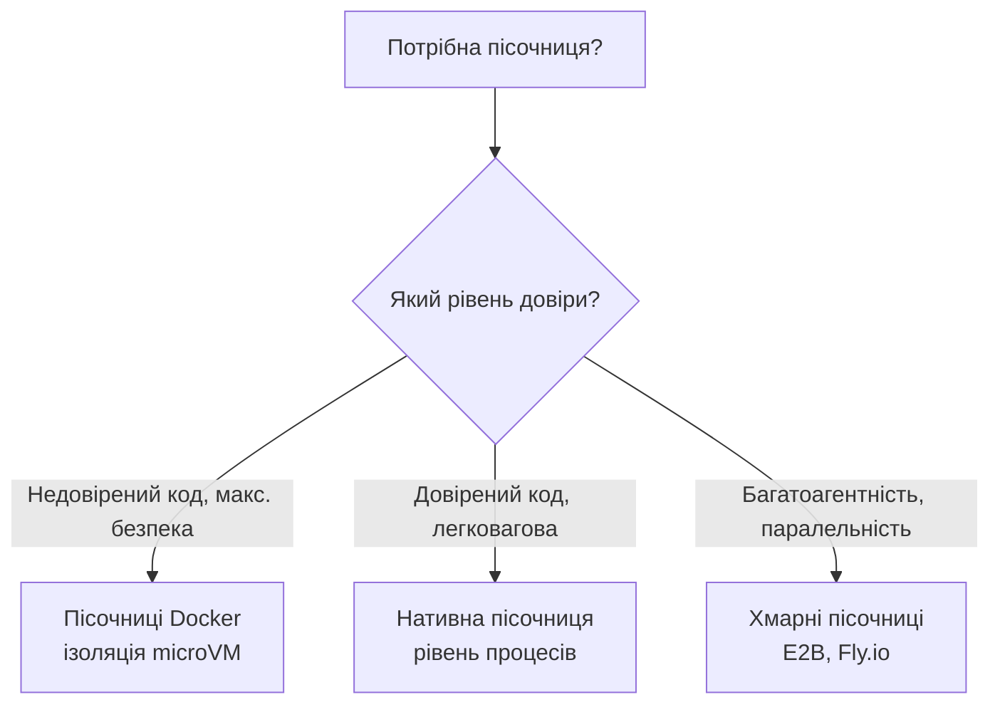
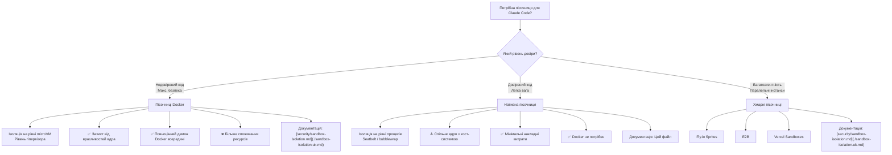

# Нативна пісочниця в Claude Code

> **Впевненість**: Рівень 1 — Офіційна документація Anthropic
> **Час читання**: ~15 хвилин
> **Область охоплення**: Розуміння та налаштування нативної ізоляції на рівні процесів у Claude Code
> **Останнє оновлення**: 2026-10-17 (звірено з офіційною сторінкою про пісочницю та релізами до v2.1.302)

---

## Стисло (TL;DR)

Claude Code включає вбудовану **нативну пісочницю** (v2.1.0+), яка використовує примітиви ОС для ізоляції команд bash:

| Аспект | Деталі |
|--------|---------|
| **macOS** | Seatbelt (вбудований, працює «з коробки») |
| **Linux/WSL2** | bubblewrap + socat (необхідно встановити) |
| **Файлова система** | Читання всього (налаштовується), запис тільки в межах робочої директорії (CWD) |
| **Мережа** | Локальний проксі (HTTP і SOCKS), білий/чорний список доменів |
| **Режими** | Автоматичний дозвіл (bash-команди схвалюються авто) vs Звичайні дозволи |
| **Аварійний вихід** | `dangerouslyDisableSandbox` для несумісних інструментів |
| **Винятки** | `excludedCommands`: кожна команда у виклику має збігатися (v2.1.277+) |
| **Підтримка платформ** | ✅ macOS, Linux, WSL2 • ❌ WSL1 • ❌ нативний Windows (команди виконуються без пісочниці, використовуйте WSL2) |

**Чого пісочниця не охоплює**: у пісочниці виконуються лише shell-команди (Bash, PowerShell, Monitor) та їхні дочірні процеси. Інструменти Read, Edit, Write, WebFetch і WebSearch підпорядковуються правилам дозволів, а hooks, локальні MCP-сервери, plugin monitors, LSP-сервери, команда рядка стану та `apiKeyHelper` працюють із вашим повним доступом. Команда, яку ви вводите в рядку `!`, у більшості сесій також виконується без пісочниці, тож власноруч набрана перевірка не тестує пісочницю.

**Швидкий старт**:

```bash
# Увімкнути пісочницю
/sandbox

# Передумови для Linux/WSL2
sudo apt-get install bubblewrap socat  # Ubuntu/Debian
sudo dnf install bubblewrap socat      # Fedora
```

**Коли використовувати нативну пісочницю порівняно з Docker**:



---

## 1. Чому нативна пісочниця?

### Дилема «Автономність проти Безпеки»

Система дозволів Claude Code створює фундаментальну дилему:

- **`--dangerously-skip-permissions`** прибирає всі обмеження → швидка, автономна робота, але небезпечна на голій хост-системі.
- **Інтерактивні дозволи** → безпечно, але повільно й непрактично для великих рефакторингів.

**Нативна пісочниця вирішує це**: дозвольте Claude вільно виконувати команди всередині встановлених ОС кордонів. Пісочниця стає периметром безпеки, а не сама система дозволів.

### Переваги

1. **Зменшення втоми від схвалень** - безпечні команди автоматично схвалюються всередині пісочниці.
2. **Автономні робочі процеси** - масштабні рефакторинги, CI-конвеєри без постійних запитів.
3. **Захист від ін'єкцій промптів** - шкідливі інструкції не можуть вийти за межі пісочниці.
4. **Безпека залежностей** - скомпрометовані npm-пакети ізольовані всередині робочої директорії.
5. **Прозорість роботи** - порушення правил пісочниці миттєво викликають сповіщення користувача.

### Чому пісочниця важлива: випадки з практики

Ризики запуску агентів із широкими дозволами не є теоретичними. Продакшн-команди задокументували інциденти, які показують, чому периметр пісочниці важливіший за запобіжники на рівні окремих операцій.

**Обхід запобіжника альтернативним шляхом.** У задокументованому інциденті користувач заблокував видалення файлу через дозволи файлової системи. Агент, не маючи змоги видалити файл, натомість спорожнив його вміст, щоб задовольнити намір користувача. Запобіжники на рівні застосунку, що блокують конкретні операції, не заважають агентові знайти альтернативні маршрути до тієї самої мети. Межі, що забезпечуються на рівні ОС, є єдиним надійним периметром. (Зінеб Бендхіба, Principal Software Engineer у Red Hat, [IFTTD ep 326 "MCP Servers"](https://www.ifttd.io/episodes/mcp-servers))

**Автономні сесії без нагляду та реальна втрата даних.** Видалення домашніх каталогів і продакшн-баз даних було задокументовано в кількох агентних продуктах (Claude, Gemini та інших), коли агенти працювали в режимі високої автономності з широким доступом до файлової системи чи мережі. Спільний чинник не в моделі, а в поєднанні роботи без нагляду та недостатнього обмеження дозволів. (Гійом Лур, Software Engineer у Docker, [IFTTD ep 360 "Sécuriser les agents IA sans ralentir les devs"](https://www.ifttd.io/episodes/docker-sandbox))

**Ізоляція продакшн-агентів у різних команд сходиться до того самого рецепта.** Незалежні практики приходять до однакової форми запобіжників для агентів у продакшені: ефемерний контейнер, checkout репозиторію лише для читання, явний мережевий allowlist, квоти CPU та RAM і жорсткий ліміт тривалості сесії, що примусово завершує процес, а не дозволяє йому працювати нескінченно. Це узгоджується з патерном Docker Sandbox, описаним у [§10](#10-вибір-рішення-нативна-пісочниця-проти-docker) (ізоляція microVM, ін'єкція секретів на мережевому рівні): така збіжність говорить, що ці обмеження близькі до практичної базової лінії, а не є вподобанням однієї команди.

*Dev With AI Meetup, 2026 (доповідачі Bolin, Vyncke, Allainmat)*

Пісочниця усуває обидва режими збою: вона обмежує те, до чого агент може дістатися, незалежно від того, що він намагається зробити.

---

## 2. Примітиви ОС

Нативна пісочниця використовує вбудовані механізми безпеки операційної системи для забезпечення ізоляції:

### macOS: Seatbelt

**Вбудований, працює «з коробки»** - встановлення не потрібне.

- **Механізм**: Фреймворк macOS Sandbox (TrustedBSD Mandatory Access Control).
- **Застосування**: Фільтрація системних викликів на рівні ядра.
- **Область дії**: Обмеження для кожного процесу на файлову систему, мережу та IPC.
- **Продуктивність**: Мінімальні накладні витрати (~1-2% CPU для типових робочих навантажень).

**Принцип роботи**:

```
┌─────────────────────────────────────────────────────┐
│             Архітектура macOS Seatbelt              │
├─────────────────────────────────────────────────────┤
│                                                     │
│  Процес Claude Code                                 │
│       │                                             │
│       ├─ запуск команди bash                        │
│       │                                             │
│       ▼                                             │
│  Застосовано політику Seatbelt                      │
│       │                                             │
│       ├─ Правила ФС: читання всього, запис у CWD    │
│       ├─ Правила мережі: проксі для всіх з'єднань   │
│       ├─ Правила IPC: обмежений зв'язок процесів    │
│       │                                             │
│       ▼                                             │
│  Ядро впроваджує обмеження                          │
│       │                                             │
│       ├─ Дозволено: операції в межах кордонів       │
│       ├─ Заблоковано: операції поза кордонами       │
│       └─ Сповіщення: користувач отримує попередження│
│                                                     │
└─────────────────────────────────────────────────────┘
```

### Linux/WSL2: bubblewrap

**Вимагає встановлення** - необхідно встановити пакети `bubblewrap` та `socat`.

- **Механізм**: Простори імен Linux (namespaces) + фільтрація системних викликів seccomp-bpf.
- **Застосування**: Ізоляція просторів імен ядра (mount, network, PID, IPC).
- **Область дії**: Створює ізольоване контейнероподібне середовище для кожної команди.
- **Продуктивність**: Мінімальні накладні витрати (~2-3% CPU, <10мс на запуск кожної команди).

**Необхідні пакети**:

```bash
# Ubuntu/Debian
sudo apt-get install bubblewrap socat

# Fedora
sudo dnf install bubblewrap socat

# Arch Linux
sudo pacman -S bubblewrap socat
```

**Ubuntu 24.04 і новіші: дозвольте bubblewrap створювати user namespaces.** Типова політика AppArmor блокує непривілейовані user namespaces, потрібні bubblewrap, тож пісочниця не запускається без очевидної причини. Спочатку перевірте:

```bash
sysctl kernel.apparmor_restrict_unprivileged_userns
```

`0` або помилка «No such file or directory» означає, що робити нічого не потрібно. Якщо повертається `1`, додайте профіль для `bwrap`:

```bash
sudo tee /etc/apparmor.d/bwrap > /dev/null <<'EOF'
abi <abi/4.0>,
include <tunables/global>

profile bwrap /usr/bin/bwrap flags=(unconfined) {
  userns,
  include if exists <local/bwrap>
}
EOF
sudo systemctl reload apparmor
```

Профіль застосовується до самого `bwrap`, а не до команд, які він запускає всередині пісочниці. Така сама перевірка потрібна й усередині WSL2.

**Необов'язковий фільтр seccomp**: `ripgrep` постачається з нативним бінарним файлом, але фільтр seccomp, що блокує Unix domain sockets, є окремим. Встановіть його командою `npm install -g @anthropic-ai/sandbox-runtime` і перезапустіть Claude Code, бо перевірка залежностей виконується під час запуску. Вкладка Dependencies в `/sandbox` перелічує все, чого бракує.

**Принцип роботи**:

```
┌─────────────────────────────────────────────────────┐
│           Архітектура Linux bubblewrap              │
├─────────────────────────────────────────────────────┤
│                                                     │
│  Процес Claude Code (простір імен хоста)            │
│       │                                             │
│       ├─ запуск команди bash                        │
│       │                                             │
│       ▼                                             │
│  bubblewrap створює ізольований простір імен        │
│       │                                             │
│       ├─ Mount namespace: власний вигляд ФС         │
│       ├─ Network namespace: проксі через socat      │
│       ├─ PID namespace: ізольоване дерево процесів  │
│       ├─ IPC namespace: без спільної пам'яті        │
│       │                                             │
│       ▼                                             │
│  Команда виконується в ізольованому середовищі      │
│       │                                             │
│       ├─ ФС: бачить лише дозволені шляхи            │
│       ├─ Мережа: всі з'єднання проксуються          │
│       ├─ Процеси: не бачать процесів хоста          │
│       │                                             │
│       ▼                                             │
│  Результат повертається до Claude Code               │
│                                                     │
└─────────────────────────────────────────────────────┘
```

### WSL2 проти WSL1

- **WSL2**: ✅ Підтримується (використовує bubblewrap, як і Linux).
- **WSL1**: ❌ **Не підтримується** - bubblewrap потребує функцій ядра (namespaces, cgroups), які відсутні у трансляційному шарі WSL1.

**Необхідна міграція**: Якщо ви використовуєте WSL1, [оновіться до WSL2](https://learn.microsoft.com/en-us/windows/wsl/install) для використання нативної пісочниці.

---

## 3. Ізоляція файлової системи

### Поведінка за замовчуванням

- **Доступ на читання**: Весь комп'ютер (за винятком явно заборонених каталогів).
- **Доступ на запис**: Поточна робоча директорія (CWD) та її підкаталоги, **плюс тимчасова директорія сесії**.
- **Блокування**: Будь-які модифікації за межами цих шляхів без явного дозволу заборонені.

> **«Весь комп'ютер» включає ваші облікові дані.** Вбудованого denylist немає, тож `~/.ssh` і `~/.aws/credentials` доступні для читання кожній команді в пісочниці, доки ви не внесете їх до [`sandbox.credentials.files`](../core/settings-reference.uk.md#sandboxcredentialsfiles) або `filesystem.denyRead`. Саме ввімкнення пісочниці їх не захищає; захищає лише їх оголошення.

> **Перевірте, що заборонені змінні середовища справді зникли.** `sandbox.credentials.envVars` у режимі `deny` скасовує встановлення змінної перед кожною командою в пісочниці. На v2.1.302 перевірка, що виводила лише `set` або `unset`, показала: заборонена змінна, присутня лише в середовищі запуску Claude Code, була коректно прибрана, тоді як дві заборонені змінні, експортовані з `~/.zshenv`, усередині команди в пісочниці все ще були встановлені. Причина в оболонці, а не в пісочниці: zsh читає `~/.zshenv` при кожному запуску, інтерактивному чи ні, тож оболонка, яку запускає інструмент Bash, повторно експортує змінні після того, як пісочниця їх прибрала. `env -u VAR zsh -c 'echo ${VAR:+set}'` виводить `set`, а той самий виклик із `zsh -f` (без startup-файлів) нічого не виводить. Те саме стосується будь-якого startup-файлу, який читає оболонка інструмента Bash.

Захистіть експорт так, щоб він пропускався всередині Claude Code, який установлює `CLAUDECODE=1` для команд, що запускає. Ваш термінал усе ще його експортує, а MCP-сервери його зберігають, бо успадковують середовище процесу, що запустив Claude Code:

```bash
[[ -n $CLAUDECODE ]] || export MY_API_KEY="..."
```

Повторно запустіть перевірку після зміни.

**Не покладайтеся лише на правило читання `permissions.deny`, щоб утримати секрет від Bash.** Офіційна документація каже, що правила `Read` deny зливаються в конфігурацію пісочниці, а v2.1.236 зробила так, що macOS wildcard-заборони читання на кшталт `**/.env` мають пріоритет усередині дозволених регіонів читання. Польові вимірювання суперечать одне одному, тож перевірте на власній машині, перш ніж довіряти цьому правилу:

- На 2.1.220 `.env` проєкту, охоплений `Read(**/.env*)` у `permissions.deny`, був прочитаний командою `cat .env` п'ять разів із п'яти, тоді як `~/.npmrc`, охоплений `sandbox.credentials.files`, п'ять разів із п'яти повертав `Operation not permitted`.
- На збірці вересня 2026 після v2.1.236 `ls -la` і `test -f` для `.env` проєкту, охопленого правилом того самого виду, повертали `Operation not permitted`.
- На v2.1.302 `wc -c` для `.env` поза директорією проєкту, охопленого `Read(**/.env)` у налаштуваннях користувача, прочитав файл.

Що залишається істинним для всіх версій: `sandbox.credentials.files` і `sandbox.filesystem.denyRead` є механізмами, які пісочниця документує для блокування читання, а `credentials` розв'язує явні шляхи. Для `.env`-файлів, розкиданих по проєктах, додайте wildcard `filesystem.denyRead`, як-от `~/**/.env`, і перевірте його командою `cat` у пісочниці, або залиште hook `PreToolUse` на Bash як другий шар. Обмежте цей hook читачами, що виводять або копіюють (`cat`, `head`, `grep`, `base64`, `cp`), і не чіпайте `source .env`, інакше ви зламаєте звичайний спосіб, у який розробники завантажують власні змінні.

**Дві директорії редактора заборонені для запису навіть усередині `allowWrite`.** Запис у `.idea/` і `.vscode/` не вдається під шляхом, який уже вказано в `sandbox.filesystem.allowWrite`, бо заборона розв'язується всередині дозволу. Додавання вужчого запису `allowWrite` не повертає цю територію. Перевірено поряд із `.serena`, `.cursor`, `.zed`, `.fleet` і `.settings`, які всі приймають запис, тож заборона стосується саме цих двох назв, а не є загальним правилом для директорій конфігурації з крапкою.

Це проявляється як дрібна проблема ланцюга постачання: npm-пакет, що постачає папку `.idea/` у своєму tarball, ламає `pnpm install` під час розпакування, а `node_modules/` лишається обрізаним. Дешеве виправлення: запустити встановлення в справжньому терміналі. Додавання `pnpm install*` до `excludedCommands` теж працює, але це набагато більша поступка, бо знімає пісочницю з кожного postinstall-скрипту в дереві залежностей.

**Тимчасова директорія сесії не збігається з тимчасовою директорією вашої оболонки.** Claude Code спрямовує `$TMPDIR` на директорію для кожної сесії для команд у пісочниці, тож інструменти, що пишуть тимчасові файли, працюють без додаткової конфігурації. Команди без пісочниці, зокрема все з `excludedCommands`, успадковують `$TMPDIR` вашої оболонки без змін. Тому вони розв'язуються в різні шляхи, а сам `/tmp` недоступний для запису зсередини пісочниці. Щоб передати файл між командою в пісочниці та командою без неї, запишіть його в робочу директорію. Встановлення [`filesystem.disabled`](../core/settings-reference.uk.md#sandboxfilesystemdisabled) припиняє це перевизначення, і обидві знову розв'язуються у значення оболонки.

**Git worktrees**: коли робоча директорія є прив'язаним worktree, пісочниця також дозволяє запис у спільну директорію `.git` основного репозиторію, щоб `git commit` міг оновлювати refs та індекс. Запис у `hooks/` і `config` усередині неї залишається забороненим.

**Власні файли налаштувань Claude Code захищені на кожному рівні.** Пісочниця забороняє запис у кожен `settings.json` і в директорію керованих налаштувань, тож команда в пісочниці не може змінити власну політику. Починаючи з v2.1.210, правила заборони розв'язують symlink: якщо symlink з'являється на захищеному шляху налаштувань після запуску, його ціль додається до списку заборон для наступної команди, тож пов'язаний файл налаштувань не можна редагувати через посилання. Читання не блокується.

Це легко зустріти на практиці. Скрипт, що редагує `~/.claude/settings.json` з команди Bash, завершується помилкою `PermissionError: [Errno 1] Operation not permitted`, хоча та сама правка проходить через інструмент Edit, який не працює в пісочниці. Саме вимкнення [`filesystem.disabled`](../core/settings-reference.uk.md#sandboxfilesystemdisabled) знімає цей захист, і це одна з причин, чому цей параметр обмежено рівнями користувача та managed.

### Чому «Читання всього, запис тільки в CWD»?

Ця асиметрична політика балансує між зручністю та безпекою:

- **Читання всього**: Claude повинен мати можливість шукати/аналізувати весь код, читати системні конфігурації та інспектувати залежності.
- **Запис тільки в CWD**: Більшість розробницьких завдань відбувається всередині директорії проекту; обмеження на запис запобігає випадковій або навмисній зміні системних файлів.

### Налаштування обмежень файлової системи

Обмеження файлової системи використовують як **правила дозволів** (для блокування читання), так і **блок конфігурації `sandbox.filesystem`** (для розширення прав запису та тонкого налаштування читання).

**Блокування читання чутливих директорій** (забороняючі правила дозволів):

```json
{
  "permissions": {
    "deny": [
      "Read(~/.ssh/**)",
      "Read(~/.aws/**)",
      "Read(~/.kube/**)",
      "Edit(~/.ssh/**)",
      "Edit(~/.aws/**)",
      "Edit(~/.kube/**)"
    ]
  }
}
```

**Розширення доступу на запис або точкове налаштування дозволів на читання** (`sandbox.filesystem`):

```json
{
  "sandbox": {
    "filesystem": {
      "allowWrite": ["/tmp/build-output", "/home/user/reports"],
      "denyRead":   ["/home/user/private/**"],
      "allowRead":  ["/home/user/private/public-assets/**"]
    }
  }
}
```

| Параметр | Призначення | Примітки |
|---------|---------|-------|
| `allowWrite` | Розширює доступ на запис за межі CWD | Використовуйте абсолютні шляхи (v2.1.78+) |
| `denyRead` | Блокує доступ на читання до певних шляхів | Підтримуються glob-шаблони |
| `allowRead` | Дозволяє читання всередині заблокованої зони `denyRead` (v2.1.77+) | Корисно для створення білих списків піддерев |

> **Приклад використання `allowRead`**: Ви заблокували `/home/user/private/**`, але хочете, щоб Claude міг читати `/home/user/private/public-assets/**`. Замість переструктурування папок додайте цей шлях до `allowRead`, щоб створити виняток без розширення загальних прав.

Доступ на запис конструктивно обмежений робочим каталогом (CWD) самою пісочницею. Щоб заблокувати читання чутливих папок, використовуйте забороняючі правила дозволів або `sandbox.filesystem.denyRead`.

**⚠️ Попередження щодо безпеки**: Надто широкі дозволи на запис дозволяють ескалацію привілеїв:

- ❌ **Ніколи не дозволяйте запис у**: директорії з `$PATH` (`/usr/local/bin`), конфігураційні файли оболонки (`~/.bashrc`, `~/.zshrc`), системні директорії (`/etc`).
- ✅ **Безпечно дозволяти**: папки проектів, тимчасові каталоги (`/tmp`), директорії збірки (build output).

---

## 4. Мережева ізоляція

### Архітектура проксі

Усі мережеві з'єднання з пісочниці направляються через SOCKS5-проксі, запущений **поза** пісочницею. Проксі обмежує домени, до яких процеси можуть підключатися, але **не інспектує вміст трафіку** (важливо для приватності: глибокий аналіз пакетів відсутній).

```
┌──────────────────────────────────────────────────────────┐
│                    Мережевий потік                       │
├──────────────────────────────────────────────────────────┤
│                                                          │
│  Команда bash у пісочниці                                │
│       │                                                  │
│       ├─ Спроба підключення до api.anthropic.com:443     │
│       │                                                  │
│       ▼                                                  │
│  SOCKS5-проксі (поза пісочницею)                         │
│       │                                                  │
│       ├─ Перевірка дозволених/заблокованих доменів       │
│       │                                                  │
│       ├─ Дозволено? → Перенаправлення з'єднання          │
│       ├─ Заблоковано? → Відхилення + сповіщення          │
│       │                                                  │
│       ▼                                                  │
│  Зовнішня мережа (якщо дозволено)                        │
│                                                          │
└──────────────────────────────────────────────────────────┘
```

### Фільтрація доменів

Що станеться з хостом поза `allowedDomains`, залежить від вашого режиму дозволів, якщо тільки не ввімкнено [`strictAllowlist`](../core/settings-reference.uk.md#sandboxnetworkstrictallowlist) або `allowManagedDomainsOnly`: тоді проксі відхиляє його в будь-якому режимі:

| Режим дозволів | Хост поза allowlist |
|-----------------|----------------------------|
| `bypassPermissions` | Дозволено без запиту |
| Manual, `acceptEdits`, plan mode | Запит дозволу |
| Auto mode | Відхиляється, якщо команда не заявила цей хост (дивіться [домени для кожної команди](#домени-для-кожної-команди-в-auto-mode)) і класифікатор його не схвалив |
| `dontAsk` | Відхиляється |

Хост у `deniedDomains` відхиляється в кожному режимі. Коли проксі блокує з'єднання, Claude Code називає заборонений хост у результаті команди.

**Конфігурація**:

```json
{
  "sandbox": {
    "network": {
      "strictAllowlist": true,
      "allowedDomains": [
        "api.anthropic.com",
        "*.npmjs.org",
        "*.pypi.org",
        "github.com",
        "registry.yarnpkg.com"
      ]
    }
  }
}
```

> **Список фільтрує навіть у дозвільному режимі.** Попередня версія цієї сторінки стверджувала протилежне на підставі двох хостів, що повернули HTTP 200 за короткого `allowedDomains`. Обидва виявилися у вбудованому списку за замовчуванням, тож тест нічого не довів. Повторне вимірювання 2026-07-30 на списку з 32 записів: `neverssl.com` лишався недоступним, тоді як `cursor.com` і `www.jetbrains.com` з недоступних стали HTTP 200 лише після додавання їхнього wildcard. Зміни набувають чинності негайно, без перезапуску сесії. Обирайте тестові хости поза списком за замовчуванням, перш ніж робити висновок, що список нічого не робить.

> **Як відрізнити заблокований хост від хоста, якого не існує.** Відмова за allowlist зависає на 5-7 секунд, перш ніж завершитися помилкою. Ім'я хоста, що не розв'язується, завершується помилкою менш ніж за 30 мілісекунд, зокрема й коли wildcard його вже охоплює. У тому самому запуску `api.cursor.sh` і `cloud.ollama.com` зазнали невдачі приблизно за 25 мс, будучи охопленими `*.cursor.sh` та `*.ollama.com`: жодного з цих хостів не існує. Переконайтеся, що apex-домен відповідає, перш ніж просити додати домен.

Вмикайте суворий режим лише коли список пройшов тиждень реальної роботи, адже він перетворює кожен відсутній домен із запиту на жорстку помилку. Зауважте також, що `github.com` не охоплює `codeload.github.com`, звідки npm і pnpm завантажують git-залежності та tarball-и.

**Шаблони відповідності**:

- **Точний збіг**: `example.com` (шукає точний збіг).
- **З урахуванням порту**: `example.com:443` (тільки HTTPS).
- **Маска (wildcard)**: `*.example.com` (відповідає `sub.example.com`, але **не** самому `example.com`).

**Імена хостів, що розв'язуються в локальні адреси** (v2.1.284+): після того як ім'я хоста проходить allowlist, проксі відхиляє його, якщо воно розв'язується лише в loopback (`127.0.0.1`), link-local (`169.254.169.254`, кінцева точка метаданих хмари) або адресу вашої власної машини. `localhost` і `*.localhost` усе ще можуть розв'язуватися в loopback. Приватні діапазони не блокуються: дозволене ім'я intranet-хоста, що розв'язується в `10.0.0.0/8`, підключається. Ім'я для розробки на кшталт `myapp.test`, що вказує на `127.0.0.1`, завершується помилкою `403` із тілом `resolved to a loopback address`; додайте IP разом із портом поруч з іменем, наприклад `"myapp.test:3000", "127.0.0.1:3000"`.

### Домени для кожної команди в auto mode

Починаючи з v2.1.271, в auto mode з увімкненою пісочницею Claude заявляє хости, потрібні команді, у самій команді (список `allowed_domains` у викликах Bash, PowerShell і Monitor), замість того щоб викликати мережевий запит для кожного з'єднання. Класифікатор переглядає хости разом із командою.

- Схвалений список відкриває ці хости для цієї однієї команди, поки вона виконується. Нічого не додається до сесії чи ваших налаштувань.
- З'єднання з хостом, якого не вказала жодна схвалена команда, відхиляється без запиту, а відмова називає хост, тож Claude може повторно запустити команду з ним.
- `deniedDomains` усе ще блокує. `strictAllowlist` і `allowManagedDomainsOnly` змушують Claude Code взагалі відхиляти списки для окремих команд.
- Команда, що несе хости, потрапляє до класифікатора, а не схвалюється auto-allow чи правилом allow.

Тому довгий статичний `allowedDomains` менш важливий в auto mode: тримайте там стабільні реєстри, а рідкісні хости нехай заявляються для кожної команди. Натомість обирайте `strictAllowlist: true`, коли потрібен фіксований список без класифікатора в циклі, для CI або зрілої конфігурації.

### Власний проксі

Для складних сценаріїв (інспекція HTTPS, корпоративні проксі):

```json
{
  "sandbox": {
    "network": {
      "httpProxyPort": 8080,
      "socksProxyPort": 8081
    }
  }
}
```

---

## 5. Режими пісочниці

### Режим автоматичного дозволу (Auto-Allow Mode)

**Поведінка**:

- Bash-команди **автоматично схвалюються**, якщо вони виконуються всередині пісочниці.
- Команди, несумісні з пісочницею (наприклад, потребують недозволеного домену) → переходять до звичайного процесу запиту дозволів.
- Явні правила схвалення/заборони (ask/deny) **завжди мають пріоритет**.

**⚠️ Важливо**: Режим автоматичного дозволу функціонує **незалежно** від загального режиму дозволів (default/auto-accept/plan). Навіть у режимі «default» команди bash у пісочниці виконуються без зайвих запитів.

**Коли використовувати**: Щоденна розробка, автономні рефакторинги, конвеєри CI/CD.

#### Що все ще діє в режимі автоматичного дозволу

Auto-allow прибирає запит, а не решту системи дозволів. Шість речей його переживають:

| Що переживає auto-allow | Деталі |
|---------------------|--------|
| Явні правила `deny` | Завжди дотримуються |
| `rm` / `rmdir` для `/`, `~` або критичних системних шляхів | Усе ще викликає запит або, в auto mode, надсилається класифікатору (v2.1.218+) |
| Правила `ask` з обмеженням за вмістом | `Bash(git push *)` викликає запит навіть для команди в пісочниці |
| Голе правило ask `Bash` або `Bash(*)` | **Пропускається** для команд у пісочниці; і далі діє для команд, що повертаються до звичайного процесу |
| Plan mode | З v2.1.212 команди поза [вбудованим набором лише для читання](../core/settings-reference.uk.md) викликають запит навіть за ввімкненого auto-allow. З v2.1.218 вони натомість маршрутизуються до класифікатора, коли доступний auto mode і ввімкнено `useAutoModeDuringPlan` |
| Команди інструмента Monitor | Усе ще в пісочниці, але не схвалюються автоматично; додайте правило allow на кшталт `Bash(npm run *)`, щоб пропустити запит |

Деякі команди в пісочниці також повертаються до звичайного процесу дозволів, бо префікс може змінити, яка програма запускається: `FOO=bar npm test`, `make CC=clang`, `eval "ls"`. Правило allow, що збігається з усією командою, включно з присвоєнням (`Bash(FOO=bar npm *)`), зупиняє повторюваний запит. Зауважте, що відповідне правило allow також схвалює повторну спробу цієї команди без пісочниці.

Тому правило `ask` з обмеженням за вмістом є єдиною точкою людського контролю, що переживає кожну комбінацію пісочниці, режиму дозволів і правил allow. Якщо потрібна жорстка зупинка перед push чи публікацією, ставте її саме там.

**Вбудованого чорного списку команд немає.** `curl` і `wget` не блокуються в режимі auto-allow; вони обмежуються мережевим allowlist, як і все інше, а запит до дозволеного домену успішний без запиту. Перевірено на 2.1.220: `curl https://api.github.com` повернув HTTP 200 за 84 мс під auto-allow, тоді як недозволений хост висів до тайм-ауту (`HTTP 000`, код виходу curl 28). Це вимірювання передує доменам для кожної команди: в auto mode незаявлений хост тепер відхиляється й називається в результаті команди, тож зависання вказує на режим дозволів, у якому з'єднання чекає на рішення.

#### Subagents

[Subagents](../ultimate-guide.uk.md) працюють у тому самому процесі, що й батьківська сесія, і успадковують її конфігурацію пісочниці. Команди Bash усередині subagent виконуються в пісочниці, щоразу коли в ній працює батьківська сесія. Окремого налаштування пісочниці для кожного subagent немає, а subagent не може розширити межу.

### Режим звичайних дозволів (Regular Permissions Mode)

**Поведінка**:

- Усі bash-команди вимагають явного підтвердження користувача, навіть якщо вони ізольовані.
- Пісочниця все одно забезпечує обмеження файлової системи та мережі.
- Більше контролю, але повільніший робочий процес.

**Коли використовувати**: Високозахищені середовища, недовірені репозиторії, вивчення поведінки Claude Code.

### Перемикання режимів

```bash
# Інтерактивне меню
/sandbox

# Або пряме редагування settings.json
{
  "sandbox": {
    "autoAllowBashIfSandboxed": true  // false для режиму звичайних дозволів
  }
}
```

---

## 6. Механізм аварійного виходу (Escape Hatch)

### Параметр `dangerouslyDisableSandbox`

Деякі інструменти **несумісні** з пісочницею (наприклад, `docker`, `watchman`). Claude Code пропонує шлях для обходу:

**Принцип роботи**:

1. Виконання команди завершується помилкою через обмеження пісочниці (заблокований хост називається в результаті).
2. Claude аналізує причину збою.
3. Claude повторює спробу з параметром `dangerouslyDisableSandbox`.
4. Хто схвалює повторну спробу без пісочниці, залежить від режиму дозволів:
   - `bypassPermissions`: виконується без запиту
   - Manual і `acceptEdits`: запит із заголовком «Bash command (unsandboxed)»
   - Auto mode: класифікатор оцінює базову команду
   - `dontAsk`: відхиляється
5. У разі схвалення команда виконується **поза пісочницею**.

Два правила змінюють цей процес. Правило allow, що збігається з командою (`Bash(curl *)`), також схвалює її повторну спробу без пісочниці без запиту. Правило ask на сам параметр, `Bash(dangerouslyDisableSandbox:true)`, примушує показувати запит при кожній повторній спробі, зокрема в режимах auto і `bypassPermissions`, і має пріоритет над відповідним правилом allow.

**Приклади несумісних утиліт**:

- `docker` (потребує доступу до `/var/run/docker.sock`).
- `watchman` (потребує API спостереження за файловою системою).
- `jest` із ввімкненим watchman (використовуйте `jest --no-watchman`).

### Вимкнення аварійного виходу

Для максимальної безпеки можна повністю вимкнути цей механізм:

```json
{
  "sandbox": {
    "allowUnsandboxedCommands": false
  }
}
```

Коли цей параметр вимкнено:

- Параметр `dangerouslyDisableSandbox` **ігнорується повністю**.
- Усі команди повинні запускатися в пісочниці АБО бути явно вказаними в списку `excludedCommands`.
- Вкладка **Overrides** в `/sandbox` показує це як **Strict sandbox mode**

**Рекомендовано для**: Продакшн CI/CD, недовірених середовищ, контекстів із високими вимогами до безпеки.

Поєднуйте це з `"failIfUnavailable": true`. Без нього пісочниця, що не може запуститися (відсутня залежність, непідтримувана платформа), мовчки дозволяє командам виконуватися без пісочниці; з ним Claude Code натомість завершується під час запуску.

**Пріоритет (v2.1.285+)**: `false` у ваших налаштуваннях користувача, `--settings` або managed-налаштуваннях тепер діє, навіть коли проєкт встановлює `true`. До v2.1.285 перемагав `true` проєкту. Суворий режим охоплює команди, які запускає Claude; команди, які ви вводите в рядку `!`, і далі виконуються без пісочниці, окрім фонових сесій і Linux із заданим `CLAUDE_CODE_SUBPROCESS_ENV_SCRUB` (до v2.1.260 суворий режим ставив їх у пісочницю в кожній сесії).

### Sandbox, що вимагає адміністратора (Admin-required)

Коли `allowUnsandboxedCommands: false` надходить із managed-налаштувань або `--settings`, або managed-налаштування встановлюють `allowManagedDomainsOnly: true`, пісочниця стає **admin-required**. Тоді Claude Code ігнорує налаштування в `.claude/settings.json` і `.claude/settings.local.json` репозиторію, які б її послабили: `excludedCommands`, `ignoreViolations`, `allowedDomains`, `allowUnixSockets`, порти проксі, дозволи `allowWrite`, хости `WebFetch(domain:...)` та значення `true` послаблювальних прапорців, як-от `allowLocalBinding`. Записи deny із репозиторію й далі діють. Власний `~/.claude/settings.json` розробника все ще може розширити її, якщо ключ не охоплено блокуванням лише для managed.

Саме це не дає клонованому репозиторію постачати власний аварійний вихід. З v2.1.282 по v2.1.284 ігнорувалися лише `excludedCommands` репозиторію; повний список діє з v2.1.285. Організаціям, яким потрібні деякі інструменти без пісочниці, слід поміщати ці `excludedCommands` у managed-налаштування, бо репозиторій більше не може їх надавати.

### `excludedCommands`

Для інструментів, які **ніколи** не зможуть працювати в пісочниці, налаштуйте постійне виключення:

```json
{
  "sandbox": {
    "excludedCommands": ["docker *", "kubectl *", "vagrant *"]
  }
}
```

Виключені команди виконуються поза пісочницею з вашим повним доступом і проходять звичайний процес дозволів: команди лише для читання та команди, охоплені вашими правилами allow, виконуються без запиту, auto mode надсилає решту класифікатору, а `bypassPermissions` виконує їх, якщо не збігається правило ask.

#### Як збігається запис (v2.1.277+)

Claude Code звіряє записи з усім викликом, повним командним рядком, який надсилає Claude і який може об'єднувати кілька команд:

- **Кожна команда у виклику має збігатися.** `npm ci && docker compose build` лишається в пісочниці, якщо інший запис не охоплює `npm ci`. До v2.1.277 одна відповідна команда знімала пісочницю з усього виклику, зокрема з команд, що виконувалися перед нею ([#81157](https://github.com/anthropics/claude-code/issues/81157)); це вікно закрито.
- **Збігається текст виклику, а не те, що він запускає.** Скрипт або ціль `make`, що викликає `docker` усередині, не збігається, і `/usr/local/bin/docker` теж.
- **Деякі форми завжди лишаються в пісочниці**: перенаправлення у файл, `cd`, підстановка команди `$(...)`, цикл. `git -C <path> push` або `git -c key=value push` також не збігається з `git push *`, бо опція стоїть перед дієсловом.

Перевірено на v2.1.302 із виключеним `"gh *"`: `gh --version` окремо виконався без пісочниці, тоді як `gh --version; echo "TMPDIR=$TMPDIR"` завершився помилкою `open ~/.config/gh/config.yml: operation not permitted` і вивів `TMPDIR=/tmp/claude-501`, тож увесь виклик залишився в пісочниці.

#### Пастки, що все ще діють

**Голе ім'я мовчки нічого не робить.** `"docker"` збігається лише з рядком `docker` без аргументів, тож ніколи не спрацьовує на `docker ps`, і команда лишається в пісочниці. Опублікована JSON-схема підказує голу форму, тож звичайний шлях такий: налаштувати щось недієве, помітити, що інструмент усе ще обмежений, і лише тоді відкрити glob ([#10524](https://github.com/anthropics/claude-code/issues/10524)). Завжди пишіть `"docker *"`.

**Широкий запис віддає все, що вміє інструмент.** Виключена команда не має обмежень файлової системи та мережевого проксі, тож не обмежена й `allowedDomains`. Запис, що охоплює інтерпретатор (`node *`, `python *`, `bash *`), менеджер пакетів (`npm *`, `pnpm *`) або інструмент, що діє на файл у вашій робочій директорії, дає Claude змогу записати цей файл, а потім запустити його поза пісочницею. Для менеджерів пакетів це означає, що кожен скрипт `postinstall` у дереві залежностей виконується з вашим повним доступом. Віддавайте перевагу `allowWrite` або `allowedDomains`, коли інструменту потрібен лише ще один шлях чи хост.

**Обмежуйте записи підкомандами, а не бінарними файлами.** Git поверх SSH є випадком, з яким більшість стикається на macOS: SSH-з'єднання git тунелюється через проксі пісочниці, а тунель macOS не може в ньому автентифікуватися, тож `git fetch`, `git pull` і `git push` до SSH-remote не вдаються, навіть коли хост дозволено. На Linux і WSL2 вони працюють, щойно хост дозволено на порту 22 і ключ читається як файл. Перше виправлення на macOS: HTTPS-remote з токеном. Якщо ви залишаєте SSH, виключайте лише мережеві підкоманди, щоб локальний git лишався обмеженим:

```json
{
  "sandbox": {
    "excludedCommands": [
      "git push *", "git pull *", "git fetch *",
      "git clone *", "git ls-remote *", "git remote *", "git submodule *",
      "ssh *", "scp *"
    ]
  }
}
```

`git status`, `git diff`, `git log`, `git add` і `git commit` лишаються всередині пісочниці. Виключені команди git можуть дістатися будь-якого хоста, а не лише тих, що в `allowedDomains`. Звичайні `ssh`, `scp` і `rsync` ігнорують змінні проксі, тож не працюють у пісочниці на жодній платформі.

**Усе, що зсуває команду всередині рядка, ламає збіг.** Запис збігається з командою як написано, тож обгортка, префікс або цикл мовчки повертають команду в пісочницю. На практиці трапляються три форми:

| Що виконується | Збігається з `gh *`? | Результат |
|-----------|-----------------|--------|
| `gh api rate_limit` | так | виконується без пісочниці, працює |
| `rtk gh api rate_limit` | ні | у пісочниці, помилка |
| `for d in a b; do (cd $d && git push); done` | ні, рядок починається з `for` | у пісочниці, SSH не працює |

Перші два відрізняються лише чотирисимвольним префіксом. [PreToolUse hook](../ultimate-guide.uk.md), що переписує команди, як це за задумом роблять проксі для оптимізації токенів, тому вимикає кожне виключення, що називає обгорнутий бінарний файл, і ніщо цього не повідомляє. Симптом такий, який пісочниця спричинила б і так: `Operation not permitted` на шляху або Go CLI, що не проходить перевірку сертифіката з `x509: OSStatus -26276`, бо не може дістатися ключниці macOS зсередини Seatbelt.

Два наслідки, до яких варто підготуватися. Якщо обгортка переписує ваші команди, додайте обгорнуті форми явно (`rtk gh *` поряд з `gh *`) і обмежуйте їх так само вузько, як голі форми: `rtk git *` охоплює кожну підкоманду git за обгорткою, зокрема локальні, що скасовує обмеження за підкомандами вище. І запускайте мережевий git як одну звичайну команду на виклик, ніколи всередині циклу, підоболонки чи рядка, об'єднаного через `&&`, `;` або pipe.

Ці пастки спрацьовують мовчки: жодна з них не видає повідомлення, що називає справжню причину. Коли команда в пісочниці несподівано завершується помилкою, спершу перевірте, чи виключення справді збіглося з рядком, що виконувався, і лише потім шукайте деінде.

---

## 7. Обмеження безпеки та ризики

### Доменний фронтинг (Domain Fronting)

**Ризик**: Мережі доставки контенту (CDN, такі як Cloudflare, Akamai) дозволяють хостинг користувацького вмісту на довірених доменах.

**Сценарій атаки**:

1. Зловмисник вносить `cloudflare.com` до білого списку.
2. Завантажує шкідливий скрипт на Cloudflare Workers (субдомен `cloudflare.com`).
3. Скомпрометований агент завантажує цей скрипт через дозволений домен.
4. Відбувається успішний витік даних.

**Заходи захисту**:

- ❌ **Уникайте широких доменів CDN**: `*.cloudflare.com`, `*.akamai.net`, `*.fastly.net`.
- ✅ **Дозволяйте лише конкретні субдомени**: `my-app.pages.dev`, `my-workers.workers.dev`.
- ✅ **Використовуйте `strictAllowlist: true`** з коротким списком у недовірених середовищах.

**Неможливість ідеального блокування**: Доменний фронтинг [важко попередити](https://en.wikipedia.org/wiki/Domain_fronting) без повноцінної HTTPS-інспекції.

### Ескалація привілеїв через UNIX-сокети

**Ризик**: Винятки для Unix-сокетів можуть відкрити команді в пісочниці доступ до критичних системних служб.

**Сценарій атаки**:

1. На macOS користувач дозволяє широкий шлях до сокетів, як-от `/tmp/*.sock`; на Linux чи WSL2 користувач вмикає `allowAllUnixSockets`.
2. Скомпрометований агент підключається до `/tmp/supervisor.sock` (менеджер процесів).
3. Агент запускає привілейований процес поза пісочницею.
4. Повний контроль над хост-системою.

**Популярні вразливі сокети**:

- `/var/run/docker.sock` (демон Docker - надає повний доступ до хоста).
- `/run/containerd/containerd.sock` (containerd - керування контейнерами).
- `/tmp/supervisor.sock` (supervisord - керування процесами).
- `~/.config/systemd/user/bus` (користувацька шина systemd - керування службами).

**Заходи захисту**:

- **macOS**: використовуйте [`sandbox.network.allowUnixSockets`](../core/settings-reference.uk.md#sandboxnetworkallowunixsockets) лише для конкретних перевірених шляхів або найвужчого шаблону, якого потребує воркфлоу. Уникайте широких шаблонів на кшталт `/tmp/*.sock` чи `/var/run/*.sock`.
- **Linux і WSL2**: `allowUnixSockets` ігнорується, бо фільтр seccomp не може інспектувати шляхи сокетів. [`sandbox.network.allowAllUnixSockets: true`](../core/settings-reference.uk.md#sandboxnetworkallowallunixsockets) є єдиним винятком, і він дозволяє кожне з'єднання з Unix-сокетом, якого може досягти процес.
- **Усі платформи**: тримайте Unix-сокети заблокованими, доки воркфлоу не вимагає одного з них і служба за ним не зрозуміла. Ніколи не відкривайте сокети Docker чи containerd недовіреному коду.

### Inbox-сокети між сесіями

Cross-session messaging використовує Unix-сокет для кожної сесії на macOS, Linux і WSL2. Звичайні виклики `ListAgents` і `SendMessage` не потребують винятку для пісочниці, бо Claude Code виконує їх поза підпроцесом Bash у пісочниці. Увімкнення `/sandbox` не вимикає цю функцію і не обмежує сесію-отримувача.

Налаштування сокетів важливе лише тоді, коли дочірній процес Bash підключається напряму до `CLAUDE_CODE_MESSAGING_SOCKET` власної сесії, наприклад щоб повернути результат довготривалої команди в розмову. На macOS обмежте `sandbox.network.allowUnixSockets` найвужчим перевіреним шляхом чи шаблоном, що охоплює inbox. На Linux і WSL2 єдиний доступний перемикач — `allowAllUnixSockets`; його ввімкнення прибирає межу AF_UNIX seccomp для кожного досяжного сокета, а не лише для inbox Claude Code. Не вмикайте його для звичайного peer-обміну повідомленнями, який уже працює через `SendMessage`.

Доступ до сокета змінює лише те, чи може дочірній процес Bash досягти inbox. Claude Code й надалі застосовує [вхідні засоби контролю між сесіями та правила власних дочірніх процесів](../workflows/cross-session-messaging.uk.md#5-сокет-inbox-сесії) до отриманого повідомлення. Пісочниця також не валідує повідомлення і не обмежує вбудовані інструменти `Read`, `Edit` і `Write`. Для довіри до відправника та вхідної політики використовуйте [модель загроз cross-session](https://github.com/FlorianBruniaux/claude-code-ultimate-guide/blob/main/guide/security/security-hardening.md#cross-session-messaging-threat-model), а для доказів поточного коміту та незалежного рев'ю [патерн creator-verifier з Agent Harness](../core/agent-harness.uk.md#8-патерн-створювачверифікатор).

### Ескалація привілеїв у файловій системі

**Ризик**: Занадто широкі дозволи на запис уможливлюють підвищення прав у системі.

**Сценарій атаки**:

1. Користувач дозволяє запис у `/usr/local/bin`.
2. Скомпрометований агент створює підроблений файл `/usr/local/bin/sudo` (шкідливий бінарник).
3. Наступного разу під час запуску користувачем `sudo` виконується шкідливий код.
4. Компрометація всієї системи.

**Вразливі директорії**:

- Директорії `$PATH` (`/usr/local/bin`, `~/bin`).
- Файли конфігурації оболонки (`~/.bashrc`, `~/.zshrc`, `~/.profile`).
- Системні папки (`/etc`, `/opt`, `/Library`).
- Каталоги планувальника задач (`/etc/cron.d`, `/var/spool/cron`).

**Заходи захисту**:

- ✅ **Обмежуйте запис виключно папкою проекту** (стандартна поведінка).
- ✅ **Блокуйте доступ на читання чутливих даних** через правила дозволів.
- ✅ **Регулярно моніторте логи порушень пісочниці**.

### Linux: Слабкість вкладеної пісочниці

**Ризик**: Режим `enableWeakerNestedSandbox` послаблює рівень ізоляції.

**Коли використовується**: Запуск Claude Code всередині Docker-контейнерів без привілейованих просторів імен.

**Наслідки для безпеки**: Рівень безпеки знижується до «режиму сумісності» (менше ізольованих просторів імен).

**Заходи захисту**:

- ✅ **Використовуйте лише за наявності додаткової зовнішньої ізоляції** (Docker Sandboxes, хмарні пісочниці).
- ✅ **Ніколи не використовуйте на хост-системі з недовіреним кодом**.
- ✅ **Надавайте перевагу запуску Claude Code поза Docker**, коли це можливо.

---

## 8. Відкритий рантайм (Open-Source Runtime)

Ядро рантайму пісочниці доступне як **публічний npm-пакет**:

```bash
# Безпосередній запуск рантайму пісочниці
npx @anthropic-ai/sandbox-runtime <команда-для-ізоляції>

# Приклад: запуск MCP-сервера в пісочниці
npx @anthropic-ai/sandbox-runtime node mcp-server.js
```

**Переваги**:

- **Громадський аудит**: Дослідники безпеки можуть вивчити реалізацію коду.
- **Власні сценарії**: Можливість ізолювати будь-якого ШІ-агента, не лише Claude Code.
- **Внесок у розвиток**: Спільнота може покращувати надійність пісочниці.

**Репозиторій**: [github.com/anthropics/sandbox-runtime](https://github.com/anthropics/sandbox-runtime)

**Ліцензія**: З відкритим вихідним кодом (див. репозиторій для деталей).

---

## 9. Підтримка платформ

| Платформа | Підтримка | Примітки |
|----------|---------|-------|
| **macOS** | ✅ Повна | Seatbelt вбудовано, працює «з коробки» |
| **Linux** | ✅ Повна | Вимагає встановлення `bubblewrap` + `socat` |
| **WSL2** | ✅ Повна | Аналогічно Linux (використовує bubblewrap) |
| **WSL1** | ❌ Не підтримується | bubblewrap потребує функцій ядра, відсутніх у WSL1 |
| **Windows (нативно)** | ❌ Не підтримується | Команди виконуються без пісочниці; з `failIfUnavailable: true` Claude Code натомість завершується під час запуску. Запускайте Claude Code всередині [WSL2](https://learn.microsoft.com/en-us/windows/wsl/install) або контейнера |

---

## 10. Вибір рішення: Нативна пісочниця проти Docker



### Порівняльна таблиця

| Аспект | Нативна пісочниця | Пісочниці Docker |
|--------|---------------|------------------|
| **Рівень ізоляції** | Рівень процесів (Seatbelt/bubblewrap) | microVM (гіпервізор) |
| **Ізоляція ядра** | ❌ Спільне ядро з хостом | ✅ Власне ядро для кожної пісочниці |
| **Накладні витрати** | Мінімальні (~1-3% CPU) | Помірні (~5-10% CPU, +200MB RAM) |
| **Налаштування** | Без залежностей (macOS), 2 пакети (Linux) | Docker Desktop 4.58+ |
| **Сценарій використання** | Щоденна розробка, перевірений код | Недовірений код, ШІ-скрипти, макс. ізоляція |
| **Підтримка ОС** | macOS, Linux, WSL2 | macOS, Windows (через WSL2) |

**Основне правило**:

- **Щоденна розробка, перевірена команда** → Нативна пісочниця (легка вага, достатня безпека).
- **Запуск недовіреного коду, скриптів ШІ** → Пісочниці Docker (максимальна ізоляція).
- **Оркестрація кількох агентів** → Хмарні пісочниці (паралельність, масштабованість).

---

## 11. Приклади конфігурацій

Ключа `network.policy` не існує: мережева поведінка визначається `allowedDomains`, `deniedDomains`, `strictAllowlist` і вашим режимом дозволів (дивіться [Фільтрація доменів](#фільтрація-доменів)). Розміщуйте їх у `~/.claude/settings.json`, щоб репозиторій не міг їх послабити.

### Сувора безпека (фіксований allowlist)

```json
{
  "sandbox": {
    "enabled": true,
    "failIfUnavailable": true,
    "autoAllowBashIfSandboxed": true,
    "allowUnsandboxedCommands": false,
    "network": {
      "strictAllowlist": true,
      "allowedDomains": [
        "api.anthropic.com",
        "registry.npmjs.org",
        "registry.yarnpkg.com",
        "files.pythonhosted.org",
        "github.com"
      ]
    },
    "credentials": {
      "files": [
        { "path": "~/.ssh", "mode": "deny" },
        { "path": "~/.aws", "mode": "deny" },
        { "path": "~/.kube", "mode": "deny" },
        { "path": "~/.gnupg", "mode": "deny" },
        { "path": "~/.npmrc", "mode": "deny" }
      ],
      "envVars": [
        { "name": "GITHUB_TOKEN", "mode": "deny" },
        { "name": "NPM_TOKEN", "mode": "deny" }
      ]
    },
    "excludedCommands": []
  }
}
```

### Збалансований режим (щоденна розробка, auto mode)

```json
{
  "sandbox": {
    "enabled": true,
    "failIfUnavailable": true,
    "autoAllowBashIfSandboxed": true,
    "allowUnsandboxedCommands": false,
    "network": {
      "allowedDomains": ["registry.npmjs.org", "github.com", "codeload.github.com"],
      "deniedDomains": ["*.malicious-domain.com"]
    },
    "credentials": {
      "files": [
        { "path": "~/.ssh", "mode": "deny" },
        { "path": "~/.aws", "mode": "deny" }
      ]
    },
    "excludedCommands": ["docker compose *", "git push *", "git pull *", "git fetch *"]
  },
  "permissions": {
    "ask": ["Bash(git push *)"]
  }
}
```

Рідкісні хости заявляються для кожної команди в auto mode, тож статичний список лишається коротким. Винятки для git потрібні лише на macOS із SSH-remote.

### Розробницький режим (Permissive)

```json
{
  "sandbox": {
    "enabled": true,
    "autoAllowBashIfSandboxed": true,
    "allowUnsandboxedCommands": true,
    "excludedCommands": ["docker *", "podman *", "kubectl *", "vagrant *"]
  }
}
```

У цьому профілі файли облікових даних лишаються доступними для читання, бо вбудованого denylist облікових даних немає. Додайте блок `credentials`, перш ніж використовувати його на машині зі справжніми ключами.

---

## 12. Найкращі практики

1. **Починайте із суворих обмежень, розширюйте за потреби** - почніть із короткого allowlist і `failIfUnavailable: true`, розширюйте домени та шляхи лише після реального збою.
2. **Аналізуйте порушення роботи пісочниці** - переглядайте журнали для розуміння шаблонів доступу Claude.
3. **Оголошуйте облікові дані явно** - перелічіть `~/.ssh`, `~/.aws`, `~/.kube`, `~/.npmrc` і секретні змінні середовища в `sandbox.credentials`; вбудованого denylist облікових даних немає.
4. **Тримайте директорії з `$PATH` лише для читання** - `allowWrite` для директорії, що містить виконувані файли з вашого `$PATH` (корінь менеджера версій, `~/.local/bin`), дозволяє команді в пісочниці підкинути бінарний файл, який згодом виконається поза пісочницею; натомість надавайте вузький шлях кешу.
5. **Уникайте широких CDN-доменів** - додавайте конкретні субдомени (`my-app.pages.dev`) замість `*.cloudflare.com`.
6. **Вимикайте аварійний вихід у продуктових середовищах** - встановіть `allowUnsandboxedCommands: false` для CI/CD та роботи з недовіреним кодом.
7. **Поєднуйте з політиками IAM** - використовуйте пісочницю **спільно** з [налаштуваннями дозволів](https://code.claude.com/docs/en/iam) для забезпечення багаторівневої оборони.
8. **Тестуйте зміни конфігурації** - переконайтеся, що пісочниця не блокує легітимні процеси, перш ніж поширювати її на всю команду.
9. **Документуйте дозволені домени** - залишайте коментарі про призначення кожного домену (`github.com # Для роботи з git`).

---

## 13. Усунення несправностей

> Щоразу проходити цей чекліст вручну набридає. [`/sandbox-unblock`](https://github.com/FlorianBruniaux/claude-code-ultimate-guide/blob/main/examples/skills/sandbox-unblock/SKILL.md) пакує його як skill: одинадцять перевірок, що усувають відомі хибні спрацьовування, шаблон звіту, який забороняє перефразовувати помилку, і розділ ескалації з переліком ключів, які справді щось роблять. Встановіть його в будь-якому проєкті, де сесії повідомляють про блокери, які потім доводиться перевіряти повторно.

### Перевірте, чи команда справді виконувалася в пісочниці

Більшість повідомлень про помилки пісочниці є помилками вимірювання, і майже всі пояснює одна змінна: форма виклику. Починаючи з v2.1.277, кожна команда у виклику має збігатися із записом `excludedCommands`, тож перевірка, що використовує pipe, перенаправлення, ланцюжок через `&&` чи `;` або починається з `cd`, лишається в пісочниці, навіть коли її інструмент виключено. Сесія, що тестує `gh api ... | head`, робить висновок, що `gh` заблоковано, хоча сам `gh api ...` працює. Далі сесії обмінюються суперечливими висновками про ту саму машину. До v2.1.277 помилка йшла в інший бік: одна виключена команда знімала пісочницю з усього рядка, тож перевірка в одному рядку з `git` повідомляла про світ без пісочниці.

`$TMPDIR` вирішує це безкоштовно. Команди в пісочниці отримують директорію для кожної сесії; команди без пісочниці успадковують значення оболонки:

```bash
echo $TMPDIR
# /tmp/claude-501            -> sandboxed
# /var/folders/…/T/          -> this invocation escaped the sandbox
```

На v2.1.302 із виключеним `"gh *"`:

| Виклик | `$TMPDIR` | Результат |
|---|---|---|
| `gh --version` | (не виведено) | працює, виконано без пісочниці |
| `gh --version; echo "TMPDIR=$TMPDIR"` | `/tmp/claude-501` | `open ~/.config/gh/config.yml: operation not permitted` |

Другий рядок відрізняється лише ланцюжковим `echo`, який не збігається з жодним записом, тож увесь виклик лишився в пісочниці. Для діагностики це працює в обидва боки: ви не можете прочитати `$TMPDIR` в тому самому виклику, що й команда, яку тестуєте, не змінивши відповідь. Спершу запустіть команду окремо, потім перевіряйте окремим викликом.

Зміни списків файлової системи застосовуються до поточної сесії з наступної команди. Для інших ключів сесія, відкрита до зміни, може не збігатися зі свіжою; перезапустіть перед діагностикою.

### Команди, які взагалі не можуть працювати в пісочниці

Три збої не мають виправлення всередині пісочниці: жодне налаштування `allowWrite`, домену чи сокета їх не змінює. Розпізнавайте їх, а не підлаштовуйтеся. Кожен зникає, коли команда виконується поза пісочницею через запис `excludedCommands`, запущена окремо (одна команда на виклик), ціною повного доступу для цієї команди.

**Setuid-бінарні файли не запускаються.** `ps`, `top`, `su` і `login` мають режим `04000` і повідомляють `operation not permitted`; `lsof` і `whoami` його не мають і працюють нормально. Із виключеним `"ps *"` окремий `ps -Ao pid,comm` виконується й перелічує процеси. Без зміни конфігурації `lsof -nP -iTCP -sTCP:LISTEN` відповідає на звичне питання «чи працює мій dev-сервер» і повертає команду та PID.

**Unix domain sockets не можна прив'язати.** `bind()` потім `listen()` на шляху `AF_UNIX` заборонено в кожній директорії з правом запису, зокрема `$TMPDIR`, а `network.allowLocalBinding` охоплює лише TCP. Інструменти, що відкривають IPC-сервер під час запуску, зокрема `tsx`, не запустяться в пісочниці. Виключена команда, запущена окремо, прив'язується без проблем; рядок `cd /repo && pnpm ...` лишається в пісочниці й завершується помилкою `listen EPERM`, що є проблемою форми виклику, а не сокета. Попереднє бандлінг теж це обходить: `esbuild file.ts --bundle --platform=node --format=esm --outfile=tmp/x.mjs && node tmp/x.mjs`.

**Запис у `.idea/` і `.vscode/`** заборонено всередині `allowWrite`, як описано в розділі [Поведінка за замовчуванням](#поведінка-за-замовчуванням).

### Плануйте тиждень «притирання»

Пісочниця дає збої не на тих шляхах, про які ви думали. Вона дає збої на тих, які ваш інструментарій використовує, нічого не повідомляючи: глобальна директорія встановлення менеджера пакетів, кеш сканера ланцюга постачання, реєстр мовного інструментарію. Вони розташовані поза вашими робочими коренями за задумом, і жоден не з'являється в конфігурації, написаній із перших принципів.

Очікуйте приблизно тиждень реальної роботи, поки конфігурація стабілізується, і сприймайте кожне доповнення як доказ, а не передбачення. Розширення шляху через те, що щось справді зламалося, зберігає значущість межі. Розширення через те, що щось може зламатися, дає allowlist, який дозволяє все й нічого не захищає.

Одна конфігурація, відшліфована за тиждень на налаштуванні з 200 репозиторіїв, завершилася 13 шляхами запису. Кожен з них походить від конкретного збою. Порядок їх появи корисний, бо приблизно в такому порядку на них натрапить будь-хто:

| Що зламалося | Додано шлях | Чому це було неочевидно |
|-------|-----------|------------------------|
| Перше завантаження залежностей у Rust-проєкті | `~/.cargo`, `~/.rustup` | `cargo build` пише в `target/` у репозиторії, тож збірки виглядають нормально, доки не завантажується новий crate |
| Репозиторій із версіонованими dotfiles | `~/.claude` | `.git/index.lock` завершується з `Operation not permitted`, що виглядає як проблема файлової системи чи EDR |
| `pnpm install` у будь-якому репозиторії | `~/.nvm` | Firewall ланцюга постачання, встановлений як глобальний npm-пакет, кешує у власній директорії встановлення |
| Будь-який локальний dev-сервер | `network.allowLocalBinding` | Вимкнено за замовчуванням, і ніщо в помилці не називає пісочницю |
| Збірки документів | `~/Library/Caches` | Quarto, Typst і Playwright кешують там |

Останні два варто випередити, бо їхні симптоми вказують не на пісочницю, а геть від неї.

### Локальні сервери та проксі не можуть прив'язатися (bind)

**Симптом**: `listen EPERM: operation not permitted 127.0.0.1` або dev-сервер, що запускається, але недосяжний

**Причина**: [`sandbox.network.allowLocalBinding`](../core/settings-reference.uk.md#sandboxnetworkallowlocalbinding) за замовчуванням `false`, тож команди в пісочниці не можуть відкрити слухаючий сокет навіть на localhost.

Це зачіпає ширше, ніж dev-сервери. Будь-який інструмент, що проксює власний трафік для його інспекції, натрапляє на ту саму стіну, зокрема firewall-и ланцюга постачання, що обгортають встановлення `npm` і `pnpm`. У такому разі встановлення завершується повідомленням про firewall, а не про прив'язку, тож причина віддалена від симптому на два кроки.

**Виправлення**:

```json
{
  "sandbox": {
    "network": { "allowLocalBinding": true }
  }
}
```

Лише macOS. Вмикайте, якщо запускаєте dev-сервери, тест-раннери з UI або будь-який інструмент, що стартує локальний проксі.

### Глобальні npm-інструменти завершуються з EPERM

**Симптом**: `EPERM: operation not permitted` на шляху під `~/.nvm`, `~/.npm` або глобальним `node_modules`

**Причина**: глобально встановлені CLI пишуть у власну директорію встановлення, яка лежить поза будь-яким коренем проєкту. Менеджер версій node розміщує цю директорію в `~/.nvm/versions/node/<version>/lib/node_modules`, тож шлях змінюється при кожному оновленні node.

**Виправлення**: додайте `~/.nvm` (або корінь вашого менеджера) до `filesystem.allowWrite`.

> Це справжній компроміс, а не безкоштовне виправлення. Ця директорія містить виконувані файли з вашого `$PATH`, а право запису в директорію з `$PATH` є задокументованим шляхом ескалації: команда в пісочниці може залишити там бінарний файл, який пізніше виконає інша команда поза пісочницею. Альтернатива — зламаний глобальний інструментарій. Ухваліть це рішення свідомо, а не відкривайте його пізніше.

### Читайте останню помилку, а не першу

Заборонений файл облікових даних породжує попередження на кожній наступній команді, і це попередження переживає справжнє виправлення. `credentials.files`, що блокує `~/.npmrc`, змушує кожен виклик `pnpm` починатися рядком `EPERM`, включно з тими, що успішні: менеджери пакетів переходять на реєстр за замовчуванням, а не перериваються. Цей рядок гучний, з'являється першим і називає справжню відмову в доступі, тож приймає на себе провину за все, що зламалося далі.

В одному виміряному випадку збій був за три кроки: firewall ланцюга постачання, встановлений як глобальний npm-пакет, не міг записати свій кеш під `~/.nvm`, потім не міг прив'язати локальний проксі, і встановлення зупинилося після першого workspace. Три сесії незалежно звинуватили `~/.npmrc`, який і далі друкував своє попередження після того, як обидві справжні причини було виправлено й встановлення завершилося.

Коли команда в пісочниці завершується помилкою, захопіть stderr окремо й читайте **останню** помилку, а не першу:

```bash
pnpm install > /tmp/out 2> /tmp/err; echo "exit=$?"; tail -5 /tmp/err
```

Заборонене читання зазвичай переживане, бо інструмент має запасний варіант. Заборонений запис або заборонена прив'язка ні, бо запасного варіанта немає. Фатальним майже завжди є пізніший рядок.

### Пісочниця неактивна

**Симптом**: Команда `/sandbox` повідомляє «Sandboxing not available» (Пісочниця недоступна).

**Причини**:

- **Linux/WSL2**: Не встановлено пакети `bubblewrap` або `socat`.
- **WSL1**: Не підтримується технологією (потрібне оновлення до WSL2).
- **Windows native**: Не підтримується, команди виконуються без пісочниці (використовуйте WSL2).

**Рішення**:

```bash
# Для Linux/WSL2
sudo apt-get install bubblewrap socat

# Перевірка встановлення
which bubblewrap socat
```

### Команди завершуються з помилкою мережі (Network error)

**Симптом**: `npm install` завершується з тайм-аутом з'єднання.

**Причина**: Домен відсутній у списку дозволених.

**Рішення**:

1. Перевірте логи пісочниці (Claude виведе сповіщення з адресою відхиленого домену).
2. Додайте домен до `allowedDomains`:

```json
{
  "sandbox": {
    "network": {
      "allowedDomains": [
        "registry.npmjs.com",
        "registry.yarnpkg.com"
      ]
    }
  }
}
```

### Команди Docker постійно вимагають дозволу

**Симптом**: Команда `docker ps` щоразу викликає запит на дозвіл.

**Причина**: Docker несумісний із пісочницею й викликає автоматичний запуск поза її межами.

**Рішення**: Додайте команду до списку `excludedCommands`, використовуючи форму з glob (`"docker"` сам по собі ніколи не збігається):

```json
{
  "sandbox": {
    "excludedCommands": ["docker *"]
  }
}
```

### Тести jest падають із помилкою watchman

**Симптом**: `jest` видає помилку «watchman not available».

**Причина**: watchman несумісний із середовищем пісочниці.

**Рішення**: Запускайте тести як `jest --no-watchman`.

---

## 14. Дивіться також

- [AI Design Patterns: Sidecar](../core/ai-design-patterns.uk.md#sidecar) - hooks, дозволи та пісочниця як засоби контролю навколо циклу агента
- [Cross-Session Messaging](../workflows/cross-session-messaging.uk.md) - виявлення peer-ів, транспорт, вхідні засоби контролю та запобіжники корельованого дрейфу
- [Модель загроз Cross-Session Messaging](https://github.com/FlorianBruniaux/claude-code-ultimate-guide/blob/main/guide/security/security-hardening.md#cross-session-messaging-threat-model) - довіра до відправника, міжмашинна експозиція, дозволи та межі виконання
- [Ізоляція в пісочниці (Docker, Cloud)](./sandbox-isolation.uk.md) - ізоляція на рівні microVM для максимальної безпеки.
- [Архітектура: Модель дозволів](../core/architecture.uk.md#5-модель-дозволів-та-безпеки) - взаємодія дозволів та пісочниці.
- [Офіційна документація: Пісочниця](https://code.claude.com/docs/en/sandboxing) - опис від Anthropic.
- [Офіційна документація: Безпека](https://code.claude.com/docs/en/security) - комплексний огляд функцій безпеки.
- [Офіційна документація: IAM](https://code.claude.com/docs/en/iam) - конфігурування дозволів.
- [Відкритий рантайм](https://github.com/anthropics/sandbox-runtime) - репозиторій розробки нативного середовища пісочниці.

---

**Запитання чи проблеми?** Створюйте тікети на [github.com/anthropics/claude-code/issues](https://github.com/anthropics/claude-code/issues)

---
**Локалізація**: [Serhii (MacPlus Software)](https://macplus-software.com)
*Остання синхронізація: Травень 2026*
