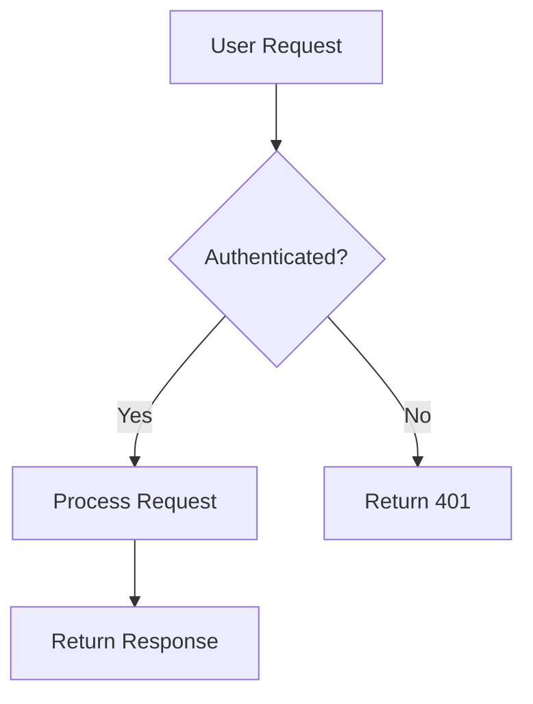
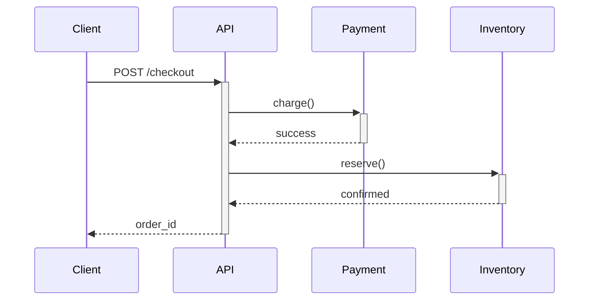
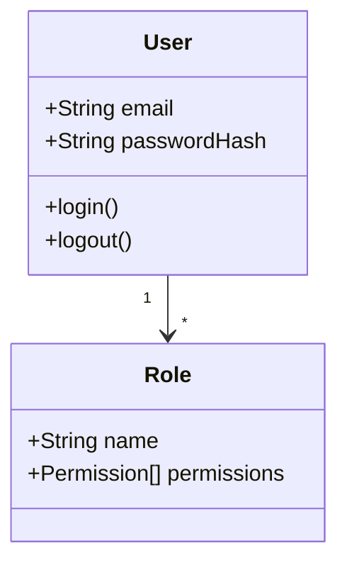

# 9. Розширені патерни (частина A)

_Швидкий перехід:_ [Trinity](#91-trinity) · [Патерни композиції](#92-патерни-композиції) · [Інтеграція CI/CD](#93-інтеграція-cicd) · [Інтеграція з IDE](#94-інтеграція-з-ide) · [Щільні цикли зворотного зв'язку](#95-щільні-цикли-зворотного-звязку)

---

> **Передумова**: Прочитайте [4.1 Що таке агенти](#41-що-таке-агенти) та [3.1 CLAUDE.md](#31-файли-памяті-claudemd) перед зануренням у 9.17-9.20.

> **Новачок у Claude Code?** Почніть з розділів 1-3. Розділ 9 має найбільший сенс після 1-2 місяців щоденного використання.

## 📌 Секція 9 — короткий підсумок (3 хвилини)

**Що ви вивчите**: Виробничі робочі процеси, що поєднують кілька функцій Claude Code.

### Категорії патернів:

**🎯 Trinity (9.1)** — Найкращий робочий процес: режим планування → поглиблені роздуми → Sequential MCP
- Коли: Архітектурні рішення, складний рефакторинг, критичні системи
- Чому: Максимальна здатність до міркувань + безпечне дослідження

**🔄 Патерни інтеграції (9.2-9.4)**
- Композиція: Агенти + навички + хуки, що працюють разом
- CI/CD: GitHub Actions, автоматизовані рецензії, шлюзи якості
- IDE: VS Code + Claude Code = безшовний потік

**⚡ Патерни продуктивності (9.5-9.8)**
- Щільні цикли зворотного зв'язку: тест-орієнтовані з миттєвою валідацією
- Todo як дзеркала: тримайте контекст узгодженим з реальністю
- Вайб-кодинг: скелет → ітерація → продакшн

**🎨 Патерни якості (9.9-9.11)**
- Пакетні операції: ефективна обробка кількох файлів
- Безперервне вдосконалення: покращення протягом кількох сесій
- Типові помилки: вчіться на помилках (списки "Робити/Не робити")

### Коли використовувати цей розділ:
- ✅ Ви продуктивні з основами і хочете майстерності
- ✅ Ви налаштовуєте командні робочі процеси або CI/CD
- ✅ Ви досягли меж простого підходу "запитай Claude"
- ❌ Ви все ще вивчаєте основи (спочатку закінчіть розділи 1-8)

---

**Час читання**: 20 хвилин
**Рівень навичок**: Місяць 1+
**Мета**: Опанувати техніки досвідченого користувача

---

## 🌍 Галузевий контекст: Тренди агентного кодингу 2026

> **Джерело**: [Anthropic "2026 Agentic Coding Trends Report"](https://resources.anthropic.com/hubfs/2026%20Agentic%20Coding%20Trends%20Report.pdf) (лютий 2026)

Патерни цього розділу відображають еволюцію індустрії, задокументовану Anthropic серед 5000+ організацій.

### 📊 Дані про впровадження

| Патерн | Час впровадження | Приріст продуктивності | Бізнес-вплив |
|---------|------------------|-----------------------|---------------|
| **Команди агентів** (9.20) | 3-6 міс. | 50-67% | Терміни: тижні → дні |
| **Мульти-екземпляри** (9.17) | 1-2 міс. | 2x output | Вартість: $500-1K/міс. |
| **Ізоляція пісочниці** (guide/sandbox-native.md) | Негайно | Базовий рівень безпеки | Вимога відповідності |

### 🎯 Дослідницькі висновки (внутрішнє дослідження Anthropic)

- **60% роботи** використовує AI (проти 0% у 2023)
- **0-20% "повністю делеговано"** → Співпраця в центрі, а не заміна
- **67% більше PRs merged** на інженера на день
- **27% нової роботи** не було б виконано без AI (дослідницька, бажана)

### ⚠️ Корпоративні анти-патерни

**Надмірне делегування** (забагато агентів):
- Симптом: Вартість перемикання контексту > приріст продуктивності
- Межа: >5 одночасних агентів = координаційні накладні витрати
- Виправлення: Почніть з 1-2 агентів, масштабуйте поступово

**Передчасна автоматизація**:
- Симптом: Автоматизація робочого процесу, не опанованого вручну
- Виправлення: Вручну → Напівавтоматично → Повністю автоматично (поступово)

**Розростання інструментів** (MCP проліферація):
- Симптом: >10 MCP серверів, конфлікти, навантаження на підтримку
- Виправлення: Почніть з основного стеку (Serena, Context7, Sequential), додавайте вибірково

### 📚 Галузеві кейси

- **Fountain** (управління персоналом): На 50% швидший скринінг через ієрархічний мульти-агент
- **Rakuten** (технології): 7-годинна автономна реалізація vLLM (12.5M рядків, 99.9% точність)
- **CRED** (фінтех): 2x швидкість виконання, якість збережена (15M користувачів)
- **TELUS** (телеком): 500K зекономлених годин, 13K кастомних рішень
- **Zapier** (автоматизація): 89% впровадження, 800+ внутрішніх агентів

### 🔗 Навігація

Кожен патерн нижче включає:
- ✅ **Галузеве підтвердження** (статистика впровадження, ROI)
- ✅ **Практичний посібник** (покрокові робочі процеси)
- ✅ **Анти-патерни** (пастки, яких слід уникати)

**Повна оцінка**: [`docs/resource-evaluations/anthropic-2026-agentic-coding-trends.md`](../docs/resource-evaluations/anthropic-2026-agentic-coding-trends.md)

---

## 9.1 Trinity

Найпотужніший патерн Claude Code поєднує три техніки:

```
┌─────────────────────────────────────────────────────────┐
│                      THE TRINITY                        │
├─────────────────────────────────────────────────────────┤
│                                                         │
│   ┌─────────────┐                                       │
│   │ Plan Mode   │  Безпечне дослідження без змін        │
│   └──────┬──────┘                                       │
│          │                                              │
│          ▼                                              │
│   ┌─────────────┐                                       │
│   │ Ext.Thinking│  Глибокий аналіз (Opus 4.5/4.6, adaptive в 4.6) │
│   └──────┬──────┘                                       │
│          │                                              │
│          ▼                                              │
│   ┌─────────────────────┐                               │
│   │ Sequential Thinking │  Структуроване багатокрокове міркування │
│   └─────────────────────┘                               │
│                                                         │
│   Разом: Максимальне розуміння перед дією              │
│                                                         │
└─────────────────────────────────────────────────────────┘
```

### Коли використовувати Trinity

| Ситуація | Використовувати Trinity? |
|-----------|--------------------------|
| Виправлення друкарської помилки | ❌ Надмірність |
| Додавання функції | Можливо |
| Налагодження складної проблеми | ✅ Так |
| Архітектурне рішення | ✅ Так |
| Модернізація застарілої системи | ✅ Так |

### Extended Thinking (Opus 4.5+) та Adaptive Thinking (Opus 4.6+)

> **⚠️ Зміна, що ламає сумісність (Opus 4.6, лютий 2026)**: Opus 4.6 замінює **бюджетне мислення** на **адаптивні роздуми**, які автоматично вирішують, коли використовувати глибоке міркування на основі складності запиту. Параметр `budget_tokens` є **застарілим** на Opus 4.6+.

#### Еволюція

| Версія | Підхід до мислення | Метод керування |
|---------|-------------------|----------------|
| **Opus 4.5** (pre-v2.0.67) | Опціонально, за ключовими словами (~4K/10K/32K токенів) | Ключові слова в prompt |
| **Opus 4.5** (v2.0.67+) | Завжди увімкнено з макс. бюджетом | Alt+T вкл/викл, `/config` |
| **Opus 4.6** (лютий 2026) | **Адаптивні роздуми** (динамічна глибина) | Параметр `effort` (API), Alt+T (CLI) |
| **Opus 4.7** (квітень 2026) | **Адаптивні роздуми + xhigh** (новий рівень effort) | Параметр `effort` (API), Alt+T (CLI) |

#### Adaptive Thinking (Opus 4.6 та Opus 4.7)

**Як це працює**: Параметр `effort` контролює **загальний обчислювальний бюджет** моделі — не лише токени мислення, а всю відповідь, включаючи генерацію тексту та виклики інструментів. Модель динамічно розподіляє цей бюджет на основі складності запиту.

**Ключове розуміння**: `effort` впливає на все, навіть коли мислення вимкнено. Нижчий effort = менше викликів інструментів, стисліший текст. Вищий effort = більше викликів з поясненнями, детальний аналіз.

**Рівні `effort`** (лише API, офіційні описи):
- **`max`**: Максимальна здатність, без обмежень. **Тільки Opus 4.7+** (повертає помилку на інших моделях). Міжсистемне міркування, незворотні рішення.
  > Приклад: `"Проаналізуй пайплайн подій мікросервісів на предмет станів гонитви в order-service, inventory-service та notification-service"`
- **`xhigh`** _(Opus 4.7+, v2.1.114+)_: Екстра-високий effort, між `high` та `max`. **Типовий у Claude Code (всі плани) з Opus 4.7.** Використовуйте, коли потрібна більша глибина міркувань без повної затримки `max`.
  > Приклад: `"Налагодь стан гонитви в розподіленій черзі завдань з конкурентними записами"`
- **`high`** (типовий для API): Складні міркування, кодування, агенти. Найкраще для виробничих робочих процесів, що потребують глибокого аналізу.
  > Приклад: `"Перероби обробку помилок у модулі платежів: додай логіку повторів, часткове відновлення після збоїв та гарантії ідемпотентності"`
- **`medium`**: Баланс між швидкістю, вартістю та продуктивністю. Добре для задач агентів з помірною складністю.
  > Приклад: `"Конвертуй fetchUser() в api/users.ts з колбеків на async/await"`
- **`low`**: Найефективніший. Ідеально для класифікації, пошуку, підагентів або завдань, де швидкість важливіша за глибину.
  > Приклад: `"Перейменуй getUserById на findUserById у всіх src/"`

> Див. [Розділ 2.5 Вибір моделі та керівництво з мислення](#25-модель-селекшн--thinking-guide) для повної таблиці рішень з effort, моделлю та оцінками вартості.

**Синтаксис API**:
```python
response = client.messages.create(
    model="claude-opus-4-7",
    max_tokens=16000,
    output_config={"effort": "xhigh"},  # low|medium|high|xhigh|max
    messages=[{"role": "user", "content": "Analyze..."}]
)
```

**Effort та використання інструментів**:

Параметр `effort` значно впливає на те, як Claude використовує інструменти:

- **`low` effort**: Об'єднує операції, щоб мінімізувати виклики інструментів. Без вступних пояснень перед діями. Швидше, ефективніше для простих завдань.
- **`high` effort**: Більше викликів інструментів з детальними поясненнями. Описує план перед виконанням. Надає вичерпні підсумки після операцій. Краще для складних робочих процесів, що потребують прозорості.

**Приклад**: З `low` effort, Claude може прочитати 3 файли та відредагувати їх в одному потоці. З `high` effort, Claude пояснює, чому читає ці файли, що шукає, а потім надає детальний підсумок змін.

**Зв'язок між `effort` та мисленням**:

- **Opus 4.6**: `effort` є **рекомендованим контролем** для глибини мислення. Параметр `budget_tokens` є **застарілим** на 4.6 (хоча все ще функціональний для зворотної сумісності).
- **Opus 4.5**: `effort` працює **паралельно** з `budget_tokens`. Обидва параметри підтримуються і впливають на різні аспекти відповіді.
- **Без увімкненого мислення**: `effort` все одно контролює генерацію тексту та виклики інструментів. Це не параметр лише для мислення.

**Використання в CLI**: Три методи керування рівнем effort у Claude Code:
1. **Команда `/model`** з клавішами вліво/вправо для регулювання повзунка effort (`low`, `medium`, `high`)
2. **Змінна середовища `CLAUDE_CODE_EFFORT_LEVEL`** (встановити перед запуском Claude)
3. **Поле `effortLevel`** в settings.json (постійне між сесіями)

Alt+T вмикає/вимикає мислення глобально (окремо від рівня effort).

#### Керування режимом мислення

| Метод | Opus 4.5 | Opus 4.6 | Постійність |
|--------|----------|----------|-------------|
| **Alt+T** (Option+T на macOS) | Вкл/викл | Вкл/викл | Поточна сесія |
| **/config** → Режим мислення | Увімкнути/вимкнути глобально | Увімкнути/вимкнути глобально | Між сесіями |
| **Повзунок `/model`** (клавіші вліво/вправо) | `low\|medium\|high` | `low\|medium\|high` | Поточна сесія |
| **Змінна середовища `CLAUDE_CODE_EFFORT_LEVEL`** | `low\|medium\|high` | `low\|medium\|high` | Сесія shell |
| **`effortLevel`** в settings.json | `low\|medium\|high` | `low\|medium\|high` | Постійно |
| **Ctrl+O** | Перегляд блоків мислення | Перегляд блоків мислення | Лише відображення |

#### Вартісні наслідки

Токени мислення оплачуються. З адаптивними роздумами:
- **Opus 4.6**: Використання мислення варіюється динамічно (менш передбачувано, ніж фіксований бюджет)
- **Прості завдання**: Розгляньте Alt+T для вимкнення → швидші відповіді, нижча вартість
- **Складні завдання**: Залиште увімкненим → краще міркування, адаптивна глибина
- **Sonnet/Haiku**: Extended thinking недоступний (тільки Opus 4.5/4.6)

#### Міграція для існуючих користувачів

**До** (більше не потрібно):
```bash
claude -p "Ultrathink. Проаналізуй цю архітектуру."
```

**Після** (мислення вже на максимумі за замовчуванням):
```bash
claude -p "Проаналізуй цю архітектуру."
```

**Щоб вимкнути мислення для простих завдань**: Натисніть Alt+T перед відправкою або використовуйте Sonnet.

#### Довідка застарілих ключових слів

> Ці ключові слова працювали до v2.0.67. Тепер вони розпізнаються візуально, але **не мають поведінкового ефекту**.

| Ключове слово | Попередній ефект | Поточний ефект |
|---------|-----------------|----------------|
| "Think" | ~4K токенів | Лише косметичний |
| "Think hard" | ~10K токенів | Лише косметичний |
| "Ultrathink" | ~32K токенів | Лише косметичний |

#### Зміни в API, що ламають сумісність (Opus 4.6)

**Видалені функції**:
- **`assistant-prefill`**: Застарілий на Opus 4.6. Раніше дозволяв попередньо заповнювати відповідь Claude для керування форматом виводу. Тепер не підтримується — використовуйте системні prompts або приклади.

**Нові функції**:
- **Fast mode API**: Додайте `speed: "fast"` + beta-заголовок `fast-mode-2026-02-01` для 2.5x швидших відповідей (6x вартість)
  ```python
  response = client.messages.create(
      model="claude-opus-4-6",
      speed="fast",  # 2.5x швидше, 6x ціна
      headers={"anthropic-beta": "fast-mode-2026-02-01"},
      messages=[...]
  )
  ```

**Міграція**:
- Якщо використовували `assistant-prefill`: Замініть на явні інструкції в системному prompt
- Для швидкості: Використовуйте fast mode API або команду `/fast` в CLI

### Приклад: Використання Trinity

```
Ви: /plan

Давайте проаналізуємо цю застарілу систему аутентифікації, перш ніж щось чіпати.
[Режим мислення увімкнено за замовчуванням з Opus 4.5 — ключове слово не потрібне]

[Claude входить у Plan Mode та виконує глибокий аналіз]

Claude: Я проаналізував систему аутентифікації. Ось що я знайшов:
- 47 файлів залежать від поточного модуля auth
- 3 критичні проблеми безпеки
- Шлях міграції потребує 4 фази

Готові до впровадження?

Ви: /execute
Почнімо з фази 1
```
## 9.2 Патерни композиції

### Багатоагентне делегування

Запустіть кілька агентів для різних аспектів:

```
Ви: Для цієї функції мені потрібно:
1. Бекенд-архітектор для проектування API
2. Рев'юер безпеки для аудиту дизайну
3. Інженер тестування для планування тестів

Запустіть це паралельно.
```

Claude координуватиме:
- Бекенд-архітектор проектує API
- Рев'юер безпеки аудить (паралельно)
- Інженер тестування планує тести (паралельно)

### Стекінг навичок

Комбінуйте кілька навичок для складних завдань:

```yaml
# code-reviewer.md
skills:
  - security-guardian
  - performance-patterns
  - accessibility-checker
```

Тепер рев'юер має всі три області знань.

### Патерн "Rev the Engine"

Для якісної роботи використовуйте кілька раундів критики:

```
Ви: Напиши функцію, потім розкритикуй її, потім покращ.
Зроби це 3 рази.

Раунд 1: [Початкова реалізація]
Критика: [Що не так]
Покращення: [Краща версія]

Раунд 2: [Покращена реалізація]
Критика: [Що все ще не так]
Покращення: [Ще краща версія]

Раунд 3: [Фінальна реалізація]
Фінальна перевірка: [Верифікація]
```

### Патерн "Stack Maximum"

Для критичної роботи комбінуйте все:

```
1. Plan Mode + Extended Thinking → Глибоке дослідження
2. Кілька агентів → Спеціалізований аналіз
3. Sequential Thinking → Структуроване міркування
4. Rev the Engine → Ітеративне покращення
5. Агент рев'ю коду → Фінальна валідація
```

## 9.3 Інтеграція CI/CD

> **📖 Повний посібник з робочих процесів**: Див. [GitHub Actions Workflows](./workflows/github-actions.md) для 5 продакшн-готових патернів з використанням офіційного `anthropics/claude-code-action` (рев'ю PR, тріаж, безпека, планове обслуговування).

> **Рев'ю коду (Teams/Enterprise)**: Для автоматизованого рев'ю PR без ручного запиту див. [Code Review](./workflows/code-review.md) — багатоагентна функція рев'ю від Anthropic, яка публікує інлайнові коментарі на GitHub на кожному PR.

### Headless Mode

Запуск Claude Code без інтерактивних запитів:

```bash
# Базове виконання без голови
claude -p "Запусти тести та повідом результати"

# З тайм-аутом
claude -p --timeout 300 "Збери проект"

# З конкретною моделлю
claude -p --model sonnet "Проаналізуй якість коду"
```

### Робочі процеси з Unix пайпами

Claude Code підтримує **операції з Unix пайпами**, що дозволяє потужну інтеграцію з shell для автоматизованого аналізу та трансформації коду.

**Як працюють пайпи**:

```bash
# Передача вмісту в Claude з prompt
cat file.txt | claude -p 'проаналізуй цей код'

# Передача виводу команди для аналізу
git diff | claude -p 'поясни ці зміни'

# Ланцюжок команд з Claude
npm test 2>&1 | claude -p 'підсумуй помилки тестів та запропонуй виправлення'
```

**Поширені патерни**:

1. **Автоматизація рев'ю коду**:
   ```bash
   git diff main...feature-branch | claude -p 'Переглянь цей diff на предмет проблем безпеки'
   ```

2. **Аналіз логів**:
   ```bash
   tail -n 100 /var/log/app.log | claude -p 'Знайди першопричину помилок'
   ```

3. **Парсинг виводу тестів**:
   ```bash
   npm test 2>&1 | claude -p 'Створи підсумок невдалих тестів з пріоритетами'
   ```

4. **Генерація документації**:
   ```bash
   cat src/api/*.ts | claude -p 'Згенеруй API документацію в Markdown'
   ```

5. **Пакетний аналіз файлів**:
   ```bash
   find . -name "*.js" -exec cat {} \; | claude -p 'Визнач невикористані залежності'
   ```

**Використання з `--output-format`**:

```bash
# Отримання структурованого JSON виводу
git status --short | claude -p 'Категоризуй зміни' --output-format json

# Стрімінг JSON для обробки в реальному часі
cat large-file.txt | claude -p 'Аналізуй рядок за рядком' --output-format stream-json
```

**Найкращі практики**:

- **Будьте конкретними**: Чіткі prompts дають кращі результати
  ```bash
  # Добре: Конкретне завдання
  git diff | claude -p 'Перелічи всі зміни сигнатур функцій'

  # Менш ефективно: Розпливчастий запит
  git diff | claude -p 'проаналізуй це'
  ```

- **Обмежуйте вхідний обсяг**: Передавайте лише релевантний вміст, щоб уникнути перевантаження контексту
  ```bash
  # Добре: Відфільтрований обсяг
  git diff --name-only | head -n 10 | xargs cat | claude -p 'переглянь'

  # Ризиковано: Може перевищити контекст
  cat entire-codebase/* | claude -p 'переглянь'
  ```

- **Використовуйте неінтерактивний режим**: Додайте `-p` для автоматизації
  ```bash
  cat file.txt | claude -p -p 'виправ помилки лінтингу' > output.txt
  ```

- **Комбінуйте з jq для JSON**: Парсинг JSON виводу Claude
  ```bash
  echo "const x = 1" | claude -p 'проаналізуй' --output-format json | jq '.suggestions[]'
  ```

**Керування форматом виводу**:

Прапорець `--output-format` керує форматом відповіді Claude:

| Формат | Випадок використання | Приклад |
|--------|----------------------|---------|
| `text` | Читабельний вивід (типовий) | `claude -p 'поясни' --output-format text` |
| `json` | Машиночитані структуровані дані | `claude -p 'проаналізуй' --output-format json` |
| `stream-json` | Стрімінг в реальному часі для великих виводів | `claude -p 'трансформуй' --output-format stream-json` |

**Приклад JSON робочого процесу**:

```bash
# Отримати структурований аналіз
git log --oneline -10 | claude -p 'Категоризуй коміти за типом' --output-format json

# Вивід:
# {
#   "categories": {
#     "features": ["add user auth", "new dashboard"],
#     "fixes": ["fix login bug", "resolve crash"],
#     "chores": ["update deps", "refactor tests"]
#   },
#   "summary": "10 комітів: 2 features, 2 fixes, 6 chores"
# }
```

**Інтеграція з build-скриптами** (`package.json`):

```json
{
  "scripts": {
    "claude-review": "git diff main | claude -p 'Перевір на проблеми безпеки' --output-format json > review.json",
    "claude-test-summary": "npm test 2>&1 | claude -p -p 'Підсумуй невдачі та запропонуй виправлення'",
    "claude-docs": "cat src/**/*.ts | claude -p 'Згенеруй API документацію' > API.md",
    "precommit-check": "git diff --cached | claude -p -p 'Перевір на секрети або анти-патерни' && git diff --cached | prettier --check"
  }
}
```
**Приклад інтеграції CI/CD**:

```yaml
# .github/workflows/claude-review.yml
name: AI Code Review
on: [pull_request]

jobs:
  claude-review:
    runs-on: ubuntu-latest
    steps:
      - uses: actions/checkout@v4
        with:
          fetch-depth: 0

      - name: Install Claude Code
        run: npm install -g @anthropic-ai/claude-code

      - name: Run Claude Review
        env:
          ANTHROPIC_API_KEY: ${{ secrets.ANTHROPIC_API_KEY }}
        run: |
          git diff origin/main...HEAD | \
            claude -p -p 'Переглянь цей PR diff на предмет проблем безпеки, продуктивності та якості коду. Форматуй як JSON.' \
            --output-format json > review.json

      - name: Comment on PR
        uses: actions/github-script@v7
        with:
          script: |
            const fs = require('fs');
            const review = JSON.parse(fs.readFileSync('review.json', 'utf8'));
            github.rest.issues.createComment({
              issue_number: context.issue.number,
              owner: context.repo.owner,
              repo: context.repo.repo,
              body: `## 🤖 Claude Code Review\n\n${review.summary}`
            });
```

**Обмеження**:

- **Розмір контексту**: Великі пайпи можуть перевищувати ліміти токенів (моніторте через `/status`)
- **Інтерактивні prompts**: Використовуйте `-p` для автоматизації, щоб уникнути блокування
- **Обробка помилок**: Збої пайпів не завжди поширюються; додайте `set -e` для строгого режиму
- **Витрати API**: Автоматизовані пайпи споживають API кредити; моніторте через `ccusage`

> **💡 Порада**: Комбінуйте пайпи з аліасами для часто використовуваних патернів:
> ```bash
> # Додати до ~/.bashrc або ~/.zshrc
> alias claude-review='git diff | claude -p "Переглянь на помилки та запропонуй покращення"'
> alias claude-logs='tail -f /var/log/app.log | claude -p "Монітор помилки та сповіщай про критичні проблеми"'
> ```

> **Джерело**: [DeepTo Claude Code Guide - Unix Piping](https://cc.deeptoai.com/docs/en/best-practices/claude-code-comprehensive-guide)

### Інтеграція з Git хуками

> **Примітка для Windows**: Git хуки запускаються в Git Bash на Windows, тому синтаксис bash нижче працює. Крім того, ви можете створити версії `.cmd` або `.ps1` та посилатися на них з обгорткового скрипта.

**Pre-commit хук**:

```bash
#!/bin/bash
# .git/hooks/pre-commit

# Запуск Claude Code для валідації повідомлення коміту
COMMIT_MSG=$(cat "$1")
claude -p "Чи хороше це повідомлення коміту? '$COMMIT_MSG'. Відповідь YES або NO з причиною."
```

**Pre-push хук**:

```bash
#!/bin/bash
# .git/hooks/pre-push

# Перевірка безпеки перед push
claude -p "Скануй застейджені файли на секрети та проблеми безпеки. Вийди з кодом 1, якщо знайдено."
EXIT_CODE=$?

if [ $EXIT_CODE -ne 0 ]; then
    echo "Знайдено проблеми безпеки. Push заблоковано."
    exit 1
fi
```

### Інтеграція з GitHub Actions

```yaml
# .github/workflows/claude-review.yml
name: Claude Code Review

on:
  pull_request:
    types: [opened, synchronize]

jobs:
  review:
    runs-on: ubuntu-latest
    steps:
      - uses: actions/checkout@v4

      - name: Install Claude Code
        run: npm install -g @anthropic-ai/claude-code

      - name: Run Review
        env:
          ANTHROPIC_API_KEY: ${{ secrets.ANTHROPIC_API_KEY }}
        run: |
          claude -p "Переглянь зміни в цьому PR. \
            Зосередься на безпеці, продуктивності та якості коду. \
            Виведи у форматі markdown." --bare
```

> **Прапорець `--bare` для CI скриптів (v2.1.81+)**: Додайте `--bare` до будь-якого виклику `claude -p`, щоб отримати детерміноване, герметичне середовище виконання. Він вимикає хуки, LSP, синхронізацію плагінів та сканування директорій навичок — гарантуючи, що локальна конфігурація розробника не просочиться в CI. Потребує `ANTHROPIC_API_KEY` (без OAuth/keychain). Також вимикає авто-пам'ять.
>
> ```bash
> # Без --bare: підхоплює локальні хуки, плагіни, навички — недетерміновано в CI
> claude -p "run tests"
>
> # З --bare: чистий аркуш, лише API ключ
> ANTHROPIC_API_KEY=$SECRET claude -p "run tests" --bare
> ```

#### Налагодження невдалих CI запусків

Коли GitHub Actions падає, використовуйте `gh` CLI для дослідження без виходу з терміналу:

**Швидкий робочий процес дослідження**:

```bash
# Список останніх запусків workflow
gh run list --limit 10

# Перегляд деталей конкретного запуску
gh run view <run-id>

# Перегляд логів невдалого запуску
gh run view <run-id> --log-failed

# Завантаження логів для детального аналізу
gh run download <run-id>
```

**Поширені команди налагодження**:

| Команда | Призначення |
|---------|-------------|
| `gh run list --workflow=test.yml` | Фільтрація за файлом workflow |
| `gh run view --job=<job-id>` | Перегляд конкретної job |
| `gh run watch` | Спостереження за поточним запуском у реальному часі |
| `gh run rerun <run-id>` | Повторний запуск невдалого |
| `gh run rerun <run-id> --failed` | Повтор лише невдалих jobs |

**Приклад: Дослідження помилок тестів**:

```bash
# Отримати останній невдалий запуск
FAILED_RUN=$(gh run list --status failure --limit 1 --json databaseId --jq '.[0].databaseId')

# Переглянути помилку
gh run view $FAILED_RUN --log-failed

# Попросити Claude проаналізувати
gh run view $FAILED_RUN --log-failed | claude -p "Проаналізуй цю CI помилку та запропонуй виправлення"
```

**Порада**: Комбінуйте з Claude Code для автоматизованого налагодження:

```bash
# Отримати помилки та авто-виправити
gh run view --log-failed | claude -p "
  Проаналізуй ці помилки тестів.
  Визнач першопричину.
  Запропонуй виправлення для кожного невдалого тесту.
  Виведи як конкретні кроки.
"
```

Цей робочий процес економить час порівняно з навігацією веб-інтерфейсом GitHub та дозволяє швидше ітерувати на CI помилках.

### Патерн шлюзу верифікації

Перед створенням PR переконайтесь, що всі локальні перевірки проходять. Це запобігає марним циклам CI та часу рев'ю.

**Патерн**:

```
Build ✓ → Lint ✓ → Test ✓ → Type-check ✓ → ТІЛЬКИ ТОДІ створюй PR
```

**Реалізація як команда** (`.claude/commands/complete-task.md`):

```markdown
# Complete Task

Запусти повний шлюз верифікації перед створенням PR:

1. **Build**: Запусти `pnpm build` — має успішно завершитись
2. **Lint**: Запусти `pnpm lint` — має бути 0 помилок
3. **Test**: Запусти `pnpm test` — всі тести мають пройти
4. **Type-check**: Запусти `pnpm typecheck` — жодних помилок типів

Якщо БУДЬ-ЯКИЙ крок не вдався:
- Зупинись негайно
- Повідом, що не вдалося і чому
- Запропонуй виправлення
- НЕ переходь до створення PR

Якщо ВСІ кроки пройшли:
- Створи PR через `gh pr create`
- Дочекайся CI через `gh pr checks --watch`
- Якщо CI не вдався, отримай фідбек та авто-виправ
- Повторюй, доки не буде mergeable або заблоковано
```

**Автономний цикл повторів**:

```
┌─────────────────────────────────────────┐
│         ШЛЮЗ ВЕРИФІКАЦІЇ + АВТО-ФІКС    │
├─────────────────────────────────────────┤
│                                         │
│   Локальні перевірки (build/lint/test)  │
│        │                                │
│        ▼ НЕВДАЛО?                       │
│   ┌─────────┐                           │
│   │ Авто-фікс│ ──► Повторні перевірки   │
│   └─────────┘                           │
│        │                                │
│        ▼ УСПІШНО                        │
│   Створення PR                          │
│        │                                │
│        ▼                                │
│   Очікування CI (gh pr checks --watch)  │
│        │                                │
│        ▼ НЕВДАЛО?                       │
│   ┌─────────────────────┐               │
│   │ Отримати CI фідбек  │               │
│   │ (CodeRabbit тощо)   │               │
│   └─────────────────────┘               │
│        │                                │
│        ▼                                │
│   Авто-фікс + push + цикл               │
│        │                                │
│        ▼                                │
│   PR mergeable АБО заблоковано (людина) │
│                                         │
└─────────────────────────────────────────┘
```

**Отримання CI фідбеку** (GitHub GraphQL):

```bash
# Отримати статус рев'ю PR та коментарі
gh api graphql -f query='
  query($pr: Int!) {
    repository(owner: "OWNER", name: "REPO") {
      pullRequest(number: $pr) {
        reviewDecision
        reviewThreads(first: 100) {
          nodes {
            isResolved
            comments(first: 1) {
              nodes { body }
            }
          }
        }
      }
    }
  }' -F pr=$PR_NUMBER
```

> Натхненно [Nick Tune's Coding Agent Development Workflows](https://medium.com/nick-tune-tech-strategy-blog/coding-agent-development-workflows-af52e6f912aa)
### Генерація нотаток релізу

Автоматизуйте створення нотаток релізу та чейнджлогу за допомогою Claude Code.

**Чому автоматизувати нотатки релізу?**
- Узгоджений формат між релізами
- Фіксує технічні деталі з комітів
- Перекладає технічні зміни на мову користувача
- Економить 30-60 хвилин на реліз

**Патерн**: Git коміти → Аналіз Claude → Зручні для користувача нотатки релізу

#### Підхід 1: На основі команд

Створіть `.claude/commands/release-notes.md`:

```markdown
# Generate Release Notes

Проаналізуй git коміти з моменту останнього релізу та згенеруй нотатки релізу.

## Процес

1. **Отримати коміти з моменту останнього тегу**:
   ```bash
   git log $(git describe --tags --abbrev=0)..HEAD --oneline
   ```

2. **Прочитати повні деталі комітів**:
   - Включити повідомлення комітів
   - Включити зміни файлів
   - Включити номери PR, якщо присутні

3. **Категоризувати зміни**:
   - **✨ Функції** - Нова функціональність
   - **🐛 Виправлення** - Вирішення проблем
   - **⚡ Продуктивність** - Покращення швидкості/ефективності
   - **🔒 Безпека** - Патчі безпеки
   - **📝 Документація** - Оновлення документації
   - **🔧 Обслуговування** - Рефакторинг, залежності
   - **⚠️ Зміни, що ламають сумісність** - Зміни API (виділити prominently)

4. **Згенерувати три версії**:

   **A. Формат CHANGELOG.md** (технічний, для розробників):
   ```markdown
   ## [Версія] - РРРР-ММ-ДД

   ### Додано
   - Опис функції з посиланням на PR

   ### Виправлено
   - Опис виправлення

   ### Змінено
   - Зміна, що ламає сумісність, з інструкцією міграції
   ```

   **B. GitHub Release Notes** (збалансований, технічний + контекст):
   ```markdown
   ## Що нового

   Короткий підсумок релізу

   ### ✨ Нові функції
   - Опис функції для користувача

   ### 🐛 Виправлення помилок
   - Опис вирішення проблеми

   ### ⚠️ Зміни, що ламають сумісність
   - Інструкції міграції

   **Повний чейнджлог**: v1.0.0...v1.1.0
   ```

   **C. Анонс для користувачів** (нетехнічний, фокус на перевагах):
   ```markdown
   Ми раді оголосити [Версія]!

   **Основне**:
   - Що користувачі тепер можуть робити
   - Як це їм допомагає
   - Коли це використовувати

   [Посилання на повні нотатки релізу]
   ```

5. **Вивести файли**:
   - Додати на початок `CHANGELOG.md`
   - Зберегти в `release-notes-[версія].md`
   - Скопіювати "Анонс для користувачів" в буфер для Slack/блогу

## Верифікація

- Перевірте пропущені зміни, що ламають сумісність
- Переконайтесь, що всі посилання на PR дійсні
- Переконайтесь, що інструкції міграції зрозумілі
```

#### Підхід 2: CI/CD автоматизація

Додайте до `.github/workflows/release.yml`:

```yaml
name: Release

on:
  push:
    tags:
      - 'v*'

jobs:
  release:
    runs-on: ubuntu-latest
    steps:
      - uses: actions/checkout@v4
        with:
          fetch-depth: 0  # Повна історія для чейнджлогу

      - name: Generate Release Notes
        env:
          ANTHROPIC_API_KEY: ${{ secrets.ANTHROPIC_API_KEY }}
          GITHUB_TOKEN: ${{ secrets.GITHUB_TOKEN }}
        run: |
          # Отримати версію з тегу
          VERSION=${GITHUB_REF#refs/tags/}

          # Згенерувати з Claude
          claude -p "Згенеруй нотатки релізу для $VERSION. \
            Проаналізуй коміти з моменту останнього тегу. \
            Виведи у форматі GitHub Release. \
            Збережи в release-notes.md"

          # Створити GitHub Release
          gh release create $VERSION \
            --title "Release $VERSION" \
            --notes-file release-notes.md

      - name: Update CHANGELOG.md
        run: |
          # Додати на початок CHANGELOG
          cat release-notes.md CHANGELOG.md > CHANGELOG.tmp
          mv CHANGELOG.tmp CHANGELOG.md

          # Закомітити назад
          git config user.name "github-actions[bot]"
          git config user.email "github-actions[bot]@users.noreply.github.com"
          git add CHANGELOG.md
          git commit -m "docs: update changelog for $VERSION"
          git push
```

#### Підхід 3: Інтерактивний робочий процес

Для більшого контролю використовуйте інтерактивну сесію:

```bash
# 1. Запустити Claude Code
claude

# 2. Запросити нотатки релізу
Ви: "Згенеруй нотатки релізу для v2.0.0"

# 3. Claude:
# - Запустить git log для отримання комітів
# - Поставить уточнюючі питання:
#   - "Це major/minor/patch реліз?"
#   - "Чи є зміни, що ламають сумісність, про які користувачі мають знати?"
#   - "Цільова аудиторія анонсу?"

# 4. Перегляд та доопрацювання
Ви: "Додай більше деталей про функцію аутентифікації"

# 5. Фіналізація
Ви: "Збережи ці нотатки та онови CHANGELOG.md"
```

#### Найкращі практики

**Перед генерацією:**
- ✅ Переконайтесь, що коміти слідують формату conventional commits
- ✅ Всі PR мають бути змержені
- ✅ Номер версії визначено (semver)

**Під час генерації:**
- ✅ Перевірте точність (Claude може пропустити контекст)
- ✅ Додайте інструкції міграції для змін, що ламають сумісність
- ✅ Включіть інструкції з оновлення, якщо потрібно

**Після генерації:**
- ✅ Звірте з закритими issues/PR
- ✅ Протестуйте шлях оновлення на staging проекті
- ✅ Поділіться чернеткою з командою перед публікацією

#### Приклад виводу

Дано такі коміти:
```
feat: додано завантаження аватарів користувачів (PR #123)
fix: вирішено проблему тайм-ауту входу (PR #124)
perf: оптимізовано запити до БД на 40% (PR #125)
BREAKING: змінено API ендпоінти з /api/v1 на /v2 (PR #126)
```

Claude генерує:

**CHANGELOG.md** (технічний):
```markdown
## [2.0.0] - 2025-01-10

### Додано
- Функціональність завантаження аватарів користувачів (#123)

### Виправлено
- Проблема тайм-ауту входу, що впливала на мобільних користувачів (#124)

### Продуктивність
- Оптимізовано запити до БД, зменшено час завантаження на 40% (#125)

### Зміни, що ламають сумісність
- **API ендпоінти**: Міграція з `/api/v1/*` на `/v2/*`
  - Оновіть клієнтський код: замініть `/api/v1/` на `/v2/`
  - Старі ендпоінти повертатимуть 410 Gone після 2025-02-01
  - Посібник міграції: docs/migration-v2.md (#126)
```

**GitHub Release** (збалансований):
```markdown
## Що нового в v2.0.0

Цей реліз приносить покращення продуктивності, виправлення помилок та нову функцію аватара.

### ✨ Нові функції
- **Завантаження аватара**: Користувачі тепер можуть завантажувати власні зображення профілю

### 🐛 Виправлення помилок
- Виправлено проблему тайм-ауту входу, що впливала на деяких мобільних користувачів

### ⚡ Продуктивність
- Запити до БД тепер на 40% швидші

### ⚠️ Зміни, що ламають сумісність
- **Міграція API ендпоінтів**: Всі ендпоінти переміщено з `/api/v1` на `/v2`
  - **Необхідна дія**: Оновіть клієнтський код API
  - **Термін**: Старі ендпоінти припинять роботу 1 лютого 2025
  - **Посібник міграції**: [Див. docs/migration-v2.md](./docs/migration-v2.md)

**Повний чейнджлог**: v1.9.0...v2.0.0
```

**Анонс для користувачів** (нетехнічний):
```markdown
📢 Версія 2.0 тут!

Ми зробили ваш досвід швидшим та більш персоналізованим:

✨ **Налаштуйте профіль** - Завантажте власний аватар
⚡ **Блискавично швидко** - Сторінки завантажуються на 40% швидше
🐛 **Надійніше** - Виправлено проблему тайм-ауту входу

**Для розробників**: Це реліз зі змінами, що ламають сумісність. Див. посібник міграції для змін API.

[Читати повні нотатки релізу →]
```

#### Поширені проблеми

**"Нотатки релізу занадто технічні"**
- Рішення: Вкажіть аудиторію в prompt: "Згенеруй для нетехнічних користувачів"

**"Claude пропустив зміну, що ламає сумісність"**
- Рішення: Явно перелічіть зміни, що ламають сумісність, у prompt
- Краще: Використовуйте префікс "BREAKING:" у повідомленнях комітів

**"Згенеровані нотатки є загальними"**
- Рішення: Надайте більше контексту: "Цей реліз зосереджений на мобільній продуктивності"

**"Коміти безладні/незрозумілі"**
- Рішення: Очистіть історію комітів перед генерацією (interactive rebase)
- Краще: Запровадьте формат повідомлень комітів через git хуки
### Фрагменти чейнджлогу: патерн примусу через PR

Альтернатива генерації нотаток релізу з комітів — фіксувати контекст _під час реалізації_, а не під час релізу. Патерн "фрагменти чейнджлогу" замінює спільний `CHANGELOG.md` одним YAML файлом на PR, накопиченим у `changelog/fragments/`, який автоматично збирається під час релізу.

**Основна проблема підходів на основі комітів**: на момент запуску `git log` для генерації нотаток релізу контекст втрачено. Розробник, який виправив стан гонитви три тижні тому, є єдиним, хто розуміє вплив. Повідомлення коміту каже "fix SSE handling".

### Автоматизація деплою

Claude Code може автоматизувати деплой на Vercel, GCP та інші платформи, використовуючи збережені облікові дані. Ключ — зібрати три компоненти: управління секретами, навичку деплою та обов'язкові запобіжники.

#### Необхідні секрети

Зберігайте облікові дані в зв'язці ключів ОС, а не в `.env` файлах:

```bash
# Vercel деплой (3 необхідні змінні)
security add-generic-password -a claude -s VERCEL_TOKEN -w "your_token"
security add-generic-password -a claude -s VERCEL_ORG_ID -w "your_org_id"
security add-generic-password -a claude -s VERCEL_PROJECT_ID -w "your_project_id"

# Отримання в скриптах
VERCEL_TOKEN=$(security find-generic-password -s VERCEL_TOKEN -w)
```

Для багатоплатформових секретів (GitHub, Vercel, AWS одночасно), **Infisical** надає централізоване управління з версіонуванням та відновленням на будь-який момент часу — корисна open-source альтернатива HashiCorp Vault:

```bash
# Встановлення Infisical CLI
brew install infisical/get-cli/infisical

# Впровадження секретів у сесію Claude Code
infisical run -- claude
# Infisical автоматично встановлює всі секрети проекту як змінні середовища
```

#### Навичка деплою

Створіть навичку, яка інкапсулює повний робочий процес деплою:

```yaml
---
name: deploy-to-vercel
description: Деплой на Vercel staging, потім продакшн зі smoke тестами
allowed-tools: Bash
---

## Робочий процес деплою

1. Запусти тести: `pnpm test` — зупинись, якщо будь-який не вдався
2. Build: `pnpm build` — зупинись, якщо build не вдався
3. Деплой на staging: `vercel deploy`
4. Запусти smoke тести на staging URL
5. **ПАУЗА** — виведи staging URL та запитай підтвердження людини перед продакшном
6. Після схвалення: `vercel deploy --prod`
7. Перевір, що production URL відповідає з HTTP 200
```

#### Необговорювані запобіжники

Ці запобіжники не є опціональними. Продакшн деплої без них створюють інциденти:

| Запобіжник | Реалізація | Чому |
|-----------|-------------|------|
| **Staging-first** | Завжди деплой на staging перед продакшном | Виявлення специфічних для середовища помилок |
| **Підтвердження людини** | Зупинись і запитай перед `--prod` | Жодних автономних продакшн деплоїв |
| **Smoke тест** | Перевірка HTTP 200 на ключових ендпоінтах після деплою | Виявлення "тихих" невдалих деплоїв |
| **Готовність до відкату** | Зберігай попередній ID деплою перед promotion | `vercel rollback <deployment-id>` |

**Хук для підтвердження** (запобігання випадковим продакшн деплоям):

```json
// .claude/settings.json
{
  "hooks": {
    "PreToolUse": [{
      "matcher": "Bash",
      "hooks": [{
        "type": "command",
        "command": "scripts/check-prod-deploy.sh"
      }]
    }]
  }
}
```

```bash
#!/bin/bash
# check-prod-deploy.sh — exit 2 для блокування, exit 0 для дозволу
INPUT=$(cat)
if echo "$INPUT" | grep -q "vercel deploy --prod\|gcloud deploy.*production"; then
  echo "ЗАБЛОКОВАНО: Продакшн деплой потребує ручного підтвердження. Запустіть команду безпосередньо з терміналу."
  exit 2
fi
exit 0
```

> **Джерела**: Патерн навички Vercel деплою задокументовано спільнотою (lobehub.com, haniakrim21); багатоплатформове управління секретами Infisical на [infisical.com](https://infisical.com). Жодного наскрізного автоматизованого робочого процесу деплою не існує в спільноті станом на березень 2026 — будівельні блоки доступні, але патерн promotion з staging на продакшн кожна команда збирає самостійно.

## 9.4 Інтеграція з IDE

### Інтеграція з VS Code

Claude Code інтегрується з VS Code:

1. **Встановіть розширення**: Знайдіть "Claude Code" у розширеннях
2. **Налаштуйте**: Встановіть API ключ у налаштуваннях
3. **Використовуйте**:
   - `Ctrl+Shift+P` → "Claude Code: Start Session"
   - Виділіть текст → Права кнопка → "Ask Claude"

### Інтеграція з JetBrains

Працює з IntelliJ, WebStorm, PyCharm:

1. **Встановіть плагін**: Налаштування → Плагіни → "Claude Code"
2. **Налаштуйте**: Інструменти → Claude Code → Встановіть API ключ
3. **Використовуйте**:
   - `Ctrl+Shift+A` → "Claude Code"
   - Вікно інструменту для постійної сесії

### Інтеграція з Xcode (лютий 2026)

**Нове**: Xcode 26.3 RC+ включає нативну підтримку Claude Agent SDK, використовуючи той самий механізм, що й Claude Code:

1. **Вимоги**: Xcode 26.3 RC або новіша (macOS)
2. **Налаштування**: Налаштуйте API ключ у Xcode → Preferences → Claude
3. **Використовуйте**:
   - Вбудований помічник коду на основі Claude
   - Ті самі можливості, що у Claude Code CLI
   - Нативна інтеграція з робочими процесами Xcode

**Claude Agent SDK**: Окремий продукт від Claude Code, але використовує ту саму структуру виконання агентів. Дозволяє створювати інструменти розробки на основі Claude в IDE, окрім VS Code.

> **Примітка**: Claude Agent SDK — це не Claude Code, це фреймворк Anthropic для створення інструментів розробки на основі агентів. Claude Code CLI та інтеграція з Xcode використовують цей SDK.

### Інтеграція з терміналом

Для нативного термінального робочого процесу:

#### macOS/Linux (Bash/Zsh)

```bash
# Додати до .bashrc або .zshrc
alias cc='claude'
alias ccp='claude --plan'
alias cce='claude --execute'

# Швидке питання про код
cq() {
    claude -p "$*"
}
```

Використання:
```bash
cq "Що робить цей regex: ^[a-z]+$"
```

#### Windows (PowerShell)

```powershell
# Додати до $PROFILE (запустіть: notepad $PROFILE для редагування)
function cc { claude $args }
function ccp { claude --plan $args }
function cce { claude --execute $args }

function cq {
    param([Parameter(ValueFromRemainingArguments)]$question)
    claude -p ($question -join ' ')
}
```

Щоб знайти розташування профілю: `echo $PROFILE`

Поширені розташування:
- `C:\Users\YourName\Documents\PowerShell\Microsoft.PowerShell_profile.ps1`
- `C:\Users\YourName\Documents\WindowsPowerShell\Microsoft.PowerShell_profile.ps1`

Якщо файл не існує, створіть його:
```powershell
New-Item -Path $PROFILE -Type File -Force
```

## 9.5 Щільні цикли зворотного зв'язку

**Час читання**: 5 хвилин
**Рівень навичок**: Тиждень 1+

Щільні цикли зворотного зв'язку прискорюють навчання та виявляють проблеми рано. Проектуйте свій робочий процес так, щоб валідувати зміни негайно.

### Піраміда циклів зворотного зв'язку

```
                    ┌─────────────┐
                    │  Deploy     │  ← Години/Дні
                    │  Tests      │
                    ├─────────────┤
                    │  CI/CD      │  ← Хвилини
                    │  Pipeline   │
                    ├─────────────┤
                    │  Local      │  ← Секунди
                    │  Tests      │
                    ├─────────────┤
                    │  TypeCheck  │  ← Негайно
                    │  Lint       │
                    └─────────────┘
```

### Реалізація щільних циклів

#### Рівень 1: Негайний (IDE/Редактор)
```bash
# Watch mode для миттєвого зворотного зв'язку
pnpm tsc --watch
pnpm lint --watch
```

#### Рівень 2: При збереженні (Git хуки)
```bash
# Pre-commit хук
#!/bin/bash
pnpm lint-staged && pnpm tsc --noEmit
```

#### Рівень 3: При коміті (CI)
```yaml
# GitHub Action для перевірок PR
- run: pnpm lint && pnpm tsc && pnpm test
```

### Інтеграція з Claude Code

Використовуйте хуки для автоматичної валідації:

```json
// settings.json
{
  "hooks": {
    "PostToolUse": [{
      "matcher": "Edit|Write",
      "hooks": ["./scripts/validate.sh"]
    }]
  }
}
```

**validate.sh:**
```bash
#!/bin/bash
# Запуск після кожної зміни файлу
FILE=$(echo "$TOOL_INPUT" | jq -r '.file_path // .file')
if [[ "$FILE" == *.ts || "$FILE" == *.tsx ]]; then
    npx tsc --noEmit "$FILE" 2>&1 | head -5
fi
```

| Цикл | Тригер | Час відповіді | Що виявляє |
|------|--------|---------------|------------|
| Lint | При наборі | <1с | Стиль, імпорти |
| TypeCheck | При збереженні | 1-3с | Помилки типів |
| Юніт тести | При збереженні | 5-15с | Логічні помилки |
| Інтеграційні | При коміті | 1-5хв | API контракти |
| E2E | При PR | 5-15хв | Користувацькі сценарії |

💡 **Порада**: Швидші цикли виявляють більше помилок. Інвестуйте в швидкість вашого тестового набору.

### Фонові задачі для fullstack розробки

**Проблема**: Fullstack розробка часто потребує довготривалих процесів (сервери розробки, watcher), які блокують основну сесію Claude, запобігаючи ітеративній роботі над фронтендом.

**Рішення**: Використовуйте `Ctrl+B` для фонових задач і підтримуйте щільні цикли зворотного зв'язку по всьому стеку.

#### Коли відправляти задачі у фон

| Сценарій | Команда для фону | Чому |
|----------|-----------------|------|
| **Сервер розробки запущено** | `pnpm dev` → `Ctrl+B` | Тримає сервер живим під час ітерацій фронтенду |
| **Watcher тестів** | `pnpm test --watch` → `Ctrl+B` | Моніторинг результатів тестів під час кодування |
| **Watcher збірки** | `pnpm build --watch` → `Ctrl+B` | Виявлення помилок збірки без блокування сесії |
| **Міграція БД** | `pnpm migrate` → `Ctrl+B` | Довготривала міграція, робота над іншими функціями |
| **Docker compose** | `docker compose up` → `Ctrl+B` | Інфраструктура запущена, розробка додатку |

#### Fullstack Workflow Pattern

```bash
# 1. Start backend dev server
pnpm dev:backend
# Press Ctrl+B to background

# 2. Now Claude can iterate on frontend
"Update the login form UI to match Figma designs"
# Claude can read files, make changes, all while backend runs

# 3. Check server logs when needed
/tasks  # View background task status

# 4. Bring server back to foreground if needed
# (Currently: no built-in foreground command, restart if needed)
```

#### Real-World Example: API + Frontend Iteration

**Traditional (blocked) flow:**
```bash
$ pnpm dev:backend
# Server starts... Claude waits... session blocked
# Cannot iterate on frontend until server stops
# Kill server → work on frontend → restart server → repeat
```

**Background task flow:**
```bash
$ pnpm dev:backend
# Server starts...
$ Ctrl+B  # Background the server
# Claude is now free to work

"Add loading state to the API calls"
# Claude iterates on frontend
# Backend still running, can test immediately
# Tight feedback loop maintained
```

#### Context Rot Prevention

**Problem**: Long-running background tasks can cause context rot—Claude loses awareness of what's running.

**Solution**: Check task status periodically:

```bash
# Before major changes
/tasks

# Output example:
# Task 1 (background): pnpm dev:backend
#   Status: Running (35 minutes)
#   Last output: Server listening on :3000
```

**Best practices:**
- Background tasks at session start (setup phase)
- Check `/tasks` before major architecture changes
- Restart backgrounded tasks if context is lost
- Use descriptive commands (`pnpm dev:backend` not just `npm run dev`)

#### Limitations

- **No foreground command**: Cannot bring tasks back to foreground (yet)
- **Context loss**: Long-running tasks may lose relevance to current work
- **Output not streamed**: Background task output not visible unless checked
- **Session-scoped**: Background tasks tied to Claude session, killed on exit

**Workaround for foreground**: If you need to interact with a backgrounded task, restart it in foreground:
```bash
# Can't foreground task directly
# Instead: check status, then restart if needed
/tasks  # See what's running
# Ctrl+C to stop current session interaction
# Restart the command you need in foreground
```

#### Integration with Teleportation

When using session teleportation (web → local), background tasks are **not** transferred:
- Web sessions cannot background tasks
- Teleported sessions start with clean slate
- Restart required dev servers after teleportation

**Teleport workflow:**
```bash
# 1. Teleport session from web to local
claude --teleport

# 2. Restart dev environment
pnpm dev:backend
Ctrl+B  # Background

# 3. Continue work locally with full feedback loops
```

#### Monitoring Background Tasks

```bash
/tasks  # View all background tasks

# Output includes:
# - Task ID
# - Command run
# - Runtime duration
# - Recent output (last few lines)
# - Status (running, completed, failed)
```
PYEOF
**Use `/tasks` when:**
- Starting new feature work (verify infrastructure running)
- Debugging (check for error output in background tasks)
- Before committing (ensure tests passed in background)
- Session feels slow (check if background tasks consuming resources)

#### Disabling Background Tasks

```bash
# Environment variable (v2.1.4+)
export CLAUDE_CODE_DISABLE_BACKGROUND_TASKS=true
claude

# Useful when:
# - Debugging Claude Code itself
# - Running in resource-constrained environments
# - Avoiding accidental backgrounding
```

💡 **Key insight**: Background tasks optimize fullstack workflows by decoupling infrastructure (servers, watchers) from iterative development. Use them strategically to maintain tight feedback loops across the entire stack.

### Claude in Chrome: The Visual Feedback Loop

All the loops above validate code. None of them tell Claude whether the UI actually looks correct, whether a form works, or whether the page renders without errors. Without a browser connection, Claude can only infer — it writes code and assumes the result matches intent.

Claude in Chrome closes that gap. It's a Chrome browser extension that gives Claude Code direct control over your browser: navigate to URLs, click elements, read the console, fill forms, take screenshots, and observe the rendered result of what it just built.

**Setup:**
1. Install the Claude in Chrome extension from the Chrome Web Store
2. Enable it for your session:

```bash
claude --chrome          # start with Chrome integration enabled
claude --no-chrome       # disable for this session
/chrome                  # check connection status / manage permissions
```

**What Claude can do with Chrome access:**

| Capability | Practical use |
|-----------|--------------|
| Navigate to localhost | Verify the page renders after a change |
| Read console errors | No copy-paste; Claude sees errors directly |
| Click through flows | Test that a form submission actually works |
| Screenshot + compare | Check visual output against expectations |
| Fill inputs | Test validation, edge cases, empty states |

**The key insight from Boris Cherny (Claude Code creator)**: "If Claude can't see the result, it can't improve it." Code feedback loops catch syntax and logic errors. Browser feedback loops catch the rest — layout, interactions, runtime errors.

**When `/chrome` is hidden**: Claude Code hides the `/chrome` command when no Chrome integration is available for your current auth setup (v2.1.87+). Verify the extension is installed and Chrome is running if it doesn't appear.

> Introduced in v2.0.72 as "Claude in Chrome Beta". The `--chrome`/`--no-chrome` flags and `/chrome` command control the browser integration. This is separate from the `claude-in-chrome` MCP server, which is a different browser automation mechanism.

## 9.6 Todo as Instruction Mirrors

**Reading time**: 5 minutes
**Skill level**: Week 1+

TodoWrite isn't just tracking—it's an instruction mechanism. Well-crafted todos guide Claude's execution.

### The Mirror Principle

What you write as a todo becomes Claude's instruction:

```
❌ Vague Todo → Vague Execution
"Fix the bug"

✅ Specific Todo → Precise Execution
"Fix null pointer in getUserById when user not found - return null instead of throwing"
```

### Todo as Specification

```markdown
## Effective Todo Pattern

- [ ] **What**: Create user validation function
- [ ] **Where**: src/lib/validation.ts
- [ ] **How**: Use Zod schema with email, password rules
- [ ] **Verify**: Test with edge cases (empty, invalid format)
```

### Todo Granularity Guide

| Task Complexity | Todo Granularity | Example |
|-----------------|------------------|---------|
| Simple fix | 1-2 todos | "Fix typo in header component" |
| Feature | 3-5 todos | Auth flow steps |
| Epic | 10+ todos | Full feature with tests |

### Instruction Embedding

Embed constraints directly in todos:

```markdown
## Bad
- [ ] Add error handling

## Good
- [ ] Add error handling: try/catch around API calls,
      log errors with context, return user-friendly messages,
      use existing ErrorBoundary component
```

### Todo Templates

**Bug Fix:**
```markdown
- [ ] Reproduce: [steps to reproduce]
- [ ] Root cause: [investigation findings]
- [ ] Fix: [specific change needed]
- [ ] Verify: [test command or manual check]
```

**Feature:**
```markdown
- [ ] Design: [what components/functions needed]
- [ ] Implement: [core logic]
- [ ] Tests: [test coverage expectations]
- [ ] Docs: [if public API]
```
## 9.7 Стилі виводу

**Час читання**: 5 хвилин
**Рівень навичок**: Тиждень 1+

Керуйте тим, як Claude відповідає, відповідно до вашого робочого процесу та навчальних вподобань. Стилі виводу — це вбудована функція продукту, а не трюк з prompt, і застосовуються на рівні сесії.

### Вбудовані стилі

Активуйте через `/config` → "Preferred output style" або встановіть `outputStyle` в `settings.json`.

| Стиль | Що робить Claude | Найкраще для |
|-------|-----------------|---------------|
| **Default** | Виконує завдання ефективно, стислі відповіді | Досвідчені розробники, швидкісно-орієнтована робота |
| **Explanatory** | Додає блоки "Insights", що пояснюють дизайн-рішення, компроміси та патерни коду | Вивчення незнайомого коду, архітектурний огляд, онбординг |
| **Learning** | Зупиняється на ключових кроках, додає маркери `TODO(human)`, просить вас написати значущі частини | Початківці, розвиток навичок, парне програмування |

**Активація:**

```
/config
→ "Preferred output style"
→ Виберіть Default / Explanatory / Learning
```

Або постійно через `settings.json`:

```json
{
  "outputStyle": "Explanatory"
}
```

Налаштування зберігається між сесіями. Якщо у вас налаштований рядок статусу, поточний стиль виводу відображається внизу поля вводу.

### Вплив на токени

Explanatory та Learning створюють довші відповіді за задумом, збільшуючи вихідні токени. Кешування prompt зменшує цю вартість після першого запиту в сесії.

### Користувацькі стилі

З грудня 2025 ви можете визначати власні стилі в `.claude/styles/`. Створіть Markdown файл та посилайтеся на нього за ім'ям файлу (без розширення) як значення `outputStyle`.

```
.claude/styles/
└── strict-reviewer.md    # Визначення користувацького стилю
```

```json
{
  "outputStyle": "strict-reviewer"
}
```

Див. `examples/styles/` для готового шаблону користувацького стилю.

### Ручний підхід (директиви в CLAUDE.md)

Для покрокового контролю без зміни глобального стилю додайте директиви виводу до вашого CLAUDE.md:

**Мінімальний (експертний режим):**
```markdown
Виводь лише код. Без пояснень, якщо не запитано.
Припускай, що я розумію кодову базу.
```

**Збалансований:**
```markdown
Пояснюй значні рішення. Коментуй складну логіку.
Пропускай очевидні пояснення.
```

**Контекстно-залежний за типом завдання:**
```markdown
## Вподобання виводу
- **Рев'ю коду**: Детально, посилайся на конкретні рядки
- **Виправлення помилок**: Мінімально, показуй лише diff
- **Нові функції**: Збалансовано, пояснюй архітектурні рішення
- **Рефакторинг**: Мінімально, довіряй моєму огляду
```

### Шаблони виводу

**Виправлення помилки:**
```markdown
**Першопричина**: [один рядок]
**Виправлення**: [блок коду]
**Тест**: [команда верифікації]
```

**Функція:**
```markdown
**Змінені файли**: [список]
**Ключові рішення**: [маркований список]
**Наступні кроки**: [якщо є]
```

### Генерація Mermaid діаграм

Claude Code може генерувати Mermaid діаграми для візуальної документації. Це корисно для архітектурної документації, візуалізації потоків та розуміння системи.

#### Підтримувані типи діаграм

| Тип | Використання | Початок синтаксису |
|------|-------------|-------------------|
| **Flowchart** | Потоки процесів, дерева рішень | `flowchart TD` |
| **Sequence** | API виклики, взаємодії | `sequenceDiagram` |
| **Class** | ООП структура, зв'язки | `classDiagram` |
| **ER** | Схема бази даних | `erDiagram` |
| **State** | Машини станів | `stateDiagram-v2` |
| **Gantt** | Терміни проекту | `gantt` |

#### Патерни запитів

**Архітектурна діаграма:**
```markdown
Згенеруй Mermaid flowchart, що показує потік аутентифікації:
1. Користувач надсилає облікові дані
2. Сервер валідує
3. Видається JWT або повертається помилка
```

**Схема бази даних:**
```markdown
Створи ER діаграму для нашої системи управління користувачами,
що показує зв'язки User, Role та Permission.
```

**Sequence діаграма:**
```markdown
Покажи мені Mermaid sequence діаграму того, як наш
процес оформлення замовлення викликає payment API → inventory → notification сервіси.
```

#### Приклади виводу

**Flowchart:**


**Sequence:**


**Class:**


#### Де візуалізувати

| Платформа | Підтримка |
|-----------|----------|
| **GitHub** | Нативний рендеринг у README, issues, PR |
| **VS Code** | Розширення Mermaid Preview |
| **GitLab** | Нативний рендеринг |
| **Notion** | Блок коду з мовою mermaid |
| **mermaid.live** | Онлайн редактор з експортом |

#### Поради з інтеграції

1. **У CLAUDE.md**: Попросіть Claude документувати архітектурні рішення діаграмами
2. **У PR**: Включайте sequence діаграми для складних потоків
3. **У docs/**: Генеруйте architecture.md з вбудованими діаграмами
4. **Експорт**: Використовуйте mermaid.live для експорту в PNG/SVG для презентацій
## 9.8 Вайб-кодинг та скелетні проекти

**Час читання**: 5 хвилин
**Рівень навичок**: Місяць 1

### Вайб-кодинг

"Вайб-кодинг" — це швидке прототипування через природну розмову — дослідження ідей до того, як братися за реалізацію.

#### Коли використовувати вайб-кодинг

- **Раннє дослідження**: Тестування, чи підхід працює
- **Доказ концепції**: Швидка валідація перед повною реалізацією
- **Навчання**: Розуміння нової бібліотеки або патерну

#### Сесія вайб-кодингу

```markdown
Користувач: Давай дослідимо, як ми можемо додати оновлення в реальному часі на дашборд.
            Не пиши код поки що, просто обдумай підходи.

Claude: Ось три підходи, які ми можемо розглянути:

1. **WebSockets**: Повний дуплекс, найнижча затримка
   - За: Push у реальному часі
   - Проти: Складність управління з'єднанням

2. **Server-Sent Events (SSE)**: Однонаправлений push від сервера
   - За: Простий, нативна підтримка браузера
   - Проти: Лише один напрямок

3. **Polling**: Періодичні HTTP запити
   - За: Найпростіша реалізація
   - Проти: Не зовсім реальний час, більше навантаження на сервер

Користувач: Давай повайбимо над варіантом 2. Покажи мінімальний SSE сетуп.

Claude: [Надає мінімальний приклад для дослідження]
```

#### Правила вайб-кодингу

1. **Жодного продакшн коду**: Це лише дослідження
2. **Викидайте вільно**: Не прив'язуйтесь до вайб-коду
3. **Фокус на навчанні**: Зрозумійте підхід
4. **Позначайте чітко**: "Це вайб-код, не для продакшну"

#### Анти-патерн: Перевантаження контексту

[Jens Rusitschka](https://kickboost.substack.com/p/are-you-still-vibe-coding-or-are) визначає "перевантаження контексту" як основний режим відмови вайб-кодингу: скидання цілих кодових баз у контекст у надії, що Claude сам розбереться.

**Симптоми:**
- Вставка 5K+ рядків коду в першому повідомленні
- "Прочитай весь репозиторій та реалізуй X"
- Очікування, що Claude підтримуватиме контекст через 20+ змін файлів
- Деградація продуктивності після забруднення контексту (див. §2.2 Fresh Context Pattern)

**Чому це не працює:**
- Розмивання уваги через занадто багато файлів та проблем
- Втрата архітектурних міркувань у шумі
- Невдалі спроби накопичуються, ще більше погіршуючи якість
- Змішування контексту між непов'язаними завданнями

**Стратегія фазового контексту:**

Замість "великого вибуху" контексту використовуйте **поетапний підхід**, що використовує нативні функції Claude Code:

| Фаза | Інструмент | Призначення | Розмір контексту |
|-------|-----------|-------------|-----------------|
| 1. Дослідження | Режим `/plan` | Аналіз лише для читання, безпечне дослідження | Контрольований (plan записує висновки) |
| 2. Реалізація | Звичайний режим | Виконати заплановані зміни | Сфокусований (plan направляє обсяг) |
| 3. Новий старт | Передача сесії | Скинути, коли контекст >75% | Мінімальний (тільки документ передачі) |

**Практичний робочий процес:**

```bash
# Фаза 1: Дослідження (лише читання, безпечно)
/plan
Ви: "Як мені рефакторити систему аутентифікації для OAuth?"
Claude: [досліджує кодову базу, пише план у .claude/plans/oauth-refactor.md]
/execute  # вихід з plan mode

# Фаза 2: Реалізація (сфокусований контекст)
Ви: "Виконай план з .claude/plans/oauth-refactor.md"
Claude: [читає план, реалізує у сфокусованому обсязі]

# Фаза 3: Новий старт, якщо потрібно (контекст >75%)
Ви: "Створи документ передачі сесії"
Claude: [пише handoff у claudedocs/handoffs/oauth-implementation.md]
# Нова сесія: cat claudedocs/handoffs/oauth-implementation.md | claude -p
```

**Перехресні посилання:**
- Повний робочий процес `/plan`: Див. [§2.3 Plan Mode](#23-plan-mode) (рядок 2100)
- Патерн свіжого контексту: Див. [§2.2 Fresh Context Pattern](#22-fresh-context-pattern) (рядок 1525)
- Передача сесій: Див. [Session Handoffs](#session-handoffs) (рядок 2278)

**Розуміння:** "Vibe Coding, Level 2" Rusitschka — це нативний робочий процес Claude Code — йому просто потрібне було явне формулювання як протиотрута від анти-патерну. Plan Mode запобігає забрудненню контексту під час дослідження, свіжий контекст запобігає накопиченню під час реалізації, а handoff дозволяють чисті переходи між фазами.

### Боротьба з деградацією вайб-коду

Вайб-кодинг дозволяє швидко створювати речі. Кодові бази, які він створює, мають тенденцію гнити способами, які важко помітити: абстракції дрейфують, найменування стає непослідовним, обробка помилок робиться трьома різними способами. Код все ще працює, але працювати в ньому стає дедалі гірше.

"Slop" — термін, [введений Simon Willison](https://simonwillison.net/2024/May/8/slop/) у 2024 для небажаного, непереглянутого AI-генерованого контенту — це проблема якості, яку вайб-кодинг у великому масштабі неминуче створює.

**Desloppify** ([github.com/peteromallet/desloppify](https://github.com/peteromallet/desloppify)) — це інструмент спільноти, який безпосередньо вирішує цю проблему. Він встановлює посібник робочого процесу в Claude Code як навичку, потім запускає пріоритезований цикл виправлень: скануй → отримай наступну проблему → виправ → виріши → повторюй, поки не буде досягнуто цільової оцінки якості. Оцінювання розроблено так, щоб протистояти маніпуляціям — підвищення числа вимагає реального покращення коду.

```bash
pip install --upgrade "desloppify[full]"
desloppify update-skill claude   # встановлює workflow як навичку Claude Code

# Перед скануванням: виключіть згенеровані файли, вихідні дані збірки, вендорний код
desloppify exclude node_modules
desloppify exclude .next

desloppify scan --path .
desloppify next                  # отримати перше пріоритезоване виправлення
# виправте, потім:
desloppify resolve <issue-id>
desloppify next                  # повторюйте
```

Цикл обробляє як механічні проблеми (мертвий код, дублювання, складність), так і структурні (чіткість найменування, дизайн абстракцій, межі модулів). Оцінка вище 98 має корелювати з тим, що старший інженер назвав би чистою кодовою базою.

> **Статус**: Рання стадія (випущено в лютому 2026, ~2K зірок на GitHub). Перспективна нативна інтеграція з Claude Code, але ще не перевірена в бою в масштабі. Оцініть вартість токенів перед запуском на великих кодових базах — багатопрохідне LLM рев'ю всієї кодової бази може бути значним.

---

### Скелетні проекти

Скелетні проекти — це мінімальні, робочі шаблони, які встановлюють патерни перед повною реалізацією.

#### Структура скелета

```
project/
├── src/
│   ├── index.ts           # Точка входу (працює)
│   ├── config.ts          # Структура конфігурації (мінімальна)
│   ├── types.ts           # Основні типи (визначені)
│   └── features/
│       └── example/       # Один робочий приклад
│           ├── route.ts
│           ├── service.ts
│           └── repo.ts
├── tests/
│   └── example.test.ts    # Один робочий тест
└── package.json           # Залежності визначені
```

#### Принципи скелета

1. **Має запускатися**: `pnpm dev` працює з дня 1
2. **Один повний вертикальний зріз**: Повний стек для однієї функції
3. **Патерни, а не функції**: Показує ЯК, а не ЩО
4. **Мінімальні залежності**: Тільки те, що потрібно

#### Створення скелета

```markdown
Користувач: Створи скелет для нашого нового мікросервісу. Включи:
      - Express налаштування
      - Один повний роут (health check)
      - Патерн підключення до БД
      - Налаштування тестів
      - Docker конфігурацію

Claude: [Створює мінімальний, робочий скелет з цими елементами]
```

#### Розширення скелета

```
Скелет (День 1)     →    MVP (Тиждень 1)    →    Повний (Місяць 1)
────────────────────────────────────────────────────────────
1 роут              →    5 роутів            →    20 роутів
1 тест              →    20 тестів           →    100+ тестів
Базова конфігурація →    На основі змінних   →    Повна конфігурація
Локальна БД         →    Docker БД           →    Продакшн БД
```
## 9.9 Патерн пакетних операцій

**Час читання**: 5 хвилин
**Рівень навичок**: Тиждень 1+

Пакетні операції підвищують ефективність та зменшують використання контексту при внесенні однотипних змін у кілька файлів.

### Коли пакувати

| Сценарій | Пакувати? | Чому |
|----------|-----------|------|
| Однакова зміна в 5+ файлах | ✅ Так | Ефективність |
| Пов'язані зміни в 3 файлах | ✅ Так | Узгодженість |
| Непов'язані виправлення | ❌ Ні | Ризик помилок |
| Складний рефакторинг | ⚠️ Можливо | Залежить від патерну |

### Патерни пакетних операцій

#### 1. Оновлення імпортів
```markdown
Користувач: Онови всі файли в src/components, щоб використовувати новий імпорт Button:
      - Старий: import { Button } from "~/ui/button"
      - Новий: import { Button } from "~/components/ui/button"
```

#### 2. API міграція
```markdown
Користувач: Мігруй всі API виклики з v1 на v2:
      - Змінити: /api/v1/* → /api/v2/*
      - Оновити обробку відповідей для нового формату
      - Файли: src/services/*.ts
```

#### 3. Застосування патерну
```markdown
Користувач: Додай error boundaries до всіх компонентів сторінок:
      - Обгорнути кожен експорт сторінки в ErrorBoundary
      - Використовувати узгоджений fallback для помилок
      - Файли: src/pages/**/*.tsx
```

### Стратегія виконання пакетів

```
1. Визначити обсяг   → Перелічити всі уражені файли
2. Визначити патерн  → Точна необхідна зміна
3. Створити шаблон   → Один приклад реалізації
4. Застосувати пакет → Застосувати до всіх файлів
5. Все перевірити    → Запустити тести, typecheck
```

### Пакети з Claude

```markdown
## Ефективний пакетний запит

"Застосуй цей патерн зміни до всіх відповідних файлів:

**Патерн**: Додати директиву 'use client' до компонентів, що використовують хуки
**Обсяг**: src/components/**/*.tsx
**Правило**: Якщо файл містить useState, useEffect, або useContext
**Зміна**: Додати 'use client' як перший рядок

Спочатку перелічи уражені файли, потім внеси зміни."
```

### macOS пакетна автоматизація: Shell + AppleScript

Пакетні операції виходять за рамки змін коду. Той самий патерн застосовується до пайплайнів конвертації файлів за допомогою нативних інструментів macOS без зовнішніх залежностей.

**Використання**: Конвертувати папку PPTX презентацій у PDF за допомогою Keynote.

```bash
# Вимоги: macOS + Keynote встановлено. Без LibreOffice, без Python.
./pptx-to-pdf.sh ~/Downloads/Prose   # рекурсивно, обробляє всі піддиректорії
```

Скрипт ([`examples/scripts/pptx-to-pdf.sh`](../examples/scripts/pptx-to-pdf.sh)):
- Знаходить всі `.pptx` файли рекурсивно в цільовій папці
- Пропускає файли, де `.pdf` вже існує (ідемпотентно, безпечно для повторного запуску)
- Відкриває кожен файл через shell, експортує в PDF через AppleScript, потім закриває Keynote
- Друкує підсумок всіх згенерованих PDF в кінці

**Критичний момент — відкривати через shell, не AppleScript**:

Інтуїтивний підхід не працює:
```applescript
-- Це викликає помилку -1719 "Index non valable" на ~12% файлів
tell application "Keynote" to open pptx_file
-- document 1 іноді порожній, AppleScript викидає помилку при доступі
```

Виправлення: використовуйте `open -a "Keynote" "$pptx"` з shell *до* блоку AppleScript, з 8-секундною затримкою, щоб Keynote повністю зареєстрував документ. Коли Keynote відкриває файл через власну команду `open`, він не завжди додає його до списку `documents`. Коли shell передає шлях файлу через `open -a`, це працює.

```bash
# Правильний патерн
open -a "Keynote" "$pptx"   # відкриття через shell
sleep 8                      # зачекати, поки Keynote зареєструє документ

osascript << EOF
tell application "Keynote"
  if (count of documents) > 0 then
    export document 1 to (POSIX file "$pdf") as PDF
    close document 1 saving no
  end if
end tell
EOF
```

Цей самий патерн "відкриття через shell, потім AppleScript" узагальнюється для будь-якого macOS застосунку, який підтримує скриптинг, але має ненадійну реєстрацію документів через власну команду `open`.

## 9.10 Мислення безперервного вдосконалення

Мета — не просто використовувати AI для кодування, а **безперервно вдосконалювати робочий процес**, щоб AI давав кращі результати з меншим втручанням.

### Ключове питання

Після кожного ручного втручання запитайте себе:

> "Як я можу покращити процес, щоб цю помилку або ручне виправлення можна було уникнути наступного разу?"

### Пайплайн вдосконалення

```
Виявлено помилку або ручне втручання
        │
        ▼
Чи може правило лінтингу виявити це?
        │
    ТАК ─┴─ НІ
     │      │
     ▼      ▼
Додати   Чи можна це додати в конвенції/документацію?
правило          │
lint         ТАК ─┴─ НІ
              │      │
              ▼      ▼
         Додати до   Прийняти як
        CLAUDE.md    крайовий
         або ADRs    випадок
```

### Практичні приклади

| Проблема | Рішення | Куди додати |
|---------|---------|-------------|
| Агент забуває запускати тести | Додати до workflow команди | `.claude/commands/complete-task.md` |
| Рев'ю коду виявляє проблему стилю | Додати ESLint правило | `.eslintrc.js` |
| Одна й та сама архітектурна помилка повторюється | Документувати рішення | `docs/conventions/architecture.md` |
| Агент використовує неправильний патерн імпорту | Додати приклад | `CLAUDE.md` |

### Зміна мислення

Традиційний: *"Я пишу код, AI допомагає"*

AI-нативний: *"Я вдосконалюю робочий процес і контекст, щоб AI писав кращий код"*

> "Розробка програмного забезпечення може бути більше інженерією робочого процесу + контексту."
> — Nick Tune

Це мета-навичка: замість виправлення коду **виправте систему, яка створює код**.

> Натхненно [Nick Tune's Coding Agent Development Workflows](https://medium.com/nick-tune-tech-strategy-blog/coding-agent-development-workflows-af52e6f912aa)

> **Див. також**: [§2.5 Від чатбота до системи контексту](#від-чатбота-до-системи-контексту) — чотирирівневий фреймворк (CLAUDE.md, навички, хуки, пам'ять), який робить це мислення операційним.

## 9.11 Типові помилки та найкращі практики

Вчіться на типових помилках, щоб уникнути розчарувань та максимізувати продуктивність.

### Помилки безпеки

**❌ Не робіть:**

- Використовуйте `--dangerously-skip-permissions` на продакшн системах або чутливих кодових базах
- Хардкодьте секрети в командах, конфігураційних файлах або CLAUDE.md
- Надавайте надто широкі дозволи, як `Bash(*)`, без обмежень
- Запускайте Claude Code з підвищеними привілеями (sudo/Адміністратор) без потреби
- Комітьте `.claude/settings.local.json` до системи контролю версій (містить API ключі)
- Діліться ID сесій або логами, які можуть містити чутливу інформацію
- Вимикайте захисні хуки під час звичайної розробки

**✅ Робіть:**

- Зберігайте секрети в змінних середовища або захищених сховищах
- Починайте з мінімальних дозволів і поступово розширюйте за потреби
- Регулярно аудите за допомогою `claude config list`, щоб переглянути активні дозволи
- Ізолюйте ризиковані операції в контейнерах, VM або окремих середовищах
- Використовуйте `.gitignore` для виключення чутливих конфігураційних файлів
- Переглядайте всі diffs перед прийняттям змін, особливо в критичному для безпеки коді
- Встановлюйте PreToolUse хуки для виявлення випадкового розкриття секретів
- Використовуйте Plan Mode для дослідження незнайомих або чутливих кодових баз

**Приклад хука безпеки:**

```bash
#!/bin/bash
# .claude/hooks/PreToolUse.sh - блокування секретів у комітах

INPUT=$(cat)
TOOL_NAME=$(echo "$INPUT" | jq -r '.tool.name')

if [[ "$TOOL_NAME" == "Bash" ]]; then
    COMMAND=$(echo "$INPUT" | jq -r '.tool.input.command')

    # Блокувати git коміти з потенційними секретами
    if [[ "$COMMAND" == *"git commit"* ]] || [[ "$COMMAND" == *"git add"* ]]; then
        # Перевірка поширених патернів секретів
        if git diff --cached | grep -E "(password|secret|api_key|token).*=.*['\"]"; then
            echo "❌ Потенційний секрет виявлено в застейджених файлах" >&2
            exit 2  # Заблокувати операцію
        fi
    fi
fi

exit 0  # Дозволити
```
### Помилки продуктивності

**❌ Не робіть:**

- Завантажуйте весь monorepo, коли потрібен лише один пакет
- Використовуйте максимум мислення/бюджетів на простих завданнях (марнує час і гроші)
- Ігноруйте очищення сесій — старі сесії накопичуються і сповільнюють Claude Code
- Використовуйте глибокі thinking prompts для тривіальних редагувань, як виправлення друкарських помилок
- Тримайте контекст на рівні 90%+ протягом тривалого часу
- Завантажуйте великі бінарні файли або згенерований код у контекст
- Запускайте дорогі MCP операції в щільних циклах

**✅ Робіть:**

- Використовуйте `--add-dir`, щоб дозволити доступ інструментів до директорій поза поточною робочою директорією
- Керуйте режимом мислення для економії:
  - Прості завдання: Alt+T вимкнути мислення → швидше, дешевше
  - Складні завдання: Залиште мислення увімкненим (типово в Opus 4.6)
  - `ultrathink` ключове слово примушує високий effort для конкретного наступного ходу (повторно введено в v2.1.68)
- Встановіть `cleanupPeriodDays` у конфігурації для автоматичного видалення старих сесій
- Повторно увімкніть підсумки мислення, якщо потрібно: додайте `"showThinkingSummaries": true` в settings.json (вимкнено за замовчуванням в інтерактивних сесіях з v2.1.89)
- Використовуйте `/compact` проактивно, коли контекст досягає 70%
- Блокуйте чутливі файли за допомогою `permissions.deny` в settings.json
- Моніторте вартість через `/status` та регулюйте рівень моделі/мислення відповідно
- Кешуйте дорогі обчислення в пам'яті за допомогою Serena MCP

**Стратегія управління контекстом:**

| Рівень контексту | Дія | Чому |
|-----------------|------|------|
| 0-50% | Працюйте вільно | Оптимальна продуктивність |
| 50-70% | Будьте вибірковими | Почніть моніторинг |
| 70-85% | `/compact` зараз | Запобігти деградації |
| 85-95% | `/compact` або `/clear` | Значне сповільнення |
| 95%+ | `/clear` обов'язково | Ризик помилок |

### Помилки робочого процесу

**❌ Не робіть:**

- Пропускайте проектний контекст (`CLAUDE.md`) — призводить до повторних виправлень
- Використовуйте розпливчасті prompts як "виправ це" або "перевір мій код"
- Ігноруйте помилки в логах або відхиляйте попередження
- Автоматизуйте робочі процеси без попереднього тестування в безпечних середовищах
- Приймайте зміни наосліп без перегляду diff
- Працюйте без контролю версій або резервних копій
- Змішуйте кілька непов'язаних завдань в одній сесії
- Забувайте комітити після виконання завдань

**✅ Робіть:**

- Підтримуйте та оновлюйте `CLAUDE.md` регулярно з:
  - Технологічним стеком та версіями
  - Конвенціями та патернами коду
  - Архітектурними рішеннями
  - Поширеними пастками, специфічними для вашого проекту
- Будьте конкретними та орієнтованими на мету в prompts, використовуючи формат ЩО/ДЕ/ЯК/ПЕРЕВІРИТИ
- Моніторте через логи або OpenTelemetry, коли доречно
- Тестуйте автоматизацію спочатку в dev/staging середовищах
- Завжди переглядайте вивід агентів перед прийняттям — особливо відполірований (див. Парадокс артефакту нижче)
- Використовуйте git гілки для експериментальних змін
- Розбивайте складні завдання на сфокусовані сесії
- Комітьте часто з описовими повідомленнями

> **⚠️ Парадокс артефакту — індекс AI-зрозумілості Anthropic (лютий 2026)**
>
> Дослідження Anthropic на 9,830 розмовах Claude виявляє критичний контринтуїтивний висновок: **коли Claude створює відполірований артефакт (код, файли, конфігурації), користувачі стають вимірювано менш критичними**, а не більш.
>
> Порівняно з сесіями без створення артефактів:
> - **−5.2pp** ймовірність виявлення відсутнього контексту
> - **−3.7pp** ймовірність перевірки фактів виводу
> - **−3.1pp** ймовірність сумніву в міркуваннях
>
> Користувачі *стають* більш директивними (+14.7pp уточнення цілей, +14.5pp вказівка формату) — але їхня **критична оцінка падає саме тоді, коли вивід виглядає завершеним**.
>
> **Для Claude Code це стандартний випадок.** Кожен згенерований файл, кожен написаний тест, кожна створена конфігурація — це артефакт. Саме тоді, коли збірка компілюється та запускається, ви повинні застосовувати найбільшу перевірку — а не найменшу.
>
> **Контрзаходи:**
> - Запускайте тести *до* прийняття згенерованого коду, а не після
> - Явно запитуйте: "Які крайові випадки або вимоги ви не врахували?"
> - Використовуйте [`output-validator` хук](../examples/hooks/bash/output-validator.sh) для автоматичних перевірок
> - Застосовуйте крок ПЕРЕВІРИТИ з формату ЩО/ДЕ/ЯК/ПЕРЕВІРИТИ, навіть коли вивід виглядає завершеним
> - У Plan Mode: оскаржуйте план *до* виконання, а не після перегляду результату
>
> *Джерело: Swanson et al., "The AI Fluency Index", Anthropic (2026-02-23) — [anthropic.com/research/AI-fluency-index](https://www.anthropic.com/research/AI-fluency-index)*
>
> 📊 Візуалізація: [AI Fluency — High vs Low Fluency Paths](../guide/diagrams/06-development-workflows.md#ai-fluency--high-vs-low-fluency-paths)

**Ефективний формат prompt:**

```markdown
## Шаблон завдання

**ЩО**: [Конкретний результат - напр., "Додати валідацію email до форми реєстрації"]
**ДЕ**: [Шляхи файлів - напр., "src/components/SignupForm.tsx"]
**ЯК**: [Обмеження/підхід - напр., "Використовувати Zod схему, показувати інлайн помилки"]
**ПЕРЕВІРИТИ**: [Критерії успіху - напр., "Порожній email показує помилку, невірний формат показує помилку, валідний email дозволяє відправку"]

## Приклад

ЩО: Додати валідацію вводу до форми входу
ДЕ: src/components/LoginForm.tsx, src/schemas/auth.ts
ЯК: Використовувати Zod схему, показувати помилки інлайн під полями вводу
ПЕРЕВІРИТИ:
- Порожній email показує "Email обов'язковий"
- Невірний формат email показує "Невірний email"
- Порожній пароль показує "Пароль обов'язковий"
- Валідні дані очищають помилки та дозволяють відправку
```
### Помилки колаборації

**❌ Не робіть:**

- Комітьте особисті API ключі або локальні налаштування в спільні репозиторії
- Перевизначайте командні конвенції в особистих `.claude/` без обговорення
- Використовуйте нестандартні агенти/навички без узгодження з командою
- Змінюйте спільні хуки без тестування всією командою
- Пропускайте документацію для користувацьких команд/агентів
- Використовуйте різні версії Claude Code в команді без координації

**✅ Робіть:**

- Використовуйте `.gitignore` для `.claude/settings.local.json` та особистих конфігурацій
- Документуйте командні конвенції в проектному `CLAUDE.md` (закоміченому)
- Діліться корисними агентами/навичками через командний репозиторій або wiki
- Тестуйте хуки ізольовано перед комітом
- Підтримуйте README для `.claude/agents/` та `.claude/commands/`
- Координуйте оновлення Claude Code та тестуйте сумісність
- Використовуйте узгоджені конвенції найменування для користувацьких компонентів
- Діліться корисними prompts та патернами в командній базі знань

**Рекомендований .gitignore:**

```gitignore
# Claude Code - Особисте
.claude/settings.local.json
.claude/CLAUDE.md
.claude/.serena/

# Claude Code - Командне (закомічене)
# .claude/agents/
# .claude/commands/
# .claude/hooks/
# .claude/settings.json

# Середовище
.env.local
.env.*.local
```

### Помилки структури кодової бази

**❌ Не робіть:**

- Використовуйте скорочені імена змінних/функцій (`usr`, `evt`, `calcDur`) — агенти не можуть їх знайти
- Пишіть очевидні коментарі, що марнують токени (`// Import React`)
- Тримайте великі монолітні файли (>500 рядків), які агенти мають читати частинами
- Ховайте бізнес-логіку в "неявному знанні" — агентам потрібна явна документація
- Припускайте, що агенти знають ваші користувацькі патерни без документації (ADRs)
- Доручайте написання тестів агентам — вони напишуть тести, що відповідають їхній (потенційно помилковій) реалізації

**✅ Робіть:**

- Використовуйте повні, пошукові терміни (`user`, `event`, `calculateDuration`)
- Додавайте синоніми в коментарях для знаходження ("member, subscriber, customer")
- Розбивайте великі файли за відповідальністю (валідація, синхронізація, бізнес-логіка)
- Вбудовуйте доменні знання в CLAUDE.md, ADRs та коментарі коду
- Документуйте користувацькі архітектури за допомогою Architecture Decision Records (ADRs)
- Пишіть тести вручну спочатку (TDD), потім доручайте агентам реалізацію для проходження тестів
- Використовуйте стандартні патерни проектування (Singleton, Factory, Repository), які агенти знають з навчання
- Додавайте перехресні посилання між пов'язаними модулями

**Ворожий до агентів приклад:**
```typescript
// usr-mgr.ts
class UsrMgr {
  async getUsr(id: string) { /* ... */ }
}
```

**Дружній до агентів приклад:**
```typescript
// user-manager.ts
/**
 * Сервіс управління акаунтами користувачів.
 * Також відомий як: member manager, subscriber service
 *
 * Пов'язані: user-repository.ts, auth-service.ts
 */
class UserManager {
  /**
   * Отримати користувача за ID. Повертає null, якщо не знайдено.
   * Поширене використання: аутентифікація, рендеринг профілю
   */
  async getUser(userId: string): Promise<User | null> { /* ... */ }
}
```

> **Повний посібник**: Для стратегій оптимізації кодової бази, включаючи ефективність токенів, підходи до тестування та запобіжники, див. [Розділ 9.18: Дизайн кодової бази для продуктивності агентів](#918-codebase-design-for-agent-productivity).

### Помилки оптимізації вартості

**❌ Не робіть:**

- Використовуйте Opus для простих завдань, які може виконати Sonnet
- Використовуйте глибокі thinking prompts для кожного завдання за замовчуванням
- Ігноруйте метрики вартості в `/status`
- Використовуйте MCP сервери, які надмірно викликають зовнішні API
- Завантажуйте всю кодову базу для сфокусованих завдань
- Повторно аналізуйте незмінений код

**✅ Робіть:**

- Використовуйте OpusPlan режим: Opus для планування, Sonnet для виконання
- Підбирайте модель під складність завдання:
  - Haiku: Рев'ю коду, прості виправлення
  - Sonnet: Більшість завдань розробки
  - Opus: Архітектура, складне налагодження
- Моніторте вартість через `/status` регулярно
- Встановлюйте бюджетні сповіщення, якщо використовуєте API напряму
- Використовуйте Serena пам'ять, щоб уникнути повторного аналізу коду
- Використовуйте кешування контексту через `/compact`
- Пакуйте схожі операції разом

**Вибір моделі за ефективністю вартості:**

> Див. [Розділ 2.5 Вибір моделі та керівництво з мислення](#25-модель-селекшн--thinking-guide) для канонічної таблиці рішень з рівнями effort та оцінками вартості.

### Помилки навчання та впровадження

**❌ Не робіть:**

- Намагайтеся вивчити все одразу — це перевантажує та неефективно
- Пропускайте основи та стрибайте до розширених функцій
- Очікуйте досконалості від AI — це інструмент, а не магія
- Звинувачуйте Claude у помилках без перегляду ваших prompt
- Працюйте ізольовано без перевірки ресурсів спільноти
- Здавайтеся після першого розчарування
- **Довіряйте AI виводу без пропорційної перевірки** — AI код має в 1.75 рази більше логічних помилок, ніж написаний людиною ([джерело](https://dl.acm.org/doi/10.1145/3716848)). Відповідайте зусилля перевірки рівню ризику (див. [Розділ 1.7](#17-trust-calibration-when-and-how-much-to-verify))

**✅ Робіть:**

- Слідуйте прогресивному шляху навчання:
  1. Тиждень 1: Базові команди, управління контекстом
  2. Тиждень 2: CLAUDE.md, дозволи
  3. Тиждень 3: Агенти та команди
  4. Місяць 2+: MCP сервери, розширені патерни
- Почніть з простих, низькоризикових завдань
- Ітеруйте prompts на основі результатів
- Регулярно переглядайте цей посібник та ресурси спільноти
- Приєднуйтесь до спільнот Claude Code (Discord, GitHub discussions)
- Діліться знаннями та ставте запитання
- Святкуйте маленькі перемоги та відстежуйте приріст продуктивності

**Чеклист навчання:**

```
□ Тиждень 1: Встановлення та базове використання
  □ Успішно встановити Claude Code
  □ Виконати перше завдання (просте редагування)
  □ Зрозуміти управління контекстом (використовувати /compact)
  □ Вивчити режими дозволів (спробувати Plan Mode)

□ Тиждень 2: Конфігурація та пам'ять
  □ Створити проектний CLAUDE.md
  □ Налаштувати .gitignore правильно
  □ Налаштувати дозволи в settings.local.json
  □ Ефективно використовувати @file посилання

□ Тиждень 3-4: Кастомізація
  □ Створити першого користувацького агента
  □ Створити першу користувацьку команду
  □ Налаштувати хоча б один хук
  □ Дослідити один MCP сервер (рекомендовано: Context7)

□ Місяць 2+: Розширені патерни
  □ Реалізувати патерн Trinity (Git + TodoWrite + Agent)
  □ Налаштувати інтеграцію CI/CD
  □ Налаштувати OpusPlan режим
  □ Створити командні патерни робочих процесів
```
### Корпоративні анти-патерни (галузеві дані 2026)

> **Джерело**: [Anthropic 2026 Agentic Coding Trends Report](https://resources.anthropic.com/hubfs/2026%20Agentic%20Coding%20Trends%20Report.pdf)

На основі дослідження Anthropic серед 5000+ організацій, ці анти-патерни виявилися найдорожчими помилками у впровадженні агентного кодингу.

#### ❌ Надмірне делегування (>5 агентів)

**Симптом**: Вартість перемикання контексту перевищує приріст продуктивності

**Приклад**:
```
Команда запускає 10 агентів одночасно:
- 6 агентів заблоковані в очікуванні один одного
- 3 агенти працюють над конфліктуючими змінами
- 1 агент реально продуктивний
→ Результат: Повільніше, ніж 2 добре скоординовані агенти
```

**Чому не працює**: Координаційні накладні витрати зростають квадратично (N агентів = N² потенційних конфліктів)

**✅ Виправлення**:
- Почніть максимум з 2-3 агентів
- Виміряйте приріст продуктивності перед масштабуванням
- Дані Anthropic: Ідеальна кількість = 3-5 агентів для більшості команд
- Boris Cherny (творець): 5-15 агентів, але з **ідеальною архітектурою + ресурсами**

#### ❌ Передчасна автоматизація

**Симптом**: Автоматизація робочого процесу, не опанованого вручну спочатку

**Приклад**:
```
Команда автоматизує рев'ю PR до того, як:
- Розуміє, як виглядають хороші рев'ю
- Має чеклист ручного рев'ю
- Протестувала на 10+ PR вручну
→ Автоматизоване сміття (агент відтворює погану ручну практику)
```

**Чому не працює**: AI підсилює існуючі патерни (сміття на вході = сміття на виході)

**✅ Виправлення**:
- Вручну → Напівавтоматично → Повністю автоматично (поступово)
- Спочатку документуйте ручний процес (він стає правилами CLAUDE.md)
- Тестуйте автоматизацію на 20+ прикладах перед повним впровадженням
- Висновок Anthropic: **60% використовують AI, але лише 0-20% повністю делегують** (співпраця ≠ заміна)

#### ❌ Розростання інструментів (>10 MCP серверів)

**Симптом**: Навантаження на підтримку, конфлікти версій, пекло налагодження

**Приклад**:
```
Проект має 15 MCP серверів:
- 8 невикористовуваних (встановлено для одноразового завдання)
- 4 дублюючих (3 різних сервери пошуку документації)
- 2 конфліктуючих (конкуруючі реалізації пошуку файлів)
- 1 реально потрібен щодня
→ Час запуску: 45 секунд, часті крахи
```

**Чому не працює**: Кожен MCP сервер = додаткова точка відмови, залежність, конфігурація

**✅ Виправлення**:
- Почніть з основного стеку: Serena (символи), Context7 (документація), Sequential (міркування)
- Додавайте вибірково: один MCP сервер за раз, вимірюйте цінність
- Аудит щоквартально: видаляйте невикористовувані сервери (`/mcp list` → статистика використання)
- Патерн команди Anthropic: **CLI/скрипти над MCP**, якщо не потрібен двонаправлений зв'язок

#### ❌ Ігнорування парадоксу співпраці

**Симптом**: Очікування 100% делегування, розчарування від постійного нагляду

**Приклад**:
```
Інженер припускає "AI пише код, я перевіряю":
- Реальність: Постійні уточнюючі запитання
- Реальність: Крайові випадки потребують людського судження
- Реальність: Архітектурні рішення все ще потребують участі людини
→ Вигорання від мікроменеджменту замість співпраці
```

**Чому не працює**: Поточний стан AI = **інструмент співпраці**, а не автономна заміна

**✅ Виправлення**:
- Прийміть **60% AI використання, 0-20% повного делегування** як норму (дані Anthropic)
- Проектуйте робочі процеси для співпраці, а не делегування
- Використовуйте AI для: легко верифікованих, чітко визначених, повторюваних завдань
- Залиште людині: високорівневий дизайн, організаційний контекст, рішення "зі смаком"

#### ❌ Відсутність вимірювання ROI

**Симптом**: Масштабування витрат без відстеження приросту продуктивності

**Приклад**:
```
Команда збільшується з 3 до 10 екземплярів Claude:
- Щомісячна вартість: $500 → $2,000
- Виміряний результат: ??? (немає відстеження)
- Реальний приріст: Незрозуміло, чи позитивний ROI
→ Фінансовий директор запитує "Чому $2K/міс.?" → Немає відповіді → Скорочення бюджету
```

**Чому не працює**: Не можна оптимізувати те, що не вимірюєш

**✅ Виправлення**:
- Відстежуйте базові показники: PR/тиждень, функцій/місяць, помилок/спринт
- Вимірюйте після масштабування: Ті самі метрики
- Розраховуйте ROI: (Приріст продуктивності × погодинна ставка інженера) - Вартість Claude
- Підтвердження Anthropic: **67% більше PRs merged/день** = вимірювана продуктивність
- Діліться метриками з керівництвом (обґрунтуйте бюджет, демонструйте цінність)

#### Швидка довідка: уникнення анти-патернів

| Анти-патерн | Межа | Вимірювання | Тригер виправлення |
|-------------|-------|-------------|--------------------|
| **Надмірне делегування** | >5 агентів | Координаційні накладні витрати | Зменшити до 2-3, виміряти |
| **Розростання інструментів** | >10 MCP серверів | Час запуску, крахи | Щоквартальний аудит, видалити невикористовувані |
| **Передчасна автоматизація** | - | Ручний процес незрозумілий | Документувати → Тестувати → Автоматизувати |
| **Відсутність ROI** | - | Не можна відповісти "Який приріст?" | Базовий рівень → Виміряти → Оптимізувати |

**Галузевий бенчмарк** (Anthropic 2026):
- **3-6 місяців** час впровадження для команд агентів
- **$500-1K/місяць** вартість для мульти-екземплярів (позитивний ROI при >3 екземплярах)
- **27% нової роботи** (не було б виконано без AI) = складніше виміряти, але цінно

---

## 9.12 Git найкращі практики та робочі процеси

Ефективні git робочі процеси з Claude Code для професійної розробки.

### Найкращі практики повідомлень комітів

Claude Code автоматично генерує повідомлення комітів. Направляйте його чітким контекстом.

**Типова поведінка:**
```bash
# Після змін Claude створює коміти як:
git commit -m "feat: додати проміжне ПЗ аутентифікації користувача

- Реалізувати JWT валідацію
- Додати управління сесіями
- Створити обробку помилок auth

Co-Authored-By: Claude Sonnet 4.5 <noreply@anthropic.com>"
```

#### Стандарти атрибуції AI

Для комплексної атрибуції AI коду, окрім Co-Authored-By, включаючи:
- Стандарт трейлера `Assisted-by:` від LLVM
- git-ai checkpoint відстеження
- Патерни відповідності для команд та підприємств

Див.: [AI Traceability Guide](./ops/ai-traceability.md)

**Налаштуйте стиль комітів у CLAUDE.md:**

```markdown
## Git Commit Conventions

Дотримуйтесь формату Conventional Commits:
- feat: Нові функції
- fix: Виправлення помилок
- docs: Зміни в документації
- refactor: Реструктуризація коду
- test: Додавання/зміни тестів
- chore: Завдання обслуговування

Перший рядок не більше 72 символів.
Включайте номер завдання: [PROJ-123]
```

**Приклад з інструкцією:**

```markdown
Ви: "Реалізуй ендпоінт входу"

Claude: Створює коміт:
git commit -m "feat: реалізувати ендпоінт входу користувача [AUTH-42]

- Додати POST /api/auth/login роут
- Валідувати облікові дані з bcrypt
- Генерувати JWT токени
- Повертати профіль користувача при успіху

Co-Authored-By: Claude Sonnet 4.5 <noreply@anthropic.com>"
```

### Git Amend робочий процес

**Коли робити amend:**
- Виправити друкарські помилки в нещодавньому коміті
- Додати забуті файли до останнього коміту
- Покращити повідомлення коміту
- **Тільки для невідправлених комітів**

**Безпечний патерн amend:**

```bash
# Перевірити, чи коміт не відправлено
git status
# Вивід: "Your branch is ahead of 'origin/main' by 1 commit"

# Зробити amend коміту
Ви: "Додай пропущений тестовий файл до останнього коміту"

Claude:
git add tests/auth.test.ts
git commit --amend --no-edit
```

**❌ Ніколи не робіть amend для відправлених комітів** (потребує force push, ламає командну історію)

**✅ Для відправлених комітів створюйте новий коміт:**

```bash
Ви: "Виправ друкарську помилку у функції аутентифікації"

Claude:
# Створює новий коміт замість amend
git commit -m "fix: виправити друкарську помилку в authenticateUser function"
```
### Управління гілками

**Патерн гілки функції:**

```markdown
## Робочий процес Git у CLAUDE.md

Завжди працюйте на гілках функцій:
1. Створити гілку з main: git checkout -b feature/name
2. Внести зміни та регулярно комітити
3. Відправити на віддалений репозиторій: git push -u origin feature/name
4. Створити pull request, коли готово
5. Ніколи не комітити безпосередньо в main/master
```

**Конвенції найменування гілок:**

```
feature/user-authentication
fix/login-validation-bug
refactor/api-endpoints
docs/update-readme
chore/dependency-updates
```

**Claude Code з гілками:**

```bash
# Почати нову функцію
Ви: "Створи нову гілку для додавання функції пошуку"

Claude:
git checkout -b feature/search-functionality

# Працювати над функцією...
# ...

# Коли завершено
Ви: "Створи pull request для функції пошуку"

Claude:
git push -u origin feature/search-functionality
# Відкриває створення PR у браузері
```

### Rewind vs Revert

**`/rewind` (локальне скасування):**
- Скасовує нещодавні зміни Claude у поточній сесії
- НЕ створює git коміти
- Працює лише для незакомічених змін
- Використовуйте коли: Claude зробив помилку, ви хочете спробувати інший підхід

**Приклад:**

```bash
Ви: "Додай валідацію email до форми входу"
Claude: [Вносить зміни]
Ви: [Переглядає diff] "Це ламає існуючий потік"
/rewind
# Зміни скасовано, повернуто до попереднього стану
Ви: "Додай валідацію email, але збережи існуючий потік"
```

**`git revert` (закомічені зміни):**
- Створює новий коміт, який скасовує попередній коміт
- Безпечно для відправлених комітів (зберігає історію)
- Використовуйте коли: потрібно скасувати закомічені зміни

**Приклад:**

```bash
Ви: "Відкоти зміни аутентифікації з останнього коміту"

Claude:
git revert HEAD
# Створює новий коміт: "Revert 'feat: додати аутентифікацію'"
```

**Дерево рішень:**

```
Зміни не закомічені? → Використовуйте /rewind
Зміни закомічені, але не відправлені? → Використовуйте git reset (обережно!)
Зміни закомічені та відправлені? → Використовуйте git revert
```

### Git Worktrees для паралельної розробки

**Що таке worktrees?**

Git worktrees (доступні з Git 2.5.0, липень 2015) створюють кілька робочих директорій з одного репозиторію, кожна з яких переключена на іншу гілку.

**Проблема традиційного робочого процесу:**

```bash
# Робота над функцією A
git checkout feature-a
# 2 години роботи...

# Потрібен терміновий hotfix
git stash              # Зберегти поточну роботу
git checkout main
git checkout -b hotfix
# Виправити помилку...
git checkout feature-a
git stash pop          # Відновити роботу
```

**Рішення з worktrees:**

```bash
# Одноразове налаштування
git worktree add ../myproject-hotfix hotfix
git worktree add ../myproject-feature-a feature-a

# Тепер працюйте паралельно
cd ../myproject-hotfix    # Термінал 1
claude                    # Виправити помилку

cd ../myproject-feature-a # Термінал 2
claude                    # Продовжити роботу над функцією
```

**Коли використовувати worktrees:**

✅ **Використовуйте worktrees коли:**
- Працюєте над кількома функціями одночасно
- Потрібно тестувати різні підходи паралельно
- Переглядаєте код під час розробки
- Запускаєте довгі CI/CD збірки під час кодування
- Підтримуєте кілька версій (v1 підтримка + v2 розробка)

❌ **Не використовуйте worktrees коли:**
- Простого перемикання гілок достатньо
- Обмежений дисковий простір (кожен worktree = повна робоча директорія)
- Команда не знайома з worktrees (додає складності)

**Команди життєвого циклу worktree:**

Повний життєвий цикл worktree охоплюється 4 супутніми командами:

| Команда | Призначення |
|---------|-------------|
| `/git-worktree` | Створити worktree з валідацією гілки, симлінками залежностей, фоновими перевірками |
| `/git-worktree-status` | Перевірити фонові задачі верифікації (type check, tests, build) |
| `/git-worktree-remove` | Безпечно видалити окремий worktree з перевіркою злиття та очищенням БД |
| `/git-worktree-clean` | Пакетне очищення застарілих worktrees зі звітом про використання диска |

```bash
# Створення з авто-префіксом та symlinked node_modules
Ви: "/git-worktree auth"
# → Створює feat/auth гілку, симлінкує node_modules, запускає перевірки у фоні

# Перевірка статусу фонової верифікації
Ви: "/git-worktree-status"
# → Type check: PASS, Tests: PASS (142 тести)

# Видалення після злиття
Ви: "/git-worktree-remove feat/auth"
# → Видаляє worktree + гілку (локальну + віддалену) + нагадування про очищення БД

# Пакетне очищення всіх змержених worktrees
Ви: "/git-worktree-clean --dry-run"
# → Preview: 3 merged (4.2 MB), 1 unmerged (залишено)
```

> **💡 Порада — Symlink node_modules**: Команда `/git-worktree` за замовчуванням симлінкує `node_modules` з головного worktree, заощаджуючи ~30с на створення worktree та значний дисковий простір. Використовуйте `--isolated`, коли потрібні свіжі залежності (наприклад, тестування оновлень).

**Управління worktrees:**

```bash
# Список всіх worktrees
git worktree list

# Видалення worktree (після злиття функції)
git worktree remove .worktrees/feature/new-api

# Очищення застарілих посилань worktree
git worktree prune
```

> **💡 Порада для команди — Shell аліаси для швидкої навігації worktrees**: Команда Claude Code використовує однолітерні аліаси для миттєвого перемикання між worktrees:
>
> ```bash
> # ~/.zshrc або ~/.bashrc
> alias za="cd .worktrees/feature-a"
> alias zb="cd .worktrees/feature-b"
> alias zc="cd .worktrees/feature-c"
> alias zlog="cd .worktrees/analysis"  # Окремий worktree для логів та запитів
> ```
>
> Окремий "analysis" worktree використовується для перегляду логів та виконання запитів до БД без забруднення активних гілок функцій.
>
> **Джерело**: [10 Tips from Inside the Claude Code Team](https://paddo.dev/blog/claude-code-team-tips/)

**Контекст Claude Code у worktrees:**

Кожен worktree підтримує **незалежний контекст Claude Code**:

```bash
# Термінал 1 - Worktree A
cd .worktrees/feature-a
claude
Ви: "Реалізуй аутентифікацію користувача"
# Claude індексує worktree feature-a

# Термінал 2 - Worktree B (одночасно)
cd .worktrees/feature-b
claude
Ви: "Додай платіжну інтеграцію"
# Claude індексує worktree feature-b (окремий контекст)
```

**Файли пам'яті з worktrees:**

- **Глобальна пам'ять** (`~/.claude/CLAUDE.md`): Спільна для всіх worktrees
- **Проектна пам'ять** (корінь репозиторію `CLAUDE.md`): Закомічена, спільна
- **Локальна пам'ять worktree** (`.claude/CLAUDE.md` у worktree): Специфічна для цього worktree

**Рекомендована структура:**

```
~/projects/
├── myproject/              # Головний worktree (main гілка)
│   ├── CLAUDE.md          # Проектні конвенції (закомічені)
│   └── .claude/
├── myproject-develop/      # develop гілка worktree
│   └── .claude/           # Конфігурація для develop
├── myproject-feature-a/    # feature-a гілка worktree
│   └── .claude/           # Контекст функції A
└── myproject-hotfix/       # hotfix гілка worktree
    └── .claude/           # Контекст hotfix
```
**Найкращі практики:**

1. **Називайте worktrees чітко:**
   ```bash
   # Погано
   git worktree add ../temp feature-x

   # Добре
   git worktree add ../myproject-feature-x feature-x
   ```

2. **Додайте до .gitignore:**
   ```gitignore
   # Директорії worktrees
   .worktrees/
   worktrees/
   ```

3. **Очищайте змержені гілки:**
   ```bash
   git worktree remove myproject-feature-x
   git branch -d feature-x  # Видалити локальну гілку після злиття
   git push origin --delete feature-x  # Видалити віддалену гілку
   ```

4. **Використовуйте узгоджене розташування:**
   - `.worktrees/` (прихована, в корені проекту)
   - `worktrees/` (видима, в корені проекту)
   - `../myproject-*` (дочірні директорії)

5. **Не комітьте вміст worktrees:**
   - Завжди переконуйтесь, що директорії worktrees знаходяться в `.gitignore`
   - Команда `/git-worktree` перевіряє це автоматично

**Розширений: патерн паралельного тестування:**

```bash
# Тестувати функцію A під час роботи над функцією B
cd .worktrees/feature-a
npm test -- --watch &      # Запустити тести у фоні

cd .worktrees/feature-b
claude                      # Продовжити розробку
Ви: "Додай новий API ендпоінт"
# Тести для функції A все ще працюють паралельно
```

**Усунення несправностей worktrees:**

**Проблема:** Створення worktree не вдається з помилкою "already checked out"

```bash
# Рішення: Не можна перевірити ту саму гілку в кількох worktrees
git worktree list  # Подивитись, які гілки перевірені
# Використовуйте іншу гілку або спочатку видаліть існуючий worktree
```

**Проблема:** Проблеми з дисковим простором

```bash
# Кожен worktree - це повна робоча директорія
# Рішення: Регулярно очищайте невикористовувані worktrees
git worktree prune
```

**Проблема:** Неможливо видалити директорію worktree

```bash
# Рішення: Використовуйте git worktree remove, не rm -rf
git worktree remove --force .worktrees/old-feature
```

**Ресурси:**
- [Git Worktree Documentation](https://git-scm.com/docs/git-worktree)
- Команди життєвого циклу worktrees:
  - [`examples/commands/git-worktree.md`](../examples/commands/git-worktree.md) — Створення
  - [`examples/commands/git-worktree-status.md`](../examples/commands/git-worktree-status.md) — Статус
  - [`examples/commands/git-worktree-remove.md`](../examples/commands/git-worktree-remove.md) — Видалення
  - [`examples/commands/git-worktree-clean.md`](../examples/commands/git-worktree-clean.md) — Очищення

### Claude Code нативні функції worktrees (v2.1.49–v2.1.50)

Claude Code має вбудовану інтеграцію worktree, що виходить за рамки ручного робочого процесу `git worktree` вище.

#### Запуск Claude в ізольованому worktree

```bash
# Прапорець --worktree / -w: створює тимчасовий worktree на основі HEAD
claude --worktree
claude -w
```

Worktree створюється автоматично, Claude працює всередині нього, і він видаляється при виході (якщо не було змін).

#### Декларативна ізоляція у визначеннях агентів

Встановіть `isolation: "worktree"` у frontmatter агента, щоб автоматично запускати його в свіжому worktree кожного разу (v2.1.50+):

```yaml
---
name: refactoring-agent
description: Великомасштабні рефакторинги, які не повинні забруднювати основний робочий tree
model: opus
isolation: "worktree"   # Кожен виклик отримує власну ізольовану копію
---

Виконайте запитуваний рефакторинг. Закомітьте свої зміни всередині worktree.
```

Це замінює попередній патерн ручної передачі `isolation: "worktree"` до кожного виклику інструменту Task.

#### Користувацьке налаштування VCS з подіями хуків (v2.1.50+)

Дві нові події хуків спрацьовують навколо життєвого циклу worktree агента:

| Подія | Спрацьовує | Використання |
|-------|-----------|-------------|
| `WorktreeCreate` | Коли створюється worktree агента | Налаштувати гілку БД, скопіювати .env, встановити залежності |
| `WorktreeRemove` | Коли видаляється worktree агента | Очистити гілку БД, видалити тимчасові облікові дані |

Типовий `worktree-setup.sh`: створити гілку Neon/PlanetScale БД, скопіювати `.env.local`, запустити `npm install`.

#### Enterprise аудит конфігурації з ConfigChange (v2.1.49+)

Хук `ConfigChange` спрацьовує, коли конфігураційний файл змінюється під час сесії. Використовуйте його для аудиту або блокування несанкціонованих змін конфігурації в реальному часі — особливо корисно в корпоративних середовищах з керованими політиками хуками.

```json
// .claude/settings.json
{
  "hooks": {
    "ConfigChange": [
      {
        "matcher": "",
        "hooks": [
          {
            "type": "command",
            "command": "scripts/audit-config-change.sh"
          }
        ]
      }
    ]
  }
}
```

#### Розгортання фрагментів політики з `managed-settings.d/` (v2.1.83+)

У багатокомандних організаціях редагування одного `managed-settings.json` створює конфлікти злиття та координаційні накладні витрати. Директорія `managed-settings.d/` вирішує це: кожен файл є незалежним фрагментом політики, який Claude Code зливає за алфавітом при запуску.

#### Запобіжник пісочниці: `sandbox.failIfUnavailable` (v2.1.83+)

За замовчуванням, якщо Claude Code не може запустити пісочницю (macOS Seatbelt / Linux seccomp недоступний), він безшумно повертається до роботи без пісочниці. У середовищах, чутливих до безпеки, це безшумне повернення є ризиком відповідності.

Встановіть `sandbox.failIfUnavailable: true` в `managed-settings.json`, щоб жорстко завершувати роботу замість цього:

**Рекомендовано для**: регульованих середовищ (SOC 2, HIPAA), CI раннерів, де доступність пісочниці гарантована, будь-якого контексту, де повернення без пісочниці є неприйнятним.

#### Ізоляція облікових даних підпроцесів: `CLAUDE_CODE_SUBPROCESS_ENV_SCRUB` (v2.1.83+)

За замовчуванням підпроцеси, запущені Claude Code (інструмент Bash, хуки, MCP stdio), успадковують повне середовище shell, включаючи Anthropic API ключі та облікові дані хмарних провайдерів. Встановіть `CLAUDE_CODE_SUBPROCESS_ENV_SCRUB=1`, щоб видалити ці облікові дані перед виконанням підпроцесу:

Це видаляє `ANTHROPIC_API_KEY`, `AWS_*`, `GOOGLE_*`, `AZURE_*` та подібні змінні хмарних провайдерів із середовища підпроцесу. Власні API виклики Claude Code не зачіпаються — обмежуються лише дочірні процеси.

**Коли вмикати**: будь-який хук або MCP скрипт, який робить вихідні мережеві виклики та не повинен мати доступу до ваших облікових даних API.

### Ізоляція гілок БД з Worktrees

**Сучасний патерн (2024+):** Комбінуйте git worktrees з гілками баз даних для справжньої ізоляції функцій.

**Проблема:**

```
Традиційний робочий процес:
Git гілка → Спільна dev БД → Конфлікти схем → Пекло міграцій
```

**Рішення:**

```
Сучасний робочий процес:
Git worktree + Гілка БД → Ізольовані середовища → Безпечне експериментування
```

**Як це працює:**

```bash
# 1. Створити worktree (стандартно)
/git-worktree feature/auth

# 2. Claude виявляє вашу базу даних та пропонує:
🔍 Виявлено Neon database
💡 Ізоляція БД: neonctl branches create --name feature-auth --parent main
   Потім оновіть .env з новим DATABASE_URL

# 3. Ви запускаєте команди (або пропускаєте, якщо не потрібно)
# 4. Працюєте в ізольованому середовищі
```

**Виявлення провайдера:**

Команда `/git-worktree` автоматично виявляє:
- **Neon** → Пропонує `neonctl branches create`
- **PlanetScale** → Пропонує `pscale branch create`
- **Supabase** → Зазначає відсутність підтримки гілок
- **Локальний Postgres** → Пропонує ізоляцію на основі схеми
- **Інше** → Нагадує про опції ізоляції

**Коли створювати гілку БД:**

| Сценарій | Створити гілку? |
|----------|----------------|
| Додавання міграцій БД | ✅ Так |
| Рефакторинг моделі даних | ✅ Так |
| Виправлення помилки (без зміни схеми) | ❌ Ні |
| Експерименти з продуктивністю | ✅ Так |

**Повний робочий процес:**

```bash
# 1. Створити worktree
/git-worktree feature/payments

# 2. Виконати пропозицію створити гілку БД
cd .worktrees/feature-payments
neonctl branches create --name feature-payments --parent main

# 3. Оновити .env з новим DATABASE_URL
# (Отримати рядок підключення з виводу neonctl)

# 4. Працювати в ізоляції
npx prisma migrate dev
pnpm test

# 5. Після злиття PR, очищення
git worktree remove .worktrees/feature-payments
neonctl branches delete feature-payments
```

### Координація паралельних Worktrees: Залежності завдань

При запуску кількох агентів у паралельних worktrees найважча проблема — не налаштування, а координація. Немає вбудованого автоматичного виявлення залежностей між агентами worktrees. Ви керуєте цим явно.

**Патерн: проаналізуйте файли, які зачіпаються, потім встановіть `blockedBy` вручну**

Перед запуском паралельних агентів визначте, які завдання спільні файли:

```bash
# Швидка перевірка залежностей: список файлів, які кожне завдання торкнеться
echo "Task A (auth feature):"
grep -r "UserService\|auth/" src/ --include="*.ts" -l

echo "Task B (payment feature):"
grep -r "PaymentService\|billing/" src/ --include="*.ts" -l

# Немає перетину? Безпечно паралелізувати.
# Є перетин? Послідовно.
```

**Матриця рішень**:

| Сценарій | Стратегія |
|----------|-----------|
| Завдання торкаються різних файлів, різних модулів | Паралелізуйте вільно |
| Завдання торкаються одного модуля, різних файлів | Паралелізуйте з явним кроком вирішення конфліктів |
| Завдання торкаються одних файлів | Розташуйте послідовно |
| Завдання B потребує API контракту завдання A | Блокуйте B, доки інтерфейс A не визначено |

**Практичне правило**: 5-хвилинний аналіз для пошуку перетинів файлів перед запуском агентів економить години вирішення merge конфліктів.

> **Примітка**: Повністю автоматичне виявлення залежностей (де система визначає, які завдання конфліктують) не існує в Claude Code або ширшій екосистемі станом на березень 2026. Підходи вище — це практичний стан мистецтва.

---
## 9.13 Стратегії оптимізації вартості

Практичні техніки мінімізації витрат API при максимізації продуктивності.

### Матриця вибору моделі

Обирайте правильну модель для кожного завдання, щоб збалансувати вартість та можливості.

> Див. [Розділ 2.5 Вибір моделі та керівництво з мислення](#25-модель-селекшн--thinking-guide) для канонічної таблиці рішень з рівнями effort та оцінками вартості.

**Режим OpusPlan (рекомендований):**
- **Планування**: Opus для високорівневого мислення
- **Виконання**: Sonnet для реалізації
- **Найкраще з обох світів**: Стратегічне мислення + економічно ефективне виконання

```bash
# Активувати режим OpusPlan
/model opusplan

# Увійти в Plan Mode (Opus для планування)
Shift+Tab × 2

Ви: "Розроби кешувальний шар для API"
# Opus створює детальний архітектурний план

# Вийти з Plan Mode (Sonnet для виконання)
Shift+Tab

Ви: "Реалізуй кешувальний шар згідно з планом"
# Sonnet виконує план за нижчою вартістю
```

### Техніки економії токенів

> **Важливо**: Claude Code використовує ліниве завантаження — він не "завантажує" всю вашу кодову базу при запуску. Файли читаються на вимогу, коли ви просите Claude проаналізувати їх. Основними споживачами контексту при запуску є ваші CLAUDE.md файли та автоматично завантажені правила.

**Оцінка вартості токенів CLAUDE.md:**

| Розмір файлу | Приблизні токени | Вплив |
|-----------|-------------------|--------|
| 50 рядків | 500-1,000 токенів | Мінімальний (рекомендовано) |
| 100 рядків | 1,000-2,000 токенів | Прийнятний |
| 200 рядків | 2,000-3,500 токенів | Верхня межа |
| 500+ рядків | 5,000+ токенів | Розгляньте розбиття |

**1. Тримайте CLAUDE.md файли стислими:**

```markdown
# ❌ Роздутий CLAUDE.md (марнує токени на кожній сесії)
- 500+ рядків інструкцій
- Кілька @includes, що імпортують інші файли
- Рідко використовувані рекомендації

# ✅ Стислий CLAUDE.md
- Тільки основний контекст проекту (<200 рядків)
- Перемістіть спеціалізовані правила в .claude/rules/ (авто-завантажуються при запуску)
- Розділіть за відповідальністю: командні правила в проектному CLAUDE.md, особисті вподобання в ~/.claude/CLAUDE.md
```

**2. Використовуйте точні посилання на файли:**

```bash
# ❌ Розпливчастий запит (Claude читає багато файлів для контексту)
"Виправ помилку аутентифікації"

# ✅ Конкретний запит (Claude читає тільки потрібне)
"Виправ JWT валідацію в @src/auth/middleware.ts рядок 45"
```

**3. Компактуйте проактивно:**

```bash
# ❌ Чекати до 90% контексту
/status  # Контекст: 92% - Занадто пізно, деградована продуктивність

# ✅ Компактувати на 70%
/status  # Контекст: 72%
/compact  # Звільняє контекст, підтримує продуктивність
```

**4. Спеціалізація агентів:**

```markdown
---
name: test-writer
description: Генерувати юніт тести (використовувати тільки для генерації тестів)
model: haiku
---

Генеруйте комплексні юніт тести з крайовими випадками.
```

**Переваги:**
- Haiku коштує менше ніж Sonnet
- Сфокусований контекст (тільки тести)
- Швидше виконання

**5. Пакуйте схожі операції:**

```bash
# ❌ Окремі сесії для кожного виправлення
claude -p "Виправ друкарську помилку в auth.ts"
claude -p "Виправ друкарську помилку в user.ts"
claude -p "Виправ друкарську помилку в api.ts"

# ✅ Пакет в одній сесії
claude
Ви: "Виправ друкарські помилки в auth.ts, user.ts та api.ts"
# Одиничне завантаження контексту, кілька виправлень
```

### Caveman (Compressed AI Responses)

**GitHub**: [juliusbrussee/caveman](https://github.com/juliusbrussee/caveman) | **Зірки**: 53K | **Ліцензія**: MIT

Caveman — це навичка Claude Code (також доступна для Cursor, Windsurf, Codex, Gemini CLI та 26 інших агентів), яка переписує стиль виводу асистента в стислі, телеграфні фрагменти. Статті, ввічливості, перехідні підсумки та багатослівні пояснення вирізаються. Блоки коду, шляхи файлів, URL, команди, заголовки та номери версій зберігаються дослівно.

**Встановлення для Claude Code:**

```bash
claude plugin marketplace add JuliusBrussee/caveman
claude plugin install caveman@caveman
```

Універсальний інсталятор (автоматично визначає вашого агента):

```bash
curl -fsSL https://raw.githubusercontent.com/JuliusBrussee/caveman/main/install.sh | bash
```

**Активація під час виконання:**

```
/caveman           # активувати (повний режим — типовий)
/caveman lite      # граматика збережена, лише вилучено наповнювачі
/caveman ultra     # максимальне телеграфне стиснення
stop caveman       # повернутися до звичайного
```

Також автоматично спрацьовує на фрази як "be brief" або "less tokens please." Автоматично вимикається для критичних для безпеки повідомлень та деструктивних операцій.

**Чотири режими стиснення:**

| Режим | Стиль |
|------|-------|
| Lite | Повна граматика, прибрано ввічливості |
| Full (типовий) | Фрагментовані речення, опущено артиклі |
| Ultra | Максимальне телеграфне стиснення |
| Wenyan (文言文) | Класичний китайський літературний режим — експериментальний |

**Як це економить токени** — два механізми:

1. **Стиснення виводу**: Текстові відповіді в середньому на 65% коротші (діапазон 22-87% залежно від типу завдання). Найефективніше на багатослівних діалогах: архітектурні дискусії, налагодження, Q&A.

2. **Стиснення вводу через `/caveman-compress`**: Переписує ваш CLAUDE.md та файли проектної пам'яті у стиснену форму на місці — заявлене ~46% зменшення вартості токенів запуску сесії. Блоки коду, URL та шляхи не зачіпаються.

**Коли НЕ використовувати:**

- Генерація документації — вивід призначений для читання людьми
- Коментарі рев'ю коду, якими діляться з нетехнічними зацікавленими сторонами
- Сесії налагодження, де важлива прозорість міркувань
- Багатоагентні ланцюжки, де нижчестоящі агенти аналізують попередні відповіді для відновлення стану

**Статистика**: 53K зірок на GitHub | Створено 2026-04-04 | MIT | Бенчмарк (`evals/`) все ще дозріває — ставтеся до конкретних відсотків як до орієнтовних

> **Джерело**: [juliusbrussee/caveman](https://github.com/juliusbrussee/caveman)
### Оптимізація виводу команд з RTK

**RTK (Rust Token Killer)** фільтрує вивід bash команд *до* того, як він потрапить у контекст Claude, досягаючи 60-90% зменшення токенів у git, тестуванні та робочих процесах розробки. 446 зірок, 38 форків, 700+ апвотів на r/ClaudeAI.

**Репозиторій:** [rtk-ai/rtk](https://github.com/rtk-ai/rtk) | **Сайт:** [rtk-ai.app](https://www.rtk-ai.app/)

**Встановлення:**

```bash
# Варіант 1: Homebrew (macOS/Linux)
brew install rtk-ai/tap/rtk

# Варіант 2: Cargo (всі платформи)
cargo install rtk

# Варіант 3: Скрипт встановлення
curl -fsSL https://raw.githubusercontent.com/rtk-ai/rtk/main/install.sh | bash

# Перевірка встановлення
rtk --version  # v0.28.0+
```

**Доведена економія токенів (заміряно на реальному виводі):**

| Команда | Базовий рівень | RTK | Зменшення |
|---------|----------|-----|-----------|
| `rtk git log` | 13,994 символів | 1,076 символів | **92.3%** |
| `rtk git status` | 100 символів | 24 символи | **76.0%** |
| `rtk git diff` | 15,815 символів | 6,982 символів | **55.9%** |
| `rtk vitest run` | ~50,000 символів | ~5,000 символів | **90.0%** |
| `rtk pnpm list` | ~8,000 символів | ~2,400 символів | **70.0%** |
| `rtk cat CHANGELOG.md` | 163,587 символів | 61,339 символів | **62.5%** |

**Середнє: 60-90% зменшення токенів залежно від команд**

**Ключові функції (v0.28.0):**

```bash
# Git операції
rtk git log
rtk git status
rtk git diff HEAD~1

# JS/TS стек
rtk vitest run           # Результати тестів стиснуті
rtk pnpm list            # Дерево залежностей оптимізоване
rtk prisma migrate status # Статус міграцій відфільтрований

# Python
rtk python pytest        # Вивід Python тестів стиснутий
rtk mypy                 # Помилки типів згруповані за файлами

# Go
rtk go test              # Результати Go тестів відфільтровані

# Rust
rtk cargo test           # Вивід Cargo тестів стиснутий
rtk cargo nextest        # cargo-nextest вивід тільки невдалих
rtk cargo build          # Вивід збірки відфільтрований
rtk cargo clippy         # Лінти згруповані за серйозністю

# Хмара та БД
rtk aws                  # Вивід AWS CLI відфільтрований
rtk psql                 # Результати psql запитів стиснуті
rtk docker               # Вивід Docker стиснутий
rtk docker compose       # Підтримка docker compose

# Файли та текст
rtk tree                 # Структура проекту стиснута
rtk wc                   # Компактні підрахунки слів/рядків/байтів
rtk read file.ts         # Вміст файлу стиснутий

# Налаштування проекту та навчання
rtk init                 # Ініціалізація RTK з авто-встановленням хука
rtk init --global        # Встановити хук глобально
rtk learn                # Інтерактивне навчання RTK

# Аналітика
rtk gain                 # Дашборд економії токенів
rtk gain -p              # Розбивка економії токенів за проектами
rtk discover             # Пошук пропущених можливостей оптимізації
```

**Реальний вплив:**

```
30-хвилинна сесія Claude Code:
- Без RTK: ~150K токенів (10-15 git команд @ ~10K токенів кожна)
- З RTK: ~41K токенів (10-15 git команд @ ~2.7K токенів кожна)
- Економія: 109K токенів (72.6% зменшення)
```

**Інтеграційні стратегії:**

1. **Встановлення через хук** (рекомендовано):
   ```bash
   rtk init --global  # Налаштовує PreToolUse хук + патчить settings.json автоматично
   ```

2. **Інструкція CLAUDE.md** (ручна обгортка):
   ```markdown
   ## Token Optimization

   Використовуйте RTK для всіх підтримуваних команд:
   - `rtk git log` (92.3% зменшення)
   - `rtk git status` (76.0% зменшення)
   - `rtk git diff` (55.9% зменшення)
   ```

**Рекомендація:**

- ✅ **Використовуйте RTK**: Fullstack проекти (JS/TS, Rust, Python, Go), робочі процеси тестування
- ❌ **Пропустіть RTK**: Малі виводи (<100 символів), швидке дослідження, інтерактивні команди

### Прогресивне дослідження коду (Smart Explore)

RTK опрацьовує **вивід команд** (те, що ви запускаєте). Smart explore опрацьовує **читання коду** (те, що ви читаєте). Разом вони покривають обидва основні споживачі токенів у сесії Claude Code.

**Проблема**: Коли Claude досліджує кодову базу, він читає файли повністю — 400 рядків, коли потрібно було 3 сигнатури функцій. Типове дослідження модуля з 10 файлів коштує 35,000 токенів. З прогресивним дослідженням те саме завдання коштує 3,500.

**Патерн (3 кроки, 86-92% зменшення):**

```
Крок 1 — Структура (~200 токенів на файл)
   Отримати лише сигнатури функцій, типи, поля
   Claude відповідає "що існує?" без читання тіла

Крок 2 — Ціль (~350 токенів на функцію)
   Прочитати одну конкретну функцію за зміщенням рядка
   Не весь файл — лише рядки 45-90

Крок 3 — Перехресне посилання (~150 токенів)
   Знайти викликачів функції
   rg "function_name" --type rust -n
```

**Підхід A: Без налаштування — дисципліна CLAUDE.md**

Найшвидший шлях. Додайте до проектного `CLAUDE.md`:

```markdown
## Протокол дослідження коду

При дослідженні кодової бази або розумінні модуля:

1. **Спочатку структура** — запустіть відповідну команду для мови:

   Rust: `rg "^\s*(pub\s+)?(async\s+)?fn |^\s*(pub\s+)?(struct|enum|trait|impl)\s" src/ --no-heading -n`
   Python/TS/JS: `rg "^\s*(async\s+)?(def |function |class |export (function|class|const))" src/ --no-heading -n`

2. Визначте 2-3 релевантні функції з сигнатур
3. Прочитайте тільки ці функції зі зміщенням рядка (не весь файл)
4. За потреби знайдіть викликачів через Grep

Ніколи не читайте файл повністю при дослідженні. Спочатку структура, потім заглиблення.
```

### Відстеження вартості

**Моніторинг вартості через `/status`:**

```bash
/status

# Вивід:
Model: Sonnet | Ctx: 45.2k | Cost: $1.23 | Ctx(u): 42.0%
```

**Встановлення бюджетних сповіщень (API використання):**

```python
# При прямому використанні Anthropic API
import anthropic

client = anthropic.Anthropic()

# Відстеження витрат
response = client.messages.create(
    model="claude-sonnet-4-5",
    max_tokens=1024,
    messages=[...],
    metadata={
        "user_id": "user_123",
        "project": "api_development"
    }
)

# Логування вартості на запит
cost = calculate_cost(response.usage)
if cost > BUDGET_THRESHOLD:
    alert_team(f"Перевищено бюджетний поріг: ${cost}")
```

**Обмеження вартості сесії:**

```markdown
## CLAUDE.md - Обізнаність про вартість

**Режим бюджетної свідомості:**
- Використовуйте Haiku для рев'ю та простих завдань
- Залиште Sonnet для роботи над функціями
- Використовуйте Opus тільки для критичних рішень
- Компактуйте контекст на 70%, щоб уникнути марнування
- Закривайте сесії після завершення завдання
```

### Економічні робочі процеси

**Патерн 1: Haiku для тестів, Sonnet для реалізації**

```bash
# Термінал 1: Генерація тестів (Haiku)
claude --model haiku
Ви: "Згенеруй тести для модуля аутентифікації"

# Термінал 2: Реалізація (Sonnet)
claude --model sonnet
Ви: "Реалізуй модуль аутентифікації"
```

**Патерн 2: Прогресивна ескалація моделі**

```bash
# Почати з Haiku
claude --model haiku
Ви: "Переглянь цей код на очевидні проблеми"

# Якщо знайдено складні проблеми, ескалюйте до Sonnet
/model sonnet
Ви: "Глибокий аналіз стану гонитви"

# Якщо архітектурна проблема, ескалюйте до Opus
/model opus
Ви: "Перероби модель конкурентності"
```

**Патерн 3: Повторне використання контексту**

```bash
# Збудувати контекст один раз, використовувати для кількох завдань
claude
Ви: "Проаналізуй потік аутентифікації"
# Контекст збудовано: ~20k токенів

# Та сама сесія - контекст вже завантажено
Ви: "Тепер додай 2FA до потоку аутентифікації"
# Не потрібно перебудовувати контекст

Ви: "Згенеруй тести для функції 2FA"
# Все ще той самий контекст

# Закомітити коли готово
Ви: "Створи коміт для реалізації 2FA"
```

### Альтернатива: Flat-Rate через Copilot Pro

Для інтенсивного використання розгляньте **cc-copilot-bridge** для маршрутизації запитів через GitHub Copilot Pro ($10/місяць) замість потокової оплати.

```bash
# Переключитися на режим Copilot (фіксована ставка)
ccc  # Використовує підписку Copilot Pro

# Назад до прямого Anthropic (потокова оплата)
ccd  # Використовує ANTHROPIC_API_KEY
```

**Коли це має сенс:**
- Ви часто досягаєте лімітів швидкості
- Щомісячні витрати перевищують $50-100
- Ви вже маєте підписку Copilot Pro

Див. [Розділ 11.2: Налаштування з кількома провайдерами](#multi-provider-setup-cc-copilot-bridge) для повних деталей.

### Вартість проти продуктивності: компроміси

**Не будьте дріб'язковими на шкоду великому:**

❌ **Фальшива економія:**
- Витрачати 2 години на ручне налагодження, щоб заощадити $1 на витратах API
- Використовувати Haiku для складних завдань, генеруючи неправильний код
- Надмірно компактувати контекст, втрачаючи цінну історію

✅ **Розумна оптимізація:**
- Використовуйте правильну модель для завдання (зекономлений час >> вартість)
- Інвестуйте в хороші prompts та файли пам'яті (зменшують ітерації)
- Автоматизуйте з агентами (послідовно, ефективно)

**Перспектива ROI:**

Економія часу від ефективного використання Claude Code зазвичай значно переважає витрати на API для більшості завдань розробки. Замість точного розрахунку ROI (який сильно залежить від вашого специфічного контексту, погодинної ставки та складності завдання), зосередьтеся на тому, чи інструмент дійсно допомагає вам постачати швидше.

**Коли агресивно оптимізувати:**
- Високооб'ємні операції (>1000 запитів/день)
- Автоматизовані пайплайни, що працюють 24/7
- Великі команди (вартість масштабується з користувачами)
- Проекти з обмеженим бюджетом

**Коли продуктивність важливіша:**
- Критичні виправлення помилок
- Термінові функції
- Навчання та експериментування
- Складні архітектурні рішення

---
## 9.14 Методології розробки

> **Повна довідка**: [methodologies.md](./core/methodologies.md) | **Практичні робочі процеси**: [workflows/](./workflows/)

15 структурованих методологій розробки з'явилися для AI-асистованої розробки (2025-2026). Цей розділ надає швидку навігацію; детальні робочі процеси знаходяться в окремих файлах.

### Швидке дерево рішень

```
┌─ "Я хочу якісний код" ──────────────→ workflows/tdd-with-claude.md
├─ "Я хочу специфікацію перед кодом" ──→ workflows/spec-first.md
├─ "Мені потрібно спланувати архітектуру" ──→ workflows/plan-driven.md
├─ "Я ітерую над чимось" ──────────────→ workflows/iterative-refinement.md
├─ "Невідома здійсненність" ───────────→ workflows/rpi.md
└─ "Мені потрібна теорія методологій" ──→ methodologies.md
```

### 4 основні робочі процеси для Claude Code

| Робочий процес | Коли використовувати | Ключовий патерн prompt |
|----------|-------------|-------------------|
| **TDD** | Код, критичний до якості | "Напиши ПРОВАЛЬНІ тести спочатку, потім реалізуй" |
| **Spec-First** | Нові функції, API | Визначте в CLAUDE.md перед запитом |
| **Plan-Driven** | Багатофайлові зміни | Використовуйте `/plan` режим |
| **Iterative** | Доопрацювання | Конкретний фідбек: "Зміни X, тому що Y" |

### 15 методологій (довідка)

| Рівень | Методології | Відповідність Claude |
|------|--------------|-------------------|
| Оркестрація | BMAD | ⭐⭐ Управління високою складністю |
| Специфікація | SDD, Doc-Driven, Req-Driven, DDD | ⭐⭐⭐ Основні патерни |
| Поведінка | BDD, ATDD, CDD | ⭐⭐⭐ Фокус на тестуванні |
| Доставка | FDD, Context Engineering | ⭐⭐ Процес |
| Реалізація | TDD, Eval-Driven, Multi-Agent | ⭐⭐⭐ Основні робочі процеси |
| Оптимізація | Iterative Loops, Prompt Engineering | ⭐⭐⭐ Основа |

→ Повні описи з прикладами: [methodologies.md](./core/methodologies.md)

### SDD інструменти (зовнішні)

| Інструмент | Використання | Інтеграція |
|------|----------|-------------|
| **Spec Kit** | Нові проекти (greenfield) | `/speckit.*` слеш-команди |
| **OpenSpec** | Існуючі проекти (brownfield) | `/openspec:*` слеш-команди |
| **Specmatic** | Тестування API контрактів | MCP агент доступний |

→ Див. офіційну документацію для встановлення та детального використання.

### Комбінаційні патерни

| Ситуація | Рекомендований стек |
|-----------|-------------------|
| Соло MVP | SDD + TDD |
| Команда 5-10, greenfield | Spec Kit + TDD + BDD |
| Мікросервіси | CDD + Specmatic |
| Існуючий SaaS | OpenSpec + BDD |
| Висока складність / відповідність | BMAD + Spec Kit |
| LLM-нативний продукт | Eval-Driven + Multi-Agent |

---

## 9.15 Іменовані патерни prompt

**Час читання**: 5 хвилин
**Рівень навичок**: Тиждень 2+

Запам'ятовувані іменовані патерни для ефективної взаємодії з Claude Code. Ці патерни виникли з найкращих практик спільноти та допомагають вам спілкуватися ефективніше.

### Патерн "As If"

Встановлюйте очікування якості, визначаючи контекст і стандарти.

**Патерн**: "Реалізуй так, ніби ти [роль] у [високоякісна компанія/контекст]"

**Приклади:**
```markdown
# Високоякісний код
Реалізуй цю систему аутентифікації так, ніби ти старший інженер безпеки у великому банку.

# Продакшн-готовність
Переглянь цей код так, ніби готуєшся до SOC2 аудиту.

# Фокус на продуктивності
Оптимізуй цю функцію так, ніби вона оброблятиме 10,000 запитів на секунду.
```

**Чому це працює**: Активує релевантні патерни знань та підвищує якість виводу до відповідного контексту.

### Патерн "Обмеження"

Примушуйте до креативних рішень, додаючи явні обмеження.

**Патерн**: "Виріши це [з обмеженням X] [без використання Y]"

**Приклади:**
```markdown
# Обмеження залежностей
Реалізуй цю функцію без додавання нових залежностей.

# Обмеження розміру
Виріши це менш ніж за 50 рядків коду.

# Обмеження часу (виконання)
Це має завершитися за менш ніж 100 мс.

# Обмеження простоти
Використовуй лише функції стандартної бібліотеки.
```

**Чому це працює**: Обмеження запобігають надмірній інженерії та змушують зосередитися на суттєвому рішенні.

### Патерн "Спочатку поясни"

Примушуйте до планування перед реалізацією.

**Патерн**: "Перед реалізацією поясни свій підхід у [N] реченнях"

**Приклади:**
```markdown
# Просте планування
Перед написанням коду поясни в 2-3 реченнях, як ти підійдеш до цього.

# Детальне планування
Перед реалізацією опиши:
1. Які компоненти ти зміниш
2. Які крайові випадки ти розглянув
3. Що може піти не так

# Аналіз компромісів
Перед вибором підходу поясни 2-3 альтернативи та чому ти вибрав одну.
```

**Чому це працює**: Запобігає передчасному кодуванню та виявляє непорозуміння на ранньому етапі. Особливо корисно для складних завдань.

### Патерн "Rubber Duck"

Налагоджуйте спільно, дозволяючи Claude ставити запитання.

**Патерн**: "Я застряг на [X]. Став мені запитання, щоб допомогти мені розібратися."

**Приклади:**
```markdown
# Налагодження
Я застряг на тому, чому цей тест не проходить. Став мені запитання, щоб діагностувати проблему.

# Дизайн
Я не можу визначитися з правильною архітектурою. Став мені запитання про мої вимоги.

# Розуміння проблеми
Я не до кінця розумію, що мені потрібно створити. Став уточнюючі запитання.
```

**Чому це працює**: Часто проблема в нечітких вимогах або припущеннях. Запитання виявляють приховані обмеження.

### Патерн "Інкрементальний"

Будуйте складні функції крок за кроком з валідацією.

**Патерн**: "Давайте будувати це інкрементально. Почни з [мінімальна версія], потім ми додамо [функції]."

**Приклади:**
```markdown
# Розробка функції
Побудуй реєстрацію користувача інкрементально:
1. Спочатку: Базова форма, що зберігає в БД
2. Потім: Валідація email
3. Потім: Вимоги до складності пароля
4. Нарешті: Процес верифікації email

Покажи мені крок 1 спочатку.

# Рефакторинг
Зроби рефакторинг інкрементально. Спочатку виокрем логіку валідації,
запусти тести, потім продовжимо.
```

**Чому це працює**: Зменшує ризик, дозволяє валідацію на кожному кроці, підтримує робочий код протягом усього процесу.

### Патерн "Межі"

Визначайте явний обсяг, щоб запобігти надмірній інженерії.

**Патерн**: "Зміни тільки [X]. Не чіпай [Y]."

**Приклади:**
```markdown
# Обсяг файлу
Зміни тільки auth.ts. Не змінюй інші файли.

# Обсяг функції
Виправ тільки функцію calculateTotal. Не рефактори оточуючий код.

# Обсяг функціональності
Додай тільки кнопку виходу. Не додавай управління сесіями або "запам'ятати мене".
```

**Чому це працює**: Запобігає розростанню обсягу та тримає зміни сфокусованими та доступними для рев'ю.

### Комбінації патернів

| Ситуація | Комбінація патернів |
|-----------|---------------------|
| Критична функція | As If + Спочатку поясни + Інкрементальний |
| Швидке виправлення | Обмеження + Межі |
| Сесія налагодження | Rubber Duck + Інкрементальний |
| Архітектурне рішення | Спочатку поясни + As If |
| Рефакторинг | Межі + Інкрементальний + Обмеження |

### Анти-патерни для уникнення

| Анти-патерн | Проблема | Кращий підхід |
|--------------|---------|-----------------|
| "Зроби ідеально" | Невизначений стандарт | Використовуйте "As If" з конкретним контекстом |
| "Виправ все" | Вибух обсягу | Використовуйте патерн "Межі" |
| "Просто зроби" | Немає валідації | Використовуйте "Спочатку поясни" |
| "Зроби швидко" | Нечітке обмеження | Вкажіть: "менш ніж 100 мс" |
| Надмір деталей | Забруднення контексту | Зосередьтеся на релевантних обмеженнях |

---

## 9.16 Телепортація сесії

**Час читання**: 5 хвилин
**Рівень навичок**: Тиждень 2+
**Статус**: Дослідницький попередній перегляд (станом на січень 2026)

Телепортація сесії дозволяє переносити сесії кодування між хмарним (claude.ai/code) та локальним (CLI) середовищами. Це дозволяє робочі процеси, де ви починаєте роботу на мобільному/вебі та продовжуєте локально з повним доступом до файлової системи.

> **Пов'язано**: [Ultraplan](#ultraplan) використовує той самий механізм web ↔ terminal handoff спеціально для фази планування — плануйте в хмарі з переглядом у браузері, потім телепортуйте затверджений план назад у термінал для виконання. Якщо ваша основна мета — спільний перегляд плану перед реалізацією, спочатку зверніться до Ultraplan.

### Еволюція

| Версія | Функція |
|---------|---------|
| **2.0.24** | Початкова можливість Web → CLI телепортації |
| **2.0.41** | Телепортація авто-встановлює upstream гілку |
| **2.0.45** | Префікс `&` для фонових задач на веб |
| **2.1.0** | Команди `/teleport` та `/remote-env` |

### Довідка команд

| Команда | Використання |
|---------|-------------|
| Префікс `%` або `&` | Відправити задачу в хмару (напр., `% Виправ помилку auth`) |
| `claude --teleport` | Інтерактивний вибір доступних сесій |
| `claude --teleport <id>` | Телепортувати конкретну сесію за ID |
| `/teleport` | Команда в REPL для телепортації поточної сесії |
| `/tasks` | Моніторинг статусу фонових задач |
| `/remote-env` | Налаштування хмарного середовища |
| `Ctrl+B` | Відправити всі запущені задачі у фон |

### Передумови

**Необхідно для телепортації:**
- Підключений акаунт GitHub + встановлений Claude GitHub App
- Чистий git стан (0 незакомічених змін)
- Той самий репозиторій (не форк)
- Гілка існує на віддаленому репозиторії
- Той самий акаунт Claude.ai в обох середовищах
- CLI версія 2.1.0+

### Приклад робочого процесу

```bash
# 1. Почати завдання на вебі (claude.ai/code)
#    "Виконай рефакторинг проміжного ПЗ аутентифікації"

# 2. Сесія працює в хмарній пісочниці

# 3. Пізніше, на локальній машині:
claude --teleport
# → Інтерактивний вибір показує доступні сесії

# 4. Вибрати сесію, Claude синхронізує:
#    - Контекст розмови
#    - Зміни файлів (через git)
#    - Стан завдання

# 5. Продовжити роботу локально з повним доступом до файлової системи
```

### Підтримка середовищ

| Середовище | Підтримка телепортації |
|-------------|------------------|
| CLI/Термінал | Повна двонаправлена |
| VS Code | Через термінал (не Chat view) |
| Cursor | Через термінал |
| Веб (claude.ai/code) | Тільки вихідна (web → local) |
| iOS додаток | Тільки моніторинг |

### Поточні обмеження (дослідницький попередній перегляд)

> **⚠️ Важливо**: Телепортація сесії знаходиться в дослідницькому попередньому перегляді. Очікуйте недоліки.

- **Однонаправлена**: Web → local тільки (не можна телепортувати local → web)
- **Тільки GitHub**: Підтримки GitLab або Bitbucket поки немає
- **Потрібна підписка**: Pro, Max, Team Premium або Enterprise Premium
- **Ліміти швидкості**: Паралельні сесії споживають пропорційні ліміти швидкості
- **Залежність від Git**: Потрібен чистий git стан для синхронізації

### Усунення несправностей

| Проблема | Рішення |
|---------|----------|
| "Uncommitted changes" | Закомітьте або сховайте зміни перед телепортацією |
| "Branch not found" | Відправте локальну гілку на віддалений репозиторій спочатку |
| "Session not found" | Переконайтесь, що той самий акаунт Claude.ai на обох |
| "Teleport failed" | Перевірте підключення до інтернету, спробуйте ще раз |
| Connection timeout | Використовуйте `claude --teleport <id>` з явним ID |

### Найкращі практики

1. **Комітьте часто** — Потрібен чистий git стан
2. **Використовуйте змістовні назви гілок** — Допомагає ідентифікувати сесії
3. **Перевіряйте `/tasks`** — Переконайтесь у статусі фонових задач перед телепортацією
4. **Той самий акаунт** — Переконайтесь, що CLI та веб використовують один логін Claude.ai
5. **Відправляйте гілки** — Віддалений репозиторій повинен мати гілку для синхронізації

### Змінні середовища

| Змінна | Призначення |
|--------|------------|
| `CLAUDE_CODE_DISABLE_BACKGROUND_TASKS` | Вимкнути функціональність фонових задач (v2.1.4+) |

---
