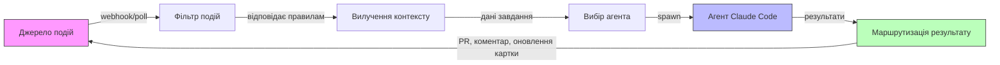
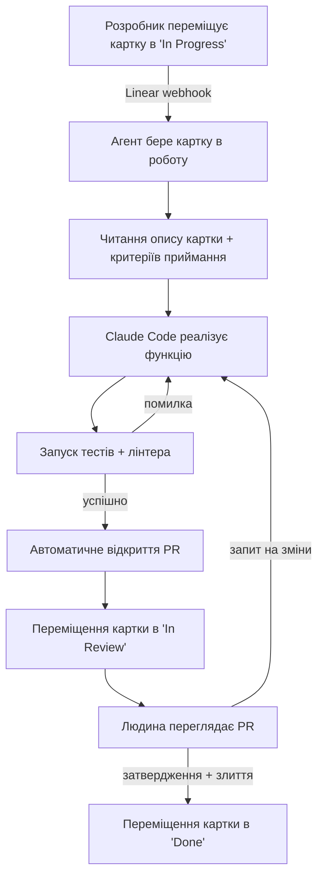

# Автоматизація агентів на основі подій (Event-Driven Agent Automation)

> **Рівень впевненості**: Рівень 3 — новий патерн, ранні послідовники повідомляють про позитивні результати, але інструментарій все ще розвивається.

Замість того, щоб вручну запускати Claude Code для кожного завдання, дозвольте зовнішнім подіям керувати роботою. Картка переміщується в «In Progress» у Linear, і Claude автоматично бере її в роботу. GitHub issue отримує мітку `claude-fix`, і за кілька секунд агент починає над ним працювати.

Це перехід від моделі опитування / pull-based («гей, Claude, зроби це») до моделі сповіщення / push-based («події запускають агентів»).

---

## Зміст

1. [Основна концепція](#core-concept)
2. [Цикл агента, керований Linear](#the-linear-driven-agent-loop)
3. [Загальний патерн «подія-в-агента»](#generic-event-to-agent-pattern)
4. [Приклад реалізації](#implementation-example)
5. [Сумісність із джерелами подій](#event-source-compatibility)
6. [Запобіжники (Guardrails)](#guardrails)
7. [Антипатерни](#anti-patterns)
8. [Інструменти та ресурси](#tools--resources)
9. [Дивіться також](#see-also)

---

## Основна концепція

Традиційне використання Claude Code є інтерактивним: ви відкриваєте термінал, вводите промпт, виконуєте ітерації. Автоматизація на основі подій усуває людину з кроку запуску. Людина все одно перевіряє результат (PR, зміни в коді), але запуск відбувається через ваш існуючий робочий процес управління проектами.



Цикл є самопідтримуваним: вивід агента (PR, оновлення статусу) повертається як зворотний зв'язок у джерело подій, що може запустити наступний крок.

---

## Цикл агента, керований Linear

Найбільш детально задокументований патерн походить із робочого процесу Damian Galarza (damiangalarza.com, лютий 2026 р.). Linear служить єдиним джерелом правди для завдань, а Claude Code виконує реалізацію від початку до кінця.

### Процес



### Що забезпечує ефективність

Опис картки виступає в ролі промпту. Хороші картки з чіткими критеріями приймання (acceptance criteria) дають на виході якісний код. Нечіткі картки призводять до нечіткого коду — так само, як і з розробниками-людьми. Якість ваших тікетів безпосередньо визначає якість автоматизації.

Структуровані поля Linear (опис, критерії приймання, мітки, пріоритет) природно мапляться на потреби Claude Code: що створити, як це перевірити та які обмеження застосувати.

### Ключові вимоги

- Картки повинні мати чіткими критерії приймання (а не лише заголовок).
- Репозиторій потребує надійного набору тестів для автоматичної перевірки.
- Правила іменування гілок повинні бути детермінованими (наприклад, `feat/LINEAR-123-card-title`).
- Шаблони PR допомагають стандартизувати вивід агента.

---

## Загальний патерн «подія-в-агента»

Приклад із Linear є специфічним, але цей патерн можна узагальнити для будь-якого джерела подій. Конвеєр складається з п'яти компонентів:

### 1. Джерело подій

Звідки надходить тригер. Це може бути інструмент управління проектами, система CI, оповіщення моніторингу або кастомний webhook.

### 2. Фільтр подій

Не кожна подія повинна запускати агента. Фільтри визначають, які події потребують дії:

```bash
# Приклад: обробляти лише картки з міткою «claude-auto»
if [[ "$CARD_LABELS" != *"claude-auto"* ]]; then
    echo "Skipping: no claude-auto label"
    exit 0
fi
```

### 3. Вилучення контексту

Витягування релевантних даних із корисного навантаження події та форматування їх як промпту для Claude Code. Тут ви перекладаєте схему вашого інструменту в інструкції природною мовою.

### 4. Вибір агента

Різні типи подій можуть вимагати різних конфігурацій агентів. Звіт про баг потребує іншого контексту `CLAUDE.md`, ніж запит на нову функцію. Ви можете використовувати різні дозволені інструменти, різні моделі або різні обмеження безпеки.

### 5. Маршрутизація результату

Куди надсилаються результати? Зазвичай це поєднання наступного:
- Гілка Git + PR (зміни коду)
- Коментар до оригінального issue/картки (оновлення статусу)
- Перехід стану картки (переміщення в іншу колонку)
- Сповіщення в Slack (для інформування людини)

---

## Приклад реалізації

Мінімальний bash-цикл, який опитує Linear на наявність карток у стані «In Progress» та запускає агентів Claude Code:

```bash
#!/bin/bash
# linear-agent-loop.sh
# Polls Linear for cards in "In Progress" state and spawns Claude agents

LINEAR_API_KEY="${LINEAR_API_KEY:?Missing LINEAR_API_KEY}"
TEAM_ID="${LINEAR_TEAM_ID:?Missing LINEAR_TEAM_ID}"
PROCESSED_FILE="/tmp/linear-agent-processed.txt"
MAX_CONCURRENT=3

touch "$PROCESSED_FILE"

poll_linear() {
    curl -s -X POST https://api.linear.app/graphql \
        -H "Authorization: $LINEAR_API_KEY" \
        -H "Content-Type: application/json" \
        -d '{
            "query": "query { team(id: \"'"$TEAM_ID"'\") { issues(filter: { state: { name: { eq: \"In Progress\" } }, labels: { name: { eq: \"claude-auto\" } } }) { nodes { id title description } } } }"
        }' | jq -r '.data.team.issues.nodes[] | "\(.id)|\(.title)|\(.description)"'
}

spawn_agent() {
    local issue_id="$1"
    local title="$2"
    local description="$3"

    echo "[$(date)] Spawning agent for: $title ($issue_id)"

    claude --print --dangerously-skip-permissions \
        "Implement the following Linear card:
        Title: $title
        Description: $description

        Requirements:
        1. Create a feature branch named feat/$issue_id
        2. Implement the described feature
        3. Run tests and fix any failures
        4. Create a PR with the card title" \
        2>&1 | tee "/tmp/agent-$issue_id.log"

    echo "$issue_id" >> "$PROCESSED_FILE"
}

while true; do
    active_agents=$(jobs -r | wc -l)
    if [ "$active_agents" -ge "$MAX_CONCURRENT" ]; then
        echo "[$(date)] Max concurrent agents reached ($MAX_CONCURRENT), waiting..."
        sleep 30
        continue
    fi

    poll_linear | while IFS='|' read -r id title description; do
        if grep -q "$id" "$PROCESSED_FILE"; then
            continue  # Already processed
        fi
        spawn_agent "$id" "$title" "$description" &
    done

    sleep 60  # Poll interval
done
```

Це лише відправна точка, а не готовий до продакшену код. Реальне впровадження вимагає належної обробки помилок, постійного сховища стану (а не текстового файлу) та тригерів на основі webhooks замість опитування (polling).

---

## Сумісність із джерелами подій

| Джерело подій | Події-тригери | Сценарій використання агента | Метод інтеграції |
|-------------|----------------|----------------|-------------------|
| **Linear** | Зміна стану картки, додавання мітки | Реалізація функцій, виправлення багів | GraphQL API / MCP server |
| **GitHub Issues** | Issue створено, додано мітку | Тріаж багів, дослідження, PR з виправленням | GitHub Actions / webhooks |
| **GitHub PR** | PR відкрито, запитано огляд | Огляд коду, автоматичні виправлення | GitHub Actions |
| **Jira** | Перехід стану, призначення на спринт | Робота над функціями, очищення техборгу | REST API / webhooks |
| **Slack** | Повідомлення в каналі, emoji-реакція | Швидкі виправлення, дослідження | Slack API / bot |
| **PagerDuty** | Створено інцидент | Діагностичні скрипти, первинний тріаж | Webhooks |
| **Custom webhook** | Будь-який HTTP POST | Будь-що | Пряма адреса HTTP (endpoint) |

---

## Запобіжники (Guardrails)

Агенти на основі подій за дизайном працюють з меншим контролем з боку людини, тому запобіжники (guardrails) стають критично важливими.

### Ідемпотентність

Агент може обробити одну й ту саму подію двічі (повторна спроба мережі, дублікат webhook). Агент повинен перевірити, чи робота вже існує, перш ніж починати:

```bash
# Перевірити, чи гілка для цієї картки вже існує
if git ls-remote --heads origin "feat/$ISSUE_ID" | grep -q "feat/$ISSUE_ID"; then
    echo "Branch already exists, skipping"
    exit 0
fi
```

### Обмеження частоти (Rate Limiting)

Не дозволяйте раптовому сплеску подій одночасно запустити 50 агентів. Встановіть жорсткі ліміти:

- **Максимум одночасних агентів**: 3-5 для більшості команд.
- **Період охолодження**: мінімум 30 секунд між запусками агентів.
- **Денний ліміт бюджету**: встановіть максимальні витрати токенів на день.

### Аварійний вимикач (Circuit Breaker)

Якщо агенти продовжують зазнавати невдач на певному типі завдань, припиніть спроби:

```bash
FAILURE_COUNT=$(grep -c "FAILED" "/tmp/agent-failures.log" 2>/dev/null || echo 0)
if [ "$FAILURE_COUNT" -gt 5 ]; then
    echo "Circuit breaker triggered: too many failures"
    # Повідомити людину, призупинити автоматизацію
    exit 1
fi
```

### Точки контролю за участю людини (Human-in-the-Loop)

Навіть у повністю автоматизованих процесах залишайте людину в циклі контролю на критичних етапах:

- Перевірка PR залишається ручною (агенти створюють PR, люди їх затверджують).
- Міграції бази даних ніколи не застосовуються автоматично.
- Деплой — це окремий крок, який запускається людиною.
- Будь-яка картка, що стосується автентифікації, білінгу або персональних даних (PII), потребує явного схвалення людиною.

---

## Антипатерни

| Антипатерн | Проблема | Рішення |
|-------------|---------|----------|
| **Агресивне опитування** | Надсилання запитів до API кожні 5 секунд марнує ресурси та призводить до обмеження лімітів (rate limit) | Використовуйте webhooks, коли вони доступні, опитуйте не частіше ніж кожні 60 секунд |
| **Відсутність аварійного вимикача** | Агент знову й знову зазнає невдачі на одному завданні, безкінечно спалюючи токени | Відстежуйте помилки для кожного завдання, зупиняйтеся після 3 спроб, сповіщайте людину |
| **Відсутність черги Dead Letter** | Невдалі події зникають, ніхто не знає, що роботу було пропущено | Записуйте невдалі події у постійне сховище для ручного перегляду |
| **Необмежена паралельність** | 20 карток переміщуються одночасно, запускається 20 агентів, сервер перевантажується | Жорсткий ліміт на кількість одночасних агентів (3-5 є цілком розумним) |
| **Нечіткі картки як промпти** | «Виправити ту штуку» дає на виході неякісний код | Впроваджуйте стандарти якості карток, пропускайте картки без критеріїв приймання |
| **Відсутність збереження стану** | Скрипт перезапускається та обробляє все з самого початку | Зберігайте ID оброблених подій у базі даних, а не в оперативній пам'яті |
| **Пропуск перегляду PR** | Агент пушить зміни безпосередньо в гілку `main` | Завжди використовуйте процес PR, люди повинні перевіряти результат |

---

## Інструменти та ресурси

### Сервери MCP

- **linear-kanban-mcp** (0xikarus на GitHub): Надає доступ до Linear API для керування дошками Kanban безпосередньо з Claude Code. Дозволяє читати картки, оновлювати стани та керувати мітками, не виходячи з контексту агента.

### Вміння та платформи

- **skillsllm.com**: Пропонує skill, який оркеструє повний цикл планування, валідації та виконання, починаючи з картки Linear. Забезпечує перетворення метаданих картки в структуровані промпти для Claude Code.

### Шаблони агентів

- **Scrum Master Agent** (lobehub.com): Автоматично визначає, чи працює він всередині Claude Desktop чи Claude Code, і відповідно адаптує свою поведінку. Корисний як відправна точка для розробки агентів, що враховують контекст оточення.

---

## Дивіться також

- [agent-teams.md](./agent-teams.md) — мультиагентна паралельна координація.
- [iterative-refinement.md](./iterative-refinement.md) — базовий цикл «промпт-спостереження-повторний промпт».
- [plan-driven.md](./plan-driven.md) — планування перед виконанням.
- [../../examples/agents/](../../examples/agents/) — готові до використання шаблони агентів.

---
**Локалізація**: [Serhii (MacPlus Software)](https://macplus-software.com)
*Остання синхронізація: Травень 2026*
