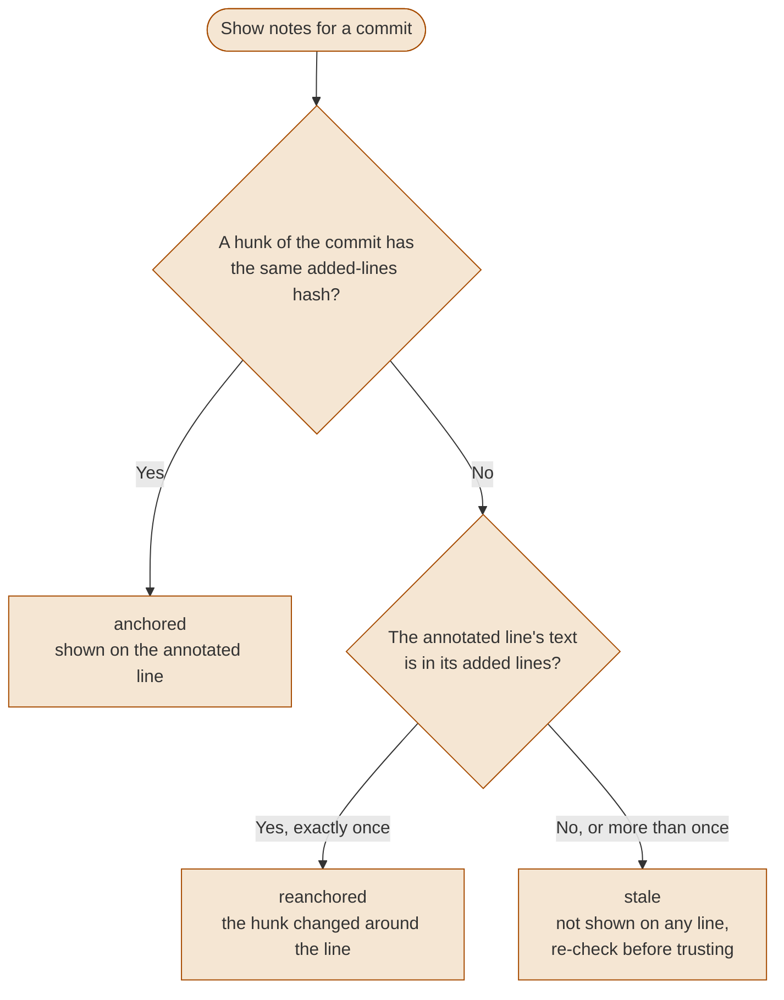
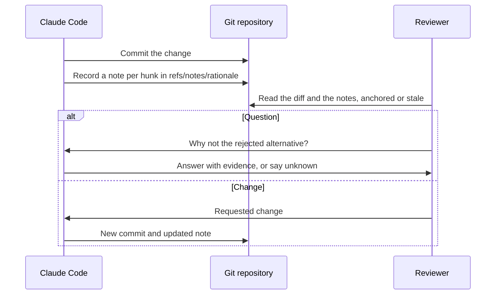

# Придатні до рев'ю зміни агента: обґрунтування поруч із diff

> **Межа доказів**: ця сторінка пропонує практику й постачає шаблон, поведінка якого покрита власними тестами. Жодне наведене тут дослідження не показує, що обґрунтування поруч із diff підвищує точність рев'ю; один контрольований експеримент виявив, що пояснення згенерованого коду не дали загальної користі. Сприймайте обґрунтування агента як твердження, яке рецензент має перевірити, а не як доказ.

Рецензент коду, написаного агентом, має diff, але не має причин. Агент мав їх під час роботи: навіщо потрібна зміна, від чого він відмовився, що може зламатися. Ця сторінка описує, як зберігати ці причини поруч із hunk, який вони пояснюють, у самому репозиторії, і як зрозуміти, що вони більше не відповідають коду.

---

## Зміст

1. [Чому diff недостатньо](#чому-diff-недостатньо)
2. [Що фіксує нотатка агента](#що-фіксує-нотатка-агента)
3. [Де зберігається нотатка](#де-зберігається-нотатка)
4. [Прив'язка та застарілі нотатки](#привязка-та-застарілі-нотатки)
5. [Відгук у вигляді запитання або зміни](#відгук-у-вигляді-запитання-або-зміни)
6. [Шаблон agent-rationale](#шаблон-agent-rationale)
7. [Що не доведено](#що-не-доведено)
8. [Див. також](#див-також)

---

## Чому diff недостатньо

Джеффрі Літт (Notion) [описує розуміння як вузьке місце](https://www.youtube.com/watch?v=WkBPX-oDMnA&t=73): «Агенти пишуть за нас величезні обсяги коду». Практика Літта — пояснювальна записка, яку агент пише до кожної зміни: вона починається з контексту й завершується вікториною, яку автор має пройти, перш ніж просити рев'ю. Есе Кунала [Resisting Cognitive Surrender](https://knlb.dev/essays/surrender) описує власний вигляд pull request із diff, поточним коментарем агента про те, чому він зробив кожну зміну, і колонкою для рецензента. Обидва підходи — індивідуальні практики, а не виміряні втручання. Їх оцінено в [трьох доповідях про рев'ю змін, написаних агентами](https://github.com/FlorianBruniaux/claude-code-ultimate-guide/blob/main/docs/resource-evaluations/reviewable-agent-changes-talks.md) та в [Resisting Cognitive Surrender](https://github.com/FlorianBruniaux/claude-code-ultimate-guide/blob/main/docs/resource-evaluations/knlb-cognitive-surrender.md).

Дані про пояснення неоднозначні, і вони мають визначати, як користуватися нотаткою:

- [Kaufman et al.](https://arxiv.org/abs/2607.08885) (препринт arXiv, липень 2026, 86 програмістів Python, контрольований експеримент) виявили, що пояснення природною мовою до згенерованих тверджень (assertions) «не дали загальної користі», а пояснення низької якості знижували точність, водночас підвищуючи впевненість.
- [Gao et al.](https://arxiv.org/abs/2607.24601) (буде представлено на ISSTA 2026, 34 учасники, внутрішньогрупове дослідження рев'ю коду, згенерованого ШІ) виявили, що повні пояснення дали найвищу сприйняту довіру, але не найвищу згоду з ШІ, а рівень пояснення не мав значущого впливу на час рев'ю.

Жодне з досліджень не перевіряло обґрунтування агента поруч з його власним diff. Вони підтверджують вужче твердження: у цих дослідженнях пояснення змінювали довіру чи впевненість, і жодне не показало кращого виявлення помилкового виводу. Нотатка корисна, коли дає рецензентові що перевірити: відкинуту альтернативу для зважування, ризик для тестування, доказ для повторного запуску.

[Рев'ю машинного виводу — це третій режим](../roles/learning-with-ai.uk.md#ревю-машинного-виводу-є-третім-режимом) розглядає automation bias і перевірку перед схваленням, що йде разом із цією сторінкою.

---

## Що фіксує нотатка агента

Цей посібник пропонує п'ять полів на hunk. Вони походять із порівняння того, що фіксують наявні інструменти ([локальні поверхні рев'ю](./multi-provider-code-review.uk.md#локальні-поверхні-ревю-для-змін-написаних-агентом), [сліди походження агентів](https://github.com/FlorianBruniaux/claude-code-ultimate-guide/blob/main/docs/resource-evaluations/agent-provenance-traces.md)), а не з дослідження того, які поля допомагають рецензентам.

| Поле | Що писати | Навіщо воно рецензентові |
|---|---|---|
| Intent (намір) | Для чого потрібна зміна, одним реченням | Diff показує, що змінилося, але не чому ([критерій Гупти «чому, а не що»](https://www.youtube.com/watch?v=TJPInBjhE4Q&t=684)) |
| Rejected alternative (відкинута альтернатива) | Варіант, який агент розглянув і не обрав, та чому | Перше запитання рецензента часто: «чому не очевидним способом?» |
| Risk (ризик) | Що це може зламати і для кого | Спрямовує рев'ю на частину, яку варто читати повільно |
| Evidence (доказ) | Тест, команда чи вивід, що підтверджує зміну | Те, що рецензент може запустити повторно замість того, щоб довіряти |
| Open question (відкрите запитання) | Що агент не зміг вирішити | Перетворює мовчазне припущення на запитання до рецензента |

[](../images/agent-note-fields.webp)

*Пропозиція цього посібника, а не поля, перевірені дослідженням. [Промпти й запис вибору](../../docs/visual-prompts/reviewable-agent-changes.uk.md).*

`unknown` є допустимою відповіддю для кожного поля, крім intent. Агент, який пише «unknown» у полі evidence, повідомляє рецензентові більше, ніж той, хто вигадує назву тесту. [docket](https://github.com/FlorianBruniaux/claude-code-ultimate-guide/blob/main/docs/resource-evaluations/agent-provenance-traces.md#docket-35) позначає hunk із малою кількістю доказів як «no evidence» і впорядковує hunk за оцінкою ризику, що враховує цю щільність.

Пишіть нотатку, поки причини ще лишаються в контексті агента, одразу після коміту, а не відновлюйте їх під час рев'ю. У glassbox агент записує нотатки через `glassbox note add` (жоден hook цього не вимагає), diffo змушує агента публікувати шари й коментарі через свій CLI, а ai-pr-review пише свій огляд постфактум за diff ([оцінка](https://github.com/FlorianBruniaux/claude-code-ultimate-guide/blob/main/docs/resource-evaluations/agent-review-surfaces.md)).

---

## Де зберігається нотатка

| Сховище | Приклад | Видимість у merge request | Після amend і rebase | Після squash merge |
|---|---|---|---|---|
| Git notes | `refs/notes/rationale` (цей шаблон), `refs/notes/ai` (git-ai) | Ні, якщо її не публікує інструмент | Так, якщо задано `notes.rewriteRef` (перевірено) | Ні для звичайних нотаток (перевірено); демон git-ai переніс свою нотатку (перевірено) |
| Файл, закомічений разом із кодом | SARIF у `.pr-notes/` (glassbox), JSON-sidecar, якщо його комітять (hunk) | Як змінений файл | Рухається разом із вмістом коміту | Зберігається в об'єднаному вмісті; діапазони рядків можуть уже не збігатися |
| Коментар у forge | Обговорення merge request (drift публікує їх) | Так | drift позначає гілку обговорення як застарілу, коли змінюється head | Залежить від forge; не перевірено |

[](../images/agent-note-storage.webp)

*Зелені клітинки перевірено в одному локальному репозиторії; сірі прочитано з коду. [Промпти й запис вибору](../../docs/visual-prompts/reviewable-agent-changes.uk.md).*

«Перевірено» стосується запусків, що стоять за [git-ai: атрибуцією ШІ на рівні рядків у git notes](https://github.com/FlorianBruniaux/claude-code-ultimate-guide/blob/main/docs/resource-evaluations/git-ai-provenance-notes.md), і власних тестів шаблону: по одному локальному репозиторію, git 2.56.0. Рядки для файлового сховища й forge походять із читання коду інструментів, а не з їх запуску.

Git notes зберігають історію коду чистою й лишаються поза diff, але ціною додаткового налаштування: `git config notes.rewriteRef refs/notes/rationale` для amend і rebase та явний `git push origin refs/notes/rationale`, оскільки звичайний push їх не надсилає. Squash або rebase, виконані кнопкою merge у forge, відбуваються на сервері й не перевірялися; див. [Provenance in git notes](../ops/ai-traceability.uk.md#35-походження-provenance-у-git-notes).

Не кладіть у нотатку секрети чи дані клієнтів. Нотатки надсилаються разом із refs репозиторію, і кожен, хто може їх отримати, може їх прочитати.

---

## Прив'язка та застарілі нотатки

Нотатка, записана для рядка 42, стає хибною, щойно хтось додасть рядок над нею. Прив'язка за вмістом, а не за позицією, цього уникає. Шаблон поєднує два підходи, прочитані в інших інструментах: спочатку хеш вмісту hunk (diffo хешує свої hunk), потім текст анотованого рядка (glassbox повторно прив'язується за фрагментом) лише тоді, коли цей текст унікальний серед доданих рядків файлу, а далі — нічого.



Ці результати покриті тестами шаблону: рядки, додані над hunk, залишають нотатку прив'язаною до її рядка, редагування деінде в hunk повторно прив'язує її, редагування анотованого рядка позначає її застарілою, а рядок, текст якого трапляється двічі, позначається застарілим, а не вгадується. Застарілу нотатку все одно варто прочитати; вона фіксує, що агент мав на меті до зміни коду.

---

## Відгук у вигляді запитання або зміни

Відгук рев'ю, що повертається до агента, потребує типу. Без нього агент сприймає кожен коментар як інструкцію. Раян Лопополо (OpenAI) [описує, як надає агентові-автору](https://www.youtube.com/watch?v=CeOXx-XTYek&t=972) «гнучкість або відкласти, або заперечити відгук рев'ю», бо «без контексту, що це дозволено, агенти для кодування схилятимуться до того, що вони роблять, тобто до виконання інструкцій». diffo типізує кожну гілку рецензента як Change або Question, з різним контрактом відповіді для кожної ([оцінка](https://github.com/FlorianBruniaux/claude-code-ultimate-guide/blob/main/docs/resource-evaluations/agent-review-surfaces.md)).



Запитання просить агента пояснити й може завершитися без зміни коду. Запит на зміну вимагає нового коміту, і агент пише для нього нову нотатку. Шаблон записує нотатки; він не переносить відгук. Передавайте тип тим каналом, яким користується рев'ю: префіксом у коментарі forge або інструментом, що типізує гілки обговорення.

---

## Шаблон agent-rationale

[`examples/skills/agent-rationale/`](../../examples/skills/agent-rationale/) — це skill для Claude Code зі скриптом Python на стандартній бібліотеці (3.9 або новіше):

```bash
# After committing, from the repository root
python3 -I .claude/skills/agent-rationale/scripts/rationale.py add --file src/cart.py --line 42 \
  --intent "Sum prices, not item objects" \
  --rejected "Give Item an __add__ method" \
  --risk "Items without a price attribute now raise AttributeError" \
  --evidence "tests/test_cart.py::test_total_uses_price" \
  --open-question "unknown"

python3 -I .claude/skills/agent-rationale/scripts/rationale.py show
```

Його 15 тестів запускаються в одноразових репозиторіях і покривають поведінку, на яку спирається ця сторінка: нотатка записується з усіма п'ятьма полями, рядок поза змінами коміту відхиляється, нотатка переживає amend і rebase з `notes.rewriteRef` і губиться при amend без нього, прив'язка повідомляє anchored, reanchored або stale, як зображено вище, а крайні випадки (рядок, що починається з `++`, form feed усередині рядка, дубльовані рядки, нотатка, написана не скриптом, шлях, заданий із підкаталогу) поводяться так, як задокументовано.

```bash
python3 -I examples/skills/agent-rationale/scripts/test_rationale.py
```

Тести були написані раніше за код, який вони покривають, і спочатку падали; навмисні мутації парсера й коду прив'язки щоразу призводили до падіння очікуваного тесту. Headless-сесія Claude Code (`claude -p`, Claude Code 2.1.319), якій 8 листопада 2026 року дали skill в одноразовому репозиторії, записала нотатку на правильному рядку й написала `unknown` для відкинутої альтернативи, доказу та відкритого запитання, чого нічого в тому репозиторії не підтверджувало. Той запуск використовував шаблон у першій закомічений версії; поточний скрипт читає свою нотатку як anchored. Одна сесія на одному коміті показує, що skill можна виконати, але не те, наскільки нотатки допомагають рецензентам.

---

## Що не доведено

- Що обґрунтування поруч із diff покращує виявлення дефектів, час рев'ю чи розуміння. Жодне дослідження, знайдене для цієї сторінки, не перевіряло цього на diff, написаних агентами.
- Що ці п'ять полів — правильні. Це пропозиція цього посібника.
- Як нотатки поводяться після кнопки merge у forge, після cherry-pick або коли кілька агентів анотують один коміт.
- Що обґрунтування агента точне. Його пише той самий агент, чий код рецензують.

---

## Див. також

- [Multi-provider code review: локальні поверхні рев'ю](./multi-provider-code-review.uk.md#локальні-поверхні-ревю-для-змін-написаних-агентом): порівняння diffo, glassbox, hunk, drift, ai-pr-review, guidedreview
- [Provenance in git notes](../ops/ai-traceability.uk.md#35-походження-provenance-у-git-notes): git-ai, AgentNote і docket та що переживає переписування історії
- [Схвалюйте лише те, що можете пояснити](../diagrams/10-adoption-and-learning.uk.md#схвалюйте-лише-те-що-можете-пояснити): перевірка перед схваленням виводу агента
- [Три місця, де пояснюється зміна агента](../diagrams/06-development-workflows.uk.md#три-місця-де-пояснюється-зміна-агента)
