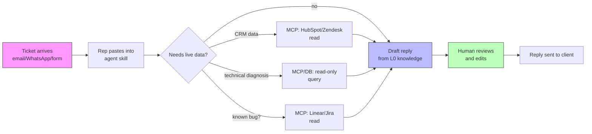

# Агент для підтримки та CSM: внутрішнє сортування тікетів і діагностика акаунтів

> **Рівень довіри**: Tier 3 (патерн, що формується). Ранні звіти про впровадження позитивні, але рівні зрілості вище за L2 на практиці здебільшого не задокументовані.

Комерційний ринок ШІ-агентів підтримки (Decagon, Intercom Fin, Ada) націлений на одне конкретне завдання: відповідати клієнтові напряму та зменшувати кількість тікетів ще до того, як їх побачить людина. Цей патерн розглядає не це.

Ця сторінка описує іншу, додаткову мету: **внутрішнього** агента Claude Code, який працює поруч із командою підтримки чи CSM, а не перед клієнтом. Агент читає тікет, складає відповідь у стилі команди та, після підключення потрібних MCP-серверів, перевіряє CRM і продуктову базу даних перед відповіддю, замість того щоб людина робила цю рутину вручну. Клієнт ніколи не спілкується з ним напряму; фінальне повідомлення завжди надсилає людина.

Інструменти зменшення навантаження з боку покупця та цей патерн — не конкуренти. Команда може запустити Intercom Fin чи Decagon з боку клієнта й водночас використовувати внутрішнього агента Claude для власних фахівців підтримки. Внутрішнього агента також дешевше й швидше розгорнути, бо він не потребує контракту з вендором і нового інструмента для команди та працює на ліцензіях Claude Code, які в команди, близької до розробки, часто вже є.

---

## Зміст

1. [Основна концепція](#основна-концепція)
2. [Модель зрілості](#модель-зрілості)
3. [Потік](#потік)
4. [MCP-сервери для цього патерна](#mcp-сервери-для-цього-патерна)
5. [Створення skill рівня L0](#створення-skill-рівня-l0)
6. [Безпека та запобіжники](#безпека-та-запобіжники)
7. [Метрики для відстеження](#метрики-для-відстеження)
8. [Антипатерни](#антипатерни)
9. [Інструменти та ресурси](#інструменти-та-ресурси)
10. [Див. також](#див-також)

---

## Основна концепція

З першого дня чітко тримайте межу: це патерн допомоги агента, а не автономний чат-бот для клієнтів. Ця відмінність важлива з двох причин.

По-перше, обсяг довіри. Кожну відповідь переглядає й надсилає людина. Доступ до даних потребує окремого контролю: облікові дані лише для читання на рівнях L1–L3, авторизація користувача, що робить запит, і обмежені запити. Перегляд чернетки не може запобігти несанкціонованому читанню, дорогому запиту чи розкриттю даних моделі до цього перегляду.

По-друге, інструментарій. Клієнтському чат-боту потрібні канал (веб-віджет, WhatsApp, поштова скринька), керування сесіями та модерація контенту, а це територія Claude Agent SDK чи API, а не Claude Code CLI. Внутрішній інструмент допомоги агента — це skill Claude Code або невеликий скрипт, який фахівець підтримки запускає на тікеті. Набагато менше будувати, набагато швидше випускати.

---

### Brevo: явні процедури замість довільної маршрутизації

У своєму викладі GenAI Days від 19 листопада 2026 року Еммануель Сьяра (Emmanuel Sciara) переказує, як Шарлі Ідрак (Charli Idrac) описує заміну в Brevo важкої для налагодження системи агентів деревом рішень, що кодує процедури підтримки. LLM втручаються у вибраних вузлах, а безпосередній виклик API отримує дані тікета. Відоме отримання даних може бути фіксованою операцією, а не черговим рішенням моделі. Сам MCP не робить виклик імовірнісним, а фіксована оркестрація не робить виводи LLM детермінованими.

Сьяра також описує окремий проєкт, у якому співробітники підтримки створюють власні інструменти через агента для програмування в Slack. Тримайте цю діяльність окремо і від автономних відповідей клієнтам, і від внутрішнього помічника зі складання чернеток, якому присвячена ця сторінка. Цей виклад не є контрольованим порівнянням продуктивності. Перш ніж переносити патерн чи заявлені вигоди, див. [оцінку джерела](https://github.com/FlorianBruniaux/claude-code-ultimate-guide/blob/main/docs/resource-evaluations/genai-days-nantes-sciara.md).

## Модель зрілості

Шість рівнів, кожен можна будувати незалежно. Більшість команд отримують реальну користь уже на L1 чи L2 і місяцями зупиняються там, перш ніж рухатися далі; досягати L5 не обов'язково.

### L0: складання відповідей, без зовнішнього доступу

Skill бере сирий текст тікета (скопійований лист, повідомлення WhatsApp, надіслана форма) і створює чернетку відповіді: діагностичні запитання, якщо тікет недостатньо конкретний, або повну відповідь, якщо випадок збігається з відомим патерном, задокументованим у skill. Жодних викликів API, жодних живих даних — лише тон спілкування команди та каталог повторюваних випадків, закладені в промпт.

Користь на цьому рівні: швидше складання відповідей, послідовний тон і безкоштовна перевірка орфографії та граматики. Запускається за кілька годин, бо не потребує нових доступів.

### L1: доступ до CRM лише для читання через MCP

Агент підключається до HubSpot чи Zendesk (див. [MCP-сервери](#mcp-сервери-для-цього-патерна) нижче) і може відповідати на запитання на кшталт «який тариф у цього клієнта», «коли був його останній тікет» чи «чи цей контакт уже позначено як ризик відтоку», не змушуючи фахівця перемикати вкладки. Потрібен API-ключ або OAuth-доступ із правами лише на читання, якщо вендор це підтримує.

### L2: доступ до бази даних лише для читання для технічної діагностики

Це рівень, що перетворює інструмент складання відповідей на діагностичний. Агент отримує облікові дані лише для читання до продуктової бази даних (а краще до її репліки) і може відповісти на «чому клієнт X не має доступу до своєї сесії», безпосередньо перевіривши стан акаунта, статус платежу чи feature flags, замість ескалації до інженерів заради п'ятихвилинного пошуку.

Це також рівень із найбільшим тертям під час погодження. Потрібна згода того, хто відповідає за доступ до даних, і за замовчуванням слід використовувати **репліку для читання**, ніколи не первинне підключення, хоч би яким «лише для читання» виглядав дозвіл на папері.

### L3: інтеграція з трекером задач для обізнаності про відомі баги

Підключіть агента до Linear чи Jira (лише читання), щоб він розпізнавав, коли тікет клієнта збігається з уже відомим, уже опрацьованим багом, і відповідав «це відома проблема, виправлення заплановано на [дата]» замість повторної ескалації дубліката. Про зворотний напрямок цієї інтеграції — агента, що перетворює сигнали підтримки на тікети в трекері — див. [event-driven-agents.md](./event-driven-agents.uk.md).

### L4: контекстні знання про продукт/партнерів

Багато B2B-продуктів інтегруються зі сторонніми системами (ERP, платіжні процесори, провайдери SSO), кожна з яких має свої особливості. Завантажте будь-яку наявну документацію щодо кожної інтеграції (PDF, документацію API, внутрішні нотатки) у базу знань, яку агент завантажує автоматично, коли тікет згадує цю інтеграцію на ім'я.

### L5: підготовка CSM перед дзвінком

Перед дзвінком щодо утримання чи допродажу агент збирає дані про використання продукту, історію тікетів і нотатки з CRM в одно­сторінковий бриф: що акаунт використовує, а що ні, нещодавні сигнали тертя та кути для допродажу. Саме цей крок перетворює 20–30 хвилин ручної підготовки на щось, готове ще до того, як CSM відкриє ноутбук. Він потребує вже налаштованих L1 (CRM) і L2 (БД), а також достатньо добре задокументованих процесів CSM, щоб було зрозуміло, що для вашого продукту означають «сигнал використання» та «сигнал тертя».

**Явно поза обсягом цього патерна**: клієнтські чат-боти та інструменти коучингу дзвінків/транскрибування (аналіз дзвінків продажів чи CSM на якість сценарію розмови). Обидва — справжні, цінні вкладення, але це або продукти для покупця (див. вступ), або побудовані на іншій інфраструктурі (телефонія/конвеєри запису), ніж skill Claude Code.

---

### Поєднуйте документацію, код і живі дані, не змішуючи їхній авторитет

База знань компанії може скерувати складне запитання до продуктової документації, відповідного коду та обмеженого пошуку даних. Тримайте ці джерела окремо: документація описує задуману поведінку, код показує реалізацію в певній ревізії, а запит спостерігає дані в певний момент часу. Перш ніж вважати поведінку репозиторію поведінкою продакшну, підтвердьте, яка ревізія коду розгорнута.

Наприклад, досліджуйте, чому акаунт не має доступу до функції, так: отримайте задокументоване правило прав доступу, перегляньте відповідний код авторизації в розгорнутій ревізії та скористайтеся дозволеним запитом стану цього акаунта. Вказуйте версію документа, ревізію коду та час запиту. Показуйте розбіжності та відставання репліки, де це доречно, замість того щоб мовчки обирати одне джерело як істину.

Застосовуйте дозволи на рівні організації, акаунта й полів користувача, що робить запит, у самому інструменті чи сервісі для кожного пошуку, а дозволи доступу до репозиторію — перед отриманням коду. Роль бази даних лише для читання не встановлює авторизацію на рівні тенанта чи полів. Віддавайте перевагу параметризованим діагностичним операціям, обмеженим результатам і тайм-аутам запитів, а журнали аудиту захищайте так само, як і самі дані. Не допускайте секретів і непов'язаних персональних даних у отриманий код і відповіді. Перегляд людиною лишається перевіркою виводу поряд із цими засобами контролю доступу.

Оцінюйте це розширення на репрезентативних запитаннях із відомими відповідями, зокрема з відхиленим пошуком між акаунтами, застарілою документацією та розбіжністю між кодом і даними. Перш ніж стверджувати про кращу діагностику, зберігайте правильність відповідей, відстежуваність джерел, випадки відмови відповідати та зусилля на ескалацію до інженерів. Компроміси щодо актуальності описано в [Контекст за межами репозиторію](../core/agent-harness.uk.md#контекст-поза-репозиторієм).

## Потік



Крок перегляду людиною (H) в цьому процесі обов'язковий, перш ніж відповідь потрапить до клієнта. Доступ до даних рівня L2 також потребує описаних вище засобів контролю облікових даних, авторизації та запитів незалежно від якості чернетки.

---

## MCP-сервери для цього патерна

Жоден із наведених нижче серверів не опублікований самими Anthropic, HubSpot чи Zendesk. Сприймайте їх як інструменти спільноти й повторно перевіряйте стан підтримки, перш ніж залежати від одного з них у продакшні. Офіційний MCP Registry (`registry.modelcontextprotocol.io`) справді містить кілька самостійно опублікованих записів HubSpot/Zendesk, але присутність у реєстрі лише означає, що хтось її подав, а не що вендор це схвалює; повне обґрунтування див. у [розділі Customer Support & CRM](../ecosystem/mcp-servers-ecosystem.uk.md#підтримка-клієнтів-і-crm-customer-support--crm). Тут сервери обрано за кількістю зірок на GitHub і свіжістю комітів.

| Система | Сервер | Покриття | Примітки |
|--------|--------|----------|-------|
| **HubSpot** | [`shinzo-labs/hubspot-mcp`](https://github.com/shinzo-labs/hubspot-mcp) | Контакти, компанії, ліди, угоди, продукти, взаємодії, пакетні операції, асоціації (читання/запис) | Найширше покриття об'єктів серед серверів спільноти, позначені релізи |
| **HubSpot** | [`baryhuang/mcp-hubspot`](https://github.com/baryhuang/mcp-hubspot) | Контакти, компанії (читання/запис), отримання розмов, семантичний пошук по кешованих даних | Найбільше зірок; раніше `peakmojo/mcp-hubspot` (старий URL перенаправляє) |
| **Zendesk** | [`reminia/zendesk-mcp-server`](https://github.com/reminia/zendesk-mcp-server) | Тікети, коментарі, статті Help Center | Найактивніше підтримуваний серед варіантів Zendesk від спільноти |
| **Linear** | Linear MCP | Issues, проєкти, коментарі, цикли | Уже задокументовано в [mcp-servers-ecosystem.md](../ecosystem/mcp-servers-ecosystem.uk.md#linear-mcp); використайте те налаштування для L3 |

Для продуктової бази даних (L2) немає універсального MCP-сервера, на який можна вказати, бо все залежить від вашої схеми та стеку. Поширений підхід — невеликий власний MCP-сервер (або навіть тонка REST-обгортка лише для читання), що надає кілька заздалегідь написаних параметризованих запитів замість доступу через сирий SQL, щоб агент не міг побудувати довільний запит до продакшн-даних.

---

## Створення skill рівня L0

Мінімальна структура skill, достатньо загальна, щоб адаптувати до тону й каталогу випадків будь-якої команди:

```markdown
---
name: agent-support
description: Drafts support ticket replies in the team's voice, using known recurring cases
---

# Support Reply Drafting

You draft replies to support tickets. You do not send anything: your output
is always reviewed by a human before it reaches the client.

## Process

1. Read the pasted ticket content (email, WhatsApp message, or form text).
2. Check it against the recurring cases below. If it matches one, draft a
   reply using that resolution.
3. If it doesn't match a known case, ask up to 3 diagnostic questions before
   drafting. Do not guess at a technical explanation you can't verify.
4. Match the tone: [team's tone-of-voice notes, e.g. direct, warm, no jargon]
5. Flag anything touching billing, data deletion, or security for escalation
   instead of drafting a reply.

## Recurring Cases

[Team fills this in from their own ticket history. This is the highest-value
part of the skill, and the one a generic template cannot write for you.]
```

Розділ із повторюваними випадками містить більшість цінності, і він має походити з експорту реальних тікетів за останні 30–90 днів, згрупованих за категоріями. Коли додано доступ L1/L2, інструкції skill розширюються так, щоб викликати відповідні MCP-інструменти замість прохання до фахівця шукати все вручну.

---

## Безпека та запобіжники

- **Лише читання, завжди, для L1–L3.** Жодного доступу на запис до CRM, бази даних чи трекера задач на цих рівнях. Якщо агентові потрібно *оновити* статус тікета чи поле CRM, це окреме свідоме рішення з власним переглядом, а не типова поведінка.
- **Доступ до БД через репліку, а не первинний вузол.** Див. [L2](#l2-доступ-до-бази-даних-лише-для-читання-для-технічної-діагностики) вище. Репліка обмежує наслідки поганого запиту не-продакшн-системою.
- **Найменші привілеї для API-ключів.** Обмежуйте облікові дані HubSpot, Zendesk чи Linear мінімальними типами об'єктів, які справді потрібні skill; більшість цих платформ підтримує деталізовані області доступу.
- **Обробка PII.** І вміст тікетів, і дані CRM містять PII. Дотримуйтеся практик обробки даних із [data-privacy.md](../security/data-privacy.uk.md) і, зокрема, не допускайте потрапляння чернеток відповідей чи діагностичного виводу в логи або транскрипти сесій, які переживуть тікет.
- **Перегляд людиною перед надсиланням.** Кожен рівень цього патерна припускає, що людина читає вивід, перш ніж він потрапить до клієнта. Тримайте контроль доступу на межі інструмента й не підключайте чернетку агента безпосередньо до дії автоматичного надсилання.

---

## Метрики для відстеження

Цей патерн не дає «рівня дефлекції», бо немає клієнтської поверхні, де вона відбувалася б. Важливі метрики — внутрішня пропускна здатність і якість команди, а не обсяг уникнутих звернень:

- **Відстань редагування від чернетки до надсилання**: наскільки фахівець змінює чернетку перед надсиланням. Зменшення цієї відстані з часом — найяскравіший сигнал того, що каталог випадків skill справді покращується.
- **Час до першої відповіді**: від надходження тікета до надісланої відповіді. Як відстежувати його поряд з іншими метриками пропускної здатності команди, див. [team-metrics.md](../ops/team-metrics.uk.md).
- **Частка ескалацій до інженерів**: має впасти, щойно запрацює L2 (діагностика БД), бо частина ескалацій існує лише для того, щоб отримати дані, які людина не могла дістати сама.
- **Час підготовки CSM** (після досягнення L5): час від «дзвінок у календарі» до «CSM має все потрібне» порівняно з ручною базовою лінією.

---

## Антипатерни

| Антипатерн | Проблема | Рішення |
|-------------|---------|----------|
| **Одразу стрибнути на L2 заради демо** | Погодження доступу до даних триває тижні; команда, що чекає на нього, нічого не випускаючи, за цей час не отримує жодної користі | Спершу випустіть L0, бо він не потребує нових доступів і все одно економить час на складання відповідей |
| **Автоматичне надсилання чернеток** | Обходить обов'язкову перевірку перед тим, як відповідь потрапить до клієнта | Зберігайте крок перегляду людиною для кожної відповіді в цьому процесі |
| **Доступ до БД через первинне підключення** | Поганий запит чи нестримний цикл агента може погіршити роботу продакшну | Завжди вказуйте на репліку для читання |
| **Загальний каталог випадків, скопійований із шаблону** | Реальні повторювані випадки команди специфічні для її продукту; загальний список дає загальні, марні чернетки | Будуйте каталог випадків L0 з реального експорту тікетів команди за останні 30–90 днів |
| **Сприйняття цього як проєкту чат-бота** | Змішує внутрішню допомогу агента (skill Claude Code) із клієнтською дефлекцією (SDK/API та оцінка вендорів) | Вирішіть, що саме ви будуєте, перш ніж визначати обсяг робіт, див. [Основна концепція](#основна-концепція) |
| **Немає прапорця ескалації для чутливих категорій** | Спори щодо оплати, запити на видалення даних і звіти з безпеки з самого початку потребують людини, а не чернетки від ШІ | Закладіть у skill L0 явне правило ескалації для цих категорій |

---

## Інструменти та ресурси

### MCP-сервери

- [`shinzo-labs/hubspot-mcp`](https://github.com/shinzo-labs/hubspot-mcp): найширше покриття об'єктів HubSpot серед серверів спільноти
- [`baryhuang/mcp-hubspot`](https://github.com/baryhuang/mcp-hubspot): найпопулярніший сервер HubSpot (раніше `peakmojo/mcp-hubspot`)
- [`reminia/zendesk-mcp-server`](https://github.com/reminia/zendesk-mcp-server): тікети, коментарі, статті Help Center
- [Linear MCP](../ecosystem/mcp-servers-ecosystem.uk.md#linear-mcp): уже задокументовано, використайте для L3

### Додаткове читання

- [Екосистема MCP-серверів](../ecosystem/mcp-servers-ecosystem.uk.md): фреймворк оцінювання, який слід застосовувати до будь-якого нового сервера перед впровадженням
- [Посібник вибору MCP чи CLI](../ecosystem/mcp-vs-cli.uk.md): чи має певна інтеграція бути MCP-сервером, чи простішим CLI/скриптом

---

## Див. також

- [event-driven-agents.md](./event-driven-agents.uk.md): запуск оновлень трекера із сигналів підтримки, зворотний напрямок інтеграції
- [mcp-servers-ecosystem.md](../ecosystem/mcp-servers-ecosystem.uk.md): фреймворк оцінювання та налаштування Linear MCP
- [data-privacy.md](../security/data-privacy.uk.md): практики обробки PII, згадані в розділі [Безпека та запобіжники](#безпека-та-запобіжники)
- [team-metrics.md](../ops/team-metrics.uk.md): метрики пропускної здатності, згадані в розділі [Метрики для відстеження](#метрики-для-відстеження)
